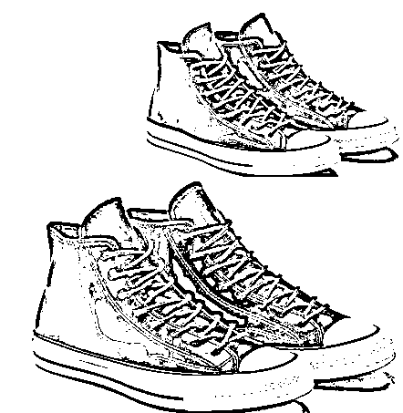
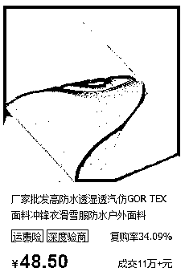
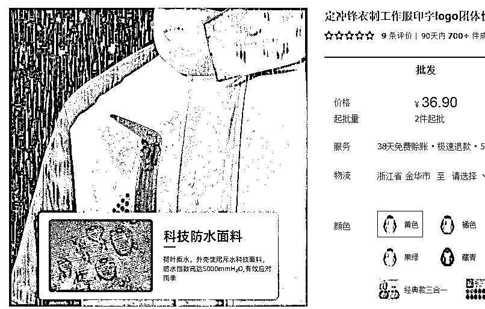

# 龙哥赚钱周报 230202

整理日期：2023年02月03日

本期汇编自年费三千多元的付费社群投递内容。

龙哥风向标系列单独在云文档更新，入口见专属QQ群动态消息。

部分内容需跳转飞书阅读，若遇到复制限制可参考此篇：

[解除复制限制！](https://mp.weixin.qq.com/s?__biz=MzI1NjAxOTI0Ng==&mid=2647895304&idx=1&sn=df7e3e36c3bf503a2513f8b4c6636d3d&chksm=f20a1349c57d9a5fccaa92c5068cb3e492ba9e3ebb178584d018892c0211214dc9d112c1f73c&token=37691864&lang=zh_CN#rd)

往期周报合集的在线版与离线版存放于专属QQ群文件及群公告。

祝阅读愉快~

春节期间囤的素材，节后就得集中还债。这批内容从清早梳理到深夜，天黑了还在赶，工作结束后又连轴转了好几小时。

更新量这么大，必须把自动化脚本补齐了，否则真的要被拖垮。

## 目录

[TOC]

# 赚钱认知

## （88赞）精华帖 独家：必胜法之四步打造百万爆款

——新手别急着铺货，先把专业度提上来才是捷径

1. 我对亚马逊、独立站、TikTok、速卖通、Etsy、Ozon、Shopee、煤炉的判断
2. 第一步【找蓝海】：蓝海市场、蓝海平台、蓝海品类方向
3. 第二步【走捷径】：流量捷径、转化捷径
4. 第三步【加光环】：快速拿到品牌力、溢价与复购
5. 第四步【微创新】：延长红利周期

正文：

大家好，我是跨境杨少，13年跨境老卖，提出《选品四层方法论》，跨赛道多项目连续创业，9成以上项目年化变现过百万，因我偏执于蓝海。

很多朋友问起我的《选品四层方法论》，本文是精简版，完整版在付费课里。我把选品从底向上拆成四层：

1. 套利
2. 流量与转化
3. 模式
4. 品与品类

其中，
1 即低成本、信息差与可控性 —— 控制风险
2 即每一份投入都必须体现为流量或转化 —— 杜绝自嗨
3 即从选品进化到选模式 —— 拿住长周期红利
4 即建立专属“选品字典” —— 实现规模复制

这些在过往精华里已有展开，本文用一套四步选品范式来呈现四层结构如何被满足。标题略显夸张，称之为必胜法，但一年多来我反复讲过——在亚马逊官方活动、线下大会上都有分享，现场的大卖、大V、服务商、外贸厂主基本都认可，他们的成果很难跳出这四步框架。也有做国内电商的朋友反馈有启发，有人按此思路在淘宝掘到蓝海品，单品净利200-400元，红利期尚可。所以标题里未刻意强调跨境二字。

赚钱里的大咖大V本质上是强流量团队，流量做好确实能成，甚至短期爆发，但常有昙花一现的焦虑。最近盜坤👸号复盘自己因缺一个长期可做的硬核产品而陷入游击战状态，颇为实在。赚钱亦有产品派高手如seven，其打法多为白帽流量，相对更偏冷启动。若强流量与强产品合一，才是胜率很高的长期生意。

做产品话题复杂，有钱的打法千变万化，差异化能聊三天三夜。本文从“没钱”的视角谈，做产品是否存在高成功率的套路，也希望抛砖引玉。

### 1. 我怎么看亚马逊、独立站、TikTok、速卖通、Etsy、Ozon、Shopee、煤炉

会选品的人，选平台时差异就显出来。优先选 1.小语种发达市场 2.人口过亿 3.有本地入驻门槛的头部平台的人，明显比盲目开店的人赚得更省力。

记住这三条。

### a) 亚马逊

亚马逊好不好做没法一概而论。它覆盖欧、北美、拉美、日、澳、印、中东等，表现并不一致。比如澳洲虽发达客单高竞争小，但人口仅两千万左右，亚马逊渗透率还不如eBay，花同样精力产出有限。

欧亚、美亚、日亚仍可操作，但限定在蓝海选品。

美亚口碑近期不佳，不少新手亏钱。可同一套蓝海打法，到虾皮连毛利都无，在亚马逊仍能做到单品净利百元人民币以上。

新手不识蓝海，摸不到亚马逊的利基，铺货加乱压FBA，一亏十万起步，责任自负。

FBA还是FBM？核心判断是客户体验。FBA时效更快，体验更好，有竞争时体验占优。真抓到蓝海独家品，买家只能等你，发慢也买，FBM同样能卖。因此蓝海品可先用FBM测，降成本控风险。

我听过大量跨境主播直播，几乎没人把客户体验与分品判断讲清楚。

所以，对“亚马逊是否好做”“FBA还是FBM”这两个问题，听谁的？听自己的。先搞懂逻辑，能说出所以然。说不出来的，大概率是割韭菜，且常承诺包赚。

### b) 独立站

过去三年我对接过千余个独立站，部分站群。部分类目一眼可判断生死。两三年前独立站以杂货为主，确有月赚百万者，但近两年基本清盘。杂货本质是FB测爆款，铺货思维，只是把广告铺到了FB。

现在存活的是品牌出海站、垂直站、定制站。

两三年前盛传的FB+Shopify，如今已偃旗息鼓。

所以有人说独立站不行了，多是掉进FB测爆款坑的人。

流量分人找货与货找人。FB属于货找人，模式差已消失，测的人多且不乏不发货不符版，ROI已崩。

独立站也有人找货来源——搜索广告、Google Shopping广告，SEO见效慢不推荐。若配上蓝海选品，这类玩家仍可赚钱。

市面独立站课程多教FB+Shopify，模式已死，谁教都无效。

因此“好做/不好做”都对，听谁的？听自己。底层判断只有两点：流量与转化。

多懂一点、更专业一点并不难，不专业谈何赚钱。

### c) TikTok

同FB一样属于货找人流量。平台是娱乐属性，你卖货就要做产品视频，产品视频如何娱乐？平台为何要推？

TK国家众多，选错很常见，东南亚陷阱尤其多。

大力出奇迹，每天发百条视频All in——时间成本算过吗？All in一个月不如正常打工拿一万？这种玩法与赌博无异。

我此前提到，九成新手做TK是两条腿瘸着走，一条流量一瘸一拐，一条选品失准。也不懂用付费广告把量推出去，用标签筛精准人群。据TK广告一级代理商数据，TK广告ROI波动极大，付费玩家盈利者寥寥，更别说只想蹭流量的。

TK诱人之处在于每天有人自然爆单，残酷在于爆的永远不是你。

成熟经营者抓确定性，韭菜才追彩票。我接触的大卖，没有主战场放在TK。

### d) 速卖通 虾皮

低价赛道。

虾皮、速卖通的卖家我自认算不过，他们怎么盈利我真算不出来，价格层面我直接认输。

我在速卖通有过短期成功，约两年内。因为操作了一个国内抢注成功的品牌山寨品。类似做法还有抢注海外三线商标到手表品类上架速卖通——只要有国内商标注册证即合规，海外买家难以分辨，可蹭搜索带来高客单高转化。

虾皮部分盈利的店群多多少少含侵权。虾皮现状仿品亏本卖，这让做蓝海选品的人难以为继。虾皮广告铺天盖地，是坑宝妈和副业人群最多的渠道。

Temu同样是低价平台，不建议新手进入。两年前Fanno兴起时圈内一片乐观，我曾在财经媒体采访中表示不看好，理由一是低价平台，二是字节亲儿子却不导流TikTok，流量与转化两大底层存疑。半年后果然衰退。

### e) Etsy 和 Ozon

相对新起的平台，有一定铺货红利窗口，估计快结束。Ozon也是低价属性，意义有限。

俄罗斯把西方大牌清出，平行进口合法化，Ozon上卖仿品形成窗口期，只要票据齐全即可，中国卖家均可操作。

Etsy以设计师产品为主，手工艺品迭代快于亚马逊，与亚马逊存在搬运红利，可为亚马逊蓝海选品提供参考。

### f) 煤炉 FB商城 C2C

基本为店群或批量账号售仿品，不展开。

### 2. 第一步【找蓝海】：蓝海市场、蓝海平台、蓝海产品方向

蓝海市场与平台分类如下：

最蓝 第一类：1.小语种发达国家 2.人口过亿 3.有本地入驻门槛的头部平台。例：日本乐天

次蓝 第二类：1.发达国家 2.人口过亿 3.平台仍有蓝海空间。例：亚马逊欧美日

微蓝 第三类：1.新上线的平台 2.刚开放中国卖家入驻的平台，即便低价也有铺货红利

不蓝：所有低价平台

具备蓝海意识的人，已超过九成新手。

再找该市场的蓝海方向。日本我们锁定真皮，美国我们锁定户外防风防水科技面料。如何按图索骥？“海关壁垒”是一个，还有“平台搬运”“材质升级”等，更多落地在付费课《选品四层方法论》。

真皮属于海关壁垒，详细拆解见我第一篇精华帖，包含筛选过程、落地案例与细节。

简单说，通过梳理日本海关税则，发现真皮制品在日本税率极高，导致价格长期高位，未被传统外贸倾销破坏价格体系。比如真皮靴，日本人普遍认为应卖100美元以上，而中国工厂出厂价仅几十人民币，这就是广阔的蓝海方向。

注意，蓝海方向≠蓝海品类。真皮或科技面料可做的品类很多，真皮我们聚焦鞋类，科技面料做鞋服皆有。

方向虽宽，但到此步精准流量已开始解决——真皮本身就是垂直关键词，对应有购买力与需求的群体，科技面料同理具备搜索量。

至此，你已进入蓝中蓝，远离难中难如虾皮，可说超过九成九新手。

### 3. 第二步【走捷径】：流量捷径、转化捷径

“七分选品，三分运营”？

我们认为选品即运营。运营要解决的就是流量与转化。

好选品在确定具体产品时，引流方式与转化卖点已定。

即好的选品模式，至少解决流量或转化，最好两者兼顾。

举一个双解案例：

合规山寨

很多人分不清山寨与仿牌。仿牌违法。山寨部分侵权，但大量可合规。为区分，我们称之为：

合规平替

合规平替可平替明星产品，也可平替高端材质。两者自带流量，因明星产品与高端材质自带搜索量，可布局精准流量。只要产品合规且有自有品牌，在亚马逊可大胆投放竞品品牌词广告，包括大牌品牌词、系列词，都是便宜且精准的词，既可付费投放，也可做自然优化。课程里提供了四种找精准词的引流方法，以及平替合规路径。

真皮鞋类合规平替案例见下图产品：

该平替选得一般，因原品价格不高且非奢侈品牌，转化不佳。选用它是因为在第四步差异化中加入确定性热点元素后，做成了高客单高利润品。

优质平替可做到原价十分之一，净利润仍有200元以上。

因此选品模式同时解决了转化——提供极致性价比。在发达市场，平替切忌做低客单烂货，既赚不到钱又退货爆炸。具体标准：客户体验达到原品90%，价格仅为五分之一或更低。

材质平替案例：

该品可蹭“冲锋衣+goretex”长尾精准流量。

转化优势在于价格仅为goretex成品五分之一，性价比直接拉满。

此二例说明：选品的同时流量方案与转化方案已锁定。运营只需执行上架、设广告等，专业要求降到实习生可做，且选品有固定参考来源，可像查字典一样输出。对选品与运营的要求大幅降低，一人创业亦可胜任，因套路固定。

合规平替是跨品类宝藏方向，兼具流量捷径与转化捷径。

多数卖家到此步已积累1-3年蓝海产品库。小语种发达国家红利期更长。

### 4. 第三步【加光环】：快速获取品牌力、溢价、复购

十年前我们发现，JEEP、骆驼、CAT的鞋服，与美国JEEP越野车、骆驼香烟、CAT重型机械并无关系——三个鞋服品牌最早由国内老板抢注。十年后才逐步和解或授权，普通卖家无法再随意售卖，但当年操作值得借鉴。

当时日本乐天与亚马逊对这三个品牌鞋服不要求授权备案也不审查——因海外并不存在，且因知名无法在日本抢注鞋服类目。这为中小卖家留下几年搬运倒卖窗口，是我们第二桶金的来源。我们在日本长期垄断这三品牌鞋服销售，并命名为“空壳品牌”。这也是一种选品模式，有窗口期限制。

该模式至今可复制。上文提到的速卖通客单净利100+产品即由此而来，且空壳品牌在速卖通有合规优势。

按占便宜程度与合规风险，空壳品牌可分：

1. 抢注海外品牌并复制全系产品，如koolaburra已被UGG收购
2. 抢注海外品牌跨类目新作，速卖通常见套利玩法
3. 在海外注册品牌并策划品牌故事与形象，国内电商常见品牌捷径

不同时期，三种打法在亚马逊均有窗口期，目前可操作的是第三类。

许多老板做品牌出海或美亚，老实使用中国品牌形象也可以，但更好方案是策划空壳品牌——在日本做德国品牌，在东欧做日本品牌，在美国做欧洲或日本品牌，均可行，本土客户查不到，故事随意编。

此打法在淘宝也有红利。某淘系渔具卖家将渔具包装成日本品牌，做日本独立站官网，反向营销回国内，因日本渔具口碑好，直接带来远高于行业均价的溢价与复购。

按经验，优质空壳品牌可做到10%复购，净利提升可达30%。这不仅是提升转化手段，有时本身可演变为选品模式——低成本搬运式输出成功产品至跨境市场，因信息差大，后续有机会再展开。

### 5. 第四步【微创新】：获得更长红利期

前三步可工具化或花钱实现，第四步做产品差异化，对人要求更高，但成功后护城河更深、红利期更长。

微创新其实是不创新。

我们推荐新手做的差异化套路是：材质套利，即上文材质平替的延伸。

新手做差异化，不宜考虑原创设计、痛点迭代——缺乏专业积淀，确定性低。新手适合基于大标品做升级式与热点嫁接式差异化。

大标品不愁卖，也无需买选品软件分析。问题是大标品多为低级材质、价格战惨烈、客单极低无利润。偏偏多数新手一上来就爱干这个——跨境直播间讲亚马逊热卖品的永远有人气。这在我看来与路边看人吵架无异，毫无意义。

跨境圈里有个现象很微妙：真正的顶奢产品，国内卖家基本不碰，也确实碰不动。这就导致大众低价区杀成红海，顶层高价区无人染指，中间那个“想升级但不想花大钱”的客群，反而没人服务。

要切入这块空档，最实用的打法叫“材质平替”：先找到用户公认的高端卖点，再找到一种能还原九成体验、成本却只是零头的替代材料，卖给那些愿意为体验小幅升级多付一点钱的中间人群。竞争少，生命周期长，还特别适合新手启动——比如户外冲锋衣，1688上的替代面料供应链已经很成熟，几千块投入就能做出差异化新品。

看看美亚上的一组真实对比。

搜“冲锋衣”这个大众词，首页基本全是一二十美元起步的基础款，挤在同一赛道里拼价格。可一旦搜“冲锋衣 gore-tex”，页面客单价立刻被拉到一两百美元。就在这堆高价货里，有个39.99美元的SKU特别显眼：它不是真正的gore-tex，但会被相关关键词检索展示出来，功能感知和正品差不多，价格却只有同屏对手的零头。

这就是把价格劣势活生生扭成了价格优势。但这个SKU如果被放回一二十美元的普通冲锋衣里，既讲不出高端故事，也拼不过超级低价，反而两头吃亏。所以它的策略是果断放弃泛流量大词，把预算集中到高意图的细分搜索词上，等用户已经想买高端面料时精准出现，流量和转化自然都占优。

面料平替只是基础版，往上还能叠加两层玩法：成本替换加热点嫁接。

举个例子，帆布质地可以升级为真皮质感，但皮料选第二层革，不用头层，单件成本降掉约三分之二，视觉和手感依然撑得起升级预期，定价则可以打得很凶。

最后附一组复盘备忘：0, 0, 0, 2, 0, 0, 0, 0, 2, 0, 0, 0, 2, 0