# 230117 龙哥赚钱周报

# 龙哥赚钱周报

整理时间：2023年1月17日

本期周报内容源自一个年费三千多的付费社群分享帖。

龙哥风向标系列单独收录在在线文档中，具体地址请查看专属QQ群消息。

部分内容需要跳转飞书阅读，如需解除复制限制，可参考这篇说明：

[解除复制限制！](https://mp.weixin.qq.com/s?__biz=MzI1NjAxOTI0Ng==&mid=2647895304&idx=1&sn=df7e3e36c3bf503a2513f8b4c6636d3d&chksm=f20a1349c57d9a5fccaa92c5068cb3e492ba9e3ebb178584d018892c0211214dc9d112c1f73c&token=37691864&lang=zh_CN#rd)

往期赚钱周报合集，在线版与离线版均已上传至QQ群文件及群公告。

祝阅读愉快~

标注了【精华】的为精华内容，前面数字为截止当日的点赞量。

目录较多，可按兴趣挑选阅读。

# 【目录】

在线版目录可查看左侧大纲

# 【赚钱认知】

## 【130赞】【精华】《拆解一个千万级项目的底层逻辑》

《拆解一个千万级项目的底层逻辑》 前不久提到要在赚钱持续输出，这篇就从认知层面展开。

完整内容见飞书：

[https://xsej9se9cv.feishu.cn/docx/NxhWdJj3UoPKvmxaBqkcz8wlntf](https://xsej9se9cv.feishu.cn/docx/NxhWdJj3UoPKvmxaBqkcz8wlntf)

## 【42赞】《视频号直播结合私域的投入产出复盘，真实ROI是什么》

过去我总觉得自己是追风者，风口来了就冲，今天热就做这个，明天火就换那个。确实赚到过钱，也以为是自己执行力强。后来才明白，很多收益是红利送的，一旦深耕，很可能打不过真正沉淀的人。随着信息传播加速，项目红利期越来越短，于是开始思考如何兼顾长短线，既有短期爆发，也有长期基本盘。目前来看，视频号直播+私域正好具备这种特质。

近期和朋友交流后，对投入产出比有了更深的理解，也体会到有圈子交流信息的重要性。

真实的ROI到底如何？

从品牌视角看，直播间可以不赚钱甚至亏损，只要带来曝光和知名度，后续靠线下或金融渠道回血。

在抖音的常见打法也是，前端直播重度投放，ROI未必打正，后端靠商城自然流变现，对供应链要求更高。

很多业务表面不赚钱，赚的是看不见的部分。

下面就以视频号直播+私域来算一笔账。

假设产品在扣除退货后毛利率为40%，ROI达到2.5即可持平，再算上人力场地成本，这就是单做直播的常规算法。

但加入私域后逻辑就变了。直播中通过订单或企业微信弹窗吸粉，整体进粉率大概在60%左右。私域单粉的价值取决于产品，部分产品月均产值可达数十上百，需实际测试。

以客单价150为例，进粉率60%时，月产值保守按8算，理论可达15以上。年产值考虑衰减后能到60左右。

若ROI为2.5，投放100万带来营业额400万。在这40万投放带来的流量中，可额外获得100万×60%×60/150=24万的私域营业额，且无需额外投放。主要成本是销售人力，一个销售可维护1-2万客户，对应月营收10-20万，人力成本约占5%，即24万私域营业额需约1.2万人力成本。

这样算下来，ROI从2.5提升到3.5。向私域前辈求证后发现，月产值8、年产60的数据非常保守，正常情况下翻倍都是合理的，翻倍后ROI可达4.5，大多数品类都能实现正收益。且优质品类在私域的销售额甚至可能超过直播间。年产值并非只持续一年，第二年仍有收益，只是衰减，衰减速度会越来越慢，产品质量好时，转介绍可达10%左右。

总结一下。

公式：客单价为n，毛利率为q，投放y，退货后营业额为z。私域进线率60%为合格线，月产值为p。

仅做直播：纯利 = q*z - y
加入私域后：纯利 = q*z - y + 每月新增 z/n×60%×p，月度递减，前3个月按80%计，后续衰减趋缓，最终稳定在首月50%左右波动。

举例：售价150元的茶叶，毛利率40%，日投放3万广告，退货后日营业额10万，直播间毛利日1万。日新增私域约400人，月增1.2万。假设月产值15元，首月私域贡献18万营收，第二月约15万，第三月约12万，半年后稳定在9万左右。年化私域营收约100-150万，主要成本为人力占比5-10%，取中值核算年利润约40万，12个月复制即500万，直播间即使亏损也不怕，且项目结束后私域仍可延续数年。

本文算法偏保守，大家可自行测算。项目门槛低，几人团队即可运作，私域货款现结，直播端货款和投流为主，若能争取到账期，前期压力更小。

有在做的朋友欢迎交流，越聊越通透。

#私域流量 #视频号

## 【44赞】《如何找到能赚钱的项目，如何判断是否适合自己》

我运营了几个抖音号，内容是项目拆解。粉丝基本都是想做互联网、正在创业的人。目前账号每天可引流300+创业粉到微信。

粉丝常问：你分享的项目很多，哪些能赚钱，哪些是割韭菜，我能做吗？

基于十年互联网经验，年营收千万以上的项目做过两三个，谈点看法。

想找一个全新无人做过的项目，基本不可能。即便有方向也不建议做。新项目研发成本无底洞，周期长，成败难测，风险极高。

更稳妥的做法是找已验证、有成熟打法的项目，比如私域直营、抖音带货等，或其延伸形态。

也就是说，要选已有标杆的项目，同行就是最好的教材，复制同行是最快路径，能避开大量弯路。

互联网项目的核心就两点：流量+变现。

只要拆清同行的流量来源和变现方式，模仿起步即可盈利。

每个项目都有关键词，用关键词在各渠道搜索即可找到同行。

例如早年做成人用品，就在百度、视频平台、微信搜索关键词，很快能找到正在投放的同行。加微信后以顾客身份聊天，能套出话术和产品。流量渠道也一样，用买家的视角思考自己会去哪里搜索，自然能找到。

初期遇到不懂的问题，可同时问10个同行销售，取最佳答案回复客户。虽不光明，但很有效。

不要担心竞争大就放弃。主流都在做的项目通常不会差，方法流程清晰，你只需测试哪种方式更适合自己。远比盲选一个听起来小众、结果未知的项目要靠谱。

做久了会发现，项目原理大同小异。

举个例子，大一时想开淘宝店卖衣服，那时是2013年，做淘宝确实能赚钱。但19岁的我不懂运营、也不懂逻辑，花790元买了个代运营教程，主要教装修上架和对接发货平台。照做后发现根本赚不到钱。后来才明白，素材被用烂，没有权重。

当时不能说淘宝不赚钱，只能说我认知不足。那个所谓的坑人教程，也让我学会了店铺基础操作，对后来做CPA、营销页、抖店都有帮助，平台界面逻辑相通。

后来跟一位做视频营销培训的老师学习，才真正开始赚钱。我的十年经历，可参考赚钱旧文《95后，互联网创业10年，用10w+私域粉丝做到年营收千万的经验》。

这段经历想说明一个观点：多数情况下不是项目不赚钱，是人赚不到钱。能拿出来卖的大项目，必然有人做成了，才会被传播。这个时候往往已是末期。

再看卖我淘宝教程的那家公司，17年时我做互联网已有六年，发现郑州的私域直营同行很多。他们提到，郑州的淘宝代运营公司基本都被查了。当时卖我教程的公司也属于这一类。

但这种商业模式从未消失，只是换了壳，比如现在的抖店代运营、抖音好物分享教学。广告语也相似：不用露脸不用开店，公司提供视频，你发就有佣金。核心逻辑和十年前一模一样，只是平台和名称换了。

客户群体依然是想靠互联网赚钱的小白，这在中国是永久红利。公司会包装得很高大上，让你看看学员案例。很多人做不起来，但学到的东西在下一个周期依然能用。

商业模式本质是换汤不换药，旧项目在新人群手中依然能玩好。现在抖音上讲商业的博主，和五六年前的微商模式区别也不大。

做互联网别指望一单暴富，也别因连续几个项目没成就彻底放弃。未来十年，没有启动资金的普通人，做互联网仍比实体创业更容易。

每个项目，哪怕亏钱，都是经验积累。当然不能所有坑都趟完，如何判断项目真假？

第一看市场需求，必须是当下真实存在、已验证的，而不是被制造的概念和未来预期。未来需求的项目要教育市场，难度极大。打着先机、未来、科幻概念的项目，假的概率很高。

第二看分享者是否靠谱，最好是长期观察、朋友圈持续更新三年以上的创作者，看其结果和创造力。一个创业者若无创造力，很难走远。

两点满足，项目基本靠谱，后续能不能成看执行。

## 【70赞】《战略思考：执行时要发挥自身优势》

比如苏联国土纵深大，二战中德国闪电战虽能快速拿下波兰，却对苏联无力。苏联的优势就是空间和冬季，可利用纵深拖延，等到冬天德国坦克被冻住。

再看中国如何用优势博弈。

中国海岸线不算最长，但赶上全球化成为制造中心，海运能力强，全球十大深水港占其五。且中国高铁里程全球第一，铁路建设和运输是强项。

这正是“一带一路”的基础：海上丝绸之路加两条横贯欧亚的铁路，用中国擅长的基建和陆运能力，打通对全球化收益不足的国家，形成新的贸易通道。铁路越长单位成本越低，虽比海运贵，但时效稳定，不受天气影响，且是中国的技术优势领域。

国家战略的精髓，就是先盘点手里的筹码，即优势，再决定怎么打牌。

中国的筹码有哪些？

当下和未来最大的消费市场，全球最完整的制造业体系，最完备的产业结构，强大的基建能力。

石油储量仅占全球3%，因此中国大力发展新能源汽车，形成全球最大市场，减少对石油依赖。俄乌冲突的走向，中国也高度关注，因其大量能源进口依赖该区域。

高新技术是短板，芯片、航天、生物等被卡脖子，近年集中攻关，部分国企团队被调往北京封闭研发。

基于这些筹码，可推演中国如何发挥优势、补齐短板、与欧美东亚周旋合作。国际博弈另当别论。

## 【39赞】《2022海外工具站复盘：商业认知篇》

关于商业认知

2022年回顾过去几年项目，很少有项目能商业化闭环并持续，真正能赚钱的屈指可数。复盘后收获了一些心得：

### 心得一：必须选择适合自己方向的项目

过去对战略方向思考很少，容易陷入达克效应。

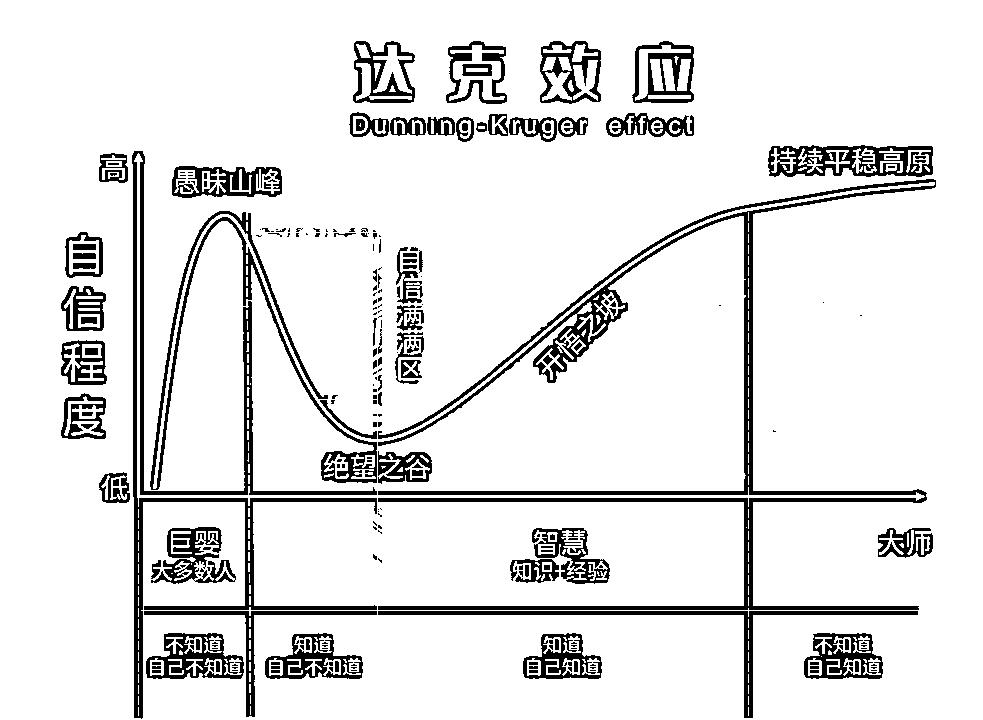

什么是战略？就是选择，选择的核心是放弃什么，而非做什么。

选择做什么不做什么，需要建立在方向之上。

方向如何定义？好方向 = 想做 ∩ 能做 ∩ 可做

1. 想做：不反感，理想状态是热爱
2. 能做：专业能力圈
3. 可做：时间精力可承受

我近十年的方向是：出海付费软件

想做方面，与热爱相关。但多数人一辈子找不到长期热爱，能先做到不讨厌已很奢侈，边做边找热爱即可。

能做方面，必须选在专业能力范围，否则容易成为“巨婴”，陷入达克效应的盲目自信高峰。

例如擅长知识付费，可做Web3赚钱课、短视频带货训练营；擅长流量，可做Web3或视频号带货的代理和Affiliate。

我技术出身，懂产品、增长和谷歌SEO，就做给淘金者卖铲子的事。

可做方面，看时间成本和投入产出比。

权重排序：能做 > 想做 > 可做。长期深耕方向，享受复利。

第二点感悟：代码本身也是一种内容形态，因此“内容为王”这句话，我举双手赞成。《纳瓦尔宝典》里提到过，想积累财富，就要把杠杆用到位。商业杠杆来自资本、人力，以及复制成本几乎为零的产物——代码和媒体。

拿龙哥盟来举例，这个社群最大的杠杆就是内容，也就是创业、副业和赚钱相关的知识沉淀。内容的载体很丰富：精华帖、风向标、航海训练营、龙珠圈友的日常交流等。龙珠激励机制调动了大家真诚分享的意愿，精华内容的产出成本被大幅压降，算下来投入产出比非常可观。当边际成本趋近于零，内容就能被无限复制和分发。

对我来说，路径就是从代码着手，做一款或者几款能商业化的软件。软件开发完毕之后，后续的维护成本会不断摊薄，回报率则逐步走高。对“内容为王”的体会，现在更深了一层。像我们这样的新手，没有资本这类杠杆，那内容和代码就是最现实的选择。

杠杆会带来复利，本质上也是一种长期主义。总想着动笔就写出宏大作品的人，往往撑不过第一章。

圈友们，2023 一起奔向共同富裕，龙哥盟 ~

欢迎交流，个人微信：qqcode168

## （85 赞）《卖空气，需求分析与做局盈利》

卖空气这件事，核心是需求拆解和做局变现。头一回写超长文，作为龙珠圈友，不交篇长文干货实在说不过去。目录如下：贴近用户编程、软文与软件、趁手工具、App 的劣势、有效的噱头与无效的产品、过审的门道、居高临下的话术、个人非规范化生产。

整篇文章的脉络很简单：直击需求、简单有效、软文过审、无中生有、做局套话。一句话概括：“产品不解决问题，照样不影响赚钱。”

全文见飞书：

[https://szzs4fdjd8.feishu.cn/docx/DNGrdODFBowfk2xwkNCc5GGSnRd](https://szzs4fdjd8.feishu.cn/docx/DNGrdODFBowfk2xwkNCc5GGSnRd)

## 《说一说送礼物和收礼物这件事》

又到年底收礼物的节点。公司要不要做礼盒，需要提前设计准备，做决定那阵正是北京疫情最凶的时候。当时担心快递不通、怕传染客户，索性不做了。后来看这担心其实多余，但再想补做也来不及了。

因为出身自媒体，我算是收礼比较多的人。从电动车到沙发，从茅台到茶叶，从挂历到新书，从水果到大米，最多的是中秋和春节礼盒，五花八门什么都有。

真正的麻烦在于怎么处理——这些礼品里 95% 我用不上。

我一般有三种处理方式。第一种，直接感谢并拒绝。很多是企业公关礼盒，对我是累赘，收下来最后搬家还是扔，不如省一趟快递。第二种，收下但不用，转手给同事或者大家一起分掉，像水果零食之类的。第三种，直接变现。我没有收藏癖，该换钱就换钱，也没什么心理负担。比如有人来拜访送茅台这类硬通货，我不喝酒也不囤，就让同事帮我卖掉，我觉得这是最好的处理方式。

心意我领了，但不会因为心理上过意不去，就一直堆在家里，变现不是挺好嘛。

最近两年我基本不再给人留地址了——真不需要那么多礼物。

至于公司送客户的礼盒该怎么搞，我之前写过一篇，可以参考：

[乙方送甲方的新年礼盒，做成啥样？](https://mp.weixin.qq.com/s/lWZWYMncAXjWr7WbFK3u7g)

## （81 赞）《去赚钱薅了龙哥认知羊毛，12 月营收 60W》

大家好，我叫刘家齐，齐家治国平天下那个家齐，在美团做过八年销售与管理。

从 11 月末被龙哥哥叫去赚钱办公室，到回到青岛落地执行，12 月美团电商无货源业务的营收突破了 60 万。

这篇帖子既是分享，也是感谢。想聊的是：普通人面对为数不多的时代红利，怎么把获利做到最大。这里说的获利，不只是钱，还有影响力。希望圈友们能在红利期抓到更多“钱”。

1. 缘起：日拱一卒，执行力拉满

11 月中旬某天晚上，鱼丸告诉我，龙哥哥把《同行一句话让我抓住美团电商红利狂开 30 家店》那篇帖子加精，还推到了赚钱大航海精华共读群。真诚的分享总能被看见，无心插柳，后来很多事都因此埋下了伏笔。

后来和鱼丸聊天，提到我坚持拆解赚钱精华并写打卡感悟已经 400 天。没想到鱼丸把我的聊天记录转给了龙哥哥，这才有了我去杭州赚钱办公室的邀约。像拆盲盒一样，我完全没想到这次见面会变成项目的加速器。11 月末参加完南京一场电商线下交流会后，我凌晨三点开车去杭州，只休息了四五个小时，上午和龙哥哥聊了一个多小时就往回赶。整个 12 月都在抢时间——时代红利流失的每分钟都是钱。

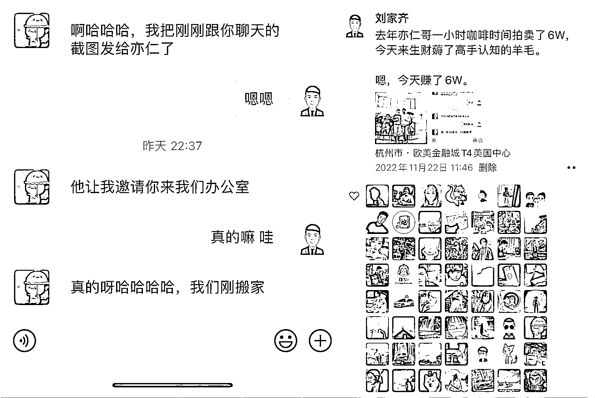

写这篇的时候，想起赚钱有位宝妈。她看了龙哥公众号一篇“加抖音博主微信变现”的帖子后，天天去抖音加博主微信。龙哥大概花了 7 万，买下了她坚持 4 个月加满 4000 多好友的微信号。龙哥当时说：我想告诉大家，执行力是值钱的，执行力能变现，我要奖励执行力。邀请我去办公室，不也是对我执行力的奖励么？

2. 时代红利下，怎么把收益放大

抛开前提谈个例，很多经验和逻辑都没有意义。以前在职场管理里做出一点成绩，我一度误以为自己能力很强，后来创业被红海项目教育了一通。所以咱们先对齐一个认知：我们赚的每一百块钱里，可能有九十块来自时代红利，只有十块是时代对个人能力的回报。英雄本质上还是时势造出来的。

我很清楚自己的每一分钱都来自时代红利。美团电商终会像淘宝店群、拼多多店群、京东店群一样，在市场充分竞争后回归平均利润。我请教龙哥的一个核心问题就是：作为普通人，在美团电商这一波红利下，怎么让收益最大化？

龙哥哥现场给我开了三副药：

1、做培训。当时我担心未来内卷，龙哥反问我：美团电商有没有绝对核心壁垒？我一下想通了——普通人能接触的互联网项目，都不是科研项目，本质几乎没有壁垒。淘宝、抖音、视频号、小红书如此，美团也一样，大家弄懂它只是时间问题。所以市面上所有项目培训，本质是花钱买别人的试错经验。培训这块我当时想法是：自己不是网红，微信朋友圈流量有限，不如佛系出单，重点做直营，再引入外部投资加杠杆，走阿米巴路子。

另一方面，因为前期没及时办理个体执照，公户里的钱没法合理避税转进个人账户。每天一万多的采购金、几十万保证金压在账上，钱长期只出不进，有段时间全靠淘宝店群客户确认收货的回款过日子。培训收来的钱正好解了直营采购的燃眉之急。

2、直营扩张。直营是我在美团电商业务上最核心的发力点。12 月末直营店铺共 50 家，当时只运营了 26 家，12 月毛利润做到了 30 多万。11 月平台下店卡得紧，被拉黑过两张执照，直到 12 月才恢复下店。12 月中旬往后下店成功率挺高。

“打江山提成制，守江山绩效制”，靠这套薪酬逻辑，运营姑娘们单月工资轻松过万。从 12 月一路干到春节，全员自愿无休，再加上计件兼职，目标是在春节前把纯直营店扩到 50 家左右，卷到除夕，年后弹射起步。美团电商一定要用兼职，计件兼职就是这个项目除资金以外的最大杠杆。

3、阿米巴模式。我感觉自己势能有限，没用传统阿米巴，而是换汤不换药升级成两种打法：

1）阿米巴执照：身边有闲置执照的朋友把执照放在公司，通过分红制度，做成类似代运营执照的模式，像老家农村“废旧手机换不锈钢盆”一样搞起来了。

2）阿米巴团队：昨天刚搬进新办公室。我负责技术和日常管理，运营参与持股，再和两位投资人朋友合伙成立了两支新小队。无论直营还是阿米巴，我的核心逻辑都是用绝对的店铺数量，在平台红利期里做最大化套利。

3. 功夫是杀人技

人与人认知上最大的差异，其实是信息输入量的差异。——龙哥

这一年我最爱逛的是赚钱项目库的“挖宝指南”板块。那里是几百位实战高手认知的结晶，我前后写了 200 多篇打卡；另外就是拆实战精华帖。这种持续刻意练习，让我练出一种本能的：看到互联网平台上的赚钱案例，大脑能快速拆出他赚钱的根本原因。

从美团离职创业一年多，坚持了 400 多天打卡拆解案例或练技能。起初是我一个人在路上，后来居然在青岛遇到几位年入大几百万的电商前辈，一起组了案例拆解、业务复盘、反思共进的每日打卡小圈子，龙哥给它取名叫“城市部落”。这一年见了许多老板，和创业老鸟聊天也能做到认知同频。我越来越明白这种“网感”刻意练习的威力——不再关心那些浮夸又落不了地的宏观信息，每天的成功案例拆解打卡会让我像“带着教程去打怪”，赚钱效率自然更高。美团电商从看到同行成功案例那天起，我心里就有种笃定：这项目能赚钱。

大鹏一日同风起，扶摇直上九万里。春节快到了，祝圈友们兔年大吉，突飞猛进~~~

# 【赚钱技能】

## （95）《有了这两个 AI 机器人，还怕做不好带货短视频?》

有了这两个 AI 机器人，还怕做不好带货短视频？好久没冒泡了……标题党一下，哈哈。

最近在研究短视频带货和无人直播带货。养号过程中，在巨量百应后台刷到了“创意中心”，有两个模块让我眼前一亮。一个是爆款视频：能看到各个行业、不同等级作者近期最新、带货效果最好的短视频。这比抖查查、蝉妈妈这些第三方工具更接近真实爆款库。另一个是创意搜索：既能按关键词也能按商品，去搜近期实时的同类竞品对标短视频。上不了热榜的话，这里更容易捞到同行内容。

我恰好懂一点 RPA，也会用影刀这个工具，就花了一周空余时间做了两个小工具，实现了这两个模块的数据采集和视频下载。

因为文章图片比较多，完整内容请移到飞书看：

[https://www.feishu.cn/docx/CGZ4dZq4ZoSFT4xUmFecNpk4nNe](https://www.feishu.cn/docx/CGZ4dZq4ZoSFT4xUmFecNpk4nNe)

## （44 赞）（精华帖）《如何解决原创视频内容的批量生产？聊聊我的短视频带货矩阵的自动化之路》

这篇想分享一个很有意思的项目。先看视频号“视频电商研究社”发布的那些短视频，注意看它们都是自动生成的原创内容，而且还是自动发布上去的——你会怎么想？

帖子里没法放视频，麻烦大家去飞书看：

[https://f2rgk22rcn.feishu.cn/docx/JmBgdr705ovHoyxQknRctRaMnKh](https://f2rgk22rcn.feishu.cn/docx/JmBgdr705ovHoyxQknRctRaMnKh)

## （60 赞）《初创公司如何科学量化股权分配？股权分配五步法教你不再踩坑》

哈喽大家好，我是玉斌，第一次在赚钱发帖，有点担心内容之前已经有人分享过了。发之前特意在赚钱精华帖里搜过一轮：讲股权的不少，但系统讲“科学量化股权分配”的确实没看到。所以今天斗胆来聊聊，怎么把股权定性定量地算清楚。

全文请大家移步飞书：

[https://ozqj66fvp1.feishu.cn/docx/C0dydiFPCoBI3LxemwWcXpdxn2e](https://ozqj66fvp1.feishu.cn/docx/C0dydiFPCoBI3LxemwWcXpdxn2e)

## （147 赞）（精华帖）《如何写出既能吸金、又能深入人心的心金文案》

大家好，我是李思念，一个创业 9 年的老玩家。大家对我的记忆点，最深的应该就是文案力。朋友圈写着写着，累计输出百万字；写出来的文案在微商圈、创业圈到处被转；在小红书上靠文案吸粉无数，变现已过七位数。

想听完整拆解的话，欢迎飞书见：

[https://b80fa9wrsf.feishu.cn/docx/JPRAdLgGFowUE7xargGc8YNjnzh](https://b80fa9wrsf.feishu.cn/docx/JPRAdLgGFowUE7xargGc8YNjnzh)

# 【龙哥问答】

## （323 赞）（精华帖）《副业收入从每月几百到几万，但没有时间陪伴孩子和休息了，怎么办？》

提问：

匿名用户 提问：

龙哥大大你好，我加入赚钱两年多了，这几年收获不少，跑通过项目，认识了很多优秀的人，特别感恩这个平台。副业收入从每月几百块涨到每月几万块，本该开心，可现在很迷茫、很疲惫。副业做得越好，占的时间越多，没有时间陪孩子，也没有时间休息。主业、副业，再加上家庭和孩子，我越来越觉得平衡不了。

1、以前都是拿休息时间做副业，现在副业占用时间越拉越长，身体感觉特别累；
2、身边优秀的人一个比一个卷、一个比一个拼，压力特别大，怕一不小心就掉队；
3、副业收入还没有高到能让我辞职，但手上的项目确实还想继续做。

我也知道什么都想要是有点贪心，但主业和副业真的都不想割舍。希望能听听龙哥哥的建议。

回答：

先恭喜你，靠自己的努力拿到了不错的副业收入，至少超过了身边 90% 的人。然后还要再恭喜你一次——因为从你提的问题里，我感觉你即将进入下一个阶段。

副业做到疲惫，家庭、健康、休息全都受影响，这些我经历过，身边很多老板也经历过。别焦虑，有解法，你马上要踏上一条新路：招人帮你干活。

把你的收入分出来一部分，别舍不得，这是必须花的钱。把那些重复性的基础工作整理清楚，交给别人去干，亲戚朋友同学都可以，让他们从兼职开始。

哪怕你省下来的时间没有去干更重要的事，拿来休息也值。休息好了，才有更大的冲劲去突破。

一旦你习惯了不断花钱请人干活的模式，你已经在往老板的位置走。赚钱的杠杆有了，天花板会比原来高出一大截。继续加油，期待你的副业收入翻十倍。

## （227 赞）（精华帖）《执行力不够，对赚钱的欲望不强，除了生活压力，还有什么具体动力能让人拼命赚钱？》

提问：

匿名用户 提问：

来赚钱两年，看了很多实战赚钱的帖子。但平时工作占掉了大部分时间，只能挤出时间去做项目。这种情况下，没有执行力和意志力根本做不成。我发现自己执行力不足，对赚钱的欲望也不强。仔细想想，底层原因大概是——我不知道真正赚到钱之后能用来干嘛，也不知道它能给生活带来什么具体变化。除了生活压力之外，还有什么动力能让人拼命赚钱？

回答：

好，这个问题很典型。

我想先反问你一下：现在的工作有充分发挥你的优势吗？你有真正热爱这份工作吗？它给你留下足够大的收入增长空间和发展机会了吗？

如果有，那你属于少数幸运儿，继续保持就好，不必逼自己去想赚不赚钱，那本来就不是人生的必选项。如果没有，那为什么你能坚持做一份工作，却没法坚持开拓自己的事业？所谓没有执行力、没有意志力、没有动力、不知道有钱能做什么，其实都是借口。

很多在职场上并不开心的人，为了逃避真正开拓新事业，宁可在不喜欢的岗位上一直扛，扛到被老板开除，再跑去下一份工作继续扛。

动脑子很累，探索未知让人害怕。用战术上的勤奋去掩盖战略上该做的探索，用忙碌的工作麻醉自己，短期是轻松，长期却有毒。

这话说得有点重，但希望能让一些人清醒过来。

# 【赚钱项目】

### 【抖音】

## 《抖音盲盒项目常见问题汇总》

大家好，我是姚麻。之前分享过一次我正在做的盲盒项目，聊的算基础。后来 @傅超人 又放了个大招，整了一篇保姆级攻略，反响很好。

要说圈友的执行力是真的强，这俩帖子一出来，最近新入坑的人明显多了。问题也跟着来了，几乎每天都有人问我各种问题，而且好多问题都是重复的  

我最近所有精力都在线上线下盯新人、盯新号，基本上能踩的坑都踩过一遍了。干脆再发一帖，把这些常见问题集中汇总一下，顺便把这段时间琢磨出来的新东西和新玩法也放进去，希望对大家有帮助。文章不短，辛苦各位移步飞书：

[https://fgsd3oxjki.feishu.cn/docx/SvdFdfi3VoAiaRxENHNcncEqnif](https://fgsd3oxjki.feishu.cn/docx/SvdFdfi3VoAiaRxENHNcncEqnif)

## （29 赞）《2023 年如何获得抖音本地生活的十倍增长的红利》

2022 年年末，共存时代终于到来，“搞钱”成了每个人的生存主题。实体门店的价值跌到了谷底，而抖音本地流量的性价比接近波峰，这条赛道即将迎来增速最快的一年。不管你已经入局，还是正在场内厮杀，都不能错过这个时机，2023 年放开马力往前冲。

——楚川

### Part 1 本地生活成长的一年

#### 1、自我介绍

大家好，我是楚川。

做了 10 年连续创业者，其中 3 年深耕本地生活，前后服务过 4700 个实体商家，覆盖吃喝玩乐、衣食住行各个细分品类。

正是这三年的摸爬滚打，让我练出一项能力：不管平台怎么变、市场怎么恶化，业务必须盈利。团队也在 2022 年把净利润做到了千万级。

#### 2、出发点与分享缘由

这支团队从本地生活的加盟 IP、信息流投放，到达人孵化、品牌孵化、供应链、官方服务、 기술服务等形态，几乎每一环都亲手跑过，踩过的坑和付过的学费足够支撑我们对同行以及准备进入赛道的人给出相对扎实的判断。

2020 到 2021 这两年，我基本全部在一线冲锋，几乎没有对外输出的空档。2021 年至暗期后，公司把运营架构和组织体系做了重塑，我才逐步腾出精力做个人层面的复盘与方法论对外沉淀。

我想先点破当下最关键的变量：本地生活赛道现阶段的真正壁垒是认知不对等带来的滞后。

我 2022 年 2 月的分享里，很多判断在过去一年里已经被市场迭代了数轮，现在的平台形态和商业打法已经与年初描述相去甚远。

#### 3、2023 年需要达成的一致认知

1. IP 内容、电商内容不等同于本地生活内容。
本地生活用户对所在区域的吃喝玩乐已有基础认知，决策链短、复购频次高，超高客单除外。内容的核心任务是把团购商品的信息精准触达。

探店类短视频曾被批得厉害，但这种看似粗糙的形式转化往往更强。过往电商和 IP 的内容套路并不完全适配本地生活，这个认知必须校正。

1. 短视频的传播效率明显高于图文。
当前做本地生活，抖音是优先级最高的阵地。获客成本最低，传播广度与速度都优于图文社区。把抖音做起来之前，不必分散资源去铺其他平台。

团队过去三年几乎全平台都做过验证，最终结论一致：抖音最有效，踩坑我们已替大家走完。

1. 只要本地生活还在，矩阵化内容就是刚需。
抖音本地生活的分发仍以 3-5 公里同城为核心，一条内容吃满流量的时代已终结。现在需要用几百条内容，用 1-2 级流量池反复触达周边 5 公里人群。

只要同城推荐逻辑不被颠覆，矩阵就是基本功。

1. 做抖音本地生活必须具备抖感。
很多朋友问如何切入，我的第一建议一定是先培养抖感。对零基础的人不必焦虑，方法都在积累。每天至少 2 小时沉浸刷feed、看直播间学习，时长不足很难成事。等你能清晰复述当下抖音生态构成与本地生活商业闭环，就说明抖感已初步形成，并非注定失败。

1. 本地生活本质是体力活，必须靠实操维持手感。
实操优先级最高。长期脱离一线，节奏很快就会跟丢。因为更新太快，不能因其他诱惑脱离现场。吃喝玩乐行业门槛低、红利大，最后比的是谁愿意下场干脏活累活。躬身入局的人才吃到肉，习惯投机快钱的人很难适应。

### Part2 2023 年变现破局路径

#### 1、抖音本地生活仍有十倍量级空间

1. 图文与短视频的竞争才刚开始：美团 2021 年年报披露平台活跃商家约 880 万家，基本覆盖全国地级市；抖音本地生活目前在一线及新一线覆盖较全，二三线渗透率偏低，空间巨大。商家供给不必担忧，市场足够大，视频号、快手也在加码。
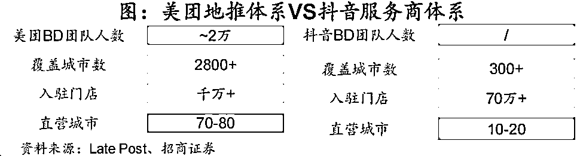

1. 投放入口全面收敛到本地推，意味着直播成为主战场，GMV 将迎来爆发。
临近年底，抖音本地生活的投放入口会进一步集中在本地推，最大增益点在直播。接下来的考核是投放效率与单场产出，短视频的助推不可或缺，直播运营决定最终回报。

外卖业务在 2023 年也会全面放量，百元以上客单的外卖单量会快速抬升，两条线协同才能实现十倍以上的增长。

#### 2、用系统视角理解抖音本地生活

1. 2023 年进入精细化较量，必须先吃透生态构成。

1. 保持抖感是起点，深入理解生态是关键。

1. 经过两年多的教育，商家、达人、服务商的认知已完成数轮迭代，初期靠收割、堆数量、硬冲 GMV 的做法已经过时。

1. 现在的商业模式要求入局即有利润，否则难以持续，这就需要对生态有深度认知。

1. 2022 年 11 月，我基于三年实战与公司 SOP 整理出抖音本地生活运营全景图，我认为这是从业者必须熟记并持续优化的基础地图。

1. 这是优秀从业者的必备能力，只有看清生态各环节，才能判断钱在哪个位置、团队的增长点在哪。

1. 抖音在所有平台中获客成本最低，流量获取主入口应放在这里。全景图反复强调的核心是获客与留存。

1. 当下跑得最快的服务商是联联周边游、千千惠，核心在于私域沉淀。起盘阶段不能忽略本地生活流量的留存，谁能把流量沉淀转化，谁就掌握主动权。

1. 在流量运营端，2023 年要掌握短视频与直播的组合打法。

1. 目前 90% 以上的服务商要么只做短视频，要么只做直播，都是不完整的。短视频是直播的基础，电商的发展也是先种草后成交。

1. 本地生活同样需要先用短视频做预热再做直播，服务交付时要组合进行。2023 年算法会放大两者的协同效应，具体打法可私下交流。

1. 不要神化工具，也不要贬低工具。

1. 从爆店码、抖音小程序到如今的外卖小程序，商家与服务商都交过学费。做抖音本地生活的本质是商家运营、流量运营、用户运营与平台运营，工具只占很小权重。

1. 没有工具生意不会停，也没有工具能实现一本万利。现阶段真正有效的工具仍在少数。爆店码更适合服务商，不建议商家单独使用；未来细节比拼要掌握本地推、矩阵管理类工具。

1. 平台运营层面，主阵地一定是抖音，其次要整合并线下实体广告与线上其他平台。

1. 虽然半年多未做整合营销全案，但我们仍建议小团队尝试，当年我们是盈利的。一个全案单价可过百万，超出能力的部分可外包。

1. 入局团队需要了解各平台特性和价值，这不是门槛高，而是本地生活的方法论有限，剩余精力应用来补全视野。谁先走通，谁先吃到红利。
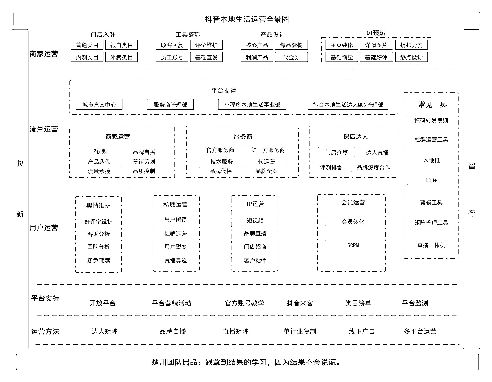

1. 服务过 4700 家门店后，我归纳出短视频本地生活打爆门店的五步法则。

1. 我今年在多个社群反复提及该 SOP，很多团队拿去复制或售卖，能帮助到人即可。该法则 1.0 版诞生于 2022 年 6 月。

1. 目前我在流程上补充了 4 处说明，帮助理解更透彻。从零到一打爆一家门店，遵循方法并配合推广节奏，基本不会出大问题。

1. 接下来一年会持续沉淀，第一是为新人指路，第二是帮助入局者自检，第三是保持自身清醒，同时坚持一线实操维持体感。

1. POI 加热是第一课。可类比实体店开业当天邀约朋友造势。开通地址认证、上架商品后，需要把 POI 做热，成为热门地址，转化才会上去。

1. 没有爆品就不要投放。爆品是核心，选品决定 80% 成败。先筛选出门店爆品再动作，事半功倍。

1. 切忌逆势操作。没有爆品强投，转化会很差，甚至适得其反。原则很简单：没有爆品，不做抖音推广推广，否则就是赌博。

1. 玩转短视频矩阵与直播运营才能持续盈利。短视频矩阵永远排第一，完整落地后再做直播。2022 年上半年我都不建议做直播，因为生态仍需先打好短视频基础。现在需要双管齐下，做 1+1>2 的事。

1. 好评率维护极其关键。抖音流量来得快，一天可打百万级流量，好评率必然承压，需要做舆情维护，这是持久战。借鉴美团、点评的做法，否则转化率掉线，退单率翻倍。

1. 这两张图是我从当前抖音本地生活视角拆解的流程与环节，可直接学习。实操一段时间后能复述这两张图，就说明真正理解了生态并能拿到结果。
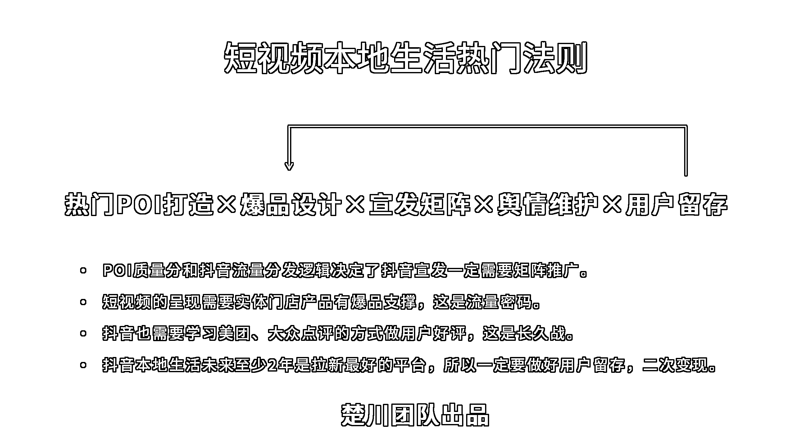

#### 3、楚川视角下 8 个高确定性细分赛道

我已多次准确预判抖音本地生活的爆发品类，命中率在 90% 左右。以下从 2023 全年角度给出判断。

1. 文旅，玩法是组品组合拳 + 重点投放。上半年发酵，下半年爆发，百倍增长都有可能。

1. 交友，2023 年依旧高增。三年社交受限后需求强烈。IP 打造 + 矩阵推广 + 私域承接，高客单可做得很炸。

1. 同城零售，结合达达、顺丰同城、饿了么运力做高客单新奇特组合，今年已验证，明年打磨顺滑后将普惠行业。

1. 演出，涵盖脱口秀、演唱会、电影院。素材量大，可混剪，分发账号多，重点投放即可见效。

1. live house。长沙 2022 年已打样，现场好歌手 + 热歌切片传播，基本就能起飞。

1. 小模型社区店，满足居民高频刚需餐饮品牌。已验证模式，大有可为，是优质私域入口。

1. 实力强劲的服务商可考虑品牌孵化。我已孵化出 4 个千万级品牌，餐饮品牌十三烧表现最好，已在 36 氪刊文天使轮，年后完成 A 轮。希望 2023 年再孵化 2 个以上品牌。
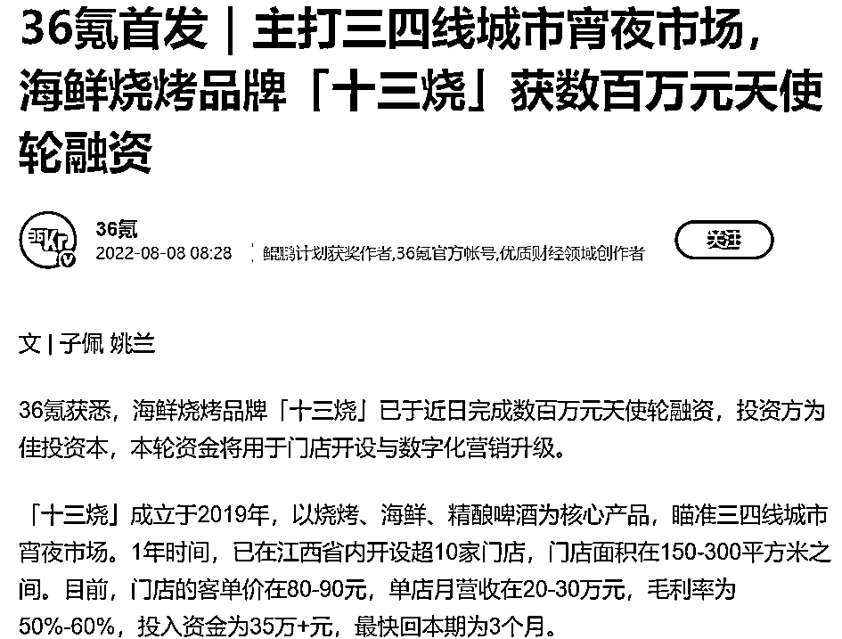

1. 垂直类目服务商。吃下抖音整块流量，如鲜花、美业、家政、便利店等，认领 1000 家以上门店，研究爆品与垂直打法，能快速赚钱。

#### 4、我会做什么：复制 70 分的楚川

今年我在群响、淘客公园、龙哥盟、中国区域互联网大会、航加、猪八戒网、美团核心高层做过分享，反馈都很正面。所以我希望有团队能复制我的能力，即复制 70 分的楚川。

1. 目前本地生活最大的限制是信息不对称。

2. 最大的制约是实操经验不足。

所以我会与优秀团队双向选择，把经验与能力嫁接到对方身上，加速在本地生活大赛中拿到结果。让有实力的团队在前期减少因信息不对称带来的时间与资金损耗，以及因实操经验不足导致的策略失误。

以上是楚川对 2023 年本地生活的判断与建议，希望大家都能迎接赛道大爆发！

需要具体链接的团队与个人，可加我个人微信。【跟对的人，一起在 2023 年拿结果！】

### 【微信】

## （34 赞）《分享个近期比较火的小项目-红包封面变现》

为什么你的红包和别人的不一样？

你想要这种炫酷的红包吗？

如果你想要，那这笔生意就算是谈成了。

篇幅受限，移步飞书文档查看：

[https://n28vbku1px.feishu.cn/docx/UktHdRPlAoCdMtxgUxRcMztBnrg](https://n28vbku1px.feishu.cn/docx/UktHdRPlAoCdMtxgUxRcMztBnrg)

## （147 赞）（精华帖）《企微捡漏社群，做淘客变现月佣 100W+ 的群运营方法论》

能用原价 1-3 折买到高性价比商品的群，我们叫捡漏群，例如原价 59 的钙片群里 9.9 就能拿下。

我们通过免费或付费方式，把目标用户从各大平台引流到企业微信，再拉进 500 人大群，通过售卖高性价比商品获取佣金。

这就决定了运营捡漏群的核心要点：稳定的企微主体、可靠且稳定的流量来源、精细化社群运营、群规模，以及多元变现方式。

今年不少同行靠捡漏群和美妆小样群赚得盆满钵满，月佣百万的大有人在，我身边大团队社群数过万，月佣数千万元。

我们入局较晚，4 月起做美妆小样，6 月转重点到捡漏群，目前新盘不到 1000 个群，月佣已破 100 万。也算有个结果。

我是菜菜爱砸锅，一个不学无术的 985、211 的 90 后硕士，互联网连续创业者，6 年淘客老兵，也做过快手电商打榜带货、地推拉新、微商潮牌，都拿到过不错的结果。

正在布局跨境私域电商，擅长引流、社群运营与私域流量的多重变现。

今天分享我们主营项目：淘客企微捡漏群与美妆小样群从 0-1 再到 1-100 的方法。淘客发展十几年，每年模式都在变，今年主流就是捡漏群和美妆小样群。

下面重点讲捡漏群的运营。

# 一、项目介绍

## 1、什么是捡漏群？

捡漏群：用户在群里能用原价 1-3 折买到超高性价比商品。比如原价 59 的钙片群里 9.9，原价 129 的洗发水群里 39.9 买 3 瓶，原价 129 一盒的面膜群里 29.9 买 2 盒共 100 片。

## 2、捡漏群的商业闭环

商业闭环：通过免费/付费引流，把目标用户从各大平台引到企业微信，再拉入 500 人大群，通过售卖商品产出佣金实现变现。

商品通常以淘宝/天猫为主。佣金一般在商品售价的 40%-60%，部分商品佣金甚至高达 90%！
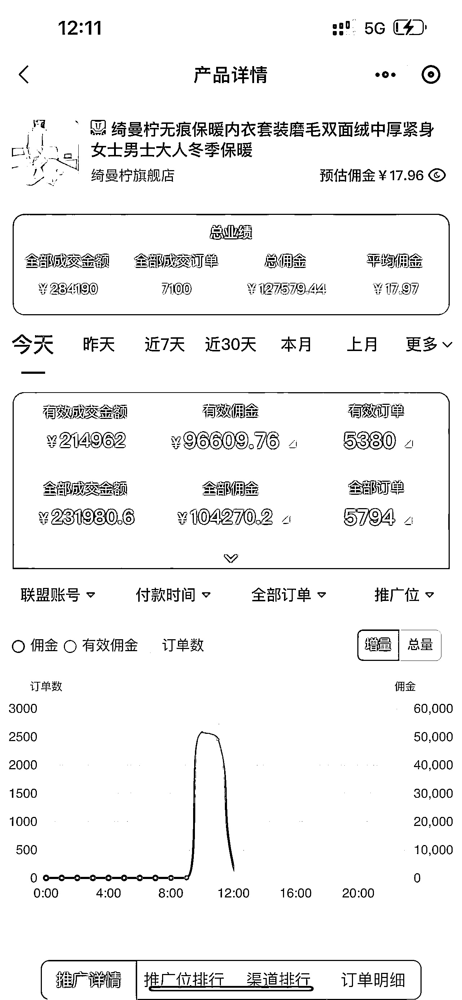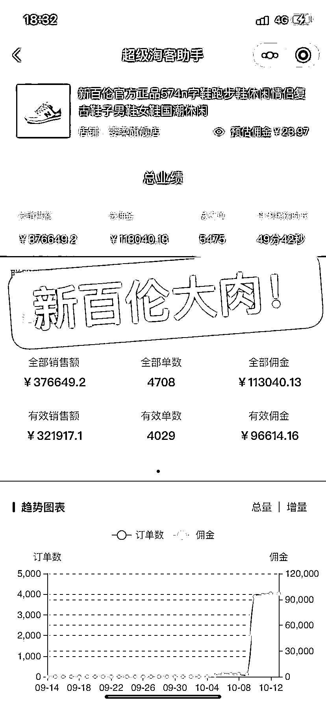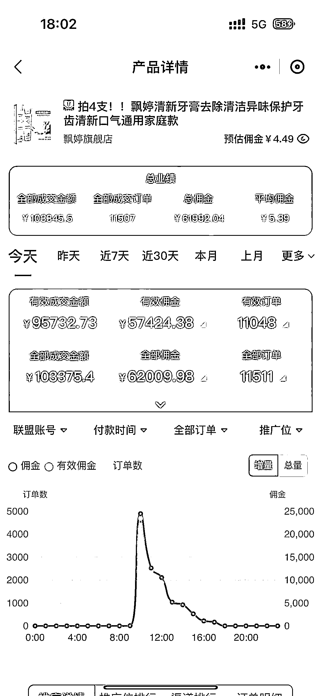

## 3、捡漏群的独特运营模式

与传统优惠券群不同，当前捡漏群属于精推模式！

（1）每天只精推一个商品，部分团队 2-3 天才推一个主品。

主推品从上午 10 点开始推，持续到下午 6 点，七八点预告次日主推商品。

通过几十条精推文案、4-5 次催单，加上 30-50 个演员不定时晒订单，营造疯抢氛围，让真实用户觉得捡到大便宜，疯狂下单，大幅提升社群产出。

这种模式既能把单品产出拉满，也避免选品困难。

（2）一个群必须配 20 个以上演员，保证发品节奏。

演员是捡漏群的灵魂，有无演员产出至少差一半。氛围死气沉沉会严重影响社群生命周期，后续产出断崖式下跌，甚至回不了本。

## 4、捡漏群的成本与回本周期

单群成本 3500-10000 不等，回本周期多在 2-3 个月。

不同流量渠道粉丝成本不同，回本周期也不同。免费流量暂不谈，我们主要靠付费流量起量。

目前公众号新增单粉成本 5-10 元不等，单个 500 人大群成本 3500-10000 不等，回本周期 2-3 个月，也有半年才回本的，具体取决于流量质量、运营经验和演员数量。

# 二、做捡漏群的几大核心要点

想通过捡漏群赚到体量，以下四个要点缺一不可。

## 1、稳定的企微主体

目前捡漏群和美妆小样群大多用企业微信承载流量。稳定的企业主体一天能接几万粉，主体不稳容易因投诉或进粉量大被限制，轻则 3 天，重则永久封主体。

前期务必养好主体再操作。稳定主体需包含：

### 1.1 企业主体需要认证

可用认证公众号认证，也可直接认证，未认证极易出问题。
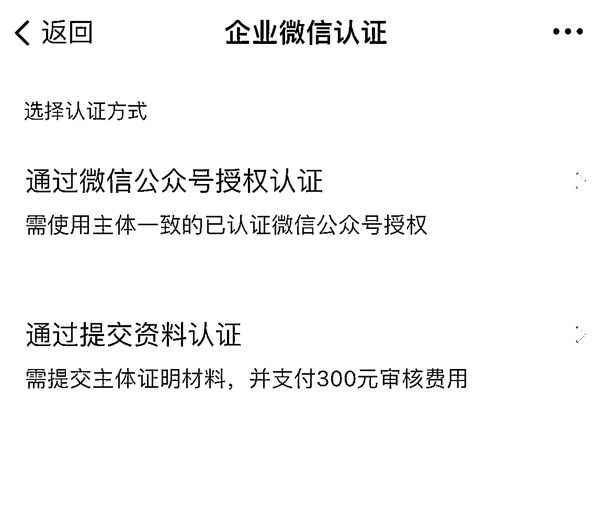

### 1.2 主体日活要大于 50

日活指主体下每天活跃的企业微信员工号数量，每个主体日活最好大于 50，越多越好！

业内有代养日活服务，不必自己注册大量号养主体。新主体认证后至少养一个月才能稳定接粉。
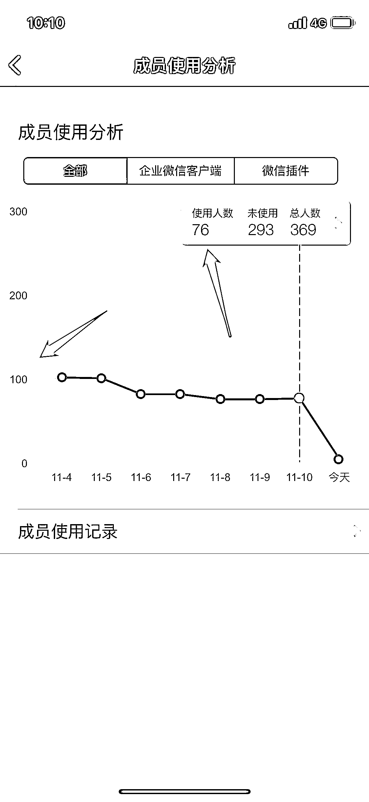

### 1.3 养号操作要点

每天上下班打卡、发日报周报、员工号间相互聊天，模拟真实员工日常。最基本的是每天打卡。

### 1.4 企业主体备案

新注册主体必须找服务商备案，降低封号风险，提升抗压能力。

### 1.5 备多个主体

一般准备 3-4 个主体，每个主体日活大于 50 后分工不同：

1. 专门建群的群主主体
2. 专门接粉的接粉主体
3. 专门发单的发单主体

在捡漏社群这条路上，主体稳定性是第一道防火墙。建议多备几个企业微信主体，万一其中一个被投诉、被限流、或者因为进粉过猛出现异常，不至于让整个运营体系瘫掉。当然如果你手上已有一个日活上千的超大主体，扛得住流量压力，也可以集中使用。单个主体也完全可以猛冲。

主体资质层面，基本都是个体工商户执照就能搞定，自己跑政务网办很快，也能找代办，市面价位在几十到一百多之间，我们长期配合的代办是 70 一张。

## 2 、稳健可期的流量供给

### 2.1 引流路径

现阶段吃得开的付费引流口径，主要是抖音、快手、微博、朋友圈广告以及视频号投放，投放形态以短视频为主，这类粉丝的后续留存和转化明显更优。

这几条渠道的建群成本偏高，单个群普遍落在 5000 到 10000 之间，粉丝质量好的话 2 个月内能回本，质量一般则需要 3-6 个月甚至更久。

对于捡漏赛道而言，理想的人群画像是 24-40 岁的一到三线城市女性，核心是宝妈群体，粘性足、复购强、付费意愿高。

投流环节坑位不少，找一家有实战经验的代投公司至关重要，好的团队能把粉丝质量拉满、把群成本压下来、产出抬上去，回本周期自然缩短。回本后持续加码复投，滚动放大体量。需要代投对接的话可以免费牵线。

除此之外还有包裹粉、小红书粉、闲鱼粉等低成本渠道，单群成本通常控制在 5000 以内，甚至能做到零成本自引，但放大节奏慢、人工投入高。

这类粉比主流付费渠道便宜近一半，可大多依赖图文形式引来，质量相对视频流差一截，回本周期一般在 2-4 个月不等。

### 2.2 引流落地页

主流打法的通路基本一致：先导到公众号，再跳转企业微信，企微内由机器人自动分流进 500 人大群。群满后开新群，开群初期先上免单或低价养群，积累信任后再切正式变现。

不同渠道落地细节有差异，整体逻辑都是低价钩子+视频内容引流。抖音上直接搜【捡漏】，能看到大量同行案例，多以家居、家电、百货类低价品做引流。

美妆小样群的引流关键词可以搜【大牌小样】，以一线品牌小样 9.9、0 元的形式吸粉。

以抖音为例，下面几张图就是典型引流页的呈现样式，自己去抖音搜索就能进到同行群里实地看。

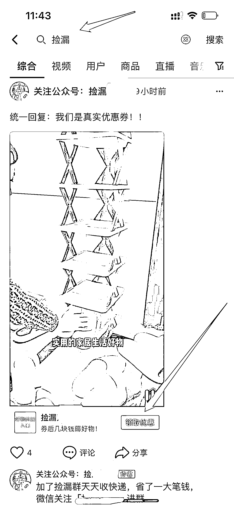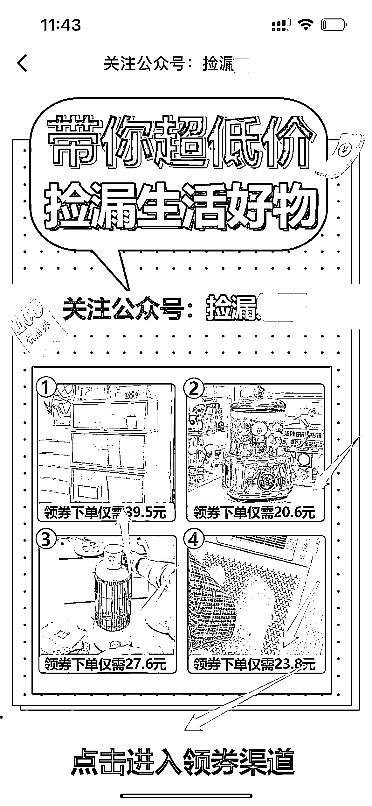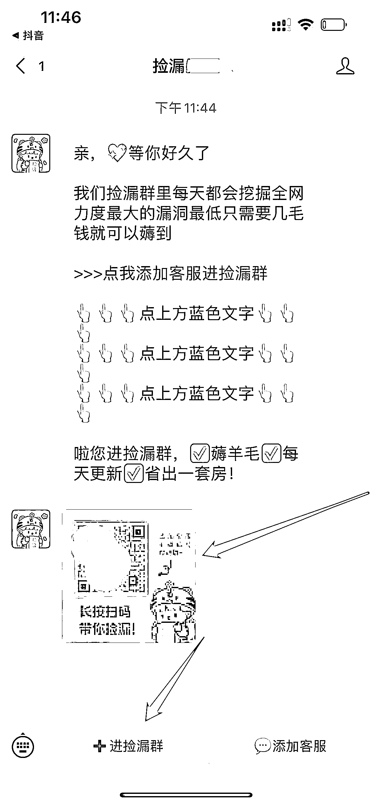

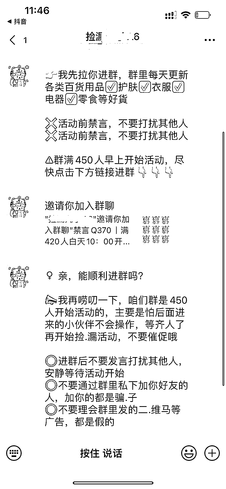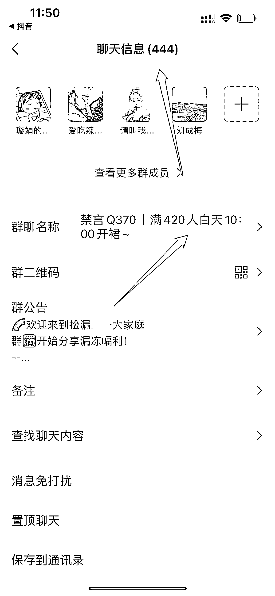

其他渠道的玩法这里不展开，有兴趣的朋友可以后续深入交流，之后会专门做一期引流拆解。

## 3、精细化社群操盘

主体养稳、流量打通后，核心问题就变成如何把成本快速变现。同样花钱买的流量，不同运营团队的回本速度能差出 3-5 倍。

行业普遍的回本标准是 2-3 个月，我们的实操基本也稳定在 2 个月内，最快的一次是 17 天回本，当时单群成本 6000 多。也有遇到流量不佳导致半年都回不了本的情况，流量质量是关键变量。

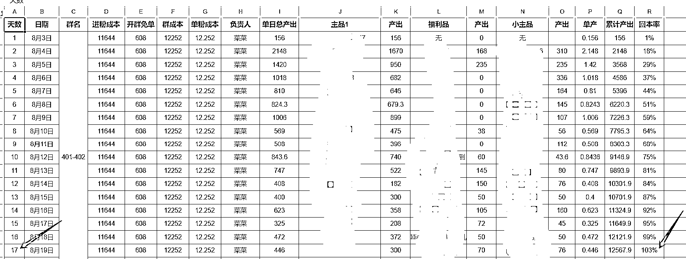

👆 这是我们 8 月份测试的两个群的运营数据。精细化运营的关键点如下

### 3.1 选品与排品

同一套运营打法，换个品产出天差地别。必须挑选与社群人群匹配的高佣商品，我们的客群集中在 24-40 岁女性，所以前 7 天的选品重点围绕这个人群喜好展开。

前 7 天直接决定回本速度。基本上要实现首月回本 40% 以上，一个月回本 70%，首发主品单群理想产出在 1000-2000，表现差的可能只有二三百。选品靠经验积累，也可以对标同行。

前 7 天的品基本是固定的，是经过大量群体测试后沉淀下来的 7 个爆款。7 天之后则按经验铺排至少一个月的内容。

选品来源主要有定向招商群、大淘客、好单库等淘客选品平台，以及同行群，同行群的价值极大，连他们的话术都可以直接借鉴。

#### 3.1.1.1 定向招商群

定向招商群是变现的核心供给源。里面聚集大量高佣爆品，且招商方已提前准备好精推文案和演员话术，直接拿来用即可。

同时定向招商的佣金普遍有保障，通常在 40% 以上，部分品能到 90%。

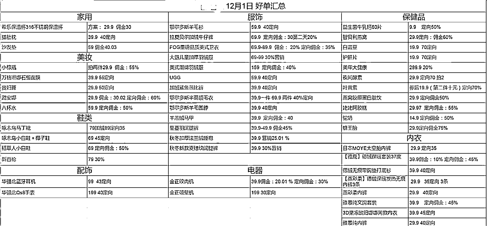

#### 3.1.1.2 选品网站

大淘客、好单库这类平台能看到实时销量榜、今日热销榜，通过榜单判断当下什么品在跑量，避开坑位，实操转化也更稳。

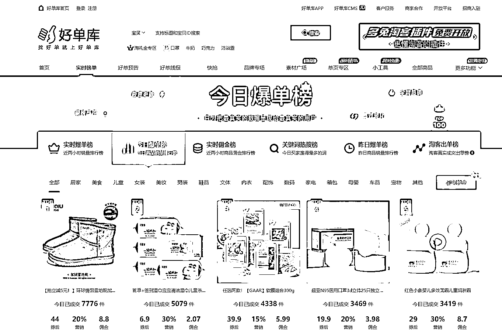

#### 3.1.1.3 同行群

多加入同行群观察他们在发什么品，判断是否契合自身社群属性，再去好单库核对当日销量，确认跑量后再复用他们的发品文案，只需把链接替换成自己的，效率很高。这也是我们常用的选品路径。

#### 3.1.2 排品

不同引流渠道的固定品大同小异，但排品顺序差异明显。比如抖音渠道首发可能是运动鞋或洗发水，朋友圈渠道首发则更偏向面膜。排品可以参考同行，也可以小范围自测。

我们也有自己的爆品库和排品逻辑，后续可以交流分享。

排品的必要性在于：每天都在开新群，若每个群前 7 天品固定不变，每天发品时间集中在上午 10-11 点，工作量会爆炸，如何统一节奏是项目难点。

我们的解决方案：

##### 3.1.2.1 批量进粉

批量进粉是为了做节奏池化，降低人工成本。每天进 5-10 个群，能力强的团队甚至进 15-20 个，在可承接范围内越多越好。这样同节奏下的群数量越多，人均管理群数越多，成本越低，回本越快。若一天只进 1-2 个群，人效会非常差。

##### 3.1.2.2 用小主品做缓冲

新群前期可以不按固定大主品节奏发，而是先发签到品或小主品过渡，等待后面新开的群统一到同一节奏，形成一个节奏池里 30-40 个群集中管理，发品压力大幅下降。

##### 3.1.2.3 固定大主品轮播

前 7 天固定品发完后进入大主品轮播阶段，通常合并 100-150 个群，统一节奏后分配给 2-3 人管理。

### 3.2、精推文案+精推催单

#### 3.2.1 精推文案

捡漏群文案风格与普通优惠券群、美妆群不同，核心是“捡漏”，所以文案会更夸张、更长。预告+秒杀+催单三段式加起来往往上百条消息，通过图文视频配合强冲击力的描述把产品细节、性价比、优势全盘托出，制造强转化。

下面以雅鹿保暖衣为例展示捡漏群精推文案的精髓。

第一张是预告，第二、三张是秒杀+催单+演员晒单。捡漏群一天只有一个主品，需要营造热闹氛围，文案必须饱满有感染力。

一般精推文案由招商方的文案团队提供，够用但同质化严重。若有条件，建议自改，注入社群独特性和人情味，不断优化产出。

#### 3.2.2 精推催单

单个大主品的催单频次一般在 4-6 次，根据群节奏灵活调整。

常规发品节奏参考：

1. 10:00-10:30 大主品秒杀
2. 11:00-11:05 第一次催单
3. 11:50-11:55 第二次催单
4. 14:00-14:05 第三次催单
5. 16:00-16:05 第四次催单
6. 17:55-18:00 第五次催单
7. 19:00-20:00 次日大主品预告

节奏并非死板，需结合经验动态调整。催单时可配合红包、群公告等手段提升曝光。

催单话术呈递进式，例如第一次说抢疯了，第二次剩最后 300 单，第三次剩 120 单，营造递减紧迫感。

催单要点围绕限时限量、爆单假象、售后保障、价格对比、性价比、好评反馈、产品亮点展开，文案与图片共同配合。

下面是雅鹿保暖内衣的三四次催单示例，均围绕上述要点展开。

### 3.3、演员氛围

捡漏群的灵魂是演员。

同样流量、同样文案、同样商品，有无演员产出至少差一倍。因为一天只有一单，主环节基本被演员的晒单和话术占据。有业内说法：没有演员就别玩捡漏。

演员作用：提升活跃度、可信度、制造爆单假象。

#### 3.3.1 演员数量

一个群至少配置 30-50 个托，资源紧张时也需 20 个以上才能撑起全天节奏。话术多来自招商方提供，需自行加工完善。

#### 3.3.2 演员话术

话术核心围绕产品展开，结合生活场景反复强化卖点，对真实用户进行持续洗脑，促进下单。

秒杀链接发出后，演员通过密集晒订单图制造爆单氛围，每次催单后都有新演员跟进晒单，形成反复刺激。

如下面的雅鹿保暖衣案例所示，能摸清基本玩法。补充要点：

演员：一个持续关注群的忠实粉丝形象。

##### 3.3.2.1 冕单/签到品情况

有免单或 0-1 元签到品时，所有托必须上线，反馈已拍+商品名或晒图，带起群情绪。

##### 3.3.2.2 大主品情况

选品发主链接后，上线 5-10 个演员。每次催单时必上 3-5 个演员，具体数量看演员池体量。

##### 3.3.2.3 大主品演员技巧

针对付费主品：

（1）晒订单图增强真实感
（2）模拟真实用户节奏
（3）演员表现需错位，避免千篇一律
（4）时间间隔化，避免集中刷屏
（5）多做互动，引导话题向产品靠拢

## 4、社群规模效应

社群活跃度随时间递减，产出也会衰退。一般 2 个月后单群日产出在 50-80，之后缓降至 30-40 稳定。数据仅供参考，有的同行后期单群日产出跌到 5-10，有的同行运营得当三年后单群仍能保持百元以上，核心仍是运营。

保守测算，回本后单群日产出 30，100 个群日利润 3000，1000 个群日利润 30000，月入 90 万。很多百万月佣团队靠的就是规模堆起来的量变质变。头部团队社群数量已过万，月佣上千万。

前面提到的靠谱流量是规模化的前提。找到稳定日进粉节奏，比如每天进 10 个群，就能形成统一开群、发品、排品节奏，持续累积数量。

一个社群生命周期约 2 年，3 个月回本后，之后每个月约 1000 利润，21 个月合计 2.1 万纯利，投资回报率在 3-4 倍，不含私域多重变现。

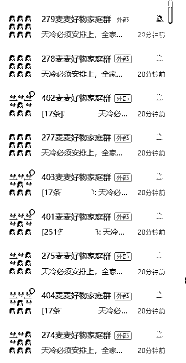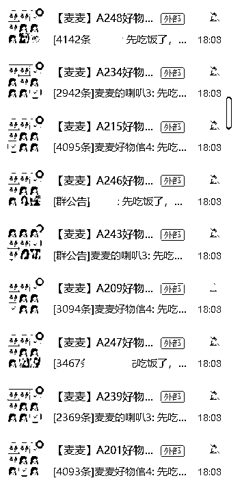

## 5、多重变现

用户沉淀在企业微信即为私域资产。除捡漏群外，还可拓展美妆小样群、拼多多群、京东捡漏群、朋友圈带货、导流返利等多种变现方式，触达成本几乎为零。

10 万私域粉足以保证稳定收益。拥有 1000 个群的公司私域体量约 60 万粉，遇到机会可随时从 0 到 1 起盘。因此囤积私域是看好捡漏项目的关键原因。捡漏粉多为 24-40 岁宝妈，质量高、消费力强，是优质资产。

# 三、必备工具清单

### 1、联盟刷高佣和礼金权限
淘宝联盟注册默认为初级，需找服务商代升高佣，费用百元以内，周期 7-10 天。升级后需刷淘礼金权限，次月 2 号生效，同样代办。

### 2、个体营业执照
有公司或个体执照可直接用，公司执照可认证企业主体，个体执照需先认证公众号再认证主体。无执照建议自办或代办，成本几十到一百多。

建议准备 3-4 张主体备用，前文已说明用途。若只用一个主体，日活需 200 以上，越高越好，否则限流会导致项目中断。

### 3、手机
手机数量依据日进粉量规划。若日进 2-3 个 500 人群，起步准备 10-20 台即可：群主号 1 个、开群号 2 个、接粉号 10 个、发单号 3-5 个。做大盘建议备 100 台以上。

安卓可双开降低成本，也方便群控养活。苹果 7 128G 约 630 元，群多消息多也不卡，但不支持多开和群控养活。

### 4、手机号
每个手机号注册一个企业微信。每个身份证三大运营商可办 15 张卡，可注册 15 个企微。建议使用实名卡，虚拟卡易出问题。

### 5、接粉公众号
需服务号并完成认证，年费 300。接入自动接粉系统，常用西皮士，稳定承压，日处理几万流量。

### 6、自动接粉工具
大批量进粉需自动化，常用企微宝，也可用萧启灵等。企微宝稳定功能全，但成本高，一个接粉号对应一个企微宝，官方年费 800，代理约 700 起。

功能包括自动通过、自动发消息、自动拉群、关键词拉群、群发、群管等。

### 7、演员微信
建议准备 20-30 个以上，越多越好。自注册需养号至少一个月。租号也是方案，月租约 100 多一个，一个号可托 100-150 个群。

### 8、演员系统
几百个群几十个托，手工不可行。主流系统有爆品站、发单帝、云中客等。一个运营可控数十上百演员，管理数百群。演员月费约 20 元。

### 9、自动发单系统
群量大需自动化发品。主流有萧启灵、超级淘客助手、淘西西、发单帝等。免费和付费都有，年费几百。

设置采集群，由选品人员一次发送精推文案，后续自动分发。一般一个发单号管理 15-20 个群。

### 10、选品工具、转链工具
选品核心是定向招商群，辅以好单库、大淘客、选单网等。转链可用萧启灵、云中客。

# 四、项目存在的一些风险和机会

## 一、做这个盘子会踩到的坑

任何生意都不是稳赚不赔，做企微私域淘客也不例外。下面把实操里最容易翻车的点摊开说清楚。

### 1. 主体被封号
流量承接、成交转化全靠企业微信和企业微信群，一旦主体信用不稳，被客户投诉或被同行举报，很容易触发封禁。封了就等于旗下所有企微账号一起瘫痪。

所以常规做法是多主体分散承接，同时把每个企微号的日活养到50以上，抗封能力才上来。

### 2. 号与群被封
单号被封还好意思，换个接粉号或发单号继续用。最致命的是群被封，损失立刻变大。

群被封的核心诱因通常是主体抗封性不足，日活太低。救场办法是立刻重建群：因为用户已在企微好友里，用工具群发新群链接拉回。实操中大概会流失30%-40%的成员，拉回来的人越少，回本周期就被越拉越长。

### 3. 运营环节掉链子
开群、选品、演员、话术，任何一环掉线，产出都会腰斩。

#### 3.1 开群不专业
开群是社群情绪最高点，用户会集中提问、也会有来捣乱的广告号。控场能力决定后续群的基调。建议多混同行群，拆解留存高的群怎么开场，把有效话术沉淀成自己的开群SOP。

判断标准就一个：首日留存。留存能稳定在90%以上，回本基本能在两个月内完成。

#### 3.2 选品失误
变现核心靠社群带货，品好与品差的差价能拉出几倍。尤其是前7个爆品，直接决定成败。有的团队第一单发面膜只出200，发洗发水能到1000，发AJ能到2000。

社群活跃度是递减的，后期一天就30左右的互动，大几千成本的群如果前期不回本，后面基本没救。选品没有捷径，只能小范围测款+抄同行+潜水招商群+盯好单库实时销量榜。

#### 3.3 演员与话术不足
演员不够，同等条件下产出至少掉一半。开盘前必须把演员号备齐或租号，社群里至少保持20人以上的真实互动。

演员要站在真实用户视角去演，话术生硬直接导致信任崩盘。演员不足，回本周期会被延长一倍以上。

### 4. 流量不给力
流量贵、流量不准，回本都会被拖死。要么走免费流量，卖多少赚多少；要么找靠谱的精准流。团队作战更要保证群的稳定产出，一天一两个群、节奏断层，人工成本吃掉利润，回本自然难。

归根结底，项目靠执行力与细节。某个细节比同行做好一点，回本就快一点；所有细节都做到位，回本自然快，再用复投滚动起来。

## 二、为什么还要做

在众多互联网项目里，CPS淘客+私域属于轻资产、回本快的赛道。淘客已经存在十几年，每年都有大佬持续吃肉。近几年资本也进了不少，但私域的本质没变：淘客CPS只是私域的一种变现方式，我们做的是私域生意。

### 2.1 自由可控
公域平台限制多，规则随时变，违规就封号申诉无门。私域在自己手里，只要维护好客户关系和产品质量，不受外部平台意志左右。

### 2.2 获客成本被压到最低
公域流量越来越贵，直通车、快车费用直线上涨。私域把客户沉淀在自己的流量池里，可反复触达复用，新客成本大幅下降，省下的就是广告费。

### 2.3 单客价值被放大
电商看客单价，私域看单客价。一个用户全生命周期贡献的销售额。私域拉长用户生命周期，提升复购频次，单客价上去，整体销售额自然上涨。

### 2.4 轻装上阵
做捡漏社群，只负责卖。囤货、发货、售后全部由上游承担。成本基本就是人工、房租、手机话费，轻资产运作，受外界影响小，转新赛道也快。

# 五、总结

做了6年淘客，也转过很多项目，最后发现淘客依旧香且稳。但它需要经验积累。新人起步建议先从免费流量做起。想做付费也要先试水低成本的流量，直接上昂贵的付费流量很容易打水漂。

目前团队也在尝试跨境TK私域玩法，有在做这块的朋友欢迎交流。

## 《视频号直播一小时加到200人，分享一些细节和优化过程图》

#涛说# 分享要短，分享要短，昨天开播一小时，私人微信到账近200人，赚钱新年预约51个，加曹大星球49个，给大家拆一下细节，附优化过程图。

第一，用好企业微信。直播时点弹出，引流到私人微信，分销用链接也行，用二维码也行，都很丝滑，不用离开直播间就能转化。如图一二三四五。

要点就两条：
1、电脑打开企业微信，在「客户与上下游」里设置好「欢迎语」，可放图片、链接、文字，新好友进来就能自动收到。
2、在「应用管理」里配「机器人」，设置关键词触发自动回复，双保险。

第二，PPT模式能留人，但我优化了更顺滑的呈现方式：金句卡片。经过多轮打磨，过程如图四五六七，安卓苹果都看过，避开评论区和按钮干扰，四个角的引导也做了微调，最后把头像换成醒目蓝色才定稿。

模板成型后提前备了几百张金句卡片，源自龙哥的金句复制粘贴。直播能用，朋友圈传播也能吃到红利。模板我放评论区，自取自改。

祝大家新年快乐，一年加满5万人，干就完了，418见。

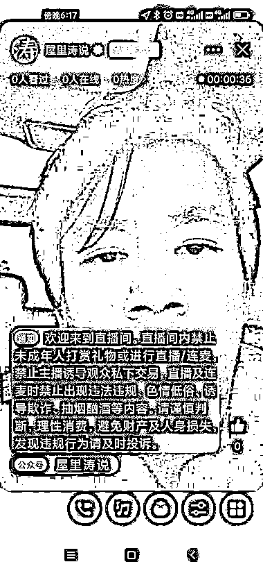  

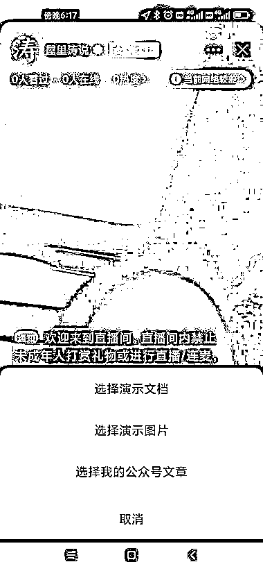  

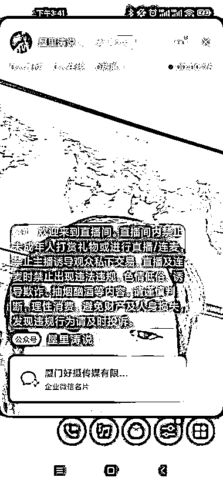  

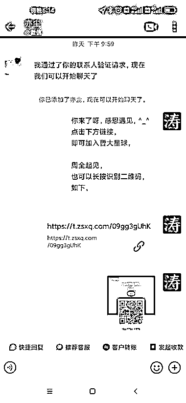  

  

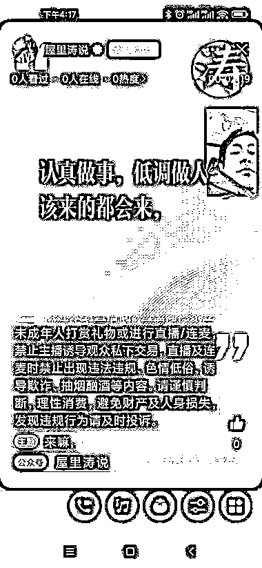  

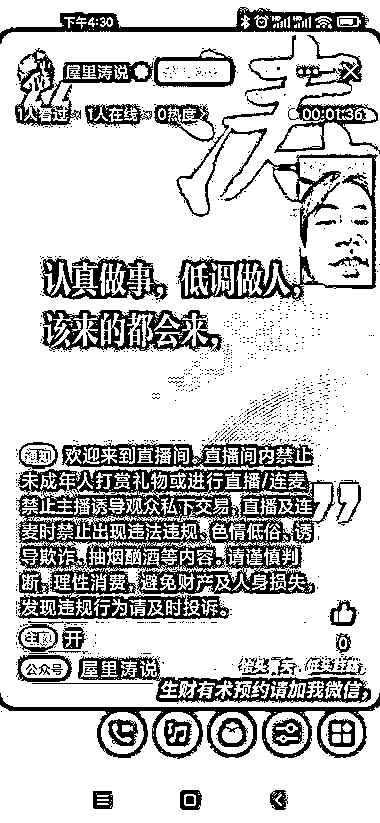  

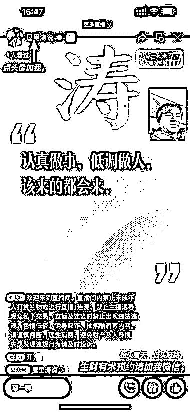  

  

## 《低成本创业，2万宝妈私域好友变现超100万的思路分享》

抖音上刷到过胎毛纪念品的视频吗？这其实是一个典型的低成本创业切口。

我也是偶然发现市场需求够大，做的人却很少，只有几家淘宝店在做，销量和评价都不错。投入很低，阿里巴巴采购材料包几百块搞定，包装盒定制几千块封顶，启动资金不到一万，很适合试错。

核心人群是刚生娃或即将生产的宝妈，这阶段她们对胎毛纪念品兴趣最高，想给孩子留下纪念。单价100-200元，亲子款、一家三口款一单能做到400-500元。

从抖音导流到私域2万宝妈好友，最终做了7000单胎毛纪念品的变现。结合用户画像，这些宝妈基本在家带娃，缺副业变现。基于前期成交建立的信任，我们再带副业，完成了30万+的额外变现。

我是11年毕业，上班三年，14年辞职做微信公众号，赶上风口第一桶金投入3800元回报超1000倍。公众号后期收益下滑，才转向胎毛项目。

变现逻辑总结一句话：对同一类人群，先解决痛点需求，再延伸更多痛点服务。

下面拆成五块来讲：产品分类、货源、用户画像、流量获取、变现路径。

1. 产品都有哪些？
早期只有胎毛笔，需要邮寄毛发，存在真伪顾虑。银饰品DIY款更有优势，宝妈可自己制作，佩戴收藏皆可。

我选品思路是先抄销量高的同行款，市场验证过再做差异化。品类包括项链、戒指、手链、手串，可组合成情侣对戒、一家三口手链，车挂、钥匙链等配件都能放胎毛，组合搭配提升客单价。还可定制刻字、AB胶模具等。如果宝妈没时间，也有代工服务，收定制费。

2. 产品从哪里来？
先买同行成品拆解，流程不复杂。材料包基本都是组装：银饰半成品、AB胶、模具、量杯、搅拌棒等，全部在阿里巴巴采购。包装和手提袋找本地包装厂定制即可。

想找全款式，用阿里巴巴拍照识图找同款，找不到再去淘宝识图，基本能覆盖。

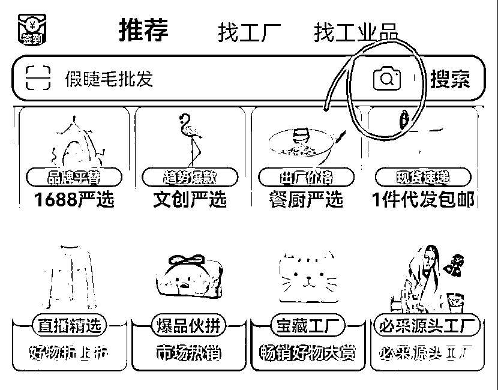  
阿里巴巴产品搜索截图

注：样品测试时可网上下单假发练习，别薅自己头发。

3. 用户群体都有哪些？
刚生娃或待产宝妈是主力。宝宝几岁以上的宝妈需求已弱，胎毛也难找，精准很重要。

可与影楼、母婴店合作，提供电子版画册供他们分发，无额外成本，变相增加收入。

4. 私域流量从哪里来？
①淘宝引流：店铺只放微信二维码，引导加好友领取制作流程。每单用户都能沉淀到私域，后期我还设计了38元引流款，全部导私域。
②抖音引流：注册个体户办企业号，企业号可放电话，便于添加。内容很简单，产品图或制作过程视频，播放20-100万，引流200-500人/次。

更新内容看三点：内容+文案+音乐+评论互动。
内容：选3-5张最佳产品图，或剪辑制作过程视频。
文案：带胎毛关键词，点明是胎毛银饰。
音乐：母婴类热门BGM。
评论：及时回复，引导关注回关。

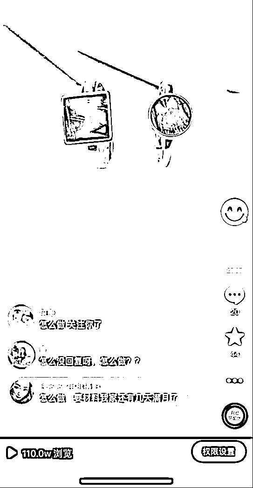  
案例截图，播放110万

抖音引流方式：
电话引流：企业号绑好记手机号，用户可直接搜号加微信；
私信引流：话术“抖音发不了链接，加微信发链接选款”，微信绑定短位QQ分流；
评论区引导：先关注对方，回复关注表情，引导关注后私信推微信。

通过这套打法积累到2万宝妈好友。

5. 怎么变现？
四种方式：纪念品、副业、无货源、其他。

①产品变现：提前建好产品合集链接，含款式图和介绍。好友通过后直接发链接挑选下单。配合朋友圈晒成交图、发货图、佩戴实拍，打消顾虑，再做满减、赠送手脚印泥等活动。2万好友成交7000单。

②副业变现：宝妈带娃在家缺副业，诈骗信息多她们又谨慎。起步学费199，先让一批人赚到钱形成口碑。学费阶梯涨价：299、399、799，限量稀缺，成交转化率很高。后来升级“不赚钱退全款”，转化更顺。部分成交来自已买过胎毛纪念品的老客户，信任成本极低。

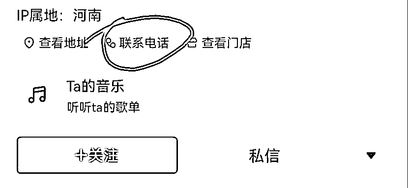  
企业号添加联系电话截图

做副业这条路上，真正值钱的，不是你做过多少项目，而是你跟用户之间那层“信任壁垒”。

我后来带第二期、第三期项目的时候，凡是跟着我跑过的老用户，基本不用我再花时间解释“这是个啥”。以前你可能要花半小时介绍、人家还要纠结一周才付款，但到了后面，我只需要说一句“有个新机会，可以搞”，对方就咔咔转账，连“会不会被骗”这种问题都不问了。这就是信任到位之后最直接的反馈。

这个副业，我前后变现差不多三十万，而且现在还在持续进账。

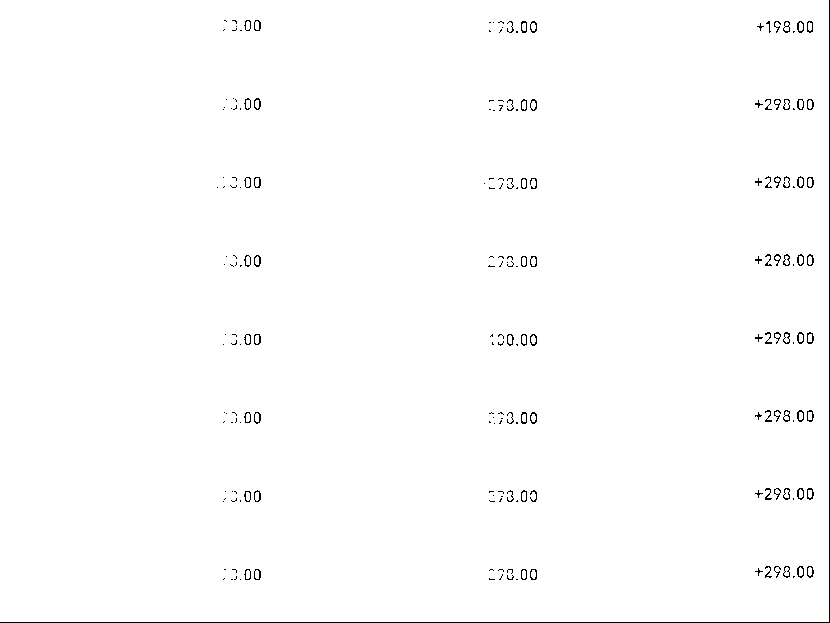

这就是副业赚钱某一天的成交图。

第三块：无货源变现。说白了，就是根据自己私域里那批人的消费习惯，去挑合适的产品来卖。我选品一般在阿里巴巴上看，重点看两个东西：销量和买家评价。销量高、反馈又好的，基本就能判断适合卖。

我会把产品详情、还有买家秀整合一下，发到朋友圈做宣传，用户直接微信下单就行。因为我自己跟快递点有合作，所以每次都是卖完一批再批量采购，然后发给客户。当然，你也可以做一件代发，让厂家直接帮你发货，省事很多。

第四块：一些零散的增收方法。比如淘客。每到节日或者促销节点，我会在朋友圈发几条内容，告诉大家淘宝购物红包免费领，有需要的直接在评论区点赞就行。不群发、不打扰，一来一回既不招人烦，又能把活动推出去。

多发几条朋友圈，参与的用户就能积累起来。等到活动正式开始，我会做一个单页面，用户打开页面以后，点一下“领取”按钮，淘宝客口令就自动复制了，再提示去淘宝打开红包页面即可。

整套流程简单到不行，页面做完以后再发一条新朋友圈，把领取链接放上去，紧接着去原来那条朋友圈评论一句：“查看我的第一条朋友圈，领红包。”整个链条就闭环了。

用户的消费佣金自然就赚到了。另外，像快手极速版、抖音极速版这类拉新下载的推广佣金，也都可以顺便做一做，都是增加收入的小渠道。

以上就是我这次的分享，第一次写，有说得不到位的地方欢迎大家指正。

### 【线下实体】

## （92 赞）《20 天帮助实体书画门店收款 160 万》

双十一期间，我们团队给一个之前服务过的老客户重新设计了一套转化路径，20 天时间，帮济南长清这家书画校区收款 160 万。当时还在口罩时期，这一波操作直接把机构在长清引爆了，收款额度做到当地天花板。

下面把整个流程细节扒给大家。

现在很多做门店服务的人，一上来就吹“帮门店涨了多少粉”“做了多少播放量”。我个人觉得，如果不帮实体门店把销售额做上去，那就是耍流氓。应该反过来，用销售额倒推你该怎么做服务。

那这次 20 天 160 万是怎么拆解的？核心就三步：

1. 引爆同城流量
2. 裂变自有流量
3. 转化到店流量

## 1、引爆同城流量

这家店是少儿书画培训机构，实体门店最核心的需求就一个：让产品持续触达本城市的精准人群。实体店的流量重心，永远在同城。

而同城流量有两个主阵地：

1. 微信——快速触达用的是同城群
2. 抖音——快速触达用的是抖音同城

### 1、同城微信群怎么玩？

一个城市里打开率最高的，是业主群、村居群、商家群、团购群这四类。这些群就是城市私域流量的主战场。活动开始前，我们带着门店的员工直接线下加群，积累了大约 1000 个同城微信社群。

群有了，接下来是两个动作：

1、沉淀同城宝妈到自己的群里。

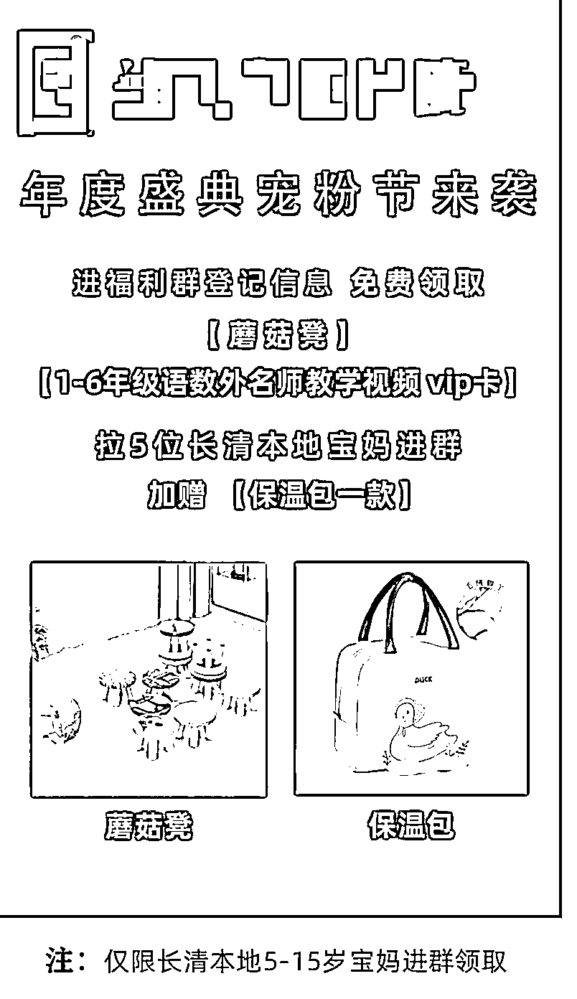

设计很简单：宝妈进群就送一个小凳子；再邀请 5 个人进群，额外送一个保温包。

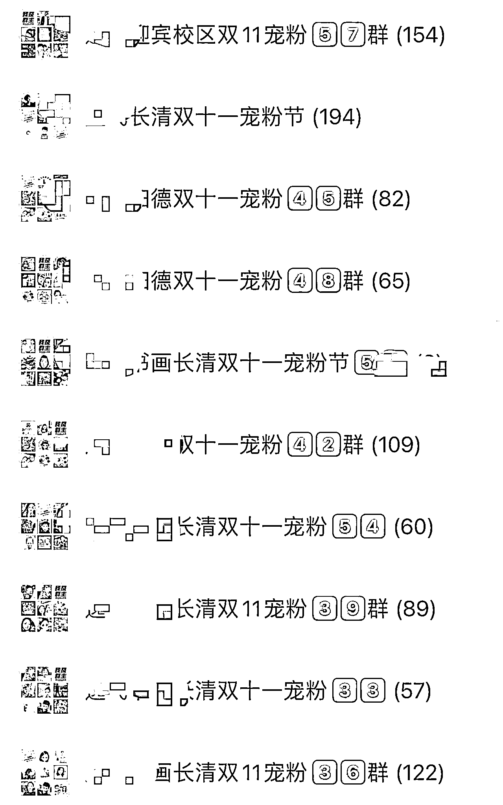

这么一轮裂变下来，新建的群里沉淀了差不多 4000 人，95% 以上都是宝妈，等于说将近 4000 多个家庭被圈进来了。而且领礼品有个条件：必须登记手机号、姓名信息。也就是说，一个小小的礼品，既完成了个人号沉淀，又拿到了家长联系方式。

2、推送活动链接到那 1000 个同城群。

前一步已经圈了一波宝妈，这一步就是顺势推活动做曝光。需要注意的是：推送要持续进行，完全不用怕被踢。

### 2、抖音怎么做？

常态化发内容没问题，搞 IP 也没问题。但如果你还没有一个成熟的抖音账号体系，靠自己是很难迅速引爆同城流量的。这种情况就得换个思路：涓涓细流，汇成大江大河。

还记得前面送的凳子和保温包吗？宝妈们要领礼品，就必须到店。

这时候可以用抖音爆店码，让所有来领礼品的宝妈各发一条抖音视频。1000 个宝妈来领，那就相当于 1000 多条视频分发出去。宝妈们的抖音权重会比普通用户高一点，看到的人也都是身边人为主。

1000 多条素人视频铺下去，同城热度立刻就被加热了。如果还嫌不够，可以再找一些 v3-v4 的博主过来二次加热。

接着挂上引流团购品，基础团购品上架刷一刷，短时间内，同城的流量基础就起来了。

## 2、裂变自有流量

第一轮外部曝光完成后，要开始盘自有流量。所有自有流量里，价值最大的就是个人微信号。

不过要注意：每一次私域推送，其实都是在消耗用户资产。如果一直硬推，迟早把用户资产耗尽。

所以这次推送产品，我们做了一个关键动作——裂变。

裂变做得最狠的鼻祖是谁？拼多多。拼团就是最好的裂变方式，没有之一。

私域裂变的关键是要设计裂变品。

这次我们设计了“66 元宠粉节定金卡”：用户交 66 元，就能抢订一个价值 3980 元的优惠名额。

课时福利：全场立减 500 到 3000 不等，目的就是在现场完成高客单转化。

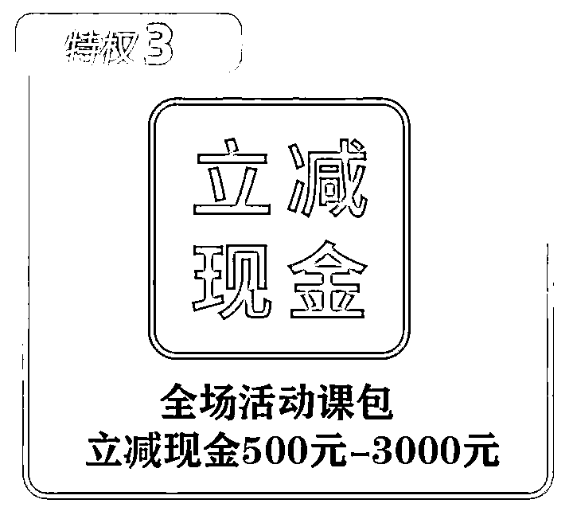

礼品福利：送康巴赫锅、骑行拉杆箱这类高感知价值的东西。

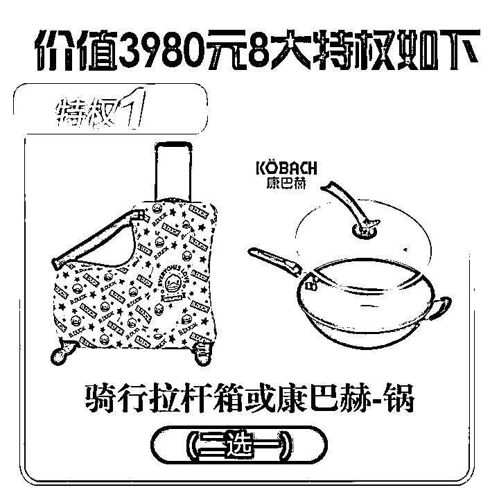

裂变机制：设定 2 人团购，用户拉一个人支付 66 元，两个人各得几节课加礼品。

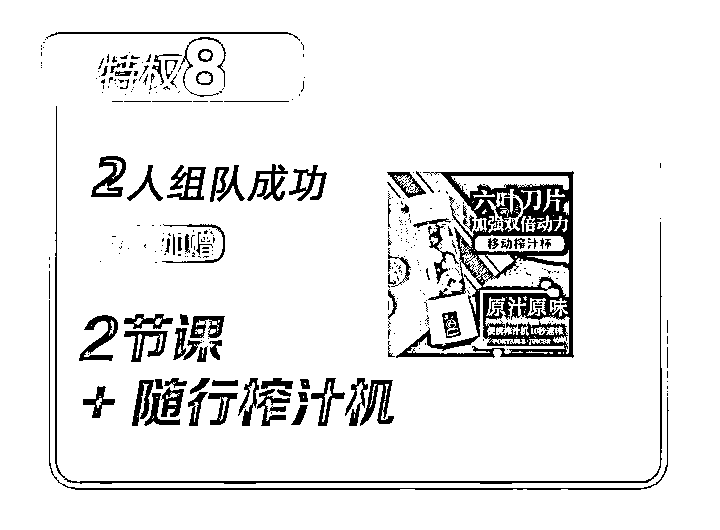

等于说，老用户先花 66 元买卡，再通过拉人的方式，把整个私域给重新滚动起来了。

### 2.2 裂变新流量

前面不是沉淀了 4000 多位宝妈、1000 多名宝妈加了微信吗？这帮人都符合“到店领礼品”的条件。

所以：

1. 群里直接售卖 66 元定金卡，买了的人再去裂变；
2. 新加微信的，一对一推 66 元定金卡，买了的人再去裂变；
3. 到店领小凳子的用户，现场引导买 66 元定金卡，买的再去做裂变。

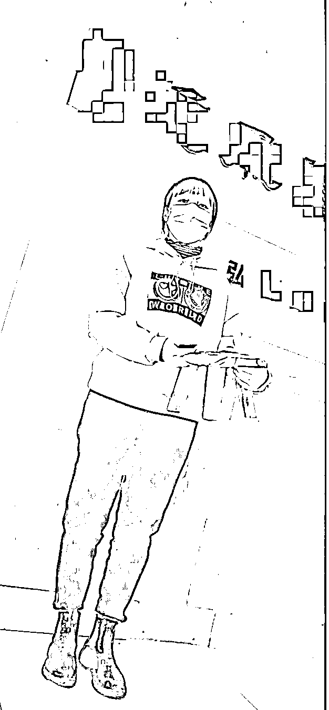

## 3、转化到店流量

到这里，公域（同城群 + 抖音）和私域（自己流量 + 裂变流量）已经全部汇合，66 元定金卡一共卖出了 624 张。

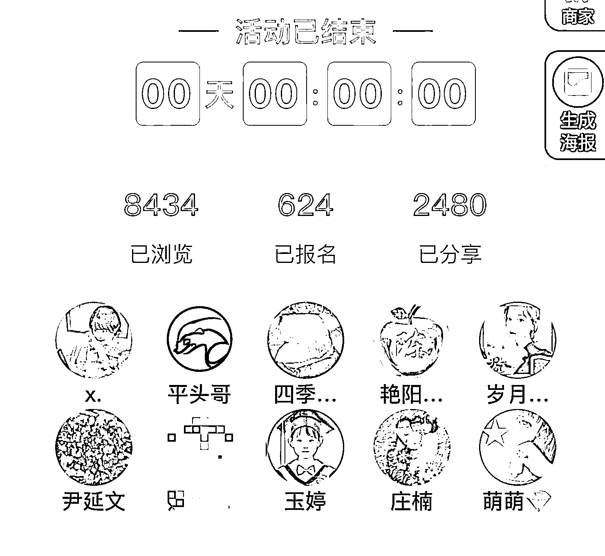

接下来要做的，就是把 624 张卡全部转化掉，把到店流量彻底变现。

这时候，门店要做的是“造节促销”。

1. 现场氛围：必须做出节日感，让用户一进门就有冲动型消费的氛围。
2. 成单速度：要制造紧迫感，用老用户带动新用户。怎么做？设计群接龙，只要有人成交就发到群里接龙，互相刺激影响。

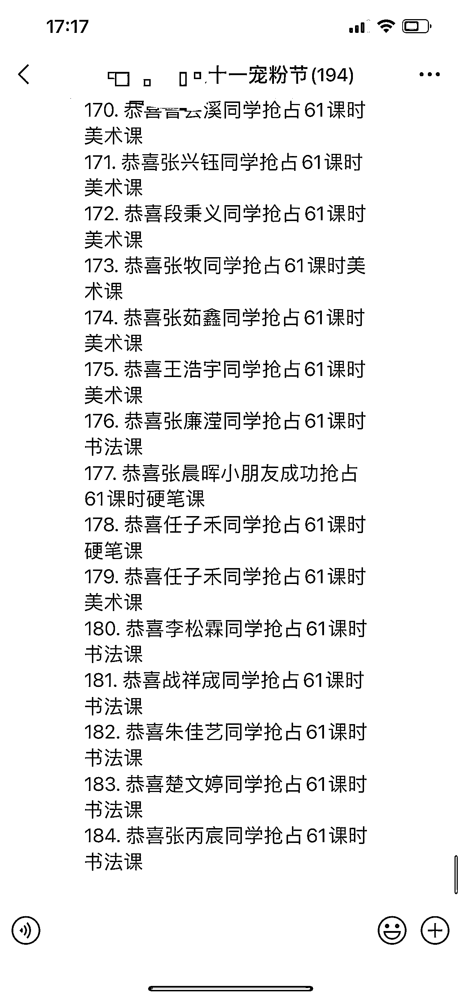

3. 方案设计：要设计阶梯式成交方案——价格阶梯、礼品阶梯。越早买的，越优先选礼品、享受越低的价格。

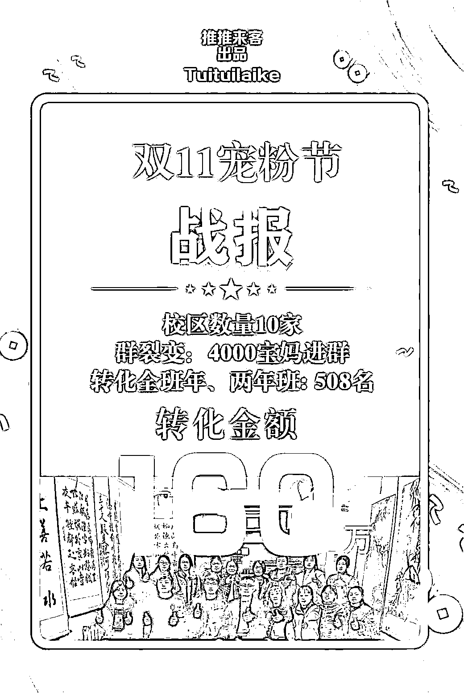

最后，这三步跑完，20 多天收款 160 万。这套逻辑其实特别适合瑜伽、水育、教培、医美这类行业，照搬过去跑个几十万问题真的不大。

### 【其他】

## （71 赞）《谈谈游戏租赁行业》

这篇算是一篇心得帖。进赚钱有半年多了，一直没啥好分享的，今天就把我做了五年的账号租赁类目拿出来聊聊，顺便扒一扒游戏租赁行业里的那些坑。

现在回想起来，六七年前开始做手游账号租赁的那批年轻人，现在应该早就财富自由了吧。

游戏租赁这个盘子其实很大，项目稳定，市面上能持续火的游戏也不少。

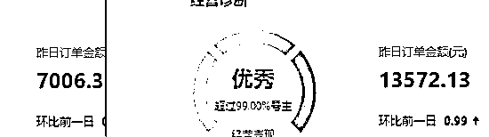

我 17 年到 19 年正好赶上了王者和吃鸡的红利期，回报率高得吓人：账号基本一两个月就能回本，回本之后全是利润。那会儿光靠暑假两个月就能赚得盆满钵满。现在回头看，这其实是个相当稳定的项目，五年前能变现的账号，现在依然能变现，无非就是赚多赚少的差距。

很多人现在还会问：租赁行业还能干吗？

答案是肯定的。不管你在平台上做，还是去经营自己的私域客户圈子，现在入场依然有得玩。这行最关键的一点，是看一款游戏的用户群体有多大。拿远一点的说，穿越火线、英雄联盟，当年火遍大江南北，现在虽然热度退了，但依然有一批稳定玩家。只要游戏不停运，账号就能一直租出去，持续变现。

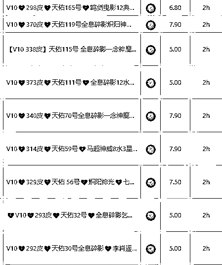

近一点的，就是王者、和平、火影、飞车这几款。早几年买号做回本周期大概在几个月到一年不等，回本之后全是利润。而且账号本身还有资产价值。比如花一万买号，干一年回本了，这号再不济还能卖个好几千。账号是能长期变现的资产，回本后以什么价格租出去都是纯赚。

也有人问：账号租不出去咋办？

租不出去的核心原因，不是市场不行，是方法没对。平台有平台的玩法，私域有私域的打法，方法对了，账号就好出。租号这行从选号、买号这一步就有讲究——比如上哪儿收低价账号、号里得配什么皮肤、哪个武器更好租。

平台玩法上，什么时候上货架热度最高、标题怎么写更吸引人、怎么引导客户二次消费——全是细节。私域也有私域的门道，比如从哪些渠道引流、怎么帮客户快速上号等等。

方法用对了，账号是非常好出租的。举个例子：100 个账号的店铺，能做到每天 80%-90% 的出租率，每个月光是租金收入就非常稳定。

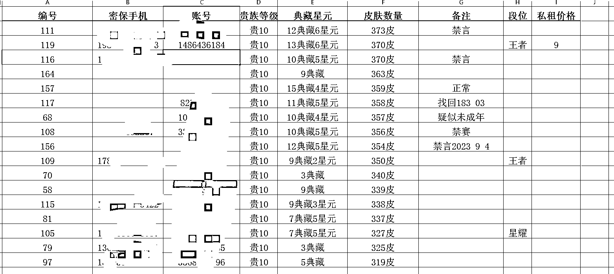

那管理方面是不是很费时间？

看你做哪条路。做私域确实要花时间，得及时回消息、引导客户上号。但如果你做的是平台，比如租号玩、u 租号这类，根本不怎么耗精力，每天抽空 1-2 小时打理一下就完事了。这类平台现在都有成熟的脚本工具，能实现 24 小时全自动管理账号。所以在平台上做，不需要投入大量时间。

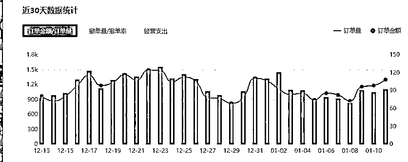

我自己 17 年那会儿，就是想着把王者号租出去赚点零花。最开始在 QQ 群上找客户，一天也能租出去几单。后来接触到租号玩这个平台，把自己的号上架上去，租完改个密码继续上架，单量一直很稳：平时一天一两单，周末三五单。

后来我认真算了下账号的回本周期，直接拿了十几万买号往平台上干。到了寒暑假，单量是真的吓人——涨价之后依然天天爆单。再后来就买了代挂软件，自动上架、自动打信誉分，基本全自动。

尝到甜头之后，又复投了几十万。做得早的时候，寒暑假两个月就能回本，后面就靠复制玩法继续买号，把店铺规模越做越大，最后还成了平台合伙人。

到 20 年左右，入场的人越来越多，如果不研究平台机制、只靠自然流量，很难稳定出单。那段时间我就专门研究平台的曝光规则，总结了不少“平时也能爆单”的方法。比如上午 10 点和下午 5 点左右买置顶货架效果最好。

直到现在，我每个月店铺还能带来两到三万收益——还是没认真管的情况下，因为号实在太多了。真要用心管，收益还能再翻 1.5 到 2 倍。我从 17 年开始做，这行累计已经赚了一百多个，现在每个月收益能稳住就满足了。

今天的分享就到这里。作为在赚钱发的第一篇帖子，有很多写得不到位的地方，欢迎大家多多包涵，也很开心在这里认识大家。

## （125 赞）（精华帖）《2 年发布 3000+视频成为 YouTube 法语区教育类的 TOP1 的复盘分享》

这不是一篇手把手的教程，也没有让你一夜爆火的黑科技。但 3000 多条视频积累下来的经验和思考，多少能给你一点启发。

我是 Kely，之前在法国 K12 互联网媒体负责视频项目。今天分享一下我们这个项目从 0 到 1 的全过程。我们是在内容覆盖度达到 100% 的情况下，花了两年时间上线 3000+ 视频，做到了法国高考期间 YouTube 直播推荐，Google 新闻排名最高第一的成绩。

整篇分享分四个部分，全方位拆解 YouTube 里的机会：

1. 熟悉了解 YouTube
2. 入场实战创作
3. 深耕内容获取更多流量
4. 走前人未走过的路，带来 10 倍以上收益

## 一、如何看待 Youtube 平台

YouTube 算是什么？B 站国际版？优爱腾海外版？

都对。而且它比你想象中要丰富得多。

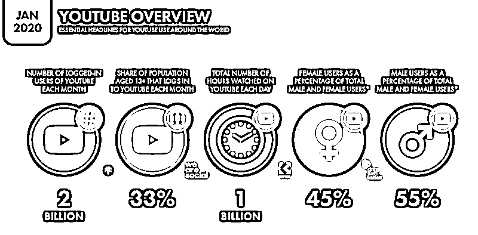

它是全球访问量第二大的网站——第一是 Google，百度排第六。

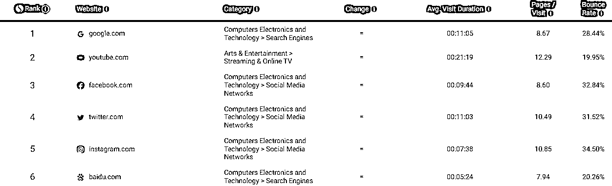

月访问量超过 26 亿，每天产生十亿小时的内容消费，人均消费 20 分钟/天，男女比例几乎对半。

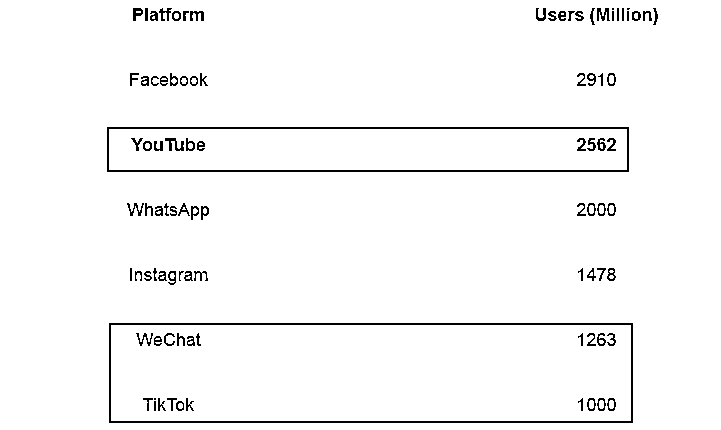

截至 2022 年，注册用户数超过 25 亿，印度是最多 YouTube 用户的国家，4.6 亿人，是美国的 1.8 倍。

平台上有 PGC 也有 UGC 内容，YouTube Premium 和 Music 的付费用户超过 5000 万，2021 年的广告收入是 280 亿美元。

2021 年，YouTube 推出 Shorts 对标 TikTok，2022 年第二季度 Shorts 月活做到 15 亿。

### 1. YouTube 能带给你什么

YouTube 本身就是第二大搜索引擎。想想看，你身边的朋友现在搜吃喝玩乐、学习教程都喜欢去哪儿？机会就在这里。

它的 SEO 权重很高：在 Google 搜索里，“YouTube”是第三大搜索关键词。换句话说，你在 YouTube 上把关键词排名做好，Google 排名也会跟着吃到红利。

官方有合作伙伴计划给你广告分成，你也可以把流量导到自己的产品上变现。总结起来，它对三方都很友好：

① 用户友好：支持高分辨率、真 4K，连接速度也快。
② 创作者友好：后台分析数据很细致，支持外链、嵌入也方便。
③ 广告主友好：受众广，日活/月活高，用户粘性大，男女比例也合适。这里就像虚拟世界里的地球村，只要产品足够好，一定能精准找到受众。

### 2. 平台内容：音乐娱乐休闲依然是主流

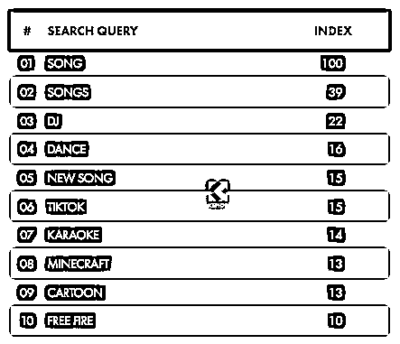

从 2022 年 1 月的搜索指数来看，音乐依然是全平台最吃香的内容，游戏内容的权重也在不断上升，以前 Twitch 的不少流量已经被 YouTube 抢走了。

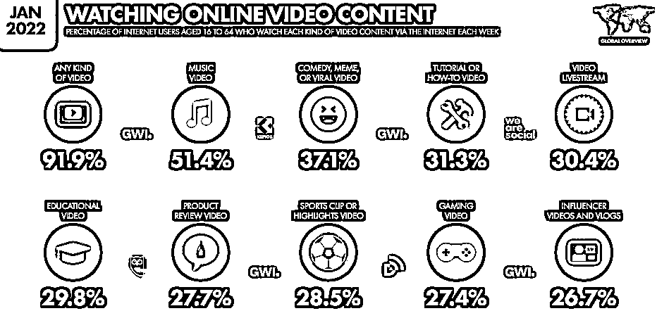

这里有一份全球 16-64 岁用户视频浏览行为的报告，可以看到音乐和搞笑内容是绝对主流，其余就是休闲、娱乐、教育、开箱、维修、直播这些品类。

YouTube 官方主推的，也正是这几个大类目。

### 3. 分发机制

（1）语言区

如果你做的内容语言是中文，平台会自动给你的内容打上中文标签。在用户没有主动搜索过中文内容、没有点过中文视频之前，你的内容只会展示给中文用户。

不管这个用户在地球的哪个位置，只要他是中文用户，就有机会看到你。但你的内容不会出现在英文用户的内容池里。

比如法语内容，就会优先推给加拿大、阿尔及利亚、利比亚这些说法语的地区。

（2）区域性（Geo Only）

你的账号注册地会决定内容分发的主要区域。比如你人在法国，内容就主要在法国、欧洲和法国海外省展示。这里没有中国选项。如果你的内容不针对特定区域，大部分人会选择美国。

但如果机器判定你对某些内容有持续兴趣，就会触发兴趣推荐，内容就可能跨区域展示。这取决于你的标签和历史观看行为。

（3）标签性（兴趣、内容属性）

同类型内容看得越多，推送就越精准。系统也会在同品类内推荐对手的视频，优胜劣汰。你能做的就是不断优化视频，增加自己被推荐的概率。

（4）机器生成（热度、种类）

推荐形式包括视频推荐、Playlist 合辑推荐、Live 直播推荐、趋势榜单等等。

比如这个页面里，提前一个月就已经自动生成好圣诞专辑了。

### 4. 盈利模式

（1）官方合作伙伴计划（YouTube Partner Program）

申请条件：

1. 开启 Google 账号双重验证
2. 订阅人数达到 1000+，总观看时长达到 4000+
3. 常驻地区必须在合作伙伴支持区域（美国、欧洲、香港等）
4. 账号无违规记录
5. 关联 AdSense 账号

审核周期大概一个月，通过之后就能开启广告分成。

好消息是：2023 年 2 月开始，Shorts 也可以加入 YPP 广告分成了。

#### YPP 的官方创收选项

1. 广告
2. 频道会员
3. 购物功能
4. 超级留言 & 超级贴纸
5. 超级感谢
6. YouTube Premium

广告、商店、打赏、会员费——变现路径非常多。

#### 非官方变现玩法

广告商合作、私域打赏、独立站、带货、CPS 等等，只要你想得到就能做。

广告商合作可以分独家和非独家：

1. 独家合作：一般会签若干条视频一口价，约定每条视频里预留多少秒广告位。这个模式在 YouTube 上接受度很高，多见于 how to 类内容。
2. 非独家：就是独立视频、独立内容各自接单。

私域打赏：直接跳外站，请作者喝杯咖啡那种。

私域会员制：比较典型的是用 Patreon。

做带货这件事，大多数人第一时间想到的渠道就是亚马逊——用户本身就信任平台和KOL，下单流程几秒钟搞定，体验顺畅。当然，第三方独立站也是个选项。卖的东西也不局限于实体，虚拟产品、课程这类通通能上。至于CPS的各种玩法，留给各位自行发挥脑洞就行了。

头部博主的商业合作，价格可一点都不亲民。

YouTube既是变现工具，也能当引流入口，关键看你的诉求是什么，玩法自然完全不同。

## 二、别光站着看，先下水试试

### 1\. 做内容

在YouTube混，好内容永远是硬通货。内容不一定非得多么有深度，但必须有自己的记忆点。

同样的选题，观众凭什么点开你，而不是隔壁那家？

内容够个性也好，人够有趣也好，颜值能打也好，教课教得明白也好，观点够犀利也好，球踢得漂亮也好，才艺够冷门也好，画面拍得够美也好，特效够炫也好，或者你本身就是自带流量的金字招牌——总得占一样。

简单说，YouTube的算法比较偏爱中长视频。接下来的内容，如果没有特殊说明，都是基于中长视频这个前提来聊的。

#### （1）方向怎么选

方向要是搞错了，再怎么努力都是在绕远路。

每个人的资源禀赋不一样，想做的事也不一样，得根据自身条件挑一条最优路线。大方向无非三种：做IP、做独立站、做引流。

##### 1）想打造IP

那从一开始就得想明白：你的粉丝画像是什么，用什么语言，重点覆盖哪些区域，消费偏好如何，以及靠什么方式变现。

同时也要给自己定好节奏：打算花多久做到什么量级，想赚多少钱。不同的项目和打法，整套规划跟执行路径差的不是一点半点。

如果你是打算靠第三方渠道变现，那你可能压根就不需要YouTube广告分成——开广告反而伤害粉丝体验。

如果你只是想在YouTube养养粉，把它当一个分发渠道用，那也别想太复杂，发内容就行了。

[shuaisoserious](https://youtube.com/@shuaisoserious)这位博主，坐标美国，主打个人健身IP，粉丝量达到一百万，既分享健身干货，也经营着自己的淘宝品牌店。

目标人群：健身爱好者

内容语言：中文

受众地区：全球

内容方向：健身相关内容，包括训练计划、个人经验、知识分享等。

变现方式：CPS+淘宝店+多平台分发（国内创作激励）

CPS这块，Myprotein的供应链全球铺开，中国区和海外区都有专属购物码。

淘宝店主要服务中国粉丝。

他的内容同时覆盖B站、知乎、新浪，靠这些平台也能拿到创作收益。

整套模式跑通的底层逻辑是：持续输出有价值的健身知识，先赢得信任，这是地基。

刚好我能搞到带折扣的产品，你有需要就顺手买。要是更喜欢我本人，那还有淘宝店，我的自有品牌随你挑。

##### 2）想做独立站

同样得先框定目标人群、主攻地区和内容方向。内容形式的选择要匹配你的受众习惯，这样触达效率才会高。

[DigitalRev TV](https://www.youtube.com/@DigitalrevTV)是这样一个案例，坐标香港，主营独立站，卖相机和镜头。

目标人群：摄影爱好者、专业摄影师、航拍爱好者等泛摄影人群。

受众范围：全球大部分地区都能配送（中国大陆除外）。

能看出来，这是面向全球摄影人群的IP加独立站模式。他们的目标很清晰：在摄影圈站稳脚跟，把影响力转化成独立站订单。中国大陆不配送，所以中文摄影爱好者并不是他们的主要服务对象。

内容语言：英文

内容方向：摄影内容，涵盖开箱、对比测评、教程等。

变现方式：独立站

用户评价很有意思——有人拿他们跟英国老牌汽车节目Top Gear相提并论，这个评价含金量确实很高。

Trustpilot上的口碑也不错，有真实的国际订单晒出来，整个从内容到变现的路径就这么闭环了。

往后看这套模式的本质：独立站的好处是商品自主可控，中间有差价可以赚。

香港免税政策带来价格竞争力，国际物流枢纽的定位让发货无比方便。欧美用户本来就有网购3C产品的习惯，消费路径天然契合。只要能把信任立起来，用户愿意来自家网站下单，事情就成了。

##### 3）想做引流

先搞明白自己是做品牌曝光，还是做产品开箱、展示、反馈这类内容。这类视频的核心使命是激发兴趣、建立信任，某种意义上还得承担客服的角色，最后把用户引到第三方网站去。

另外还可以换一个身份——做广告主，找KOL进行合作推广，让他们帮你引流。

[NikkieTutorials](https://www.youtube.com/@nikkietutorials)这个频道做的是化妆教程，坐标荷兰，粉丝量高达一千四百万，去年也推出了自创美妆品牌Nimya。

受众：欧美地区的年轻女性，热爱美妆，但消费力有限。

内容语言：英文

内容方向：美妆教程、仿妆、生活挑战、节日特辑、产品测评、明星妆面还原（合作过Adele和金·卡戴珊）。

变现方式：早期靠引流CPS，后期做独立站。

前期通过CPS模式，在视频里给不同品牌带货赚佣金。后来即便做了自有品牌，原来的佣金收入照样没断。

从互动反馈能看出来，这个IP形象深受粉丝喜欢，而且有大量重复观看行为——这往往意味着潜在的复购可能性。

这套玩法的核心，归根结底还是信任。

你展示的东西好看又好用，价格也合理，那我就愿意通过你的链接下单。你要做的无非是持续产出内容，把产品和效果展示到位。

我们自己的项目主打引流方向。

之前在攒用户的阶段开了广告收益，结果流量直接掉了30%，带来的收入却少得可怜。

老板思路很简单：收入来源越多越好。

但现实打了脸——你的数据还不够硬的时候，开广告只会适得其反。

拿我们的K12项目来说，这类内容跟娱乐搞笑视频不太一样，人家看完广告能继续看，但K12的用户等完广告可能直接就划走了。

这也是我们用真金白银换来的教训：试验了三个月，数据摆在那里，最后老板同意把广告关掉了。

所以你得对自己项目的定位和发展阶段有清醒的判断，什么阶段做什么事。在没达到YPP门槛之前，先专注在涨粉和拉长观看时长上面。

#### （2）成本怎么算

1）生产成本

做内容要花钱的地方包括设备、房租水电、人员工资、第三方合作、服务器、推广费用等。拉长时间看，设备成本其实是占比最低的，人员才是最大开销。其他弹性成本因项目规模而异。

小项目：一个人包揽拍摄剪辑后期。

条件好点的：文案脚本、拍摄剪辑、后期制作各一人，三个人就能保证稳定更新了。

2）时间成本

做一条视频要花的时间，拍摄、剪辑、后期、还要不要做直播，都得算进去。

不同类型视频的生产周期不一样，除了拍摄和剪辑，前期准备的时间也全都算在内。

3）怎么快速起步

做开箱视频，完全不用先配齐专业器材。

现在的手机就能搞定拍摄、剪辑、上传全流程。相机、灯光、麦克风、绿幕这些东西，真不需要一开始就买齐。

当然，预算充足的话，效果肯定会更好。

所以说，开始并没有想象中那么难。

如果你是单枪匹马或者小团队作战，成本结构是最优的。只要基本制作条件过得去，唯一的消耗就是时间，这种模式最适合快速试错。

但你要是中型团队，压力就来了——人员成本会迅速压倒其他开支，环节一多，时间拉得就更长。

这也解释了为什么YouTube上看到的大多数KOL都是小团队或者个人创作者。中大型机构普遍看不上YouTube这点体量，顶多把它当个分发渠道，顺带做做品牌曝光。

我们最早起步时只有一台摄影机、一个麦克风、两盏灯、一个十平米的小房间和一台剪片用的电脑。后来内容升级了，才陆续添置投影仪、直播电脑、无线麦克风和360相机。

#### （3）多久能启动

##### 1）普通人

一个普通人在YouTube做项目，从零到有一定起色，平均需要三到六个月。

相比抖音那种爆发式增长，YouTube的曲线平滑得多。

一开始几乎没什么观众，等到算法把你推入流量池，能不能起来全靠标签和描述。你要是做大众热门领域，竞争激烈程度可想而知。

但如果你选的是小众赛道，我有个朋友发的视频，一周之内就有精准粉丝在评论区互动了。

##### 2）自带流量

如果你本来就有粉丝基础，那启动周期自然更短。比如你在其他平台已经有了一批粉丝，YouTube账号的冷启动会轻松不少。

汤质老师就是一个例子，他的YouTube账号运营了两年（中间停更九个月），总共只发了24个视频，累计了150万播放和5.5万粉丝。

仔细看他的频道会发现，清一色全是长视频——"长"本身就是他的辨识度。

而且他的内容总能引发深入思考，这又是一个鲜明的特点。

但YouTube对他而言只是众多分发渠道之一，他还有公众号、B站、知识星球等阵地。既然不依赖YouTube变现，这种分发模式对他几乎没有额外的时间和成本压力。

我们自己的账号，订阅从0做到1000，最少也花了三个多月。

早期我们做的内容偏向媒体采访和时事评论。这个阶段，内容本身的独特性不够强。用户看新闻频道和看我们的视频，本质上没什么区别，只不过我们的内容更聚焦一些。

视频发出去之后，蹭上话题热度，播放量也才几百到一千左右。当时做视频类内容的同类媒体几乎找不到，大部分都是图文，整个板块没有太大波动，但我们还是一直在坚持。

后来我们启动了K12内容计划，本以为流量会不错，结果前三个月播放量依然只有100上下。怎么想都想不通，内容明明没问题，为什么就是没有流量？

后面我们开始一步一步优化，情况才慢慢好转。

### 2\. 做运营

初期不知道怎么运营，最简单粗暴的方法就是——盯着你的竞争对手看。最好的老师永远是对手。

但找到对标账号也千万别全盘照搬，因为你们所处的阶段完全不一样。同样一件事，他做了有效果，你做了可能啥也不是。

#### （1）多平台分发，前期加速器

最好把Facebook、Twitter这些账号都顺手注册了。因为前期你根本没有流量，把视频分享到FB、Twitter或者专业论坛，能帮你争取更多曝光机会。

##### 1）自有媒体

包括但不限于网站、App、Facebook等社交媒体。这些渠道的好处是你对内容有完全的掌控权，发出去的每条内容都能确保是自己想展示的。

我们做了自己的网站，把YouTube视频直接内嵌到网页里，用户浏览网站的时候，不用跳转就能直接看，体验非常顺滑，同时也拉高了视频播放量。

另外我们也会在各大社交媒体同步发布视频信息，尽可能把初期的曝光做大。

YouTube在视频播放量达到一定阈值时会检查流量来源——我们当时碰到的节点是300（这个数可能随时会变）。它会审查你的流量数据有没有异常，防止有人靠作弊手段刷量。

##### 2）合作媒体

如果你是做产品类内容的，可以主动联系新闻媒体、科技网站、自媒体账号，让他们来报道你的产品。第三方视角的报道，能让你的IP和产品显得更立体、更丰满。

很多时候，同行的推荐和开箱测评，比你自卖自夸要有说服力得多。同行可以是在这个行业里的人，也可以是某个领域的专业人士。

要是传统媒体能报道你一次，那影响力就更大了，后面细说。

##### 3）付费投放

通常适合销售类产品，只要投产比足够高，就可以一直投下去。

可以投社交媒体广告，也可以花钱让KOL帮你带货，具体效果因内容而异。

不过这不完全算是YouTube内容创作的主线玩法，毕竟广告的投放周期更短，或者更常以GIF图片形式出现。

关键还是看你的目标路径。如果投广告是为了拉高视频点击、把路人转成IP粉丝、再导到产品成交——那不如直接投产品，可能还来得更直接。

#### （3）看数据

YouTube Analytics的精细程度在各视频平台后台里算是顶尖的，里面甚至有一堆普通人用不上的细节数据，连用户的操作系统都一清二楚。当然，如果你喜欢研究细节，这绝对是最好用的数据分析工具。

Analytics里最核心的几个指标：

①观看时长

YouTube判断视频好坏最看重的因素就是观看时长。因为平台上内容是中长视频为主，总观看时长比完播率更有参考价值。（还记得申请YPP要4000小时的要求吗？）

②播放量

播放量的增长直接影响账号权重。前期拼的就是播放量，中后期才更看重观看时长。

③订阅数

对YouTube来说逻辑很简单——如果你的内容够好，用户自然会关注。订阅数也是平台给你基础推送的一条底线。

数据分析贯穿整个运营周期，学会看懂数据是你的一门必修课。

今天这个视频数据好，那个播放量高，另一个互动率高——你得知道为什么？什么人在看？这背后的原因是什么？

这些数据在前期优化视频时价值巨大。通过观察观看时长曲线，你能快速知道视频在哪一段流失了观众。

一条4分半的视频，平均看到3分钟，而且下降曲线是平滑的，跟同类视频比就算正常。

有多少人反复观看你的视频？有多少人点了关注？

做测试视频的时候，我完全没想到土耳其会有这么多观众看。

流量来源里，超过50%来自搜索，16%来自推荐，10%来自播放列表。

只要基础内容过关，哪怕没怎么优化，搜索流量也是相对精准的，整个流量结构很健康。

再看看社交媒体渠道带来了多少流量，谁贡献最大。这样你就能对视频的表现有一个清晰的认知——它有没有话题性。

简单总结：数据表现得最好的地方，就是你做得最对的地方。差一点的也不一定代表不好，关键看你的方向需要什么。

假设你在外部平台流量很大，养了一堆自己的粉丝，但搜索流量占比太小，那反而不健康——因为你成了流量反哺，过于依赖外部输血。

##### 1）分析对手数据

最简单的方法——去对手的频道，按播放量从高到低排序，把前10名的视频拉出来，你就能知道这个领域什么样的内容最受欢迎。

再统计一下他的粉丝数、平均播放量、更新频率、视频整体质量、评论区都在聊什么。

比如这个账号，最受欢迎的视频里，有7个都在聊苹果产品。流量密码是iPad还是MacBook？答案是都在！他们保持周更的频率，画面精美，平均时长9分钟。发布两天，视频能跑8千播放；一个小时的视频，能有700播放。

数据拆解完，还得分析对方的内容本身。

看他的内容形式是口播还是动画，开头怎么切入的，怎么设置悬念，有没有引导粉丝点赞关注？

感受一下视频节奏。假设中间弹出广告，你还愿意继续看下去吗？

再看他主页的内容规划是怎么排布的。

变现方式：赞助+CPS+请喝咖啡

如果这是你的竞品，做到对整体情况心里有数，并不难。

#### （4）基础优化

YouTube的黄金三秒法则。

前3秒留不住人，后面你就算内容再精彩也是白搭。

我们常用的是结果前置或者观点先行。先把用户感兴趣的结果抛出来，或者直接来一个让用户惊讶的结论。让用户第一秒钟就知道这条视频在讲什么。

开头成功抓住注意力之后，剩下的就看你怎么根据内容特点来展示了。

你可以用一个华丽炫目的画面开场，也可以用一个悬念作为钩子。选一个最适合你内容调性和最能代表你个人标识的开头，这点至关重要。

K12的内容更强调逻辑和整体。知识点讲完一个，用户能预判到下一个要讲什么，整个知识链路非常清晰。

我们项目从一开始的单IP，后期发展成多IP矩阵——每位老师都是一个独立的IP。每个老师的自我介绍里，一定会把自己的IP名和品牌名绑定，形成强关联。

以至于在现实生活中，老师们经常被问到："你是不是跟那个XX有合作？"或者在街上被认出来："哎！我在XX的视频里见过你！"

某种程度上说，这也算是一些成绩，说明这套策略跑通了。

##### 1）标题描述怎么优化

写标题和描述时，用最简洁直白的话把意思说清楚就好，千万别为了堆关键词把句子搞得很复杂。

简洁和精准，往往是效率最高的。

##### 2）封面怎么优化

封面是你和用户之间的第一道桥梁。

在YouTube上，一个视频能不能被点开，封面起到的作用，有时候甚至比标题还重要。

封面既是吸睛的入口，也是品牌调性的名片。别小看这一步，花点心思打磨是值得的。

封面要和你的品牌气质、个人调性保持一致。硬核的攀登教学，配水彩轻描淡写式的画面就很违和。

  

##### 3）Call to Action 

打开 YouTube 就能发现，绝大多数创作者都会在开场或收尾时喊一句：点个赞、给点支持、帮忙转发。

如果你希望别人订阅，就必须明明白白说出来。B 站上到处都是“求三连求投币”的呼吁，道理很简单，用户不被提醒，他根本不知道可以做什么。

  

一定要主动引导订阅，这样每次更新都能 push 到他，保住基础播放。等粉丝量起来了，为了调性可以收敛一点，但在起步阶段就别不好意思开口，要喊。

##### 4）增加你的互动率 

视频下方只要有留言，都要回。任何互动机会都别放过，哪怕对方只丢了一个 emoji。

  

### 3\. 定期复盘，做好下一步计划 

把前面几步跑通后，账号也运营一段时间了，对整个项目会有更整体的体感。

你应该能算清楚：花了多久、投入多少成本、产出了多少条视频、数据表现如何、整体是否在往上走。

对照最初定的目标，比如一个月、两个月、三个月要达到的粉丝数和观看量，有没有达成？

没达成的缘由是什么？当前的开销还能支撑多久？有没有别的盈利业务能帮你度过前期投入期？

如果三个月没起色，半年也没起色，你能否承受这笔损失？

如果有增长但远低于预期，还有哪些打法没试过，哪些渠道还没用上？

这些问题日常也会冒出来，但定期复盘能把感知变成可对照的数据。

项目不同、定位不同，策略自然不同。如果你只是把 YouTube 当分发渠道，那直接粗暴搬运就行，别纠结太多。

我们的项目架构就是不靠 YouTube 做 IP 变现，我们做视频是为了把流量导到后端。确认广告无法带来收益后，广告位直接就关了。

从一开始，目标就是在教育赛道占下一个媒体位置。

## 三、提升你的内容种类和形式，获取更多流量 

一旦决定要长期深耕，就必须持续优化，找新突破口，获取更多曝光。

这时候你面对的已经是全球顶尖创作者的竞争。

不只是做出“能看的视频”，而是要做出“优质的视频”。

### 1\. 多样化内容形式 

  

做教育新媒体起步时，我们的新闻类视频就是主播对政策进行讲解，形式很单一。

后来开始做人物访谈，还加入了线下论坛的采访。活跃度上去后，高校的商务合作就找上门了。

访谈里会植入合作方的露出，给到更多展示机会，甚至单独为对方定制一支片子。虽然费用cover不了全部制作成本，但为后续的网站广告位、商务推广合作打下了基础。

还尝试过在活动现场做 360 度直播，但收音和画面都达不到预期，只能叫停。

### 2\. 深挖不同内容种类 

有了经验后，对内容的要求就要再往上提。可以在深度和广度两个维度去扩。

深度上就是往里挖，做别人没做的切口。

比如大家都在聊手机性能、像素多高，你反而聊使用手感。找准自己擅长的视角，做有辨识度的内容。

广度上就是开拓更多题材。你本来做体育、专注足球，世界杯临近，除了报道进行中的赛事，能不能提前做各支球队的专题、球星专题、甚至赞助商专题？提前一个月备好，往往能吃到一波流量。

举个例子，你一开始做创业口播，请了 10 个创业者讲成功与失败的经历。访谈完能否再提炼出一份《创业避坑指南》？

内容一下就丰满起来了，就像搭积木，一块块添上去，最后就是一座高楼。

我们的项目也是这样迭代的。

前期先做教育新政的解读和分析，帮助用户做选择，属于时事解说。

接着做特殊院校学生的访谈。

比如一些不常见的职业，像面包师，让观众了解这个职业的学习路径，给到未来方向的参考。

再做创业学生的系列，他们为什么创业？在什么节点做了决定？过程如何？是成功还是失败？

还有合作伙伴访谈，他们能为学生提供什么新项目、什么帮助。

How to 系列，比如怎么领取政府补贴。符合条件的学生可以申请，这条线把学生校外生活的信息补得非常完整。

  

另一条主线是 K12 教育内容，从校外延伸到校内。

我们找来在职教师，他们负责教学内容，我们负责录制、剪辑和上线。有一个同事专门把老师的稿件数字化，方便拍摄和剪辑。

不同老师的表达节奏不同，有人一分钟讲清，有人需要铺垫两三分钟。

测试上百条后发现，5 分钟的视频，平均只看 3 分钟；3 分钟的视频，平均只看 1 到 2 分钟。所以后期我们把大多数视频都控制在 5 分钟以内，能直说就不铺垫。

这一块是持续工业化产出，用了两年上线了 3000+ 条视频，实际还多一点点，力求做到 100% 内容覆盖。

### 3\. 运营技巧提升形象，获取更多流量 

频道的基础搭建航海之前讲过，这里不再赘述。

##### （1）YouTube 频道搭建 

这相当于你的线上门店。必须体现专业度，和你的独有属性。

  

##### （2）账号包装 

包装直接决定第一印象，包括整体画面风格。是明亮通透还是低调克制？

字体选什么？主色调是什么？风格是内敛、夸张还是严肃？

一个做搞笑的账号，字体和配色大概率会是夸张、明亮、高对比度的。

一个做法律的账号，多半会用工整、冷静、沉稳的配色。

  

光看配图就能感受到和搞笑、创意有关联。

  

频道顶部有一个广告位，这是最佳的宣传位置，一定要精心设计。

如果是品牌，可以放 slogan。

进阶玩法是根据时间段做轮换，有精力的话可以定期更新。

  

不进视频就能直接点击购买

首页还有一个置顶视频。对于新访客来说，这是了解你的最佳窗口。

品牌会放宣传片，做内容类账号，可以放最新作品或数据最好的作品。

进频道后这个视频会自动播放，也能用来拉这条视频的数据。

##### （3）互动模块 

内容积累多了，风格也稳定了，我们会在视频里卡点植入其他视频。

通过互动卡片把相关视频嵌进当前视频里。

  

不同类型视频的互动点击率大概在 3% 到 7% 之间波动，不算爆炸，但只要有就是增量。

举个例子

这支视频讲“小马在医院醒来后发生了什么”。如果你没看他怎么摔的，可以去看前一支。

K12 内容结构清晰也有好处。录制前我就知道这条会和上一条关联，于是会在拍摄时让老师在片中带到上一个知识点。

同时做标题和简介 SEO 时，也会把上一个视频带进来。

做了这个动作后，点击率提升了约 8%。

##### （4）SEO 标题简介优化 

熟悉谷歌 SEO 的话，YouTube 上手很快，底层逻辑类似。

几个关键点：

1. 标题要简洁精准
2. 不要堆砌关键词
3. 用人话写

标题里可以加上系列名，也可以用 1、2、3 来做编号。

比如“张三笔记”“张三杂谈”“张三语录”。

这样机器能自动识别出它们属于同一个系列。

简介要精准又丰富：

1. 第一句点明视频讲什么
2. 补充背景信息，附上上一个视频链接
3. 有对应独立站页面，就放链接
4. 写上社交媒体的联系方式，告诉观众去哪找你
5. 长视频可以用分段导航做目录，方便跳转

  

比较标准且 SEO 友好的标题描述范例

##### （5）关键词优化 

在搜索框输入目标关键词，看一下同类结果和数据。

  

再把关键词丢进谷歌搜索，看返回的是什么。

  

基本能看出门道了。

关键词要根据内容来选，不是越多越好。

比如做数码，都在做 iPad 开箱，你也只能用同样的词，这时候就拼内容质量了。

##### （6）字幕 

字幕不只是给人看的，也是给机器读的。有时间就补上，对视频权重有帮助。

  

##### （7）播放列表 

播放列表能做合辑，也能做 SEO。描述写法和视频简介类似，很多人忽略了。

  

##### （8）视频章节 

方便用户快速定位到想要的部分。

  

##### （9）结尾引导 

最好提前做一个结尾模板。视频看完后，能顺势推荐其他视频。

  

否则机器推荐的下一个视频，可能就不是你的了。

这里还可以加关注的提示，一定要做。

我们的点击率稳定在 5% 到 10%。

##### （10）稳定发布频率 

尽量固定时间发，比如每月 1 号、15 号；或每周三、周五。

我们测试过，有些日子播放就是低迷，前期要避开。在用户最活跃的那天发，对前期播放影响很大。

##### （11）直播加成 

YouTube 上的直播对账号权重提升非常明显。

有时间和资源就一定要做。

YouTube 的直播流量很大，尤其是游戏直播，世界杯期间体育内容也有加成。

  

直播有多个推荐板块，一上推荐权重就会大幅提升。

看数据这个账号几乎每天直播，占据了三个板块的第一位，增幅很可观。

  

还没完，正在直播里还有小分类，游戏区他也是第一。

我们之前的项目也是这个效果，正在、过去、将来直播推荐里都有，教育区也是第一。

## 四、走前人未走过的路 

做这个项目时没有可对标的竞品，K12 在当时并不火，国内大厂也没下场。很多打法都是自己摸索，接下来两个探索性项目带来了 10 倍以上的回报。

#### 1\. 发掘市场空白-填补空白-360 度驾考实录 

在 K12 内容和校外生活内容稳定增长后，我们开始思考如何把视频经验复制到技能类内容。

法国路考是 20 分钟上路，每到一个路口情况都不同，需要现场判断。没经历过的人都会有未知恐惧。

看别人跳伞视频时，我想到能不能用 360 度视频完整展示一场路考？让用户直观看到考试中发生了什么，为什么这么操作，看不懂还能反复回放。

想法提出后领导很感兴趣，直接开始小规模测试。

测试项目预算有限，先买了当时市面上为数不多的 360 相机，能用但效果一般，只为验证可行性。

难点在于机位安装。

装车外，能看清路况，却看不到考生反应，也看不到考官的操作和判断。

装车内，则要解决固定、减震、收音问题。用的还是私人车辆，改装受限。

后来另配一套收音系统，后期再合成，经过多次调试才得到可用成果。

拿着可用样片申请了新预算，买了更好的 360 相机，开启了集中录制。

  

最终我们是市场上第一个也是唯一一个推出 360 度驾考实操视频的，直接把竞争对手甩在了后面。

这些视频在我们的网站和 App 内嵌播放，反向为 YouTube 导流，提升视频权重。

Google Play 的产品经理看到 App 更新后觉得内容很棒，直接给了 6 周的首页推荐。

App Store 也有推荐，只是力度小于 Google Play。

App 下载量大幅提升，注册用户激增，获客成本远低于 Facebook 广告。

除人力成本外，设备采购花了不到 1 万，其他都是现成资源。

最终产出 20 条以上的成片，单条成本约 500 元。

现在回看制作上仍有改进空间，但当时完全是盲拍，边做边优化，没有任何案例可参考。

#### 2\. 法国高考直播助力、媒体联合 

前面提到我们已经覆盖了 K12 教育内容。但发现一个问题：很多学生进来看看就走，播放量有了，互动却很少。

为了提升互动率，我们开了几期直播。

流程很简单，提前放预告，告诉大家周几几点上线，请大家预约。

这里很关键，直播预告一放上去，就进入了 SEO 流程。

它会在 YouTube Live 中被收录。SEO 和账号权重够的话，你的直播预告会直接出现在机器生成的 LIVE 推荐里。

  

最高峰时，6 个推荐里有 5 个都是我们账号的直播。

开播初期固定在周三下午 3 到 5 点，学生没课的时间。

前期数据一般，因为没课时大家更想出去玩。

随着考试临近，数据越来越好。

每门课只播一个小时，老师讲 30 到 40 分钟。

中间穿插一两个提问，最后汇总问题统一回答，互动率慢慢起来了。

后期在线人数增多，开播时看不清留言，必须安排专人筛选问题。

直播团队配置不大：一人负责技术，一人负责收集提问、回答、社媒运营；负责人把控节奏、分析数据、调度人员。

项目从考前两个月就启动了。考前一个月，电视台记者来采访，想了解我们新媒体教育的运作模式。

我们接受了法国电视台的采访，热度又上了一层。

之后迎来电视台的合作计划：互推、流量置换、外加媒体报道。双方几乎没有额外支出，电视台带来了传统媒体的增量流量，我们也提升了电视台的形象。

3\. 前面讲到要深耕，要做到领域内最好。

看到这里可能以为高考前的直播复习就结束了，其实没有。作为媒体，我们的目标是吃下考试期间的全量流量。

于是继续加码，和传统媒体正面竞争。

考试当天安排团队在校外采访学生。11:30 结束内容，12:30-13:00 就上线，抢第一波流量；下午 4 点半再推一波。

团队小、反应快，上线速度比电视台还快，直击考场实时内容。

合作老师远程改卷，考完当天下午就能进直播间解答。解答完再安排第二天的考前重点复习，形成考前-考中-考后的闭环。

  

最终成绩是：YouTube 直播推荐全程覆盖，Google 新闻排名长期前三，最高第一，基本没掉出前五。我们牢牢掌握了流量的入口。

搜一下和 K12 相关的复习资料、解题内容，几乎全是咱们这边产出的东西。夸张的是，Google 上甚至 YouTube 的直播页排名都盖过了我们自家官网。

在 Google 新闻区，咱们的位置被刷到了更前面。

完全没花推广费，就靠自然搜索把榜单占满了。过去攒下的那些沉淀，终于在这一波流量高峰里全部变现。

回头复盘这段历程会发现，每一次真正的大跃进，都是因为我做了别人还没试过的路。动手之前，谁都不知道最后会是什么结果。

当时状态很安静，就是踏踏实实把当下的每一步做好边干边学，边干边调，一直做到自己当下能做到最好的程度，结局自然不会太糟。

对照我们的长期目标来说，慢下来反而更快。

希望我的这段实操经历，能给你一点点参考。

# 总结

这一周的赚钱周报里精华内容不少，大家直接点目录就能跳转。

说实话小懒手动归纳整理到手都快废了，下次出周报小懒真要写个脚本来自动搞了。

整理的时候本来是想顺便把项目都过一遍，但这种高重复的工作真的会把小懒的耐心耗光。

今天早上已经给大家补上了 80 多条龙哥风向标，算上之前的，风向标资源累计快三百条了。

祝大家都能从里面淘到机会，顺利把钱赚到~

本周赚钱周报除了离线版，小懒也会整理到在线版合集里，方便大家检索和手机上查看。

小懒爱你们！

