# 别再盲目捡梗拍视频了，这两套自动化采集让我直接抄到对标本

先说句实话，标题有点抓眼球，但内容是真的。

最近在啃短视频带货的玩法，同时也在摸无人直播的可行性。刷号的时候点进巨量百应的后台，创意中心里藏着的两个功能区，瞬间打开了思路。

更夸张的是，平台里单条内容的收益上限远超预期，几十万流水的案例并不罕见。更明显的是，头部号在用高度模板化的内容做规模化复制，矩阵特征特别突出。

首个区域是爆款汇总。能按行业、按创作者等级筛选当下带货效果最突出的作品。相较于市场上常见的第三方监测工具，这个源头库的实时性和贴合度更高。

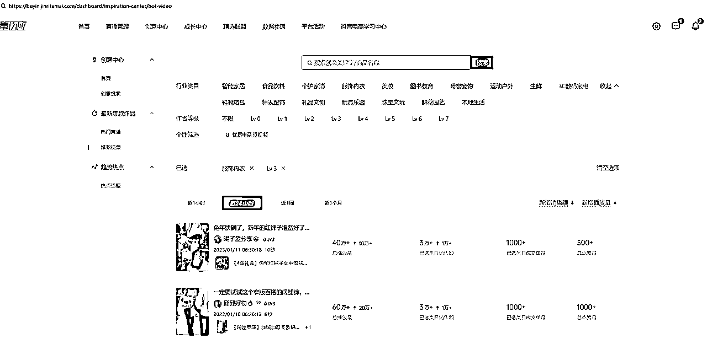

第二块是创意检索。支持用关键词或商品编号作为入口，拉取近期同品类竞对的片子，更新非常快。发布量不大的账号，反而更适合在这里找对手的实操拆解。

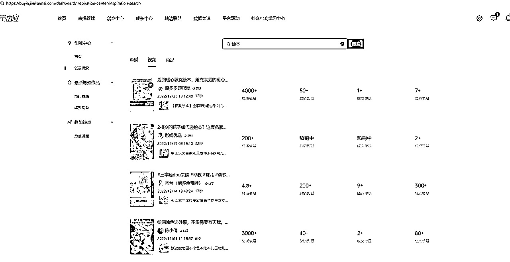

当时唯一的念头就是：把这些素材完整保存，同时把里面的数据结构化，优质的脚本骨架单独归档。无论是复刻还是二次剪辑，效率都会明显提升。

参考价值很直观，能进入榜单的、能产生转化的、时间最新的样本，基本就是最值得研究的标的。成熟的脚本框架迁移性很强，换一套话术、换一个主推 SKU，成单概率通常远高于凭空创作。

靠记忆不如靠留存。我对 RPA 工具有点经验，平时在用影刀，于是抽空花一周业余时间搭了两套自用流程。

## 方案一：Buyin 创意检索抓取

围绕 Buyin 的创意检索来做。

核心能力：

*   自定义检索词或商品名称
*   可设循环滚屏的轮次
*   以 GMV 做阈值过滤掉零销量内容
*   数据表导出，默认落到桌面
*   可选无水印视频下载
*   自动记忆上次的输入参数

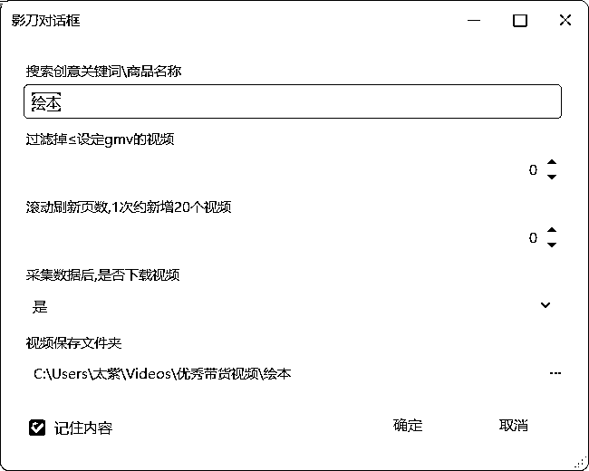

按默认配置跑，不做分页加载时，单页大约 22 秒结束。

#### 表格产出

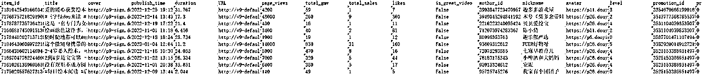

表格可展开查看，字段齐全，后续做二次分析也方便。常用用法是把 total_gmv 倒序，快速定位同行近期成交最好的内容。后续就是自由发挥。

#### 视频下载

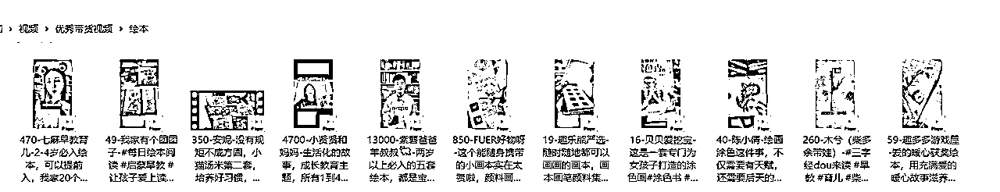

#### 参考源码，仅作学习，请勿违规使用：

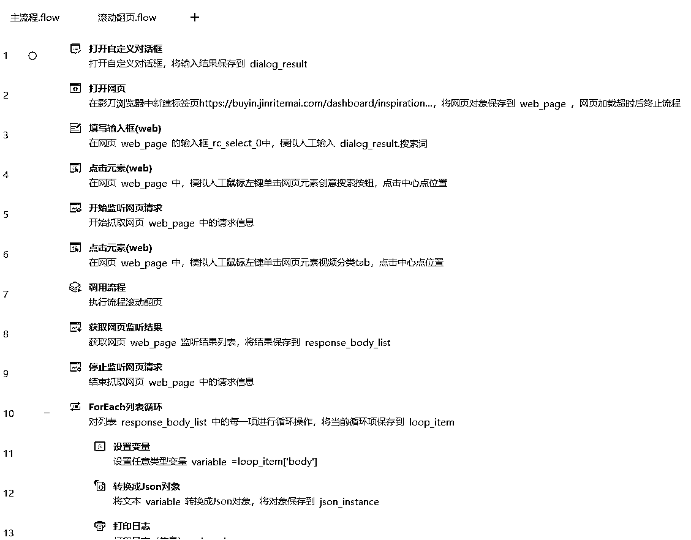

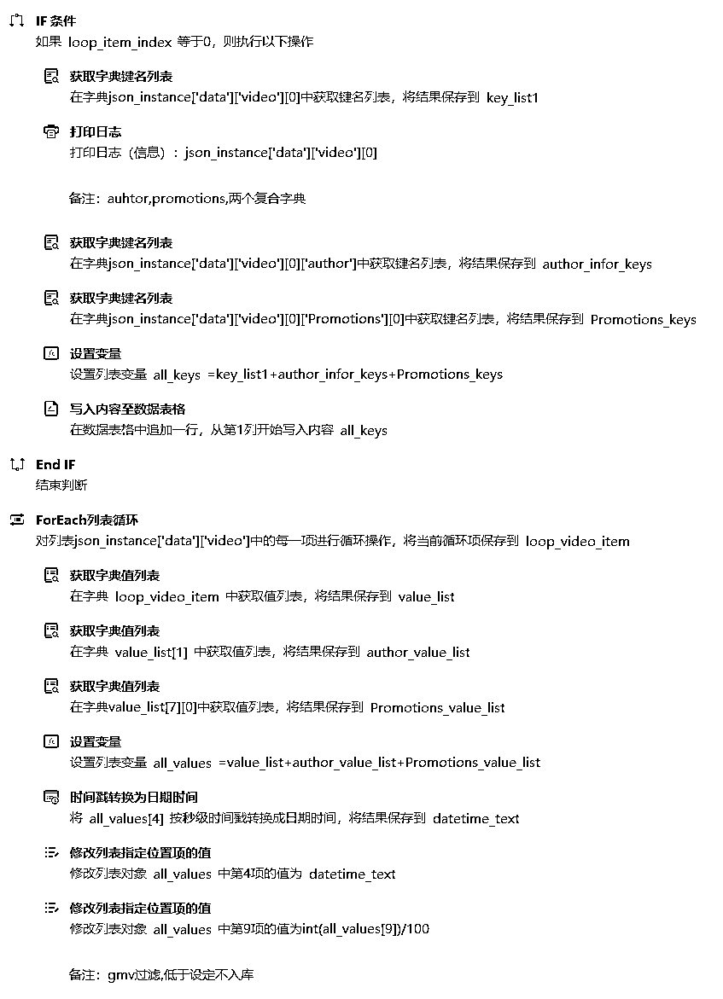

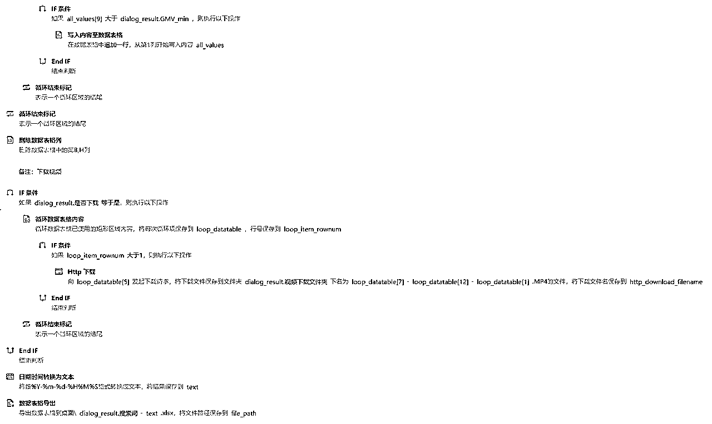

## 方案二：Buyin 热门作品分类抓取

围绕 Buyin 的爆款榜单来做。

核心能力：

*   可选大行业与子行业
*   可选创作者等级
*   可选时间窗口
*   控制下拉加载的页码
*   数据表导出，默认落到桌面
*   可选无水印视频下载
*   自动记忆上次的选择项

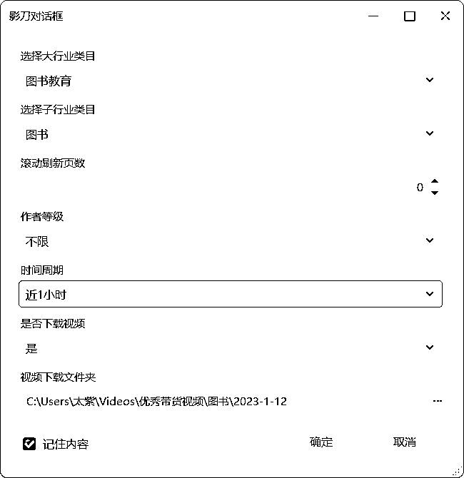

确认后启动，不做翻页刷新时，单页约 55 秒完成。

#### 表格产出

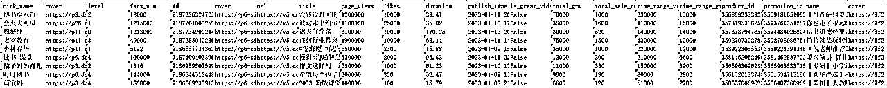

采集到的数值比前端展示更精细，因为页面做了取整简化。我的筛选偏好是找粉丝体量小却成交不错的作品，这类黑马更适合中小创作者借鉴。头部账号自带粉丝红利，转化天然占优，参考意义有限。

#### 视频下载

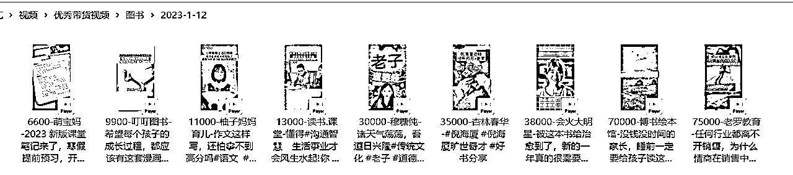

素材下载后，用飞书妙记做语音转文字，脚本梳理会更快。

#### 参考源码，仅作学习，请勿违规使用：

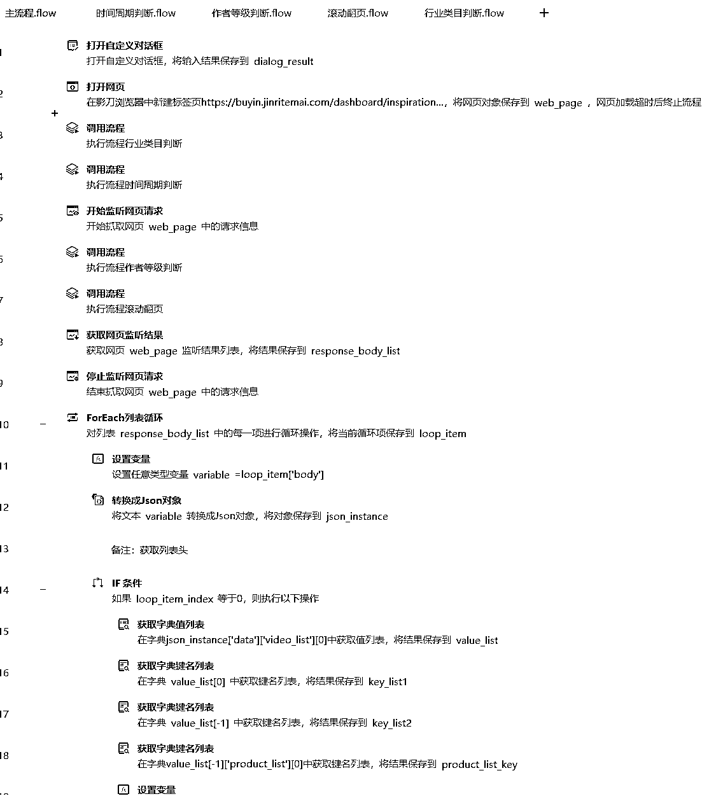

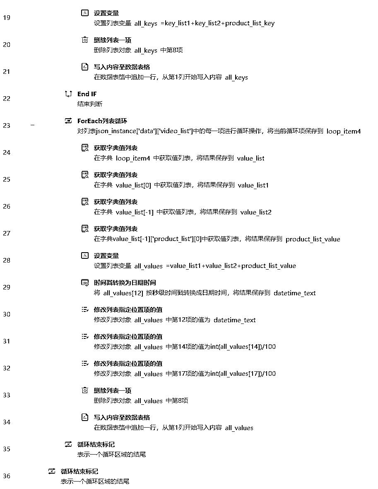

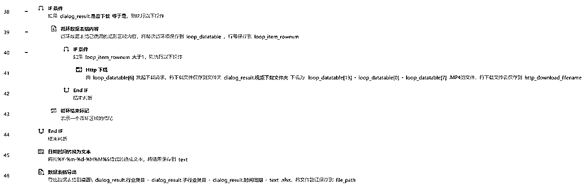

## 收尾

RPA 确实好用。之前我分享过用后羿采集器做知乎相关的数据抓取，那个工具也不错。但 RPA 的自由度更高，有想法加一点编程思维，哪怕不是专业开发者，也能做出能用的流程。

我本人不是程序员，最多算产品背景，上面代码可能不够优雅，欢迎指正。

我还写了几套日常自用的小流程，也是自己偶尔在跑。

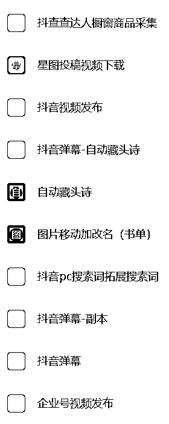

另外我用影刀尝试过一套无人直播的小机器：采集直播间弹幕 → 关键词匹配 → 自动语音回复 → 自动视频回复。流程跑通了，但体验一般，脚本运行时电脑被占用。所以后来我找程序员朋友另起炉灶，做了一套无人直播工具，上述功能都能覆盖，beta 版已出来。

附上我的影刀注册邀请链接，无推广收益，只是想测试 90 天创业版权限。现在脚本不好直接分享，看看创业版能不能解决……互惠互利。

https://www.winrobot360.com/share/activity?inviteUserUuid=5cd282a5-32eb-426f-ad50-4b3eaa9edc70

做 RPA 的、做短视频带货的、做直播带货的朋友，欢迎交流，微信：cooperhgp。

老规矩，加我时备注“龙哥盟”~