# 【AI绘画】无须N卡A卡！浏览器里就能玩的顶级AI绘图实战


嗨，我是屋顶瓦，今天分享一套在 Google Colab 上畅玩 AI 绘画的完整打法，干货密度很高，跟着做就能立刻上手。废话少说，直接进入正题。

说明：正文配图、模型获取地址以及可用的脚本链接已汇总在文章末尾，自行取用即可。

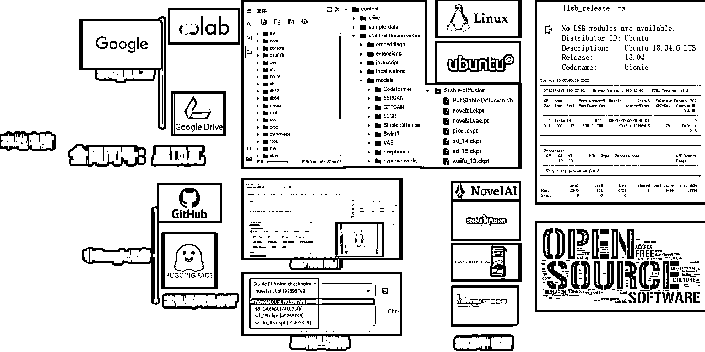


# 先弄清几个关键概念

## Colab

Colab 是 Google 推出的在线协同开发环境，本质可视作一台可远程操作的云主机。连上后就能调用平台提供的算力资源完成各类任务。因为模型训练和图像生成对显卡依赖大，本地设备往往吃不消，所以该平台在 AI 与机器学习圈子里非常流行。

底层其实是 Linux 系统搭配 GPU 的云主机，目前镜像为 Ubuntu 18.04，打开浏览器就能执行 Python 代码。

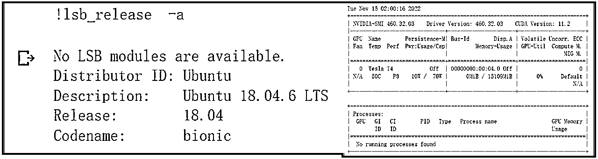

Colab 有免费版和付费版，免费账号每日可使用数小时，资源大约为 12GB 内存、约 15GB 显存、约 55GB 磁盘。同价位带 GPU 的云主机价格都不低，Google 的配置对尝鲜和轻量使用相当友好。

延伸问题：
如果几小时时长不够，有什么办法续航？可以多申请几个 Google 账号，一个账号用几小时，多个账号轮换就能延长可用时间。

## Gdrive


## Github

Github 是开发者聚集的开源社区，全球大量优质代码在此开源共享，找项目、学实现都非常便捷。2018 年被微软收购。

## Hugging Face

Hugging Face 可看作 AI 领域的 Github，平台收纳了海量模型、数据集、说明文档以及免费教程，均保持开源。工程师可以在前人成果上持续迭代协作，产出更优作品。

## stable diffusion

扩散模型是当前一线的生成式模型，能输出高分辨率多样化图像。Stable Diffusion 由 Stability.ai、Runway、LAION 等机构联合研发，是一个文本驱动图像的扩散模型。通俗讲，它提供了一套把文字提示转化为图像的算法与实现。输入 prompt 后，配合训练好的模型文件即可生成对应风格的画面。没有这一核心，就没有后来的模型生态。

github 地址：https://github.com/CompVis/stable-diffusion

## stable diffusion WebUI

这是一款为 Stable Diffusion 封装的网页操作界面，大幅降低了使用门槛。若没有它，使用 Stable Diffusion 只能写代码或命令行，对普通用户极不友好，也是 AI 绘画爆发的重要推手。

github 地址：https://github.com/AUTOMATIC1111/stable-diffusion-webui

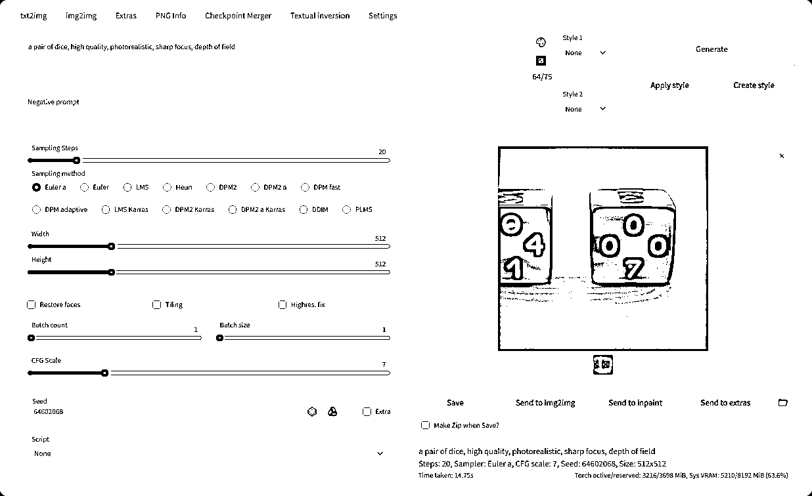

## NovelAI、Waifu1.3、Stable Diffusion1.4/1.5 等模型文件

这些模型皆基于 Stable Diffusion 训练而来。网络上模型繁多，既有官方发布也有个人魔改，不同模型决定了最终画风。比如 NovelAI 与 Waifu 系列偏向二次元动漫，Stable Diffusion 1.4/1.5 依托 LAION-5B 训练，LAION-5B 是目前最大可公开访问的多模态语料库，所以风格更宽泛、写实感更强。可按喜好挑选，也可自行训练。

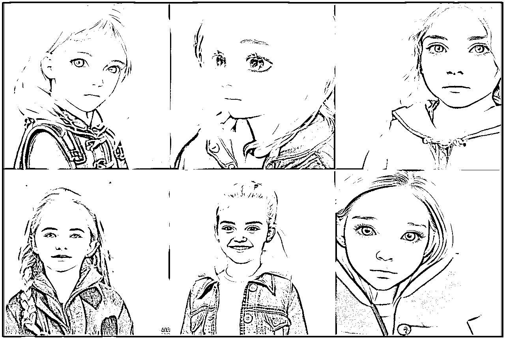

上图从左到右、从上到下，分别是 novelai、waifu1.3、sd1.4、sd1.5、midjourney-v4-diffusion、redshift-diffusion 在同 prompt、同参数下生成的对比。可明显看出 novelai 与 waifu 充斥动漫气质，其余模型则更趋真实。

# 实操流程

## 一、准备 Google 账号

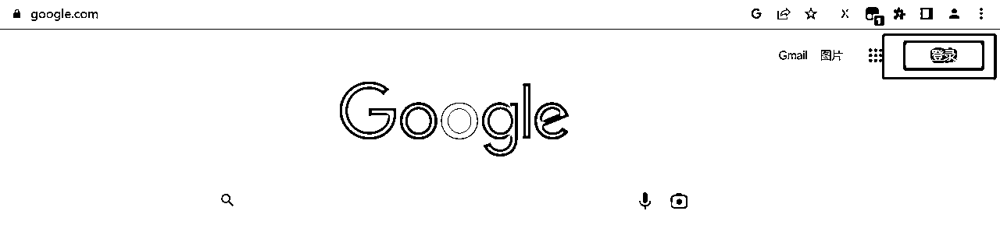

进入 Google 首页，右上角点击登录，按向导创建新账号即可，流程很简便，不再赘述。

## 二、打开 Colab 共享脚本

脚本链接：https://colab.research.google.com/drive/1PKF-X2PjTcbrjmpjSk6OU-it6QShL5xM?usp=sharing

该脚本会持续更新，使用时复制一份到自己的 Colab 后执行即可。涉及的代码步骤已在脚本内标注清楚，基本只需填入文件地址与个人 token。

运行方式：点单元格左侧的播放图标即可，每个单元格可独立执行，同时只能跑一个。

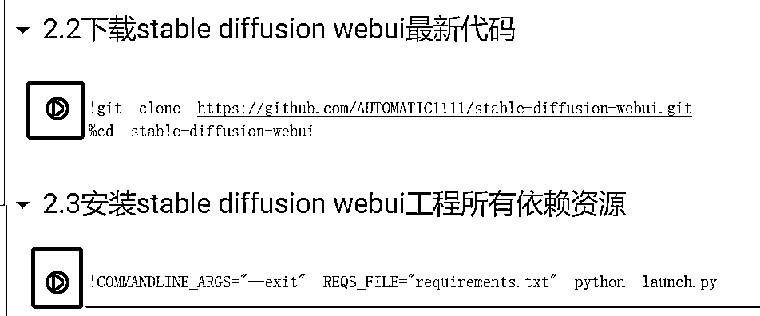

进阶技巧：熟悉后可自行复刻。想批量执行，点击脚本首个单元格后，通过菜单 代码 -> 运行当前单元及之后所有单元，脚本会按序自动执行，直至最后打开 WebUI 页面。

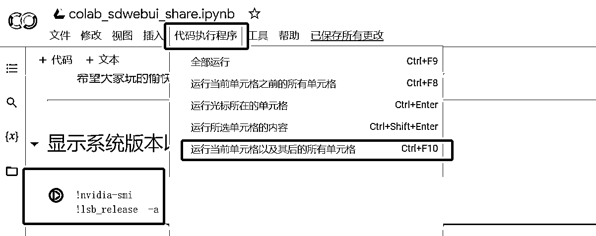

## 三、配置 Colab 运行环境

### 将硬件加速器切换为 GPU

Stable Diffusion 必须依赖 GPU，先把加速器设为 GPU。菜单 修改 -> 笔记本设置 -> 硬件加速器 -> GPU。

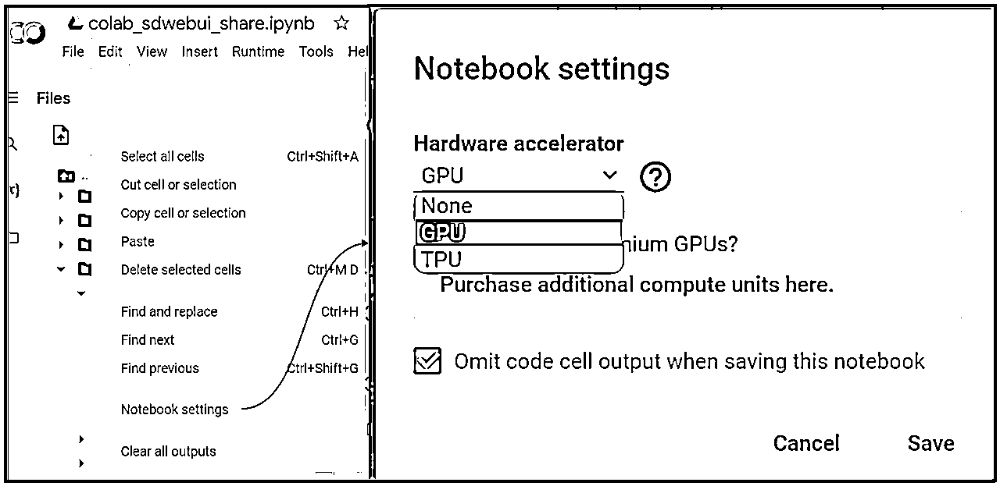

### 连接免费云资源

免费用户可使用数小时，入门足够，后续可考虑 Colab Pro。点击右上角 连接，系统会分配云主机资源。

### 释放资源

用完建议释放，避免时长受限。点击右上角 连接 -> 断开并删除运行时。

* 提示：此操作会清空已搭建的环境。

## 四、部署 Stable Diffusion WebUI

* 此步在脚本内直接点击运行即可

```
# 挂载Google Drive(Google云端硬盘)
from google.colab import drive
drive.mount('/content/drive')

#下载stable diffusion webui最新代码
!git clone https://github.com/AUTOMATIC1111/stable-diffusion-webui.git
%cd stable-diffusion-webui

#安装stable diffusion webui工程所有依赖资源
!COMMANDLINE_ARGS="--exit" REQS_FILE="requirements.txt" python launch.py
```

## 五、获取模型文件

* 底层思路

Colab 本质上是带 GPU 的远程机。前面已把 WebUI 装好，现在需要把模型文件搬到这台机器上，WebUI 才能加载出图。搬运方式主要有以下几种：

### 从自己的 Gdrive 加载

把模型放到个人 Gdrive，再让 Colab 挂载 Gdrive 并拷贝到本地。优点是文件存在云盘不易丢失，缺点是免费账号仅 15GB，模型常在 4-8GB，装不了几个。

* 在 Gdrive 根目录新建 stablediffusion 文件夹，再在其下建 models 子文件夹
* 将所有模型放入 /stablediffusion/models/

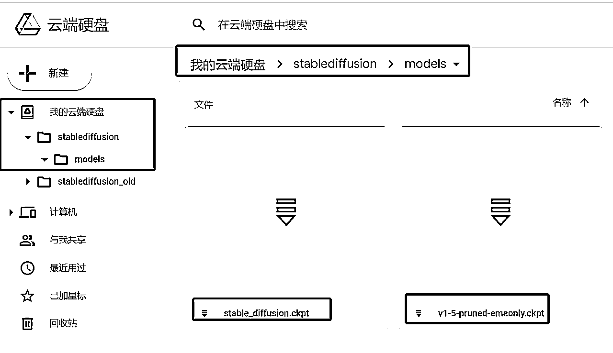

* 在 Colab 中执行拷贝指令，将云盘文件复制到运行环境

```
!cp /content/drive/MyDrive/stablediffusion/models/* /content/stable-diffusion-webui/models/Stable-diffusion/
```

### 在 Colab 内直接下载模型

Colab 默认约 50GB+ 空间，可存放大量模型，我曾同时存放十余个。

#### 2.1 gdown 下载

gdown 适合拉取他人分享在 Gdrive 的文件，人少时可用，人多可能被 Google 限流。

在网盘找到目标文件，点击共享 -> 权限设为“有链接者均可访问” -> 复制链接，链接中标红部分的 ID 即为需填入脚本的标识。

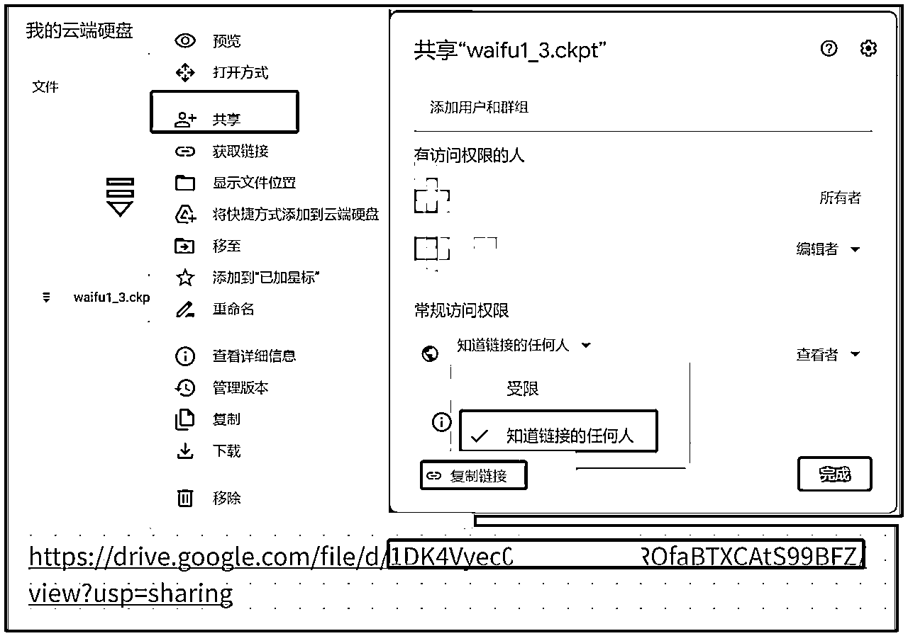

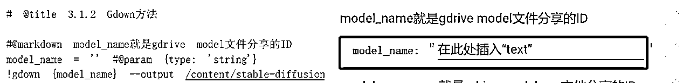

代码逻辑很直接，就是把对应分享文件拉到 /content/stable-diffusion-webui/models/Stable-diffusion/model.ckpt，该路径可自行调整。

```
#@markdown model_name就是gdrive model文件分享的ID
model_name = '' #@param {type: 'string'}
!gdown {model_name} --output /content/stable-diffusion-webui/models/Stable-diffusion/model.ckpt

model_vae_name = '' #@param {type: 'string'}
!gdown {model_name} --output /content/stable-diffusion-webui/models/Stable-diffusion/model.vae.pt
```

#### 2.2 Huggingface 下载

* 注册账号 https://huggingface.co/join
* 在主页新建一个 Model，名称与 License 随意，注意设为 Private 私有。部分模型为非官方泄露版，设为私有更稳妥。

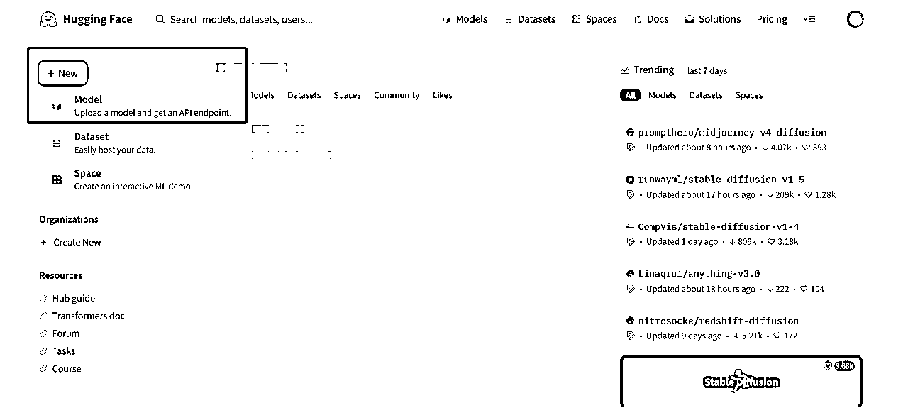

* 进入新建的 Model，选择 Files and versions 标签，点击 Add files -> upload files，把本地模型上传，上传完成后点左下角 commit。

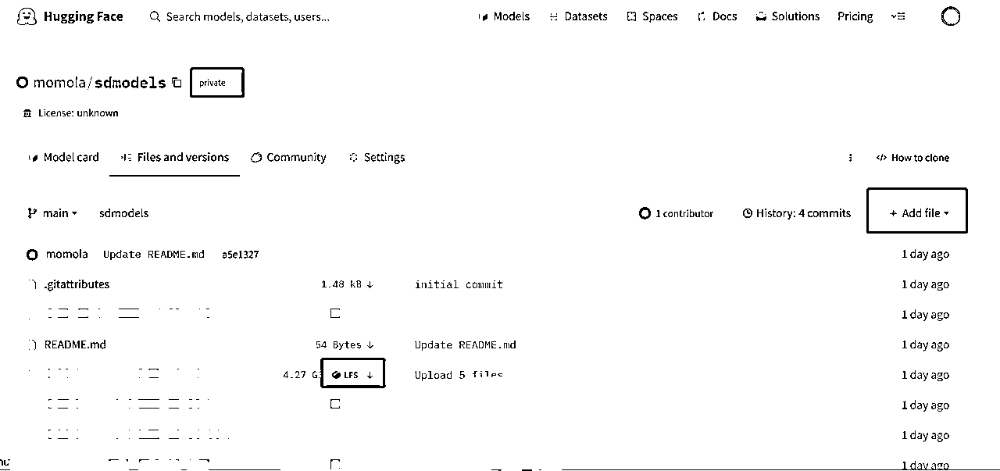

* 上传成功后点击文件名进入详情，右键复制链接地址，即可得到下载地址。

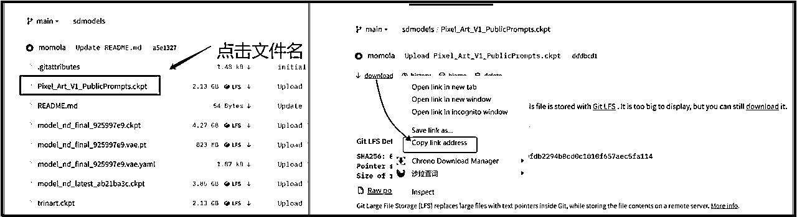

* 生成 token，访问 https://huggingface.co/settings/tokens 创建一个 token，用于 Colab 访问 Huggingface 时的鉴权。

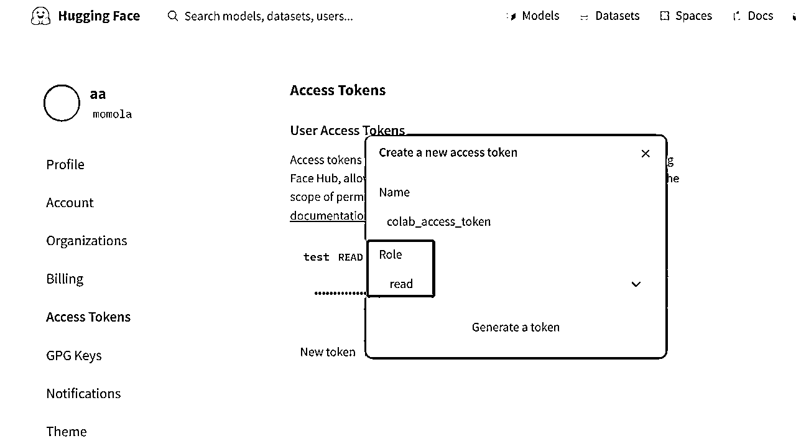

* 将上一步获得的下载链接与 token 填入脚本，Colab 即可正常拉取文件。

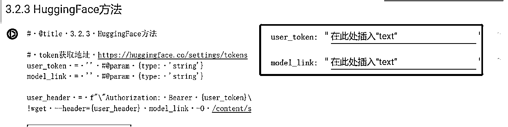

代码说明：user_token 与 model_link 即在 Huggingface 上获取的信息。wget 为 Linux 下载指令，这里用于在鉴权后把文件拉到 /content/stable-diffusion-webui/models/Stable-diffusion/model.ckpt，换模型只需改链接与路径。

```
# @title 3.3 HuggingFace方法

# token获取地址 https://huggingface.co/settings/tokens
user_token = '' #@param {type: 'string'}
model_link = '' #@param {type: 'string'}
model_vae_link = '' #@param {type: 'string'}

user_header = f"\"Authorization: Bearer {user_token}\""
!wget --header={user_header} {model_link} -O /content/stable-diffusion-webui/models/Stable-diffusion/model.ckpt

model_vae_link = f"\"Authorization: Bearer {user_token}\""
!wget --header={user_header} {model_vae_link} -O /content/stable-diffusion-webui/models/Stable-diffusion/model.vae.pt
```

#### 2.3 从其他云存储下载

Mega、AWS S3、Google Cloud Storage 等，只要能拿到公网访问地址或提供 API，均可下载。原理与 Huggingface 类似，需具备一定的云存储基础。

#### 2.4 下载方式建议

我个人更推荐 Huggingface，上手快体验好，且平台上有很多官方开源模型可直接用。另外提醒一点，多动手理解原理，别只会跑脚本，基础打牢后后续扩展会更顺畅。若想深耕，Huggingface 是必经之路。

## 六、启动 Stable Diffusion WebUI

环境与模型准备完毕后，只需运行 WebUI 即可。

```
命令行参数如下:
  - `--share` - 创建一个在线的 gradio.app 链接
  - `--gradio-debug` - 打印输出到控制台
  - `--gradio-auth me:qwerty` - 创建用户，默认 username 为 test, password 为 test，可以自行修改，用作登陆
  - `--deepdanbooru` - 用于安装deepdanbooru，方便使用图片获取prompt
  - `--ckpt` - 用于选择加载默认模型，例如加载以下路径的sd_14模型，可以加入这句 --ckpt /content/stable-diffusion-webui/models/Stable-diffusion/sd_14.ckpt

!COMMANDLINE_ARGS="--deepdanbooru --share --gradio-debug --gradio-auth test:test" REQS_FILE="requirements.txt" python launch.py
```

稍作配置即可生成精美图像

参考咒语：

这次分享一个可以直接套用的 Stable Diffusion 绘图配方，把提示词按类别拆开，方便你自由组合：

正向提示词：
- 风格基底：masterpiece，best quality，CG，wallpaper，HDR
- 画质增强：high quality，high-definition，extremely detailed
- 海滩场景：sea beach、beautifully detailed water / sky / sea、waves、coconut trees
- 光线氛围：detailed light、sunlight、chiaroscuro
- 人物刻画：delicate beauty、young girl、eyes like jewels、flowing hair、long hair
- 氛围细节：blue bubble、fluttering splash droplets、intricate textures、petals all around her、flowers、swimming ring
- 权重强调：{highres}、{{intricate detail}}

反向提示词：
- 画质底线：lowres、cropped
- 质量不足：worst quality、low quality、normal quality
- 结构问题：bad anatomy、bad hands
- 数量异常：missing fingers、fewer digits、extra digit、extra limbs
- 渲染瑕疵：jpeg artifacts、blurry、poorly drawn
- 干扰信息：text、error、signature、watermark、username、artist name
- 风格偏移：b&w、weird colors、cartoon、3d、bad art、close up
- 分组权重：bad anatomy / bad hands = 1.1；cartoon / 3d / bad art / poorly drawn / close up / blurry = 1.5；disfigured / deformed / extra limbs = 1.5

采样配置：50 步，DDIM 采样器，提示词引导系数（CFG scale）10。


写在最后

到这里，如何在 Colab 里把 Stable Diffusion 从原理到落地完整跑通，就全部梳理完了。希望这份说明能帮你减少摸索成本，快速度过新手阶段，玩得开心。

阅读过程中如果有不清楚的地方，欢迎在评论区聊，我看到了会尽快回复。

整理这篇文章花了不少时间和精力，如果它对你的创作流程有一点帮助，不妨点个赞支持一下，万分感谢。

资源速览：
- 图片与样例：https://boardmix.cn/app/share?token=rQOvVxMObEWKYKlDd-ECP_wOCux2F2Opapu-CI34W8JMp-P5EJEWdWTH5GiPaAPQx73PUCO9YxQB2pacWD7QPo6MJ8I8YBhguVlRSvpVJto=&inviteCode=p4EZRi
- 可运行的脚本：https://colab.research.google.com/drive/1PKF-X2PjTcbrjmpjSk6OU-it6QShL5xM?usp=sharing
- 模型整合包：https://pan.baidu.com/s/1uUeCFD_cuLQteTEgf1tndQ?pwd=78jk （访问密码：78jk）
- 模型导航站：https://rentry.org/sdmodels

若以上地址遇到访问限制，相信你自有办法解决。