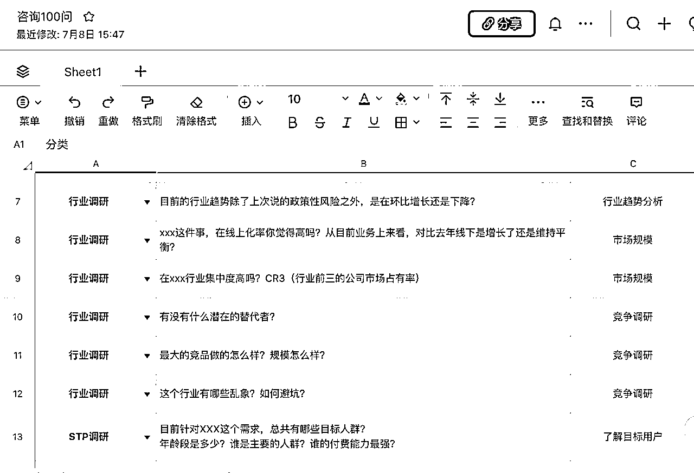
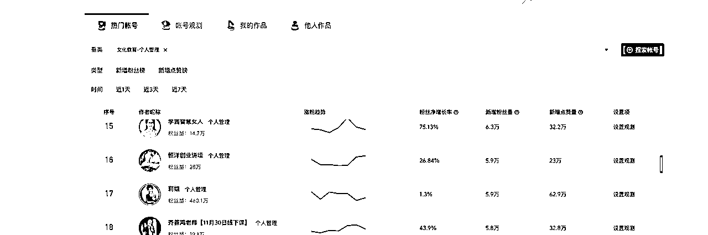
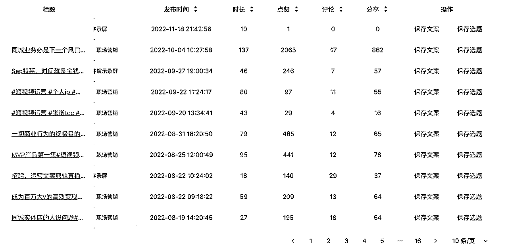
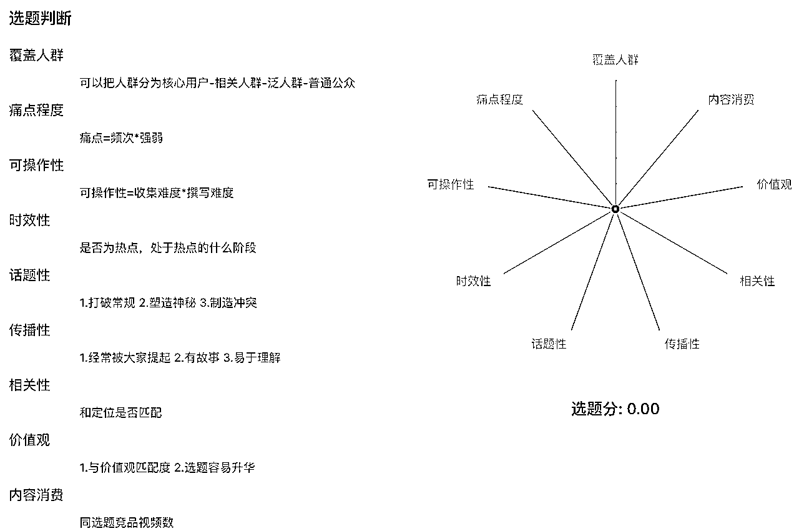
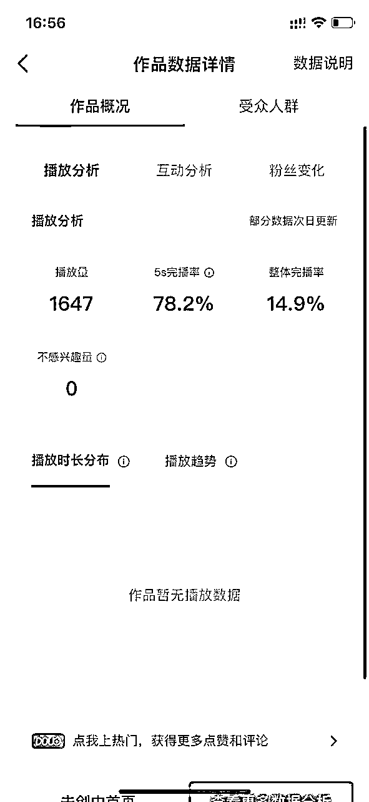

# 从零搭建短视频团队，我踩过的坑和落地的打法

大家好，我是俊达，正在做短视频赛道的一个创业者。

今年4月起，我们开始做几个垂类知识IP和商业IP，团队也摸出来了一些成绩：

*   两个月时间，高考志愿号精准涨粉10万+，私信直接爆了。
*   一条抗衰视频，后端带来300个干细胞客户。
*   垂类账号千粉级别完成六位数变现。
*   …

把我对做短视频IP矩阵的思考整理了一下，一共五块内容，希望对正在筹备或正在做的朋友有参考：

1.  变现产品怎么梳理
2.  短视频团队怎么建
3.  短视频IP的打造流程
4.  我现在看好的抖音IP赛道
5.  20条实战心得

## 变现效率，才是项目能不能活的关键

先统一认知：做抖音IP的本质是做流量，最终要落到后端变现上。

抖音前端内容同质化严重，大家都看得到，真正拉开差距的是后端变现效率。

拿减肥品类举例，有人把变现体系搭完整，一个客户能贡献1000元毛利，你只做到500元，那别人完全可以把获客成本压到900元，通过投放和矩阵把规模做大。流量成本只会越来越高，ROI算不过来就投不动，而当下的抖音，不做付费投放很难起量放大。

什么样的产品更适合IP去承载？我总结成两类：

第一类是低客单价0-50元的泛兴趣品，比如书单号、低价知识课。

第二类是高客单价1000元以上的强痛点品，比如高考志愿填报。

客单价不一样，成交路径完全不同。

低客单兴趣品可以直接在短视频里带货成交，适合小团队甚至个人启动，对选品能力和流量运营能力要求高。因为客单价低，就要选大盘、高转化的品，人群规模最好在1亿+，流量成本才低。我们团队运营自己做的外星人书单号，旺的时候一个月也能做几万块。

高客单品，成交基本有两条路：直播间直接转化，或引流私域成交。因为链路复杂，更适合有直播经验或私域销售经验的团队。

直播间直接转化的高客单，需要IP自带很强的信任感，像李一舟这类，直播间人少但GPM很高，平台就会持续推流。

引流私域的路子，就是低转高打法，前端卖低价产品做信任，后端再推几千到上万的产品，比如海参系。这种打法对团队要求极高，要同时解决短视频引流SOP、直播引流SOP、私域销售SOP、低价产品体系和高价产品体系等一大堆问题。

说下我们自己的案例。

通过朋友得知，抖音上有一个几十万粉的高考志愿老师，年变现千万元，看起来很蓝海。我们在赚钱社群里也搜过相关讨论，综合下来投产比不错：一是符合高客单咨询/培训/招商的变现逻辑，二是季节性极强。

当时是3月底，正好赶上6月高考季，流量窗口来了。于是我们去找当地最大的机构，也就是行业头部，企查查和Boss直聘查到老板电话，直接cold call，约了两次面后谈成联营合作，每月服务费加项目分成，很快就跑通了。

和行业头部合作的好处是，他们有预算、有背书、变现体系成熟，更适合抖音去放大。

## 团队能力，决定了账号的上限和下限

先问个问题：短视频IP想爆，什么最重要？

我们内部的排序是：观众缘 > 表现力 > 文案【选题 > 开头 > 结构 > 结尾】 > 场景 > 剪辑

观众缘不只是舒服，还要匹配。让一个小姑娘讲中医变现，效果肯定差。

表现力也很致命，同样一稿文案，不同的人念出来数据天差地别。

想清楚这两点，就会明白“谁来出镜”这个核心问题。

很多老板第一反应是做创始人IP，但这其实是个坑。原因有两个：一是大部分老板的专业度补不上表现力的短板；二是老板时间成本太高，all in不了抖音。

我们就踩过雷。当时高考项目让创始人出镜，后来他时间不够，直播场次跟不上，浪费了至少几十万的流量。

现在我会直接找演员，在咸鱼、Boss上找，稳定200元/天，表现力好、效率高。运营跟拍即可，一条视频拍摄成本可以控制在50元左右。

最近很多团队也开始用专业主持人出镜，从商业效率看，比创始人或签约专家自己上要更高。

除了出镜人，团队还需要什么？

如果走素人演员IP，核心就是运营+拍摄剪辑。运营考核私域引流，剪辑考核产出数量。

运营具体要做：找对标账号/视频、写文案、调演员表现力、给剪辑提建议、投放复盘。

剪辑做四件事：拍摄、剪辑、数据统计、发布。

如果是创始人/专家孵化，还需要一个IP手，负责了解IP、沟通挖掘、持续提炼可表达内容，考核和运营一致。

团队架构决定配合效率，能力决定账号天花板。

我在二线城市招人，完全对口的人才很少，和MCN朋友聊也都说好的内容运营特别难招，这是个硬问题。但剪辑好招，Boss上发个岗位私信就爆了。

所以我们验证了一条可行的招人思路：只招剪辑，从中筛选有灵性的往运营方向培养。用人成本也降下来了。

我的搭建路径是：

1.  启动期，懂业务的老人或自己下场做运营
2.  先跑通初步的内容生产流程
3.  招1-2个剪辑，实操2-3个账号
4.  挑出最有感觉的剪辑，培养成运营
5.  循环迭代

人才成长路径：剪辑 -> 运营 -> 项目经理

这样团队不会断层。真正能赚钱的短视频团队，核心能力不是内容，而是“不下牌桌”的能力。一个IP或一个运营走了，业务不能停。

如果遇到真正牛的内容运营，最好直接拉成合伙人。

## 流程化，才是规模复制的底座

说到流程，我很有底气。因为我们不仅自己摸索，还交流了很多先进团队，甚至自研了一套内容系统。我相信只有流程化才能复制放大。

内容团队最大的浪费不是人或时间，而是经验浪费。没有流程，方法无法沉淀，业务就放大不了。

我们的IP打造流程是这样：

### 定位流程

定位要花2-3天，但非常值。做三件事：

第一，竞品调研。行业抖音上有多少竞品？做了多久？最近赚了多少？定位是什么？内容形式差异在哪？能不能抄、能不能超？

第二，找定位缺口。先定商业定位，再定内容定位。梳理竞品的变现产品和内容打法，找到变现缺口。

比如法律赛道，如果没人做公司法、劳动合同法的专业内容，或做得不深，就有机会。

我们内部梳理了100个验证问题，找到缺口后全部过一遍，能答上来基本就稳了。

然后把用户需求凝成一句话，比如高考志愿就是：铁饭碗、好就业、上名校、考高分。

第三，定位细节。围绕商业定位做细化：用IP还是演员、头像简介、选题规划、内容模板、抖+预算等。这部分运营配合项目经理完成。

定位确定后才进入执行。

### 执行流程

选题流程：

1.  收集对标账号。可以用抖音热点宝的热门账号功能，https://douhot.douyin.com/observe?active_tab=monitor_hot_account

一键找到该领域最近涨粉最猛的账号。

2.  收集对标爆款视频，建立选题库。我们自己做了一个系统在用，可以一键抓取整理对标视频，保存转文字后归纳。

3.  选题入库后打分，按分值优先发布。评分维度包含：

文案流程：

有选题后写文案，核心做四件事：找顶级对标素材、写高流量开头、用好文案结构、写能导私域/涨粉的结尾。

大部分没流量的号，问题就是对标不对。很多人就找三四个几千赞视频抄，结果没效果。哪怕小众领域也可以跨领域找对标。

我们通过关键词拓展和批量转文字工具，平均20分钟就能拿到20个精准高赞【2-50万赞】的对标素材。

为什么要这么极致效率？因为我深刻体会到，绝大多数内容质量问题，都靠多看竞品来解决。

开头占比超过70%。我们要求每个开头都必须有10万赞以上的爆款对标，基本能把新号的5秒完播率拉到50%+。

我们验证最好的结构是：泛流量开头 + 漏斗型观点 + 引导结尾，即钩子开头 + 内容框架 + 钩子结尾。

拍剪流程：没什么技术门槛，按标准执行即可。棚拍可参考我们团队的sop。

复盘流程：

很多团队复盘敏感度不够。几个核心指标：

5秒完播率低 = 开头或场景问题

整体完播率低 = 文案结构、剪辑、场景问题

留存坏点【我们叫的词，人群骤降的秒数】，要不断复盘哪些话、哪些场景、哪些动作导致掉人，然后直接砍掉。

数据达标后再投放。目前起号预算大概5000左右，投到粉丝模型搭建完成，一般能上万粉，周期约一个月。

给做高客单咨询、招商的朋友建议：不要追求7天14天起号，粉丝模型会太泛，慢慢投更稳，也是找到新号内容形态的过程。

## 我现在看好的抖音IP赛道

S级：升学规划、小众职业培训【如挖掘机】、小众招商

A级：公考教资培训、留学培训、中医赛道【有资质的】

B级：医美【受限流影响】、财经投资【供应链和限流问题】、小吃培训

## 20条实战心得

1.  短视频讲知识是爽文逻辑，不是论文逻辑。
2.  干货剧情化是下一波红利。
3.  低转高路径，一定要把低价产品设计成高价产品的landing page。
4.  很多起量方法很简单、成本很低，关键是底层逻辑对了，先小成本验证再放大。
5.  做短视频精力要求高，老板必须是阿尔法。
6.  情绪 > 干货，但纯情绪转粉不行。
7.  爆款变现公式 = 钩子开头 + 内容框架 + 钩子结尾。
8.  金句的核心是句式和比喻，不是真知灼见。
9.  定位差异化是起量的前提，很多赛道难做是因为痛点标签被占了。
10.  抖音一定要做竞品分析，包括跨领域创作者，他们帮你免费试错。
11.  做IP号，人设身份比内容本身更重要。
12.  大部分人的专业度补不上表现力差距，所以用演员。
13.  好的内容团队一定是技术驱动的。
14.  先商业定位，再内容定位。
15.  不能变现的流量没有价值。
16.  知识付费，直播是红利。
17.  直播核心看GPM，高客单比低客单更易做，只看转化率加投放激活。
18.  知识付费直播竞争远不如电商直播激烈。
19.  好的卖课、导私域到直播间的，短视频通常做得不错，短视频流量占比25%+。
20.  做短视频团队本质是算账，一条视频成本、直播时长、私域新增，账必须算清。

## 写在最后

以上是几个月实操的心得整理，封在家时梳理出来的，欢迎交流拍砖。

我们内部还在孵化几个招商/知识付费的小垂类账号在拓展。如果你也在做抖音，或喜欢新鲜事物，欢迎聊聊。