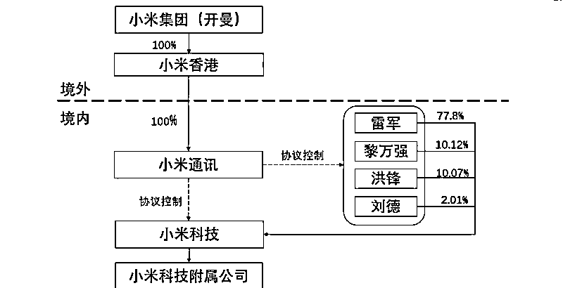
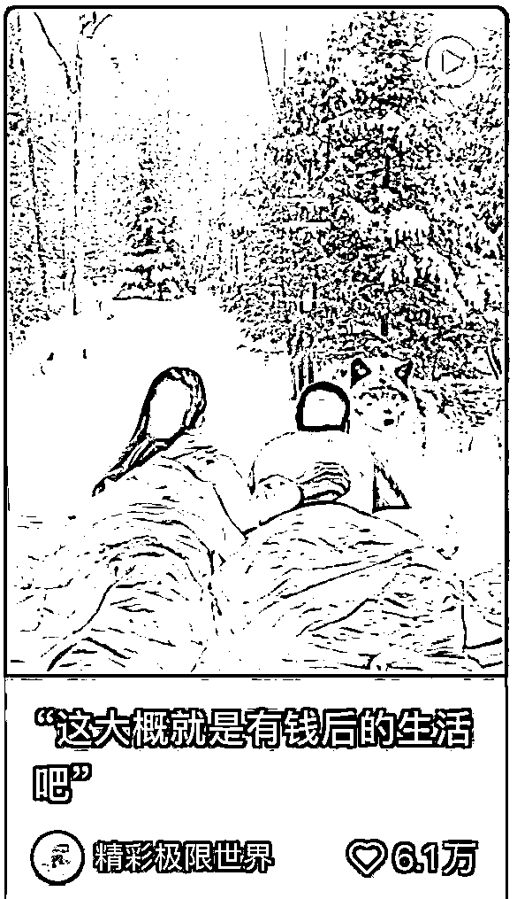
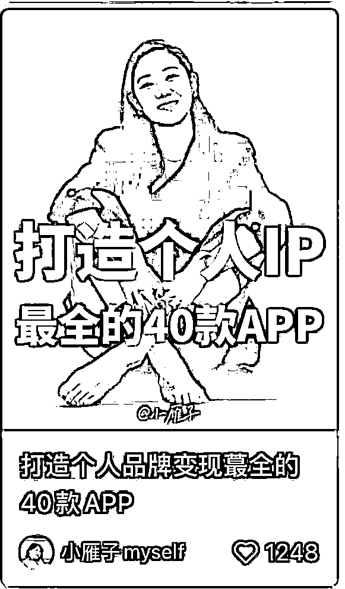

# 230104 龙哥赚钱周报

来源：[`www.yuque.com/for_lazy/money/efgciaa7settwksk`](https://www.yuque.com/for_lazy/money/efgciaa7settwksk)

整理时间：2023 年 1 月 4 日

这期内容来自年费 3000+ 的高质量会员社区。

部分帖子需要到飞书阅读。如果遇到复制限制，可以参考这篇：[教你解决复制问题](https://mp.weixin.qq.com/s?__biz=MzI1NjAxOTI0Ng==&mid=2647895304&idx=1&sn=df7e3e36c3bf503a2513f8b4c6636d3d&chksm=f20a1349c57d9a5fccaa92c5068cb3e492ba9e3ebb178584d018892c0211214dc9d112c1f73c&token=37691864&lang=zh_CN#rd)

往期所有周报（网页版和打包版）都在会员 Q 群共享盘里，群内的置顶通知也有对应入口。

希望各位读得开心。

标题带【精华】的，说明是加精内容；前面的数字是目前的点赞量。

内容有些长，你看感兴趣的就好。网页版目录请查看左栏导览。

# 【目录】

# 【搞钱认知】

## （262 赞）《告别 2022：10 句让我心头一动的话》

2022 年最后一个夜晚，真的不好形容。窝了一整年，有太多波澜。此刻我不想做年度总结，只想把心里最有共鸣的 10 句分享给你，当作送别。

01. 进化论，也许是这颗星球上唯一算得上成功学的理论。

我今天的成熟度，和去年这个时候已经很不一样。环境变了，不跟着进化就只能出局。王立铭的这句话我特别同意。他有一本《进化论讲义》，推荐你也翻翻。假如海水被晒干，最壮的鱼也活不下来；反而是一种长了肺的鱼，换得新生。

02. 真正的乐观，是全然接纳现实和真相——周航

周航说：真正的乐观，不是永远看好，而是明知现实不佳，仍然愿意拥抱它。如果 2023 并没有想象中好，我们也接得住。过去 40 年步伐很快，但这不代表着以后也要一直加速。你可以乐观，但也要认清现实。愿你勇敢、坚定、开朗，也踏实。

03. 有一句话被太多人引过，我依然喜欢：世上只有一种真正的英雄气概，就是看穿生活以后，仍然对它不离不弃。

这句话和前一条其实是一脉相承的，已经被说到烂熟，我理解它，就不再展开。

04. 熊彼特说得特别透：只有搞创新的人，才能拿到高于同行的超额利润。否则你只能赚行业平均利润，勉强活着。

创新不一定在技术上。产品的样子、从哪条渠道卖、广告怎么投、话题怎么传，到处都有创新空间。只要创新刚好被市场需求接住，你就有了生存的筹码。

05. 华楠记过一件小事，我读完之后记到现在：一个人只要对工作拼尽全力，那反而是最轻松的。

可惜大多数人从没试过真正投入。你回头看看过去一年的任务，哪一件没有改进的空间？如果换一个更厉害的人来做，会不会马上不一样？很多事情根本轮不到拼天赋，只要足够沉、足够勤，就已经赢了。相关阅读：[人和人的差距，就是这样拉开的](https://mp.weixin.qq.com/s?__biz=MzI1NjAxOTI0Ng==&mid=2647895304&idx=1&sn=df7e3e36c3bf503a2513f8b4c6636d3d&chksm=f20a1349c57d9a5fccaa92c5068cb3e492ba9e3ebb178584d018892c0211214dc9d112c1f73c&token=37691864&lang=zh_CN#rd)

06. 关于提问，王慧文有个说法：答案看起来显而易见的问题，往往才是创新的真正入口。

可我还想说，不要为了面子，不敢问“傻问题”。真正的高手坐在你对面，你装懂他一眼就看穿，不但不觉得你厉害，反而觉得你虚伪。不懂就问，才能一步步变强；假装懂，只会越来越空。还有一种人，开会时叽里呱啦，就是为了证明他还在场，连自己说的是什么都搞不清楚。千万别活成这种人。

07. 有一句话，在我的书里被读者标记最多，至今已有 2512 人划线：做事不能只靠愿望，要看手里的牌。

老鹰吃兔子，鲨鱼吃不到，但鲨鱼不该羡慕老鹰，它只要多捕几条鱼就好。中国老话讲，不要被外面的光鲜带走。有朋友问我：你怎么不做一个品牌？这里头有两个误会。一是他以为咨询公司不算品牌；二是他觉得我无所不能。其实我擅长的是咨询，硬件上的经营并非我的强项。每个人都得先盘点自己的能力和资源，找到属于你的生态位，然后扎进去。时间越久，壁垒越深。最怕的是，看到别人在那里赚钱，心里就发痒，换了一个又一个赛道，最后什么都没剩下。

08. 要解决一个问题，常常得先解决比它高一层的那个问题。

09. 营销的“营”，第一层意思是“经营”。

这两句放在一起说：我买了一件特别有型的外套，穿上之后却并不好看。问题出在外套吗？不是。问题出在我的底子不够好，那就是更高一层的问题。想变好看，可能需要整容，也需要身高管理。

公司也一样。表面看是卖不动，本质可能是产品技术落后；再往上挖，也许是过去十年从来不投研发，只顾着打销售战。我们做营销咨询的，对内一直强调：想要谈营销，先要理解经营。比如有家餐饮品牌来找我们，我一见就明白它为什么走不出本地：口味太地域化，外省人很难接受。它不是营销做得不够，而是产品选择出了问题。

读懂经营，才能读懂营销。

10. 稻盛和夫一生推崇一句话：答案并不在老板办公室里，而藏在现场里。

但大多数人只是听过，没去看过。产品明明诞生于销售和消费的现场，太多产品经理却只是关起门来想象用户。卖场里发生了什么？工厂里发生了什么？员工宿舍里发生了什么？旅客洗澡时发生了什么？我住进一家酒店，花洒按钮完全失灵，等于顶着 12 级风雨洗澡，却没有人知道。据说微软过去每位工程师都用顶配电脑，等新版本一出，却没人想过另一群配置很差的人能不能顺畅打开。这就是典型的远离现场。

我们同事后来真的去北京市南边那家南城香门店当服务员，才发现坐火车的人最着急的不是菜品多丰富，而是“大概多久能上菜”。稻盛和夫先生已经离开，但他的管理思想仍然朴素而有力。

祝你 2023 新年快乐。

## （107 赞）《读了一堆精华帖，我浓缩出 50 条赚钱认知》

前两天听龙哥说：社区里的帖子越写越冗长，动辄就是一座“长文山”。作者写得费劲，读者也刷得走神。很多不爱写长文但很有干货的人，反而会害羞，怕自己写太少拿不出手。我起初也想整一篇万字长文，结果只写了六千多字就停住。对一个新手来说，光是 5000 字就是大山。

老话讲：真智慧说一遍就够，伪知识才需要堆成书。

我看文章有个习惯：读完之后思考，再把内容压成几句提示语。以后只要看到那一句，就能还原整篇文章的框架。学习不是为了摆一排书单，而是等需要的时候能拿得出来。

下面这 50 条，全部来自我读过的大量精华内容，算是浓缩里的浓缩。

01. 能用钱解决的劳碌，就不值得自己耗进去。集中精神盯住当下要完成的目标，少碰低回报的杂事。

02. 学会简化人生。从今天开始，多问自己“还有什么可以扔下”。

03. 别等完美再出发。先用最简单的方式把第一单做成，验证商业模型是不是走得通。

04. 知识要转化成绩效。处在什么阶段，就学什么阶段最需要的东西，边学边用，才是真学习。

05. 搞钱的基本思路：找需求、给解决方案、复制放大。

06. 从第 1 个粉丝出现，就要考虑收钱。流量像限时门票，过期作废；能带来现金的才是流量，否则只是访问数字。

07. 一个账号做到月赚 10 万很难，但做出 30 个每个月赚 3000 的号，相对容易。把能赚钱的小事不断复制，哪怕一单只赚 1 块钱，放大一百倍就是年入百万的池子。

08. 做什么项目没那么重要，流量才是咽喉。产品一定，就要把大部分精力投到拉新和成交上。

09. 那些别人短时间替代不了的部分，就是你的护城河。

10. 成年人只做挑选，不做教化。别总想着教育客户，费劲又不落好。

11. 要做能有积累的事，不然每次都是归零重来。

12. 挣钱无非是设定目标，然后边做边解问题，一切行动都往目标上靠。

13. 需求得到满足，人就愿意付钱。关键是选谁来当付款人、怎么打动他。需求可以是实在的，也可以是情绪上的。

14. 赚钱说到底靠交易，交易能不能成，看需求的契合度。

15. 目标定了，只做与它同方向的动作，执行力堆上去，快速验证，快速改正。

16. 盯住一个平台、一个定位，把它打到极致，别什么都想要。

17. 门槛太低的事情，人人都会涌进来，几天就黄。有一点门槛反而是好事，直接替你筛掉一半人。该买样品的时候别抠门。

18. 别做又大又空，要做小且尖。垂直细分，你才能知道用户要什么，也知道怎么收钱。

19. 从终点往回倒推。正向流程：定位→内容→流量→产品→变现；逆向流程：变现→定位→产品→内容→流量。先找到买家，再去找货。

20. 买家愿付多少钱，取决于他心里觉得值多少。与其降价，不如研究他为什么不掏钱。

21. 自己觉得有价值不算数，用户愿意用才算数。先做出最小测试装，让别人帮你验证。

22. 爆过一轮的内容，还会再爆。持续创作不靠灵感，靠成熟模板。

23. 想长期产出内容，必须把时间成本和金钱成本压低，否则再强的人也会被抽干。

24. 只靠卖时间是很难富的。要学会用杠杆：劳动力、个人品牌、复制成本极低的数字产品。

25. 向已经赚到钱的人对齐。谁在研究赚钱，就靠近谁；谁的路径被验证了，就主动抄作业。

26. 资产就是睡觉时还在进账的东西。别让钱闲着，让它替你卖力。

27. 互联网引流的终极心法，是免费。免费给出用户需要的东西，往往最有效。

28. 个人品牌是最强杠杆，能让有限的精力撬动极大的影响。

29. 你把时间种在哪里，收获就长在哪里。先建一张日常清单，把固定动作养成习惯。

30. 大盘子会被拖垮，把火力集中到那两成关键动作上。

31. 人天然跟着利益走。动力不足时，想一想做成之后你能兑换到什么。

32. 没有哪款产品能讨好所有人，能照顾好愿意付费的那群人，已经够好了。

33. 别只迷信长期主义。真正的机会来临时，一两年就能赚到别人一辈子的钱。

34. 想多了，处处是问题；做多了，答案自己会长出来。少聊宏大，把手头具体的事做透。

35. 列出用户最头疼的 10 个大问题，每个再拆成 10 个小问题，等于你手里有了 100 个改进方向。

36. 自己的产品还没影，先找渠道做代销，用别人的货验证自己的推导。

37. 信息差永远存在。把平台 A 的货搬到平台 B，让另一边的人看见，生意就成了。

38. 定一个能点燃你的目标。兴趣是最好的初始燃料，没有它很难持续。

39. 老爆款换一件新外衣，就是原创。调酒师不产酒，把几种基酒按配方混合，就创造出价格更高的新饮品。

40. 玩法容易过期，内容却能流传。想走远路，就要抓住那些不太会变的东西。

41. 最贵的永远是时间。钱赔了能再赚，今天丢了，就再也回不来。

42. 大多数事情，根本轮不到拼天赋。每天多往前走一点点，就能超过八成的人。

43. 别人的风口，不一定是你该追的风。体型、资源、性格，都在替你投票。

44. 会技术的人太多了，你未必需要亲自学。把专业环节交给专业的人，你的时间才够用。

45. 赚小钱和赚大钱，消耗的步骤差不多，都要做内容、引流量、谈成交。既然一样费神，为什么不去做更大的那一笔。

46. 先站在巨人的肩膀上模仿，再考虑超越。看看那些用户过亿的 App，有几个不是从已有玩法里长出来的？短视频也一样，不必创造全新的内容，把同样的主题换一种展示方式就好。

47. 成交三件事：真实需求、足够信任、支付能力。而信任只能靠你提供的价值慢慢攒起来。

48. 你想赚多少钱，就要去找对应的需求规模。想赚一百万，要找到能支撑一百万的市场。

49. 最笨的方法往往最有效：锁定一个需求、一个渠道入口，单点循环，做到无人能比。

50. 压轴的一条：真诚是终极必杀技。

读一篇文章并不需要记住每个字。哪怕只有一句能把你推向下一个动作，就没有白读。不然，人就容易停在“懂了很多道理，还是过不好”的焦虑里。

这 50 条里，任何一条都可以展开成上万的篇幅。可是真有必要吗？我还是那句话：高价值的信息，浓缩起来才有穿透力。

ps：感谢所有愿意无私分享的人，这篇“拼盘”是你们共同喂大的。

# 【搞钱技能】

## （41 赞）《用小米当样本：拆解红筹模式和 VIE 结构》

#法律财税人的创富工具箱# #商业案例档案 04#

一家企业的成熟，往往体现在它有节奏地解决不同阶段的核心任务。

无论是基于税务和财务的合规，还是为了战略需要而搭的顶层框架，都离不开架构设计。

这份文档重新理了一遍小米当年的架构，看懂了架构，顺带就看懂了它背后的股权配置、税务处理与业务逻辑。

腾讯在线文档：《用小米看懂海外布局：红筹与 VIE 结构》V1.0（20221226）

[https://docs.qq.com/doc/DSmthVHdmd1daa0l2](https://docs.qq.com/doc/DSmthVHdmd1daa0l2)

## （70 赞）《想做好内容，先学学渣男》

我是劲猫。有次只花 20 分钟，写出了 10 万赞藏的大爆文；后来靠 1 万粉丝换来 20 万进账。

有人提起我早前分享过的经历，是一篇小白摸索某书、三个月涨粉 8000、最终变现 5 万的文章。说实话有点不好意思，像头一回见家长一样紧张。

今天想聊的，是“渣男式创作”。

为什么从这个角度切入？两个原因。

第一，我观察自己身边那些“渣男心态”的女生朋友，感情大都顺利。两个人还没走到痛苦那一步，她们已经转身离开，心里想的是“下一个更乖”。不内耗，反而活得痛快。而那些为一段感情付出所有、把自我都搭进去的人，却总被伤害。

第二，做号也是一样。认真花三四个小时甚至一整天，磨出一条内容，点赞只有个位数；另一些人随手发的帖，转头就爆到几千几万。这很像你精心准备一顿温馨大餐，对方却嫌土，反而去夸那杯 10 分钟外卖咖啡更好喝。

气不气？没关系，今天就把这套办法交给你。

### 第一点：勾住胃口，马上停手。

你只需要把最亮眼的结果拍在用户脸上，然后闭嘴，剩下的让他自己补完。

心理学有个“峰终定律”：人对一段体验的评价，基本取决于两个时刻——最高潮和结尾。开头、结尾都给足甜味，中间哪怕平淡，整段记忆依然是甜的。

比如有篇展示有钱人生活的笔记，开头就是一排无边泳池、高楼远望，封面直接抓人，这是第一段冲击。

结尾又用漂亮画面稳稳接住。中间剪辑乱一点、画质模糊一点，根本不重要。重要的是把情绪推到顶点就收手，他才会觉得意犹未尽，还会回来看你。

### 第二点：戳中痛点，立刻撤。

再比如另一篇，标题大约叫《做个人号，先用这 40 个应用软件》。

现在谁都想把账号做起来，缺的恰恰是“从哪下手”的方向。这就是痛点。

文章做的就是一件事：把 40 个 App 的名字一次性摆出来，然后停住。没有下载链接，没有使用教程，没有“手把手教你用这些工具做 IP”的后续，只有名字。

给一点甜头，留一个钩子，让用户主动在评论区追问、收藏、讨论，流量自然就围过来了。

这就是渣男做内容的基本功：撩得到，也收得住。

你有没有刷到过这种帖子？标题猛得不行，点开一看，操作流程从头讲到尾，步骤1、2、3，方法1、2、3，一条不落。你以为这是用心良苦？结果用户拇指一滑，三秒就划走。话越密，人跑得越快。

真正会玩的人从来不讲全套。他们只挑你身上最痛的那个点，轻轻碰一下就撤。你被戳中了，回想起来，他好像递了点东西，又好像没递够。这股“吊着”的劲，反而让你在心里给他盖了个章：这人懂IP，有货。关注，就这么点下去了。

渣男式打法第二招：广布触点。渣男养鱼最擅长的事，就是在不同的圈子之间来回游走，东边留句晚安，西边抛个话题。做内容也一样，别把赌注全押在某个角落，网铺得越宽，被对的人捞起来的概率才越大。

说到这里，肯定有人问：那你不说要深耕垂直吗？注意，真正的垂直，从来不是绑在内容类型上的。你做一个母婴号，不代表每天只能聊育儿；婆媳、夫妻、消费、成长，都能写。但你要吸引的那群人，从头到尾都得是同一类人。内容可以四处开花，人群必须一击即中。一个是水面撒网，一个是水底钉桩。

这，就是个人IP该有的“渣男式清醒”。