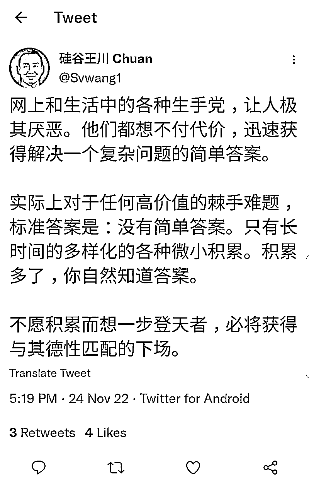

# 龙哥赚钱周报

整理时间：2022年11月29日

专属群的伙伴们好，又到每周的赚钱周报时间了～

部分内容链接跳转至飞书查看，如需解除复制权限，可参考这篇指引：
[解除复制限制！](https://mp.weixin.qq.com/s?__biz=MzI1NjAxOTI0Ng==&mid=2647895304&idx=1&sn=df7e3e36c3bf503a2513f8b4c6636d3d&chksm=f20a1349c57d9a5fccaa92c5068cb3e492ba9e3ebb178584d018892c0211214dc9d112c1f73c&token=37691864&lang=zh_CN#rd)

往期周报与精华合集，可在专属群 Q 群文件及群公告里查阅。

祝阅读愉快，有所收获～

帖子标题后标注【精华】的为精华内容，前方数字为截至目前的点赞量。

以下为本期目录，篇幅较长，可按兴趣挑选阅读。

# 【目录】

在线版目录请查看左侧大纲

# 一、赚钱认知 & 技能

## 【93 赞】《微小中型创业如何合规进行财税规划》
#法财税人，创富兵器库# 
关于中小创业者如何做到合法合规的财税筹划。 本文由法财税人团队联合律师团队共同撰写，原本计划由@财爷 首发，为提升关注度本人先行发布，供大家参考。

【腾讯文档】时间捐赠局分享·微小中创业如何合法财税规划（以短视频从业者为例）V1.0 ：
[https://docs.qq.com/doc/DSlRHYmZyamdTQ3Na](https://docs.qq.com/doc/DSlRHYmZyamdTQ3Na)

## 【102 赞】《日更写作565天，我如何用写作搭建人生复利系统》
大家好，我是唐夕。从2021年4月25日开始在公众号日更，至今整整565天。靠着持续输出，我从0到1打通了写作变现闭环。

一年多时间里，我推出了自己的课程、组建了付费社群，也承接了不少个人咨询，从零积累出了第一桶金，也获得了与市场直接对话的能力。

核心理念：只管输出，不问结果，因果自现。持续表达，惊喜自然会来。

文章主要围绕四个问题展开：
1. 为什么要建立持续输出力？
2. 日更过程中会遇到什么阻碍，如何破局？
3. 缺少正反馈时如何坚持？
4. 普通人如何系统提升表达力？

**为什么必须打造持续输出力**
2021年春节前，我所在的公司倒闭，我失业回兰州备考公务员。考完许久未找到合适工作，焦虑感很强。利用空闲去书店读书，重燃写作欲望。

读书不写作等于白读，写作不读书也难为继。通过这次焦虑我开始反思：仅靠公司打工很危险，公司会倒会裁，如果自己没有直接面向市场的能力，在职场会越来越被动。

梳理过去几年积累：断断续续写过不少文章，有篇阅读量破6万+，豆瓣粉丝3000+，长期做企业新媒体运营，对各平台都很熟。

于是决定日更公众号，先用坚持来改变自己。初期不考虑变现，只求持续写、提升能力，做出点拿得出手的东西，先把一件事做成。

500多天的持续输出让我切身体会到表达的价值：

01 一旦开始输出，你就进入了1%俱乐部。信息爆炸时代，99%的人在消费内容，只有1%在创造。好内容创作者本就稀缺，这正是红利所在。别做被动的消费者，消耗注意力和时间，做创造者。

02 输出倒逼输入，倒逼思考。因为日更，我一年读了100本书，加入赚钱、玩赚等高质量社群，开眼界、破圈层，耐心、勇气、坚持力明显提升。写作是思考的外化，像钩子一样把碎念和灵感抓住，导向深层思考。

03 内容是普通人最容易用的复利杠杆。复制边际成本为零，可重复利用多平台分发。无需资金投入，只要时间整理经验分享，一部电脑或手机即可。它在你休闲或睡觉时仍在传播，带来持续被动收益。自媒体本质是给自己造一台印钞机。

04 写作是最好的社交。坚持输出后，我微信好友增长6倍，且都高度同频。现实中我不善社交，但内容让我被动吸粉，来加我的人基本都读过文章，认可度极高。内容创作打破圈层，不用自我介绍和刻意证明价值。文章就是最好的名片和筛选器。

**日更会遇到的问题与解法**
01 不知写什么。刚开始10天靠读书积累撑着，之后就卡壳。解法是平时有意识建选题库和问题库，观察生活、记录对话。素材随时记在flomo里翻看。实在没想法就找朋友聊天，问他最近的困惑，聊完文章雏形就有了。写作公式：文章=问题+回答。

02 完美主义作祟，总觉得不够好。解法是把成长型思维和完成大于完美内化为信念。持续写下去能力自然提升，每个人经历和感悟都是独特的，真诚表达就有价值。

03 怕写错。少楠老师说过：没有观点就不值得被关注。世界没有标准答案，写作本质是输出偏见，吸引同频者。放松输出即可。

04 写几天数据差就怀疑自己。写作是指数型技能，拐点前需要耐心。它是在聚光灯下成长的过程，人们爱看的是你变好的过程，而非已经完美。

05 时间不够。方案一：早起写，将日更设为当天最重要的事。方案二：碎片化利用通勤、等会、睡前时间进行输入或记灵感。需养成三习惯：灵感即记、及时搜集素材、积累写作框架。

**无正反馈如何坚持**
01 公开承诺。自我设限，无路可退。第一篇就宣布日更，失信成本倒逼习惯养成。
02 简化写作。初期不要求字数，几百字甚至100字表达观点即可。后期自然提升到800-1000字。
03 寻找精神能量源。看辉哥、明白老师的文章，以及S老师《持续行动》，在动摇时补充能量。
04 加入写作圈子。社群里的同频鼓励，比赚钱反馈更早到来，互相夸赞和激励是持久动力。

**系统提升写作表达力**
写作=输入+思考+输出
输入靠读书聊天观影，思考是连接信息，输出是结构化表达。
提升路径：拓宽输入广度深度→强化思考力，写作者80%时间在思考→提升输出力，多写多练。
写作是复利技能，是能力放大器，同时是能量棒，帮助认识自我、内化知识、记录成长、链接资源。
核心一句话：你不缺写作天赋，缺的是每天10分钟的执行力。

推荐书单：《表达力》贺嘉、《写作是门手艺》刘军强、《李诞脱口秀工作手册》李诞、《学会写作》粥佐罗、《写出我心》娜塔莉

## 【297 赞】《不愿积累只想一步登天的人，帮不了》
坏消息是，赚钱本质上很复杂。连我最好的朋友问我怎么赚钱，我也很难简洁回答。要项目、要认知、要情绪管理、要行动、要反馈、要迭代，最后还得自己下场实操。

大多数时候我只会丢给他一篇精华帖：先看完，有问题再来问。

结果是，大多数人连看都不看，更提不出问题。

## 《赚钱就像谈恋爱，别只说不做》
本期星球嘉宾半佛仙人第1000篇原创，干货满满。

赚钱就像爱，不要说要做：
[https://mp.weixin.qq.com/s/-YyzT1ECn5TKVfTYEsBFpQ](https://mp.weixin.qq.com/s/-YyzT1ECn5TKVfTYEsBFpQ)

## 【118 赞】《从亏掉100万，到在赚钱里赚回300万，我走过的路》
大家好，我叫老罗，96年。

最近看到群里很多朋友分享亏钱经历，路径基本相似：盲目入行、合伙做事、梭哈all in、最后黯然收场，还有人循环亏损。

我也曾亏过100多万，经历过公众号、小商店、抖音、B站、小游戏、小红书、今日头条等项目。痛定思痛后总结方法，结合赚钱使用，3个月赚100万，累计利润超300万。

1. 外卖CPS：首日盈利百元+，2个月做到月赚10万，第3个月突破月赚20万，累计盈利200万+。去年8月停止增粉后，至今每月仍稳定5万+

2. 副业课程：3个月盈利100万+

核心方法论：结合自身资源做项目

很多人低估手头资源，高估新项目。项目做到一定程度总想推倒重来，这很不明智。人的精力有限，老板们能成是因项目聚焦，一旦外包就失去增长点。所以要盘点现有资源，在主业基础上延展。

**第一步：盘点手头资源**
以我为例：35万IP粉公众号+350万僵尸粉公众号、公众号涨粉方法、赚钱有术星球、多名员工。
即：公众号经验+流量+人力+项目，缺的就是合适的变现方式。

**第二步：拆解项目所需资源**
当时赚钱还没航海功能，只能翻精华帖，或用精华帖索引工具 [http://search.shengcaiyoushu.com/?digested=true&page=1](http://search.shengcaiyoushu.com/?digested=true&page=1)

看到黄海老师的外卖CPS帖子 [https://t.zsxq.com/07w4YPX9t](https://t.zsxq.com/07w4YPX9t)
所需资源：搭建外卖CPS公众号、接入美团联盟和饿了么分销、公众号引流。
这些我都有，且帖子推荐用云瞻平台对接，匹配度100%。