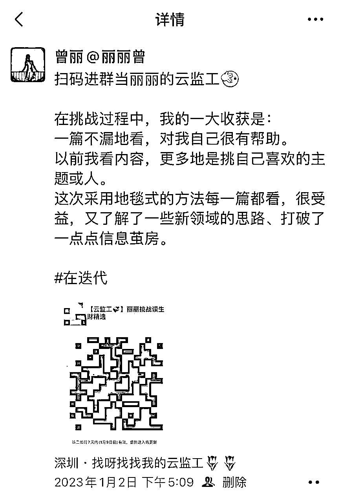
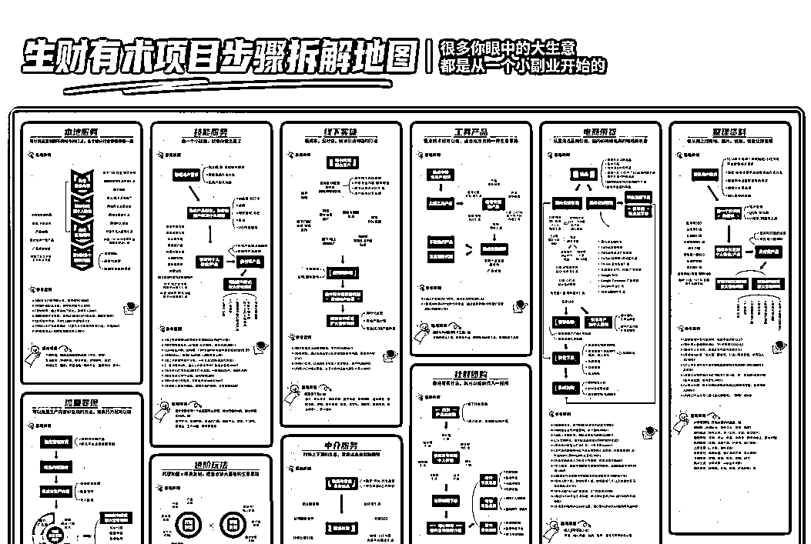
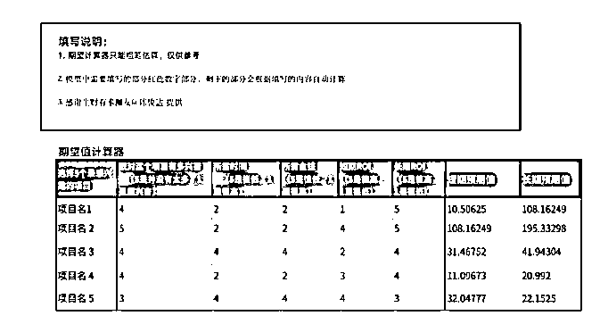
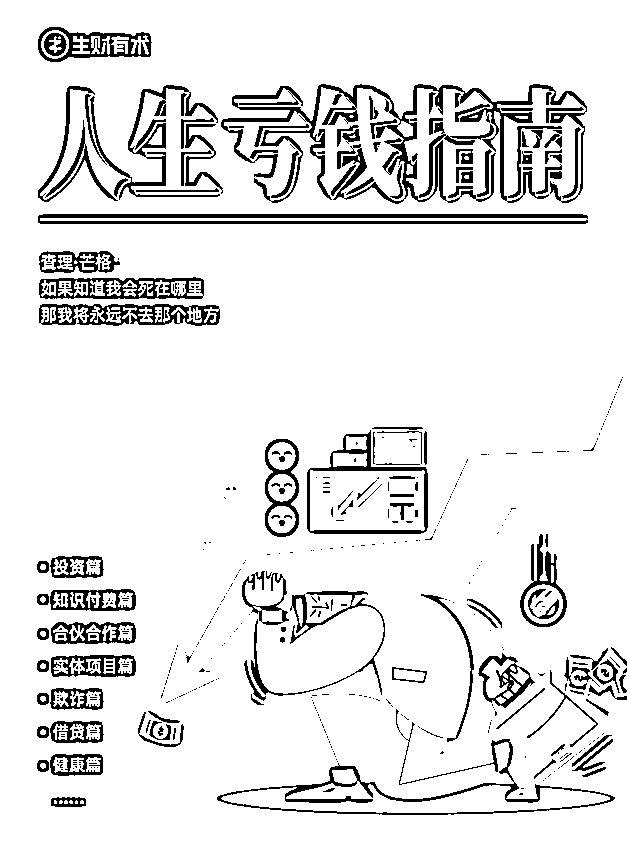
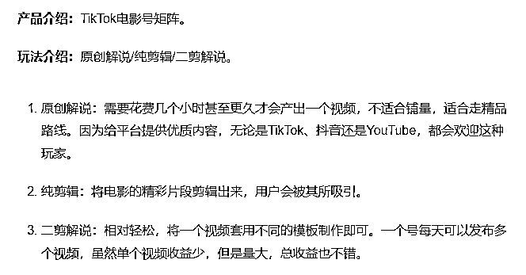
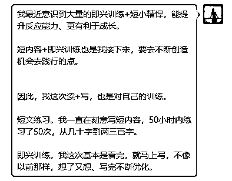

# ('【已发部分】普通人可复制的云监工玩法，挑战3天读50篇赚钱小报童项目精选+写5000多字心得', (2, 48))

跨年那晚，别人都在倒计时发愿，我却给自己安排了一场很“自虐”的挑战：趁三天小长假，把某付费栏目里已经上新的50篇商业拆解全部读掉，再整理出至少5000字的笔记。这个念头刚出现时，我自己也知道，凭一个人的定力大概撑不久。于是索性把它做成一场公开的“进度围观局”——请一群陌生人隔着屏幕盯我打卡、陪我跑完这三天。

最后的结果是，我真的召集到102位监工，也按约定把50篇读完、把笔记写完。复盘下来，这套玩法很适合想快速验证自己执行力的普通玩家：启动成本不高，操作起来也不复杂，不必像深度陪伴型交流群那样天天耗在群里。更重要的是，它能让围观者亲眼看到一位普通人的成长，感受到陪伴的乐趣，顺便加深对号主的认识和记忆。

一、怎样招来一百多位盯梢的人？

我的方法简单到有点粗暴：在自己的社交动态里发一条招募帖，正文讲清楚要挑战什么，再把详细条款写在评论区。当时留下的截图如下：

条款设计上，我特意没有照搬市面上常见的“挑战失败就瓜分几千块”那一套，因为那样等于让发起者和参与者站在对立面，彼此心态都会变得微妙。我反过来做：失败时只象征性地分200元红包，额度故意放得极低，好筛掉那些只看红包来的路人；一旦成功，大家能得到的东西反而更多。

当时发布的内容大概是：

挑战任务：三天内读完50篇高质量商业拆解，并写下5000字以上的个人笔记，相当于每篇平均100字。

如果我达成目标，你得到：
①我的完整版5000字笔记；
②2023年以7折购买“丽丽”任意产品的机会；
③从人群中随机抽出10位，送一份新年盲盒（盲盒里有XXX、XXX等随机一样）。
（实际推进过程中我也额外发过一些红包，总额约200元，具体记不清了。）

如果我失败，那么就：
由群内所有人一起平分200元失败基金🧧。

我准备啃的资料，就是这个付费栏目（附链接）。

二、开读之前，先把栏目福利盘一遍

我没有一上来就冲向文章列表，而是先花了点时间研究这个栏目的配套玩法。

先打开专栏看整体概况，了解50篇拆解覆盖哪些方向；再读它的使用指引：要先看得到的显性价值，也要留意项目之外的隐藏资源；记得去领10张项目步骤拆解图、按自己的擅长领域缩小阅读范围，顺手领取“期望值计算器”和一份近10万字的《人生亏钱指南》，读的时候再列一份具体行动清单。

这些“破万读者”专属福利，对消化专栏内容非常有用。我在小长假里逐类读完50篇，第一步就是研究明白这些权益，然后私聊鱼丸领取。

下面是我领到的资料截图：

三、五千字笔记是怎么写的？

我给自己定的固定格式是：案例标题 + 原文链接 + 话题标签 + 我的感想。这样既方便大家检索，也让整个群里的信息保持整洁。偶尔为了不显得太干，我会配上一张项目简介截图；如果群友都买过这个栏目，可以截完整版，如果有还没买的，就只截一小块示意。

以下是我按类别整理出来的“读后记录”。

01 社群团购类

《教育人从0到1在小红书上做水果团购项目，半年利润近10W》

这篇给我的第一层启发是：做事要会举一反三。它和我以前在星球发过的《才391个小红书粉丝，但引流私域432人成交308单的复盘》（https://t.zsxq.com/09aQpKLAT）底层逻辑很像，以后遇到近似的玩法都能串起来思考。第二层启发是：拆解案例本身就是一种值得练的能力，它把关键信息浓缩成很短的文章，阅读效率极高，还能帮你从一个案例发散到多个相邻行业。

《全职妈妈如何通过经营母婴团购社群，一年卖货120W》

泳怡给出的数字是800位用户。她先广撒网，从精准宝妈聚集地攒下40位初始顾客，再用心经营出信任，从中筛出铁杆粉丝做转介绍，最后滚出1.6万多次总购买次数。高活跃度和高黏性，不是运气，而是细致经营的结果。

《线下图文快印生意拓展到抖音，1个月变现80W》

一句话：带货到最后，比的是货本身。货是那个“1”，技巧、人设、平台都是后面添的“0”。真正稀缺的商品，会自己匹配到更强的渠道和卖手。

【待栏目更新】《大厂离职做鲜花创业，从小区团购起步，到供应链搭建，小程序月利润达100W+》

02 整理资料类

《定期整理分享行业资料，也能变现10W以上》

整理资料属于典型的“脏活累活出奇迹”。很多垂直圈子就是靠这个起家的：先靠整理到的干货攒下第一批人，再顺势卖圈子、卖单独的资料、提升影响力、接合作。但一定要留意版权问题，整理前先看原资料是否允许转载，如果来源比较固定，甚至可以直接去问对方愿不愿意被授权；转载时也尽量注明来源，利他就是利己。

《帮助家长整理教辅资料，3个月变现27000元》

卖教辅资料很适合新手入局，基本链路是：做资料包—导流—成交—领取资料。凡是考试性强、整理费时的主题，都适合做成产品，同样的提醒：版权风险不能忽略。

《拼多多上卖资料，自动发货也能月营收过万》

自动发货能把人力省下来，做虚拟品类最重要是挑货的眼光。整体门槛不高，但竞争很凶，除非你能找到又细分又没什么人卖的货。

【待栏目更新】《零基础玩抖音“毒文案”壁纸号，引流小程序变现，单号日入30-50元》

《大二学生靠分享头像表情包做到月纯利5W+的抖音图文引流项目》

头像表情包生意我十几年前就听过，长期有需求，门槛也低，关键就是流量怎么拿、钱怎么收。做泛人群和做精准人群是两条路：精准粉丝进了自己的池子，成交率当然更高；泛粉丝只要量足够大，再配合标准化流程，也能用规模砸出结果。引流用的钩子不必非是你要卖的东西，能钓到目标客户就是好钩子；大众向内容虽然吸来的人不够精准，但至少先让人进了池子，如果连池子都不进，后面成交就是零。

《美容行业通过小红书精准引流，一鱼三吃：卖素材+会员分销+实体店加盟，每月变现10W+》

痛点即机会。你是某个行业的人，就最容易看见这个行业最痛的三件事。把它们写下来，想办法满足、规模化解法，赚钱只是顺带的结局。

《以茅台为例，利用热点布局QQ群做淘宝客，多渠道收入26W+》

哪怕很多年轻人已经不用QQ，它依旧是可用的流量入口。切进一个细分话题建群，再用收费社群或淘客群去转化，依然走得通。

《利用12个公众号打造行业社群服务，“躺赚”60W》

圈子会像互联网产品一样，从纯免费进化到“免费+收费并行”。几乎所有生意都能靠一个收费群来承接，但不管用户交1元还是10万，可持续的前提都是：这个群真的对他有用。

03 技能服务类

《通过思维导图训练营成功变现40000+》

小技能放大，也能撑起一个生意。怎么判断自己擅长什么？你乐意做的、常被人肯定的、没有回报也甘愿投入的，都算。我本人是营销出身的运营，可工作之外一天也没有停止学习；我还因为喜欢养花，在阳台养了一百多盆，最后也把经验写成了文章。

《短视频带货新生儿纪念品+起名服务，单日利润1000+》

抓住人生节点，成交效率往往更高。新生儿前后的纪念品、起名服务，都是成熟业务，也是做母婴市场很自然的切入点。别被自己的认知框住，看到广告就顺手去电商平台搜一搜，能迅速了解一个陌生行当。

《以AI绘画为例，如何把一门刚学会的新技能快速变成赚钱生意》

有新东西出现时，大胆做第一批尝试者，并且持续在公开场合分享。赚钱的方式可以是1对1咨询、训练营、收费专栏、收费圈子或接单。

《复购50%+、变现4.5W的线上减脂营怎么做》

不用被“满大街都在做”吓到。每个人的社交圈不同，你碰得到的人，别尝试不了；再叠加公域里成千上万的目标顾客，只要主流审美还认“瘦”，这条赛道就能一直做。

《一套课程卖8年，通过小众百度竞价广告培训变现800W》

相信时间的复利。跑通最小闭环之后，把流程沉淀成标准动作，把一件小事重复一百次，把同一个主题写成一百篇文章。哪怕在别人看来的冷门渠道和过时内容，只要你坚持，也有不小的收获。

《新手在小红书发起100天打卡活动，一周赚6000元，涨粉5.2W》

打卡营很适合普通人起步：打卡本身就是交付，用户有参与感，群内互动会增加彼此连接，还能培养信任、方便后续做高价产品。不过新手上手并不容易，正式开营前最好找几个参考账号模仿，先建一个种子用户试运营群，或者做一次短期活动群来试错，再配合问卷调研做足准备。

《轻运营百日写作活动，轻松赚到10W》

新人做“百日XX”类活动，我建议采用“收费+押金”双轨制。如果只是押金制，完成后退全款，一旦群主没有其他赚钱手段、拿不到正反馈，又没法帮大部分人完成目标，发起者和参与者就会变成零和博弈，很难走下去。

《细分定位IT录播课，实现每月被动收入5W+》

知识付费越发展，录课卖课越卷。普通人先别急着花大成本做课，可以用单次付费咨询、收费专栏、短期训练营这些轻方式跑通最小验证，等账号有了粉丝或合作渠道，再考虑重投入。

《免费教人搭海外网站、收服务商的佣金，半年赚到40W》

先服务好一批精准客户，低价甚至免费帮助他们，再赚上游服务商给的返佣。这个思路和当年港股打新的套利逻辑是一脉相承的。

04 流量变现类

《低成本组建大学生写手团，头条故事号月赚15000+》

早几年平台缺内容，一个号月入上万不算难事；现在野蛮增长期过了。但把内容生产做成标准流程，价值依然很大——可以给其他平台供稿赚流量收益，也能给自己引流涨粉、做账号矩阵。

《免费音乐+免费视频，自动生成YouTube视频赚佣金，7天收益123美元》

挑空白市场的思维不只适用于选品，也适用于做视频、音频、图文。不断寻找少有人做的题材，同时保持对“异常数据”的敏感。

《如何通过TikTok电影号矩阵玩法，累积播放120亿，赚取创作者基金50W+》

我算是老剪辑号观众，刷过的短视频过万。个人感受是：切剧比切电影更容易留人，一个视频爆了能带活同矩阵其他几十条。但真正能让我记住、愿意转发的，还是原创解说。

《公众号写情感文，广告变现13W+的玩法分享》

我原本以为收入来自接广告软文，结果对方只靠贴片广告。自媒体竞争越激烈，越该往更小的细分人群中去，去写那些供给还不充分的选题。

《抖音无人直播助眠号/音乐号，2个月内变现10W+》

无人直播能省人力，但也带着相应的风险，不能只看账单。

《每天1小时，小红书小说推广博主，单篇笔记变现400+》

其实就是换一个平台卖小说：平台在变，读者找书的需求不变。抖音、小红书、公众号都只是入口。

《游戏录屏发国外，一个月赚10000-50000+》

海外短视频小游戏对多数人还是陌生地带；找不到攻略时，完全可以去翻抖音、快手、视频号里小游戏博主的老经验。

05 中介服务类

《政策申报服务项目——如何利用政策红利赚200W净利润》

这行门槛不低，就算不做，也值得了解其赚钱原理——它赚的是信息不对称和资源不对称的钱，这种思路放到别的中介生意里也成立。

《马来西亚留学服务如何在特殊时期逆流而上营收500W》

危机里常藏着新需求。我访谈过做留学中介的朋友，被上网课的学生规模震到；也问过疫情时期读研的人，确认了大量线上留学的真实需求。

《“考研最值得关注的10个公众号”，通过投放这类内容半年变现百万+》

如果自己不适合做重交付，也扛不住长期写稿，那挑一个垂直细分行业做媒介投放，也是一条路。

06 线下实体类

《线下实体店活动策划服务，平均月利润5W+》

服务外包是大趋势。做活动推广时，与其什么都碰，不如深耕某一类客群；同时把个人品牌做起来，在同一个客户身上挖掘更多合作可能。

《疫情封控，通过私域运营让实体面包店扭亏为盈，单月破11W》

以后私域会慢慢变成优质实体店的标配。但私域只是容器，关键是怎么把它和店铺经营搭在一起，而不是为了刷存在感。

《利用小红书，让酒店在淡季每天客房爆满，单月利润66W》

线下店线上找客，越来越成为刚需。顾客注意力在哪儿，就到哪儿吆喝；平台会轮换，人的注意力不会消失。各种引流技巧归根到底一句话：把目标顾客的需求摸透。

《利用小红书线上获客，让艺术实体店起死回生并月入10W》

小红书是个适合光明正大卖货的地方，规则愿意给新人机会，社区又有浓厚的种草氛围，用户对种草内容接受度高、也更友善，普遍已经有了为审美付费的习惯。

07 本地服务类

《800元入行除甲醛业务，首月赚到15000》

除甲醛不只是除有害气体，更要除客户心里对“异味=甲醛”的担忧。与其费力扭转认知，不如多送一项能满足对方真实需求的附加服务。

《校园外卖配送业务，单校年利润可达30W》

大学生做校园生意，先别急着拉队伍。我认识一位学姐，当年组队送水果失败，她的教训是：先用最笨的微信点单、群里接单方式跑通流程，成本低、风险也小。

《宠物殡葬，线上获客线下转化，店铺月入20W》

越来越多人不婚不育，把情感寄托在宠物身上。沿着宠物的“衣食住行、生老病死”去做服务，生意机会肉眼可见。

《同城相亲交友项目，如何从0做到1W付费会员，80W年营收》

围绕一个大厂做圆心，向外辐射周边公司和同城年轻人，是个可执行的切口。我在百度工作时，出于好奇组织过以百度同事为中心的相亲活动，因此认识了很多人，也听到不少有意思的人生故事。

《区域相亲项目，不到5人团队年营收百万》

大家都在C端卷的时候，把C端人群打包变成B端或G端的资源，是退出内卷的一种解法。不过在赚企业或政府的钱之前，先把各方的诉求理顺，做到谁都不亏，才走得远。

《传统行业打造自媒体IP：抖音汽车代购单月售车15台，利润20W》

爱车的人，卖车可以成为副业。我爸就是个活例子：他从没碰过自媒体，微信好友也极少，没有一丁点公域流量，但自从二十多年前买了第一辆摩托，就自己倒腾了几十辆车，还帮人买进卖出几十辆新车二手车。照样能赚钱。

08 电商带货类

《出海赚美金，月均利润3W美金的纪念币项目》

把社会热点做成纪念币或其他周边，海内外都有买家。

【待栏目更新】《利用信息差在闲鱼套利，单次盈利3000+》

《闲鱼上卖投影仪，做好运营每月能赚10000+》

这条案例给人的直接信号是：闲鱼不缺购买力，只要有稳定的货源和靠谱的日常打理，也可以成为一份月入过万的副业。更细的执行细节，等栏目之后补上。

标题：3天读完50个赚钱案例，我才发现自己以前看的全是“热闹”

最近刷到一份很“猛”的复盘：有位圈友给自己立了个Flag，3天读完50篇赚钱案例，再输出5000字心得。我算了算这个工程量，光读都够呛，更别说还要写总结。

但真正让我上头的，不是那50个案例本身，而是她读完之后的思考方式。有几个点，我想转述给你。

一、普通项目赚小钱，想放大收入得“长”出系统

很多生意起步时靠一个人单打独斗就行，但做到一定体量，你会发现不梳理流程、不搞标准化，天花板很快就到了。

她举了个很形象的例子：从闲鱼无货源倒卖起步，到成为上游供应商，再把代发、培训拆成独立业务线，收入结构就完全变了。这背后的逻辑是——当一条线索的获取成本涨到几十、几百块时，线索本身就成了一件可以反复售卖的产品。生意要放大，拼的就不再是体力，而是系统。

二、不挑食的阅读，才能打破信息茧房

我以前刷内容有个坏毛病：只点自己感兴趣的领域看，越看越窄，越看越觉得自己啥都懂。

她这次反着来，50篇一篇不落全看完，结果意外打开了新世界：珠宝短视频矩阵能单人撑起百万年利润，茶叶实体店靠小红书引流一年翻百倍，连母婴纪念品都能在宝妈圈里做出百万生意。那些你本能想跳过的内容，往往才是藏着新思路最多的地方。

三、案例的价值，不是“现在做还来不来得及”

很多人看项目拆解，第一句话就问“现在入场还行不行”。但更值钱的角度，是有没有时效红利、能不能同类复制、能不能跨类迁移。

她刷到一个儿童游乐项目的视频，没有像以前一样在评论区“哈哈哈哈”，而是顺着线索摸别人的变现模式和项目思路，最后用这套玩法两个月搞到40W+。还比如，把国内精细化运营的思路迁移到海外产品上，用电商的蓝海选品思维去判断一个方向值不值得投入——凡此种种，都是“借别人的题，发自己的卷”。

四、别小看那些“随手看到”的信息

她提到自己去水贝珠宝城时，一边美滋滋地买买买，一边看到快递不停地发走，还听从业几十年的前辈讲了不少珠宝故事。当时只觉得是逛街见闻，后来读到珠宝矩阵的案例才发现，那些碎片早就给理解这个行业埋好了底。

认知这东西，从来不是一瞬间长出来的，是攒出来的。站在字节、阿里、腾讯、百度这些巨头肩膀上找机会，风景确实不一样。

五、你以为的“读50篇”，比上班还累

挑战开始前，她估摸着6小时就能搞定。实际呢？从第一天晚上一直干到第三天晚上，中间去掉吃饭、洗漱、偶尔休息，几乎整整两天泡在里面。

快的时候10分钟一篇，慢的时候因为忍不住去查延伸资料，一个多小时才看完一篇。原以为的“轻松打卡”，硬生生被自己读成了“闭关修炼”。但正是这种笨功夫，才让她写出了5000字心得。

群里有人问“进度怎么样”，她回答里写了这么一段话：

六、说好的云监工，画风怎么跑偏了

本来是一群人围观她打卡，结果评论区慢慢变成了大型夸夸现场：“3天50篇，平均每天光读就近3小时，还要写5000字，执行力太硬核了”“2023年的开年礼物”“文字能力爆表，牛啊”“记得看一会儿远眺一下，保护眼睛”……

她自己也笑说：这哪里是云监工，分明是夸夸群。

看完这份复盘，我最深的感受是：能持续搞到钱的人，未必比我们聪明多少，但他们更擅长把别人当镜子，从每个案例里借一点思路，缝进自己的方法论里。

读案例的意义，不是找到一张藏宝图，而是亲手画出一张属于自己的地图。

如果你也对项目拆解、副业思路感兴趣，或者想认识这个执行力爆棚的圈友，欢迎来微信找我玩，微信号：852933973。