# 万字复盘:一个普通职场人，下班后靠拆解，7年拆了500个项目，复制成功30+，副业收入破百万

> 来源：[https://evs6m7y1q3.feishu.cn/docx/I9OAdzzs2oBliNxsmPjcHnBUnzf](https://evs6m7y1q3.feishu.cn/docx/I9OAdzzs2oBliNxsmPjcHnBUnzf)

大家好，我是秦汉唐，私域深耕七年，擅长私域运营、商业模型拆解与复制。

做私域的朋友大概都感受过同一个痛点：社群做得再精细、朋友圈再用心、内部培训再到位，前端没有持续进流，后面全是空谈。

私域本质上只是承接与深化的环节，用来维系客户关系与提升粘性。真正决定生死的是前端获客：有没有打开入口，是否能每月稳定进来新客。

我们曾服务多家电商客户，他们想法不少，想把老客转推广员、转代理。可前端始终打不开，并不是缺订单，也不是老客少，而是老客户沉淀在别的部门，资源卡住不放。所以私域的瓶颈，往往不在运营本身，而在流量从哪里来。

破局的办法是什么？这些年做私域代运营的同时，我们也开始自孵一批带流量的项目。

平时刷小红书、抖音、快手、豆瓣，系统会不断推送内容。看到一些有趣的商业机会，尤其是不起眼的小生意，我就会去复盘：内容如何生产，后端怎么把人导进私域，再怎样完成成交。

拆解量大了之后得出一个结论：很多生意并不需要几十万启动费就能复刻。用类似的内容打法、搭类似的转化路径，你也能拿到回报。即便只有原项目的十分之一，也是可观的业余收入。

今天就把方法论拆开讲：普通运营人如何通过商业拆解去发现、复制副业项目。

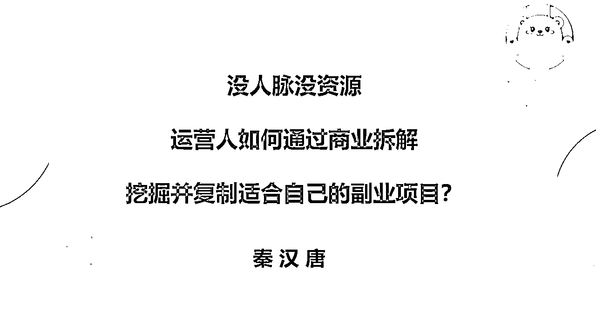

# 01 实操案例分享

先分享几组我认为比较典型的拆解。

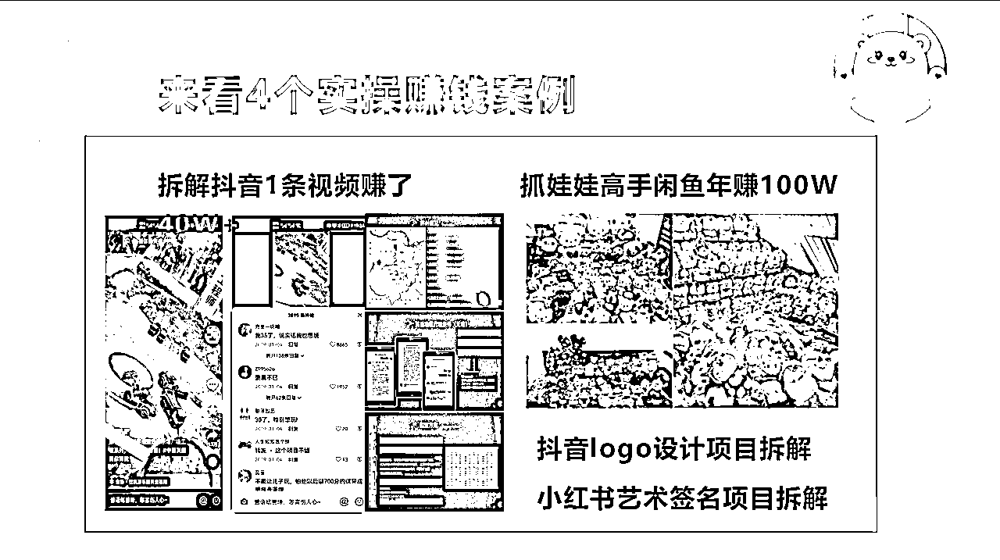

第一个案例是几年前在老家过年时刷到的儿童游乐项目。抖音上有一条视频，商场中庭搭了个模仿工地的场景，几台合金挖机、塔吊、翻斗车在跑，一群小朋友围着，拿着遥控器挖土卸土。我这个大人都觉得上头，换成在我家附近的商场，我也会带孩子去玩。

数据很能说明问题：8.4万点赞、1.1万转发、3000多条评论，播放量妥妥破千万。点进评论区，除了“好幼稚”“好想玩”的感叹，大量是咨询信息：“苏州有吗？”“能加盟吗？”“我们万达想搞，怎么加入？”

作为一个敏感的互联网人，本能地在所有触点做了动作：用咨询的口吻在评论区留言、点关注私信假装着急、拨打主页上的官方电话。两小时后，对方私信甩来一个微信号，加过去后发了两份资料：《已签约城市地图》《代理政策》。分为市代和区代，加盟费用合计约4万，市代还能发展下级拿返点。文件显示已有130多个城市被拿下，我想问的苏州早已名花有主。

转念一想，不求赚500万，赚50万行不行？于是有了后续动作。

让技术伙伴去扒这家公司全网信息，发现它只是广州一家贸易商，既非源头工厂也非终端门店，就是靠差价倒货。它的淘宝、京东、拼多多自营店销量平平，一直把产品当普通货卖。这条视频爆点在于把“卖货”变成了“卖门票”，场景感一下就戳中人心，尤其是男性用户。

综合判断，这个项目具备复制条件。其一，爆发具有偶然性；其二，货源并非独家，可另寻渠道；其三，场景需求已被市场验证。

我们组了个三人小组：我、技术、商务。商务去深圳找源头，拿下极低成本和一年质保。产品定价上，对方要4.5万加盟，我们直接定2万。

引流做两条线，追求确定性。第一条，用抖音作品投放，有有效评论就立刻放大投放，三条号同时运作。第二条，找一批做副业、做生意类公众号合作，成交给分润。

三个月内签下40多位加盟商，2万一人约80万，扣除成本，半个月净赚40万。就这么成了。

该项目更细的复盘请戳下方查看👇

第二个案例是抖音账号“文川手写”。专门帮人设计logo，手写呈现从灵感到成稿的全过程，观感很新颖。当时粉丝体量不大，但评论区全是有效需求：“怎么联系你？”“设计一个多少钱？”“我开了奶茶店，能帮我弄个logo吗？”

这类项目同样可复制。内容生产路径固定，要么找工具，要么找设计师就能复刻。流量端靠持续输出内容，每月能稳定带来数百条意向。交付端可以外包给设计专业的大学生，招50个派单，一个logo收费599，给学生200-250，我们赚差价。

类似的方向还有艺术签名。小红书和抖音上有很多这类账号，持续发笔记就有人来问“我叫秦汉唐，想做个签名”。私信引导加微信，9.9一个，背后用免费生成网站交付，成本几乎为零。一天成交几十单，一个月赚点零花钱完全可行。小红书上艺术签名笔记的爆款率也挺高。

第三个重点案例来自赚钱大佬涛哥。有一个朋友抓娃娃技术很强，常去商场抓娃娃，抓完挂闲鱼卖，一边抓一边卖，一年娃娃收入40多万。随后他把买家拉进微信私域，又开收徒业务，收599教抓娃娃技巧。徒弟收了几百个，卖货加收徒一年综合收入破百万。

他只会抓娃娃这一项技能，却通过思路迭代从卖货到卖方法，把收入做了二次放大。

还有教飞牌切水果的。个人兴趣研究出技巧发抖音，意外走红，一堆人求学。他开了线下速成课，899元/人，10天学会。

只要保持观察习惯，定期查看账号主页、评论区、作品更新节奏、引流与变现方式，把发现记录到飞书表格里，拆流量、拆转化、拆产品。坚持三个月，就能积累几十个案例，形成项目池，再从中挑一个适合自己复刻的去落地。

# 02 项目必备：选赛道+选渠道

方法论层面，任何项目都需要两个基础：赛道与渠道。

赛道是业务根本，无外乎卖货、卖课、卖个人。

卖货可以做电商；卖服务可以做美容套餐、装修、餐饮；卖课程可以做1V1咨询、训练营、代运营。

渠道是客户所在的触点。公域包括抖音、快手、小红书、视频号、豆瓣、知乎，电商店铺也算。

举例，赛道定为女装，渠道可以是小红书也可以是抖音，但业务内核仍是卖女装。

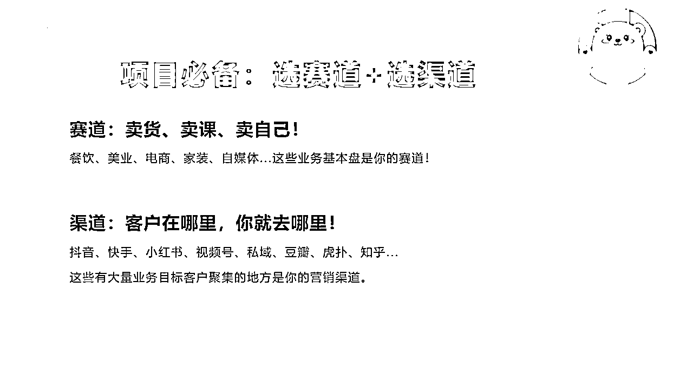

渠道之间存在信息差。很多项目在抖音做得一般，搬到小红书就起量；小红书饱和了，优化后搬到抖音也能跑。我们孵化的大量项目都靠这种迁移打法。

有人称之为后发制人。用别人验证过的路径去复制或二次创作。我不喜欢从零原创，也不喜欢all in赌一把。你花半天做一条原创，可能只有几百播放。我更倾向等别人做成熟、做半年以上，我再跟进。

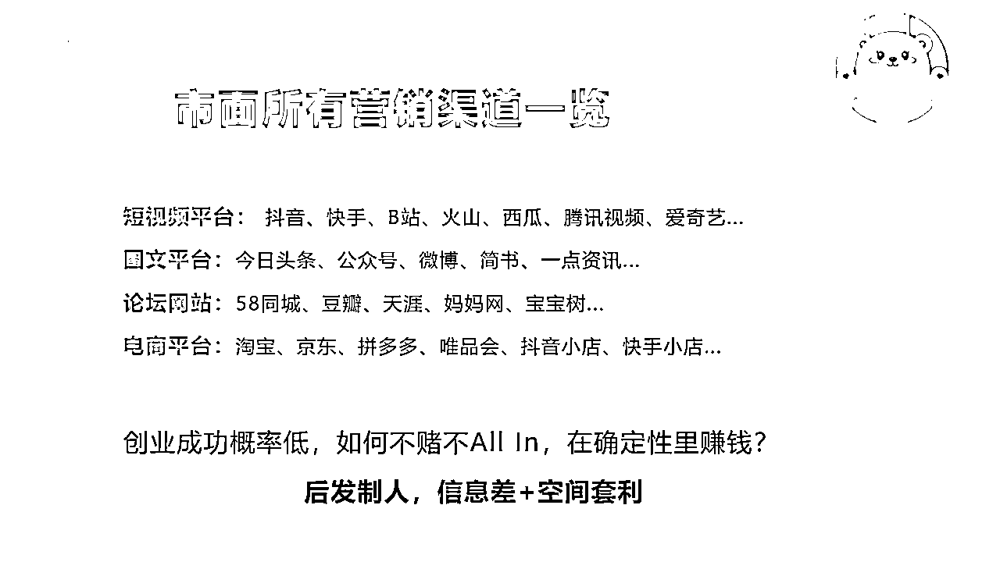

# 03 如何建立赚钱情报挖掘体系

怎么找项目？分享三个方法。

第一，喂养算法。从毕业起我保持每天两小时商业内容泛读。最早在今日头条，我会刻意在商业文章上停留，比如“濒临倒闭的母婴店，靠社群裂变7天破10万”。点赞、收藏、关注，坚持一两个月后，信息流就会持续推送同类内容。抖音、小红书、视频号、公众号皆是算法逻辑，很多项目都是这么刷到的。

但要保持定力，别被帅哥美女、娱乐八卦占据注意力，否则算法会把你带偏。

实操做法：看到优质内容立刻收藏点赞关注；分享到一个只有自己和小号的微信群；每周整理一次，按拆解逻辑归档到飞书文档；建立项目库，按流量、转化、交付难度加权打分。分数靠前的，就是优先考虑的方向。

第二，学会搜索。要能判断信息源的真实性与干货含量。比如搜“副业”，出来十条，你要分辨哪些是广告软文，哪些是真复盘。搜索时不要一条条点进去精读，而是批量打开几十条，快速筛掉垃圾，再二次筛选精读。

第三，技术加持。认识靠谱的技术伙伴可以做爬虫和数据监控。现在很多第三方数据平台能监测目标领域的头部账号，观察其作品更新规律，用来捕捉新机会。

这就是情报搭建的闭环。

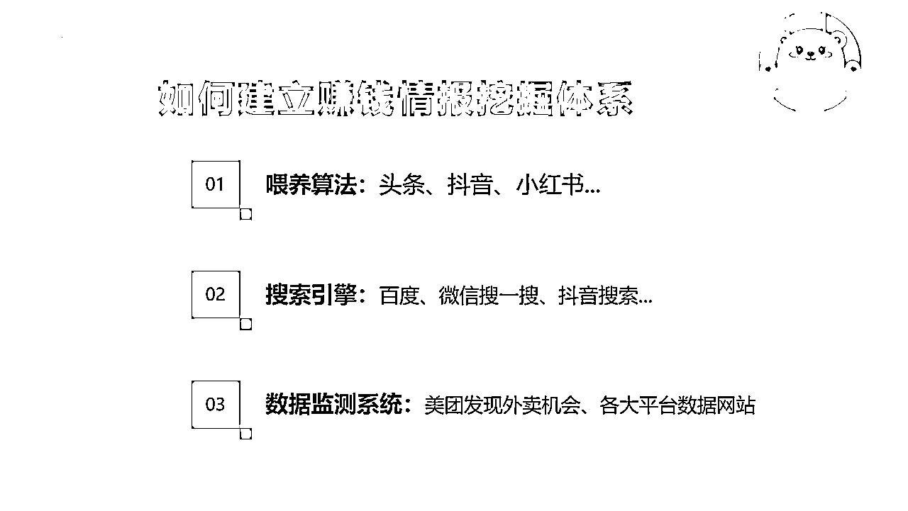

# 04 如何拆解一个赚钱项目

系统拆解分为八步：

1.找项目，建项目库。
2.拆流量：靠什么带来用户？固定内容还是投放？是否还有其他入口？
3.拆转化：是直播间直接成交，还是导私域后用社群、朋友圈、私聊成交？周期多长？
4.拆交付：产品是有形还是无形？是商品、课程还是招商加盟？客单价多少？好不好卖？同行是否做了半年以上？
5.评估复制性和持久性。需要投入五万十万的短期难复制；同行坚持不到三个月说明难赚钱，坚持半年以上说明模型成立。
6.定策略。明确自己的产品、流量、转化如何打，是完全复制还是结合自身做微创新。儿童游乐项目我们就做了流量端口的微创新。
7.搭团队。把项目拆成产品、流量、转化，看是否一人可扛，还是需要2-3人协作。
8.强执行。前面七步没有最后一步落地，一切都是空谈。

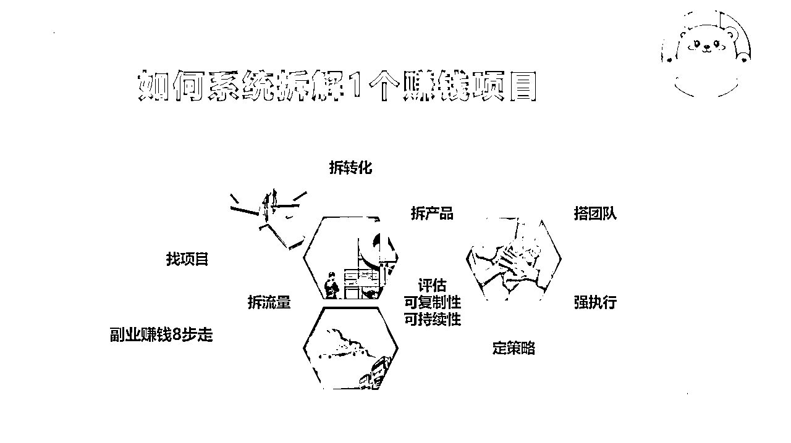

最后讲项目管理思维，让0到1更稳。

做乙方多年，服务过全国型集团，也做过单店项目。踩坑后发现，做事一定要有方法论，即项目管理。

我把它分为策划与执行两部分。

策划是先对齐预期：多久完成？有无量化指标？然后做方向规划，比如私域从门店自然流、电商导流或投放广告起步。策划即想法、规划和目标设定。

执行是分工、分解、监控、复盘。

策划里包含产品货盘。以化妆品为例，100ml可作引流款，价格略高于成本不赚钱；500ml作利润或口碑款走量；1000ml做高利润套餐。引流款和走量款先把人拉微信，再推套餐。卖课同理：9.9引流课、599训练营、1999陪跑，需要提前规划。

运营策略包括引流方式、转化路径、售后交付和口碑维护。

目标设定必不可少。没有目标就没有紧迫感。儿童游乐项目初期目标是三个月招100个代理，每人2万，利润50%。完成一半也算成功。没有目标，做事会迷茫。

里程碑是关键节点。儿童游乐项目第一个里程碑是签下第一个代理，证明引流到转化的闭环跑通。第二个里程碑是某条渠道跑通，比如抖音投放带来首单加盟，说明该渠道被验证。

止损点必须提前设。包括时间、金钱、资源上限。比如预期三个月，日更坚持，三个月没跑通就放弃。或者最多投入5台手机，5000元成本封顶，做不起来就停。止损点是保护决策理性的底线。

除了负面，也要给正面留出操作空间。比如某个业务原计划用90天走通，实际只用了30天就拿到首个阶段成果，这时就该抓住机会做放大：把业务中所有值得复用的环节逐项梳理出来。拆完之后，先定总体目标，再定运营打法、货盘结构和重要节点，这就成了一版策划案。策划案里会有很多执行细节，比如第一周做什么、第二周做什么。

到了执行阶段，就要换成执行案。执行案要回答几个问题：什么时间做、在哪儿做、由谁主责、做哪些事，以及如何设定阶段指标。我之前分享过一张图，来自一家全国有近七千间门店的集团企业，那是他们三年的销售额测算。双方沟通后，把全年总营收拆成几个板块，并写明每个板块要投入多少费用、能换回多少回报。

执行案又如何理解？简单说，它是一份某年某月的关键任务清单：模块怎么排、二级事项有哪些、每项任务如何描述、谁主责、谁协助、哪一天收官。完成项标绿，延误项标红。这才是执行案。

操盘中的一条铁规矩是：在最终拍板前，任何人都能反复犹豫、反复推翻；但一旦把截止时间、责任主体和任务明细敲定，就必须不打折扣地做完。因为前一项如果偷了工，后面就会产生连串顺延，整个节奏都会垮掉，人的状态和动力也会急转直下。我们当年做乙方时，总是对客户强调同一件事：约定10号交，就不能11号交，10号当天必须完成。

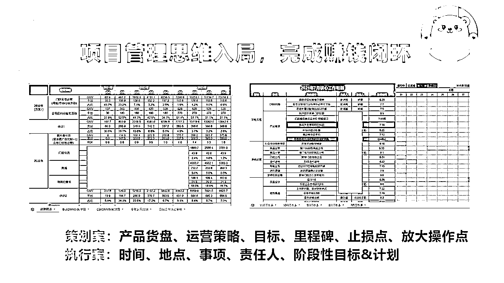
+

所以，这套管理方法的关键作用：把带盈利潜力的念头，变成一整套可落地、可追踪的行动方案。

# 05 用三种放大器把生意收益推向1到100

讲完0到1，再看怎么用三种放大器实现1到100。

第一种是人力这一杠杆。核心是用成本可控的兼职人员来放大产出。比如做内容平台，我们招募了大批兼职写手，把内容制作过程固化成SOP，让他们照模板引流；每个人发一篇内容，5到10分钟就能完成，每拉来一个咨询账号就结一笔钱。这样同时能跑几百个号，不必单靠自己吭哧吭哧写三小时，最后只出一篇，互动还少得可怜。当然，前提是单个获客成本够低。

第二种是技术这一杠杆。用工具代替重复劳动。比如要研究某一领域的笔记，可以用软件一次抓取大量内容。我做K12账号时，就把某地区教育类点赞超过50的笔记全部下载下来，然后批量复制、批量改写、批量上传，再安排人手做分发，整条链路像工厂产线一样运转。

第三种是资源这一杠杆。说白了就是资金和人脉，这条路对多数普通人并不友好，所以这里不细说。

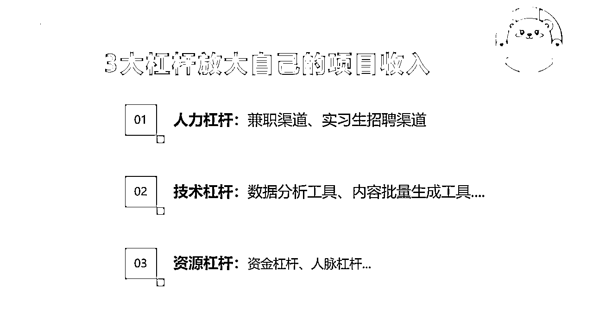

# 06 选生意怎么躲开陷阱

说完放大器，再聊聊我过去踩过的坑。我给自己定了三条红线。

第一条，重投入的不碰。假如开个店要准备三十万前期投入和装修费，试错代价太高，我不想这样冒险。

第二条，知识盲区不碰。像数字资产、虚拟币、炒股这类领域，我没有充足的金融认知。哪怕身边很亲近的朋友因此盈利，回头劝我加入，我也不会碰，因为心里没底。

第三条，不感兴趣的不碰。2019年，一个老同学介绍他朋友的祖父是养蟹人，我就和另一位伙伴一起做了几个月的河蟹电商。那算我头一回真正下场做小生意。可做起来才发现，我完全提不起兴趣。我必须同时处理品牌标识、铺渠道、联系带货主播、写销售文案，还要管售后和退换货。常有顾客反馈螃蟹断腿、死蟹、冷冻没做好，只能退款重发，特别消耗人。虽然四个月赚了二十来万，我的结论却是：以后不再做线上卖货，至少不碰后端发货环节。所以后来转到了付费知识内容和虚拟型产品上，这也正是我强调“不感兴趣就不碰”的原因，要选和自身兴趣、能力画像匹配的事。

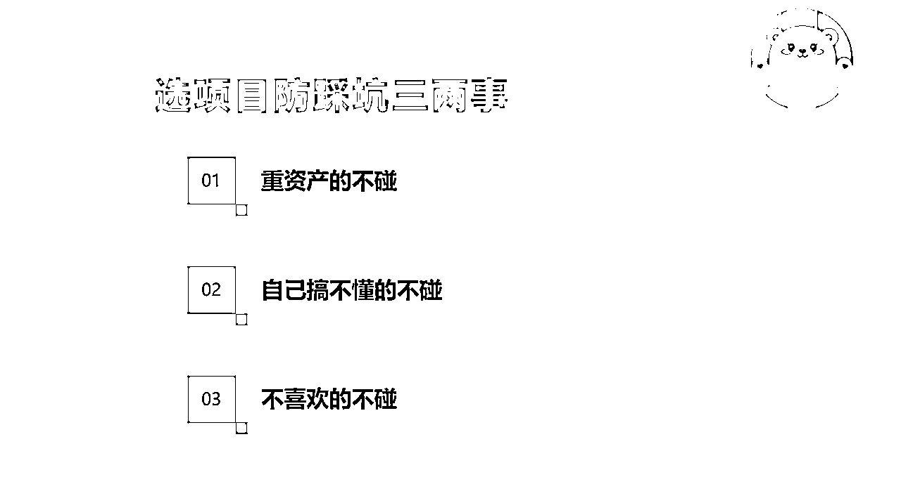

# 07 做事情需要的基本功

最后说说做事情的基本功。

第一，会搜索。会打开搜索引擎，还要能分清广告和真实结果。
第二，能找到低价的外援渠道。
第三，如果有好几位搭档一起做事，利润怎么分。
第四，一边做内容拉新，一边做成交转化，一边打磨产品，精力如何分配？

再分享几句心里话：不用怕行情差、市场太卷、对手太多。凡是红海赛道，总有人年入可观，多你一个也不多。你只需要锁定一件已经有人稳定盈利的生意，把模式拿过来做适当调整，就能开始变现。从零做到一百万，本质上是选择一件已经被验证的事。

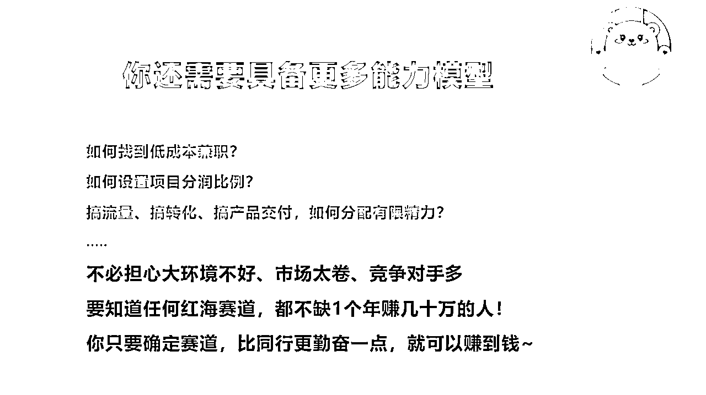

这篇分享的主题是：职场人如何透视一门生意并开启副业。我做了七年私域流量，擅长拆解线上成功案例并复刻；五年拆了两百多个盘，成功落地六个，前后加起来赚了几百万。欢迎来链接，一起交流变现心得。

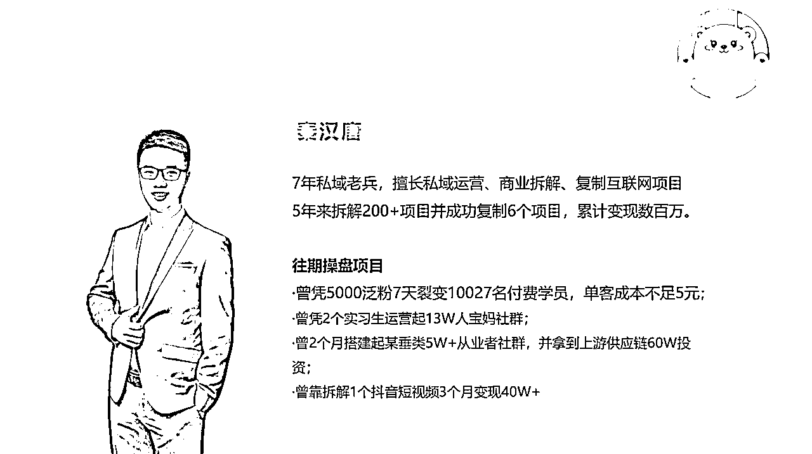