# 小红书资料号变现复盘：7天圈粉6000+、到手3w+，新手也能落地的完整打法

> 来源：[https://giwb0zv0cv.feishu.cn/docx/IpCcdJ9NAoAt4pxKKV5c5sfenZc](https://giwb0zv0cv.feishu.cn/docx/IpCcdJ9NAoAt4pxKKV5c5sfenZc)

这篇内容的目标很纯粹：给同样刚起步的小白讲透小红书运营的基本逻辑，以及资料号的完整操作方法。

整个过程不需要高端工具，也不涉及硬核技能，全是可以直接套用的简单动作。

为了让新手更容易消化，我穿插了几个小故事。文字可能有点“不正经”，但这确实是一篇正经的实战干货。

## 先看成果

7天新增粉丝6000+，到12月初累计到手3w+，微信精准好友2000+。我做的是英语类目，变现端对接的是星城老师的资源。

笔记表现：大约8条留言破500，20多条留言破100；还有大量点赞过万、留言20～30条的内容。

账号截图

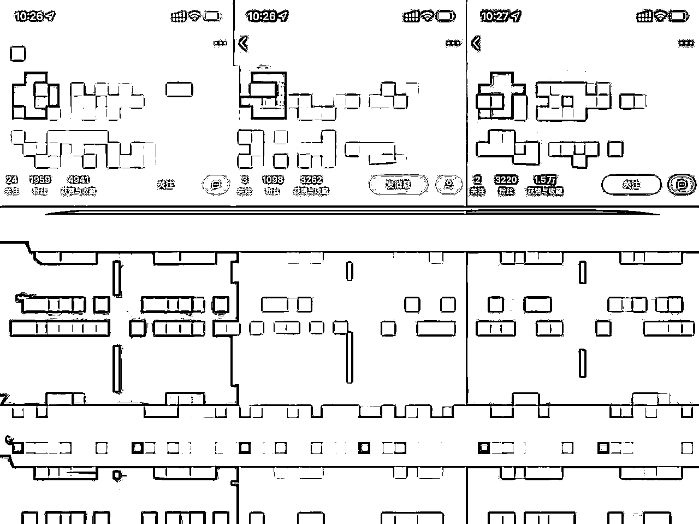

后台统计，重点看赞与评的比值

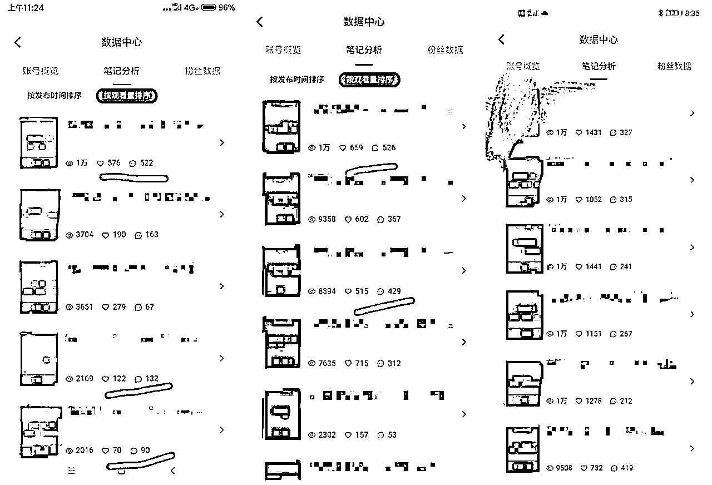

评论互动情况

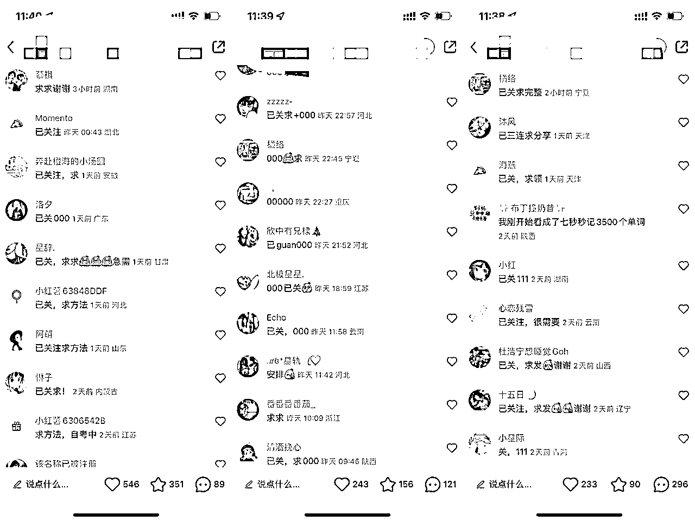

资料号的基本认知：

*   别把点赞、收藏这类表面数据当KPI
*   真正能带动转化的笔记，往往评论板块特别热闹；核心是设计好诱饵、激发互动，后面详细展开

命运的转折，始于报名11月航海的小红书运营志愿者。

那一次，我完整啃完了航海手册，逐字听了教练们的分享，随后意识到自己终于撞对了平台。接着链接上星城、无敌、梨云三位教练，又感觉撞对了人。

有人带、有圈子切磋，还有300+志愿者相互打气，我下场实操的畏惧感一下子轻了很多，于是就这么开干了。

## 个人经历（可略过）

简单交代一下背景：91年生人，经历相当曲折。大学时做情感培训，蹭上风口赚了50w+；后来被同学带进1040阳光工程，又全部吐了出来。

毕业后进入金融行业，跟圈里的晋四喜一样做贷款。2018年前政策比较宽松，用两年时间攒下一笔钱，买了两套房，还生了娃。

接着开始瞎折腾：外汇、炒币、P2P……不到一年半，房子没了，还倒欠近200w😢

受挫后基本宅在家里，一边emo，一边翻书，一边上网找项目。起初完全没有方向，像无头苍蝇一样乱撞。抖音火起来那两年，我报课极其疯狂：大蓝、参哥、薛辉……能买的课基本都买了。

状态基本都是：听课—自我感动—自我麻醉—不敢动手—害怕失败—迈不过心魔—空虚了再续费—再听课。

后来接触到钱南的圈子，经常混在群里聊天，视野这才慢慢打开；再经钱南推荐，加入了龙哥盟。

入圈头一年我几乎一直潜水，知识星球App几乎没打开过，认识的圈友也不超过5个。

而现在的我，连续参加多期航海，每天刷精华帖成了习惯，手机和电脑壁纸全是赚钱实战壁纸，微信通讯录里80%都是圈友。

为什么变化这么大？起点是去年报名参加精华共读志愿者。第一次做志愿者收获很大，随后又做了第二次、第三次……

当志愿者的日子里——

认识了很多可爱的船员，并且深入交流过。有位深圳船员跟我讲了口罩期间深圳的人性化管理，还说要带我去吃当地美食；有位擅长写作的龙珠圈友给我开小灶；还有一位技术型船员，三下五除二帮我解决了大难题……

链接到许多热心志愿者，他们给过我很实际的帮助。到现在，志愿者群仍是我最珍视的资产，给我1w都不换的那种。

业务上遇到卡点，群里问一句，不出3分钟就能收到5个以上解法；甚至有人主动加我，还语音指导了1个多小时，直接把我感动到不行。

我想说：在龙哥盟，志愿者这个群体最有温度。

发几张图感受下：

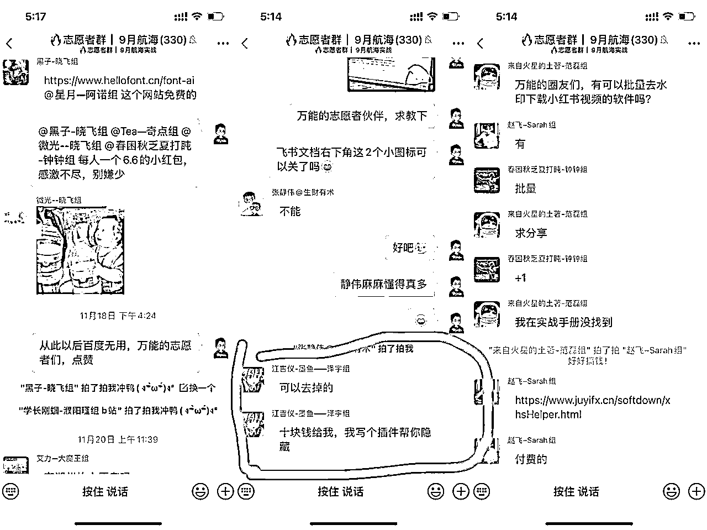

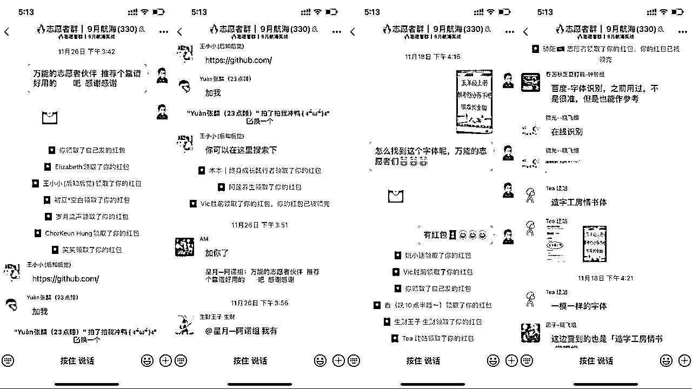

在这些实战经历里，我也逐渐立起了自己做副业的基本原则。目前这些原则置顶在备忘录，每天会看一遍。

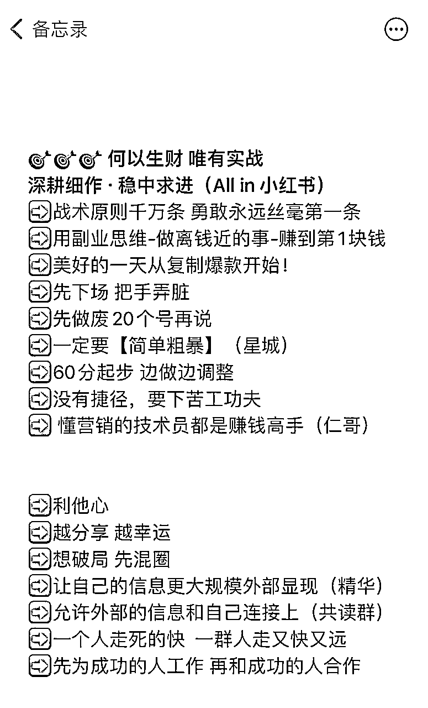

疯狂安利：如果你现在还没有方向，或者进赚钱一段时间还在边缘观望，真心建议先去当2、3次志愿者。

在“甲板”上，你会碰到同频的伙伴、流量高手、技术大牛、不同行业的精英，这些优质资源都能触达。

（我就是在无意中，靠志愿者身份打碎了自我封闭，希望你也可以）

连接的价值，老大的原话如下：

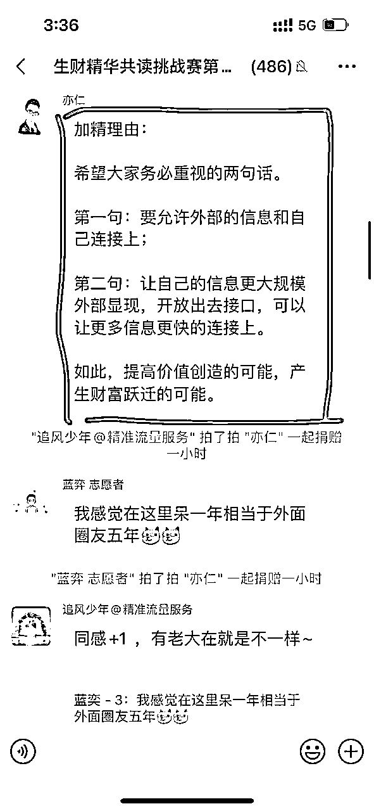

前面铺垫完了，马上进入实操。

## 资料号实战步骤

### 第一步：做减法，聚焦一处

老大有句话说得很好：卓越的人一辈子只做一件事，厉害的人一年做一件事，普通人却总想一天做好几件。

早年的我，恨不得抓住所有平台的流量，项目见一个爱一个，每天列的计划全是空话。

上图挨喷也认了：看到别人赚钱的项目就记下来，结果全都停在纸上。

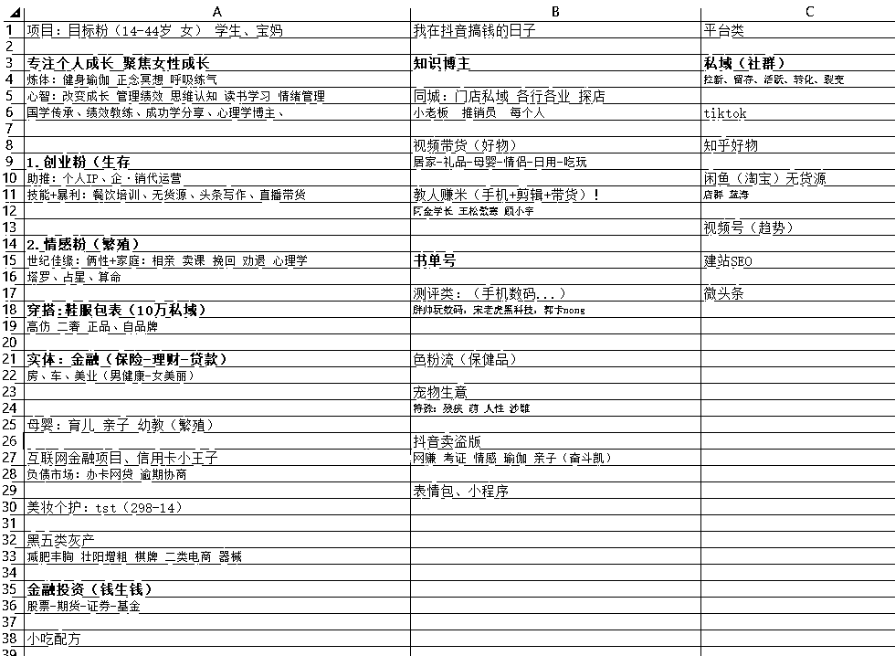

连第一次参加航海，我都一口气报4条船，还嫌不够；赚钱团队主动退款，我还有点不高兴。

这样的状态持续了将近一年，结果不但没赚到钱，反而比从前更窘迫。现在回头看，只能说自己当年天真得可爱。

估计不少伙伴也有过同款经历。这个坑，我待了整整一年。希望你能早些走出来：迷途知返，沉下心做深做细才是出路。

现在我只想认真做好小红书，做好资料号，这便已足够。

### 第二步：从自嗨模式切换到用户视角

要用用户的视角看问题，这是徐东、星城、梨云等几位大佬反复强调过的。

用户到底想要什么？这个问题很值得琢磨。

分享几样我老婆最近在抖音买的东西：

1.  一双15元的鞋垫，据说能促进二次发育，还能矫正腿型，穿上它=拥有大长腿。
2.  一条35元的裤子，据说可以提拉臀部，零运动，穿一个月就拥有蜜桃臀。
3.  她想练马甲线，我说你做做仰卧起坐，她本能地说伤腰，于是我收到一个快递：磁疗仪。戴上去一震，小腹赘肉就能自己掉光。

从老婆身上，我学到了很多用户思维。以前我以为只有老年人才会信保健品的邪，后来发现，其实每个人都有“老年人属性”。

过去我总爱跟她摆事实、讲道理，告诉她必须运动。现在我不这么干了，我们经常一起刷抖音，碰到便宜又让人“觉得有效”的神器，我甚至会主动劝她买来试试。她相当感动，我们夫妻关系明显变好，连她做饭都更香了！

重点：用户买的是一种感觉，是那种怦然心动的爽感！感觉对了，什么事都好谈。

让用户心动的底层逻辑：

下单冲动 = 自己省事（省力原则） + 有神器/秘籍加持 + 能立刻兑现愿望

一句老广告早就讲透了：“这钙片吃下去，爬楼就跟坐电梯一样轻松。”

广告卖的不是成分，而是“不费劲”的幻想。

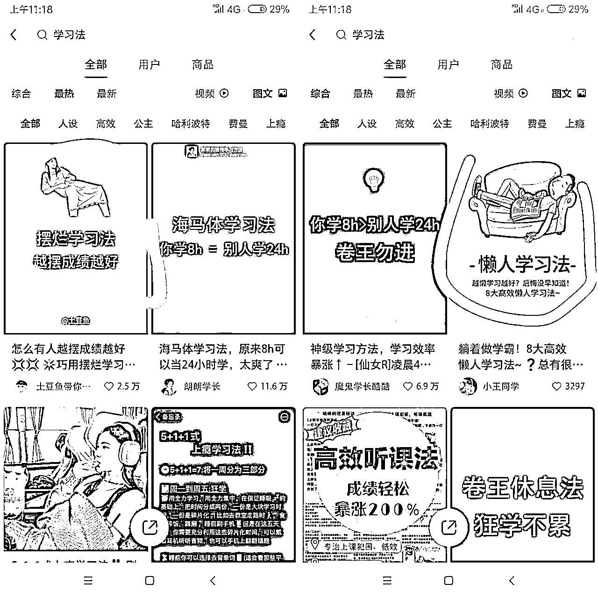

再比如搜“学习法”，在“综合”和“最热”两个排序下，排前面的分别是摆烂式学习、懒人式学习，甚至还有睡觉式学习。姜文要站着赚钱，而普通用户更想躺着变学霸，最好一觉封神。

宗旨只有一条：让用户先心动，心动就会行动，行动就会成交，咱们才能赚到副业路上第一块钱。

没有用户思维怎么办？

方法不难：每天花半小时，把自己代入用户角色，去刷同行、翻评论，坚持一周，变化自然会显现。

好，最关键的一步——用户思维已经拿到，现在开始选领域。

### 第三步：怎么选一个有潜力的领域

#### 1. 先搞懂红海和蓝海（小白版）

两个月之前，我连红海和蓝海的区别都说不清，为此专门翻了好几天知乎和精华帖。

所以如果直接甩给你“怎么选赛道”，多少有点不负责。那就讲个故事吧（新手友好版）。

这是一个悲伤的故事：

当年我考了430分，进了一所财经类院校，学的却是计算机。

报考理由：
a. 听说哈尔滨漂亮姑娘多
b. 财经类学校女生占比高

这妥妥是蓝海中的蓝海啊。

拿到录取通知书后，我特地查了查学校男女比例：2:8。那叫一个开心，失眠了好几天。可惜当时大意了，没留意我自己的院系。

上课那天我彻底傻了：200人的大教室里只有4个女生，其中1个还是我们班的，南方人，小芳，相貌一般。

后面的剧情就是：我（无奈）被迫清心寡欲过了整整三年，当时还不懂与外界链接。

而小芳呢？被全班和老师当成掌上明珠，做上了班干部，还连续三年拿奖学金……

好，故事讲完，开始套概念。

*   红海：抢食的人多，口粮却少。故事里悲惨的男主角就是这样——一个小白，掉进竞争激烈、同行实力还很强的赛道里，想冒尖比走蜀道还难。血的教训：选对方向比埋头努力更重要，方向错了努力全白费！
*   蓝海：抢食的人少，口粮充足。像小芳一样，自身条件平平，但进了一个男生多（用户多）、女生少（同行少）的班级，也就是细分赛道，自然机会不断，这就是蓝海。
*   陷阱：看着很美，进去才发现是坑。有的赛道从大方向看是蓝海，可细分领域已经拼得头破血流（比如故事里的男主）；有的赛道看着是红海，细分市场却大量空白（比如小芳）。

举例：

抖音确实卷，但小程序、小说变相等小类目一直很香，还会时不时冒出新的蓝海机会；

小红书本身做的人不算多，但资料号最近也有点内卷；再往下细分，不同年级、不同科目依然很吃香。

说到底，本质就是供需关系：是供不应求，还是供大于求。

#### 2. 找到适合你的冷门利基方向

精准定位三原则：自己爱做、市场有需求、平台给流量。

*   自己爱做：赚钱的过程往往一波三折。毛爷爷说过，前途是光明的，道路是曲折的。摸索期一定要有让自己坚持下去的理由，热爱就是最好的内驱。
*   市场有需求：参考上面“从自嗨到用户视角”的部分。
*   平台给流量：在平台混，就得顺着平台的意思，官方爸爸才会给流量。

小技巧：干货内容和营销内容按二比八配比，比如发10篇，8篇营销、2篇干货。干货内容容易吸粉，还能引爆流量，从而带动其他引流笔记。

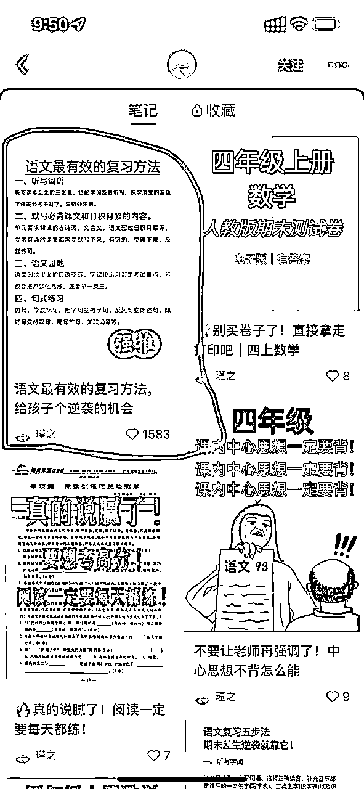

#### 怎么找到蓝海方向

1. 首页搜关键词、二级类目、下拉联想词

这个方法主要是判断方向是否符合平台调性，以及大致生态。很多大佬都讲过了，这里不重复；说点我自己摸索出来的心得。

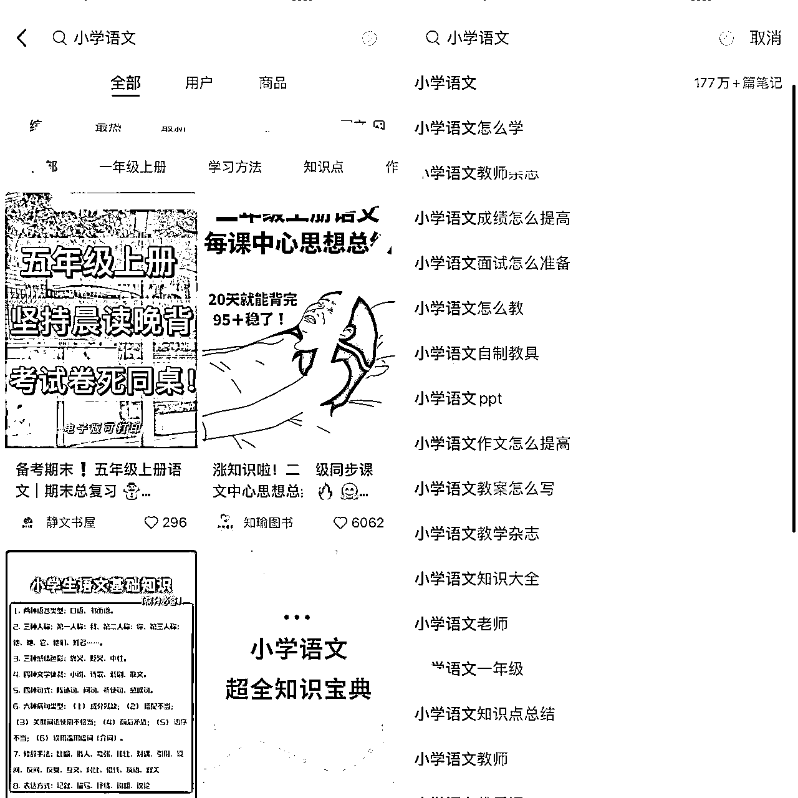

2. 看头部账号

观察你想做的方向有没有头部玩家；头部一旦垄断，会吸走不少流量。

搜“小学语文”，排在最前面的四个号都来自河南，画风统一，还带着官方认证；继续往下翻，少说也有几十上百个号在抢同一条流量。这说明已经有专业选手进场，新人硬刚会非常吃力。

不过他们没有做细分，我们切入一年级、二年级、三年级，机会反而更大。

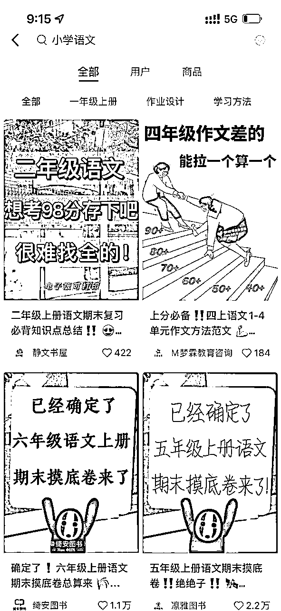

PS：小学的数学、英语两个类目都没看到有影响力的玩家进场；初中各科也相对空白——说明资料号在各学科细分下几乎都是蓝海，等着我们去开拓。

3. 对比最新发布与最热内容

同样搜“小学语文”和“小学英语”的最新笔记：语文方向24小时内新增内容量，几乎是英语的5到10倍。

但两个方向的目标人群高度重合。

举个例子：24小时内语文笔记发了100篇，英语只发了10篇。也就是说，发一篇语文内容要面对100个同行；发英语内容只需要赢过10个人。

我现在做的就是英语类目，很香。前期我用这个方法做过调研，下一步也准备试试语文。

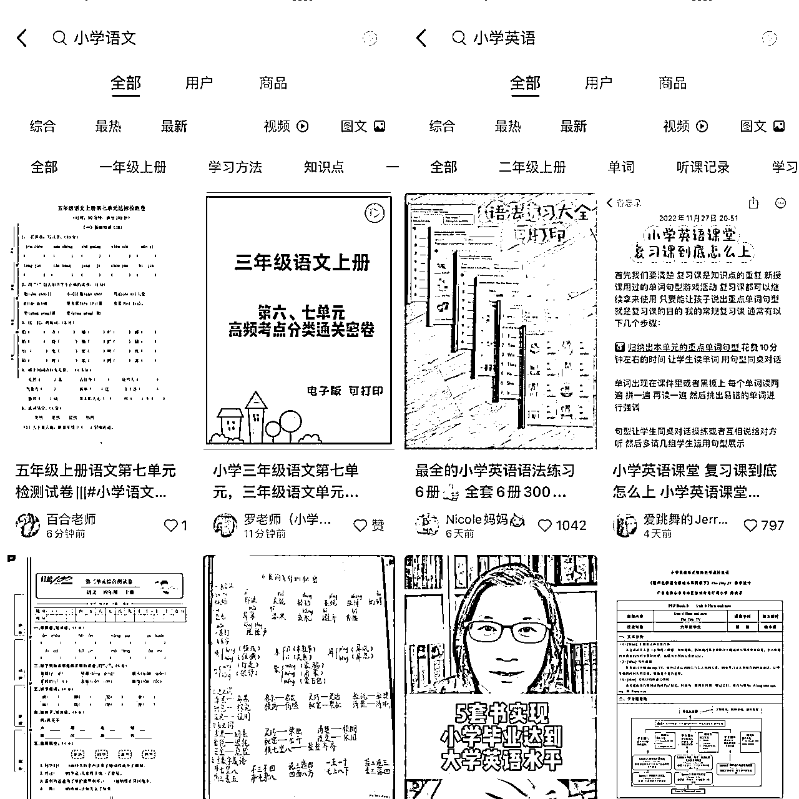

再看两个方向的最热内容，点赞量基本在同一水平线上，说明用户盘子与喜好程度接近；唯一差异是英语类目竞争更小，更容易做。

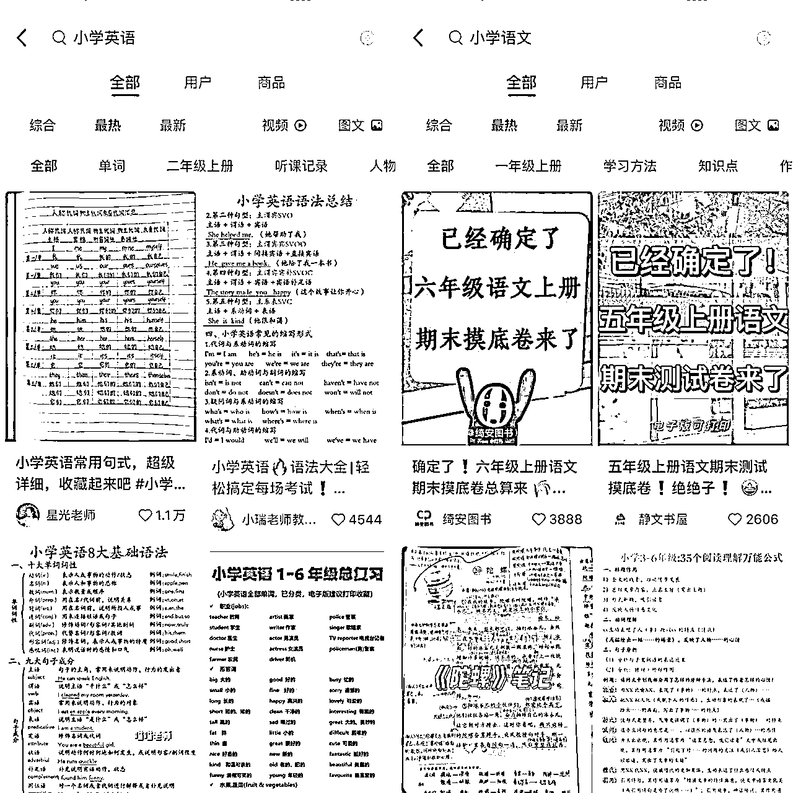

4. 多刷星球

进了赚钱，基本就不存在信息差。多看多刷，总会遇见不期而遇的精彩；最新的行业动态和新鲜玩法都在里面。

我现在做的英语方向是考研，碰巧对上了老大发的那张表，简直绝了！

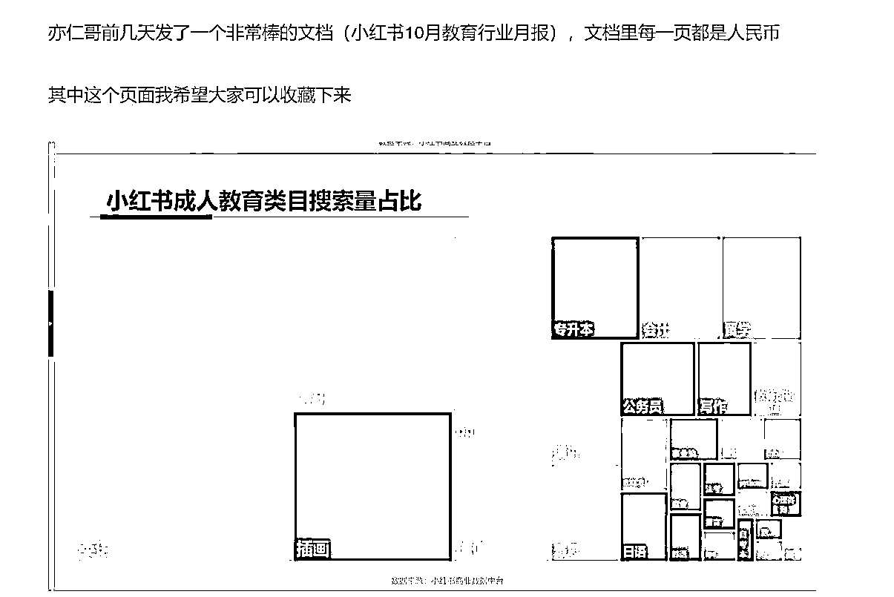

把上面四种方法结合起来，你能清晰感知到自己选的方向在小红书里的现状：

当前市场如何、同行多不多、有没有大佬入场、用户喜不喜欢、行业风向是什么，基本都能看到。

做完这一步，相当于对“用户—同行—平台”做了一次三维扫描。功课到位后，觉得打不动就换方向，觉得没问题就全力冲刺。

下一步，开始找选题。

### 第四步：挖掘高需求选题

#### 概念：什么叫做“选题”（小白版）

新手朋友如果看完这段还不懂选题是什么，以后就倒着念我的名字好了。

想象你开了一家叫“玉足堂”的足疗按摩店。做推广时有7个方向可选：

1. 技师颜值高  2. 价格亲民  3. 装修上档次  4. 手法专业  5. 私密性好  6. 小姑娘多  7. 停车方便

好的营销，是挑出用户最关心、需求最强的1—2个点往死里打。不需要面面俱到，但要直击要害。

比如前面的例子，我最关心的依次是4、2、7（按摩嘛，手法最重要了😜）。
如果你的宣传主打1或6，我看都不会看——内容再好，不是我的需求也白搭。

方向不对，努力白费。选题占七成功力，内容只占三分，这话就是这么来的。现在懂了吗？

圈友，你最在意的是哪一项？欢迎告诉我😍

用一句话总结：

选题的本质，就是从你产品能提供的价值里，提炼出用户最敏感的那几个点。

#### 怎么找到好选题

*   看最热榜。快到期末了，学科类目用户近期的需求高度集中在：考试卷、复习资料、考前押题、拿分技巧。

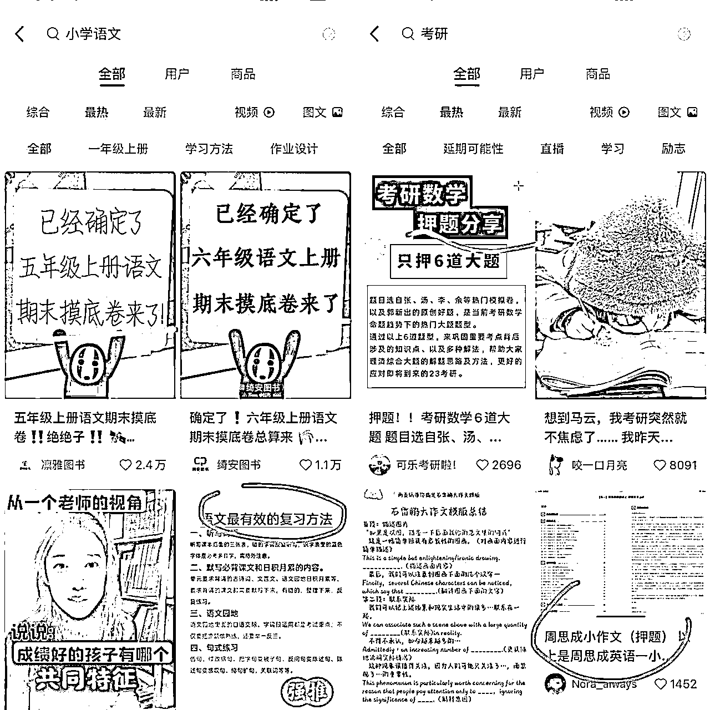

*   翻评论区。那里就是用户吐槽与心声的汇聚地。“走进群众、融入群众”，永远是认识用户的最佳路径。
*   引流到私域以后，主动问用户最近最头痛什么，再送上对应的资料（相当于轻量问卷）。
*   问同行的朋友。比如你有朋友是小学老师，他一定最清楚学生和家长的头疼点。

以上方法的核心，都是围绕市场反馈来定方向，以用户真实需求为出发点。为了不陷入自嗨，我的原则很简单：“不要自我感觉”，一切看市场，看用户怎么说。

### 第五步：做出高点击封面

选题搞定后，下一步最关键的就是封面。人靠衣装马靠鞍。

我在B站关注了一位“换头”美妆博主。

你的封面如果做得太劝退，用户大概率划走；做得够吸引人，点击率基本不会差。

不过审美是一点点养出来的。我这种直男，最稳的做法就是先把爆款研究透。

方法1：保持开放、多链接，方便掌握最新行业动态。

我的三个账号：一个梨云绿、一个梨云黑，坐等梨云教练出更多模板。

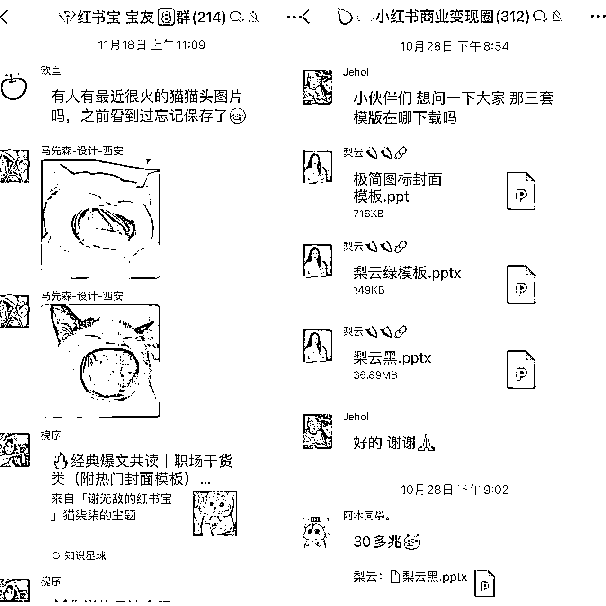

这里必须说，赚钱的航海教练阵容只能用“YYDS”来形容。

跟星城教练学运营，跟无敌教练学爆文，梨云教练的模板则属于白嫖。一定要多参加集体活动哦😘

方法2：自己动手，丰衣足食。

以学习类为例：搜学习、成长、干货、考研、小学、职场、学霸、知识……刷一个小时后退回首页。
（小红书的推荐机制很快，容易把你的首页“刷垂”。到这时候，推荐页基本都是学习类，爆款封面很容易被捞到。）

参考标准：发布时间在1个月内、粉丝少但点赞爆炸、点赞上千、多次出现、7天内数据持续稳定。

找到以后，用下方小程序去水印，再用美图秀秀的消除笔去掉文字，模板就到手了（拿来主义😜）。

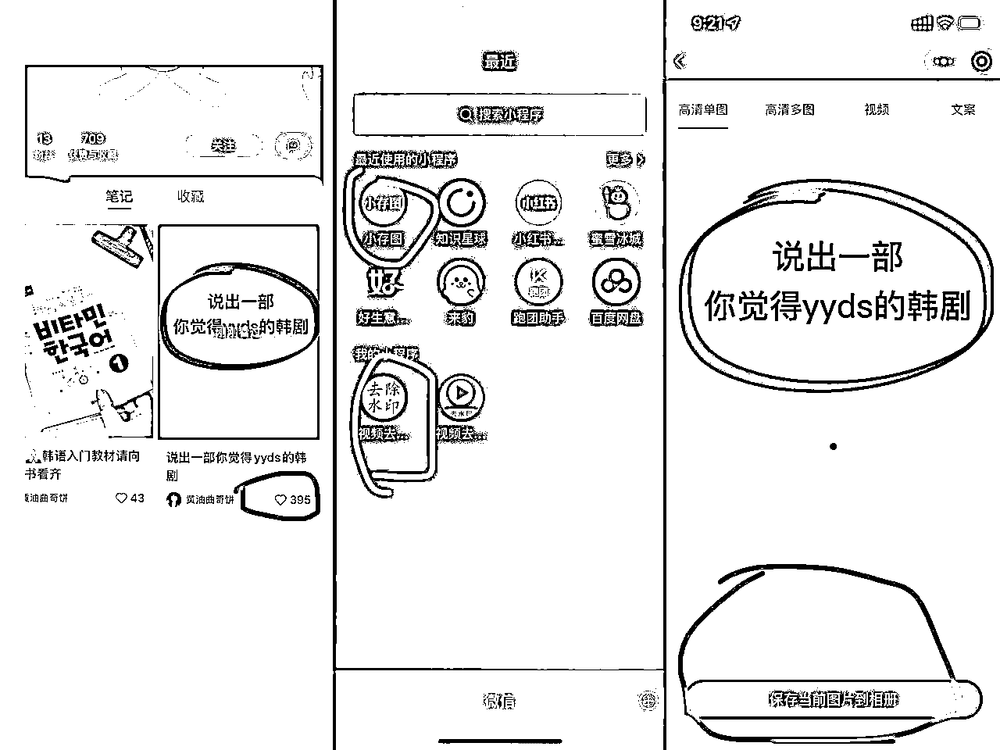

如果模板是纯色系，直接拿创客贴吸色就行。注意首图比例：1242:1660。

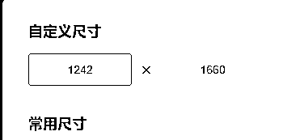

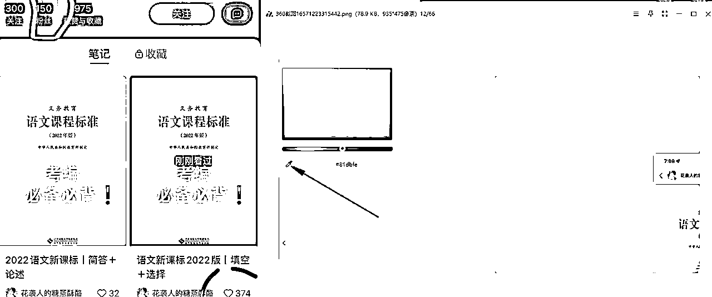

模板解决了，下一步冲标题！

### 第六步：制造“忍不住想点”的标题

#### 1. 两极标题法

核心原理：

*   人性偏好：越省力越好，越快见效越好
*   动物基本驱动力：追求快乐、逃避痛苦。由此延伸出正向诱导和反向施压。

标题模板：

正向诱导：产品或技巧 + 1秒上手 + 效果炸裂

*   小学英语类目最火的一条：“搞懂这些语法，能考130+”（图1）
*   蝉妈妈导出的背单词类目最火标题（图2）

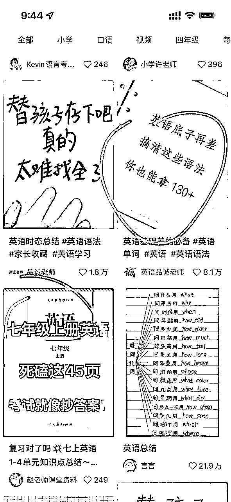

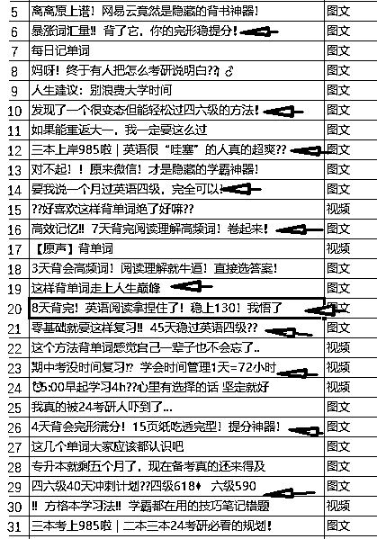

反向施压：不看必亏 + 限时删除 + 制造紧迫感

*   你不看这篇文章就会错过一个亿，限时删除！！！
*   抖音上大量文案都是这个套路。说白了就是制造焦虑，有点损，但用户就吃这一套。

这背后是人天生害怕损失，也更容易被负面信息牵动。毕竟在原始社会，抓住机会最多是多几块肉；但一次失误可能命都没了，所以进化让我们对“失去”格外敏感。

#### 2. 基因重组法

这里得感谢袁隆平爷爷。把不同的优质水稻杂交，才育出超级稻。

方法很简单，效果立竿见影。我的爆款标题就是这么来的，妥妥的流量密码。

比如搜“纪录片—最热”，翻看前十笔记，高频词就那几个：唯唯诺诺、央视推荐、格局炸裂。

最热前8名里，有6个标题几乎长一个样。这就是星城老师说的：所谓爆款，往往是把被验证过无数次的东西再复制一遍。

那就照着抄，把高频词像积木一样来回拼。重组出来的标题，天然带着爆款基因。

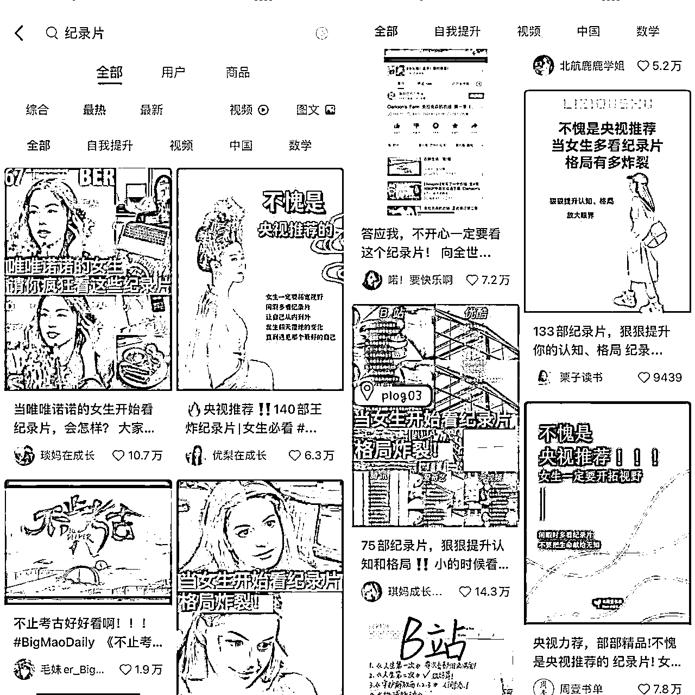

小建议：把最热标题手抄到纸上，没事多看一眼，网感会慢慢长出来（我的字有点辣眼睛🤭）。

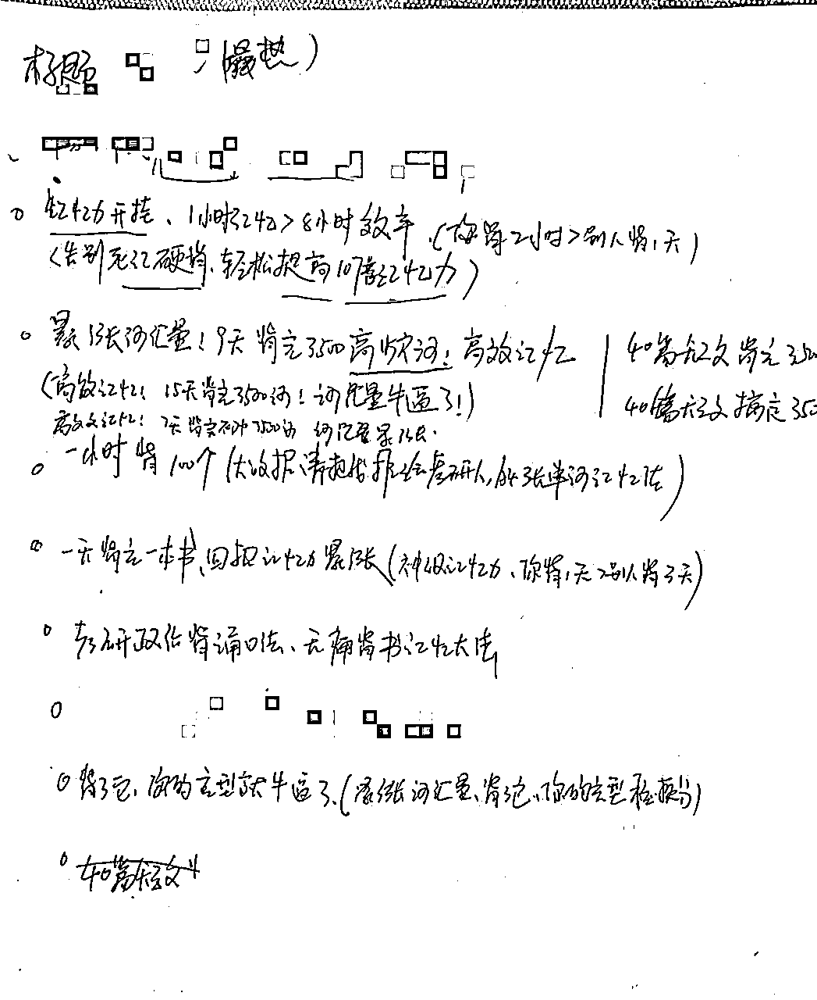

当然，用蝉妈妈这类数据平台也能收集爆款标题。不过我个人建议新人先人工整理，印象更深，后面再用工具提效。

两种方法叠加着用，既符合人性法则，又自带爆款基因，标题这关基本稳了。下一步是内容生产。

### 第七步：设计让人忍不住留资的引流诱饵

诱饵是资料号的灵魂。做资料号，第一优先级是引流和转化，不是点赞收藏——那些只是安慰剂。

#### 第一步：找到“诱饵设计得好”的笔记

去哪里找？看留言区。

失败样本：图1。
特征：点赞不少，但留言区冷冷清清；或像第三个案例，留言区变成了聊天室，没有实际转化价值。

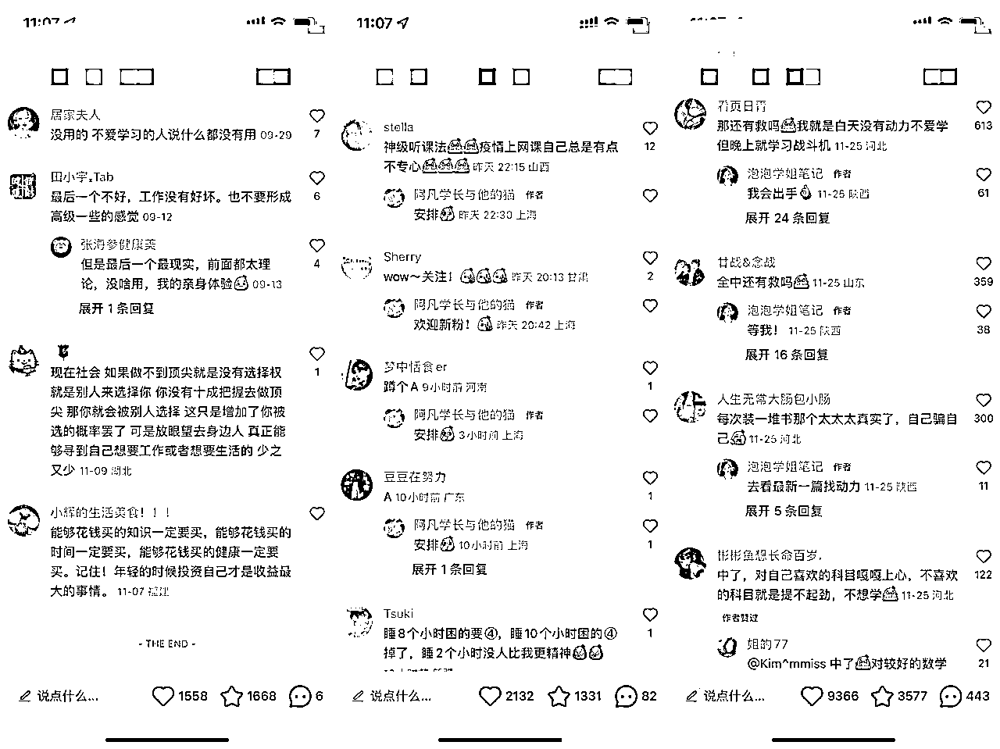

正确示范：下图。
特征：留言区整齐划一，全是“求资源”“怎么拿”“私你了”。

做资料号最容易陷入的误区，是把点赞和收藏当成最终结果。真正能带来转化与收益的，是评论区愿意进一步交流的那批人，他们才是变现的根基。

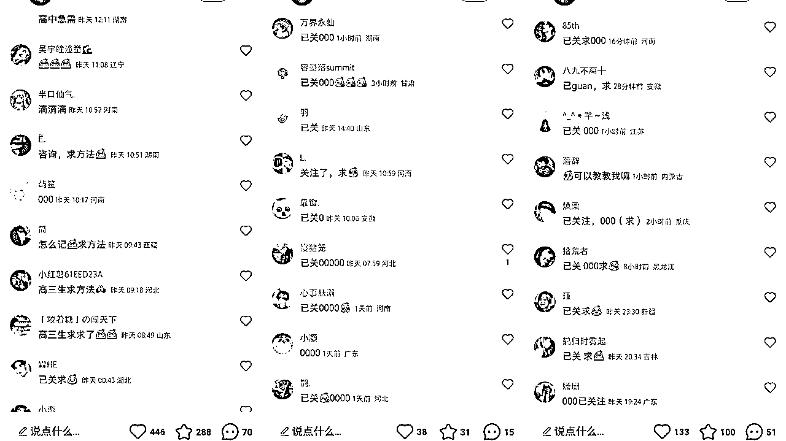

要快速积累可复用的同行素材，可以双向并行：人工日常扫荡对家内容，再借助系统推荐自动补位。池子建立起来后，关键在于把别人的方法论改造成自己的引流入口。

#### 第2步：如何筛选出高转化钩子

我的做法是每天抽出固定时间翻看对家，只要开头足够抓人的笔记就归档。单独建一个合集存放，随后用小号联系原作者索取资料，或直接在电商平台购买同类素材亦可。

不必纠结自身创意匮乏。核心逻辑是同行就是现成的市场样本，已被用户验证过的东西完全可以做二次开发。

持续执行一段时间后，手上会沉淀十余到二十余个甚至更多的具备强需求的钩子，难度自然会下降。

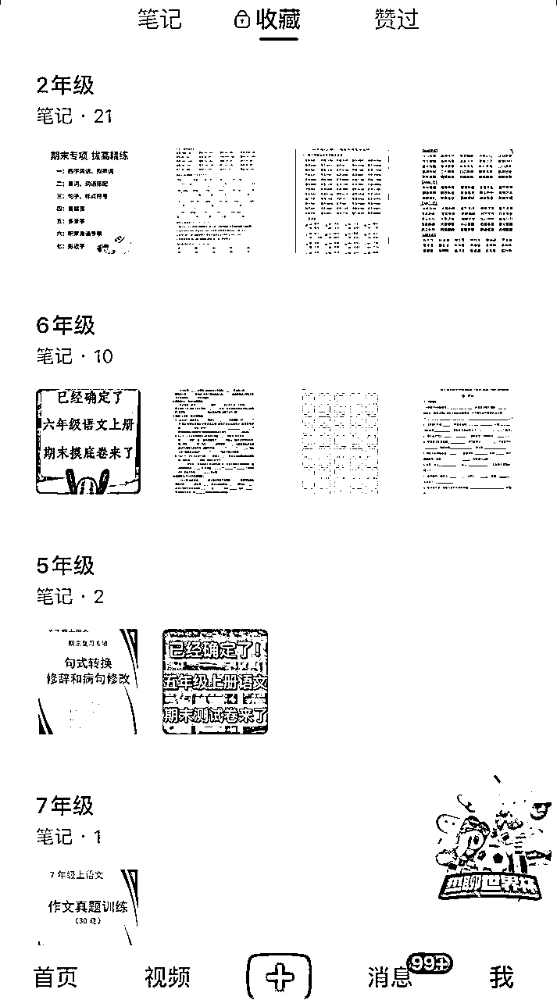

起步阶段不建议闭门自造觉得靠谱的钩子，除非你对该赛道有实操经验、对受众心理与市场规律有清晰认知。爆款笔记里的钩子是用户用行为投票选出来的，已得到大众认可。

#### 第3步：把钩子加工成自用工具

拿到同行钩子资料后稍作润色，就能成为个人的引流利器。

无水印截图可以直接拿来用，用美化工具换个边框贴纸即可焕新。有水印的图片先做文字转化，重新排版后再使用，我用的转文字工具识别度比较高。

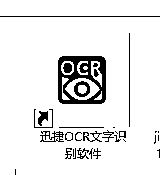

小经验：

曾看到同行发了两条内容相近的笔记。一条获赞近两千，评论仅三十左右；另一条获赞五百，评论却超过两百。转化差距至少五倍，差异点在哪？

首条文案暗示“我这里有上百篇，只展示四篇”，先让用户看到冰山一角，再提示还有更多等你领取。这正是资料号钩子的核心思路：先给一半，留一半制造诱惑。手法有点坏，但效果很稳。

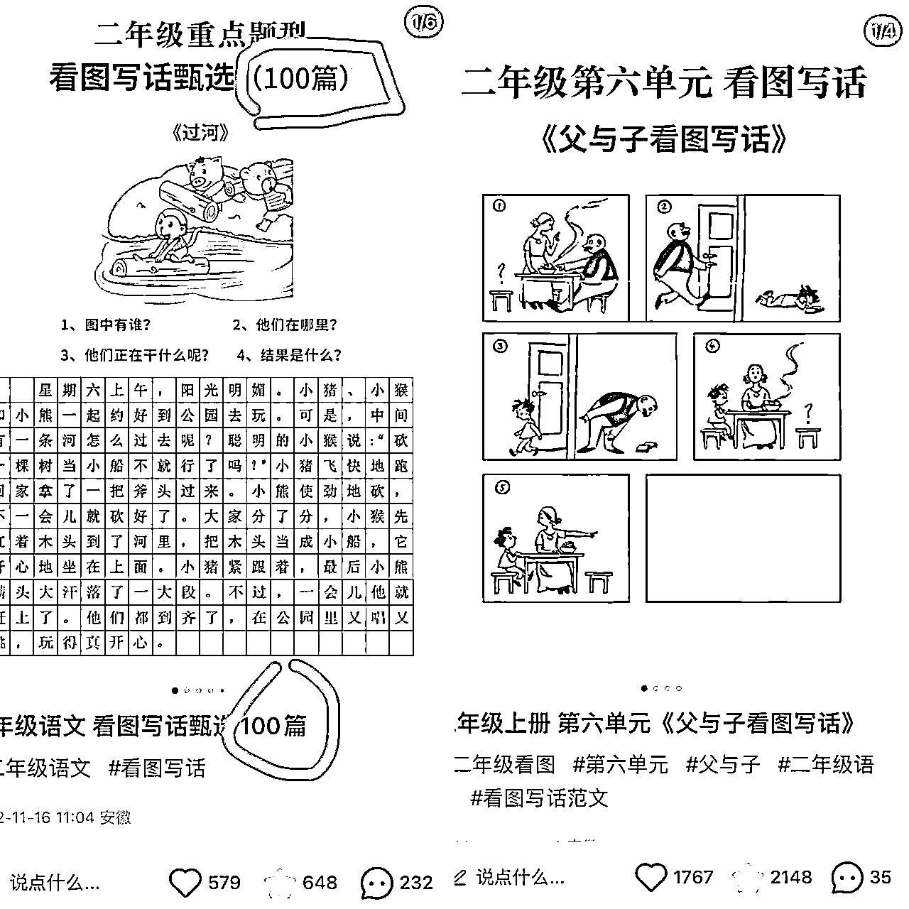

总结：

对资料号而言，一篇点赞一百评论一百的笔记，带来的收入往往远高于点赞上万评论二三十的笔记。我们不需要追求热度，也不需要刻意做大爆款，只要时常出现几条点赞五六十评论五六十的作品，就已经很香。

抛开虚荣指标，把钩子打磨到位。每篇平均能带来二十到三十个私信，累积下来非常可观。

### 复制连发打法

记住一点：爆款的本质都是重复出来的。

思路是先模仿他人的爆款，持续测试直到摸出自己的爆款形态，再开始复刻自己的爆款。

例如某账号粉丝一千五，运营不到一个月，其它内容数据平平，直到一条跑出来了。博主便持续重复投放，原理很简单：曾火过的内容大概率还能再火。很多人做出一条爆款后就换选题，我们反其道而行，直接复制自己的爆款，你会发现：持续投放，持续有流量。

做法很直接，找到数据尚可的笔记就不断投放，直到流量消耗殆尽。期间可以每日发布两条，一条复刻爆款，一条用于测试新模板。这样既能吃完当下红利，又能孵化下一个爆款。

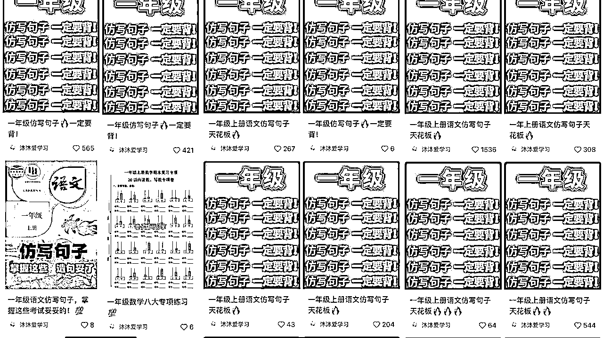

下面是我自己的案例：同一账号里两篇作品完全一致，标题封面内容均未改动，效果依然可观。

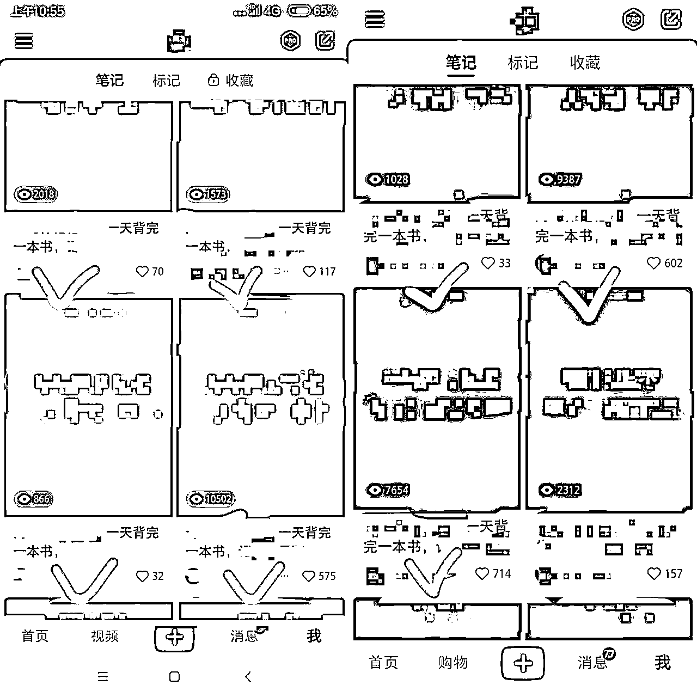

曾经错过一个爆款，后悔不已。如今我只想对它说：请持续投放下去。若要设定期限，我希望是永久。

有了爆款后，下一步就是把用户往评论区引导，促使其留言互动。

### 激活评论区

提升评论量的直接好处：

*   利用从众心理，让更多有需求的用户主动来私信你，就像人多排队的摊位更吸引人一样。
*   笔记权重也会随之提升。

所以重心要放在如何促使用户评论和关注上。

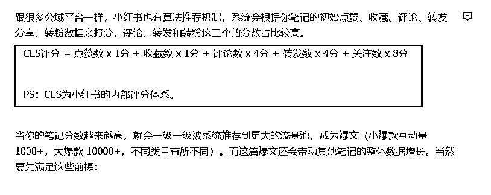

原理拆解：

*   从众效应：多数人会跟着别人走，所以需要先制造头羊效应。
*   下指令：用户习惯懒惰，不会主动思考。看到喜欢的内容时，必须立刻告诉他下一步如何操作，否则意向人群会流失。

具体打法很简单，效果却很明显：

1. 引导用户先关注再回复指定数字。指令越清晰越好，同时便于我们统计数据。
2. 用三个小号先在评论区留言，制造初始热度。三个人就足以点燃氛围。

没有小号也可以加入互助群。直接在平台搜索相关关键词，就能找到不少。

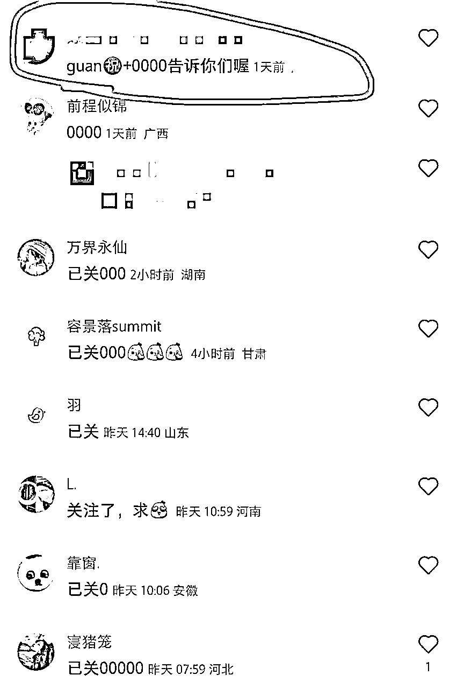

实操记录：有条笔记晚上发了不到半小时获赞五十，却零评论。我判断有潜力，便用大号先在底下引导，随后用两个小号补充了几条评论。睡前又陆续进来三四个真人评论，第二天醒来直接破百。很多时候就差一个带头的人，一个小动作就能同时刺激互动和笔记评分。

### 接入私域

到这里，爆款选题、爆款封面、爆款标题、爆款钩子，再加上评论区引导，已经具备了爆款基因。接下来就是日更冲量，把数量做上去，剩下的交给平台机制。一般十天内就能跑出小爆款。

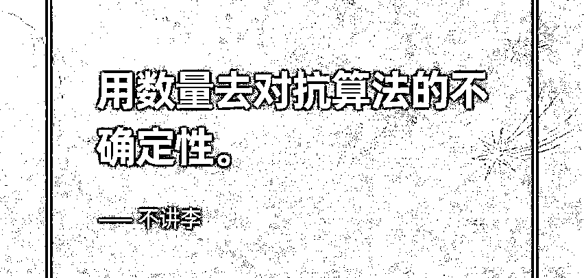

引流添加微信，我的做法是主动私信每一个新关注的用户，把等待变成出击。

形式是图文结合。比如：“同学你好，资料这边发不过去，加下我给你发。”

需要注意：

*   安全系数：准备四五张图轮换，话术也做差异化，避免被系统判定为重复操作。
*   回复速度：用户不一定常在线，及时响应实测能把加粉效率提升数倍。

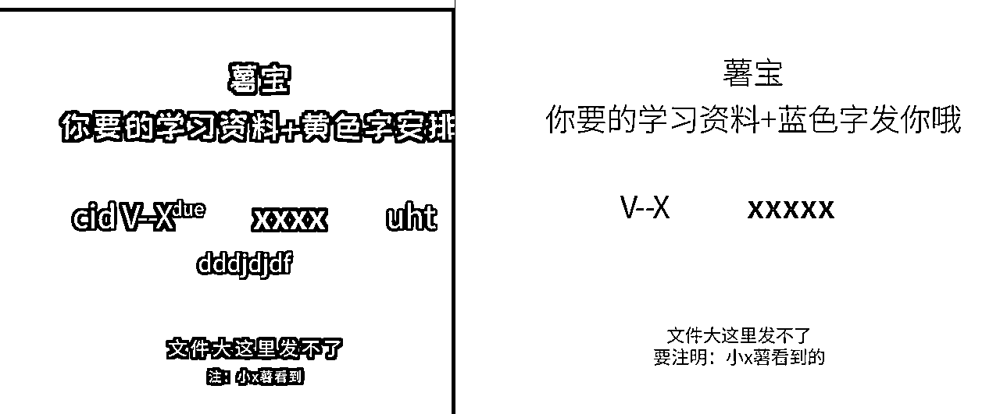

下一步我打算加入建群引流。部分账号没有建群权限，可以在平台搜索“代建群”，几块钱就能搞定。

下面这条同行的话术制造了紧迫感，可以借鉴。

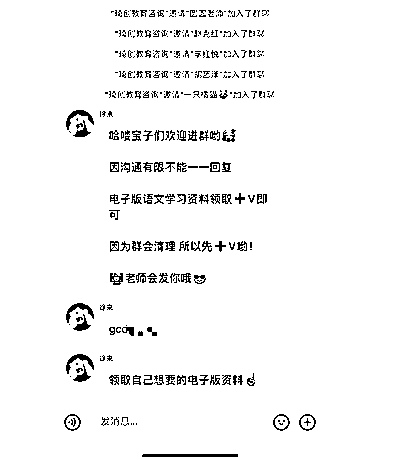

其余的引流方式，航海手册里都有整理。圈友可以自行去学习。我建议精挑细选一到两种深耕即可，贪多反而减效。

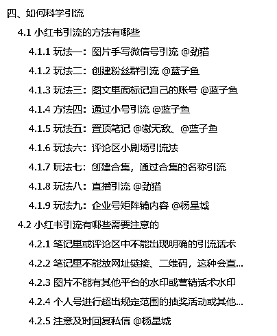

变现方面，我目前主要做线上课程转化，具体由星城教练负责，我没有实操就不展开。后续计划对接各科目的老师，做多层转化。

到这里就结束了，有问题欢迎评论区交流。

补充：新号首发，有概率直接破千赞，且赞评比例接近一比一。内容依旧是可复制的爆款逻辑。

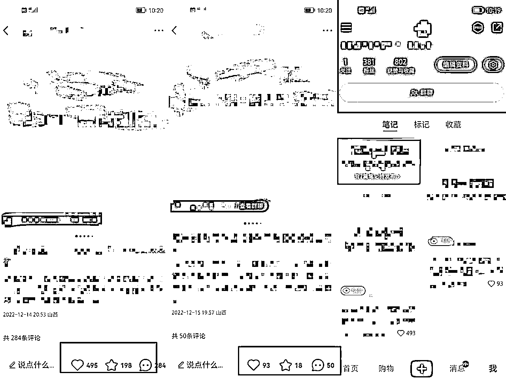

最后感谢：感谢龙哥老大提供的赚钱大家庭，让我走出闭门造车的困境；感谢推荐人钱南带我进入龙哥盟，让我拿到互联网的第一笔收入；感谢星城教练的点拨，让我在摸索两年后真正入门；感谢航海中遇到的每位船员和志愿者伙伴的支持。

共勉一句话：赚钱靠实战，伙伴们快点下场动手。

.......补充.........

感谢圈友国强绘制的思维导图，质量很高，特此补充，希望能对大家有帮助。

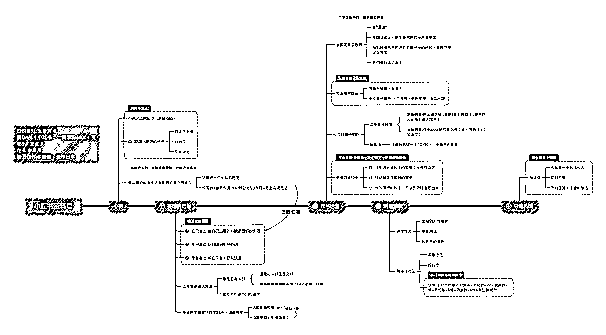

其他进阶内容：引流效果提升十倍，小红书笔记框架经过三个月迭代总结

https://wx.zsxq.com/dweb2/index/topic_detail/584115844185284