# 三年创业路，两年拿到天使，月入15万+，我是怎么靠“0中介费”做起个人房屋分享平台的

> 来源：[https://v0ln6e97jg.feishu.cn/docx/PglAdRMiIoVTRyxc4Q3cw8hvnWf](https://v0ln6e97jg.feishu.cn/docx/PglAdRMiIoVTRyxc4Q3cw8hvnWf)

大家好，我是秋冬，洛阳本地人。加入赚钱圈也快两年了，毕业后我在便利店行业深耕了七八年，正好赶上那批最早进入这个赛道的从业者。

行业到了瓶颈期，2019年我提前布局转型，开启了【不一样的个人房屋分享平台】这个项目。希望这篇干货，能给当下创业的你一点启发。全文约7738字，拆成几个板块来讲。

一、项目背景——变革中才有机会
二、胖龟找房1.0——不收中介费的个人房源分享模式
三、胖龟找房2.0——胖龟+
四、胖龟找房3.0——零中介费租房平台

## 一、机遇往往诞生于变革之中

### 1、起因

岳父岳母常住英国伦敦，2019年我去探访，他们的房子已经有近百年历史。岳父说那房子原主人70岁时才决定卖掉回老家养老。

我问他为何不买新房，他说英国新建房很少，大家基本都在交易老房子。那趟考察我是冲着找赛道去的，回来后把海外的模式和国内情况一一对照，一年后我和合伙人决定在洛阳启动胖龟找房。

### 2、行业现状分析

房产是国家支柱产业，但“房住不炒”之下，传统中介的日子越来越难。

#### （1）行业痛点
* 需求端市场崛起，过去的卖方主导局面已变
* 随着信息透明化，传统中介和平台的壁垒被削弱
* 从业者水平参差，双边收费、独家委托套路普遍
* 假房源、钓鱼、置业顾问跳单、跑单、撬单每天都在上演

表面看门店众多、收费高、营收好看，实质并未解决行业核心痛点。在政策压力和疫情冲击下，买卖低迷、中介闭店成片，行业重组洗牌正是机会窗口。

#### （2）行业走向
2018年起国内新房开工下行，城镇化接近尾声。2019年底疫情后，居民消费趋紧，房产销售从增量+存量并重，转入存量消费时代。二手房成交金额逐年抬升，行业进入周期成熟期。中介与房地产共生，地产进入低利率周期，中介未来将更煎熬。

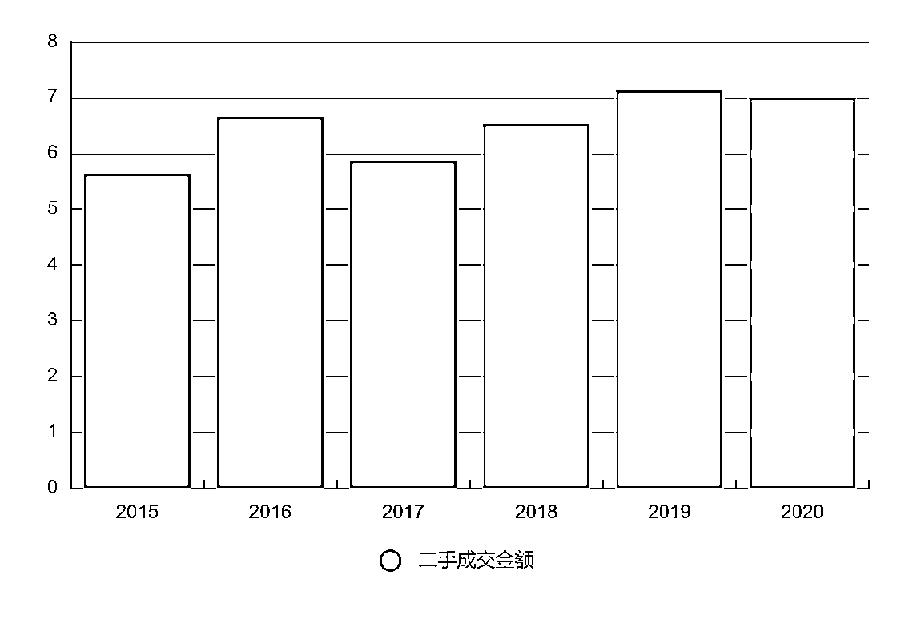

### 3、机会从哪里来

源于亲身经历和多年的实操。

#### （1）卖房经历
2019年我卖掉一套老房子，委托中介挂了两个月，有买家看中。见面后对方私下找我希望绕开中介交易。因签了独家协议，跳单要赔偿中介费，我拒绝了私下交易，最后买家多付了2个点的费用。

#### （2）便利店拓展经历
七八年便利店工作重心是门店拓展，跟无数中介打交道。起初二房东把房源托管给中介，中介掌握房东资源，只能掏中介费。后来发现中介服务不值价，还会出现跳单。带团队后我把重点放在挖掘房东联系方式上，并把省下的中介费作为给同事的奖励。

买家为何想私下成交？为什么我愿意绕过中介拿单？本质都是想省掉高额中介费，中介的价值配不上收费。

#### （3）行业痛点梳理
* 虚假低价引流：用低价房源吸引客户到店，实际带看其他房源
* 变相违规收费：名义上只收佣金，实际额外收费
* 阴阳合同：教唆签合同规避税费
* 抬高房价吃差价：顶风操作赚差价
* 虚构费用收割：过户、贷款、评估费差价、贷款服务费等子虚乌有收费

#### （4）我们的优势与差异化
优势：
1. 不收中介费，因为中介费是伪概念，本质是信息不对等税。买房租房者只要知道业主电话，就不会再付中介费。
2. 没高额代办费，有合作权证公司，只收跑腿费。
3. 无评估差价，有专业评估合作方。
4. 无高额贷款服务费，有金融机构对接，只收固定小额费用。

差异：
我们不是传统中介，不收费。我们是第三方个人房屋分享平台。与58同城、安居客、贝壳、房天下不同，那些平台房源里联系人大多是中介置业顾问，本质是线上中介。我们要打破信息差，让房源直接触达需求者。

让好房源通过分享到朋友圈扩散，让想买房租房的人在胖龟找到房子且不付中介费，让业主更快成交。平台客户都是精准需求。我们还推出分享推广奖，成功推荐一位客户奖励1800元，实现利他又获益。

## 二、胖龟找房1.0——零中介费个人房屋分享平台

二手房客户普遍不懂流程，只能付高额信息差费。生意本质是信息差，我们切入信息差市场，打造1.0版本。

### 1、第一年做了什么
思路理清后，开始做小程序、盘点重点小区、整理房源、丰富房源库、疏通物业和事业单位资源。线上准备好后，开线下实体门店和社区店中店，随后启动线上品牌推广。

#### （1）自建小程序
搭建房源上传浏览、数据分析、自主检索、供需匹配、智能会员体系的全新服务系统。

自建小程序

#### （2）线下实体门店
提供营销、专业房产服务、售后、选房、带看、议价及居间合同签约服务。

线下实体门店

#### （3）联营店中店赋能
通过合伙人计划，在便利店、社区菜鸟驿站、理发店等贴近用户的场景开设联营店中店，用小程序码追踪，为社区业态赋能。

店中店，门店赋能

#### （4）招商推广
抖音招商、加盟招募、洛阳本地汽车广播106.5推广、本地自媒体投放，快速提升品牌声量。

抖音招商推广

汽车音乐广播嘉宾

### 2、第一年结果
8家直营门店，34家店中店，会员新增12110人。付费胖龟会员287名，营收104.7万元。帮助会员节省中介费约574万元，代办过户贷款及贷款服务费节省143万元。

### 3、如何帮客户避开中介费
客户扫码线下门店或合作店中店的小程序二维码注册后，自助找房。后台客服电话跟进了解需求，引导转化为年费会员。

成为胖龟年费会员可获得十大权益。

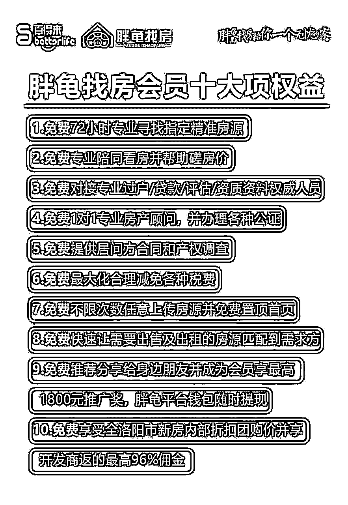

### 4、房源怎么找
①小程序内自选房源，直接拨打房东电话沟通
②小程序无合适房源，提交需求由我们匹配
③中介手上的房源，记下小区、单元、房号告诉我们即可获取联系方式

### 5、房东电话获取渠道
物业：建立关系后付费获取业主电话
水电信息：通过水电号找到相关单位获取
同行转化：与传统中介共享房源、客户资源，获取业主信息

### 6、盈利模式
#### （1）年费会员
年费3650元，帮助买二手房省去中介费。提供房东电话一年有效期，购房新房返还开发商佣金90%。

#### （2）开发商返佣
新房项目返佣约10%

#### （3）代办服务费
房产过户代办500元，贷款代办500元

#### （4）评估费用
对接评估公司收取评估费3%

#### （5）裂变分享
老用户分享二维码裂变新用户，新用户付费老用户得1800元推广奖

### 7、踩过的坑
#### （1）小程序开发浪费2万
首期找线上团队沟通效率低，问题响应慢，合作两个月后放弃，改找本地外包。本地考察要看团队构成、案例、技术沟通能力。最好自己吸纳一名技术开发人员。

#### （2）招聘别只找房产老兵
早期招相关房产销售，经验有余但思维固化，只想卖房不做会员转化。后来改招应届毕业生，可塑性强，激励到位效果更好。

#### （3）营销渠道排序
抖音>本地自媒体>汽车广播
抖音投放10万+，品牌营销占60%，招商占40%，带来4000+粉丝，100+付费会员，获客成本约600元。招商带来100+意向，成交5家加盟，单加盟成本约8000元，有利润。汽车广播投2万无明显效果。
做本地项目投放一定要锁定本地人群。

ps：2021年杭州上线官方“0中介费”平台，我们算是提前布局了。

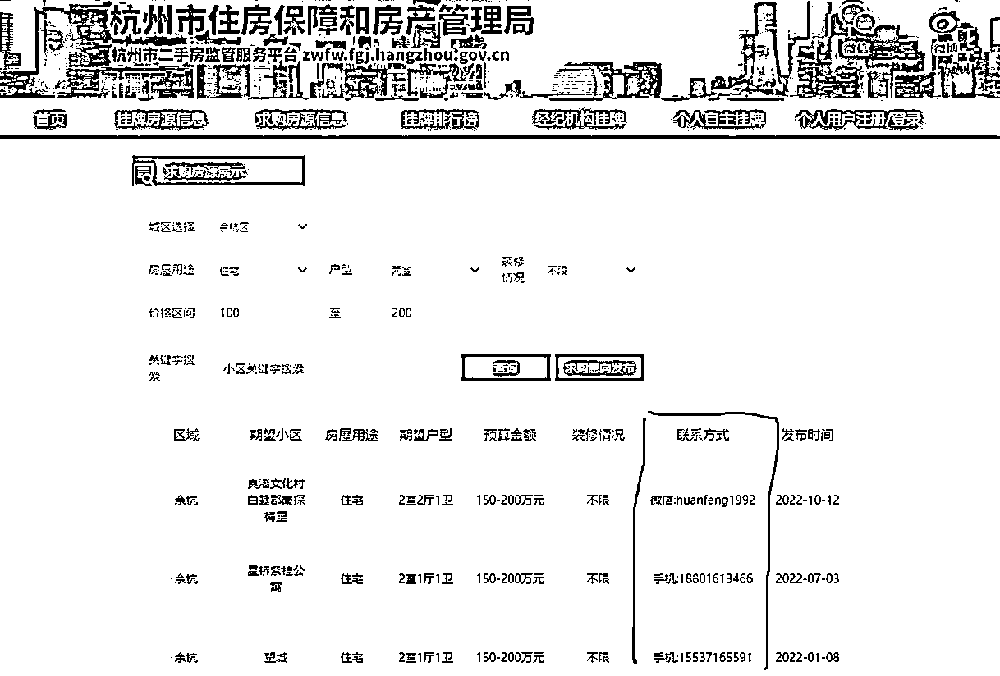

2020年结语——因相信，而相见

## 三、胖龟找房2.0——胖龟+

2021年，疫情进入第三年，行业艰难但我们持续迭代。当年只做了三件事：打磨线下门店、胖龟+赋能、接触投资人。

### 1、门店精细化运营
关掉4家店，开5家店。店型从50-60平压缩到10-15平，降低成本。由随意开店转为精准截流，选址在中介门店隔壁，用“买二手房租房0中介费”的门头吸客，截获中介流量。

典型案例：涧西区某中介标杆店隔壁开店后，对方客户流失明显，甚至找上门来。

开在中介堆里的门店

### 2、胖龟+居家生活平台
整合房产后市场，搭建家政、建材、设计、劳务、金融板块。目的：提升小程序粘性，为买房后装修提供一站式服务，覆盖租房到买房再到装修全链路。

胖龟+便利店、胖龟+理发店、胖龟+社群……只要有用户场景就延伸曝光。

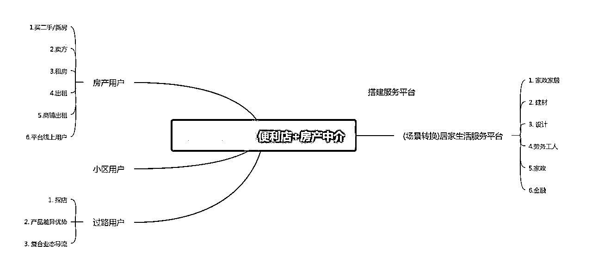

整体框架

### 3、融资路演
1.0闭环跑通后制作招商手册白皮书和商业计划书，跑成都、上海、深圳、西安会见投资人，吃了不少亏。

提醒：融资最好有熟人介绍，市场上很多打着投融资旗号收费用的是骗子，小则几千大则上万，不要盲目缴费。

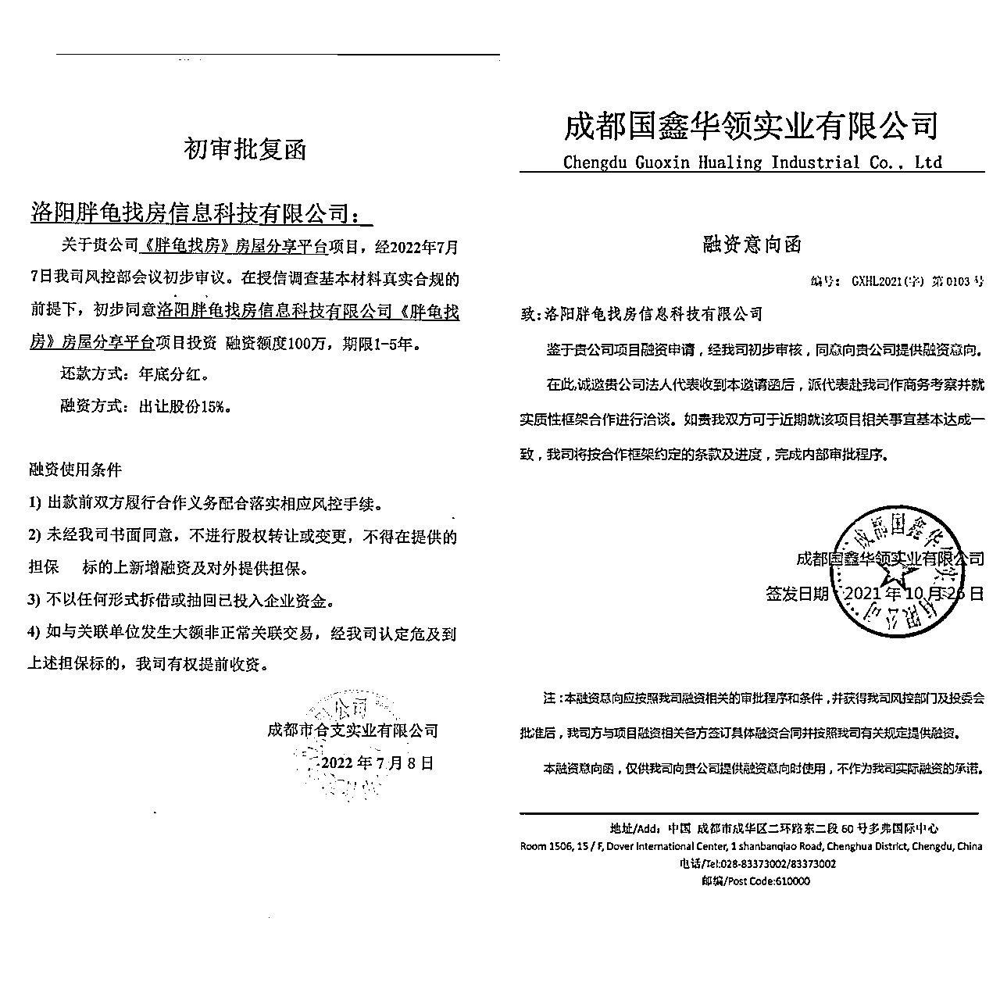

融资意向函

2021年结语——行动起来，你就成功了一半

## 四、胖龟找房3.0——零中介费租房平台

努力终有回报。

### 1、拿到天使投资
2021年6月13日，我们获数百万元天使轮融资，投资方为早行人创投。早行人聚焦互联网相关领域，投资移动互联网、电商、社交、消费、文娱、企业服务等。

本轮资金用于门店建设、团队搭建、系统优化。模式被认可，潜力得到释放。

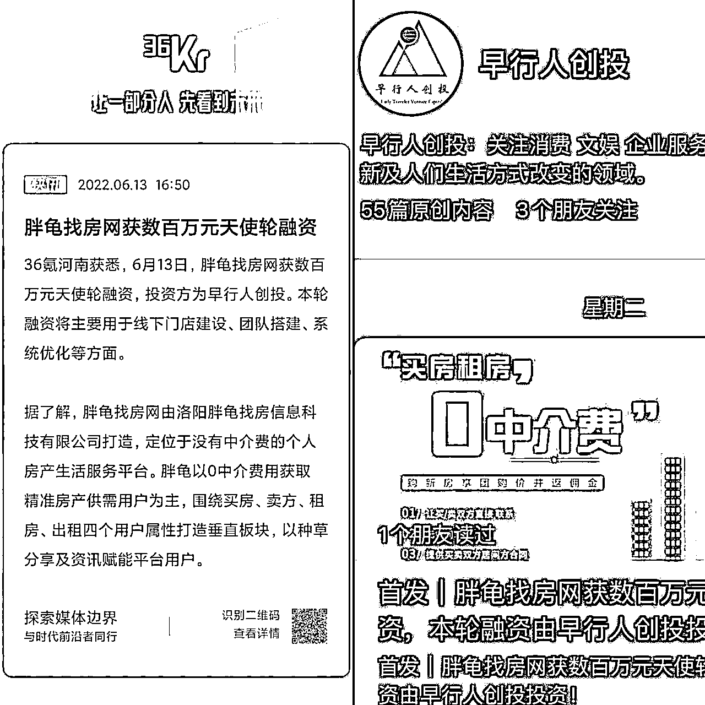

成功拿到天使投资

### 2、开拓一个全新的营收增长点

我们打造出了一条全新的业务增收路径，目前已经实现了月入 15w 的成绩。为了让加盟伙伴获得更强的赋能，也为了让品牌拥有更深的护城河，我们正式推出了“0”中介费租房这一新业务。

这个板块完全是从零起步、一点点试出来的。花了大约半年时间摸索，如今稳定做到了月入 15w。

### 3、把新业务“0”中介费租房拆开讲讲

“0”中介费租房，大家可能第一次听说。以往我们想租到心仪的房子，基本都要靠中介，中介会收一个月的房租当作服务费。

当初萌生这个想法，是因为我们在做“0”中介费卖房时，经常有客户跑来问租房的事。团队就在琢磨：既然客户已经在这了，怎么把他们转化？客户不肯出中介费，那这笔钱该由谁来出？平台？不可能，平台不会白白搭上人力和时间。房东？有这个可能，而且可能性不小。

#### （1）说服房东

顺着这个问题，我们开始思考怎么让房东愿意承担这笔费用。换个角度想，如果我是房东，我为什么要花钱找中介帮我招租？

也许是房子已经空了很久，急着让资产产生收益；也许是房贷压力大，想快点租出去；又或者我自己不是一房东，而是二房东，必须尽快出手房源，不能让它空置。

我们推演了不少情况，也见了很多房东，最后锁定了二房东这个群体。因为二房东手里的房源不止一套，他特别怕空置——空一天，成本就得自己扛。

那二房东去哪儿找？

*   58同城上搜房东信息。

*   美团上有很多公寓型酒店，可以找老板聊长租合作。

*   找长租公寓的负责人，他们手上公寓多、获客渠道单一，我们正好帮他们带客。

丰富的房东资源

#### （2）找到租客

现在是自媒体百花齐放的时代，几乎每个人都有自己的常用社交平台，这里面自然也藏着大量商机。我们的租客就活跃在这些平台上，除了大家熟知的抖音、快手、小红书、58、安居客、转转、咸鱼、最右、拼室友、豆瓣、微博、知乎，不少城市还有本地深耕的租房APP，比如杭州19楼、上海芭乐兔等等，都是很不错的租房平台。

租客到底怎么挖？

##### ①抖音、快手、小红书：（PS：玩法大同小异）

两条路：

*   一是自己发内容，配上真实的视频或图片，靠曝光吸引有租房需求的人来私信、咨询。

*   二是主动出击，去这些App上同行大V的帖子评论区里找潜在租客。

PS：打开抖音，搜“上海租房”，挑热度高、回复多的视频，点开评论区，凡是看到类似“博主这个多少钱”“这个还在吗”“徐汇区某某还有房吗”这类留言的，基本都是有租房意向的人，直接私信、破冰、了解需求。

##### ②58、安居客：发帖，或者直接进“拼室友”板块发找室友帖。

##### ③转转、咸鱼：这两个App很有意思，主页直接有租房入口，点进去能找到“求租广场”，要么自己发帖，要么在广场上能看到大量已经发布租赁需求的人。

##### ④拼室友这类小程序/App：里面就是找室友的模块，看到合适的客户需求直接打招呼就行。

##### ⑤豆瓣、微博、知乎：微博有各城市租房超话，比如#杭州租房超话#、#上海租房超话#，进讨论组里发帖、回复；豆瓣则有对应的兴趣小组，可以先养一养账号活跃度，再加入小组发帖回帖。

日常和租客沟通

#### （3）配房

后台人员根据租客提的需求，在公司的房源库里做精准匹配。每个需求会先发3-5-7套合适的房源，不满意就继续二配、三配。每位同事都有自己的客户表，每天做总结，每周做复盘，摸清用户需求，已经租到房的客户及时从表里移除。

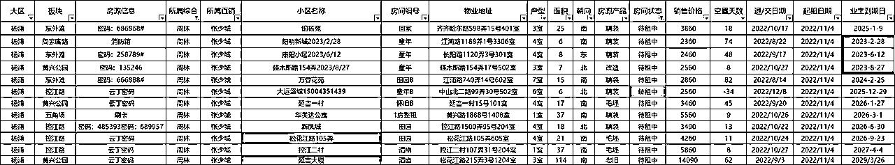

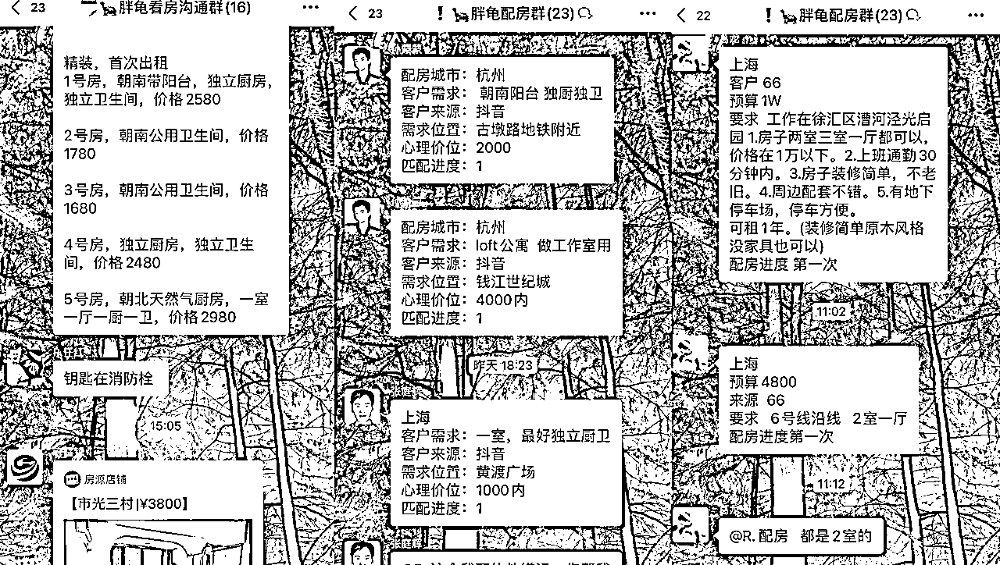

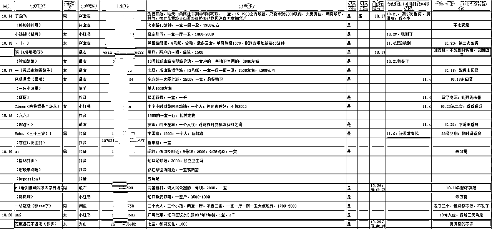

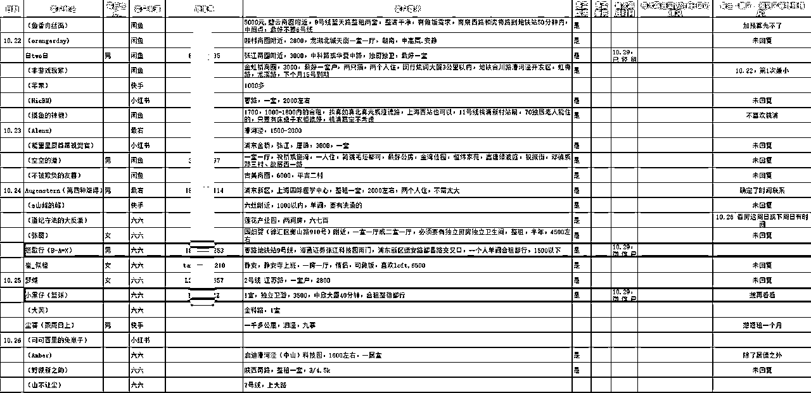

公司内部配房流程

#### （4）看房

客户想看哪套房，我们就把房源位置、楼栋号、房间号、密码锁密码或钥匙存放点发过去，引导客户自己去看。这样双方都省事。当然我们本地也准备了车夫团队可以带看，但一般用不上——现在的年轻人更愿意自己看房。

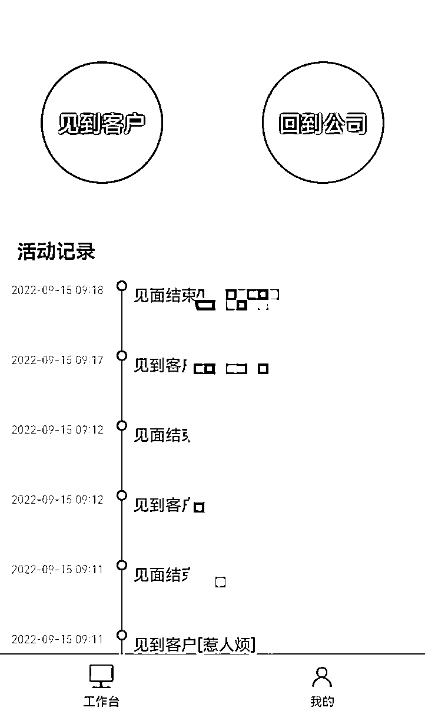

线上带看流程

#### （5）成交

客户一旦看中，我们会马上联系房源对应的房东、二房东或管理公司，尽快到房间签订租赁合同。当然，也有很大比例是直接在线上完成签约的。

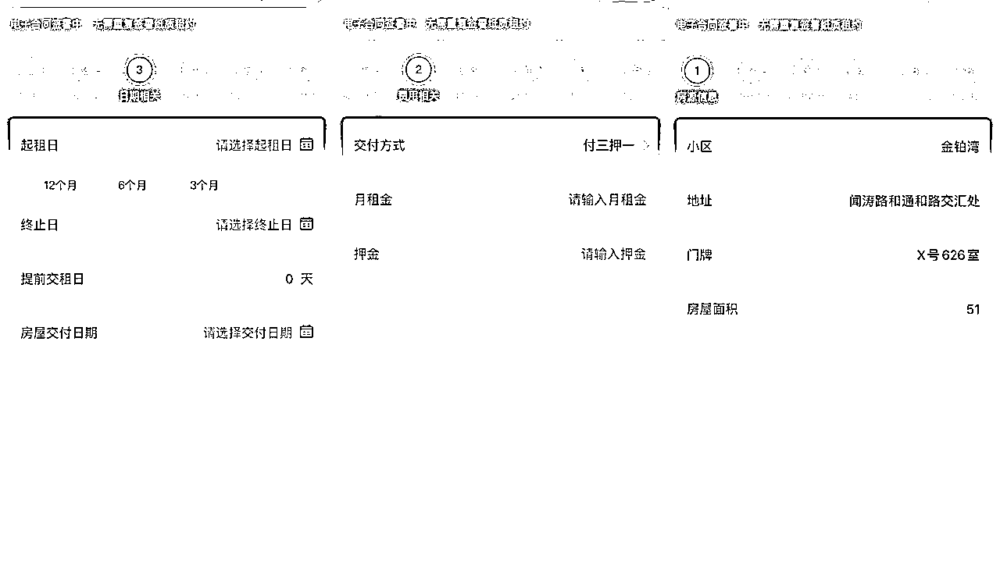

线上签约流程

#### （6）利润

在我们这座城市，单套房子的租金大致在1000-2000元，员工底薪约3000元，只要每月成交两单，成本就能覆盖。所以项目跑通之后，我们开始扩招客服人员，靠人海战术把利润做上去。

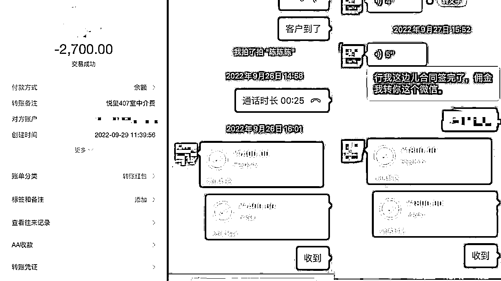

利润

#### （7）裂变

本地项目跑通后，我们很快遇到了天花板——洛阳流动人口有限，房子转手频率和需求量都没那么大。为了让盘子更大，我们陆续开通了杭州、上海、深圳等城市。

我们把这些城市数十万间合作房源并入胖龟平台，无论单间、独卫、宿舍、整租、公寓、1-5室、老洋房、别墅、网红小区、短租、长租还是月租，各种需求都能覆盖。

那边每年都有大批毕业生涌入，需求市场非常大，单套房子的佣金也更高——有的能到一两万，有的两三千，整体收益相当不错。

上海的部分房源

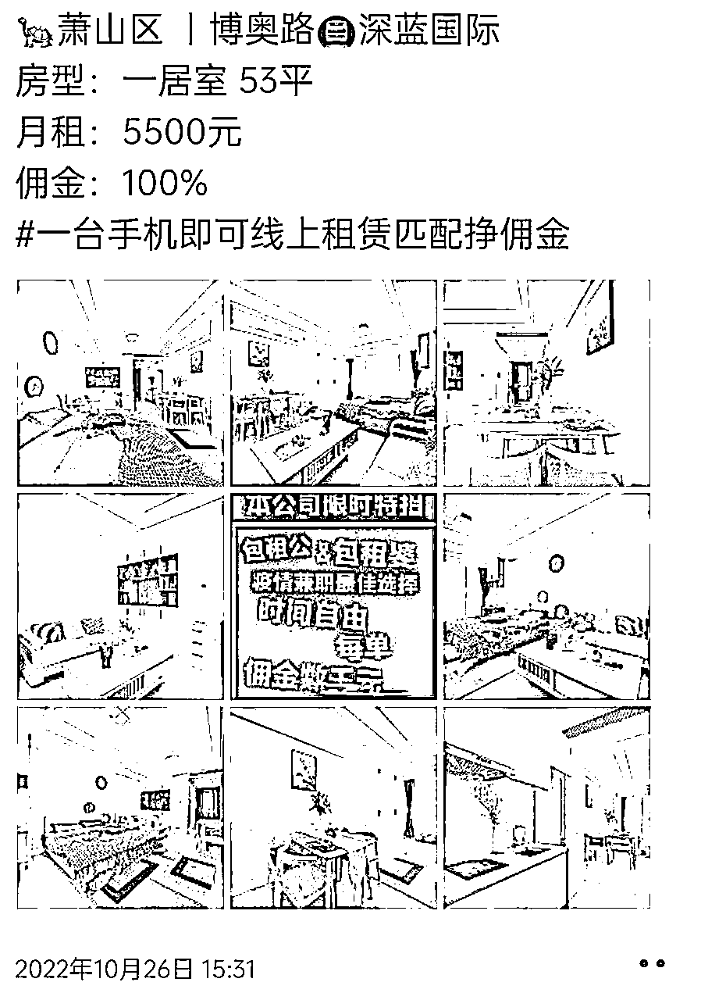

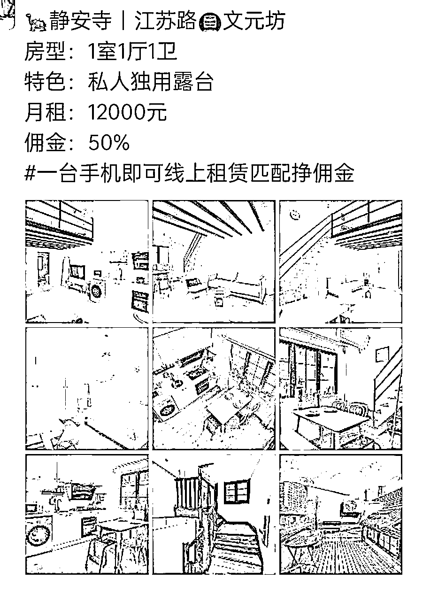

上海的房租行情

在微博指数、微信指数和百度指数上，都能搜索查询对应关键词的热度。

①、微博指数

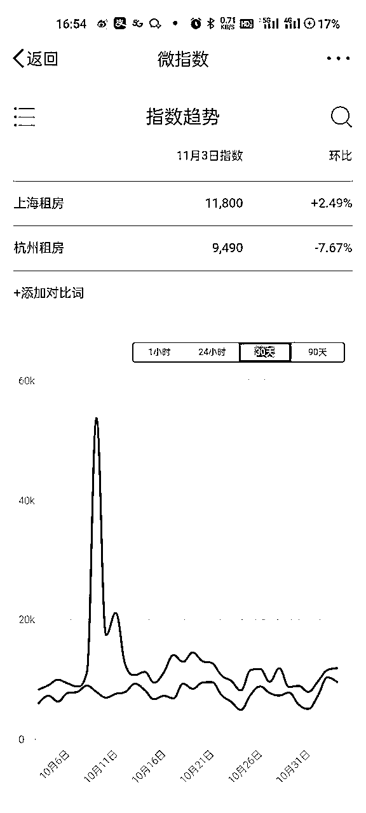

②、微信指数

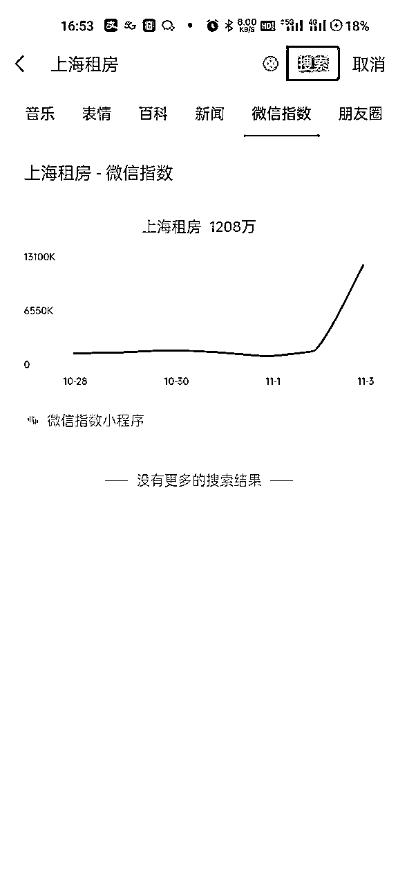

③、百度指数

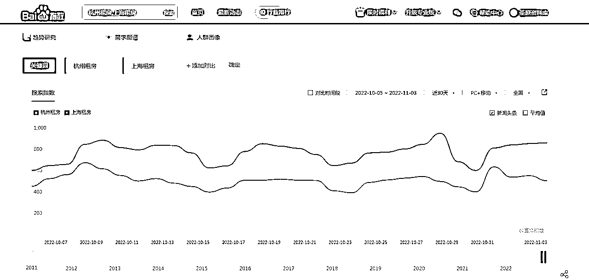

#### （8）扩张

运行一段时间后，我们把整套流程做成了模板、定成了标准，再用“区域合伙人计划——城市管家”的方式，让合伙人快速上手。

我们有现成的平台、房源库、配房人员和带看流程，合伙人只需要维护用户、聊天沟通就行。合伙人可以单人操作，也可以组建一个工作室。

希望在这样的特殊时期，大家能通过一个好项目实实在在赚到钱，哪怕最低限度，也能多一份上不封顶的收入。接下来我们会把重心继续压在租房业务上，把它打磨得更精细。

当你找到一个合适的“风口”，就全力all in进去。

ps：顺嘴提一句，杭州的巴乐兔已经做到B轮了，月销售额2000w+。

2022年还没有结束，胖龟的进化也不会停。

创业这件事，九死一生是常态。只要头脑始终保持清醒，明白路上的困难并不可怕，真正可怕的是被挫折带来的负面情绪和怀疑吞噬。信念不倒、精神不倒，敢拼敢冲，就总有机会赢。

因为相信，所以遇见；因为坚持，所以圆梦。

谢谢你的阅读，一起龙哥盟！