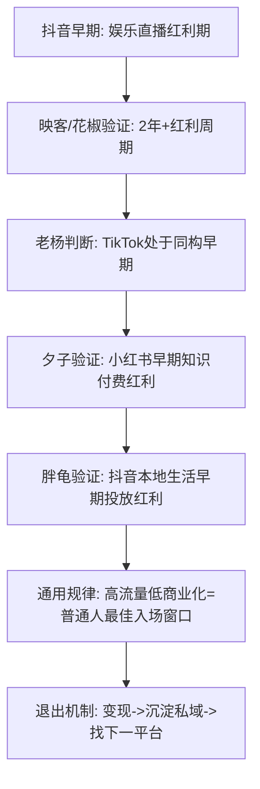

# 第 28 章 创业实战核心方法论 —— 从“起盘验证”到“规模复制”的全链路打法

## 学习目标

- 理解最小MVP闭环：用最小成本跑通“产品-流量-销售-交付”商业验证
- 掌握选品决定论：好产品自带转化力，深挖需求、顺应趋势、强化背书
- 洞察信息差即金钱：生意本质是打通信息不对称，从“卖信息差”进化到“卖服务/品牌/供应链”
- 建立私域高客单模型：端着金饭碗别讨饭，用专业诊断+SOP标准化换取高溢价复购
- 学会内容不自嗨：定位→模仿爆款选题→脚本化→批量产出的SOP起号法
- 践行向有结果的人学习、复制再创新：付费买时间/避坑/确定性，结合自身资源微创新
- 判断平台周期窗口：在“高流量低商业化”早期入场吃红利，建立“1+1+1项目矩阵”持续造血
- 实施标准化复制与加盟赋能：策划案+执行案双轮驱动，沉淀品牌/SOP/供应链核心资产
- 构建多元变现基本盘：拒绝单一渠道依赖，自有产品/用户/品牌/渠道是抗风险基石
- 内化避坑指南：技术外包慎重/吸纳合伙人、招聘重可塑性/投放重本地投产比/融资防前置收费骗局

## 28.1 生活类比

创业像**在荒岛上从零建立生存基地**：**最小MVP闭环** = 先搭个能遮风挡雨的“茅草棚”（产品-流量-销售-交付跑通），别上来盖“钢筋混凝土大楼”；**选品决定论** = 种子（产品）决定收成，选耐旱、高产、抗虫的良种（深挖需求+趋势+背书），省去后天施肥除草（销售成本）的一半力气；**信息差即金钱** = 你知道岛上哪里有淡水源、哪里有果树，别人不知道，你带路收“过路费”；但地图一旦公开，费就收不到了，必须进化成“向导服务”（服务差/品牌差）；**私域高客单** = 岛民信任你的专业（识草药、懂急救），愿付高价让你长期照顾健康，而不是买你一次性卖的椰子水（低客单团购）；**内容不自嗨** = 吹海螺招募伙伴，别自吹自擂“俺最牛”，要学会模仿“求救信号”的标准频率/节奏（爆款结构），让过路船听得见、信得过；**向有结果的人学习** = 别自己摸索造船，付费买张“造船图纸+避坑指南”，按图施工，再按自家木材/工具微调细节；**平台周期窗口** = 捕鱼要赶鱼群迁徙季（平台早期红利），过完村（规则收紧/流量见顶）鱼就没了，得换渔场；**标准化复制** = 造好一艘样板船，把图纸、工具、材料清单、操作手册打包成“造船套装”，招伙计按套装批量复制；**变现基本盘** = 别只靠卖鱼（单一广告/分成），要有自己的“鱼塘+渔船+渔具”（自有产品/用户/品牌/渠道），风浪来了才不怕断粮；**避坑指南** = 出海前查好：造船匠靠谱吗（外包考察/吸纳合伙人）？水手听指挥吗（招可塑性新人）？渔具耐用吗（投放测ROI）？借钱的收手续费吗（融资防骗）？

## 28.2 概念地图

创业实战核心方法论
├── 起盘验证
│   ├── 最小MVP闭环           —— E1WGd70YLoaHGfxAYJTc4WoFnsd.md / PglAdRMiIoVTRyxc4Q3cw8hvnWf.md / FCiidWBeJoLOT1xreYnc9Se4nOf.md
│   │   ├── 产品-流量-销售-交付四环
│   │   ├── 从挣1块钱开始
│   │   └── 验证周期1-3个月
│   ├── 选品决定论             —— E1WGd70YLoaHGfxAYJTc4WoFnsd.md / FCiidWBeJoLOT1xreYnc9Se4nOf.md / PglAdRMiIoVTRyxc4Q3cw8hvnWf.md
│   │   ├── 深挖需求+涵盖面齐全
│   │   ├── 口服/订阅制趋势
│   │   └── 医院/专业背书
│   └── 信息差即金钱           —— PglAdRMiIoVTRyxc4Q3cw8hvnWf.md / E1WGd70YLoaHGfxAYJTc4WoFnsd.md / FCiidWBeJoLOT1xreYnc9Se4nOf.md
│       ├── 中介费是伪概念/智商税
│       ├── 向服务差/品牌差进化
│       └── 窗口期有限需持续迭代
├── 流量与转化
│   ├── 私域高客单（金饭碗）   —— E1WGd70YLoaHGfxAYJTc4WoFnsd.md / PglAdRMiIoVTRyxc4Q3cw8hvnWf.md
│   │   ├── 专业诊断建立权威
│   │   ├── 咨询SOP表格标准化
│   │   └── 联创合伙人复制
│   ├── 内容不自嗨（SOP起号）  —— E1WGd70YLoaHGfxAYJTc4WoFnsd.md / FCiidWBeJoLOT1xreYnc9Se4nOf.md / PglAdRMiIoVTRyxc4Q3cw8hvnWf.md
│   │   ├── 定位→收集爆款→写脚本→批量录制
│   │   ├── 模仿结构/逻辑非抄袭内容
│   │   └── 平台差异化适配
│   └── 平台周期窗口           —— FCiidWBeJoLOT1xreYnc9Se4nOf.md / PglAdRMiIoVTRyxc4Q3cw8hvnWf.md / E1WGd70YLoaHGfxAYJTc4WoFnsd.md
│       ├── 高流量低商业化早期入场
│       ├── 红利期≥2年判断依据
│       └── 退出机制：变现→沉淀私域→找下一平台
├── 规模复制
│   ├── 复制再创新             —— E1WGd70YLoaHGfxAYJTc4WoFnsd.md / FCiidWBeJoLOT1xreYnc9Se4nOf.md / PglAdRMiIoVTRyxc4Q3cw8hvnWf.md
│   │   ├── 付费学习买时间/确定性
│   │   ├── 完整复制核心打法
│   │   └── 基于资源禀赋微创新
│   ├── 标准化复制与加盟赋能  —— E1WGd70YLoaHGfxAYJTc4WoFnsd.md / PglAdRMiIoVTRyxc4Q3cw8hvnWf.md / FCiidWBeJoLOT1xreYnc9Se4nOf.md
│   │   ├── 策划案+执行案双轮
│   │   ├── 核心资产：品牌/SOP/供应链/数据/工具
│   │   └── 单店模型跑通前严禁加盟
│   └── 1+1+1项目矩阵         —— FCiidWBeJoLOT1xreYnc9Se4nOf.md / E1WGd70YLoaHGfxAYJTc4WoFnsd.md
│       ├── 1盈利+1开发+1知识付费
│       └── 项目生命周期2-6个月
└── 风控与基本盘
├── 变现渠道不能单一（基本盘） —— E1WGd70YLoaHGfxAYJTc4WoFnsd.md / PglAdRMiIoVTRyxc4Q3cw8hvnWf.md / FCiidWBeJoLOT1xreYnc9Se4nOf.md
│   ├── 自有产品/用户/品牌/渠道
│   ├── 抗周期性与估值溢价
│   └── 聚焦1-2核心业务做深
└── 避坑指南                 —— PglAdRMiIoVTRyxc4Q3cw8hvnWf.md / E1WGd70YLoaHGfxAYJTc4WoFnsd.md / FCiidWBeJoLOT1xreYnc9Se4nOf.md
    ├── 技术外包：实地考察/吸纳合伙人/代码掌握在手
    ├── 核心招聘：白纸可塑>固化思维老手
    ├── 营销投放：抖音本地>本地自媒体>汽车广播/测投产比
    └── 融资谈判：收前置费99%是骗子

## 28.3 最小MVP闭环 —— 先跑通“挣1块钱”的最小生意

### 为什么需要这个概念？

创业初期资源极其有限，不可上来就造“航母”。必须用最小成本验证“产品-流量-销售-交付”商业闭环是否成立，避免在未验证模式前过度投入导致沉没成本过高。三位作者（夕子、老杨、胖龟）均以“最小MVP闭环”作为起盘的第一步，用最小成本、最快速度跑通“产品——流量—销售—交付”完整商业链路，核心原则是从挣1块钱开始，选天花板高、可持续3-5年的方向。

### 核心定义与推导

> **最小MVP闭环**（来源：《夕子线上美业复盘》）

$$
\text{MVP}_{\text{闭环}} = \text{产品}_{\min} \times \text{流量}_{\min} \times \text{销售}_{\min} \times \text{交付}_{\min}
$$

**约束条件**：
- 成本最小化：$\text{Cost} \le \text{个人可承受上限}$
- 速度最优先：$\text{Time} \in [1, 3] \text{个月}$
- 必须含真实收款：$\text{Revenue} > 0$

这个公式展示了四个最小要素的乘积关系：任一环节为零，闭环即不成立。夕子用2万启动资金，知乎引流，微信诊断，搭配医美面膜，3个月月利润达5万，完成了MVP验证；胖龟找房自建小程序+线下门店，先跑通洛阳单店模型（8家店、104.7万营收），再复制到上海、深圳；老杨TikTok睡播用简陋直播间（手机+电脑+音响）测试，峰值在线飙到上万，验证了“娱乐直播最简单拿结果”的假设。

### 关键性质

- **验证优先于完美**：不要追求完美，要追求“跑通”。老杨指出“刚开始的直播间就这么简陋，然而并不耽误在线峰值飙到上万”。
- **闭环思维**：四个环节缺一不可，必须亲自跑通每一环。夕子强调“专业——流量——成交——深挖需求——复购，不断做好这个闭环”。
- **可复制性**：跑通后的模型才具备放大复制的基础价值。胖龟打房“将所有的流程模板化，标准化”，为后续城市合伙人复制奠基。

### 典型例子

| 案例 | 产品ₘᵢₙ | 流量ₘᵢₙ | 销售ₘᵢₙ | 交付ₘᵢₙ | 验证周期 | 关键指标 |
|------|---------|---------|---------|---------|----------|----------|
| 夕子美业 | 医美面膜单品 | 知乎/小红书内容 | 微信1v1诊断收款 | 发货/到店服务 | 3个月 | 月利润5万 |
| 胖龟找房 | 0中介费会员服务 | 抖音本地/物业/水电费号 | 到店/线上签约收会员费 | 配房-带看-签约SOP | 1年跑通单店 | 8店/104.7万营收 |
| 老杨TikTok | 睡播直播间 | 平台自然推流 | 观众打赏礼物 | 程控道具自动触发 | 2周起号 | 峰值在线4.2万、小时均$100 |

### 边界条件

- 仅适用于“可标准化、可复制”的轻资产模式，重资产/长研发周期项目需调整验证颗粒度
- 验证周期建议控制在1-3个月，过长则失去“最小”的意义
- 必须包含真实收款动作，免费送不算跑通闭环

---

## 28.4 选品决定论 —— 好产品自带转化力，省一半销售心力

### 为什么需要这个概念？

多数创业者过度关注“卖”，忽视“选”，导致在烂产品上耗费巨大销售成本。好产品能自带流量、自带转化、自带复购，是降低获客成本、提升利润率的核心杠杆。夕子直言：“选品很关键，产品好省了一半的心，后续回购率也高。”老杨更指出“选品即运营：选品过程本身就决定了引流方法和转化卖点”。三位作者形成共识：选品重于销售，种子决定收成。

### 核心定义

> **选品决定论**（来源：《夕子美业选品三要素》）

$$
\text{GoodProduct} = \underbrace{\text{需求覆盖面}}_{\text{深挖痛点}} \times \underbrace{\text{趋势顺应性}}_{\text{口服/订阅制}} \times \underbrace{\text{背书强度}}_{\text{医院/专家/数据}}
$$

**三要素权重**：需求覆盖面（基础）> 趋势顺应性（放大器）> 背书强度（信任加速器）

这个公式展示了好产品的三大基因：夕子从代购医美面膜（单挣2元）转型自建品牌，深挖“祛痘+美白+抗衰”全需求，引入口服+医院背书，年利润过百万；胖龟找房将“房源信息”做成标准化产品（0中介费会员服务），解决买房者“怕被坑、想省钱”核心痛点；老杨用“产品狗定势思维”拆解睡播：定位娱乐、用户<25岁、价值解压、竞对极少、本地化改造道具/程控。

### 关键性质

- **需求匹配度**：必须精准击中用户真实痛点（如荨麻疹、敏感肌的修复需求）。夕子亲历皮肤病，深知“皮肤有问题最快捷的方式就是找专业人士解决”。
- **复购驱动力**：好产品天然具备高复购属性。夕子指出“口服保养是趋势，一个人一单接受了某个品牌的口服，不会轻易更换牌子的”。
- **信任背书**：专业背书（医生、博士创立、医院合作）大幅降低用户决策成本。夕子加盟模式强调“医生、985生物医学博士创立的品牌，更具有专业性以及说服力”。

### 典型例子

| 维度 | 夕子美业 | 胖龟找房 | 老杨TikTok |
|------|----------|----------|------------|
| 需求覆盖面 | 祛痘/美白/抗衰/敏感修复全链路 | 买房/租房/装修/贷款全生命周期 | 睡眠困难/解压/恶搞/社交货币 |
| 趋势顺应性 | 外用+内服/季度订阅制 | 会员制+店中店+合伙人裂变 | 程控自动化+道具包标准化 |
| 背书强度 | 三甲皮肤科/博士创立/医院合作 | 0中介费承诺/政府备案/天使投资 | 平台算法推荐/真实打赏数据 |

### 边界条件

- 选品需结合自身资源禀赋（供应链、专业度、资金），盲目追求高客单/高复购可能导致交付崩盘
- 红海标品靠“微创新”（材质套利、热点嫁接）差异化，而非原创研发
- 产品生命周期有限（2-6个月），需建立“1个盈利、1个开发、1个知识付费”的项目矩阵持续造血

---

## 28.5 信息差即金钱 —— 生意的本质是“已知的秘密”

### 为什么需要这个概念？

打破“产品思维”迷信：很多暴利生意不靠造产品，靠的是“打通信息不对称”。理解中介、平台、代购等商业模式的底层盈利逻辑，发现身边被忽视的赚钱机会：信息差往往隐藏在熟悉的行业细节中。胖龟找房创始人一针见血：“生意的本质就是信息差，在互联网里也存在大量的信息差生意。”

### 核心定义

> **信息差**（来源：《胖龟找房复盘》）

$$
\text{InfoGap} = \text{知道路径/价格/渠道/规则/联系方式}_{\text{卖家}} - \text{不知道}_{\text{买家}}
$$

**核心主张**：中介费是信息差造成的“智商税”。如果买房者或者租房者知道房东电话，他们绝不会给中介公司掏中介费。

这个公式展示了信息不对称的货币化本质：买卖双方信息掌握程度不对等，中间商赚取差价。夕子代购韩国医美面膜赚渠道信息差，后转型自建品牌建立护城河；跨境电商核心是国内工厂不知海外需求、海外消费者不知国内货源；胖龟找房通过物业、水电费号、同行转化三条渠道低成本获取房东电话，打破中介垄断。

### 关键性质

- **非对称性**：信息差一旦公开（如平台撮合），商业模式即失效，需持续挖掘新信息差
- **可复制性**：利用公开渠道整合信息合法合规，窃取隐私违法
- **合规边界**：不得侵犯用户隐私、商业秘密，不得发布虚假信息诈骗

### 多源对照

#### 共识
三份素材均认同：生意本质是信息差，中介费是智商税，平台撮合能创造价值。

#### 分歧
- **《胖龟找房》**：主张彻底消除信息差，建立“个人房屋分享平台”，让买卖双方直接对接，以会员费/返佣替代中介费
- **《夕子美业》**：认为纯信息差生意无护城河，必须向“服务差”、“品牌差”、“供应链差”进化，通过专业诊断+自建品牌建立壁垒
- **《老杨TikTok》**：将信息差视为“玩法差”，早期全球仅4人做睡播，玩法未公开即为核心壁垒；素材写作时已有20-30个国内直播间跟进，但“均未突破作者早期版本”，说明执行细节差才是真护城河

### 典型例子

| 信息差类型 | 卖家知道 | 买家不知道 | 变现方式 | 进化方向 |
|------------|----------|------------|----------|----------|
| 房产中介 | 房东电话/真实成交价/避坑流程 | 全部 | 中介费(智商税) | 0中介费平台→会员费/返佣/裂变 |
| 美业代购 | 韩国医美渠道/真假辨别/用法用量 | 全部 | 差价/服务费 | 自建品牌/专业诊断/口服订阅 |
| 跨境电商 | 国内工厂货源/成本价/合规认证 | 海外需求/选品/物流 | 渠道差价 | 自有品牌/海外仓/私域复购 |
| 睡播玩法 | 程控硬件/道具清单/起号SOP/话术 | 全部 | 知识付费/加盟/设备销售 | 1+1+1矩阵/持续迭代/平台迁移 |

### 边界条件

- 纯信息差生意无护城河，易被平台打击或竞品复制，必须向“服务差”、“品牌差”、“供应链差”进化
- 法律红线：不得侵犯用户隐私、商业秘密，不得发布虚假信息诈骗
- 时效性：任何信息差都有窗口期（如TikTok睡播红利期2年），过期即归零

---

## 28.6 私域高客单（金饭碗） —— 专业信任换取高溢价复购

### 为什么需要这个概念？

公域流量昂贵且不可控，私域是沉淀用户资产、实现长期复购的核心阵地。多数人把私域做成“卖货群”（低客单、低复购、高流失），错失高价值变现。私域用户因“专业/信任”而来，天然适合高客单、技术型、咨询型产品。夕子被私域老师点醒：“端着金饭碗在讨饭”——当时兼着社群团购卖吃喝拉撒，私域用户奔着专业看皮肤来的，做低价团购是降维打击自己。

### 核心定义

> **私域高客单模型**（来源：《夕子美业私域实战》）

$$
\text{LTV}_{\text{私域}} = \underbrace{\text{专业诊断权威}}_{\text{信任溢价}} \times \underbrace{\text{SOP标准化服务}}_{\text{边际成本可控}} \times \underbrace{\text{高客单/高复购/高毛利产品}}_{\text{单用户价值}}
$$

**核心心法**：“端着金饭碗别讨饭”——私域用户奔着专业来，做低价团购是降维打击自己。

这个公式展示了私域高客单的三大引擎：夕子通过咨询SOP表格提升回复速度、客单价、成交率、利润率，并复制给联创合伙人，她们的“客单价、成交率、利润率都上来了”；胖龟找房租房业务“配房-带看-成交”标准化流程，配房人员只需按SOP操作，合伙人只需“维护用户、聊天即可”。

### 关键性质

- **信任溢价**：专业诊断建立权威，用户愿为“确定性结果”支付高溢价。夕子三甲医院皮肤科背景，是“科学护肤”人设的硬核支撑。
- **复购驱动**：皮肤管理、健康调理、租房服务等需求天然高频、长周期，LTV极高。
- **SOP标准化**：咨询SOP表格、聊天话术、朋友圈搭建可复制，实现“联创合伙人”快速复制。

### 典型例子

| 指标 | 夕子美业（私域咨询） | 胖龟找房（租房配房） |
|------|----------------------|----------------------|
| 核心动作 | 微信诊断→搭配方案→复购跟进 | 需求登记→3/5/7套精准配房→自看/陪看→签约 |
| 标准化工具 | 咨询SOP表格/话术库/朋友圈模板 | 客户表/房源表/周复盘/小程序锁码 |
| 客单价 | 单次咨询/方案数百~数千元 | 会员费/佣金/代办费 |
| 复购周期 | 皮肤周期28天/季度订阅 | 租房周期1-2年/续约/推荐 |
| 复制方式 | 联创合伙人“拿来即用” | 城市管家合伙人“只聊天” |

### 边界条件

- 前提是具备真实专业能力（如夕子三甲医院皮肤科背景），无专业支撑的“卖课/卖货”私域不可持续
- 服务型私域边际成本随用户增加而增加，需通过“分层服务”（标准化SOP服务大众、1v1服务高净值）控制成本
- 合规风险：医疗/健康类私域销售需严守广告法、医疗法红线，避免“治疗”表述

---

## 28.7 内容不自嗨 —— 模仿→优化→创新的SOP化起号法

### 为什么需要这个概念？

多数人做内容陷入“自我感动”陷阱：写自己想写、拍自己想拍，平台不推、用户不看。算法推荐机制下，爆款内容有规律可循，新号冷启动最快路径是“站在巨人肩膀上”。内容生产必须工业化：选题库、脚本库、批量拍摄、定时发布，而非靠灵感突击。夕子强调：“做内容有个很重要的点，一定不要自嗨。先从模仿开始。做好定位，之后模仿，再优化。”

### 核心定义

> **内容SOP流程**（来源：《夕子小红书起号SOP》）

```
内容SOP = 定位 → [每日收集1-3个爆款选题入库] → [统一写3-5脚本] → [统一录制3-5视频] → 定期发布
```

**核心原则**：选题即流量，爆款选题已验证用户需求，蹭热点、拆解同行是低成本获取流量的确定性路径。

这个流程展示了内容工业化的四步走：夕子定位“科学护肤”，每天收集爆款选题，统一写脚本录制，小红书从千粉到万粉，咨询量暴涨；老杨“多看、多拆解、多测试”，看尽天下直播，心中自然无马，拆解像素级细节，MVP快速验证，简陋直播间也能破万在线。

### 关键性质

- **结构化生产**：将创作拆解为可量化、可分工、可考核的标准动作，实现“人员更替不影响产出”
- **平台差异化**：小红书重“图文/视频+搜索关键词”，抖音/TikTok重“前3秒留人+互动引导”，需针对性适配
- **模仿≠抄袭**：需在“结构/逻辑/呈现方式”上模仿，核心内容（专业知识、人设、产品）必须原创

### 多源对照

#### 共识
三位作者均采用“定位→收集爆款→脚本化→批量产出”SOP，反对“自嗨式创作”。

#### 分歧
- **《夕子美业》**：单账号追热点宜“转述做原创”，强调专业人设一致性
- **《老杨TikTok》**：矩阵号追热点宜“标题差异化+伪原创”规避查重，主打“怼量驱动爆单概率”
- **《胖龟找房》**：内容服务于“引流+转化”，抖音本地生活核心是“POI加热、爆品驱动、短视频矩阵、直播运营、好评率维护”

### 典型例子

| 步骤 | 夕子美业（小红书） | 老杨TikTok（直播切条） | 胖龟找房（抖音本地） |
|------|-------------------|------------------------|---------------------|
| 定位 | 科学护肤/专业诊断 | 娱乐睡播/解压恶搞 | 0中介费/本地房源/真实成交 |
| 选题来源 | 同行爆款/用户高频问/热点事件 | 国内外直播间/热门道具/节日热点 | 真实看房/租房避坑/政策解读 |
| 脚本结构 | 痛点切入→专业分析→方案推荐→引导私域 | 道具触发→夸张反应→引导礼物→留人话术 | 爆品钩子→真实看房→政策红利→到店/私域 |
| 产出节奏 | 日更3-5条图文/视频 | 日播4-6小时/切条分发 | 日更多条/矩阵号轮播 |

### 边界条件

- 模仿≠抄袭：需在“结构/逻辑/呈现方式”上模仿，核心内容（专业知识、人设、产品）必须原创
- 单账号追热点宜“转述做原创”，矩阵号追热点宜“标题差异化+伪原创”规避查重
- 内容仅是“钩子”，后端无产品/无转化/无交付，流量再大也是“自嗨”

---

## 28.8 向有结果的人学习，复制再创新 —— 站在巨人肩膀上赚钱

### 为什么需要这个概念？

闭门造车是创业最大忌：重复发明轮子成本极高、成功率极低。付费学习本质是“买时间、买确定性、买避坑经验”，ROI远超自学摸索。成功路径具有可迁移性：同行业、跨行业的核心打法（选品、流量、转化、交付）同构。夕子直言：“赚钱，向有结果的人学习，复制再创新”。

### 核心定义

> **复制再创新范式**（来源：《夕子付费学习复盘》）

$$
\text{Success}_{\text{新}} = \underbrace{\text{复制核心打法}}_{\text{人设/脚本/产品/SOP}} \times \underbrace{\text{微创新差异化}}_{\text{基于资源禀赋适配}}
$$

**核心动作**：付费最有价值的社群/课程/咨询，直接获取“现成脚本、现成SOP、现成课程”。

这个公式展示了“降维打击”的数学本质：用成熟模式打败摸索期对手，把“从0到1”压缩为“从1到N”。夕子付费生财星球、玩赚星球、私域老师（1.5小时咨询），复制“高客单、剧本人设、咨询SOP”，月利润从1-2万跃升至10万+；老杨复制Twitch睡播玩法到TikTok，本地化改造（道具、程控、用户画像），开发出可批量复制的标准化项目；胖龟找房参考贝壳/链家模式，创新“0中介费+会员费+店中店+合伙人”组合拳，打造差异化护城河。

### 关键性质

- **资源匹配**：复制不等于照搬，必须结合自身资源（供应链、技能、人脉、资金）做适配
- **持续迭代**：被复制者已在进化，复制者必须同步更新，甚至反向倒逼源头升级
- **核心能力不可外包**：选品判断、用户洞察、团队管理、现金流把控必须内化为自身能力

### 典型例子

| 阶段 | 夕子美业 | 老杨TikTok | 胖龟找房 |
|------|----------|------------|----------|
| 付费学习对象 | 生财星球/玩赚星球/私域老师 | Twitch睡播头部/国内直播同行 | 贝壳/链家/自媒体课程 |
| 复制核心打法 | 高客单人设/咨询SOP/朋友圈搭建 | 睡播道具/程控/起号SOP/话术 | 0中介费/店中店/合伙人裂变/小程序锁码 |
| 微创新差异化 | 口服订阅/医院背书/实体店/加盟赋能 | 静播/热播分层/本地化道具/硬件研发 | 居家平台/租房配房/城市管家/天使融资 |
| 关键指标 | 月利润1-2万→10万+/年利润百万 | 单小时$100/峰值在线4.2万/2年红利期 | 首年104.7万/月入15w+/数百万融资 |

### 边界条件

- 警惕“割韭菜”课程：甄别标准看“讲师是否亲自做过、是否有完整案例、是否提供可落地SOP、是否有持续陪跑”
- 核心能力不可外包：选品判断、用户洞察、团队管理、现金流把控必须内化为自身能力
- 伦理底线：复制商业模式合法，抄袭知识产权/用户数据/核心代码违法

---

## 28.9 平台周期窗口 —— 在“高流量低商业化”阶段入场赚红利

### 为什么需要这个概念？

平台发展有明确周期：流量红利期→商业化收割期→存量博弈期，入场时机决定成败。早期入场享受“流量便宜、竞争弱、规则宽、用户宽容”的多重红利；晚期入场面临“流量贵、竞争烈、规则严、用户挑剔”的多重夹击。老杨基于抖音、映客、花椒发展路线图判断：“初级阶段娱乐直播至少可以做2年的时间，在这段时间里面，不需要对某个项目进行深度的运营和挖掘，就可以赚到一桶金。”

### 核心定义

> **平台周期窗口判断模型**（来源：《老杨TikTok平台周期论》）

$$
\text{Window}_{\text{红利期}} = f(\underbrace{\text{平台主推方向}}_{\text{流量扶持对象}}, \underbrace{\text{商业化工具成熟度}}_{\text{低=机会}}, \underbrace{\text{头部玩家固化程度}}_{\text{低=切入点}})
$$

**判断标准**：平台主推什么（如抖音早期推娱乐直播、TikTok现推娱乐直播）、商业化工具是否成熟、头部玩家是否固化。

这个模型展示了如何用历史规律预判新平台：老杨2022年6月入场TikTok，当时全球仅4个竞品，单小时均$100、峰值在线4.2万，预判红利期2年；夕子2020年初入场小红书，捕获早期皮肤管理赛道红利；胖龟打房2021年投放抖音本地生活，获客成本600元、投产比高、带来5位加盟商，远优于汽车广播（投2万无水花）。

### 关键性质

- **红利确定性**：按历史规律，娱乐直播早期红利至少可持续2年
- **先发优势**：早期建立的账号权重、用户心智、运营经验构成显性壁垒，后来者难以逾越
- **退出机制**：必须在平台收紧规则、流量见顶前，完成“变现→沉淀私域→寻找下一平台”的转移

### 方法演进图



### 典型例子

| 平台 | 红利期业务 | 入场时机 | 核心指标 | 退出/转移信号 |
|------|------------|----------|----------|---------------|
| 抖音(早期) | 娱乐直播/带货 | 2017-2019 | 免费流量大/商业化工具少 | DOU+上线/头部固化/规则收紧 |
| TikTok(2022) | 睡播/娱乐直播 | 2022.6 | 全球竞品<10/小时均$100 | 商业化工具上线/同质化/管控升级 |
| 小红书(2020) | 种草/知识付费 | 2020.1 | 千粉变万粉/咨询暴涨 | 蒲公英上线/流量商品化/笔记限流 |
| 抖音本地(2021) | 同城引流/招商 | 2021 | 获客600元/投产比高/5加盟商 | 本地推上线/团购佣金率降/考核严 |

### 边界条件

- 非所有平台早期都值得入场：需判断平台调性是否匹配自身业务（如知识付费不适合纯娱乐平台）
- 红利期不可贪恋：项目生命周期2-6个月，必须建立“1+1+1项目矩阵”持续开发新项目
- 合规底线：利用平台规则漏洞（如无人直播硬改设备、引流擦边）属灰色地带，随时面临封号/封设备风险

---

## 28.10 标准化复制与加盟赋能 —— 把“跑通的模式”变成“可复制的产品”

### 为什么需要这个概念？

单店/单号/单人利润有天花板，规模化增长靠“复制”而非“苦干”。复制的前提是“标准化”：将核心动作（选品、内容、销售、交付、管理）拆解为SOP，实现“人员更替、异地复制、批量放大”。加盟/合伙人模式是轻资产扩张的核心杠杆：用品牌、SOP、供应链、技术换取加盟费/分成/管理费。

### 核心定义

> **标准化复制双轮模型**（来源：《夕子加盟赋能一条龙》+《胖龟城市管家》+《老杨1+1+1矩阵》）

$$
\text{ScaleUp} = \underbrace{\text{策划案}}_{\text{产品货盘/运营策略/目标/里程碑/止损点}} + \underbrace{\text{执行案}}_{\text{时间/地点/事项/责任人/阶段目标表格化管控}}
$$

**核心资产沉淀**：品牌、供应链、SOP、用户数据、技术工具是可复用的核心资产，人员是变量。

这个模型展示了“策划案定方向，执行案保落地”的双轮驱动：夕子给合伙人“现成脚本（改人设即发）、录制视频SOP、3条视频剪辑、6980元看脸课程喂饭教程、私域朋友圈/聊天SOP”；胖龟找房城市管家计划，“平台提供房源库、配房人员、带看流程、小程序锁码，合伙人只需维护用户、聊天就行”；老杨1+1+1矩阵，“1个盈利、1个开发、1个知识付费”，将直播项目标准化为“软硬件配置清单+运营SOP+道具包”对外输出。

### 关键性质

- **利益绑定**：合伙人/加盟商需承担成本（加盟费/保证金/进货款），利益一致才能保证执行力
- **质量控制**：总部必须保留“品控权”（如夕子保留产品研发、胖龟保留房源库/配房系统），防止劣币驱逐良币
- **微创新接口**：需保留“微创新”接口（如针对不同城市调整选品、不同人设调整话术），适应本地化差异

### 典型例子

| 维度 | 夕子美业（联创合伙人） | 胖龟找房（城市管家） | 老杨TikTok（项目输出） |
|------|------------------------|----------------------|------------------------|
| 赋能内容 | 脚本/SOP/剪辑/课程/私域模板/发售辅助 | 房源库/配房人员/带看流程/小程序锁码/品牌授权 | 软硬件清单/运营SOP/道具包/起号陪跑 |
| 合伙人门槛 | 孕妈店主/美业从业者/宝妈创业 | 本地资源整合者/团队管理者 | 有执行力团队/启动资金/认同模式 |
| 核心留存权 | 产品研发/品牌/供应链/用户数据 | 房源库/配房系统/小程序/品牌 | 核心程控软件/道具设计/迭代路线图 |
| 扩张速度 | 合伙人一周卖出家居水光 | 洛阳→上海/深圳/杭州 | 国内20-30间/海外10间/知识付费学员 |

### 边界条件

- 单店模型未跑通前（盈利、可复制、财务健康）严禁开放加盟，否则是“收割”而非“赋能”
- 标准化≠僵化：需保留“微创新”接口，适应本地化差异
- 法律风险：加盟合规（两店一年）、特许经营备案、知识产权保护、数据合规必须提前布局

---

## 28.11 变现渠道不能单一 —— 自己必须有“基本盘”

### 为什么需要这个概念？

单一变现渠道（如仅靠广告、仅靠平台分成、仅靠单一大客户）抗风险能力极弱。平台规则变更、行业周期下行、大客户流失会瞬间摧毁收入体系。必须建立“自主可控”的基本盘：自有产品、自有用户、自有品牌、自有渠道。夕子警示：“变现渠道不要太单一了，不能完全依赖于接广告。得有个基本盘，比如有家淘宝店铺，有家实体店，或者有项项目。”

### 核心定义

> **基本盘抗风险模型**（来源：《夕子基本盘论》+《胖龟多元变现》+《老杨1+1+1矩阵》）

$$
\text{AntiFragile} = \underbrace{\text{自有产品}}_{\text{定价权}} + \underbrace{\text{自有用户}}_{\text{触达权}} + \underbrace{\text{自有品牌}}_{\text{溢价权}} + \underbrace{\text{自有渠道}}_{\text{分发权}}
$$

**核心主张**：变现渠道不要太单一，不能完全依赖接广告，得有个基本盘。

这个模型展示了基本盘的四大支柱：夕子2024年一年无广告收入，靠自有品牌（淘宝/私域/实体店）覆盖成本；同行纯靠广告的博主大量停更。胖龟打房从1.0卖信息差→2.0居家平台→3.0租房佣金+会员费+加盟费，建立多元收入结构，月入15w+。老杨1+1+1矩阵，娱乐直播变现+项目开发+知识付费培训，三条腿走路，单项目周期结束不断收入。

### 关键性质

- **抗周期性**：基本盘业务在行业寒冬期（如2024年美妆广告暴跌）依然能维持现金流
- **估值溢价**：有基本盘的公司估值远高于纯渠道商/代理商/达人，因拥有“确定性现金流”
- **战略主动**：有基本盘才敢于在公域平台“借流量”、“测新品”、“谈合作”，否则只能被动接单

### 典型例子

| 基本盘要素 | 夕子美业 | 胖龟找房 | 老杨TikTok |
|------------|----------|----------|------------|
| 自有产品 | 自建品牌护肤品/口服/家居水光 | 会员服务/配房SOP/小程序系统 | 睡播道具包/程控软件/培训课程 |
| 自有用户 | 私域高净值用户/会员体系 | 租房会员/购房会员/合伙人网络 | 培训学员/加盟商/直播间粉丝 |
| 自有品牌 | 夕子科学护肤/医生IP | 胖龟找房/0中介费IP | 老杨睡播IP/项目输出品牌 |

### 边界条件

- 基本盘建设需投入真金白银（研发、供应链、团队、合规），初期ROI低，需用现金流业务反哺
- 切忌“贪多嚼不烂”：基本盘建议聚焦1-2个核心业务做深做透，而非同时铺开多条战线
- 基本盘也有生命周期：需持续迭代产品、升级服务、拓展新渠道，防止基本盘变成“包袱”

---

## 28.12 避坑指南：外包选型、招聘偏好、投放策略的血泪教训

### 为什么需要这个概念？

创业九死一生，大多数坑是前人踩过的，付费买教训不如免费学经验。关键节点（技术外包、核心招聘、大额投放）决策失误，往往导致项目直接死亡。建立“避坑清单”并制度化（如招聘SOP、外包验收标准、投放小额测试），是生存技能。胖龟找房创始人总结三年创业三条铁律：技术外包必实地考察/吸纳合伙人；招聘重可塑性应届生；投放测ROI聚焦抖音本地。

### 核心定义

> **避坑指南四大铁律**（来源：《胖龟找房避坑实录》）

| 坑位 | 反面教材 | 正面操作规范 |
|------|----------|--------------|
| **技术外包** | 延期/质量差/不懂业务/代码不在手 | 深入实地考察团队/案例/代码 → 吸纳技术合伙人 → 代码掌握在自己手中/分阶段验收 |
| **核心招聘** | 招“固化思维”行业老手（如房产销售难转会员转化） | 招“白纸可塑”应届生 → SOP喂饭式培训 → 思维重塑优于经验复用 |
| **营销投放** | 烧汽车广播/泛自媒体/大V软广（薅羊毛客户多/转化低） | 本地业务必投抖音本地 → 小额测试(500-1000元/渠道) → 算投产比 → 加大/止损 |
| **融资谈判** | 缴纳尽调费/过桥费/担保费/材料费 | 正规投资人不收前置费 → 靠推荐不靠海投 → 律师审条款 |

### 典型例子

**胖龟找房三连坑实录**：
1. **技术外包坑**：小程序外包踩坑（延期、质量差、不懂业务）→ 吸纳技术合伙人，代码归自己掌控
2. **招聘偏好坑**：招房产销售失败（思维固化，只会推房子不会转会员）→ 改招应届生，可塑性强，按SOP喂饭式培训
3. **投放策略坑**：投汽车广播2万无水花（薅羊毛客户多）→ 聚焦抖音本地投放（获客600元、投产比高、带5加盟商）

**夕子美业规避单一平台风险**：早期知乎引流被封、淘宝店被封，转型小红书+私域，构建“内容+私域”双引擎。

**老杨TikTok规避平台风控**：无人直播硬改设备寿命10分钟-10天，卖设备是一锤子买卖，持续研发投入对抗风控，同时布局知识付费基本盘。

### 边界条件

- 避坑经验有时效性：平台规则变、市场环境变、工具迭代，旧避坑指南可能失效，需持续更新
- 幸存者偏差：看到的都是“踩坑后活下来”的经验，死得最惨的往往没机会发声，需保持敬畏
- 核心风险不可规避：市场风险、政策风险、黑天鹅事件无法通过“避坑”消除，只能通过“现金流储备+多元化”对冲

---

## 28.13 设计中的取舍

### 为什么不用“重资产自建”而是“轻资产合伙人/加盟”？

重资产自建（直营门店、自建技术团队、自有供应链）虽然可控性强，但资金占用大、扩张慢、抗风险弱。三位作者均选择“轻资产合伙人/加盟/知识付费”模式：夕子联创合伙人“拿来即用”、胖龟城市管家“只聊天”、老杨项目输出“软硬件清单+SOP”。**Trade-off**：放弃对终端执行的绝对控制权，换取指数级扩张速度和现金流安全性。核心前提是“单店模型跑通前严禁加盟”，且总部保留品控权（产品/供应链/核心系统）。

### 为什么不用“原创研发”而是“微创新/复制再创新”？

原创研发周期长、不确定性高、资金需求大，不适合资源有限的创业者。三位作者均主张“站在巨人肩膀上”：夕子付费复制“高客单/SOP”、老杨复制Twitch睡播本地化、胖龟参考贝壳模式创新组合拳。**Trade-off**：放弃“从0到1”的独家荣耀，换取“从1到N”的确定性速度和低成本。核心前提是“复制核心打法，微创新差异化”，核心能力（选品判断/用户洞察/现金流把控）必须内化。

### 为什么不用“单一赛道深耕”而是“1+1+1项目矩阵”？

单一赛道生命周期有限（2-6个月），平台规则变、用户审美变、竞品涌入会快速见顶。老杨提出“1+1+1矩阵”：1个盈利（奶牛）、1个开发（种子）、1个知识付费（放大器）。**Trade-off**：分散精力管理多个项目，换取现金流持续性和抗周期能力。核心前提是“项目开发运营能力内化”，否则多项目并行会导致“样样稀松”。

---

## 28.14 动手练习

### 练习 1：设计你的最小MVP闭环验证清单

假设你想做一个“职场人士周末露营装备租赁”副业，请列出验证该业务“产品-流量-销售-交付”闭环所需的最小动作清单：
1. 产品：最小可行产品是什么？（如：仅租“帐篷+睡袋+防潮垫”基础套装，不含炊具/灯具）
2. 流量：用0预算在1周内获取前20个精准意向用户的具体渠道与话术？（如：小红书搜“周末露营装备”评论区私信/同城露营群发帖）
3. 销售：最小成交动作设计？（如：微信收200元押金+50元/天租金，发货前确认地址/时间）
4. 交付：最小交付闭环？（如：闲鱼面交/顺丰到付，归还验货退押金）
5. 验证标准：多少天内、多少单、多少利润，判定“跑通”？

回答问题：
- 如果验证期内只有咨询无下单，是“产品不好”还是“流量不准”还是“信任不够”？如何用最小成本排查？
- 为什么要求“必须包含真实收款动作”，免费送不算跑通闭环？

### 练习 2：选品决定论实战：从“烂产品”到“爆品”的三步改造

某创业者想卖“通用型护肤套装”，发现转化极低。请用“美业选品三要素”诊断并改造：
1. 深挖需求涵盖面：该套装只主打“补水”，用户真实痛点还包括什么？（如：敏感修复/抗老/美白/祛痘），如何拆解为“针对性单品+搭配方案”？
2. 顺应趋势：为何“口服保养/订阅制”能大幅提升复购？如何为该套装设计“外用+内服”组合或“季度订阅”模式？
3. 强化背书：无医院/医生背书时，可用哪些低成本背书替代？（如：成分党测评报告/真实用户疗程照/皮肤科医生科普合作/权威机构检测报告）

回答问题：
- 改造后的产品组合，客单价预计提升多少？复购周期缩短多少？
- 如果供应链不支持小批量定制“针对性单品”，如何用“微创新”（材质套利/热点嫁接/包装差异化）在现有标品基础上制造差异化？

### 练习 3：私域高客单SOP拆解与复刻演练

参考夕子“咨询SOP表格”将私域成交率从低提升至高，请为你的业务（或假设业务）设计一份“首次咨询SOP表格”雏形：
1. 破冰建立信任（3句话以内）：如何用专业身份+同理心+结果预期打开局面？
2. 结构化诊断（5-8个关键问题）：覆盖现状/痛点/预算/决策链路/过往尝试等维度
3. 方案呈现模板：痛点-方案-产品-价格-预期效果-售后保障，一页纸可视化
4. 异议处理话术库：列出前3个高频异议（如贵/怕过敏/想再考虑）及标准化回复
5. 成交收款引导：提供2种支付方式、限时福利、分期选项

回答问题：
- 这套SOP交付给新入职合伙人/客服，需要配套哪些培训动作（如：角色扮演/实战陪跑/录音复盘）才能保证“拿来即用”？
- 当用户需求超出SOP覆盖范围（如极度复杂病情/非标定制需求），如何设计“升级通道”既不卡死流程又不降低标准化效率？

### 练习 4：平台周期窗口判断与入场决策模拟

当前某新兴平台（如“视频号本地生活”、“小红书电商”、“TikTok Shop东南亚”）处于什么阶段？请用“平台周期窗口”四大判断标准分析：
1. 平台主推什么？（流量扶持对象/商业化工具成熟度/头部玩家固化程度）
2. 历史规律对比：该平台调性/赛道与抖音/快手/淘宝早期有何同构/差异？
3. 红利确定性：预判该赛道红利期还有多久？依据是什么？
4. 退出/转移预案：若6个月后规则收紧/流量见顶，你的私域沉淀/下一平台/新项目矩阵准备好了吗？

回答问题：
- 如果判断“已过早期红利期”，普通人还能切入吗？切入点在哪里？（如：垂类细分/服务商/工具/私域承接）
- 如何用“1+1+1项目矩阵”在红利期内实现“一个项目跑通、一个在开发、一个做知识付费”的滚动造血？

### 练习 5：避坑指南压力测试：你的创业计划能扛住这4个坑吗？

针对你正在筹备或运营的项目，逐项核查并给出应对预案：
1. 技术外包坑：核心系统（小程序/App/官网/自动化工具）是否外包？已否，是否深入考察过团队实地/代码/案例？是否有“吸纳技术合伙人/代码托管/分阶段验收”兜底方案？
2. 招聘偏好坑：核心岗（运营/销售/内容/运维）是否招了“有经验但思维固化”的行业老手？是否建立了“招可塑性强的应届生/白纸人才+SOP喂饭式培训”机制？
3. 投放策略坑：是否在“汽车广播/泛自媒体/大V软广”等低ROI渠道烧过钱？是否建立了“小额测试（500-1000元/渠道）→算投产比→加大/止损”标准化投放SOP？
4. 融资骗局坑：是否接触过“要求缴纳尽调费/过桥费/担保费/材料费”的融资中介/机构？是否确立“正规投资人不收前置费/靠推荐不靠海投/律师审条款”铁律？

回答问题：
- 哪一个坑最可能让你的项目“直接死亡”？为什么？
- 如果预算极其有限（<5万），你会优先投入资源规避哪一个坑？如何用“非规范化生产/野路子”低成本解决？

---

## 28.15 本章小结

这一章中我们系统学习了创业实战的核心方法论全链路。首先我们确立了**最小MVP闭环**思维，用最小成本跑通“产品-流量-销售-交付”商业验证，从挣1块钱开始；其次掌握了**选品决定论**，好产品自带转化力，标准是深挖需求涵盖面全、顺应口服趋势、强专业背书；接着洞察了**信息差即金钱**的商业本质，中介费是智商税，纯信息差无护城河需向服务差/品牌差进化；然后建立了**私域高客单（金饭碗）**模型，私域用户奔专业而来，用专业诊断+SOP标准化服务高客单/高复购/高毛利产品；随后学会了**内容不自嗨**的SOP起号法，定位→每日收集爆款选题→统一写脚本录制→定期发布，模仿结构/逻辑非抄袭内容；践行了**向有结果的人学习、复制再创新**，付费买时间/确定性/避坑，完整复制核心打法，结合自身资源微创新；判断了**平台周期窗口**，在“高流量低商业化”早期入场吃红利（≥2年），建立1+1+1项目矩阵持续造血；实施了**标准化复制与加盟赋能**，策划案+执行案双轮驱动，沉淀品牌/SOP/供应链/数据/工具核心资产，单店模型跑通前严禁开放加盟；构建了**变现基本盘**，拒绝单一渠道依赖，自有产品/用户/品牌/渠道是抗风险基石；最后内化了**避坑指南**，技术外包实地考察/吸纳合伙人、招聘重可塑性应届生、投放测投产比聚焦抖音本地、融资警惕收前置费骗局。

本章我们一起学习了以下概念：

| 概念 | 解释 |
|------|------|
| 最小MVP闭环 | 用最小成本跑通“产品-流量-销售-交付”四环，从挣1块钱开始，验证周期1-3个月 |
| 选品决定论 | 好产品自带转化力，标准：深挖需求涵盖面全、顺应口服趋势、强专业背书 |
| 信息差即金钱 | 生意本质是打通信息不对称，中介费是智商税，纯信息差无护城河需向服务差/品牌差进化 |
| 私域高客单（金饭碗） | 私域用户奔专业而来，用专业诊断+SOP标准化服务高客单/高复购/高毛利产品，端着金饭碗别讨饭 |
| 内容不自嗨 | 定位→每日收集爆款选题→统一写脚本录制→定期发布，模仿结构/逻辑非抄袭内容，平台差异化适配 |
| 复制再创新 | 向有结果者付费学习买时间/确定性，完整复制核心打法，结合自身资源禀赋做微创新差异化 |
| 平台周期窗口 | 在平台“高流量低商业化”早期入场吃红利（≥2年），建立1+1+1项目矩阵持续造血，规则收紧前完成转移 |
| 标准化复制与加盟赋能 | 策划案+执行案双轮驱动，沉淀品牌/SOP/供应链/数据/工具核心资产，单店模型跑通前严禁开放加盟 |
| 变现基本盘 | 拒绝单一渠道依赖，构建自有产品/用户/品牌/渠道，抗周期、享估值溢价、拥有战略主动权 |
| 避坑指南 | 技术外包实地考察/吸纳合伙人、招聘重可塑性应届生、投放测投产比聚焦抖音本地、融资警惕收前置费骗局 |

下一章中，我们将学习如何将这些创业方法论内化为个人成长体系，从“赚快钱”进阶到“复利人生”，构建可持续的认知升维与长期主义框架。
