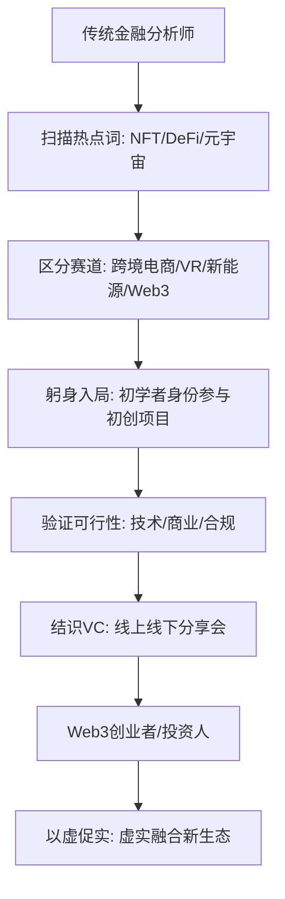

# 第 32 章 IP打造与生态洞察：从“追热点”到“做IP”的进化
作者：龙哥

## 学习目标

- 理解母题作为IP护城河的核心价值，及其与传统定位的区别
- 掌握2层基因（文化沉淀+商业能力）如何驱动IP长期发展
- 学会运用3重身份（工具/人/神）在不同用户阶段自如切换
- 掌握4级观感的定义与作用机制，理解感性消费驱动的逻辑
- 能够识别并构建IP的5份资产，理解幂次效应与生态协同
- 掌握内容体系五件套的构成与核心方法论（如构建理论的五大方法）
- 了解传统金融转型Web3的行业扫描与躬身入局方法论
- 理解Web3“以虚促实”的经济趋势及其市场规模与生存法则
- 能分析真实IP案例（如龙飞律师、李子柒）并解释其成功背后的框架

## 32.1 生活类比

想象IP打造是**经营一座庄园**：**1个母题** = 庄园的土地根基，无论种植什么作物（内容），都在这片土壤上生长；**2层基因** = 庄园的根系（文化）与果实（商业），光长叶不结果秋天就荒了，光结果不扎根，风一来就倒了；**3重身份** = 庄园的三种服务角色：先是农夫（工具，提供作物），再是管家（人，安抚情绪），最后是庄园主（神，给出长期规划）；**4级观感** = 庄园的园林设计，让人“还没想清楚就流连忘返”，产生感性认同；**5份资产** = 庄园的土地（用户）、种子（版权）、收成（实物）、声誉（文化）、周边生态（生态）；**内容体系** = 庄园的水利灌溉系统，让创作不再靠天吃饭（灵感），而是靠系统运转。就像庄园需要从根基到生态系统整体规划，IP也需要从母题到资产、从内容到变现的系统设计，才能实现“风骨与变现并存”。而跨界Web3，就像是庄园主看到了新的海外市场，虽然路途未知，但地图（数据）和指南针（生存法则）已经备好，关键在于躬身入局去验证。

## 32.2 概念地图

IP打造与生态洞察
├── 外部打造框架（12345）
│   ├── 1个母题（护城河锚点）
│   │   ├── 定义：文化原型/传承因子 —— P002
│   │   ├── 性质：传承性、可延展性（百变题型）、护城河与灵活性并存
│   │   └── 主张：定位是静态占位，母题是动态内容根
│   ├── 2层基因（风骨+变现）
│   │   ├── 文化沉淀价值：长期信任与口碑
│   │   ├── 商业持续能力：现金流与团队运转
│   │   └── 主张：不要做没有文化溢价的事；不迷信天道酬勤
│   ├── 3重身份（工具/人/神）
│   │   ├── 工具：解决功能问题
│   │   ├── 人：提供价值主张/情绪
│   │   ├── 神：支持迭代升级（危机再分配效应）
│   │   └── 性质：递进性、角色可叠加
│   ├── 4级观感（感性消费驱动）
│   │   ├── 松弛感：尽在掌握
│   │   ├── 对象感：只说给你听
│   │   ├── 获得感：让你说“卧槽”
│   │   └── 氛围感：沉浸其中
│   └── 5份资产（资产包）
│       ├── 用户资产：用户质量比数量重要
│       ├── 版权资产：17种版权，13种可交易
│       ├── 实物资产：IP衍生品
│       ├── 文化资产：文化势能
│       └── 生态资产：协同发展（幂次效应）
├── 内容体系规划（五件套）
│   ├── 四级内容架构：引流到成交逐级递进
│   ├── 一套独有理论（五大方法）
│   │   ├── 理想解法：TRIZ六步推导
│   │   ├── 节点法：从服务流程提炼共性
│   │   ├── 词根法：提炼垂类优势词
│   │   ├── 母题法：延展/结合母题
│   │   └── 核心法：提取内容核心点
│   ├── 一个十年故事：5-8分钟中视频建立信任
│   ├── 一份百问百答：降低沟通成本
│   └── 一份点线面打通路径：产品→项目→产业链
├── 变现模型（千万营收）
│   ├── 产品阶梯：年度会员→私教→私董会→合伙/徒弟
│   ├── 图书增量：一书一码+联合出品人计划
│   └── 4近原则：离钱近、离痛点近、离易用近、离信任近
└── 生态与趋势洞察（Web3跨界）
├── Web3定义：基于区块链的互联网生态（以虚促实）
├── 转型方法论：扫描热点→躬身入局→验证可行性→结识VC
├── 市场规模数据：十年3万亿流动价值、顶级机构入场、对冲基金配置7%
└── 生存法则：敬畏市场、保护团队弹药、选择比努力更重要、容错率控制

## 32.3 母题 —— 给 IP 挖一条“护城河”

### 为什么需要这个概念？

你可能听过无数次“定位”、“卡位”，但你有没有发现：按部就班做定位，内容却总写不深、边界也收不住？传统的“定位”只盯着用户心智，不从内容本身出发，导致无法做出细化的内容延展，也就建不起真正的护城河。IP 需要一个既能长期不变、又能承载千变万化内容的锚点。这就好比**钓鱼要钉一个牢固的桩**：桩钉得稳，水面怎么变、鱼群怎么游，你都能从容应对。

> "指的是，文化传统中具有传承性的文化因子，或者人类社会中那些循环往复且普遍发生的事情。最简单的理解就是原型。"
> 
> "对于IP来说，掌握母题就是可以既搭建出来自己的护城河又能随时调整边界的，这里可以直接挂钩很多人讲的定位卡位，但这个定位有一个弊端就是，它不是从内容的角度出发的，也就没法做好更细化的延展更不可能把护城河做出来。"
> 
> ——《P002, HiVkdfBYJo2H5xxWIemcMcMQnLc.md》

### 核心定义

**母题**指文化传统中具有传承性的文化因子，或人类社会中循环往复且普遍发生的事情，最简单的理解就是**“原型”**。对 IP 而言，母题是内容的原点，既可搭建护城河，又能随时调整边界。

### 关键性质

| 性质 | 解释 |
|------|------|
| **传承性** | 母题承载的是跨时代、跨人群的普遍母题（如“母性”“英雄”“自由”“爱与伤害”） |
| **可延展性** | 母题下有“百变题型”，所有内容都可以视为母题的一个变体，题型可模块化、解法可标准化 |
| **护城河与灵活性并存** | 母题是长期锚点，但允许在每个具体内容上自由换形态，在不改变根基的前提下调整表达 |

### 典型例子

- **龙飞律师**的亲密关系内容，本质上是在“爱与伤害”这一母题下不断变化场景（婚姻、育儿、财产）。
- **李子柒**的 IP 走的是“传统田园生活”这一文化母题，无论拍什么题材，都在强化这一母题。

### 边界条件

- **母题不等于定位**：定位是静态的占位，母题是动态的内容根，后者才支持持续创作。
- **母题必须真正从内容创作出发**，而不是从市场、用户、竞品反向推出来的话术。

> "定了一个母题之后，母题下有百变题型的对不对？那百变题型最好是都可以解，百变题型具体都有哪些？题型能不能模块化，解法能不能标准化？"
> 
> ——《P002, HiVkdfBYJo2H5xxWIemcMcMQnLc.md》

---

## 32.4 2层基因 —— 让 IP 既有“风骨”又有“铜板”

### 为什么需要这个概念？

很多 IP 做完内容后发现“叫好不叫座”，或者做变现后发现“赚快钱但伤粉”。根本原因是：**单靠内容能力（文化沉淀）无法养团队，单靠商业能力（变现）又留不住用户的心**。两层基因没有同时设计。这就像**一棵树既要扎根深（文化），又要能结果（商业）**：光长叶不结果，秋天就荒了；光结果不扎根，风一来就倒了。

> "指文化沉淀价值（风骨）和商业持续能力（变现），这里重点需要说的有三点：一是不要做没有文化溢价的事情……二是IP是少数人的领地……三是不要相信天道酬勤那种鬼话。"
> 
> ——《P002, HiVkdfBYJo2H5xxWIemcMcMQnLc.md》

### 核心定义

**2层基因**指 IP 应同时具备**“文化沉淀价值（风骨）”**与**“商业持续能力（变现）”**两层基因。文化沉淀价值负责长期信任与口碑，商业持续能力负责现金流与团队运转，两者缺一不可。

### 关键性质

- **双向驱动**：文化沉淀价值让用户愿意长期跟随，商业持续能力让 IP 有资源持续产出更好内容。
- **溢价效应**：有文化溢价的内容，用户愿意为“意义感”和“归属感”支付更高价格。
- **长期主义**：两层基因都依赖时间积累，不可能靠短期爆款堆出来。

### 典型例子

- **龙飞律师**在婚姻方向上既有“解决问题”的商业能力，又有“我见过你所有糟心事”的文化共情，两层层叠带动账号短期内破千万粉。
- **李子柒** IP 本质走的是文化资产路线，后续的商业变现（品牌、衍生品）都建立在文化母题之上。

### 边界条件

- **不要做没有文化溢价的事情**：纯搬运、纯蹭热点无法沉淀长期资产。
- **也不要相信“坚持就能成功”的幸存者偏差**：没有清晰变现前景和正反馈的坚持会耗尽人性。

> "二是IP是少数人的领地，每个IP的花期和成长环境不同，不要走别人的路径，既容易形成路径依赖又容易忽略“地图”上不好展示的关键节点；"
> 
> "三是不要相信天道酬勤那种鬼话，极大概率是幸存者偏差，这里用不下牌桌的能力来表达会更恰当。"
> 
> ——《P002, HiVkdfBYJo2H5xxWIemcMcMQnLc.md》

### 多源对照：IP 坚持的边界在哪里？

**共识**：IP 需要长期主义与持续投入。

**分歧**：
- 《P002》认为：**不要迷信“天道酬勤”**，所有坚持须建立在清晰前景+有效正反馈（两周可验证变现）的基础上，否则要及时转换或引入团队。
- 传统励志论调：强调“日更”、“百日挑战”等单纯的时间堆砌，容易陷入“无效勤奋”陷阱。

---

## 32.5 3重身份 —— 在“工具、人、神”之间自如切换

### 为什么需要这个概念？

用户在不同阶段对 IP 的需求不同：先是“你能解决我的问题吗”，再是“你懂我吗”，最后是“我该听你的吗”。如果 IP 只用同一身份面对所有用户，要么停留在功能层做不大，要么过早要求信任而流失用户。这好比**医生的三重身份**：先开药（工具），再安抚情绪（人），最后给出长期健康方案（神）。

> "指IP需要根据不同的状态下把自己当工具或者当人或者当神。"
> 
> "工具是从解决用户问题的功能性上说的……人是从解决用户价值主张或情绪性的角度去说的……神是从解决用户迭代升级的角度去说的，危机具有强烈的再分配的效应。"
> 
> ——《P002, HiVkdfBYJo2H5xxWIemcMcMQnLc.md》

### 核心定义

**3重身份**指 IP 需要根据用户在不同阶段的心理需求，把自己当作**“工具”“人”或“神”**三种角色来服务用户：

| 身份 | 切入角度 | 核心任务 |
|------|----------|----------|
| **工具** | 解决用户功能问题 | 提供可操作的解决方案 |
| **人** | 提供价值主张或情绪支持 | 打破用户的防御机制，建立情感连接 |
| **神** | 解决用户迭代升级 | 承接用户的危机感并给出方向，获得再分配话语权 |

### 关键性质

- **递进性**：用户对 IP 的信任是逐级升维的，从“能用”到“可信”再到“可跟随”。
- **危机再分配效应**：当用户意识到自身瓶颈并产生危机感时，谁解决这个危机感，谁就获得“再分配话语权”，从而将用户组织起来。
- **角色可叠加**：同一 IP 可以同时是工具（给方法）、人（给情绪）、神（给方向），关键是按场景切换侧重。

### 典型例子

- **龙飞律师**连麦时先给具体法律建议（工具），再表达“你的糟心事我都见过”（人），从而让用户产生“你快来问我吧”的信任（神）。
- **知识付费 IP** 卖课时是工具，做直播答疑时是人，推出年度会员/私董会时就是神。

### 边界条件

- **“神”的权威必须建立在危机解决能力之上**，不能靠话术包装，否则一旦被识破，信任崩塌更快。
- **三种身份的切换要顺滑自然**，同一场景下强行切换会让用户感到违和。

> "神是从解决用户迭代升级的角度去说的。危机具有强烈的再分配的效应。当用户意识到自身的瓶颈之后便具有了一定的危机感，这时候谁解决这个危机感谁就具有一定的再分配话语权……"
> 
> ——《P002, HiVkdfBYJo2H5xxWIemcMcMQnLc.md》

---

## 32.6 4级观感 —— 让用户“还没想清楚就下单”

### 为什么需要这个概念？

多数消费决策不是理性计算的结果，而是被感性瞬间驱动的。如果 IP 只输出硬信息，用户会保持理性审视，成交周期长、转化率低。这好比**逛街买衣服**：让你掏钱的往往不是质量参数，而是“穿上它我感觉自己不一样了”的瞬间感觉。

> "指的是IP的对外输出和呈现上要具备至少两个观感才可以让用户有被感性支配而非理性催生的消费行为。"
> 
> "松弛感是说IP有一种尽在掌握的状态……对象感是指这些话我只对你一个人说……获得感指的是没能让你说卧槽就是我输……氛围感是指沉浸其中无法自拔。"
> 
> ——《P002, HiVkdfBYJo2H5xxWIemcMcMQnLc.md》

### 核心定义

**4级观感**指 IP 在对外的输出和呈现上，要具备至少两个观感，以促成由感性支配而非理性催生的消费行为：

| 观感 | 定义 | 用户心理 |
|------|------|----------|
| **松弛感** | IP 有一种尽在掌握的状态 | “跟着他不会错” |
| **对象感** | 指这些话我只对你一个人说 | 专属感与亲密感 |
| **获得感** | 没能让你说“卧槽”就是我输 | 每期内容都有“赚到了”的感觉 |
| **氛围感** | 让用户沉浸其中、无法自拔 | 情绪场域的构建 |

### 关键性质

- **感性驱动**：观感的目的是绕过理性防御，直接作用于情绪。
- **组合使用**：具备至少两个观感即可，不必四个全占。
- **可设计性**：观感是 IP 对外呈现的“氛围装修”，可以通过内容选题、语言风格、视觉设计主动营造。

### 典型例子

- **龙飞律师**的连麦风格自带松弛感（“你问题我都见过了”）和对象感（“你快来说出你的糟心事”）。
- **穿搭 IP** 的线上发布会同时营造氛围感（沉浸式场景）和获得感（新品首发+干货讲解），一场活动可带来千万到上亿流水。

> "龙飞律师在婚姻方向的连麦上就是有一种松弛感的……你看那些连过麦的都解决了，你还不快来说出你的糟心事儿我给你出出好主意嘛，这也是她的账号短短时间内就破千万的原因。"
> 
> ——《P002, HiVkdfBYJo2H5xxWIemcMcMQnLc.md》

### 边界条件

- **观感不能脱离真实能力**：松弛感装不出来，用户会识破刻意。
- **观感要服务于商业目标**，不能为了“有感觉”而放弃信息密度。

---

## 32.7 5份资产 —— 把 IP 从“个人号”变成“资产包”

### 为什么需要这个概念？

以流量堆起的 IP，一旦流量红利消失，价值即刻清零；而真正的 IP 应该像一家公司一样拥有可评估、可变现、可传承的多元化资产。只盯“粉丝数”会把 IP 做窄，无法支撑长线变现和品牌升级。这好比**一个农夫不能只盯着一块地的收成，还要有种子、农具、水源、土地和口碑**。

> "指的用户资产、版权资产、实物资产、文化资产、生态资产这五种和个人IP息息相关的资产形态。"
> 
> "用户资产指的是你的用户是谁决定了你是谁……版权资产首先要明确一个IP可以有17种版权，其中13种是可交易的……实物资产是指IP衍生品……文化资产是指IP能够将自己置于某一主文化或者亚文化之下……生态资产本质上指的是某个组织里所有成员或者单位协同有效发展带来的经济效益。"
> 
> ——《P002, HiVkdfBYJo2H5xxWIemcMcMQnLc.md》

### 核心定义

**5份资产**指与个人 IP 息息相关的五种资产形态：

| 资产类型 | 核心内涵 | 关键指标 |
|----------|----------|----------|
| **用户资产** | 你的用户是谁决定了你是谁 | 用户质量 > 用户数量 |
| **版权资产** | 一个 IP 可拥有 17 种版权，其中 13 种可交易 | 核心可变现资产 |
| **实物资产** | IP 衍生品，虚拟影响力实体化 | 版权授权、联名款 |
| **文化资产** | IP 置于某一主文化/亚文化之下 | 文化势能、话语权 |
| **生态资产** | 组织内成员/单位协同发展的经济效益 | 最高形态、护城河最深 |

### 关键性质

- **幂次效应**：靠品牌势能积累的用户资产，边界更广、幂次效应更强，IP 的多次“觉醒”才成为可能。
- **可交易性**：版权资产中 13 种可交易版权是变现的直接抓手。
- **生态协同**：生态资产是最高的资产形态，需要多方协同，一旦形成则护城河极深。

### 典型例子

- **李子柒**的 IP 本质上走的是文化资产路线，其品牌衍生品（实物资产）和用户社群（用户资产）共同构成完整资产包。
- **星云 IP 计划**聚集 20 个 S 级 IP 形成产业群组，就是生态资产的实践。

> "如果你的IP是靠品牌涨起来的，那品牌本身所具有的势能就是你的用户资产。显而易见，品牌性质的边界会更广，幂次效应更强，IP的多次“觉醒”就有了可能。"
> 
> ——《P002, HiVkdfBYJo2H5xxWIemcMcMQnLc.md》

### 边界条件

- 资产需要时间积累，无法速成；靠流量堆砌的 IP 资产边界窄，难以长期增值。
- 五种资产应配套建设，单一资产的强势（如只有粉丝量）无法支撑 IP 的长远发展。

---

## 32.8 内容体系五件套 —— 为 IP 装上“永动机”

### 为什么需要这个概念？

没有内容体系的 IP，创作靠灵感、更新靠意志力，一旦停更流量就断崖下跌。零散的内容无法形成系统认知，用户记不住 IP 的核心主张，也就无法沉淀信任。这好比**种地不能只靠一季收成，要有土壤改良、轮作计划、灌溉系统和仓储**——内容体系就是 IP 的整套生产系统。

> "一个IP的内容体系包含5个部分，四级内容架构、一套独有理论、一个十年故事、一份百问百答和一份产品项目产业链打通路径。"
> 
> ——《P002, HiVkdfBYJo2H5xxWIemcMcMQnLc.md》

### 核心定义

一个 IP 的内容体系必须包含 **5 个部分**：

| 组件 | 作用 | 关键点 |
|------|------|--------|
| **四级内容架构** | 按层级组织内容，从引流到成交逐级递进 | 分层分级、流量承接 |
| **一套独有理论** | IP 自己的方法论，形成认知壁垒 | 可复述、可传播、有壁垒 |
| **一个十年故事** | 5-8 分钟中视频讲清楚个人十年成长 | 素材对比、关键时刻标注、文案清晰、增加信任 |
| **一份百问百答** | 提前覆盖用户常见问题 | 降低沟通成本、提升转化 |
| **一份点线面打通路径** | 从产品(点)到项目(线)再到产业链(面) | 产品→项目→产业链升级 |

### 关键性质

- **系统性**：五件套互相咬合，理论支撑内容，故事增加信任，百问百答承接流量。
- **可复用性**：内容体系一旦建立，后续创作都可以在体系内完成，不再依赖灵感。
- **资产性**：五件套本身就是 IP 的核心资产，可随 IP 一起出售或传承。

### 典型例子

- **某私域顾问**年费 50-100 万，其“水利私域理论”正是从服务逻辑中提炼的独有理论（节点法案例），成为其内容体系的核心壁垒。
- **头部 IP** 的十年故事视频，通过新手村到大佬村的对比、低谷荣耀转折的标注，成为用户深度信任的入口。

> "素材方面，需要前后对比表现成长，重点是新手村到大佬村的对比；关键时刻重点标注 低谷、荣耀、转折；"
> 
> "故事方面，一般一个十年故事要5-8分钟……文案方面，表达清晰……目的明确，增加信任。"
> 
> ——《P002, HiVkdfBYJo2H5xxWIemcMcMQnLc.md》

### 边界条件

- 五件套的搭建需要时间与专业能力，不是所有 IP 都能一步到位，**应优先搭好“独有理论”与“百问百答”两个地基**。
- 内容体系要随 IP 成长迭代，不能一套用到底。

---

## 32.9 构建体系理论的五大方法 —— 给 IP 造一套“独门秘籍”

### 为什么需要这个概念？

市面上的方法论大多是别人的，直接用会出现“水土不服”，而且无法形成差异化壁垒。有一套自己命名的理论，用户更容易记住你、传播你，并默认你是该领域的专家。这好比**武林高手要有自己的独门武功**：光会少林长拳（通用方法）打不出名号，得有自己的绝活。

> "系统的方法也是有的，大概分成5种。第一种理想解法。……ARIZ算法中给出了确定理想解的步骤：1）设计的最终目标是什么？……第六种是核心法。……直接命名内容经纪理论了。"
> 
> ——《P002, HiVkdfBYJo2H5xxWIemcMcMQnLc.md》

### 核心定义

为 IP 生成自有独创理论的五种系统化创作路径：

| 方法 | 来源 | 核心逻辑 | 适用场景 |
|------|------|----------|----------|
| **理想解法** | TRIZ ARIZ 算法 | 从“设计的最终目标是什么”出发，六步推导出最理想的理论形态 | 需要颠覆性创新、打破行业认知时 |
| **节点法** | 实操服务流程 | 从自己实际服务流程中抽取共性节点，将实操经验提炼为可复述的理论框架 | 有成熟服务/交付体系、需产品化时 |
| **词根法** | 垂类关键词 | 提炼垂类的优势词，从关键词延展出完整理论 | 深耕细分领域、已有关键词积累时 |
| **母题法** | 母题框架 | 直接延展或结合既有母题，形成理论根干 | 已有明确母题、需构建理论体系时 |
| **核心法** | 自身内容体系 | 从自身内容体系中提取核心点，直接命名成理论 | 已有成熟内容体系、需提炼核心时 |

### 关键性质

- **来源多样性**：五种方法适用不同场景，可以从服务流程、垂类词、母题、核心点等多角度切入。
- **可组合性**：五种方法可以混合使用，不必只选一种。
- **独创性**：理论一经命名即成为 IP 的专属资产，难以被抄袭。

### 典型例子：节点法实战 —— “水利私域理论”

某私域顾问年费 50-100 万，作者为其提炼理论：

```
服务流程 5 步：
第1步：重构组织结构、重塑商业模型
第2步：私域流量池搭建
第3步：社群运营 SOP
第4步：成交转化体系
第5步：客户裂变增长

以“水”为喻命名：
第1步 → 水系（源头治理）
第2步 → 水库（蓄水池建设）
第3步 → 水利工程（渠道疏导）
第4步 → 水轮机（动能转化）
第5步 → 水循环（自我更新）
```

这就是**“水利私域理论”**的完整生成过程：先确认服务逻辑，再用母题（水）串联命名。

> "因为他的私域年度顾问费用较高（50-100w/年），服务逻辑下……他就说了一下第一步是重构组织结构重塑商业模型，2345步分别是什么……"
> 
> "(特别说明，目前这个水利私域理论属于我的那个朋友，在此仅作为举例使用，不建议朋友们挪用~)" 
> 
> ——《P002, HiVkdfBYJo2H5xxWIemcMcMQnLc.md》

### 多源对照：理论构建的“借鉴”边界

**共识**：独创理论能形成认知壁垒，用户更易记忆传播。

**分歧**：
- 《P002》主张：**借鉴但非借用**——找十个模型，看自己适合哪个模型的哪一部分，再有机结合；直接复制会遗漏关键情境、形成路径依赖。
- 部分培训市场：鼓励“标准化模板”、“直接套用成熟框架”，容易导致同质化与“水土不服”。

> "最有效的办法是找十个模型，看自己适合哪个模型的哪一部分，再看这些部分能不能有机结合，运作起来是不是顺滑，借鉴但非借用~"
> 
> ——《P002, HiVkdfBYJo2H5xxWIemcMcMQnLc.md》

### 边界条件

- 理论的独创性需要以**真实服务经验为底**，不能凭空编造，否则用户一听就假。
- 理论要能**落地到具体服务/产品中**，不是口号。
- 他人的理论只能“借鉴”不能“借用”，直接复制会遗漏关键情境、形成路径依赖。

---

## 32.10 变现模型：千万营收的产品阶梯

### 核心框架：4近原则

在设计变现产品时，必须遵循**“4近原则”**：

| 维度 | 含义 | 产品示例 |
|------|------|----------|
| **离钱近** | 好变现 | 私董会、合伙/徒弟 |
| **离痛点近** | 好卖出 | 私教、咨询、具体解决方案 |
| **离易用近** | 好留存 | 年度会员、标品化课程 |
| **离信任近** | 好复购 | 长期顾问、陪跑服务 |

### 产品阶梯与定价区间

| 层级 | 产品形态 | 定价区间 | 交付特征 |
|------|----------|----------|----------|
| **入门** | 年度会员 | 标品，趋近 0 交付 | 规模化、自动化 |
| **进阶** | 私教 | 3w/3个月 1对1 | 高强度、定制化 |
| **高阶** | 私董会 | 5-20w 门票 | 圈层、资源、信息差 |
| **顶层** | 合伙/徒弟 | 20w-100w | 深度绑定、利益共同体 |
| **增量** | 图书 | 一书一码 + 联合出品人 | 破解版税低、招募 1000 联合出品人 |
| **高频** | 课程直播 | 199 小课、一天两播、单场 6w、月 400w | 1+1+1 模式（直播→小课→短视频） |
| **专家** | 咨询/培训 | 1K+/h、1天3w | 按时计费、企业级 |

> "注意一个底层逻辑就是4近，离钱近好变现，离痛点近好卖出，离易用近好留存，离信任近好复购。"
> 
> "图书在常规出版的情况下卖5w册才有二三十万的版税收入，但是能卖1w册已经属于畅销书了……可以，走一书一码和联合出品人计划，在一书一码技术的支持下招募1000个人作为联合出品人。"
> 
> "课程和直播一起搭配会更有效果，说个现实数据，199小课，一天两播，一场6w，一个月400w~有点意思是吧……"
> 
> ——《P002, HiVkdfBYJo2H5xxWIemcMcMQnLc.md》

### 设计中的取舍

**为什么不用“单一爆款课”模式？**
单一课程虽然现金流快，但缺乏复购与用户深度绑定，生命周期短。产品阶梯设计的 trade-off 是：**前期投入更大（要搭建全链路交付体系），但后期形成复利护城河，LTV（用户生命周期价值）指数级增长**。

---

## 32.11 Web3 跨界 —— 寻找 IP 的第二增长曲线

### 为什么需要这个概念？

当传统 IP 赛道竞争加剧，寻找新的蓝海市场和增长点成为必然，而 Web3 作为新兴生态提供了想象空间。IP 的“文化资产”与 Web3 的“数字资产”有天然的契合点，如 NFT、数字藏品等。这好比**出海远航**：国内市场（红海）竞争激烈，需要造一艘新船（Web3 技能）去探索新大陆（新市场）。

### 核心定义

| 概念 | 定义 |
|------|------|
| **Web3** | 一种基于区块链技术的互联网生态，并且还能实现与现实世界交互的虚拟世界，是传统互联网的演进形态，强调“以虚促实”的经济趋势。 |
| **以虚促实** | 虚拟经济与实体经济结合的趋势，各大厂推出平台 NFT 并与线下结合，促进虚实融合的经济模式。 |

> "什么是Web3? 是一种基于区块链技术的互联网生态，并且还能实现与现实世界交互的虚拟世界。"
> 
> "各大厂也都开始推出自己平台的NFT和线下结合，而这也符合国内所说的以虚促实的经济趋势。"
> 
> ——《P004, T1Jad4VhIoPc2hxKJxwcUFPOnTc.md》

### 转型方法论：扫描 → 躬身入局 → 验证 → 结识 VC

```
1. 扫描热点：保持对市场风向标与热度词的敏锐（NFT、DeFi、元宇宙），时刻留意研报中各行业市场需求性
2. 躬身入局：用原有资源找到初创团队，以“初学者身份”参与项目，只有自己参与才能快速摸透可行性
3. 验证可行性：在实操中判断技术落地、商业模式、合规边界
4. 结识 VC：积极参加线上线下分享会，建立资本连接
```

> "2021年上半年开始，我对市场上的风向标和热度词也特别敏锐，时刻留意研报中各行各业市场的需求性。"
> 
> "跟两个公司的合伙人说了下我的想法，自己另外去开辟Web3的赛道。然后我用金融圈的资源找到了一些国内Web3的初创团队，以一个初学者的身份参与进去。因为只有自己参与项目，才能快速的摸透行业的可行性。"
> 
> "平时也会积极的参加一些Web3的线下或线上分享会，结识到不少行业VC。"
> 
> ——《P004, T1Jad4VhIoPc2hxKJxwcUFPOnTc.md》

### 市场规模数据：为什么值得 All in？（但要控制容错率）

| 指标 | 数据 | 含义 |
|------|------|------|
| **10年流动价值** | 3 万亿美元 | 与全球传统创投基金总规模相当 |
| **头部机构管理规模** | Polychain、Paradigm、a16z 等各自管理数十亿至数百亿美元 | 顶级资本已深度布局 |
| **对冲基金配置计划** | 5年内将 7% 资产投入 Web3 | 机构资金持续入场 |
| **养老基金动向** | 巨无霸养老基金酝酿直投 | 长期资金背书 |

> "Web3市场在10年内创造了3万亿美元的流动价值，已足以与传统投资基金投资的初创公司的总价值相媲美。"
> 
> "Polychain、Paradigm、a16z、Multicoin、3AC以及一些其他专精的公司各自管理着数十亿或数百亿美元的资金。"
> 
> "全球大量对冲基金正计划5年内将其资产的7%投入到web3的市场中，巨无霸养老基金也开始酝酿直投了。"
> 
> ——《P004, T1Jad4VhIoPc2hxKJxwcUFPOnTc.md》

### 生存法则：熊市怎么活？

**核心公理**：**选择比努力更重要，容错率决定风险控制。**

> "有句老话，选择比努力更重要。在看赛道之前，在于你前期资金规模有多大，再决定要关注什么赛道。"
> 
> "从金融的角度来说，要给自己一定的容错率，如果在早期仅仅是ALL IN在一个方向，风险并不是特别好控制。"
> 
> ——《P004, T1Jad4VhIoPc2hxKJxwcUFPOnTc.md》

**三条铁律**：

1. **敬畏市场**：“敬畏它，并且与它共舞”——真正活下来的老鸟都懂这句话。
2. **保护弹药**：年轻团队领袖要保护团队不受市场崩塌连锁反应影响（如 FTX 暴雷）；**不要浪费弹药**，熊市选择有大量资金弹药的“基建公司”工作是更优选择。
3. **控制容错率**：早期绝不 All in 单一方向，给自己留足试错空间。

> "真正活下来能够完成远航的老鸟，都懂一句话：“敬畏它，并且与它共舞”。"
> 
> "在此温馨提示各位从事Web3的小伙伴：“不要浪费弹药”。如果你是一个有抱负的Web3公司的员工，在签约之前，记得去问招聘人员他们公司的赛道情况以及现金情况。在一个拥有大量资金弹药的“基建公司”工作绝对不是个坏的选择，这在熊市会是更好的选择。"
> 
> ——《P004, T1Jad4VhIoPc2hxKJxwcUFPOnTc.md》

### 方法演进图：从传统金融到 Web3 的跨界路径



---

## 32.12 设计中的取舍

### 为什么不用“追热点、堆流量”的短平快打法？

热点收割（如 P002 素材中的“行程码下线”案例）虽能单日变现 1 万+，但**泛粉价值密度低、取关率高（53.8%），无法沉淀长期资产**。IP 打法的 trade-off 是：**前期见效慢（需沉淀母题、理论、故事），但后期形成品牌势能、用户资产幂次效应强、可实现“多次觉醒”**。

### 为什么“定位”不能替代“母题”？

定位是**静态占位**（如“职场技能培训”），内容方向被锁死在技能教学，无法延展到情绪、价值观、人生哲思等维度；母题是**动态内容根**（如“自由与责任”），允许在保持核心不变的前提下，无限延展“百变题型”。

### “神”身份的权威从哪来？能不能包装？

**不能包装**。“神”的权威必须建立在**危机再分配效应**之上：当用户意识到自身瓶颈并感到危机时，能解决该危机的 IP 才获得话语权。靠话术包装的“神”，一旦用户发现解决不了实际危机，信任崩塌速度比建立快十倍。

---

## 32.13 动手练习

### 练习 1：为你的 IP 定位“母题”
假设你要打造一个关于“职场成长”的知识 IP，请完成以下练习：
1. 用母题思维思考：这个 IP 的 1 个母题可以是什么？（提示：母题是文化原型，如“英雄之旅”“爱与伤害”“自由与责任”）
2. 列出该母题下的 5 个“百变题型”（即内容变体），确保题型可以模块化、解法可以标准化
3. 对比“定位思维”和“母题思维”的差异：如果只定位为“职场技能培训”，内容方向会被限制在哪些范围内？而换成母题后，边界扩展到哪里？
4. 自检：你的母题是否真正从内容创作出发？是否具备传承性和可延展性？
**回答问题**：
- 为什么“定位”无法做细化的内容延展，而“母题”可以？
- 如果你的母题选错了，会带来什么后果？如何纠偏？

### 练习 2：设计“3重身份”的切换场景
以“龙飞律师”为例，她的 IP 在“爱情与伤害”母题下运营。请为她的内容设计三种身份的具体呈现：
1. 工具身份：写出一个具体的法律问题场景，以及你会给出的“工具性”建议（解决什么功能问题）
2. 人身份：写出一个“打破用户防御机制”的表达（如何提供情绪价值，让用户觉得“你懂我”）
3. 神身份：设计一个用户“迭代升级”的痛点场景（用户意识到自身瓶颈），并给出你的“神性”回应，说明你如何利用危机再分配效应获得话语权
4. 将三个身份放在同一个账号的内容规划表中，标注节奏和比例
**回答问题**：
- 三个身份中哪一个最难建立？为什么？
- 如果三个身份切换不自然，用户会有什么反应？

### 练习 3：盘点你的 IP“5份资产”
选择你熟悉的一个 IP（可以是账号、品牌或你自己），分别列出它的 5 份资产现状：
1. 用户资产：你的用户画像是什么？用户质量高吗？靠流量堆砌还是品牌势能积累？
2. 版权资产：这个 IP 可能拥有哪些版权？（如文字、视频、音频、课程等）哪些可以交易？
3. 实物资产：有没有 IP 衍生品？如果没有，哪些方向可以做？
4. 文化资产：这个 IP 把自己置于哪个主文化或亚文化之下？文化势能强吗？
5. 生态资产：有没有形成多方协同的生态？如果没有，如何构建？
6. 最后，评估这 5 份资产的均衡度，指出你 IP 最短板的一份资产，并给出补齐策略
**回答问题**：
- 为什么“版权资产”是 IP 的核心可变现资产？
- 幂次效应在哪些资产上体现得最明显？

### 练习 4：用“节点法”构建一套独有理论
假设你是年费 50-100 万的私域顾问，服务逻辑包含以下 5 步：
- 第 1 步：重构组织结构、重塑商业模型
- 第 2 步：（你自行补充，假设是做私域流量池搭建）
- 第 3 步：（你自行补充，假设是做社群运营 SOP）
- 第 4 步：（你自行补充，假设是做成交转化体系）
- 第 5 步：（你自行补充，假设是做客户裂变增长）
请完成：
1. 为这 5 步分别起一个“以水为喻”的名字（如：水系、水利工程、水循环等），构成一套完整的“水利私域理论”
2. 解释为什么“水”这个母题适合私域顾问？是否可以用其他母题（如“树木生长”“房屋建造”）替代？对比优劣
3. 验证你的理论是否满足“可复述、可传播、有壁垒”三个标准
**回答问题**：
- 为什么独创理论能形成认知壁垒？
- 直接借用别人的理论（如照搬“水利私域”）有什么风险？

### 练习 5：评估你的 Web3 转型路线
假设你是一个传统行业的从业者，想利用业余时间了解 Web3，请完成以下练习：
1. 扫描热点：列出最近一个月你在财经科技媒体上看到的 3 个 Web3 相关热词（如 NFT、DeFi、元宇宙），并简述其含义
2. 躬身入局：选择一个门槛最低的 Web3 应用（如一个去中心化钱包或一个 NFT 交易平台），注册并体验其完整流程，记录下你的操作步骤和感受
3. 验证可行性：设想一个能将你的传统行业技能与 Web3 结合的微小场景（例如利用 NFT 为你的作品确权），评估其需要哪些资源，你具备哪些
4. 寻找圈子：搜索并列出两个可以接触到 Web3 从业者的线上或线下社群
**回答问题**：
- 为什么“躬身入局”比“观望”更有助于理解 Web3？
- 在资源有限的情况下，如何为自己留足“容错率”，避免 All in 风险？

---

## 32.14 本章小结

这一章中我们学习了如何从零构建一个具有“风骨体面”、能实现千万营收并具备长期护城河的个人 IP 体系，以及如何通过跨界 Web3 寻找第二增长曲线。首先我们理解了**母题**作为 IP 护城河核心锚点的价值，它区别于静态定位，具备传承性与可延展性；其次掌握了**2层基因**（文化沉淀+商业能力）双向驱动 IP 长期发展的逻辑，并明确了不要迷信无效勤奋；接着学会了运用**3重身份**（工具/人/神）在不同用户阶段自如切换，核心在于利用“危机再分配效应”获取话语权；然后掌握了**4级观感**（松弛/对象/获得/氛围）驱动感性消费的机制；之后识别并构建了 IP 的**5份资产**（用户/版权/实物/文化/生态），理解了品牌势能带来的幂次效应；随后搭建了**内容体系五件套**（四级架构/独有理论/十年故事/百问百答/点线面路径）作为 IP 的永动机；并掌握了**构建独创理论的五大方法**（理想解法/节点法/词根法/母题法/核心法）；最后了解了 **Web3** 的定义、以虚促实趋势、市场规模（十年 3 万亿流动价值）、转型方法论（扫描-入局-验证-VC）以及熊市生存法则（敬畏市场、保护弹药、选择比努力重要、控制容错率）。

本章我们一起学习了以下概念：

| 概念 | 解释 |
|------|------|
| 母题 | 文化原型与传承因子，是 IP 搭建护城河并调整边界的核心锚点，比静态定位更能承载持续内容创作 |
| 2层基因 | IP 应兼具文化沉淀价值（风骨）与商业持续能力（变现），两者双向驱动、缺一不可，且需遵循 4近原则设计产品 |
| 3重身份 | IP 需在工具（解决问题）、人（情绪支持）、神（迭代方向）之间切换，危机再分配效应是“神”身份的权威基础 |
| 4级观感 | 具备松弛感、对象感、获得感、氛围感中至少两个，通过感性支配促使用户更快决策消费 |
| 5份资产 | 用户、版权、实物、文化、生态五类资产构成 IP 的完整资产包，靠品牌势能积累的资产幂次效应更强 |
| 内容体系五件套 | 四级内容架构、独有理论、十年故事、百问百答、点线面打通路径构成 IP 的永动机式生产系统 |
| 构建理论的五大方法 | 理想解法、节点法、词根法、母题法、核心法，为 IP 生成有壁垒的独创理论，用户更容易记住与传播 |
| Web3 与以虚促实 | Web3 是基于区块链、能与现实交互的互联网生态，虚拟经济与实体经济结合是长期趋势 |
| 转型方法论 | 通过扫描热点、躬身入局验证、结识 VC 完成赛道转型，选择比努力更重要，容错率决定风险控制 |
| 市场规模与生存法则 | Web3 十年创造 3 万亿流动价值，尽管竞争激烈，但敬畏市场、保护团队弹药是熊市生存的关键 |

下一章中，我们将学习如何将这些 IP 打造方法论内化为个人的长期主义成长体系，探讨“利他即利己”、“战略发挥优势”、“不流动稀缺资源优先”等认知框架，帮助你从“赚快钱”进化到“复利人生”。
