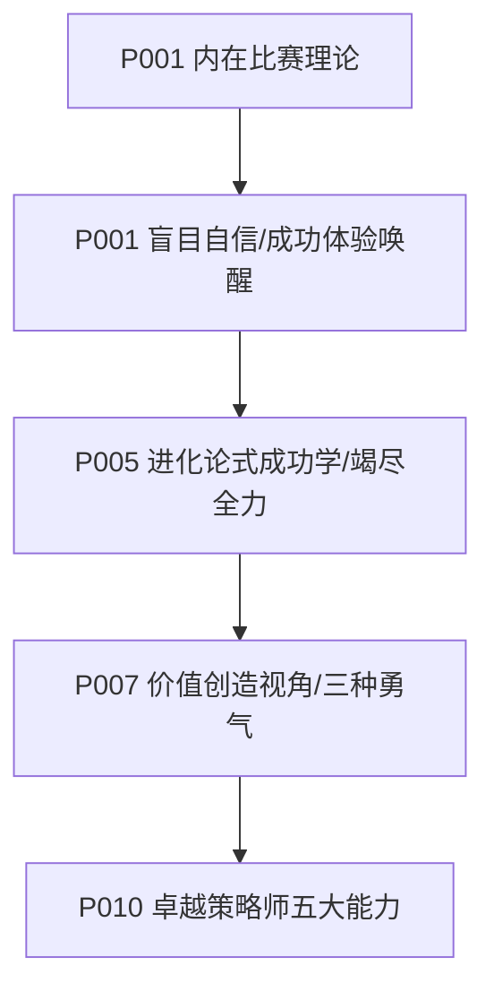

# 第 39 章 认知升维与长期主义 —— 从“赚快钱”到“复利人生”

## 学习目标

- 理解内在比赛理论：自我一与自我二的博弈如何决定外在成败
- 掌握盲目自信、唤醒成功体验、俯视学习法三大打赢内在比赛的实操工具
- 掌握确定性窗口期的类比推演判断方法，学会在宏观周期中识别“春天”并集中火力
- 理解增长瓶颈怪圈的成因，学会从“追求增长”视角切换到“价值创造”视角的三种勇气
- 掌握强加成本战略的核心逻辑：用自身优势迫使对手承受高成本
- 识别信息差生意的本质，学会从身边被忽视的细节中挖掘高确定性的微生意机会
- 建立“优雅亏大钱”反向风控思维，通过规避三大致死步骤建立敬畏市场的止损肌肉记忆
- 理解正反馈驱动热爱的机制，掌握“找热爱”或“为钱冲”两条摆脱懒惰内耗的突破路径
- 掌握利他即利己的分享复利逻辑，学会在开放生态中通过高质量输出吸引资源回流
- 掌握卓越策略师五大能力模型与道术器用四层框架，完成从执行者到架构师的认知跃迁

## 39.1 生活类比

想象创业是一场**网球内在比赛**（源自《身心合一的奇迹力量》）：
- **自我一** = 爱唠叨、爱评判、爱发号施令的理性教练（经常搞砸事）
- **自我二** = 掌握肌肉记忆、直觉、真实信念的天才选手（真正打球的人）
- **内在比赛** = 教练是否信任选手、选手是否相信自己能赢
- **外在比赛** = 实际的比分、业绩、收入
- **盲目自信** = 教练闭嘴，对选手说：“在我的领域，你就是国王”
- **唤醒成功体验** = 让选手回忆/制造几个“漂亮回球”，激活“我能赢”的肌肉记忆
- **俯视学习法** = 看高手教学时，心态是“朕心甚悦，但朕是国王”，而非跪着记笔记

再想象**抓住确定性窗口期**像**冲浪者等“组合浪”**：
- **香港疫情数据** = 气象卫星云图（相似体系的历史轨迹）
- **首轮感染后平静期** = 浪前的深呼吸窗口（2-3个月确定性红利期）
- **第二波疫情** = 后续的碎浪、乱流（红利归零甚至变负）
- **春天** = 全年最大的一组浪，冲上去就是“先干个春天再说”，错过等明年

最后想象**价值创造视角**像**种树 vs 采果子**：
- **追求增长视角** = 盯着树上果子（销售额/DAU/权力）拼命跳、甚至摇树，果子越跳越少、树也摇死了
- **价值创造视角** = 扎根、浇水、施肥（品牌心智/数据资产/人才密度/用户信任）——这些是**最稀缺、最不流动**的资产
- **不流动稀缺资源** = 树根系，看不见、挪不走、但决定树高、决定抗风、决定年年有果
- **茅台案例** = 八项规定砸牌降价时，别人卖果子（牺牲品牌换销售额），茅台护根系（守住品牌心智），最终成万年老树

## 39.2 概念地图

认知升维与长期主义
├── 内在心法
│   ├── 内在比赛理论（自我一/自我二）    —— P001
│   ├── 盲目自信（舍我其谁心态）          —— P001
│   ├── 唤醒成功体验法（成功是成功之母）  —— P001
│   ├── 俯视学习法（战略藐视战术重视）    —— P001
│   ├── 正反馈驱动热爱（懒惰=无正反馈）    —— P005, P007
│   └── 竭尽全力是最轻松的工作方式       —— P005
├── 战略认知
│   ├── 战略三要素（目的/指导原则/禀赋）  —— P003, P005
│   ├── 强加成本战略（非对称博弈）         —— P003, P007
│   ├── 战略非目标论（目标≠战略）           —— P007
│   ├── 增长瓶颈怪圈（被想拥有的东西绑架） —— P004, P007
│   ├── 价值创造视角（三种勇气切换）       —— P004, P007
│   ├── 不流动稀缺资源价值优先（品牌/数据/信任） —— P007
│   ├── 争是不争，不争是争（贡献视角胜利）  —— P007
│   ├── 持续增长悖论（成功后放弃致胜动作） —— P007
│   └── 重构成功归因复盘法（抓机会/破惯例） —— P007
├── 机会判断
│   ├── 确定性窗口期（香港疫情类比/春天3个月） —— P001
│   ├── 时代红利与个人能力补偿（90%红利/10%能力） —— P003
│   ├── 信息差生意（身边闷声发大财/网上项目过时） —— P006, P007
│   └── 行业机会切入（旅游/健康/餐饮）        —— P001
├── 执行方法论
│   ├── 盈利验证与放大（MVP先卖后做/复制30遍） —— P003, P005
│   ├── 以结果倒推的逆向思考（变现→定位）     —— P005
│   ├── 剥离式拆解问题法（10大问题→100小问题） —— P005
│   ├── 渣男思维做内容（撩完就跑/广撒网）      —— P005
│   ├── 峰终定律应用（首尾愉悦定全局）         —— P005
│   ├── 优雅亏大钱三步骤（反向规避致死路径）    —— P007
│   ├── 亏钱反期望定理（反向操作不保证赚钱）  —— P007
│   ├── 利他即利己/分享复利（越分享越幸运）     —— P003, P009
│   ├── 执行力可变现（奖励机制/生财办公室）    —— P003
│   └── 做事依据能力资源而非愿望（老鹰/鲨鱼）  —— P005
└── 策略师进阶
    ├── 卓越策略师五大能力（调研/总结/管理/决断/叙事） —— P010
    ├── 道术器用四层框架（道/术/器/用）          —— P010
    ├── 合格总结三要素（目标比对/要事实/发现问题） —— P010
    ├── 5WHY分析法（期望-现状/连问5为什么）       —— P010
    ├── 产品Idea五种构思法（原生>抄竞品>搜索词>预付费>生造） —— P010
    └── 好名字公式（低成本+好理由+好延展）         —— P010

## 39.3 内在比赛理论 —— 自我二决定你能走多远

### 为什么需要这个概念？

很多人有技术、有资源、有勤奋，却始终做不成事，核心卡在潜意识不认可目标。外在比赛（业绩、收入）的成败，实则由内在比赛（潜意识信念）决定。李宗伟技术不输林丹，却屡败；老虎伍兹技术未退步，却跌出前百，皆因输掉内在比赛。

### 核心定义

**内在比赛理论**（来源：《P001, 20230207_01.md》）

> "人，有两个自我，分别是自我一、自我二。自我一，对应着理性，是一般意义上的自我。自我二，对应着感性，或者说对应着潜意识。"
> "任何一个比赛，实际上是同时进行的两场比赛，内在比赛和外在比赛。内在比赛，也就是英文书名里的'Inner Game'，这是最容易被人忽视的。"
> "人们往往容易忽略的是，如果自我二（也就是潜意识），并不认可这个目标的时候，会输掉内在比赛。一旦输掉内部比赛，外在比赛也会输。"
> 
> ——《龙哥赚钱周报 20230207_01》

这个理论源自《身心合一的奇迹力量》（The Inner Game Of Tennis），指出人有两个自我：
- **自我一（理性/一般自我）**：爱分析、评判、发号施令，经常唠叨“你不行”、“风险太大”、“能力不足”
- **自我二（感性/潜意识）**：掌握肌肉记忆、直觉、真实信念体系，才是真正执行动作、产生结果的主体

**内在比赛**是自我一与自我二的博弈，核心问题是：自我二是否真心认可这个目标？**外在比赛**是现实世界的业绩竞争，其结果受内在比赛支配。

### 关键性质

1. **决定论**：一旦输掉内在比赛，外在比赛必输，无法靠战术勤奋弥补战略信念缺失
2. **非理性**：自我二不讲逻辑，只认“成功体验”和“身份认同”，不认“大道理”
3. **可训练**：可通过唤醒成功体验、俯视学习法主动重塑自我二的信念

### 典型例子

> "在两人的职业生涯中，总共交手 37 次，李宗伟输了 25 次，其中两次是奥运会决赛。李宗伟的技术比林丹差吗？可真不见得，大部分职业羽毛球运动员和教练认为，他俩的技术不分伯仲。甚至还有一些人认为，李宗伟的技术比林丹更加全面。其实他不是输给了林丹，他是输给了自己。"
> 
> ——《P001, 20230207_01.md》

> "在性丑闻离婚之后的两个月，他就丢掉了世界第一的头衔，在往后几年，甚至跌出过世界排名前 100……曾经，他光芒四射，是个完美的人。闹了性丑闻以后，他的潜意识和他的对手的潜意识，都不再认为他是一个完美、不可战胜的人。因为性丑闻，老虎伍兹输掉了自己的内在比赛。"
> 
> ——《P001, 20230207_01.md》

> "作为一等一的赚钱高手，他们早就身心合一了。大家看到他们言语里的不羁，是源自于他们打赢了自己内在比赛。"
> 
> ——《P001, 20230207_01.md》

### 边界条件

- **盲目自信≠盲目冲动**：需建立在“已验证的能力圈”内，否则是幻觉非信念
- **无法替代技能**：内在比赛赢了只能发挥真实水平，不能让外行打赢专家
- **环境剧变失效**：如海水干涸，最强的鱼也会死，需配合进化论式适应环境

### 方法演进图

## 39.4 盲目自信与唤醒成功体验 —— 给潜意识装配“必胜信念”

### 为什么需要这个概念？

创业充满不确定性，理性分析往往导致犹豫、恐惧，自我一会拖自我二后腿。潜意识（自我二）只认“成功过”，不认“理论上能行”，必须喂给它确定性证据。普通人缺乏大成就，需用“微小成功”拼凑“必胜信念”。

### 核心定义

**盲目自信**（来源：《P001, 20230207_01.md》）

> "一言以蔽之：你需要盲目的自信。因为盲目的自信和乐观，是创业者的理性选择。"
> "这样'舍我其谁''在我的领域，我就是国王'的心态，才是创业者真正需要的心态！"
> "创业途中充满了艰难险阻，而盲目的自信和乐观，是创业者的理性选择。常言道，永远不要低估一个高估自己的人。"
> 
> ——《龙哥赚钱周报 20230207_01》

**定义**：在能力圈内，对自己能搞定目标的无条件信任，是创业者的理性选择。

**唤醒成功体验法**（来源：《P001, 20230207_01.md》）

> "当自己内心很怂、不自信的时候，你需要回顾下自己成功的经历，唤醒自己的成功体验。"
> "比如，一些优秀的推销员，在开展一天的工作时，会先去找一些优质的客户，或者推销一些容易卖的产品，通过这种方式去制造成功体验。这份体验，会帮助他更好地开展一天的工作。"
> "失败不是成功之母，成功才是成功之母。"
> 
> ——《龙哥赚钱周报 20230207_01》

**定义**：通过回顾/制造过往成功经历，激活潜意识中的“赢家身份”，作为新挑战的心理燃料。

**俯视学习法**（来源：《P001, 20230207_01.md》）

> "我的答案是：别跪着学！要俯视！你就是国王，把生财有术的帖子，当成奏折来看。"
> "毛主席说，战略上藐视敌人，战术上重视敌人。跪着学生财有术的人，打不赢内在比赛。"
> "但是在战略上，来自于你的潜意识，你内心相信的应该是'老头儿，刚才你的奏折有一些亮点，朕心甚悦。可是，朕才是这个领域的国王。'"
> 
> ——《龙哥赚钱周报 20230207_01》

**定义**：战略上藐视（我是国王看奏折），战术上重视（跪着把细节学透），避免跪着学习导致内在比赛输。

### 关键性质

1. **正向循环**：成功体验→自信→行动更果敢→更大成功→更强体验
2. **逆向工程**：没有现成大成功，就用“先卖易卖品”、“先攻简单关”制造小成功
3. **身份锚定**：一旦自我二认同“我是搞X的高手”，会自动过滤干扰、调动资源

### 典型例子

- **优秀推销员**：每天先找优质客户/推易卖品，制造“开门红”体验，带动全天状态
- **作者建议**：做新事前回顾“曾搞定过比这难的事”，唤醒潜意识“舍我其谁”
- **俯视学习**：看付费社群帖子当“奏折”，心态是“朕心甚悦，但朕是国王”，而非跪着求教

### 边界条件

- **仅限能力圈内**：不懂芯片设计却盲目自信造芯片，是妄想非自信
- **需配合“进化论”**：环境变了（如海水干涸），原有信念失效，需进化出新肺（新能力/新模式）
- **避免幸存者偏差**：只复盘成功不复盘失败，会让自我二积累虚假无敌感

## 39.5 确定性窗口期 —— 用数据推演“春天在哪里”

### 为什么需要这个概念？

普通人创业最怕“赌运气”，需要找到确定性高的时间窗口集中火力。宏观周期（疫情、政策、技术爆发）决定了流量、需求、竞争的大基调。错过窗口期=放弃全年最重要机会，如2023春天错过则等下一轮周期。

### 核心定义

**确定性窗口期**（来源：《P001, 20230207_01.md》）

> "最近 3~6 个月，是比较确定的疫情平稳期，之后才会迎来第二波疫情的峰值。"
> "香港跟大陆一样，也是第一次大规模疫情感染，就把八九成的居民给感染了。之后香港就进入了 2~3 个月的平静期，平静期之后就进入第二波疫情感染。"
> "至少 2023 年的春天，会是一个比较确定的稳定期。"
> "因为这个春天，可能是今年最重要的 3 个月窗口期。反正我相信春天来了，先干个春天再说。"
> 
> ——《龙哥赚钱周报 20230207_01》

**定义**：通过类比推演（香港疫情数据→大陆），判断出的宏观环境相对稳定、需求集中释放、竞争尚未白热化的黄金期。

**核心判断逻辑**：
1. 首轮大感染后 → 2-3个月平静期 → 第二波来临前 = 确定性窗口
2. 2023春天 = 全年最重要3个月窗口期，主张“先干个春天再说”

### 关键性质

1. **类比推演**：用相似体系（香港）的历史轨迹，预测目标体系（大陆）的未来
2. **红利递减**：窗口期内越早入场红利越大，平稳期结束红利归零甚至变负
3. **多行业共振**：窗口期往往催生旅游、健康、餐饮等多个确定性赛道同时爆发

### 典型例子

> "今年春节国内旅游人次达到 3 个亿，基本上已经恢复到 2019 年同期的 88.6%了。出境的机票订单量上涨了 258%，入境的预定量上涨了 632%，国际酒店的预定量同比增长了 177%。"
> 
> ——《P001, 20230207_01.md》

> "像去年有好几个保健品的品牌，在抖音销量都过亿了。诺特兰德的维生素片保健品，连续两个月是抖音直播的单品销量第一了。还有养生相关的书单，养生茶，推拿的小课程、小产品，都是适合普通人带货的品类。"
> 
> ——《P001, 20230207_01.md》

### 边界条件

- **仅适用“确定性”判断**：不可用于技术突破型、政策突变型不可预测赛道
- **窗口期≠躺赢**：仍需选对赛道、跑通模型、组建团队，窗口只给“风向”不给“风力”
- **二次感染风险**：平稳期结束后流量成本暴涨、转化率下降，需提前布局私域沉淀

## 39.6 增长瓶颈怪圈与价值创造视角 —— 别让目标绑架了你

### 为什么需要这个概念？

企业/个人越想增长、越焦虑、越投机、越计算利弊、越抓取资源，反而离增长越远。根因：被“想拥有的增长”绑架，丧失了面向未来、面向用户、积累价值的三种勇气。表现：面向过去（用旧地图找新路）、计算利弊（不关注用户）、抓取资源（不积累品牌/信任）。

### 核心定义

**增长瓶颈怪圈**（来源：《P007, 20230207_07.md》）

> "进入增长瓶颈的一个典型现象，就是越想要增长，却距离想要的增长越远。"
> "如果用一句话来形容这种现象，那就是我们被我们想拥有的东西绑架了。"
> "再进一步的恶性循环，就是觉得这些问题的原因是自己还不够狼性、不够拼搏，所以不断压榨自己、逼迫自己，让自己活在一个焦虑紧张和对失去的害怕中（业界常说的话就是 FOMO 心理），让自己更加难以去做自己热爱的事情，更加难以去专注，从而进一步失去优势。"
> 
> ——《龙哥赚钱周报 20230207_07》

**定义**：被增长预期绑架→投机跟风/压榨自己/计算利弊→失去优势→更焦虑→更投机的恶性循环。

**价值创造视角**（来源：《P007, 20230207_07.md》）

> "我发现，破除增长焦虑唯一的方法，就是怎么从追求增长的视角，切换成价值创造的视角。"
> "从一个'我如何得到增长'，变成'我如何成为一个值得被奖赏增长的人'。"
> "转化看待问题的方式，而非解决问题本身，往往才是最关键的办法。"
> "真正要去摆脱这种视角，最难的不在于方法论，而是 3 种'勇气'：面向未来而非面向过去的勇气；面向用户而非计算利弊的勇气；积累价值而非抓取资源的勇气。"
> 
> ——《龙哥赚钱周报 20230207_07》

**定义**：从“我如何得到增长”切换为“我如何成为值得被奖赏增长的人”，需面向未来、面向用户、积累价值三种勇气。

### 关键性质

1. **视角重构**：转化看待问题的方式，比解决问题本身更关键
2. **稀缺资产导向**：识别环境中“最稀缺、最不流动”的资产（品牌、数据、人才、信任）并积累
3. **复盘双轨**：除问“坚持什么走到今天”，必问“抓住什么机会/打破什么惯例走到今天”

### 典型例子

> "柯达认为自己成功的重要法门是坚持成像的品质和性能（这个 belief 也在一定程度上限制了它们进入更加便捷但是成像品质相对低的数码相机市场）。它最初成功的法门并不是高品质，而是抓住技术趋势开发适合更多人群的便捷性产品。"
> 
> ——《P007, 20230207_07.md》

> "八项规定后大量的中高端白酒品牌，降价砸了牌子，几乎只有茅台认为品牌才是最重要的资产，不会用品牌和品质的牺牲去换销售额。"
> 
> ——《P007, 20230207_07.md》

> "邬思道（号称编剧附体的人）提出了违反共识却真正行之有效的关键战略，只有八个字'争是不争，不争是争'——就是当你想去争权夺力，反而距离皇位会变远，当你不去争，去想着怎么给大清国创造价值，才能赢得皇帝的信任，这才是最大的争，成为最后的赢家。四爷最与众不同的策略在于——从一个争抢的视角，变成一个贡献的视角。"
> 
> ——《P007, 20230207_07.md》

### 边界条件

- **需有“面向未来”的基本判断力**：盲目乐观非面向未来，需洞察趋势势能
- **非否定目标**：目标是战略的对象/结果，非战略本身；无目标无导向，执着目标误入歧途
- **积累价值≠不赚钱**：积累品牌/信任/数据是为了更高维度、更长周期的变现能力

### 多源对照：战略本质的不同解读

**共识**：战略核心是“选择不做什么”，而非“做什么”；战略需发挥禀赋（优势），不能选劣势做方向。

**分歧**：
- **P003/P005（战略发挥优势法）**：强调“先审视筹码（优势），再决定怎么打牌”，认为战略是筹码与出牌的框架
- **P007（战略非目标论/三勇气）**：强调战略≠目标，战略是视角切换后的指导原则，需三种勇气支撑
- **P006（买卖生意商业三分论）**：将战略层级化为“买卖→生意→商业”，认为商业本质是“卖卖卖”即持续创造客户价值

## 39.7 战略三要素与强加成本战略 —— 用优势逼死对手

### 为什么需要这个概念？

很多人把“定目标”当“定战略”，导致战略成了口号，无法指导具体取舍。资源有限时，必须通过战略指导原则，把优势转化为对手的负担，实现以弱胜强。战略本质是“选择不做什么”，并发挥禀赋（劣势不能做战略方向）。

### 核心定义

**战略三要素**（来源：《P003, 20230207_03.md》与《P007, 20230207_07.md》）

> "首先，战略目的是让你能获得优势或者获得相对优势。"
> "其次，战略应该形成一种自始至终的指导原则。"
> "还有一个呢，就是战略需要发挥你的禀赋。你要是跟老乡鸡、南城香比卫生、标准化、品牌力，那就错了。你应该提升你的人情味、现炒等等。这就是不能选择你的劣势来做战略方向。"
> "战略就是先审视自己手里的筹码，也就是自己的优势，然后再决定自己怎么打牌，也就是如何运用自己的优势来获得你想要的结果。"
> 
> ——《龙哥赚钱周报 20230207_03/07》

**定义**：战略包含三个要素——1)目的：获得相对优势；2)形式：自始至终的指导原则；3)基础：发挥禀赋（优势）。

**强加成本战略**（来源：《P007, 20230207_07.md》）

> "因为苏联有几个弱点：国土面积太大（这在面对德国侵略时是优点，纵深比较好），防守成本很高，苏联还非常重视国土防空。"
> "美国的战略就是，让苏联承受越来越多的费用和成本。"
> "你看，美国所有的行动，都是遵守一个战略指导原则，就是让苏联增加成本。这叫做'强加成本'战略。"
> 
> ——《龙哥赚钱周报 20230207_07》

**定义**：利用自身优势，迫使对手不得不持续投入高昂成本应对，拖垮其经济实力的一种战略指导原则。

### 关键性质

1. **非对称博弈**：不在对手强项硬碰硬，而在己方强项/对手弱项发起攻势（美苏：美用技术/经济拖垮苏）
2. **指导原则恒定**：战术可变（毒刺导弹、压油价、星球大战），战略指导原则不变（让苏联加成本）
3. **劣势规避**：老乡鸡拼卫生/标准化/品牌力会死，战略方向必须是“人情味/现炒”等优势

### 典型例子

> "首先是训练阿富汗游击队。并向阿富汗提供'毒刺'的肩扛式防空导弹……第一批'毒刺'200 枚运到阿富汗以后就击落了 100 多架苏军的直升机和固定翼飞机。石油价格每降 1 美元，苏联就损失 5 亿到 10 亿美元。这就是一方面在放血，一方面破坏造血功能。你看，美国所有的行动，都是遵守一个战略指导原则，就是让苏联增加成本。这叫做'强加成本'战略。"
> 
> ——《P007, 20230207_07.md》

> "LV 率先开发出轻便、耐磨损的旅行箱，抓住了 19 世纪欧洲火车普及的机会；NIKE 通过赞助顶级球星的方式抓住了电视转播崛起的机会；索尼抓住了晶体管技术的突破开发随身听等等。宝洁最早也只是卖肥皂，如果宝洁基于过去去做自我定位……就很难有我们看到的宝洁。但如果看到了 19 世纪末最大的势能就是广播媒体的出现带动全国品牌的建立，就自然会发现还有更大的空间。"
> 
> ——《P007, 20230207_07.md》

### 边界条件

- **需准确识别“相对优势”**：错判优势会导致战略指导原则指错方向
- **对手必须有“成本承受上限”**：对无成本约束的对手（如无限输血的平台方）失效
- **指导原则需穿越周期**：战术随环境变（毒刺→压油价→星球大战），原则不变

## 39.8 信息差生意与身边机会挖掘 —— 赚钱机会在脚下

### 为什么需要这个概念？

网上公开的“月入X万项目”基本已过时，真机会隐藏在身边被忽视的信息差中。普通人容易仰望网红大佬，却忽视身边“闷声发大财”的实体小生意。信息差≠垄断资源，只是“多看一眼、多问一句、多跑一趟”发现的供需错配。

### 核心定义

**信息差生意**（来源：《P007, 20230207_07.md》）

> "身边赚钱的机会其实还是很多的，只是你没有发现，这个就是大家所说的信息差。"
> "先有闷声发大财，网上说做什么小项目一个月可以赚多少钱的，基本是已经过时了。"
> "对于赚钱这件事，真的需要你从身边挖掘发现，而不是在网上听谁说赚钱。"
> 
> ——《龙哥赚钱周报 20230207_07》

**定义**：利用认知不对称（如专业门槛、渠道壁垒、需求隐蔽性）获利，而非依靠技术/资本垄断。

### 关键性质

1. **非标准化**：难以被复制粘贴，依赖本地资源、人际网络、特定场景
2. **高确定性**：已验证有人赚钱、模型跑通、现金流为正，非理论推演
3. **反脆弱**：不依赖平台算法、不怕大厂降维打击、抗周期能力强

### 典型例子

> "苏州有一家叫 ao 图文的，就只做广告牌子，现在开了有 70 家店……一块牌子 3000-5000 块，生意稳定……一个月 15 块牌子，也要 7w 块了。"
> 
> ——《P007, 20230207_07.md》

> "四线城市做烤面筋……一天卖 600 串左右，一天的收入在 2000 多，节假日更多。"
> 
> ——《P007, 20230207_07.md》

> "小姐姐也没有天天广告漫天……差一点一个月 7000-8000 左右，到了吃螃蟹的季节，一个月 2w-3w 不等。如果按照一年平均 1.2w 算。"
> 
> ——《P007, 20230207_07.md》

### 边界条件

- **难规模化复制**：强依赖本地/人际/非标，不适合“矩阵化/标准化”放大
- **易被政策/规划冲击**：如城管整治、拆迁、平台封杀私域导流
- **需“懂行”切入**：外行强行入局（如不懂广告材料做图文）极易被坑

## 39.9 反期望亏钱法则与优雅亏大钱三步骤 —— 反向规避致命风险

### 为什么需要这个概念？

创业者常陷入“必赚”幻觉，忽视亏钱是常态、赚钱是概率。缺乏止损机制、加杠杆赌翻身、死扛不退出，是亏大钱的标准动作。用反讽梳理“必亏路径”，比正向讲“如何赚钱”更触动防线。

### 核心定义

**优雅亏大钱三步骤**（来源：《P007, 20230207_07.md》）

> "我的方案可以分成三个步骤：1、做容易亏钱的事。2、投入足够多的钱。3、坚持到底。"
> "坚定选择只有少数人能够赚钱的项目。这样，除非天赋异禀，否则你大概率就是一个亏钱的人。"
> "要带着一夜暴富的追求，伴随破釜沉舟的气势，配上一往无前的决断（XX 跌很多这种事情不可能发生！），一次上大仓位，最好配上杠杆。"
> "这一步叫：坚持到底，决不退出。赚钱了不止盈，亏钱了不止损。只有这样才能确保真的亏大钱。"
> 
> ——《龙哥赚钱周报 20230207_07》

**定义**：保证亏大钱的三个步骤：1)做容易亏钱的事（选少数人能赚/看不懂的项目）；2)投入足够多钱（加杠杆/高频/大仓位）；3)坚持到底（赚不止盈、亏不止损）。

**反期望定理**（来源：《P007, 20230207_07.md》）

> "如果你要问，那我反着来，就能保证赚钱吗？我也希望可以，但很不幸不能，无论多厉害的高手，亏钱是赚钱路上的不可缺少的部分。舍弃了亏钱，就意味着舍弃赚钱。"
> "毕竟，赚钱的方式千差万别，亏钱的方式殊途同归。"
> 
> ——《龙哥赚钱周报 20230207_07》

**定义**：严格反着亏钱步骤做，也无法保证赚钱，因为“赚钱方式千差万别，亏钱方式殊途同归”，亏钱是赚钱路上不可缺少的部分。

### 关键性质

1. **系统性风控**：三步骤缺一不可，少一步大概率只是“小亏”或“不赚钱”，三步齐全必“亏大钱”
2. **认知对抗**：人性贪婪（一夜暴富）、恐惧（不止损）、侥幸（跌很多不可能发生）是三步骤的心理燃料
3. **幸存者偏差破解**：只看赚钱案例学不到风控，必须研究“亏钱大师”共性

### 典型例子

- **步骤1**：坚定选择“只有少数人能赚”的项目（如高杠杆合约、不懂的跨境赛道），除非天赋异禀必亏
- **步骤2**：带着一夜暴富追求+破釜沉舟气势+大仓位+杠杆，一次上重仓
- **步骤3**：赚了不落袋（还要涨）、亏了不割肉（会涨回来），决不退出，直至爆仓/负债百万
- **作者自述**：创业10年失败4次、负债百万，靠自媒体上岸，核心教训是“非刚需项目推不动”

### 边界条件

- **非鼓励亏钱**：目的是建立“敬畏市场、止损优先、小步试错”的风控肌肉记忆
- **小额试错≠步骤2**：MVP验证用自有资金、可承受损失、设定止损线，与“加杠杆大仓位”本质不同
- **反向操作不等于赚钱**：避开三步骤只是“入场券”，赚钱仍需正向能力（选品、运营、团队）

## 39.10 正反馈驱动热爱 —— 懒惰是因为不够赚

### 为什么需要这个概念？

很多人误以为“热爱→坚持→成功”，实则“正反馈→热爱→坚持→更多正反馈”。懒惰本质=未获正反馈；未获正反馈源于做得少；做得少源于不够喜欢/不够缺钱。打破内耗两条路：找到真热爱（内驱力），或纯粹为钱冲（外驱力），二选一即可。

### 核心定义

**正反馈驱动热爱**（来源：《P005, 20230207_05.md》与《P007, 20230207_07.md》）

> "为什么会有懒惰这个东西？本质上，就是没拿到正反馈，如果你每天做的事都有大量的钱进账，比如一天一万利润揣兜里，你说你会懒？你比谁都积极。"
> "但是最核心的是，你不够喜欢。"
> "你不够想，不够想赚钱，不够缺钱。这里有两个突破口，一个是尽快找到自己到底热爱，另一个，找不到也没关系，就是为了钱冲，不别扭，不内耗。"
> "无论你做什么工作，只要竭尽全力就可以，竭尽全力是最轻松的工作方式。…… 其实我们几乎所有的人，做事都很难做到竭尽全力。…… 有时候我们不必去拼天分，我们在很多事情上，只要够勤奋、够用心就可以了。"
> 
> ——《龙哥赚钱周报 20230207_05/07》

**定义**：热爱不是先天属性，而是“获得正反馈→多巴胺分泌→产生喜爱感”的后天养成结果。懒惰方程：懒惰=无正反馈=做得不够多=不够喜欢/不够缺钱。

### 关键性质

1. **可工程化**：通过“先做易出单品/找优质客户”制造早期正反馈，人为启动热爱循环
2. **去道德化**：为钱冲不丢人，比“假装热爱、实则内耗、最后放弃”体面得多
3. **竭尽全力是最轻松的工作方式**：只要够勤奋用心，多数事能超过多数人，无需拼天分

### 典型例子

- **推销员案例**：先推易卖品造“开门红”正反馈，激发一天的积极性，这是人为设计的热爱引擎
- **作者感悟**：一天一万利润揣兜里，没人会懒；核心是“不够想、不够想赚钱、不够缺钱”
- **小马宋观点**：竭尽全力是最轻松的工作方式，大多数人没竭尽全力，所以觉得累

### 边界条件

- **正反馈必须真实**：虚假数据/自我感动/团队吹捧造不出真正反馈，潜意识（自我二）骗不了
- **纯为钱冲需“算得清账”**：只盯钱不盯价值，极易陷入“优雅亏大钱”三步骤陷阱
- **热爱≠不累**：热爱只是让你“累得值得、累得不内耗”，体力/脑力消耗客观存在

## 39.11 利他即利己与分享复利 —— 越分享越幸运

### 为什么需要这个概念？

传统思维认为“教会徒弟饿死师父”，导致囤积秘诀、封闭运营。互联网时代市场容量极大、边际成本趋零，分享反而能引来更多信息回流、资源连接。利他是最高级的利己：通过帮助他人成功，建立信任资产、召唤同频合伙人。

### 核心定义

**利他即利己**（来源：《P003, 20230207_03.md》与《P006, 20230207_06.md》）

> "事实证明，你越利他，你得到的回报会更大；现在最稀缺的就是信息，这市场这么大，蛋糕分得完吗？"
> "记得亦仁说我想告诉大家，执行力是值钱的，执行力是可以变现的，我想奖励执行力；邀请我去生财办公室这何尝不是对我的执行力的一种奖励。"
> "发圈动力=佣金/设计交压力。产品需要具备社交货币价值，让分销员发朋友圈、私聊没有压力才能自发传播。"
> 
> ——《龙哥赚钱周报 20230207_03/06》

**定义**：乐于分享好信息、好方法不藏私，不会因竞争受损，反而因分享获得更大回报和信息回流。

### 关键性质

1. **非零和**：知识/经验分享不减库存，反而通过反馈、讨论、迭代增值
2. **吸引力法则**：分享什么，吸引什么人；藏私什么，失去什么连接可能
3. **长期复利**：短期看似“便宜别人”，长期建立“专家/靠谱/慷慨”人设，转化率极高

### 典型例子

- **作者亲证**：分享项目拆解、运营心法，未因竞争受损，反而获邀生财办公室、被亦仁高价买号奖励执行力
- **社群裂变**：书里有品0预算冷启动，靠“分销员发圈展示好妈妈形象”（社交货币）首月进10万分销员
- **开源生态**：Linux、React、Stable Diffusion因开源分享成为行业标准，核心贡献者获顶级商业回报

### 边界条件

- **核心护城河不分享**：如核心算法、独家供应链、法律红线内的商业机密
- **分享需“高质量”**：垃圾内容/过时教程/营销软文伪装干货，会透支信任破产
- **需配合“接住流量”**：分享引来咨询/合作无转化体系（私域/产品/服务），流量即废纸

## 39.12 卓越策略师五大能力与商业模式画布道术器用法 —— 从执行到架构的进阶

### 为什么需要这个概念？

从“会干活”进阶为“会设计生意/带团队/定战略”，需一套可训练的能力模型。杂乱无章的业务动作，需用“道术器用”四层框架统摄，避免战术忙碌掩盖战略懒惰。总结/复盘/提问/定义问题，是连接认知与行动的基础设施。

### 核心定义

**卓越策略师五大能力**（来源：《P010, 20230207_04.md》）

> "合格乃至卓越的策略师应具备五项综合素养：扎实的调研能力（对调研的压倒性投入就是对客户的负责）、清晰逻辑的归纳总结能力（搜尽奇峰打草稿）、把控全局的项目管理能力、让人难以怀疑的决断力、面向内外部的双重叙事能力。"
> 
> ——《龙哥赚钱周报 20230207_04》

**定义**：
1. **扎实调研能力**：压倒性投入=对客户负责
2. **清晰归纳总结能力**：搜尽奇峰打草稿
3. **项目管理把控全局**：量化目标+明确时间节点+高频同步
4. **让人难以怀疑的决断力**：建立在调研+总结+管理基础上
5. **双重叙事能力**：对内（团队）和对外（投资人/合作伙伴/用户）各自说服力强

**道术器用四层框架**（来源：《P010, 20230207_04.md》）

> "用道、术、器、用四个层面讲清并运行所有项目：道为商业模式的本质（用XX产品/服务解决XX客户的XX痛点，赚XX钱），术为解决方案的9个关键维度（客户、价值、渠道、关系、资源、伙伴、活动、成本、收入），器为载体工具平台，用为执行力与业务流迭代。"
> 
> ——《龙哥赚钱周报 20230207_04》

**定义**：
- **道**（商业本质）：一句话阐述——我用XX产品/服务，解决XX客户的XX痛点，赚XX钱
- **术**（9维方案）：客户画像/核心价值/获客渠道/用户关系/关键资源/核心伙伴/核心活动/成本结构/收入来源
- **器**（载体工具）：承载上述9个板块的便捷工具平台
- **用**（执行迭代）：执行力、业务流的迭代

**合格总结三要素**（来源：《P010, 20230207_04.md》）

> "一次合格的总结必须带有下方三个因素：1、总结与目标的比对。2、要事实，不要观点。3、能够帮助发现问题。"
> "总结的目的是什么？我认为就是简单四个字：发现问题。完不成目标有问题，为什么完不成？完成了目标有问题，为什么没办法超额完成？超额完成了目标也有问题，那是不是我们的目标设置得太低？为什么？"
> 
> ——《龙哥赚钱周报 20230207_04》

**定义**：总结必须包含目标比对、要事实不要观点、能发现问题三要素，目的就是发现问题。

**5WHY分析法**（来源：《P010, 20230207_04.md》）

> "第一个方法，叫5WHY分析法，意思是每当遇到问题时，都可以连续用5个WHY来探寻其发生的真实原因。"
> "1WHY：为什么老板骂我？因为我今天迟到了。2WHY：为什么我会迟到？因为我起床晚了。3WHY：为什么会起床晚？因为天杀的闹钟没响。4WHY：为什么闹钟没响？因为它没有电了。5WHY：为什么闹钟没电？因为我忘记了换电池。"
> 
> ——《龙哥赚钱周报 20230207_04》

**定义**：问题=期望-现状，连续问5个为什么穿透症状找根因。

**产品Idea五种构思法**（来源：《P010, 20230207_04.md》）

> "从高到低按成功率排序的五种产品创意方法：原生idea（注意到并解决自己遇到的问题）、抄成功竞品做出差异化、分析搜索关键词找未满足需求、预付费定制产品化、生造idea（不推荐）。高成功率需满足三个条件：有真实需求、你是该领域专家、你能坚持下去。"
> 
> ——《龙哥赚钱周报 20230207_04》

**定义**：按成功率排序：原生需求>抄竞品做差异>分析搜索词找缺口>预付费定制>生造idea(不推荐)。

**好名字公式**（来源：《P010, 20230207_04.md》）

> "好的品牌名称应满足：低触达成本+低理解成本+低记忆成本+好体验理由+低传播成本+好的延展空间——好的名字听得懂、记得住、好理解、易传播，易于扩散并形成口碑。"
> 
> ——《龙哥赚钱周报 20230207_04》

**定义**：低触达/理解/记忆/传播成本+好体验理由+好延展空间=听得懂、记得住、好理解、易传播、易扩散、易延展。

### 关键性质

1. **调研是策略师的“压倒性投入”**：不用脚投票的调研是瞎猜
2. **总结是发现问题的工具**：超额完成目标也要反思“目标是否设太低”
3. **道统领术、术落地器、器服务用**：四层错位（如有器无道）必导致资源浪费

### 典型例子

> "1WHY：为什么老板骂我？因为我今天迟到了。2WHY：为什么我会迟到？因为我起床晚了。3WHY：为什么会起床晚？因为天杀的闹钟没响。4WHY：为什么闹钟没响？因为它没有电了。5WHY：为什么闹钟没电？因为我忘记了换电池。根因：无备用闹钟/流程无兜底。"
> 
> ——《P010, 20230207_04.md》

> "原生idea（解决自己遇到的问题）成功率最高，需满足：真实需求+领域专家+能坚持。"
> 
> ——《P010, 20230207_04.md》

> "好名字：听得懂、记得住、好理解、易传播、易扩散、易延展（如‘蜜雪冰城’vs‘奈雪的茶’）。"
> 
> ——《P010, 20230207_04.md》

### 边界条件

- **五大能力非天生**：均可通过刻意练习（写草稿、做复盘、带项目、背锅决策）习得
- **道术器用非一次性填表**：随业务演进动态校准，道变则术器用全变
- **决断力≠独断专行**：建立在调研+总结+管理基础上，并有双重叙事安抚利益相关方

## 39.13 设计中的取舍

### 为什么不用“理性分析”代替“盲目自信”？

理性分析（自我一）擅长发现风险、计算失败概率，但创业初期成功率极低，纯理性会导致“不敢开始”或“过度对冲”。盲目自信（自我二信念）提供行动的原始动力，是“先开枪，再瞄准”的心理基础。二者分工：自我二负责“信我能赢”，自我一负责“怎么赢得漂亮”。

### 这种设计的 trade-off 是什么？

| 维度 | 盲目自信（自我二主导） | 理性分析（自我一主导） |
|------|------------------------|------------------------|
| **优势** | 启动快、抗压强、能穿越不确定性 | 避坑、资源配置优、风控严密 |
| **劣势** | 易冲动、忽视硬性约束、幸存者偏差 | 启动慢、决策瘫痪、错失窗口期 |
| **适用阶段** | 0→1 验证期、窗口期冲锋期 | 1→N 放大期、成熟期精细化运营 |

**核心取舍**：创业初期必须“盲目自信”启动，但必须尽快建立“理性分析”的风控体系（如MVP验证、止损线、OKR复盘），否则盲目自信会演变为“优雅亏大钱”三步骤的步骤1和步骤3。

### 为什么不用“追求增长”而是“价值创造”？

追求增长视角将KPI（GMV、DAU、融资估值）视为目的，导致短期行为（刷单、买量、压榨团队）。价值创造视角将“成为值得被奖赏的人”视为目的，导致长期行为（打磨产品、积累品牌、深耕用户信任）。

**Trade-off**：前者见效快、好汇报、易融资；后者周期长、难量化、需耐心。但前者不可持续（柯达、共享单车），后者构建护城河（茅台、可口可乐、Costco）。

## 39.14 动手练习

### 练习 1：内在比赛复盘与成功体验唤醒实战

回顾你过去 3 个月最想推进但卡住的一件事（如：做👸号、跑通某项目、学某技能）：

1. 识别自我一的唠叨：写下它反复说的 3 句‘你不行’理由（如：没时间、不专业、竞品太强）
2. 识别自我二的真实状态：你潜意识里真信能成吗？若不信，写下‘自我二不认可’的核心证据
3. 执行唤醒成功体验法：列出你此前搞定过的、难度相当或更大的 3 件事（哪怕是‘考上大学’、‘搞定难搞客户’、‘学会开车’），每天出发前花 2 分钟闭眼重温其中一件的‘赢’的感觉
4. 设计‘开门红’微任务：把大目标拆解出一个‘今晚 30 分钟必能完成、且能拿到正反馈’的小动作（如：发 1 条朋友圈测试选题、加 1 个同行微信套话术），完成后记录自我二的反应

回答问题：
- 连续 7 天做‘开门红’后，你对大目标的‘盲目自信’程度有何变化？（1-10 分自评）
- 为什么‘跪着学’（笔记记满、不敢质疑）会导致内在比赛输？结合‘俯视学习法’说明你的下一次付费学习如何‘俯视’

### 练习 2：确定性窗口期推演与行动方案设计

假设当前是 2024 年 1 月，你观察到某新技术（如 AI 视频生成 Sora 级模型开放）引发首轮狂热，类比 2023 春天疫情平稳期判断逻辑：

1. 寻找‘香港数据’：列出 3 个可作为类比参照系的历史案例（如：ChatGPT 开放后的 3 个月、抖音电商 2020 上半年、直播带货 2019 年）
2. 推演‘平静期’特征：从参照系中提取‘首轮狂热后 2-3 个月平台鼓励、流量便宜、竞争未白热化’的共性特征，判断当前是否处于窗口期
3. 定义你的‘旅游/健康/餐饮’三个切入赛道：基于你的能力圈（能做）、资源禀赋（可做）、兴趣（想做），各写 1 个具体切入动作（如：做 AI 视频工具分销/做 AI 换装带货/做 AI 课程私域）
4. 制定‘先干个春天再说’的 90 天冲刺计划：第 1-30 天跑通 MVP（完成第一单）、第 31-60 天复制放大（做 10 个号/招 2 个兼职）、第 61-90 天沉淀私域（建立单客价模型）

回答问题：
- 若第 45 天平台算法大变、流量成本翻倍（类比第二波疫情来袭），你的‘止损/转型’预案是什么？
- 为什么‘不流动稀缺资源’（品牌/数据/信任）必须在窗口期内开始积累，而不能等窗口期结束再补？

### 练习 3：增长瓶颈诊断与价值创造视角切换

选取你正在操盘或熟悉的一个真实项目（哪怕是朋友的、同行的），进行‘增长瓶颈怪圈’体检：

1. 症状检查：近 3 个月是否出现‘越投广告/越加班/越跟风竞品、ROI 越低、焦虑越重’的恶性循环？列出 3 个具体表现
2. 归因复盘：用‘重构成功归因复盘法’问两个问题——A) 过去靠什么‘坚持’走到今天？B) 过去抓住了什么‘机会/打破了什么惯例’走到今天？对比两个答案的差异
3. 视角切换演练：把当前核心 KPI（如：月 GMV 100 万）改写为‘价值创造型战略指导原则’（如：成为细分人群‘最信赖的选品专家’），并按‘三种勇气’拆解：
   - 面向未来：放弃哪个‘过去有效但未来失效’的动作？（如：停止无差别投流，转做超垂直 SEO 内容）
   - 面向用户：新增哪个‘不计算 ROI、纯解决用户痛点’的动作？（如：建立‘买前免费诊断、买后陪跑 21 天’服务）
   - 积累价值：本季度要沉淀的 1 个‘不流动稀缺资产’是什么？（如：100 个‘信任我选品’的高净值私域用户标签）

回答问题：
- 为什么‘帮助一万个人赚到钱’是目标不是战略？你的新战略指导原则如何体现‘发挥禀赋、不选劣势’？
- 结合‘强加成本战略’，你的新动作如何让竞品‘接招成本极高、不接招死得更快’？

### 练习 4：身边信息差挖掘与反向风控演练

**第一部分：信息差寻宝（实地/线上均可）**

1. 打开大众点评/抖音同城/微信‘附近的商家’，筛选‘评分 4.5+、评价数<200、开业>2 年’的店，实地/线上观察 3 家，记录：客单价、翻台率/日单量、显性痛点（如：排队久、无会员体系、不接外卖）
2. 用‘苏州 AO 图文/烤面筋/卖螃蟹’案例逻辑分析：这 3 家店中，是否存在‘单品极致标准化、供应链可复制、老板不想扩张/不会扩张’的信息差？若有，写出‘帮老板做分销/做品牌/做供应链’的合作提案草案

**第二部分：优雅亏大钱反向体检**

3. 列出你近 1 年投入时间/金钱>5000 元但未盈利的 3 个尝试，对照‘优雅亏大钱三步骤’打分（每步中 1 分）：
   - 步骤 1：是否‘只有少数人能赚/我看不懂模型’？（如：不懂合约做合约、不懂跨境做跨境）
   - 步骤 2：是否‘加杠杆/大仓位/高频’？（如：借钱投流、全职无收入硬扛、高频换项目）
   - 步骤 3：是否‘赚不止盈、亏不止损、决不退出’？（如：亏了加仓、赚了不提、死磕半年）
4. 总分≥2 分的项目，立即制定‘止损/转型/清仓’执行清单（含截止日期、责任人、最小可行行动）

回答问题：
- 为什么‘反着亏钱步骤做’（选大众能赚/我看懂、小仓位无杠杆、止盈止损纪律）仍可能亏钱？结合‘亏钱反期望定理’说明
- 如何用‘利他即利己’化解‘教会徒弟饿死师父’的顾虑？设计一个‘分享得利他’的具体动作（如：把你的选品 SOP 脱敏后发社群/做成公开文档）

### 练习 5：策略师能力自测与道术器用落地

针对你当前主导的一个业务/项目，完成‘道术器用’四层画布填写（每层限 100 字以内）：

1. **道**（商业本质）：我们用 [具体产品/服务] 解决 [具体人群] 的 [核心痛点]，赚 [具体钱/模式] 的钱
2. **术**（9 维方案）：客户画像/核心价值/获客渠道/用户关系/关键资源/核心伙伴/核心活动/成本结构/收入来源 —— 各写 1 句核心结论
3. **器**（载体工具）：列出当前用的 3 个核心工具/平台（如：企微+小程序+RPA），标注哪个是‘可替换的’，哪个是‘护城河’
4. **用**（执行迭代）：本周完成的 1 个‘最小闭环验证’、下周计划的 1 个‘关键指标优化动作’、本月需解决的 1 个‘战略级卡点’

接着做‘卓越策略师五大能力’自评（1-5 分，5 分为教科书级）：

- 调研能力：最近 1 个月是否做过‘压倒性投入’的实地/数据调研？（而非只看报告/听汇报）
- 归纳总结：最近 1 个复盘文档是否‘搜尽奇峰打草稿’（反复推敲结构、语言、逻辑）？
- 项目管理：团队是否有‘量化目标+明确时间节点+高频同步’的 OKR 运行节奏？
- 决断力：最近 1 个‘让人难以怀疑’的艰难决策是什么？（如：砍掉业务线/换核心供应商/清退合伙人）
- 双重叙事：对内（团队）和对外（投资人/合作伙伴/用户）的核心叙事是否一致且各自说服力强？

回答问题：
- 用 5WHY 分析你自评最低的那项能力的根因（连问 5 个为什么），并写出下周要做的 1 个‘刻意练习’动作
- 你的‘好名字’是否通过‘低触达/理解/记忆/传播成本+好体验理由+好延展’测试？若不通过，给出修改建议

## 39.15 本章小结

这一章中我们学习了如何从“赚快钱”的战术层面跃迁到“复利人生”的战略认知层面。首先我们深入剖析了**内在比赛理论**，理解自我一（理性）与自我二（潜意识）的博弈决定外在成败；其次掌握了**盲目自信、唤醒成功体验、俯视学习法**三大工具，为潜意识装配必胜信念；接着学会了**确定性窗口期**的类比推演判断，在宏观周期中识别“春天”并集中火力；然后诊断了**增长瓶颈怪圈**的成因，练习从“追求增长”切换到“价值创造”视角的三种勇气；随后解析了**强加成本战略**的非对称博弈逻辑，以及**信息差生意**挖掘身边微生意机会的方法；之后建立了**优雅亏大钱**反向风控思维与**亏钱反期望定理**，筑牢敬畏市场的止损防线；接着理解了**正反馈驱动热爱**机制，掌握摆脱懒惰内耗的两条突破路径；随后领悟了**利他即利己**的分享复利逻辑，学会在开放生态中通过高质量输出吸引资源回流；最后掌握了**卓越策略师五大能力**与**道术器用四层框架**，完成从执行者到架构师的认知跃迁。

本章我们一起学习了以下概念：

| 概念 | 解释 |
|------|------|
| 内在比赛理论 | 人有两个自我：自我一（理性/评判）、自我二（潜意识/执行）；内在比赛输则外在比赛必输，核心是自我二是否认可目标 |
| 盲目自信 | 创业者的理性选择：在能力圈内对自己无条件信任，建立“在我的领域我就是国王”的潜意识信念 |
| 唤醒成功体验法 | 通过回顾/制造微小成功（先推易卖品），激活潜意识赢家身份，驱动更大成功——成功才是成功之母 |
| 俯视学习法 | 战略上藐视（我是国王看奏折）、战术上重视（跪着把细节学透），避免跪着学习导致内在比赛输 |
| 确定性窗口期 | 用类比推演（香港疫情→大陆）判断宏观平稳期，2023春天为3个月黄金窗口，主张“先干个春天再说” |
| 增长瓶颈怪圈 | 被增长预期绑架→投机/计算利弊/抓取资源→失去优势→更焦虑，越想增长反而离增长越远 |
| 价值创造视角 | 从“我如何得到增长”切换为“我如何成为值得被奖赏增长的人”，需面向未来、面向用户、积累价值三种勇气 |
| 强加成本战略 | 利用自身优势（美：技术/经济）迫使对手（苏联）在弱项（防空/油价/军备）持续高成本应对，拖垮其经济 |
| 信息差生意 | 真机会在身边被忽视的细节（广告牌/烤面筋/朋友圈卖蟹），网上公开项目基本过时，先有闷声发大财 |
| 优雅亏大钱三步骤 | 反讽式风控：1)选少数人能赚/看不懂的项目 2)加杠杆大仓位 3)赚不止盈亏不止损——规避这三步即避开致死路径 |
| 亏钱反期望定理 | 严格反着亏钱步骤做也不保证赚钱，因为赚钱方式千差万别、亏钱方式殊途同归，亏钱是赚钱路上不可缺少的部分 |
| 正反馈驱动热爱 | 懒惰本质=无正反馈=做得少=不够喜欢/不够缺钱；两条路：找真热爱，或纯粹为钱冲（不别扭不内耗） |
| 利他即利己/分享复利 | 市场蛋糕极大、边际成本趋零，分享高质量信息不减库存反增值，吸引同频者、建立权威、召唤合伙人 |
| 卓越策略师五大能力 | 扎实调研（压倒性投入）、清晰归纳（搜尽奇峰打草稿）、把控全局项目管理、让人难以怀疑的决断力、双重叙事能力 |
| 道术器用四层框架 | 道=商业本质（用XX解决XX痛点赚XX钱）；术=9维方案（客户/价值/渠道/关系/资源/伙伴/活动/成本/收入）；器=载体工具；用=执行迭代 |
| 5WHY分析法 | 问题=期望-现状，连续问5个为什么穿透症状找根因（如：老板骂我→报告晚→数据迟→同事拖→闹钟没电→无备用兜底） |
| 产品Idea成功率排序 | 原生需求(解决自己问题)>抄竞品做差异>分析搜索词找缺口>预付费定制>生造idea(不推荐)，高成功率需：真实需求+领域专家+能坚持 |
| 好名字公式 | 低触达/理解/记忆/传播成本+好体验理由+好延展空间=听得懂、记得住、好理解、易传播、易扩散、易延展 |

下一章中，我们将结束整个教程的学习旅程。感谢你读到了这里，恭喜你，你已经完成了从副业入门到认知升维的完整进阶！愿你打赢内在比赛，抓住确定性窗口，积累不流动的稀缺资产，在长期主义的道路上越走越远。
