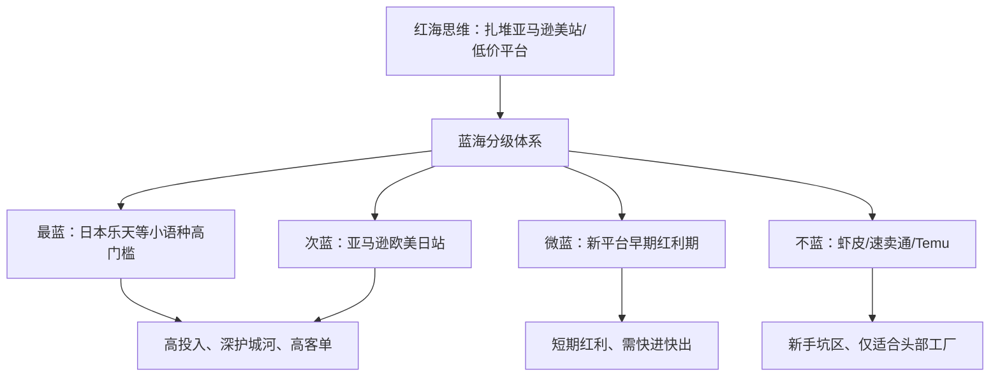
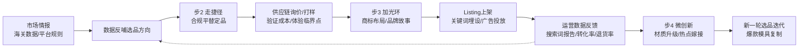
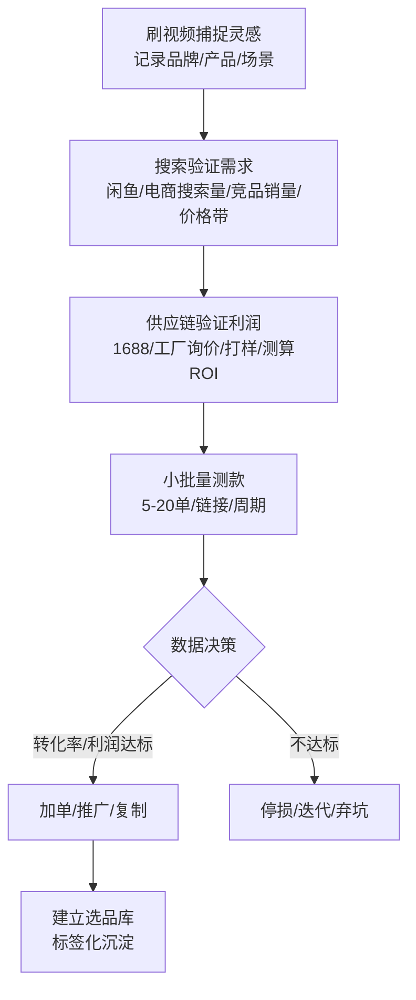

# 第 35 章 跨境电商选品必胜法 —— 从“盲目试错”到“四步打造百万爆款”

## 学习目标

- 掌握跨境电商蓝海市场四级分类体系（最蓝、次蓝、微蓝、不蓝）的判定标准与应用
- 理解蓝海方向与蓝海品类的区别，学会通过海关壁垒、材质升级挖掘自带精准流量的垂直方向
- 熟练运用合规平替模式，以1/5-1/10价格还原90%高端体验，同时解决流量获取与转化难题
- 掌握空壳品牌策略的三种操作形态（抢注复制、跨类目新品、虚构故事），评估其溢价与复购价值及窗口期风险
- 理解微创新=不创新的核心悖论，掌握基于大标品的升级式差异化与热点嫁接式差异化实操路径
- 精通材质套利战术（如二层皮替头层皮、国产膜替Gore-Tex），在供应链成熟度与体验还原度间找到利润临界点
- 能完整执行四步选品范式：找蓝海→走捷径→加光环→微创新，并理解各步骤的资源匹配度与顺序不可逆性
- 建立选品即运营的底层认知，在选品阶段预判引流词、卖点、复购模式，打破选品运营割裂的伪命题
- 确立追求确定性而非彩票的商业思维，识别搜索流量与推荐流量的本质差异，规避低价平台与货找人模式的赌博属性
- 掌握平台判断底层依据：流量结构（来源/成本/稳定性/精准度）+ 转化模型（客单/利润/复购/LTV）
- 学会抖音选品发散思维法，将刷视频转化为挖掘闲鱼/电商蓝海产品的四大信息差来源（代金券、影视场景、特定场景、技能教学）

## 35.1 生活类比

想象跨境电商选品是一场**在迷雾大陆上的淘金之旅**：**蓝海分级体系** = **分级藏宝图**：最蓝=深山老林金矿（需翻译官/向导/通行证，竞争少、矿脉深）；次蓝=已开发矿区主脉（路好走、人虽多但仍有散金）；微蓝=刚发现的新矿点（先到先得、但可能很快枯竭）；不蓝=淘金热闹市（人挤人、泥沙俱下、卖铲子的赚钱、淘金的多亏本）。**蓝海方向** = **测矿仪指针**：不挖泛泛之地（品类），只锁定特定矿脉走向（真皮/科技材料），指针指哪里，哪里就有自带标价的精准买家。**合规平替** = **以次充好但合法合规的‘平替金条’**：外观重量手感90%像真金（体验），成本只有1/10，卖价1/5，买主买去检测通过、用着舒服、还推荐亲友，你赚差价、平台不封号、品牌方无法起诉。**空壳品牌** = **给金条盖上‘瑞士银行’或‘百年钱庄’的印章**：印章是合法注册/巧妙讲故事得来的，金条瞬间身价倍增、老顾客回头率飙升，但印章有效期有限（窗口期），且不能假冒驰名商标（法律红线）。**微创新/材质套利** = **不炼新合金，只换熔铸模具里的‘料包’**：成熟铸模（大标品）不变，把核心原料从‘进口纯金’换成‘高仿合金/优质镀层’（二层皮/国产膜），出厂流程零改动，成品卖相功能差不多，成本暴跌，护城河筑起。**四步范式** = **标准化采矿SOP**：先看图找矿区(找蓝海) → 再用平替工法速出金(走捷径) → 再盖印章卖高价(加光环) → 最后优化料包延长矿区寿命(微创新)，缺一步、乱序、跳步全是找死。**选品即运营** = **矿工同时是鉴定师和销售**：挖矿前就知这金条卖给谁(人群)、靠什么话术卖(卖点)、走什么渠道(流量)，挖出来直接成交，不挖‘美但卖不掉’的废石。**追求确定性** = **经营矿场而非买彩票**：搜索流量=自有矿脉（可控、可积累、可传承）；推荐流量=刮刮乐（靠运气、平台收割、一夜归零）；低价平台=强制低价收购站（卖方只剩泪）。**抖音发散法** = **坐在茶馆听江湖传闻挖金矿**：刷代金券=听谁卖便宜券转手倒卖；刷热剧=蹭热门剧组道具同款；刷场景=盯着理发店/露营地全套装备清单；刷技能=盯着大师用的铲子/材料包——半小时听够十几个发财门路，关键是你要‘有商业敏感度的耳朵’且‘马上去验证、马上去上架’。

## 35.2 概念地图

跨境电商选品必胜法
├── 市场分级体系（夜视仪）
│   ├── 最蓝：小语种发达国+1亿人口+高准入壁垒（日本乐天）
│   ├── 次蓝：发达国+1亿人口+有选品空间（亚马逊欧美日）
│   ├── 微蓝：新平台/新开放入驻（短暂铺货红利）
│   └── 不蓝：所有低价平台（虾皮/速卖通/Temu）——新手慎入
├── 选品四步范式（端到端工程）
│   ├── 步1 找蓝海：筛选市场/平台 → 定位蓝海方向（海关壁垒/平台搬运/材质升级）
│   ├── 步2 走捷径：合规平替/合规山寨 → 对标明星产品/高端材质 → 极致性价比+精准词布局
│   ├── 步3 加光环：空壳品牌（抢注/策划） → 品牌溢价/信任/复购 → 窗口期战术红利
│   └── 步4 微创新：材质套利/升级式/热点嫁接 → 供应链壁垒+认知壁垒 → 延长红利期
├── 核心战术模块
│   ├── 蓝海方向：垂直材质/属性词（真皮/科技材料） → 自带精准搜索流量+价格锚定+供应链可迁移
│   ├── 合规平替：体验90%+价格1/5-1/10 → 流量捷径(蹭词)+转化捷径(鹤立鸡群)+利润护城河(成本极低)
│   ├── 空壳品牌：合法抢注/虚构故事 → 信任转移+溢价杠杆+复购引擎(10%复购/30%净利提升) → 法律/平台/伦理三重边界
│   ├── 微创新/材质套利：不创新=基于大标品做确定性升级 → 材质替代(二层皮/国产膜) → 供应链友好+红利期延长器
│   └── 选品即运营：选品时已定引流词/卖点/模式 → 运营数据反哺选品迭代 → 团队协作机制(选品懂运营/运营参选品)
├── 认知升维与避坑指南
│   ├── 确定性vs彩票：搜索流量可控/可积累 vs 推荐流量赌博/归零
│   ├── 平台判断尺子：流量(来源结构/成本/稳定性/精准度) + 转化(客单/转化率/毛利/复购/LTV) → 听自己的
│   ├── 生命周期匹配：增长期激进/成熟期精细/衰退期撤离 + 资源禀赋匹配 + 组合拳策略
│   └── 低价平台陷阱：平台定价权>卖家 → 极致比价/毛利极薄 → 仅适合头部工厂全托管
└── 选品灵感挖掘（抖音发散法）
    ├── 电子代金券搬运 → 闲鱼信息差套利
    ├── 热门影视/综艺场景 → 道具/同款/衍生品 → 蹭热点自带流量
    ├── 特定场景视频(理发/露营/收纳/宠物) → 场景全链路产品 → 触发B端批发单
    └── 技能教学视频 → 工具/材料/半成品 → 卖铲子/卖课/卖材料包机会

## 35.3 蓝海市场分级体系 —— 给选品装上“夜视仪”

### 为什么需要这个概念？

新手卖家往往扎堆红海平台（如亚马逊美站、低价平台），陷入价格战和内卷。平台与市场的竞争程度直接决定了选品的生存空间和利润天花板。我们需要一套标准化的“地图”，在动手前就能判断哪里有草原、哪里是沼泽。

> "最蓝的（第一类蓝海）：1.小语种发达国家，2.人口大于一个亿，3.有本地入驻门槛的头部平台 ，比如日本乐天... 次蓝的（第二类蓝海）：1.发到国家，2.人口大于一个亿，3.平台仍然有蓝海选品空间， 比如亚马逊欧美日... 微蓝的（第三类蓝海）：1.新上线的平台 ，2.刚开始开放中国卖家入驻的平台 ，即使是低价平台也有一点铺货红利期... 不蓝的：所有低价平台"
> 
> ——《docs/202301-02/20230207_02.md》

### 核心定义

**蓝海市场分级体系**（来源：《docs/202301-02/20230207_02.md》）

根据语言门槛、人口体量、平台准入壁垒将跨境电商市场分为四级：

| 等级 | 定义要素 | 典型代表 | 核心特征 |
|------|----------|----------|----------|
| **最蓝** | 小语种发达国家 + 人口>1亿 + 本地入驻门槛高 | 日本乐天 | 竞争极少、客单价高、用户忠诚度高、需懂小语种/有海外实体 |
| **次蓝** | 发达国家 + 人口>1亿 + 平台有选品空间 | 亚马逊欧美日站 | 竞争中等、流量大、规则透明、英语通用、入驻标准化 |
| **微蓝** | 新上线平台 / 刚开放中国卖家入驻 | TikTok Shop 新站点 | 短期铺货红利、流量扶持重、但需警惕“货找人”流量不确定性 |
| **不蓝** | 所有低价平台 | 虾皮、速卖通、Temu | 极致比价、平台补贴价格战、卖家算来算去多亏损、新手慎入 |

这个分级标准核心看三要素：**语言壁垒（劝退懒人）**、**人口规模（支撑天花板）**、**准入门槛（过滤竞争者）**。蓝海等级越高，意味着前期投入（学语言、搞资质、研平台）越大，但后期护城河越深。

### 关键性质

- **动态性**：今天的“微蓝”可能是明天的“次蓝”或“不蓝”（如TikTok Shop成熟后）。
- **资源匹配**：即使是“最蓝”市场，若你无小语种能力、无海外实体，强行进入反成陷阱。
- **幸存者偏差**：即使在“不蓝”平台，头部大卖依然能通过供应链极致压榨赚钱，但不适合作为新手起盘标准动作。

### 方法演进图

## 35.4 蓝海方向 —— 在宽阔草原上画出“自带流量的圈地”

### 为什么需要这个概念？

选定‘最蓝’市场（如日本乐天）后，面对海量品类依然无从下手。类目太宽（如‘鞋’）竞争大、流量泛；关键词太窄（如‘红色耐克跑鞋42码’）流量太小。我们需要一个中间层级的概念：既能指引大方向，又自带精准搜索流量。

> "蓝海方向不是蓝海品类，真皮或者科技材料，可以做的品类有好几个，比如真皮我们重点选择了鞋类，科技材料我们即做了鞋类也做了服装类。...这一步，我们已经开始解决精准流量了，因为真皮就是一个相对垂直的关键词，对应的就是对产品有一定要求，并有一定消费力的人群。"
> 
> ——《docs/202301-02/20230207_02.md》

### 核心定义

**蓝海方向**（来源：《docs/202301-02/20230207_02.md`）

- ≠ 蓝海品类，而是一个**相对垂直的产品方向/材质属性**，如“真皮”、“科技材料（Gore-Tex类）”。
- 一个蓝海方向下可延展多个品类（真皮方向可做鞋、包、服、配饰）。
- 核心价值：该方向关键词本身代表了一批**有消费力、有品质要求、搜索意图明确**的精准人群。

### 关键性质

- **流量自带性**：用户主动搜索‘真皮靴子’比泛搜‘靴子’转化率高数倍。
- **价格锚定性**：方向词自带价格预期（用户心知真皮靴>$100），为后续‘合规平替’定价留出巨大空间。
- **供应链可迁移性**：同一方向下的供应链能力可复用（搞定真皮鞋供应链，做真皮包成本大降）。

### 典型例子

- **真皮方向**：作者通过筛选日本海关关税发现真皮制品关税极高 → 日本市场价格体系未被破坏 → 形成长久蓝海方向。
- **科技材料方向**：Gore-Tex等高端面料认知度高、搜索量大、但正品贵 → 适合做‘合规平替’。

> "我们通过筛选日本海关关税信息，发现真皮制品在日本的关税非常高...价格体系没有被打破过。比如真皮的靴子，日本人普遍认为应该卖到 100 多美元以上，而中国工厂出厂价格有的仅有几十人民币。这就是一片广阔的蓝海选品大方向。"
> 
> ——《docs/202301-02/20230207_02.md》

### 边界条件

- 方向选择必须结合目标市场文化/消费习惯（日本偏好真皮、欧美偏好功能性面料），不能生搬硬套。
- 方向太宽退化为品类，太窄流量不足，需反复校准颗粒度。
- 方向红利期有限：当平替产品充斥导致用户对‘真皮’关键词信任度下降时，方向价值衰减。

## 35.5 合规平替 —— 用“五分之一价格”撬动“九成体验”的流量与转化双捷径

### 为什么需要这个概念？

传统选品要么靠‘原创设计’（风险高、周期长、新手不会），要么靠‘跟卖/铺货’（无差异、拼价格、必死）。爆款明星单品、高端材质自带巨大搜索流量，但价格高、门槛高。我们需要一条‘合法、合规、低成本、高还原’的路径，同时解决‘从哪来流量’和‘凭什么转化’。

> "合规平替不仅可以平替具体明星产品，也可以平替高端材质，这两种做产品的方向都是自带流量的，因为明星产品和高端材质，是有相应的搜索流量的。具体标准就是要达到原产品的客户体验的 90%，但是价格只有五分之一甚至更少。合规平替是一个适用绝大部分类目的宝藏选品方向，因为它既有流量捷径，也有转化捷径。"
> 
> ——《docs/202301-02/20230207_02.md》

### 核心定义

**合规平替**（来源：《docs/202301-02/20230207_02.md`）

- 以极低成本材料/工艺，还原高端明星产品或高端材质**核心体验的90%**，售价仅为原品**1/5甚至1/10**，且自有品牌、无侵权风险。
- 两大子类：
  1. **明星产品平替**（对标具体爆款，如某品牌网红冲锋衣）
  2. **高端材质平替**（对标材质认知，如‘Gore-Tex平替’、‘真皮平替’）

### 关键性质

- **流量捷径**：直接蹭明星产品/高端材质的成熟搜索词（用户搜‘Gore-Tex’能看到你的‘平替冲锤衣’）。
- **转化捷径**：极致性价比（原价1/10、体验90%）形成‘鹤立鸡群’的比价优势，决策路径极短。
- **利润护城河**：成本结构极低（如二层皮成本仅头层皮1/3），即便售价极低仍保留可观净利（案例：客单净利100-200元人民币）。
- **合规前提**：自有品牌、无Logo侵权、无专利侵规 → 可大胆投放竞品品牌词广告（亚马逊规则允许）。

> "好的平替，可以打原价的十分之一的价格，净利润还有 200 人民币以上。...它虽然不是 goretex 的，但是搜索 goretex 它会展示，它功能相同，它足够便宜。...39.99 的它鹤立鸡群。只要产品合规，有自己的品牌，在亚马逊是可以大胆投放竞品品牌的关键词广告的。"
> 
> ——《docs/202301-02/20230207_02.md》

### 典型例子

| 维度 | Gore-Tex平替冲锋衣 | 真皮鞋平替 |
|------|-------------------|-----------|
| **对标对象** | 头部品牌Gore-Tex 3L冲锤衣 $100-200 | 日本市场头层皮靴 $100+ |
| **材质替代** | 国产同规格防水透气膜（成本1/5） | 头层皮 → 二层皮/优质PU（成本降2/3） |
| **体验还原** | 防水透气功能90%相似 | 手感/外观/耐穿90%相似 |
| **定价策略** | $39.99（原价1/5-1/10） | 日本市场售价$40-60（出厂价仅几十元人民币） |
| **净利润** | >200元/单 | >100元/单 |
| **流量获取** | 搜索‘Gore-Tex’直接展示 | 搜索‘真皮靴子’精准人群 |

### 边界条件

- 体验还原度<90% → 差评率飙升、账号死；>95% → 成本失控、利润薄，需卡在‘临界点’。
- 仅适用于‘标准化程度高、核心体验可量化’的品类（服装、箱包、户外、3C配件），非标品难复制。
- 依赖平台允许‘竞品词投放’与‘功能性描述’的规则红利，规则收紧时需切换为‘材质词/场景词’引流。

## 35.6 空壳品牌 —— 给产品披件“外国名牌”的隐形战袍

### 为什么需要这个概念？

合规平替解决了流量和转化，但缺乏‘品牌溢价’和‘复购粘性’，用户买完即走，LTV低。从零养品牌太慢、太贵、太不确定。利用信息差（国内用户查不到国外商标细节、国外用户查不到国内品牌真假），低成本获取信任。

> "我们还给他们起了个名字，叫做空壳品牌。这也是一种选品模式，虽然只有特定的窗口期。1.抢注国外品牌，并复制它的全系产品（例如 koolaburra 已被 ugg 收购） 2.抢注国外品牌，并跨类目做新类目产品（速卖通常见套利玩法） 3.在国外注册品牌，策划国外的品牌故事和品牌形象（国内电商常见品牌捷径）"
> 
> ——《docs/202301-02/20230207_02.md》

### 核心定义

**空壳品牌**（来源：《docs/202301-02/20230207_02.md`）

非传统意义上的‘山寨/侵权’，而是**合法抢注/策划**的、在目标市场特定类目**未被注册**的知名国外品牌，或**虚构**的具有海外背景故事的品牌。三种操作形态：

1. **抢注国外品牌复制全系**（如Koolaburra被UGG收购后，在其未注册类目抢注）
2. **抢注国外品牌跨类目新品**（速卖通常见套利：服装品牌做箱包）
3. **海外注册新商标+策划故事/形象**（国内电商常用‘洋品牌’捷径）

### 关键性质

- **信任转移**：借用品牌原有声量/知名度，瞬间跨越‘无名小卖’信任门槛。
- **溢价杠杆**：同等产品贴上品牌标，售价可提升20%-50%，用户心理账户归入‘品牌消费’。
- **复购引擎**：品牌化运营可沉淀私域/会员，案例显示成功空壳品牌复购率达10%，净利提升30%。
- **窗口期特征**：平台风控升级、品牌方维权觉醒、消费者认知升级会关闭窗口，属于‘战术性红利’而非‘战略性护城河’。

> "我们做一个日本品牌，在东欧做一个日本品牌，在美国做一个欧洲或者日本品牌，这都是可行的，本土客户查不到，故事随便你说。按我们的经验来看，成功的空壳品牌，可以做到 10%的复购，可以带来的净利提升最多可以达到 30%。上文提到的我们在速卖通能做到客单净利润 100+的产品，就是这个模式出来的。"
> 
> ——《docs/202301-02/20230207_02.md》

### 典型例子

- **日本乐天垄断案例**：作者团队抢注 JEEP、骆驼等品牌在日本未注册类目，长期垄断该品牌鞋服销售。
- **速卖通套利玩法**：抢注国外品牌跨类目（如服装品牌做箱包），利用品牌惯性收割流量。
- **国内电商‘洋品牌’**：在国内注册欧美/日韩风商标，编造‘百年工匠/皇室御用’故事，配合独立站/内容营销收割溢价。

### 边界条件

- **法律红线**：必须确认目标市场目标类目**真正未注册**，且不构成‘恶意抢注’（如驰名商标保护），否则面临侵权赔偿/封号。
- **平台风控**：亚马逊品牌备案越来越严（需商标注册证+授权链），空壳品牌备案通过率下降，需评估ROI。
- **伦理/长期主义**：纯‘讲故事不做品控’的空壳品牌必死；只有‘平替产品力+品牌故事’双驱动，才能在窗口期内积累真资产。

### 多源对照：空壳品牌的三重边界

**共识**：空壳品牌是低成本获取品牌溢价/信任/复购的有效战术手段，核心利用跨国商标信息差与消费者品牌认知惯性。

**分歧**：

| 维度 | 素材观点（作者实战） | 行业通规/风控趋势 | 教学化建议 |
|------|---------------------|------------------|------------|
| **法律风险** | 强调“合法抢注、类目未注册、非驰名商标”可规避 | 多国反恶意抢注法趋严，跨类保护范围扩大 | 必须委托当地IP律所做FTO（自由实施）检索，保留法律意见书 |
| **平台备案** | 早期亚马逊品牌备案宽松，可过 | 亚马逊2023年起强制商标注册证+授权链，通过率骤降 | 视为“战术性红利”，主航道仍需自建品牌资产 |
| **伦理边界** | “本土客户查不到，故事随便说” | 欧美日消费者维权意识觉醒，虚构故事易引发集体诉讼 | 故事可包装，产品力必须硬；建议转型为“自有品牌+真实溯源” |

## 35.7 微创新与材质套利 —— 不搞“颠覆性创新”，只做“确定性升级”

### 为什么需要这个概念？

新手最易犯的错：要么盲目‘原创设计’（烧钱、周期长、死得快），要么无脑‘跟卖铺货’（无差异、卷价格、死得更快）。市场不需要‘从0到1’的颠覆，需要‘从1到1.1’的**确定性、可量化、可供应链落地**的微小改良。

> "微创新其实就是不创新。新手做差异化，不要去考虑原创设计，痛点迭代，这些方向没有专业积淀，很难拿到成功确定性，新手适合基于大标品，去做升级式的和热点嫁接式的差异化产品。我们比较推荐新手去做的微创新差异化套路是：材质套利，是上文材质平替的一个延申。材质升级：帆布升级到真皮 平替套利：头层皮换成二层皮，成本下降三分之二。"
> 
> ——《docs/202301-02/20230207_02.md》

### 核心定义

**微创新 = 不创新**（来源：《docs/202301-02/20230207_02.md`）

不做原创设计、不做痛点迭代，仅基于**大标品（成熟品类、稳定需求、完善供应链）**做两类差异化：

1. **升级式差异化**：材质升级（帆布→真皮、涤纶→科技面料）、功能升级（普通→防水透气）、场景升级（居家→户外）
2. **热点嫁接式差异化**：蹭热点IP/节日/趋势（奥运会、电影同款、新年限定），快速切入、快速收割

**材质套利**：微创新的核心战术——用**低成本材质替代高成本材质**，但保留核心感官/功能体验（二层皮替头层皮、PU替真皮、复合面料替Gore-Tex）。

### 关键性质

- **供应链友好**：大标品供应链极其成熟，只需向工厂提‘换材质/加功能’单一要求，开模/打样/量产风险极低。
- **红利期延长器**：合规平替易被跟卖同质化，微创新（特别是材质套利）构建‘供应链壁垒+认知壁垒’，延长产品生命周期。
- **确定性收益**：不赌‘用户喜不喜欢新设计’，赌‘用户认不认这材质/功能’——后者有搜索数据佐证，前者全凭运气。

### 典型例子

| 微创新类型 | 案例 | 材质/功能变更 | 客单价跃升 | 利润率变化 | 供应链影响 |
|-----------|------|--------------|------------|------------|------------|
| **材质升级** | 帆布鞋→真皮鞋 | 鞋面材质替换 | $15 → $45 | 翻倍 | 无缝衔接，仅换料 |
| **材质套利** | Gore-Tex冲锤衣平替 | 3层压胶→国产同规格膜(成本1/5) | $150 → $39.99 | 净利>200元 | 成熟供应链直供 |
| **功能升级** | 真皮靴→防水透气真皮靴 | 增加防水透气膜复合 | $50 → $80 | +40% | 需验证复合工艺 |
| **热点嫁接** | 生肖限定真皮钱包 | 经典款+IP图案/配色 | $30 → $55 | +30% | 仅增印刷/烫金工序 |

### 边界条件

- **‘微’的度把控**：改动太大（改模具、改结构）→ 变‘大创新’，风险失控；改动太小（换拉链、换包装）→ 无感知，不起量。
- **材质诚实度**：必须在详情页/包装明确标注实际材质（如‘二层牛皮’而非‘真皮’），否则构成欺诈，平台/法律零容忍。
- **大标品边界**：仅适用于‘结构固定、材质可替换、功能可叠加’的品类（鞋服箱包、户外、家居、3C配件），不适用于强结构创新品类（无人机、机器人）。

## 35.8 四步选品范式：找蓝海→走捷径→加光环→微创新

### 为什么需要这个概念？

单点技巧（如只会找蓝海、只会做平替）无法成体系，遇到环境变化即失效。我们需要一个**标准化、可复制、可教学、可迭代**的端到端操作流程，将选品从‘玄学’变成‘工程’。四步分别对应选品四层模型的四个层级，层层递进，缺一不可。

> "本文将选品从底层往上分为四层：1.套利 2.流量&转化 3.模式 4.品&品类。本文通过描述一个四步选品范式，来带大家感受一下这个 4 层结构是如何被满足的。第一步【找蓝海】、第二步【走捷径】、第三步【加光环】、第四步【微创新】"
> 
> ——《docs/202301-02/20230207_02.md》

### 核心定义

**四步选品范式**（来源：《docs/202301-02/20230207_02.md`）

| 步骤 | 核心动作 | 对应四层模型 | 关键产出 |
|------|----------|--------------|----------|
| **步1 找蓝海** | 筛选蓝海市场/平台 → 定位蓝海方向（海关壁垒/平台搬运/材质升级） | 第1层：套利（成本结构） | ‘有流量、有利润、低竞争’的大坐标 |
| **步2 走捷径** | 采用合规平替/合规山寨 → 对标明星产品/高端材质 → 极致性价比+精准词布局 | 第2层：流量&转化（商业模式） | 同时解决流量与转化的最小闭环 |
| **步3 加光环** | 构建空壳品牌（抢注/策划） → 赋予品牌力、溢价能力、复购价值 | 第3层：模式（组织/品牌） | 低成本获取信任背书、复购引擎 |
| **步4 微创新** | 基于大标品做材质套利/升级式/热点嫁接差异化 → 打造护城河 → 延长红利期 | 第4层：品&品类（资产护城河） | 可复制的‘爆款模具’、长红利期 |

### 关键性质

- **顺序不可逆**：无蓝海地基则捷径无处落脚；无捷径验证则光环无产品可加；无光环积累则微创新无品牌承载。
- **最小闭环**：前两步即可跑通‘有流量、有转化、有利润’的最小商业闭环，后两步是‘做大、做久、做强’的放大器。
- **资源匹配度**：新手建议仅跑通前两步（低资源占用、高确定性），有团队/供应链/资金后再叠加后两步。

### 全链路复盘：真皮通勤鞋（日本乐天）

> "第一步【找蓝海】：日本乐天（最蓝）→ 真皮方向（海关高关税护价）→ 锁定‘真皮靴/鞋’... 第二步【走捷径】：头层皮平替→二层皮/优质PU，体验90%价格1/5，$39.99鹤立鸡群，客单净利>100元... 第三步【加光环】：抢注欧美复古品牌商标→策划‘百年匠心’故事→日本本土品牌形象→复购率10%+，净利提升30%... 第四步【微创新】：真皮+防水透气膜（全天候）、真皮+轻量化中底（通勤）、真皮+联名IP（礼品季） → 持续推新、延长生命周期"
> 
> ——《docs/202301-02/20230207_02.md》综合整理

### 数据流图：四步范式的资源流转

### 边界条件

- **非万能公式**：高客单非标品（定制珠宝）、强内容属性（盲盒、文创）、重服务品类（SaaS、教育）需大幅调整。
- **平台规则依赖性**：依赖亚马逊等‘搜索流量为主、允许竞品词投放、品牌备案相对宽松’的规则环境，规则变则打法变。
- **执行力门槛**：四步看似简单，每步细节（关键词挖掘、供应链谈判、商标布局、工艺把控）皆有深坑，需配套SOP与避坑指南。

## 35.9 选品即运营 —— 打破‘七分选品三分运营’的伪命题

### 为什么需要这个概念？

传统认知将‘选品’与‘运营’割裂：选品选完甩给运营，运营背锅‘产品不好卖’。导致选品不考虑推广成本、运营不懂产品卖点、团队互甩锅、资源浪费。我们要重新定义二者关系：选品**就是**运营的前置环节，运营**是**选品假设的验证环节。

> "\"七分选品，三分运营\"？我们认为选品就是运营，运营要解决的问题主要就是两个：流量，转化。好的选品，在确定具体产品的时候，就已经确定引流方法，和转化方法（卖点）。即好的选品模式，必须把流量和转化，解决一个，或者两个都解决。"
> 
> ——《docs/202301-02/20230207_02.md》

### 核心定义

**选品即运营**（来源：《docs/202301-02/20230207_02.md`）

- 好的选品，在确定具体产品时，**就已经确定了引流方法和转化方法（卖点）**。选品模式必须把‘流量’和‘转化’解决一个，或两个都解决。
- 选品四层模型本质：
  - 第1层：套利（成本结构）
  - 第2层：流量&转化（商业模式）
  - 第3层：模式（组织/品牌）
  - 第4层：品&品类（资产护城河）

### 关键性质

- **前置决策**：选品阶段就要想清楚‘靠什么词引流’、‘靠什么卖点转化’、‘靠什么模式复购’，不会做的不选。
- **倒逼供应链**：运营端的流量词/卖点/痛点，反向倒逼供应链端的材质选择/工艺标准/包装设计。
- **验证闭环**：运营实测数据（点击率、转化率、退货率、搜索词报告）→ 反哺下一轮选品方向迭代。

### 典型例子

**反面教材**：选了个‘设计感极强但无搜索词、无痛点、客单$50利润$2’的原创包包 → 运营无词可投、无卖点可讲、广告费烧光仍不出单。

**正面教材**：选定‘真皮平替通勤包’ → 选品时已定：引流词‘真皮包/通勤包/大容量’，卖点‘真皮质感/百搭/价格仅品牌1/5’，模式‘空壳品牌+会员复购’ → 运营上手即跑。

### 团队协作机制表

| 角色 | 选品阶段职责 | 运营阶段职责 | 协作机制 |
|------|-------------|-------------|----------|
| **选品经理** | 拆解蓝海方向、测算平替成本、评估品牌窗口期、设计微创新方案 | 参与广告词挖掘、监控竞品动态、反馈退货原因到供应链 | 每周选品评审会：运营带数据、选品带方案、供应链带报价 |
| **运营专员** | 评审会上挑战“此词能否跑量、此卖点能否转化” | 执行广告投放、优化Listing、运营私域复购 | 每日复盘：搜索词报告→否定词/扩词→反馈选品调整关键词库 |
| **供应链/工厂** | 提供材质样品、报价BOM、评估工艺可行性 | 按退货原因改良工艺、配合微创新打样 | 季度联合开发会：共同确定下季度“材质套利/升级式”主推方向 |

### 边界条件

- 并非否定运营技巧价值：同款产品，强运营比弱运营业绩高3-5倍；但运营无法拯救‘选品逻辑不通’的产品。
- 早期‘选品即运营’偏重流量/转化验证；后期品牌化阶段，运营重心转向用户运营/品牌资产沉淀，选品重心转向产品线规划/护城河建设。

## 35.10 追求确定性而非彩票 —— 拒绝‘货找人’的赌博逻辑

### 为什么需要这个概念？

短视频/直播‘货找人’流量（TikTok、抖音、快手）看似爆发快、门槛低，实则‘大力出奇迹’、极度依赖运气、不可复制、不可积累。新手极易沉迷‘单日爆单’的多巴胺，忽视‘长期稳定盈利’的商业本质。

> "成功老板都是抓确定性，只有韭菜财迷爱抓彩票，我接触的大卖，没有一个主战场在 tk。大力出奇迹，每天上 100 个视频，我要 all in~~你的时间不值钱?你 all in 一个月好好打工一万块赚不到?你这样做 tk 跟赌有啥区别? tk 又是个跟 fb 一样\"货找人\"的流量性质，算了，洗洗睡吧"
> 
> ——《docs/202301-02/20230207_02.md》

### 核心定义

| 维度 | **确定性生意模式** | **彩票模式** |
|------|-------------------|--------------|
| **流量来源** | 可追溯（搜索词/广告位） | 算法黑箱推荐（货找人） |
| **转化路径** | 可复现（标准话术/详情页/SOP） | 靠爆款视频/直播间人气 |
| **生命周期** | 长（月-年级） | 极短（天-周级） |
| **资产沉淀** | 品牌/客户/供应链/团队 | 无品牌/无复购/无壁垒 |
| **核心指标** | 看‘动作’（投放/优化/迭代） | 看‘运气’（爆不爆/限不限流） |
| **抗风险** | 可跨平台迁移 | 强绑单一平台算法 |

### 关键性质

- **可控变量 vs 不可控变量**：确定性模式最大化可控变量（选品、供应链、广告、客服），最小化不可控变量；彩票模式反之。
- **时间复利**：确定性模式随时间积累优势（品牌权重↑、关键词权重↑、客户资产↑、团队能力↑）；彩票模式随时间资产归零（账号权重清零、粉丝流失、供应链断联）。
- **主观确定性陷阱**：很多卖家把‘主观臆断’当‘确定性’（如‘我觉得这产品一定火’），真正的确定性必须有**数据佐证**（搜索量、竞品销量、广告测试ROI）。

### 边界条件

- **‘确定性’非‘死板’**：在确定性主航道上，可分配10-20%资源做‘小赌注’测试新平台/新玩法（如TikTok Shop早期红利），但核心资源不倾斜。
- **阶段差异**：0-1阶段为生存，适度‘赌’一下极低成本高爆发机会可接受；1-N阶段为发展，必须建立确定性模型，否则规模化即死。

## 35.11 平台判断底层依据：流量与转化 —— 听自己的，不听镰刀的

### 为什么需要这个概念？

圈子充斥‘XX平台好做’/‘YY平台死了’的片面论调，新手听风就是雨，频繁跳槽平台、折腾死。平台方/服务商/培训机构利益相关，其‘推荐’往往隐藏利益输送。我们需要一把‘尺子’，让卖家自己量平台、量机会、量风险，实现决策自主权。

> "听谁的?听自己的!终究要自己懂底层判断依据:1.流量 2.转化。所以说好做，说不好做都对，听谁的?听自己的!自己要懂底层判断依据:1.流量 2.转化。要让其知其所以然。讲不出所以然的，大概率镰刀。"
> 
> ——《docs/202301-02/20230207_02.md》

### 核心定义

**平台判断底层依据**（来源：《docs/202301-02/20230207_02.md`）

判断平台/打法好坏的**唯一底层依据：流量（从哪来）+ 转化（凭什么成交）**。任何不讲清楚‘流量来源构成’、‘流量精准度/成本/稳定性’、‘转化路径/客单/利润/复购’的‘推荐’，大概率是镰刀。

### 流量维度拆解表

| 子维度 | 关键追问 | 优质信号 | 警惕信号 |
|--------|----------|----------|----------|
| **来源结构** | 搜索/推荐/广告/私域占比？新店前30天自然流量占比？ | 搜索流量>50%、自然流量占比高 | 推荐流量>80%、依赖付费/刷单 |
| **获取成本** | CPC/CPM均值？新品测款周期/成本？ | CPC可接受、测款周期<2周、单品测款成本可控 | CPC极高、测款周期长、烧钱无上限 |
| **稳定性** | 旺淡季波动？算法大版本更新频率？近半年封号/限流率？ | 波动<30%、算法稳定、合规账号存活率>95% | 波动>100%、频繁大版本、封号率高 |
| **精准度** | 搜索意图强弱？长尾词转化率？ | 长尾词转化率>10%、用户搜索意图明确 | 泛词流量大但转化<1%、意图模糊 |

### 转化维度拆解表

| 指标 | 定义 | 优质基准（参考） | 判断逻辑 |
|------|------|------------------|----------|
| **客单价 (AOV)** | 平均订单金额 | >$30（蓝海选品要求） | 太低无法覆盖广告成本 |
| **转化率 (CVR)** | 访客下单比例 | 搜索流量>10%、推荐流量>3% | 太低说明流量不精准或产品力弱 |
| **毛利率** | (收入-直接成本)/收入 | >30%（扣广告后净利>15%） | 太低无抗风险能力 |
| **复购率** | 365天内再次购买比例 | >15%（品牌化目标>30%） | 无复购=一次性生意，LTV低 |
| **LTV/CAC** | 生命周期价值/获客成本 | >3（健康），>5（优秀） | <1 即亏损模型 |

### 典型平台画像对比

| 平台 | 生命周期 | 流量结构 | 转化模型 | 适合人群 | 进入策略 |
|------|----------|----------|----------|----------|----------|
| **亚马逊** | 成熟期 | 搜索>60%、CPC高精准、规则透明严 | 高客单、高毛利、可品牌化、复购可期 | 有供应链、懂广告、长期主义者 | **精细化运营+品牌沉淀** |
| **TikTok Shop** | 增长期 | 推荐>90%、算法黑箱、ROI极不稳、封号高 | 低客单、冲动消费、复购低、依赖达人/直播 | 有内容/直播强团队、资源豪赌红利 | **激进测品（副业占比<20%）** |
| **Temu/拼多多跨境** | 低价收割期 | 平台定价权>卖家、极致比价、全托管 | 极低客单、极薄毛利、零品牌、零复购 | 头部工厂、极致成本控制、全托管 | **仅限头部工厂全托管，新手禁入** |

### 决策口诀

**听谁的？听自己的！** 终究要自己懂底层判断依据：1.流量 2.转化。要让其知其所以然。讲不出所以然的，大概率镰刀。

### 边界条件

- **动态监测**：流量/转化结构随政策、环境、竞争动态变化，需建立‘月度平台健康度体检机制’而非一次性判断。
- **资源禀赋匹配**：同一平台，对‘有内容团队’是蓝海，对‘有供应链无内容’是修罗场；判断必须带入‘我是谁、我有什么’。
- **组合拳策略**：成熟卖家通常‘主平台吃确定性（亚马逊/独立站SEO）+ 副平台蹭红利（TikTok/视频号）’，单一平台依赖即风险。

## 35.12 抖音选品发散思维法 —— 把刷视频变成“挖金矿”

### 为什么需要这个概念？

闲鱼/闲置/二手/信息差选品最大痛点：‘脑子里没有货’，不知道选什么、从哪找灵感。传统选品工具（5118、百度指数、插件）只能挖掘‘已知需求’，无法发现‘隐性需求/场景需求/新趋势’。短视频内容=真实生活场景的高密度投射，是零成本、高直观、强时效的选品灵感库。

> "视频的好处在于我们所看到的场景和产品非常的直观，如果你细心留意，半个小时挖出十几个蓝海产品完全是没有问题的。"
> 
> ——《docs/202301-02/20230207_04.md》

### 核心定义

**抖音选品发散思维法**（来源：《docs/202301-02/20230207_04.md`）

利用抖音/短视频平台的**算法推荐机制**，通过**有意识的刷视频**，从四个维度发散选品思维：

1. **电子代金券搬运**：刷到团购券/代金券视频 → 闲鱼搜同款 → 发现价差/信息差 → 上架倒卖
2. **热门影视剧/综艺场景选品**：刷热剧高光片段 → 截取场景道具/同款/衍生品 → 闲鱼/电商搜索验证需求 → 上架测款
3. **特定场景视频选品（特别好用）**：刷垂直场景视频（理发店、露营、整理收纳、宠物、母婴） → 场景内所有显性/隐性产品 → 批量挖掘高客单/批发潜力品
4. **技能类视频找灵感**：刷手工/改造/技能教学视频 → 关注工具/材料/辅料/半成品 → 发现‘卖铲子/卖课/卖材料包’的B端/C端机会

### 关键性质

- **‘场景即需求’**：视频展示的不是孤立产品，是‘人+场景+产品+动作+结果’的完整使用语境，天然包含痛点、卖点、搭配点。
- **‘热点即流量’**：影视/节日/大事件自带百万级曝光，蹭热点选品自带搜索流量爆发期，无需冷启动。
- **‘信息差即利润’**：视频创作者/平台用户大多非卖家，不懂变现；卖家用‘商业视角’二次解码，即获取认知套利收益。

### 典型例子

| 维度 | 视频线索 | 验证动作 | 发现机会 |
|------|----------|----------|----------|
| **代金券搬运** | 粒上皇代金券团购视频 | 闲鱼搜‘粒上皇代金券’ | 商家加价转卖，妥妥信息差套利 |
| **热门影视** | 《去有风的地方》自助餐厅场景 | 闲鱼搜‘保温餐炉/自助餐炉’ | 需求旺、可触发批发单 |
| **特定场景** | 理发店广告视频（洗头床、置物架、剪发工具、护发素、围布） | 1688/闲鱼搜各单品 | 触发B端批发单的高客单产品 |
| **技能教学** | 手工皮具制作视频（切皮刀、打磨机、五金配件、皮料） | 搜索工具/材料关键词 | ‘卖铲子/卖材料包/卖教程’机会 |

### 验证闭环 SOP（不可省略）

### 边界条件

- **前提**：具备‘商业敏感度’（能一眼识别‘可卖/可批发/有利润’）+ ‘执行力’（立马搜、立马测、立马上），光刷不动手=娱乐。
- **版权/合规红线**：影视同款/周边涉及版权风险，需区分‘通用款/风格款’（安全）与‘官方授权/Logo款’（高危），新手碰前者不碰后者。
- **平台迁移性**：此法适用于‘内容平台（抖音/小红书/B站/视频号）→ 交易平台（闲鱼/拼多多/亚马逊/独立站）’的跨平台套利，单平台内闭环效果弱。

## 35.13 设计中的取舍

### 为什么不用“原创设计/痛点迭代”作为新手主攻方向？

原创设计需要专业工业设计能力、用户调研能力、开模试产资金、漫长周期，且成功率极低（素材原话：“新手做差异化，不要去考虑原创设计，痛点迭代，这些方向没有专业积淀，很难拿到成功确定性”）。新手的核心优势是供应链灵活、成本敏感、执行力强，劣势是设计能力弱、品牌运营经验少。微创新（材质套利/升级式/热点嫁接）精准匹配新手禀赋：在成熟大标品框架内单点改良，供应链零门槛、风险可控、收益确定。

### 这种设计的 trade-off 是什么？

| 收益 | 代价/风险 |
|------|-----------|
| **极低试错成本**：无开模费、打样周期短、MOQ低 | **易被跟卖**：无专利壁垒，同行跟进快，需持续微创新延长红利期 |
| **确定性高**：有搜索数据佐证需求、有成熟供应链托底 | **平台规则依赖**：依赖允许竞品词投放、功能性描述、品牌备案宽松的规则窗口 |
| **快速变现**：前两步即可跑通最小闭环，现金流健康 | **品牌资产弱**：空壳品牌属战术红利，长期仍需转型自有品牌+真实溯源 |
| **可规模化复制**：“爆款模具”可横向延展品类、纵向迭代材质 | **法律/伦理边界**：空壳品牌商标抢注、材质描述诚实度需严守红线 |

## 35.14 动手练习

### 练习 1：蓝海市场分级实战判断

假设你要销售客单价$80的户外防水背包，请判断以下市场/平台组合属于哪一级蓝海，并说明核心依据：
1. 日本乐天市场（需日语客服、日本公司实体、严格审核）
2. 亚马逊德国站（德语Listing、VAT合规、FBA入仓）
3. TikTok Shop 美区跨境店（新开放、流量扶持、无本地实体要求）
4. Temu 全托管模式（平台定价、极致比价、仅供货）

回答问题：
- 若你只有英语能力、无海外实体、启动资金5万，应优先选择哪一级？为什么？
- ‘不蓝’平台头部大卖为何仍能盈利？新手为何不可复制？

### 练习 2：合规平替产品设计推演

目标市场：美国亚马逊。对标产品：某头部品牌Gore-Tex 3L冲锋衣，售价$199，月搜索量5万。
请设计一款合规平替产品方案，包含：
1. 核心材质替代方案（需说明成本占比变化、功能还原度预估）
2. 定价策略（参考‘原价1/5-1/10’与‘净利>200元’标准）
3. 关键词布局方案（如何蹭Gore-Tex流量且合规）
4. 详情页卖点话术（体现‘90%体验、1/5价格’且规避侵权）

回答问题：
- 若体验还原度仅80%，差评率预计会如何变化？对账号健康度有何影响？
- 亚马逊若禁止竞品词投放，你的流量获取策略如何调整？

### 练习 3：四步选品范式完整复盘

以‘日本市场真皮通勤鞋’为例，按四步范式撰写完整选品执行计划：
步骤1 找蓝海：说明为何选日本乐天（最蓝依据）、为何选真皮方向（海关关税数据如何筛选、价格锚定逻辑）
步骤2 走捷径：设定合规平替方案（头层皮→二层皮/优质PU，成本降幅、体验还原度、定价$39.99的鹤立鸡群逻辑）
步骤3 加光环：空壳品牌操作路径（抢注何种品牌？策划何种故事？日本本土化包装/客服要求？预估复购率提升？）
步骤4 微创新：规划前3款差异化新品（材质套利方向、热点嫁接方向、升级式方向），并说明如何延长红利期

回答问题：
- 若仅有资源跑通前两步，后续面临哪三大风险？如何用最低成本验证是否值得投入步骤3/4？
- 该范式若迁移至‘独立站+Google SEO’模式，哪些环节需根本性调整？

### 练习 4：抖音发散选品实战演练

打开抖音，连续刷20分钟（建议设定计时器），有意识地从以下四个维度捕捉产品灵感，并记录：
1. 电子代金券/团购券视频：记录品牌名、券面价值、闲鱼/转转搜索结果（有无商家倒卖、价差多少）
2. 热门影视/综艺高光片段：截图1个典型场景，列出场景中可见的5个实物产品，去1688/闲鱼验证批发价/零售价
3. 特定场景垂直视频（搜索：理发店日常/露营好物/整理收纳/宠物用品/母婴神器）：选1个场景，列出视频中出现的所有产品，标注哪些可能触发‘批发单’或‘高客单’
4. 技能教学视频（搜索：手工皮具/木工/陶艺/改造翻新/电子DIY）：记录视频中使用的3种核心工具/材料/半成品，评估‘卖铲子/卖材料包/卖教程’的可行性

回答问题：
- 你记录的20个灵感中，有多少通过‘搜索验证需求→供应链验证利润→小批量测款’闭环？
- 哪个维度挖掘出的产品‘场景感’最强、最容易写出转化率高的详情页？为什么？
- 如何建立‘每日15分钟刷视频→产出3个验证过的选品方向’的标准化SOP？

### 练习 5：平台判断底层依据应用题

某服务商向你推荐‘2024年必入局的XX新平台’，并展示了几个‘单日爆单$5000’的后台截图。
请按‘流量+转化’底层依据，设计一份5个核心提问清单，强迫服务商讲清‘所以然’，判断是机会还是镰刀：
1. 流量来源结构：搜索/推荐/广告/私域各占比？新店前30天自然流量占比？
2. 流量获取成本：CPC/CPM均值？新品测款周期多少天？单品测款成本几何？
3. 流量稳定性：旺季/淡季波动幅度？算法大版本更新频率？近半年封号/限流案例率？
4. 转化模型：类目均客单价？均转化率？均毛利率？复购周期与比例？LTV/CAC比？
5. 资源匹配度：该平台对‘有供应链无内容团队’的友好度？是否强制要求直播/短视频产出？

回答问题：
- 若服务商只能回答‘流量大、好出单、很多新手赚钱了’等模糊话术，你的决策是什么？
- 结合你自身资源（语言/供应链/团队/资金），该平台处于生命周期哪阶段？你的进入策略是激进/精细/观望/放弃？

## 35.15 本章小结

这一章中我们学习了跨境电商选品的“必胜法”体系。首先，我们建立了**蓝海市场四级分类体系**（最蓝/次蓝/微蓝/不蓝），像给选品装上夜视仪，在动手前就能判断哪里有草原、哪里是沼泽；其次，我们提出了**蓝海方向**这一中间层级概念，在宽阔草原上画出自带精准流量的圈地（真皮/科技材料），实现流量自带、价格锚定、供应链可迁移；接着，我们深度拆解了**合规平替**这一核心战术——用五分之一价格还原九成体验，同时拿下流量捷径与转化捷径，构建利润护城河；然后，我们剖析了**空壳品牌**的三种操作形态与三重边界（法律/平台/伦理），揭示其作为战术性窗口期红利的本质；随后，我们确立了**微创新=不创新**的悖论智慧，掌握材质套利等确定性升级路径，在供应链成熟度与体验还原度间找到利润临界点；接着，我们串联了**四步选品范式**（找蓝海→走捷径→加光环→微创新），形成端到端可复制的工程化SOP，明确顺序不可逆与最小闭环逻辑；随后，我们打破了‘七分选品三分运营’的伪命题，确立**选品即运营**的前置决策与验证闭环机制；接着，我们建立了**追求确定性而非彩票**的商业思维，识别搜索流量与推荐流量的本质差异，规避低价平台赌博属性；然后，我们给出了**平台判断底层依据**——流量结构+转化模型的量化尺子，实现决策自主权；最后，我们传授了**抖音选品发散思维法**，将刷视频转化为挖掘蓝海产品的四大信息差来源，并配套验证闭环SOP。

本章我们一起学习了以下概念：

| 概念 | 解释 |
|------|------|
| 蓝海市场四级分类 | 按语言/人口/准入壁垒分最蓝/次蓝/微蓝/不蓝，新手有选蓝海意识即超越90%同行 |
| 蓝海方向 | 垂直材质/属性词（真皮/科技材料），自带精准搜索流量、价格锚定、供应链可迁移，连接宽泛蓝海与具体选品 |
| 合规平替 | 体验还原90%、价格仅1/5-1/10，同时解决流量(蹭词)与转化(性价比)难题，净利可达200元/单 |
| 空壳品牌 | 合法抢注/策划海外品牌故事，低成本获信任/溢价/复购(10%复购/30%净利提升)，属战术性窗口期红利 |
| 微创新=不创新 | 新手不搞原创设计/痛点迭代，仅基于大标品做升级式(材质/功能/场景)与热点嫁接式差异化 |
| 材质套利 | 核心微创新战术：低成本材质替代高成本材质(二层皮替头层皮/国产膜替Gore-Tex)，供应链友好、红利期延长器 |
| 四步选品范式 | 找蓝海→走捷径→加光环→微创新，顺序不可逆，前两步跑通最小商业闭环，后两步做大做久做强 |
| 选品即运营 | 选品阶段即确定引流词/卖点/复购模式，运营数据反哺选品，打破七三分割裂伪命题 |
| 确定性vs彩票 | 搜索流量可控/可积累/可迁移=确定性生意；推荐流量赌算法/强绑平台/资产归零=彩票模式 |
| 平台判断底层依据 | 唯听自己的：流量(来源结构/成本/稳定性/精准度)+转化(客单/转化率/毛利/复购/LTV)，讲不出所以然的大概率镰刀 |
| 抖音选品发散法 | 代金券搬运/影视场景/特定场景/技能教学四维度，半小时挖十几个蓝海，核心是场景即需求+热点即流量+信息差即利润 |

下一章中，我们将学习如何将这些选品方法论落地为具体的**供应链谈判与质量把控体系**，从“选对品”进阶到“造好品、控成本、保交期”，构建跨境电商的硬核后端护城河。
