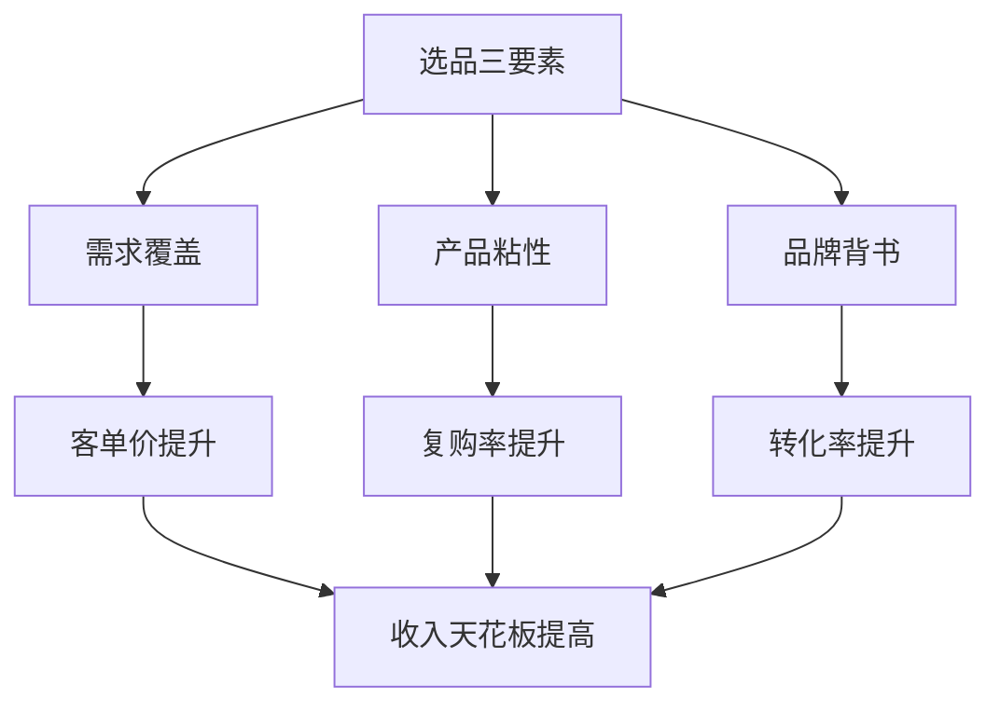

# 第 26 章 创业的起点与商业模式 —— 从“痛点”到“生意”

## 学习目标

-   理解痛点作为创业第一性原理的内涵，能识别真痛点与伪痛点的区别
-   掌握信息差作为商业机会的运作机制，能用信息差视角分析一个行业的盈利模式
-   理解选品决定论的核心主张，能运用选品三要素评估一款产品的商业潜力
-   掌握最小MVP闭环的构建方法，能设计低成本验证商业模型的实验
-   理解付费方即盈利支点的设计逻辑，能识别商业模式中的付费主体与痛点来源
-   掌握全域获客的渠道矩阵方法，能针对不同平台制定差异化的获客策略
-   理解私域资产的高价值属性，能区分低价值消耗与高价值深耕的运营方式
-   掌握标准化复制的核心步骤，能设计一套可复制的SOP体系赋能扩张

## 26.1 生活类比

想象创业像**看病就医**：你需要先找到身体真实疼痛的部位，才能对症下药。夕子的创业始于自身的荨麻疹和敏感肌，胖龟找房源于对高额中介费的不满，老杨的睡播项目则捕捉到现代人普遍存在失眠与压力的问题——这三个案例都有一个共同点：创业者本人就是那个“病人”，他们感受过痛点，知道哪里疼，才决定“贴哪里”。痛点是你身体的告警信号，信息差则是你只知道挂号排队、但名医知道哪个窗口最快的差距。选品如同医生开的药——好药对症自然见效，烂药再好的诊所也白搭。而MVP闭环就像先开一剂小药方试三天，有效再开大疗程，而不是直接住院手术。

想象商业模式的付费设计像**钓鱼**：付费方是鱼塘里最饿的那条鱼——二房东空置一天就亏一天房租，所以他有强烈的动力为“快速出房”付费。全域获客则是在多个鱼塘同时撒网，抖音、小红书、58，而不是守着一个池塘等鱼上钩。私域运营是钓上来好鱼养在自家鱼缸里，喂精饲料，让信任和复购持续增值，而不是炖了吃一顿就没了。标准化复制则把养鱼秘诀写成手册，教多个渔场同时养，而不是自己一个人守着唯一鱼塘。

## 26.2 概念地图

```
创业起点
├── 痛点识别
│   ├── 真实性（自身体验）        —— E1WG, PglA, FCii
│   ├── 付费意愿（痛点深度）       —— E1WG, PglA
│   └── 可外延（同类人群）         —— E1WG, PglA
├── 信息差洞察
│   ├── 不对称性（中介费伪概念）   —— PglA
│   ├── 可定价（省时省力付费）     —— PglA
│   └── 可抹平（窗口期有限）       —— PglA
├── 选品决定论
│   ├── 需求覆盖（涵盖面齐全）     —— E1WG
│   ├── 产品粘性（口服不换牌）     —— E1WG
│   └── 品牌背书（医院合作）       —— E1WG
└── 最小MVP闭环
    ├── 产品（最小可行）           —— E1WG, FCii
    ├── 流量（公域获取）           —— E1WG, FCii
    ├── 销售（转化成交）           —— E1WG, FCii
    └── 交付（完成闭环）           —— E1WG, FCii

商业模式设计
├── 盈利支点
│   ├── 付费方痛点强度（二房东）   —— PglA
│   ├── 价值对价（明确大于费用）   —— PglA
│   └── 稳定可续（持续支付能力）   —— PglA
├── 全域获客
│   ├── 平台适配（定制内容钩子）   —— PglA, E1WG
│   ├── 主动出击（私信/评论）      —— PglA
│   └── 矩阵协同（多平台导流）     —— PglA, E1WG
├── 私域金饭碗
│   ├── 专业匹配（技术型高客单）   —— E1WG
│   ├── 高客单（信任支撑溢价）     —— E1WG
│   └── 持续复购（信任复利）       —— E1WG
└── 标准化复制
    ├── SOP化（脚本/剪辑/话术）    —— E1WG, PglA
    ├── 赋能输出（拿来即用）       —— E1WG, PglA
    └── 单店前置（健康模型再扩）   —— E1WG, PglA

风险防控
├── 避坑指南
│   ├── 外包选型（实地考察）       —— PglA
│   ├── 招聘偏好（白纸可塑）       —— PglA
│   └── 投放策略（本地抖音优先）   —— PglA
└── 止损意识
    ├── 成本上限（明确试错预算）   —— PglA, E1WG
    └── 及时退出（不恋战）         —— PglA
```

## 26.3 痛点即创业起点 —— 从“哪里疼”到“贴哪里”

> "想着离职后先要搞定社保问题，找了代办公司注册公司，方便自己交社保，这公司不知不觉也有4个年头了。"
> 
> ——《线上美业复盘：从荨麻疹到年利润百万》[E1WG]

创业的第一问题不是“我有什么”，而是“用户哪里疼”。多数人习惯从自身优势出发，结果做出了无人需要的产品。但真实的痛点自带付费意愿，是商业逻辑成立的原始起点。

我们来看一个反直觉的事实：本章三个素材案例的创始人，都不是从“我擅长什么”开始的，而是从“我被什么困扰”开始的。夕子被荨麻疹和敏感肌折磨，胖龟的创始人被高额中介费困扰，老杨捕捉到现代人失眠压力大的普遍焦虑——他们都是先感受到疼，才决定找药。

**痛点定义**（来源：《线上美业复盘：从荨麻疹到年利润百万》）

> 痛点是用户真实存在、愿意花钱解决的强烈困扰，商业项目的切入点应锚定在最痛的那一点上。

这个定义包含三个关键判定标准，缺一不可：

1. **真实性**：痛点必须来自本人或身边人的亲身经历，而非凭空臆想。夕子的美业项目源于自己三甲医院皮肤科的求医经历，这种真实性让她能准确理解同类用户的痛苦。

2. **付费意愿**：痛点越深，用户越愿意掏钱。荨麻疹患者愿意为一张诊断搭配方案付费，二房东愿意为快速出房付费——痛到极致，付费就成了自然反应。

3. **可外延**：自身的痛点必须能推及同类人群的共性需求。夕子一个人的荨麻疹可能只是个案，但敏感肌、问题性肌肤是千万人的共性困扰，这就完成了从“个人痛点”到“商业机会”的跃迁。

胖龟找房的案例提供了另一个视角，让我们把痛点翻译成商业语言：

> "我们不收中介费，是因为中介费本身就是个伪概念！为什么说是伪概念，因为是智商税，中介费为什么要收？就是因为买房及租房者不知道售房及出租转让业主的联系电话！"
> 
> ——《胖龟找房：0中介费房产平台创业复盘》[PglA]

胖龟找房把“高额中介费”这个广泛痛点解构为“信息不对等”，进而推出“0中介费”的个人房屋分享平台。老杨则捕捉到“睡不着”这个具有全球普遍性的痛点，将Twitch上已成熟的“睡播”玩法本地化到TikTok：

> "一句话：恶搞之让你睡不着"
> 
> ——《TikTok娱乐直播项目实战》[FCii]

这里我们注意到一个重要的边界条件：并非所有痛点都是真痛点。**高频、广泛、可持续**三个特征缺一不可。一个一年只发生一次、影响范围极小、且用户已经习惯的“痛点”，通常只是抱怨，而非商业机会。同时，痛点必须能翻译成可付费的服务或产品，否则就停留在抱怨层面。

## 26.4 信息差即商业机会 —— 你凭“知道别人不知道的”赚钱

> "生意的本质就是信息差，在互联网里也存在大量的信息差生意。以这个信息差为市场的切入点我们创办了胖龟找房的 1.0——没有中介费的个人房屋分享平台。"
> 
> ——《胖龟找房：0中介费房产平台创业复盘》[PglA]

痛点存在但用户不知道如何解决，就形成了信息差。中介费、搬运费、代办的实质都是信息差的定价。当我们理解了“生意的本质是信息差”，就具备了透视一个行业盈利模式的底层视角。

**信息差定义**（来源：《胖龟找房：0中介费房产平台创业复盘》）

> 信息差指一方掌握而另一方不掌握的关键信息（如房东电话、低价货源、平台红利），凭借这种不对等可以合法获取利益。

胖龟找房把“房东联系电话”这一关键信息透明化后，中介费这一“智商税”就失去了存在基础。作者的思考路径值得拆解：

> "如果买房者或者租房者知道房东电话！那么他们还会给中介公司掏中介费吗？nonononon，绝对不会！这叫什么？是不是信息不对等差造成的信息差？"
> 
> ——《胖龟找房：0中介费房产平台创业复盘》[PglA]

从这个案例中，我们可以提炼出信息差的三个关键性质：

| 性质 | 含义 | 示例 |
|------|------|------|
| 不对称性 | 买卖双方掌握的信息不对等 | 中介知道房东电话，买房者不知道 |
| 可定价 | 用户愿为省时、省力的关键信息付费 | 中介费、代办费、搬运费 |
| 可抹平 | 平台或竞品一旦跟进，信息差就消失 | 政府上线0中介费平台后窗口关闭 |

信息差的窗口期通常有限。胖龟找房自己也承认，2021年杭州上线了“0中介费”的政府平台机构，说明他们比政府“提前了一步”[PglA]。这个例子完美展现了信息差的“时间属性”：必须在被人抹平前完成收割，或建立新的壁垒。

老杨的TikTok睡播项目，从另一个角度诠释了信息差的运作——平台阶段性的信息差：

> "回观抖音的发展路径，第一阶段就是高流量低商业化阶段，这时候要做的并不一定要跟平台的指向，而是要看清平台的现状。"
> 
> ——《TikTok娱乐直播项目实战》[FCii]

老杨看懂了TikTok正处于类似抖音早期的“高流量低商业化”阶段，此时娱乐直播是普通人最轻松的赚钱窗口。这种对平台阶段演进的判断，本质上是认知信息差——大多数人跟着平台的指向走（做电商），而少数人看清现状（做娱乐直播）赚到了第一桶金。

信息差的边界条件虽然清晰，但我们也必须警惕：信息差必须合法合规，不能涉及隐私窃取或欺诈。同时，单靠信息差建立的生意往往缺乏壁垒，必须在窗口期内建立品牌、用户或供应链的护城河。

## 26.5 选品定生死 —— 好产品自带流量和转化力

> "所以选品很关键，产品好省了一半的心，后续回购率也高。"
> 
> ——《线上美业复盘：从荨麻疹到年利润百万》[E1WG]

产品不好，再强的运营也是徒劳。好产品自带转化力和复购力，能省掉一半销售精力。很多创业者重营销轻选品，导致后端交付无力、口碑崩塌——选品本质上是解决“卖什么才能持续赚钱”的问题。

**选品决定论定义**（来源：《线上美业复盘：从荨麻疹到年利润百万》）

> 选品决定论是强调产品本身的质量、需求匹配度和复购潜力优先于销售技巧的商业方法论，即“产品好省一半心”。

夕子总结了美业选品的三个关键维度，这些标准具有跨行业参考价值：

1. **需求覆盖**：好产品应深挖用户需求并涵盖面齐全。夕子的选品逻辑是“不仅祛痘、还有美白、抗衰等等”——单一功效的产品只能解决单一问题，而覆盖多维度需求的产品能提升客单价和复购率[E1WG]。

2. **粘性**：口服类产品一旦被接受，用户不轻易换品牌。“一个人一单接受了某个品牌的口服，不会轻易更换牌子的”——这种产品粘性制造了天然的复购[E1WG]。

3. **背书**：与医院合作能强化品牌专业可信度。“尽量能跟医院合作的产品，品牌背书这块强”——权威背书降低了用户的决策成本[E1WG]。



老杨的睡播项目从侧面印证了选品决定论：他开发的是“娱乐直播”这个“产品”，而它天然自带流量和打赏转化力——简陋的直播间（“刚开始的直播间就这么简陋”）并不妨碍在线峰值飙到上万[FCii]。当“产品”本身顺应人性的娱乐需求时，流量和转化就变得水到渠成。

必须强调选品决定论的边界条件：它不能替代运营，在竞争充分的领域仍需流量打法配合；同时，小众高客单产品虽好但市场规模有限，需要在选品时同步评估可复制性和天花板。

## 26.6 最小MVP闭环 —— 先造独木舟，再想航母

> "1.做生意从自己身边资源入手，从挣1块钱开始，选一个天花板比较高的，持续3——5年。 2.跑通自己的生意环节，最小mvp（产品——流量—销售—交付）"
> 
> ——《线上美业复盘：从荨麻疹到年利润百万》[E1WG]

创业最大的风险是投入巨大成本后发现需求不存在。很多人一开始就想建大平台、雇大团队，结果死在半路上。MVP能帮助创业者用最小成本验证“产品—流量—销售—交付”是否成立。

**最小MVP闭环定义**（来源：《线上美业复盘：从荨麻疹到年利润百万》）

> 最小可行产品（MVP）闭环是通过最低成本、最快速度跑通“产品-流量-销售-交付”整个商业链路，验证模型成立后再复制放大的方法。

夕子的路径是教科书式的MVP实践：

1. **从挣1块钱开始**：她最初代购医美面膜，一单只赚2元，但她跑通了“产品→流量→销售→交付”的完整链路[E1WG]。
2. **选择高天花板赛道**：她判断线上美业有持续3-5年的增长空间，而非一次性买卖。
3. **逐步放大**：跑通MVP后，她才陆续投入付费学习、扩充产品线，最终做到年利润过百万。

老杨的睡播项目也遵循同样的逻辑，只是更加“极端”：

> "5.3 测试。快速测试，快速看到结果，产品方法论MVP真是让各行各业都能大放异彩啊。"
> 
> ——《TikTok娱乐直播项目实战》[FCii]

老杨在软件还没上线、道具也没加到位的“简陋直播间”就开始测试，结果在线峰值飙到上万[FCii]。这个案例说明了MVP的精髓：**用最少的工作量验证最关键的不确定性**——直播有没有人看，比设备是否精美重要得多。

MVP闭环的四个构成要素值得细拆：

| 环节 | 核心问题 | 最小形式示例 |
|------|----------|------------|
| 产品 | 用户愿意为什么付费？ | 代购一单面膜 |
| 流量 | 从哪获取第一批用户？ | 知乎发帖、小红书视频 |
| 销售 | 怎么完成第一单成交？ | 微信私聊诊断 |
| 交付 | 交付什么证明价值？ | 搭配方案+医美产品 |

MVP环节的边界条件同样重要：它验证的是“有人买”而非“能赚大钱”，需警惕幸存者偏差——少数成功案例可能只是运气；同时，跑通闭环之后的放大路径必须提前设计，否则会陷入项目天花板。

## 26.7 付费方即盈利支点 —— 找到“谁痛谁掏钱”

> "我们推演了很多，也会见了很多房东，最后我们找准了二房东这个渠道。因为二房东手上不单单就一间房子，他需要快速的让自己的房子租出去不能有空置，因为每空置一天，房租的费用就需要自行来承担。"
> 
> ——《胖龟找房：0中介费房产平台创业复盘》[PglA]

商业模式不成立的常见原因是没有找对付费方。用户痛但不掏钱，说明付费方错位。有时付费方不是最终使用者，而是“中间人”——找到“谁痛谁付费”的支点，商业模式自然成立。

**盈利支点定义**（来源：《胖龟找房：0中介费房产平台创业复盘》）

> 盈利支点指在商业模式设计中选择适当的付费主体，通常由最痛的一方承担费用（如二房东因空置亏损而愿付中介费），从而支撑整体商业闭环。

胖龟找房的设计堪称教科书级：他们取消了租客的中介费，转而向二房东收费。逻辑链条如下：

1. **痛点强度**：二房东手上有多套房子，空置一天就亏损一天房租。这种“持续流血”的痛感，比租客付一次中介费的痛感强烈得多。
2. **价值对价**：付费方获得的利益需明确大于所付费用——二房东支付的服务费远低于空置损失。
3. **稳定可续**：二房东有持续支付能力（房源不断），而非一次性冲动消费。

这个案例揭示了一个重要的商业设计原则：**商业模式设计不能只问“用户要不要”，更要问“谁最痛、谁最愿意掏钱”**。有时最痛的不是最终使用者，而是产业链上的中间环节。

“有需求的地方就有市场”这个判断需要补充一个限定条件：需求必须足够痛、足够付费意愿强，才能真正支撑商业模式[PglA]。胖龟找房的教训是，转型到2.0、3.0版本才最终找到二房东这个真正愿意付费的主体，说明付费方的探索往往需要多轮验证。

盈利支点的边界条件：需警惕“两头通吃”导致用户反感（既要租客的钱又要房东的钱）；同时，付费方的痛点可能随市场变化而消解（如空置率下降时二房东的付费意愿降低），商业模式需具备动态调整能力。

## 26.8 全域获客 —— 把“鱼塘”撒满全网

> "打开抖音，搜索 上海租房，找热点回复量最高的几个，点开评论区，找回复 博主：这个多少钱，这个还在吗，徐汇区某某还有房子吗，等等一系列的有租房欲望的人，那就给人私聊，破冰建立联系取得租房需求。"
> 
> ——《胖龟找房：0中介费房产平台创业复盘》[PglA]

单一渠道的流量不稳定，平台算法一变生意就断。不同平台的用户画像差异大，多渠道覆盖才能提高触达概率。“等客上门”时代已经结束，必须主动出击、全域布网。

**全域获客定义**（来源：《胖龟找房：0中介费房产平台创业复盘》）

> 全域获客指同时布局多个公域平台（抖音、快手、小红书、58、转转、豆瓣等），根据不同平台特性定制内容与钩子，系统化地发掘和引流目标客户。

胖龟找房的获客矩阵覆盖了几乎所有的公域平台：

| 平台 | 获客策略 | 核心逻辑 |
|------|----------|----------|
| 抖音/快手 | 评论区私聊找有租房欲望的人 | 主动出击 |
| 58/安居客 | 拼室友模块发布 | 平台流量 |
| 转转/咸鱼 | 求租广场发帖 | 平台模块 |
| 豆瓣/🧣/知乎 | 租房超话、小组发帖回复 | 兴趣社群 |

每个平台都有各自的用户习惯和内容偏好，全域获客的核心是“平台适配”：抖音靠评论区主动出击，豆瓣靠小组内容渗透，58靠平台流量。同时，多平台同步发布、相互导流形成矩阵协同，提高了整体触达概率。

夕子的小红书内容策略则从另一个角度诠释了全域获客，只是更强调内容质量：

> "做内容有个很重要的点，一定不要自嗨。先从模仿开始。做好定位，之后模仿，再优化。"
> 
> ——《线上美业复盘：从荨麻疹到年利润百万》[E1WG]

夕子通过“定位-模仿-优化”的内容SOP，在小红书积累了从千粉到万粉的增长，实现了公域引流。这里的内容不是“自嗨式表达”，而是基于爆款拆解的系统化生产。

全域获客的边界条件：全域不等于平均用力，需根据投产比动态调整渠道优先级（胖龟找房实测抖音>本地自媒体>汽车广播）；小团队需警惕渠道过多导致精力分散。

## 26.9 私域金饭碗 —— 专业用户就该卖高客单

> "私域老师有句话点醒了我：“端着金饭碗在讨饭。”当时我兼着一个社群团购业务，就是吃喝拉撒的这些，我私域的用户更多奔着我专业，看皮肤来的，我居然做这种事情，真的在讨饭。"
> 
> ——《线上美业复盘：从荨麻疹到年利润百万》[E1WG]

很多私域运营者把优质专业用户当泛粉消耗，做低价团购。但私域的核心价值在于信任，信任能支撑高客单价——用低价值方式消耗信任，是对私域资产的最大浪费。

**私域金饭碗定义**（来源：《线上美业复盘：从荨麻疹到年利润百万》）

> 私域金饭碗指将私域中具有专业需求的用户视为高价值资产，用专业技术服务匹配高客单产品，避免做低价值团购“讨饭”式运营。

夕子从“端着金饭碗讨饭”的教训中总结出的三个原则：

1. **专业匹配**：用户因专业而来（看皮肤），应服务专业需求（皮肤诊断），而非卖低价值的吃喝拉撒团购[E1WG]。
2. **高客单**：“私域的用户需要花费时间和精力去交流，这种需要技术的事情，就应该收高客单。”[E1WG]——专业服务的定价应反映其技术含量。
3. **持续复购**：信任建立后复购率自然提升。夕子的私域用户通过专业诊断+医美产品成交，复购率高。

这里有一个关键的佐证案例：

> "一个私域老师3000粉变现300万，这个跟她后端变现产品有很大的关系。"
> 
> ——《线上美业复盘：从荨麻疹到年利润百万》[E1WG]

3000粉变现300万的案例告诉我们：**私域的价值不取决于好友数量，而取决于后端产品与信任深度**。专业的技术服务匹配高客单产品，是私域变现的最优路径。

私域金饭碗的边界条件：以专业技术建信任需真才实学支撑，否则高客单不可持续；私域运营的人力和时间成本高，需有SOP提效。

## 26.10 标准化复制 —— 把“跑通的店”克隆30遍

> "所以我现在给到合作伙伴，直接是现成的脚本（在标红的地方改为自己的人设信息即可），给到录制视频的sop，以及提供3条视频的剪辑。你拿来就可以直接发布，相当于公域账号直接有了。"
> 
> ——《线上美业复盘：从荨麻疹到年利润百万》[E1WG]

单点盈利只是开始，真正的商业价值在于规模化复制。没有标准化流程就无法复制，只能永远做小店。从1到N的关键是把“人-货-场”变成可复制的SOP。

**标准化复制定义**（来源：《线上美业复盘：从荨麻疹到年利润百万》）

> 标准化复制是将已验证跑通的单店/单项目模型，通过制定标准作业流程（SOP）、模板化工具和赋能体系，批量复制到更多门店或合伙人的过程。

夕子的加盟赋能体系是标准化复制的优秀范本，她为合伙人提供了四端打包：

| 端口 | 赋能内容 | 效果 |
|------|----------|------|
| 产品端 | 985生物医学博士+医生创立的品牌 | 专业性说服力 |
| 流量端 | 现成脚本+拍摄SOP+3条剪辑 | 拿来即用，直接发布 |
| 看脸端 | 6980课程+小群喂饭教程 | 解决不会看皮肤的问题 |
| 私域端 | 朋友圈搭建+聊天SOP | 后台标准化运营 |

这种“拿来即用”的赋能理念，让一个孕妈店主加入联创不到一周就成功卖出自有品牌家居水光[E1WG]。

胖龟找房的标准化复制更具系统性，他们通过区域合伙人计划——城市管家，快速让合伙人上手：

> "我们将所有的流程模板化，标准化，我们通过区域合伙人计划——城市管家，快速让合伙人上手。"
> 
> ——《胖龟找房：0中介费房产平台创业复盘》[PglA]

胖龟找房提供“平台+房源库+配房人员+带看流程”，合伙人只需“维护用户，聊天就行”[PglA]。这种“总部赋能+合伙人轻运营”的模式，大大降低了合伙人上手的门槛，使得从洛阳扩展到上海、杭州、深圳成为可能。

标准化复制的核心要义是：**把依赖个人能力的环节变成模板化的工具**。夕子的脚本只需“标红处改人设”，胖龟找房的带看流程是现成路径——人只是执行者，不是创造者，这样复制才不受限于个体能力。

但标准化也有边界：过度标准化可能失去灵活性，需保留一定个性化空间；复制扩张前必须跑通单店盈利，否则放大的是亏损。

## 26.11 避坑止损 —— 看穿外包、错招和项目泡沫

> "在本地选择的时候，一定要深入公司内部去考察，看看外包团队的人员构成，人员数量，还有他们实施过的案例... 所以在做互联网项目创业的时候，最好的方式吸纳一位优秀的技术开发人员最好。"
> 
> ——《胖龟找房：0中介费房产平台创业复盘》[PglA]

创业成功的路不可复制，但失败的路可以提前避开。很多错误源于信息不对称和认知不足，而非能力问题。一次失败的试错成本可能吃掉几轮盈利。

**避坑止损定义**（来源：《胖龟找房：0中介费房产平台创业复盘》）

> 避坑止损基于对创业中典型陷阱（外包选错、招聘固化、渠道无效、平台周期等）的事先知悉与判断，避免投入方向性错误。

胖龟找房三年创业踩了三个大坑，每个都有代表性：

1. **外包选型陷阱**：未深入考察外包团队就合作，导致返工。教训是“一定要深入公司内部去考察，看看外包团队的人员构成，人员数量，还有他们实施过的案例”[PglA]。更好的做法是吸纳一位优秀的技术开发人员。

2. **招聘固化陷阱**：

> "一开始我们在线下招聘的时候偏向于找寻一些从事过相关房产行业的销售人员...这波人有个严重的问题，固化思维太重，难以改变思维，销售的重点只是推荐房子，而非会员的转化。后来我们把招聘重点放到了刚毕业的大学生身上..."
> 
> ——《胖龟找房：0中介费房产平台创业复盘》[PglA]

有固化思维的房产销售难以转变“推荐房子”的思维为“会员转化”思维，而白纸可塑的毕业生反而更容易接受新打法。

3. **投放无效陷阱**：

> "以此 抖音推广>本地自媒体>汽车广播...汽车广播这个板块不建议大家做，薅羊毛的客户比较多~...投抖音的时候如果你是做本地项目，一定要投本地一定要投本地..."
> 
> ——《胖龟找房：0中介费房产平台创业复盘》[PglA]

投放渠道的投产比差异巨大：抖音本地投放能带来4000+粉丝、100+付费会员、600元/名获客成本[PglA]；而汽车广播“扔进去2w，水花都看不到”[PglA]。

避坑止损的边界条件：过度避坑可能导致行动迟缓、错失窗口期；风险信息需结合自身环境判断，不能全盘照搬。

## 26.12 多源对照

本章的三个核心素材（E1WG线上美业、PglA胖龟找房、FCii睡播）在多个核心概念上提供了互补的视角，也存在值得关注的共识与分歧。

### 共识

**痛点驱动创业**：三份素材都确认“痛点是创业的第一性原理”。夕子的荨麻疹、胖龟的高中介费、老杨的睡不着，都是创业者亲身感受或捕捉到的真实痛点，然后以此为起点构建商业逻辑。

**MVP先行**：无论是夕子的“从挣1块钱开始”还是老杨的“快速测试”，都强调用最小成本验证商业模型，再复制放大。

**全域获客**：夕子用小红书+知乎双线引流，胖龟找房覆盖抖音、快手、小红书、58、转转、豆瓣、🧣、知乎的矩阵式获客，都体现了“全域布网”的获客哲学。

### 分歧

**产品与技术的关系**：夕子强调“产品好省一半心”，选品决定论中产品和内容的质量优先；而胖龟找房更强调技术壁垒和平台建设，从自建小程序到配房SOP，透露出“系统优先”的倾向。老杨则走第三条路——用程序自动化控制设备，以技术降低人力依赖。

**对平台周期的判断**：老杨明确主张“看清平台的现状”，在TikTok高流量低商业化阶段做娱乐直播是“最轻松”的方向；而夕子和胖龟找房则更多聚焦于产品、服务与现有平台的深耕，未强调平台红利的窗口期判断。

**扩张路径差异**：夕子通过加盟赋能（轻资产复制），胖龟找房则走“平台+城市合伙人”的区域扩张（相对重资产），老杨则坚持小团队+程序化控制（极轻资产）。三种扩张路径对应不同的资源禀赋和行业属性。

## 26.13 设计中的取舍

**为什么不用“我先做产品再找用户”的路径？**

传统产品开发路径是“先有产品，再找用户”。但三位创始人都反转了这个顺序：夕子先接触皮肤问题用户，再引入产品；胖龟先发现“中介费是伪概念”，再构建平台；老杨先测试直播有没有人看，再完善设备。MVP逻辑的本质是**先验证需求，再投入开发**，而不是先投入开发，再祈祷需求存在。

**“零中介费”为什么能成立？传统中介为何不跟进？**

胖龟找房取消中介费，本质上是“主动消除信息差”。传统中介不跟进的原因在于：它们是信息差的既得利益者，消除信息差等于自断财路。但胖龟找房能做到，是因为它找到了替代付费方（二房东）。这个设计的代价是：初期需要教育市场、验证二房东付费意愿，以及面临传统中介的竞争压制。

**全域获客为什么不“平均用力”？**

全域获客不等于所有平台平均投入。胖龟找房实测抖音>本地自媒体>汽车广播，说明不同渠道的投产比差异巨大。正确的做法是先小成本测试各渠道效率，再集中资源投入高效渠道。这条取舍揭示了一个普遍原则：**获客的“广度”必须在“效率”的约束下进行**。

**私域高客单会不会吓跑用户？**

私域专业用户因特定专业需求而来，他们的决策逻辑是“值不值”而非“贵不贵”。夕子3000粉变现300万的案例证明：只要专业能力可信，高客单不仅不吓跑用户，反而筛选出优质客户。这里的取舍是：放弃低价带来的走量，换取高客单带来的利润率和复购率。

## 26.14 动手练习

1.  **痛点识别工作坊：给三个案例各找一个创业切口**
    -   结合本章三个素材案例，完成以下分析：
    -   从你自身或身边人的经历中，找出3个高频、广泛、可持续的真实痛点，并用一句话描述目标人群
    -   对每个痛点，评估其付费意愿强度（1-10分）与可外延性（能否推及同类人群）
    -   选其中一个痛点，模仿夕子（荨麻疹→线上美业）的逻辑，设计一个最小MVP闭环：
        -   最小可行产品是什么？
        -   初始流量从哪来？
        -   怎么定价和完成第一单销售？
        -   交付物是什么？
    -   回答问题：
        -   如何判断一个痛点是真痛点还是伪痛点？
        -   为什么“高频、广泛、可持续”三个特征缺一不可？

2.  **信息差地图：找出你所在行业的三层信息差**
    -   信息差是商业机会的源泉。请针对你所在或熟悉的行业，绘制一张“信息差地图”：
    -   列出行业的5个主要参与者（如：生产者、渠道商、消费者、监管方、服务方）
    -   在每对参与者之间，标出信息不对称的具体内容（如：生产者知道成本底价，消费者不知道）
    -   判断每类信息差是否合法、可定价、可抹平（窗口期多长？）
    -   模仿胖龟找房“取消中介费”的逻辑，设计一个消除某类信息差的商业模式：
        -   谁最痛？谁愿意付费？
        -   如果由最痛的一方付费，商业模式如何闭环？
    -   回答问题：
        -   信息差被抹平之后，你的壁垒在哪里？
        -   如何在窗口期内完成收割或建立新壁垒？

3.  **六维模型实战：给三个项目算一笔“复制账”**
    -   用本章学习的六维评估模型（流量效率、销转效率、交付效率、客单价、毛利率、复购率），评估以下3个项目的可复制性与收入天花板：
        -   项目A：夕子的线上美业（皮肤诊断+医美产品+加盟）
        -   项目B：胖龟找房1.0（0中介费个人房屋分享平台）
        -   项目C：TikTok睡播（娱乐直播打赏）
    -   对每个项目：
        -   逐项打分（1-10分）并说明理由
        -   判断该项目属于“效率维度”驱动还是“财务维度”驱动
        -   模拟计算：如果复制到10个城市/10个账号，收入是否线性增长？瓶颈在哪？
    -   回答问题：
        -   为什么小说推文天花板低而教育资料能到百万？
        -   客单价提升如何改变项目量级？

4.  **付费方设计练习：重构一个“用户不掏钱”的生意**
    -   假设你经营一个面向C端消费者的本地生活平台，但用户拒绝为服务付费。
    -   列出可能的潜在付费方：广告主、商家、供应商、数据需求方、政府…
    -   对每个候选付费方，分析其痛点强度：
        -   他们面临什么损失？
        -   愿意为消除损失支付多少？
        -   支付是否可持续？
    -   模仿胖龟找房“二房东付费”的逻辑，设计一个新盈利模型：
        -   选择最合适的付费方
        -   明确你为其创造的独特价值
        -   画出新的商业闭环
    -   回答问题：
        -   如何验证付费方的痛点真实存在而非臆想？
        -   如果付费方痛点随时间消解，如何调整？

5.  **标准化复制方案：把一门手艺做成SOP**
    -   选一个你熟练掌握但依赖个人能力的技能（如：写文案、剪视频、做咨询），设计一套可复制的SOP体系：
    -   拆解该技能的5-8个关键步骤
    -   为每个步骤设计标准化的模板或工具（如：脚本模板、检查清单）
    -   设计一套赋能方案：
        -   如何让新人“拿来即用”？（参考夕子给加盟商现成脚本）
        -   如何保证质量下限？（参考胖龟的配房-带看SOP）
        -   如何评估单店/单人盈利能力？（参考单店模型健康标准）
    -   回答问题：
        -   过度标准化会失去什么？如何保留灵活性？
        -   如果复制10份，哪些环节会最先崩坏？如何预防？

## 26.15 本章小结

这一章中我们学习了创业的起点与商业模式设计的完整框架。首先，我们从夕子、胖龟、老杨三位创始人的真实经历出发，理解了痛点作为创业第一性原理的内涵，学会了如何识别真痛点与伪痛点（高频、广泛、可持续三特征）。其次，我们剖析了信息差作为商业机会的运作机制，理解了“生意的本质是信息差”这句话背后的不对称性、可定价性与可抹平性。接着，我们掌握了选品决定论的核心主张（需求覆盖、产品粘性、品牌背书）和最小MVP闭环的构建方法（产品-流量-销售-交付）。然后，我们学习了付费方即盈利支点的设计逻辑（找到“谁痛谁掏钱”）、全域获客的渠道矩阵方法、私域金饭碗的高价值运营理念，以及标准化复制的核心步骤（SOP化、赋能输出、单店前置）。最后，我们通过避坑止损的三个典型案例（外包选型、招聘固化、投放无效），理解了风险控制在创业中的重要性。

本章我们一起学习了以下概念：

| 概念 | 解释 |
|------|------|
| 痛点 | 创业的第一性原理：用户真实愿意花钱解决的强烈困扰，是商业逻辑成立的原始起点 |
| 信息差 | 一方掌握而另一方不掌握的关键信息，凭借这种不对等可合法获取利益，但窗口期有限 |
| 选品决定论 | 产品好省一半心：需求覆盖、产品粘性、品牌背书构成好产品的三个维度 |
| 最小MVP闭环 | 用最低成本跑通产品-流量-销售-交付全链路，验证模型成立后再复制放大 |
| 付费方即盈利支点 | 找到“谁痛谁掏钱”的付费主体（如二房东），商业模式自然成立 |
| 全域获客 | 同时布局多个公域平台，按平台特性定制内容与钩子，主动出击发掘目标客户 |
| 私域金饭碗 | 专业用户是高价值资产，应匹配高客单技术型服务，而非低价值团购消耗信任 |
| 标准化复制 | 将跑通的单店模型SOP化并赋能合伙人，是规模化扩张的前提，单店盈利前置是必要条件 |
| 避坑止损 | 通过前人经验识别外包选型、招聘固化、投放无效等典型陷阱，设好成本上限及时退出 |

下一章中，我们将从“创业的起点”进阶到“团队的搭建与治理”，深入探讨如何分好股权、如何建设团队、如何避坑——核心是“规则前置”理念：在顺境时把丑话说在前面，才能避免逆境时翻脸。
