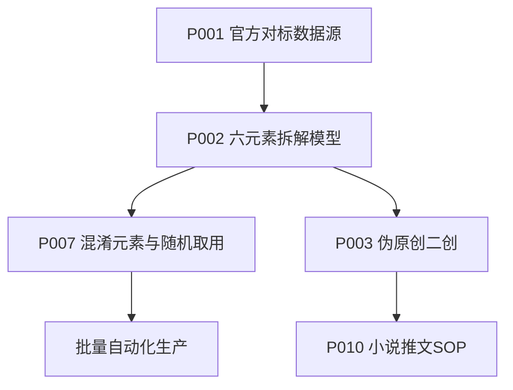
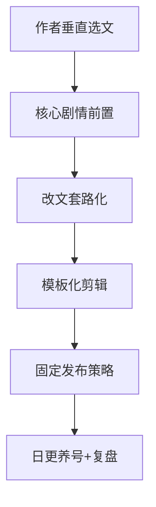

# 第 10 章 爆款内容生产线——从“对标”到“批量工业化”

## 学习目标

-   理解官方数据源与第三方工具在短视频对标中的差异，掌握以巨量百应创意中心为雷达的对标方法论
-   掌握短视频模板六元素拆解法，能将任意爆款视频转化为可复制的乐高积木
-   理解伪原创二创的底层逻辑，能基于'情、趣、用、品'四象限跨平台取材并合规改造
-   掌握选品即定人群的推导逻辑，能针对特定人群标签筛选垂直需求品
-   理解视频号新号流量扶持机制与视频搬运去重流水线，能独立完成新号冷启动与素材改造
-   掌握混淆元素与随机取用机制，能实现批量视频的差异化和原创化生产
-   理解黑马小达人策略的筛选标准与学习价值，能建立可持续的对标账号库
-   掌握小说推文的核心剧情前置与选文垂直化方法，能将文艺创作转化为标准化SOP

## 10.1 生活类比

想象短视频内容生产是一个**美食中央厨房**。**对标方法论** = 参考米其林餐厅的招牌菜榜单，而不是听美食博主空口推荐；**黑马小达人** = 那些不在榜单上、但小巷里天天排队的苍蝇馆子，更值得偷师；**六元素拆解** = 一份菜谱可拆为食材、火候、摆盘、酱汁、餐具、背景音乐般的用餐环境；**伪原创二创** = 把A店的招牌菜换个B店的秘制酱料，端到C店卖，只要不是照抄就能上菜单；**选品定人群** = 给中老年人开食堂，就要卖养生粥和健步鞋，而不是网红奶茶；**去重流水线** = 把别人用过的食材换个切法、换口锅、换个盘子，再撒把自家葱花；**混淆元素** = 每道菜出锅前夹一片自家院子种的香菜，让每盘菜都有一点点'原创'的味道；**核心剧情前置** = 把小说最精彩的反转写到封面海报上，让路人第一眼就掏钱买书。就像中央厨房需要标准化的菜谱和流水线才能批量出餐，短视频生产也需要模板化和SOP才能规模化放大。

## 10.2 概念地图

```
短视频爆款内容生产
├── 对标方法论
│   ├── 官方数据源（巨量百应创意中心） —— P001
│   │   ├── 爆款视频库（实时、分行业）
│   │   └── 创意搜索（按GMV/关键词筛选）
│   ├── 黑马小达人策略 —— P001, P008
│   │   ├── 粉丝5W以下、视频200条以上
│   │   ├── 围绕垂直品反复带、画面干净
│   │   └── 低粉高销更具可参考性
│   └── 脚本模板复用 —— P001
├── 模板化拆解
│   ├── 六元素模型（背景/标题/内容/文案/字幕/BGM） —— P002
│   ├── 流量视频 vs 带货视频 —— P002, P011
│   ├── 1比1模仿保底原则 —— P002
│   └── 底层工具模块抽取 —— P002
├── 伪原创二创
│   ├── 情、趣、用、品四象限 —— P003, P002
│   │   ├── 情-共情（喜怒哀乐细分人群）
│   │   ├── 趣-有趣（反差/实验）
│   │   ├── 用-有用（教学/实用）
│   │   └── 品-新奇特产品
│   ├── 跨平台素材库（抖音/快手/知乎/小红书/TK） —— P003
│   └── 不违规二创（拼接/换音乐） —— P003
├── 选品定人群
│   ├── 人群标签先行（中老年+下沉城市） —— P004
│   ├── 垂直需求品优先 —— P004
│   │   ├── 运动锻炼类
│   │   └── 保养类
│   └── 通用品不作为第一梯队 —— P004
├── 批量生产与去重
│   ├── 视频搬运去重流水线（放大→翻转→BGM→加字） —— P006
│   │   └── 加字引导出单 —— P006
│   ├── 混淆元素与随机取用 —— P002, P007
│   │   ├── 素材随机取用
│   │   ├── 时间段随机取用
│   │   └── 自拍混淆元素
│   ├── 新号流量扶持（前7天） —— P005
│   └── RPA批量采集（影刀） —— P001
└── 小说推文SOP
    ├── 选文垂直化（作者垂直+专栏垂直） —— P010
    ├── 核心剧情前置（提高5s完播率） —— P009
    ├── 改文套路化（关键词提炼+情绪修饰） —— P009
    └── 模板化剪辑（复制草稿统一样式） —— P012
```

## 10.3 对标方法论——让官方数据成为你的“商业雷达”

我们在前几章反复提到，短视频带货的第一步是“看到别人怎么赚钱”。但很多新人会陷入一个误区：凭感觉刷视频，凭印象模仿。这一节，我们介绍一套系统化的对标杆方法，把“凭感觉”变成“看数据”。

> “对标对标, 这里上榜的, 出成绩的, 最新的, 不就是最好的对标吗?”
> 
> ——《CGZ4dZq4ZoSFT4xUmFecNpk4nNe.md》

这段话点明了核心思想：**最好的对标素材，是官方数据平台上“正在出成绩”的爆款**。

### 为什么需要这个概念？

我们来看第一性原理：短视频带货竞争激烈，盲目原创成功率低。我们需要找到经过市场验证的爆款作为参考。但问题来了——去哪里找？

常用的第三方数据工具（如抖查查、蝉妈妈）存在明显短板：数据滞后且不准确，难以实时捕捉行业最新趋势。作者在素材中直接指出：

> “这个是比抖查查蝉妈妈这些第三方要更准确的行业优秀爆款视频库.”
> 
> ——《CGZ4dZq4ZoSFT4xUmFecNpk4nNe.md》

也就是说，**官方数据源比第三方工具更贴近真实战场**。

### 核心定义：官方实时爆款视频库

> **对标方法论**定义（来源：《CGZ4dZq4ZoSFT4xUmFecNpk4nNe.md》）

$$
\text{对标方法论} = \text{巨量百应创意中心（官方实时）} \succ \text{第三方工具（滞后）}
$$

这个公式展示了核心主张：与抖查查、蝉妈妈等第三方工具相比，巨量百应创意中心是更准确的行业优秀爆款视频库。它提供两个核心模块——**爆款视频**（能找到各行业、不同等级作者、近期的实时且带货效果最好的短视频）和**创意搜索**（按搜索词、GMV过滤等维度筛选视频）。

### 关键性质一：筛选性——黑马小达人策略

光有数据还不够，关键在于如何从海量数据中筛选出**可学习**的对象。这里引入“黑马小达人”概念。

> **黑马小达人策略**方法（来源：《CGZ4dZq4ZoSFT4xUmFecNpk4nNe.md》）

```
1. 在巨量百应创意中心采集数据后，优先筛选“粉丝量少但销量高”的视频
2. 筛选标准：粉丝5W以下、视频200条以上、一直围绕几个垂直品反复带、视频画面干净
3. 有一定非带货视频、保持更新
4. 分析其脚本结构，复制到自己的赛道
```

这段伪代码展示了完整的筛选流程。为什么要选“低粉高销”？素材中给出了关键逻辑：

> “这种黑马小达人更是我们小达人适合学习的对象, 毕竟大达人都是有粉丝基础加成在的, 销量天然会高一点.”
> 
> ——《CGZ4dZq4ZoSFT4xUmFecNpk4nNe.md》

这里有一个反直觉的洞察：**大达人的销量是“粉丝加成”的结果，而不是内容的胜利**。一个百万粉丝账号发任何视频都可能有高销量，但你无法判断是内容好还是粉丝信任。而黑马小达人粉丝少、销量高，说明**内容本身具备转化力**，这才是真正值得学习的对象。

### 关键性质二：模板化——脚本模板复用

对标的目的不是“看”，而是“用”。素材提供了一个重要观点：

> “好的脚本大概率是不会过时的, 一个脚本模板, 改改文案换个产品推, 成功率大概也比瞎原创要好一点吧.”
> 
> ——《CGZ4dZq4ZoSFT4xUmFecNpk4nNe.md》

这引出一个核心原则：**脚本模板复用优于盲目原创**。

### 典型例子

我们来看一个完整的操作示例：通过巨量百应创意中心，输入“护肤”关键词，自动采集近7天内GMV最高的100条视频，筛选出粉丝量低于5万但单条视频GMV超10万的“黑马视频”，下载后用飞书妙记转成文字脚本，存入自己的脚本库。这个过程把“对标”从理念落到了可执行的动作。

### 多源对照

关于“对标谁”这个问题，不同素材给出了侧重点不同的答案：

**共识**：对标的核心是“找到已验证的爆款”，而非盲目原创。最新、出成绩的爆款是最好的学习对象。

**分歧**：

- 《CGZ4dZq4ZoSFT4xUmFecNpk4nNe.md》强调**官方数据源**：应以巨量百应创意中心等实时数据为准，数据更准确；
- 《JmBgdr705ovHoyxQknRctRaMnKh.md》强调**直接1比1模仿**当下爆款视频去做原创，任何验证过的流量视频或带货视频都可作为模板；
- 《Lg2vd5GWHoqhBbxuT5LcThEpncb.md》则从**学习对象**角度提出，黑马小达人（低粉高销、视频数多）比大达人更具参考价值。

### 设计中的取舍

**为什么不用第三方工具而是官方数据？**

第三方工具（抖查查、蝉妈妈）虽然方便，但数据滞后，难以捕捉当天的最新趋势。官方平台（如巨量百应）实时更新，能看到“现在”正在爆的视频。代价是官方平台仅覆盖入驻巨量百应的商家，部分非平台内爆款无法捕捉。这就像股市的实时行情和历史K线——你要做短线，就得看实时盘。

**黑马小达人策略的边界在哪里？**

低粉账号可能因偶然因素爆款（如一时的热点），缺乏长期可复制性。如果选了粉丝过少的账号（如低于1000粉），可能学到的是“运气”而非“方法论”。所以筛选标准不能只看“低粉高销”，还要看视频数量和持续性。

## 10.4 模板化拆解——把爆款视频拆成“乐高积木”

对标找到了爆款，下一步是**理解爆款为什么爆**。这一节我们学习如何把任意一条视频拆解成可复制的“乐高积木”。

> “所有的视频都可以拆成以下元素：1. 背景：图或者视频 2. 标题：主、副标题 3. 内容：图、视频 4. 文案：5. 字幕：6. 背景音乐：”
> 
> ——《JmBgdr705ovHoyxQknRctRaMnKh.md》

### 为什么需要这个概念？

1比1模仿爆款虽然保险，但直接搬运会面临平台打击和内容同质化风险。手动剪辑视频效率低，无法实现批量生产，难以满足矩阵化运营对内容数量的需求。视频制作看似复杂多变，缺乏统一的抽象模型就无法实现自动化生成。

### 核心定义：六元素拆解模型

> **六元素拆解**定义（来源：《JmBgdr705ovHoyxQknRctRaMnKh.md》）

$$
\text{Video} = f(\text{背景}, \text{标题}, \text{内容}, \text{文案}, \text{字幕}, \text{BGM})
$$

这个公式展示了核心抽象：**所有短视频无论形式如何，最终都由六种元素构成**。这是实现视频自动生成的基础，也是将任意爆款视频转化为可复制模板的关键。

### 关键性质一：普适性与模块化

视频模板有各种各样的形式，拆解的多了会发现其实都是上面提到的那些元素组成的。例如，一个中医养生流量视频模板可以拆解为：

- **背景**：一张中医大师的照片，放大模糊
- **标题**：请等一下，xxxx
- **内容**：一张中医大师的照片
- **文案**：国医大师xxx
- **字幕**：无
- **背景音乐**：一段舒缓古风曲

每个元素可独立寻找相似替代素材，降低模板复制的操作难度。

### 关键性质二：可编程性

元素拆解后即可编写代码自动生成视频，实现批量化生产。

> **原创视频自动生成**方法（来源：《JmBgdr705ovHoyxQknRctRaMnKh.md》）

```
1. 将爆款视频拆解为六元素
2. 为每个元素寻找3-5个相似素材
3. 编写代码自动生成视频
4. 通过素材随机取用、时间段随机取用、混淆元素确保差异性和原创性
5. 开发自动发布工具，多平台自动发布
```

这段伪代码展示了从“看一条视频”到“生产一百条视频”的完整链路。作者指出，底层工具模块抽取后，“现在几分钟就能实现一个新的模板，抖音上看到的视频只要不是特效很多，基本都能做，只要拆解清楚就可以。”

### 流量视频 vs 带货视频

拆解之前，还要先分清视频的类型。

> **流量视频 vs 带货视频**定义（来源：《JmBgdr705ovHoyxQknRctRaMnKh.md》）

$$
\text{流量视频} \rightarrow \text{拉曝光、涨粉、打标签}
$$

$$
\text{带货视频} \rightarrow \text{直接促成销售转化}
$$

这两个公式展示了内容矩阵的分工。每个赛道的视频内容都有两种：流量视频和带货视频。**用验证过的流量视频或带货视频当模板，是要保证1比1模仿做出的内容都是60分以上的。**

### 方法演进图



### 典型例子

我们来看完整操作：拆解一条中医养生流量视频模板，背景为一张中医大师照片放大模糊，标题为“请等一下，xxx”，内容为一张中医大师照片，文案为“国医大师xxx”，字幕为无，背景音乐为一段舒缓古风曲。随后为每个元素寻找3-5个相似素材，编写代码实现自动生成。作者分享的案例中，通过这种方式将一个朋友的三个中医养生号做成数月变现10w左右。

### 边界条件

特效较多的视频（如复杂转场、粒子效果）拆解后难以用代码还原，需人工介入。模板拆解依赖对目标赛道的理解，若赛道本身内容形式单一，拆解出的模板受限。

## 10.5 伪原创二创——用“拼图思维”制造“新爆款”

有了模板拆解的能力，我们面对的下一个问题是：**素材从哪里来？** 答案出人意料：全网都是你的素材库。这一节我们学习伪原创二创方法论。

> “我把短视频内容分为\"情趣用品\"四个字”
> 
> ——《VsjCdIDNJoNRvlxo4OWcJ7bDnO5.md》

### 为什么需要这个概念？

平台对搬运打击日益严厉，直接搬运视频容易导致限流、封号。完全原创难度大、成功率低，需要借力已验证的爆款素材降低创作风险。各平台素材丰富，但缺乏系统化的素材筛选与重组方法，导致二次创作效率低。

### 核心定义：情、趣、用、品四象限

> **内容四象限**定义（来源：《VsjCdIDNJoNRvlxo4OWcJ7bDnO5.md》）

$$
\text{爆款内容} = \{\text{情（共情）}, \text{趣（有趣）}, \text{用（有用）}, \text{品（新奇特产品）}\}
$$

这个公式展示了内容分类的底层逻辑。所谓“情趣用品”四象限，是作者对几乎全部平台爆款内容的归纳：

- **情-共情**：喜怒哀乐，可继续细分——小朋友的喜怒哀乐、20岁的、30岁的、40岁的、50岁的、男人的、女人的等
- **趣-有趣**：有意思的实验、80岁老人做口播、反差较大的内容
- **用-有用**：教做菜、教做PPT、教做电工等
- **品-新奇特产品**：北方人没见过的酸角糕、其他地方没有的特色绿植等

### 关键性质：跨平台取材与不违规二创

> **伪原创二创**定义（来源：《VsjCdIDNJoNRvlxo4OWcJ7bDnO5.md》）

$$
\text{伪原创} = \text{全平台素材库} \xrightarrow{\text{情、趣、用、品筛选}} \xrightarrow{\text{拼接/换音乐}} \text{自己赛道的作品}
$$

这个公式展示了伪原创的完整链路：**所有短视频平台（抖音、快手、优酷、知乎、小红书甚至TK）都是你的素材库**。通过“情、趣、用、品”底层逻辑找到爆款规律后，我们要做的无非是把这些素材不违规地二创成自己赛道的作品进行发布。

素材中给出了一个重要操作心法：

> “通过大概几十条作品的制作之后, 你大概率会发现其实有些作者没上热门的视频, 其实他的画面或者他们音乐很好. 你就会开始留意那些视频的那些片段, 或者音乐, 脑海里面会自然给他做一个合适的拼接.”
> 
> ——《VsjCdIDNJoNRvlxo4OWcJ7bDnO5.md》

也就是说，伪原创不是“乱拼”，而是**基于对爆款底层逻辑的理解，做有意识的拼接**。

### 多源对照

关于“伪原创”，两个素材给出了互补视角：

**共识**：都认为基于已验证的爆款素材进行二次创作，比完全原创更高效，且需要规避平台打击。

**分歧**：

- 《VsjCdIDNJoNRvlxo4OWcJ7bDnO5.md》从**内容分类**角度出发，强调“情、趣、用、品”四象限是所有爆款的底层逻辑，跨平台取材是关键；
- 《JmBgdr705ovHoyxQknRctRaMnKh.md》则从**技术自动化**角度出发，认为通过六元素拆解+代码生成可以实现“原创优于二剪优于搬运”，强调的是程序化批量生产，而非手工拼接。

### 典型例子

在抖音找到一条播放量破千万的“情感共鸣”类视频，分析其文案和画面节奏后，将其画面素材与另一条快手的背景音乐拼接，文案改为自己赛道（如“中年职场困境”）相关的表达，发布到视频号后播放量突破百万。

### 边界条件

过度拼接他人素材可能触犯平台原创审核，需要搭配自拍混淆元素降低风险。“情、趣、用、品”仅用于内容定位和素材筛选，不能替代对目标用户需求的深入理解。

## 10.6 选品即定人群——让用户觉得“我真的需要”

内容生产的最终目的是卖货。而卖货的第一步是选品。这一节我们介绍一种反直觉的选品方法论——**选品即定人群**。

> “选品其实就是定人群然后找需求，大家能理解这句话，就很好选品了。”
> 
> ——《Lg2vd5GWHoqhBbxuT5LcThEpncb.md》

### 为什么需要这个概念？

视频号用户群体（中老年、下沉市场）与抖音快手差异明显，直接搬运其他平台的选品逻辑失败率高。面向泛人群的通用品（服装、食品）竞争激烈，难以通过价格优势取胜。带货效率取决于商品与目标用户需求的精准匹配，缺乏方法论时容易凭感觉选品。

### 核心定义：选品即定人群

> **选品方法论**定义（来源：《Lg2vd5GWHoqhBbxuT5LcThEpncb.md》）

$$
\text{选品} = \text{定义人群标签} \rightarrow \text{推导特定需求} \rightarrow \text{选择垂直需求品}
$$

这个公式展示了“人群先行”的选品逻辑：先定义清晰的人群标签（年龄、地域、消费习惯），再推导该人群的特定需求，最后选择垂直需求品而非“通用品”。

### 关键性质：垂直优先与需求差异化

以视频号带货为例，人群标签是“中老年人+下沉城市”。那么这类人群的特定需求是什么？

> “年纪大了就想身体好，年纪大了就想重返青春，所以运动锻炼类的品和有关保养方面的品，都可以考虑。”
> 
> ——《Lg2vd5GWHoqhBbxuT5LcThEpncb.md》

垂直需求品的核心优势是：**价格反而不是特别的重要，重点在于我觉得这玩意对我有用**。作者更偏向于那种让用户看了觉得“这个东西我是真的需要，是真的适合我”的产品。

而“通用品”（如服装、食品）因为需求过于普通，是所有人的需求而非目标人群的特定需求，所以不在第一梯队。

### 典型例子

视频号带货项目中，将人群定位为“中老年人+下沉城市”，挖掘其“身体好、重返青春”的特定需求，选择运动锻炼类和保养类产品（如健步鞋、按摩仪）而非服装、零食等通用品。最终通过直播实现单场破万场观、200多单的转化。

### 边界条件

垂直需求品虽转化率高，但受众相对狭窄，需配合高频上新和持续内容输出维持流量。下沉市场用户对价格敏感度存在差异，部分垂直品（如高价保健品）需测试后再决定是否主推。

## 10.7 视频号新号流量扶持——平台送给新手的“新手村加速器”

做号的第一道坎是冷启动：新账号没粉丝、没播放、没信心。这一节我们介绍一个平台规则上的“隐形加速器”——**新号流量扶持**。

> “圈友诚不欺我也，新号果然是有流量扶持的，这个视频号还真可以搞。”
> 
> ——《Lg2vd5GWHoqhBbxuT5LcThEpncb.md》

### 为什么需要这个概念？

新账号冷启动阶段播放量低、无人问津，大量运营者在前7天就放弃。不了解平台的冷启动机制，就无法利用平台规则加速起量过程。需要判断新号流量扶持的时间窗口和效果边界，以制定合理的起号策略。

### 核心定义：新号流量扶持

> **新号流量扶持**定义（来源：《Lg2vd5GWHoqhBbxuT5LcThEpncb.md》）

$$
\text{新号播放量} = 
\begin{cases}
\text{破万播放（高概率）}, & \text{注册初期（约7天）} \\
\text{回归正常水平}, & \text{扶持期过后}
\end{cases}
$$

这个公式展示了视频号平台给予新注册账号的流量倾斜机制：新号发视频容易破万播放，是快速起量的重要基础。

### 关键性质与应用

作者用实测数据验证了这个机制的存在：

> “到了晚上我看了一下，三个号全部破万播放了，两个1W出头，有一个跑到了3W+的播放。”
> 
> ——《Lg2vd5GWHoqhBbxuT5LcThEpncb.md》

新号流量扶持的“时限性”意味着它是一个**有限的时间窗口**。作者也提出了一个激进但有效的策略：

> “在7天扶持期内作死的发视频，一个视频几千一万的，几十个视频就是几十万，几百个就是几百万，然后7天时间过了就换号。”
> 
> ——《Lg2vd5GWHoqhBbxuT5LcThEpncb.md》

这个策略的核心是利用扶持期的高播放概率，通过大量发视频叠加出百万级播放量。

### 视频搬运去重流水线

新号有了流量，但视频素材从哪里来？在冷启动阶段，搬运是常见的起步方式，但直接搬运必然限流。这就需要用一套固定的去重流程给旧素材“换马甲”。

> **视频搬运去重流水线**方法（来源：《Lg2vd5GWHoqhBbxuT5LcThEpncb.md》）

```
1. 放大：将画面放大一定比例，可配合裁剪
2. 翻转：左右翻转或上下翻转画面方向
3. BGM处理：换BGM、加BGM底、或对原视频变速（1.1-1.2倍）
4. 加字：遮盖原字幕，添加针对产品特点的醒目引导文字
```

这段伪代码展示了一条固定流程。作者强调了一个反直觉的洞察：

> “有时候出单可能不是因为视频，而是你加的字抓住了用户.”
> 
> ——《Lg2vd5GWHoqhBbxuT5LcThEpncb.md》

举一个具体的例子：

> “比如产品是个拖把……今天惹老伴生气了，罚我做一天家务，还好有这个拖把。”
> 
> ——《Lg2vd5GWHoqhBbxuT5LcThEpncb.md》

这条引导语把“卖拖把”包装成了一个“男人认错做家务”的场景，抓住了中老年女性用户的心理。

### 边界条件

扶持期结束后流量下降明显，需要依赖内容质量和粉丝积累维持播放量。过度依赖流量扶持会导致扶持期结束后数据断崖式下跌，需提前规划内容策略。画面翻转、变速幅度过大可能影响观看体验，需适度处理。

## 10.8 混淆元素与随机取用——让批量视频“长得不一样”

当你有了模板、素材和去重流程，下一个瓶颈出现了：**如何批量生产而不被平台判定为搬运？** 答案藏在“混淆元素”和“随机取用”这两个机制里。

> “再加上混淆元素，这样能保证做出来的视频都是原创视频，且每个视频生成的都不相同，在任何一个平台都能过原创。”
> 
> ——《JmBgdr705ovHoyxQknRctRaMnKh.md》

### 为什么需要这个概念？

自动化批量生成的视频若内容雷同，会被平台判定为搬运或低质内容，无法通过原创审核。手动差异化处理效率低，无法支撑矩阵化运营对内容数量的要求。需要一套机制在自动化流程中自然地生成具有差异性的原创内容。

### 核心定义：三个差异化手段

> **差异化生成机制**定义（来源：《JmBgdr705ovHoyxQknRctRaMnKh.md》）

$$
\text{原创性} = \text{素材随机取用} + \text{时间段随机取用} + \text{自拍混淆元素}
$$

这个公式展示了三个确保视频原创性的核心手段。具体来说：

- **素材随机取用**：每个素材（背景图、内容图、BGM）在生成时随机选择
- **时间段随机取用**：如果模板有多片段，每个片段素材内的时间段也随机取用
- **混淆元素**：加入自己拍摄的照片和视频，让每条视频都有一点“原创”的味道

### 关键性质

这三个手段均可编码实现，无需人工干预。作者强调：“每个视频的生成时都加一些混淆元素，用自己拍的照片和视频”。这套机制的巧妙之处在于，它用**程序化**的方式模拟了“人肉原创”的随机性。

### 典型例子

在一套中医养生视频模板中，准备了20张中医相关照片、50段背景视频、30首背景音乐。生成时每次随机选取1张照片、随机截取某段视频的某个时间段，并混入自己拍摄的5张生活照片，确保生成的100条视频各不相同且都能过原创审核。

### 边界条件

自拍混淆元素需与赛道相关或至少不突兀，否则影响视频内容的完整性。随机组合可能产生不协调的视频（如古风画面配现代音乐），需要预设合理的素材组合规则。

## 10.9 小说推文的批量生产SOP——把“文艺创作”变成“流水线作业”

前面几节的方法适用于大多数短视频赛道，这一节我们聚焦一个具体的变现场景——**小说推文**。这个赛道特别适合展示“从艺术到工程”的转变。

> “下面我将根据配音号的实操流程，从选文改文、剪辑制作、发布运营、日常维护四个方面展开.”
> 
> ——《ZcEdd0xTCo1K5IxwCyLccKUynOb.md》

### 为什么需要这个概念？

单篇小说推文制作耗时（选文、改文、配音、剪辑），无法满足日更多篇的需求。手工制作质量不稳定，难以形成可持续的内容供给能力。需要一套标准化、可重复的流程，降低单条内容的制作时间和精力消耗。

### 核心定义一：选文垂直化

> **选文垂直化**定义（来源：《ZcEdd0xTCo1K5IxwCyLccKUynOb.md》）

$$
\text{稳定文章来源} = \text{作者垂直（关注优质作者）} + \text{专栏垂直（盐选专栏集中选文）}
$$

这个公式展示了两种获取稳定优质文章的路径。作者强调：“选文是小说推文项目的绝对核心。”

- **作者垂直**：关注8~10个符合账号定位的优质作者，在知乎-动态里可以看到他们每天点赞的文章、关注的问题、发布的回答。抓住了作者，就等于抓住了稳定的文章来源。
- **专栏垂直**：选中作者的某篇优质文章后，查看该文章所属盐选专栏，再去专栏里筛选同类型的优质文章。专栏相当于知乎的编辑事先帮我们筛选了一遍。

> “从专栏里选文章对账号的'垂直'帮助很大，因为优质作者们很少会死磕某一类文章，我们也不可能只发一个作者的文章，但我们可以瞄准了一个专栏使劲薅.”
> 
> ——《ZcEdd0xTCo1K5IxwCyLccKUynOb.md》

### 核心定义二：核心剧情前置

选好文后，接下来是“改文”。这一步的关键不是“朗读”，而是**二次创作**。

> **核心剧情前置**定义（来源：《ZcEdd0xTCo1K5IxwCyLccKUynOb.md》）

$$
\text{完播率} \propto \frac{\text{核心剧情位置}}{\text{视频总时长}}
$$

这个公式展示了一个关键结论：**核心剧情在视频中的位置越靠前，完播率越高**。针对“中开高走”的文章，将核心剧情（含冲突、悬念、反差）提炼后前置到视频开头，可显著提高5s完播率。

素材中给出了具体操作：

> “将核心剧情提前后，还可以适当添加一些能够调动情绪的修饰词，比如'竟然''偏偏''非要'等.”
> 
> ——《ZcEdd0xTCo1K5IxwCyLccKUynOb.md》

### 批量生产SOP

> **批量生产SOP**方法（来源：《ZcEdd0xTCo1K5IxwCyLccKUynOb.md》）

```
1. 选文：作者垂直+专栏垂直，每天定时“收菜”
2. 改文：通读全文→提炼关键词→核心剧情前置→添加情绪修饰词→精简篇幅
3. 剪辑：打开剪映→拖入素材→处理素材→智能字幕→导出视频（熟练后≤15分钟）
4. 发布：发布前5-15分钟上线活跃，发布后评论区引导
5. 复盘：内容分析、粉丝分析、策略分析三维度每日复盘
```

这段伪代码展示了从选文到发布的完整流程。作者运营2个号，每天发布2-4条视频，从选文改文到剪辑发布投入的时间不超过1.5小时，单号每周收益稳定在400元左右。

### 数据流图



### 多源对照

关于“批量生产”，不同素材给出了互补视角：

**共识**：都必须先找到“验证过的爆款”作为基础，再通过流程化手段放大产量。

**分歧**：

- 《ZcEdd0xTCo1K5IxwCyLccKUynOb.md》强调**内容精细化**：核心在选文质量（作者垂直+专栏垂直）和改文技巧（核心剧情前置），剪辑反而被简化；
- 《JmBgdr705ovHoyxQknRctRaMnKh.md》强调**程序化自动化**：核心在六元素拆解和代码生成，内容“质量底线”靠1比1模仿保证，不依赖人工改文能力。

### 边界条件

SOP依赖选文质量，若选文环节未垂直化则后续改文剪辑的投入可能浪费。标准化流程可能限制创意发挥，需定期引入新模板防止内容同质化。

## 10.10 本章小结

这一章中我们系统学习了短视频爆款内容生产的完整链路：从“对标”到“拆解”到“批量生产”。首先，我们讲解了以巨量百应创意中心为雷达的对标方法论，理解了官方数据源优于第三方工具，以及黑马小达人策略的学习价值；其次，我们掌握了六元素拆解模型，能把任意爆款视频转化为可复制的乐高积木；接着，我们学习了伪原创二创的底层逻辑，理解了如何基于“情、趣、用、品”四象限跨平台取材合规改造；然后，我们推导了选品即定人群的方法论，理解了垂直需求品优先的选品逻辑；再然后，我们介绍了视频号新号流量扶持机制与搬运去重流水线，完成了新号冷启动与素材改造的技能储备；最后，我们深入小说推文赛道，掌握了核心剧情前置与选文垂直化的批量生产SOP。

这一章我们一起学习了以下概念：

| 概念 | 解释 |
|------|------|
| 对标方法论 | 以官方实时数据源（巨量百应创意中心）替代滞后第三方工具，以爆款作为学习基准 |
| 黑马小达人策略 | 优先学习'低粉高销'账号，其内容转化力不依赖粉丝加成，更具参考价值 |
| 六元素拆解模型 | 所有短视频均可拆为背景、标题、内容、文案、字幕、BGM六个可替换的积木模块 |
| 流量视频 vs 带货视频 | 内容矩阵分工：流量视频拉曝光打标签，带货视频承接转化 |
| 伪原创二创 | 以'情、趣、用、品'四象限为底层逻辑，跨平台取材并合规拼接换乐 |
| 选品即定人群 | 先定义人群标签再推导垂直需求，让用户觉得'我真的需要'而非靠价格取胜 |
| 新号流量扶持 | 视频号新号前7天有流量倾斜，是快速起量的时间窗口 |
| 搬运去重流水线 | 固定四步（放大→翻转→BGM→加字）给旧素材换马甲，加字引导是出单关键 |
| 混淆元素与随机取用 | 通过素材随机、时间段随机和自拍混淆，保证批量视频差异化且过原创 |
| 核心剧情前置 | 将小说冲突悬念提炼后前置到开头，是提升5s完播率的关键手段 |
| 选文垂直化 | 作者垂直+专栏垂直双路径获取稳定优质文章来源，强化账号垂直定位 |
| 批量生产SOP | 从选文到发布的标准流程，把单条制作时间压缩到15分钟内 |

下一章中，我们将从“内容生产”转向“商业化放大”，学习如何把解决一个痛点的方法论复制到多个赛道，用矩阵号和团队协作实现从月入几千到月入百万的跃迁。你将掌握账号运营与私域转化的完整体系，把辛苦生产出来的内容“吃干抹净”。
