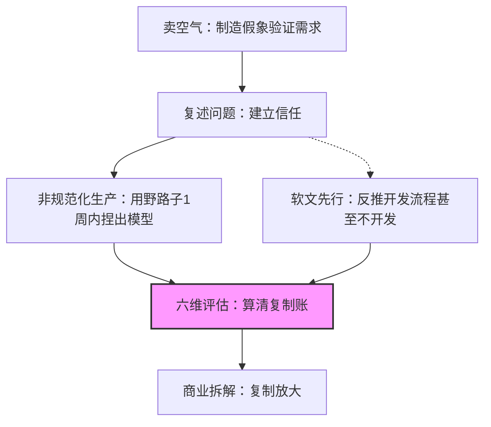

# 第 3 章 产品孵化 —— "卖空气"与"软文先行"的最小化验证
作者：龙哥

## 3.0 学习目标

- 理解"卖空气"与"软文先行"作为最小化产品验证方法的底层逻辑
- 掌握用"复述问题"建立用户信任的内容策略与写作要点
- 了解"非规范化生产"如何降低个人开发者的试错成本
- 掌握用"六维评估模型"评估产品潜力的方法，并理解其在复制放大中的价值
- 能运用"私域前端流量"思维判断副业项目的成败关键点

## 3.1 生活类比：开一家"概念餐厅"

想象做副业产品就像开一家**"概念餐厅"**。

**卖空气** = 先在门口贴出招牌菜海报，有客人点单才进厨房炒菜。你不必先囤满一冰箱食材、雇好厨师、装修好店面才开始营业，而是先放出菜单看看有没有人愿意下单。

**软文先行** = 菜单不是给厨房看的，而是给客人看的点菜指南。客人看到的是文字描述的菜品（软文），而非厨房里的锅碗瓢盆（代码）。菜品（代码）反而可以后做，甚至直接去找隔壁餐厅的现成菜品（现成软件）来交付。

**复述问题** = 服务员先复述"您是不是想吃辣但怕上火？"，客人觉得"这服务员懂我"，于是愿意多聊几句。即使服务员还没端出任何菜，客人已经产生了信任感。

**非规范化生产** = 用一口大锅先炒出个大概味道，让客人尝一口，认可了再精致摆盘。你不需要一上来就讲究刀工、摆盘和米其林星级流程，先让客人尝到味道最重要。

**六维评估模型** = 开店前先算一笔账，看看这道菜的毛利高不高、顾客会不会常来吃、后厨能不能忙得过来，算明白了再决定要不要投入。

**商业项目拆解** = 看到隔壁餐厅生意好，不偷它的菜谱，而是拆出"地段引流→招牌菜转化→后厨外包"的经营链路，然后用自己的方式复制。

就像聪明的老板不会先装修再等客，而是先放出菜单测试是否有客人愿意下单，再看要不要真备原料。

## 3.2 概念地图

```
产品孵化方法论
├── 反直觉起点：软件的本质就是软文
│   ├── 核心定义：感知形态是软文，可反推开发流程 —— P001
│   ├── 关键性质：文案即产品、零代码交付（找现成软件替代） —— P001
│   └── 边界条件：需真实需求支撑，否则积累恶评 —— P001
├── 最小化验证：卖空气
│   ├── 核心定义：用模型/截图/预售页制造假象先收钱 —— P001
│   ├── 关键性质：零成本验证、预售导向、快速迭代 —— P001
│   └── 边界条件：需有交付意图，不可无限延期，适用轻量产品 —— P001
├── 信任建立：复述问题
│   ├── 核心定义：罗列用户症状让其产生"这次找对了" —— P001
│   ├── 关键性质：共鸣优先、低成本高回报、普适性强 —— P001
│   └── 边界条件：只建立初步信任，必须有后续价值交付 —— P001
├── 快速产出：非规范化生产（野路子）
│   ├── 核心定义：用低门槛工具在1周内做出可演示模型 —— P001
│   ├── 关键性质：成本优先、模型即产品、工具平民化 —— P001
│   └── 边界条件：只适合小而简单的产品，后续需回归质量 —— P001
├── 潜力评估：六维评估模型
│   ├── 核心定义：从效率与财务两大维度评估项目可复制性与收入天花板 —— P005
│   ├── 效率维度：流量效率、销转效率、交付效率 —— P005
│   ├── 财务维度：客单价、毛利率、复购率 —— P005
│   ├── 关键性质：六维满足四个及格，效率不足时用财务维度弥补 —— P005
│   └── 应用场景：评估"卖空气"验证法的潜力与局限 —— P005
└── 系统复制：商业项目拆解
    ├── 拆解法：八步法（找项目→拆流量→拆转化→拆交付→评复制→定策略→搭团队→强执行） —— P002
    ├── 可复制性判定：爆得非偶然、货源非独家、需求已验证 —— P002
    └── 底层原则：后发制人、私域前端流量优先 —— P002
```

## 3.3 反直觉起点：软件的本质就是软文

> "多年经验总结一个观点：软件的本质就是软文。"
>
> ——《个人开发者：卖空气与软文先行》（P001）

让我们先停下来做一个思维实验。当你第一次接触一个软件时，你看到的是什么？不是源代码，不是编译过程，而是一个介绍页面、一段功能说明、几行广告文案——**文字**。这正是本文作者的核心洞察：软件的最终展现方式，终究是软文。

传统开发的思维是"先有东西再推广"——先写代码、再写介绍、再上架售卖。但作者反问道："程序员的思维总是先有东西再推广，不要等什么东西已经有了再去卖！假装已经有了足够！卖空气！" 这句话揭示了一个关键的反推逻辑：既然软件的最终形态是文字，为什么不直接从文字开始？

> **软件的本质就是软文**定义（来源：《个人开发者：卖空气与软文先行》）

$$
\text{软件被用户感知的最终形态} \rightarrow \text{介绍性文字（软文）} \rightarrow \text{可反推开发流程}
$$

$$
\text{甚至：软文} \rightarrow \text{不开发软件} \rightarrow \text{寻找类似软件交付给客户}
$$

这个公式展示了"反推思维"的核心：产品的价值不在于你写了多少代码，而在于用户是否通过文字感知到它的价值。第一个箭头表明软件面向用户的最终形态是文字介绍，这决定了推广文案的质量直接决定销售转化。第二个箭头更激进——既然用户感知的是软文，那么你甚至可以跳过开发环节，直接找现成的类似软件交付给客户。

我们来看一个典型例子。假设你想做一个"一键解封"工具，按照传统思维你得先开发、再宣传。但按照软文先行的逻辑，你可以先写一篇介绍该工具的软文，有人付费咨询后，再去找现成软件或开发。作者在文中给出了同样的例子：

> "想一些根本不现实，或多数人下载不到的软件，但他们觉得应该有这种软件，只需要想到名字即可。"

这句话展示了软文先行的极端应用：先想一个产品名字，写一篇介绍性软文，然后看是否有人感兴趣。如果反馈积极，再去兑现。这种做法的边界在于——软文先行必须建立在真实需求的基础上，凭空捏造、过度宣传会积累恶评；且如果你不开发，就需要有可靠的现成替代软件，否则交付环节会崩盘。

## 3.4 最小化验证：卖空气

> "或者直接做个模型，上架开卖，卖空气，卖预售。卖不出去就没必要继续做了！"
>
> ——《个人开发者：卖空气与软文先行》（P001）

"卖空气"这个概念听起来像玩笑，但它可能是整章中最实用的验证方法。传统流程告诉你：先做产品，再卖产品。但个人开发者时间、资金有限，赌错方向就血本无归。怎么办？作者给出的答案是：**先卖空气，卖得出去再做产品，卖不出去就止损**。

> **卖空气**定义（来源：《个人开发者：卖空气与软文先行》）

$$
\text{验证流程} = \text{制造"已具备功能"的假象} \xrightarrow{\text{预售}} \text{获得付费信号} \xrightarrow{\text{决定}} 
\begin{cases}
\text{有订单} \rightarrow \text{开发/找现成软件兑现} \\
\text{无订单} \rightarrow \text{止损，不投入开发}
\end{cases}
$$

这个流程展示了"卖空气"的完整闭环：核心是用最低成本获得用户的真实付费意愿数据。与传统开发流程（做产品→推广→看反应）相比，卖空气把"验证需求"的环节前置到了"开发"之前，从而把试错成本从"数周的开发时间"压缩到"几张截图和一段文案"。

我们来看一个真实案例。作者提到"羊了个羊刚有点火，立刻就有人P一张分数999999截图，去社交软件用已经开挂的口吻发文，开始吸粉，差不多5天后《羊了个羊》大火🔥，这时他就可以套话找真正能刷分软件了，直接把粉丝变现！" [P001] 注意，这个案例中并没有真正开发任何刷分软件——它只是用一张P图制造了"已具备功能"的假象，然后通过吸引关注来收集需求信号。

"卖空气"的三个关键性质值得你记住：

- **零成本验证**：不需要完整产品即可获得付费数据，几张截图、一段文案就能开卖
- **预售导向**：用未来交付的承诺换取当下的资金与信号，卖得出去就继续，卖不出去就止损
- **快速迭代**：根据预售反馈决定是否投入真实开发，每一次预售都是一次市场调研

但你必须清醒地认识到"卖空气"的边界：

| 边界条件 | 说明 |
|----------|------|
| 预售 ≠ 诈骗 | 必须要有交付的意图或替代方案（如寻找现成软件给客户用） |
| 不可无限延期 | 不能对已收钱的用户无限拖延，否则信任崩塌、口碑反噬 |
| 适用轻量产品 | 适用于低客单价的轻量产品，重资产项目不适用 |

> 如果你打算用"卖空气"的方式做一款产品，请记住：它的目的不是欺骗，而是**以最小的成本确认需求是否真实存在**。一句话总结：卖得出去就继续做，卖不出去就及时止损。

## 3.5 复述问题建立信任 —— 让用户觉得"这次找对了"

> "举例：就拿看病举例子，医生会问你：'有没有这个症状？有没有那个症状？'结果你发现：'都是我现在的症状'，所以你认为这个医生懂你的病，这次找对了！"
>
> ——《个人开发者：卖空气与软文先行》（P001）

用户面对陌生卖家时天然有戒备心。我们凭什么在几秒钟内让一个陌生人相信"这次找对了"？作者给出的答案是：**复述他的问题**。

为什么医生问诊能让病人产生信任？不是因为医生给了什么治疗方案，而是因为医生的每一个问题都精准命中病人的症状——"你是不是出油多？毛孔粗？爱长痘？" 用户全中，心里暗想："这商家懂我"。这其实就是一种强大的内容策略：先让用户感到被理解，而不是急着给方案。

> **复述问题建立信任**方法（来源：《个人开发者：卖空气与软文先行》）

```
1. 列出目标用户常见症状/问题（3~5条）
2. 用"你是否有这样的经历"的口吻逐一复述
3. 让用户内心产生"这次找对了"的共鸣（此时你还未给出任何解决方案）
4. 取得初步信任后，再提供后续的价值交付
```

这段伪代码展示了复述问题法的核心操作流程。关键在于第2步和第3步——复述问题不是随便列举几个泛泛的痛点，而是要有细节、够精准，让用户产生"这不就是在说我吗"的共鸣。正如作者所说："写软文的核心是用户看到你这篇文章，内心在想'这次找对了！'，就行了，不管他真找对了还是假找对了。"

我们用一个卖护肤品的例子来演示。传统写法是："本产品富含XX成分，能有效改善肌肤问题。" 用户看完无感，因为没觉得跟自己有关。复述问题写法是："你是不是出油多、毛孔粗、爱长痘？每逢换季就过敏发红？用了很多护肤品都不见效果？" 用户全中，就会觉得这商家懂我，愿意继续读下去。

复述问题法的三个关键性质：

- **共鸣优先**：先让用户感到被理解，而不是急着给方案
- **低成本高回报**：只需精准描述问题，不需证明解决方案的有效性
- **普适性强**：适用于软文、客服话术、售前咨询等一切触达场景

但这个方法也有明确的边界：复述问题**只是建立信任的第一步**，后续必须跟上真实的价值交付。否则你只是"知道问题"而非"解决问题"，信任会迅速崩塌。作者也明确指出："不管他真找对了还是假找对了"——这既是这个方法的力量所在，也是它的伦理风险所在。我们在第7章会深入讨论这个问题。

### 3.5.1 复述问题与信息差搬运论的联动

细心的读者可能已经发现，复述问题不仅是一种文案技巧，它还与第2章讲过的"信息差搬运论"（渠道信息差，内容从A平台搬运到B平台）产生共鸣。当你在不同平台上搬运内容时，复述问题法可以帮助你快速判断一个内容是否值得搬运——如果原内容精准复述了某个未被充分满足的痛点，那么它换一个渠道很可能继续爆火。这个观点我们会在后面的章节详细展开。

### 3.5.2 多源对照：复述问题的多种解释

不同素材对"如何建立信任"给出了不同答案。

**共识**：信任是转化的前提，而低成本快速建立信任是内容营销的核心目标。

**分歧**：

- 《P001, p.6》认为复述问题是最快建立信任的方法——"用户内心在想'这次找对了'"是唯一标准；
- 《P002, p.11》则强调"后端变现效率决定项目成败"，认为信任必须由后端（即实际的产品和服务体验）来巩固，前端复述问题只是迈出了第一步；
- 《P005, p.3》从六维视角补充，认为信任的积累本质是"销转效率"问题——如果销售能SOP化、专业度要求低，那么信任的建立也可以被标准化。

## 3.6 非规范化生产（野路子） —— 用"野路子"快速捏出产品模型

> "个人开发者需要的是'非规范化生产'俗称野路子。非规范化生产的核心是：'降低成本''提升效率'。就怕个人开发者'没有正统的命，得了正统的病！'"
>
> ——《个人开发者：卖空气与软文先行》（P001）

我们刚刚讨论了"卖空气"和"复述问题"——这些方法解决了"验证需求"和"建立信任"的问题。但当你真的需要拿出一个产品模型来演示时，怎么办？作者给出的答案是：**放弃规范化流程，用"野路子"快速捏出可演示的模型**。

个人开发者的处境很特殊：资金、时间、团队都有限。按正规化流程（需求分析→原型→UI→开发→测试→上线）走完，周期太长、成本太高。作者一针见血："很多人'没有正统的命，得了正统的病'，盲目套用大厂流程导致项目胎死腹中。" [P001]

> **非规范化生产（野路子）**定义（来源：《个人开发者：卖空气与软文先行》）

$$
\text{开发周期} \leq 1 \text{周} \quad \text{（超过1周的软件产品不适合个人开发者）}
$$

$$
\text{工具选择} = \text{中文编程工具} \quad \text{（不会英语也能快速入门）}
$$

$$
\text{优先级} = \text{降低成本} \succ \text{提升效率} \succ \text{功能完整} \succ \text{界面美观}
$$

这三条公式展示了"野路子"的核心约束。第一条设定了开发周期的硬上限：1周。这迫使你只做"小而简单的产品"；第二条给出了工具选择的平民化策略，用中文编程工具消除语言门槛；第三条是优先级排序——成本、效率优先于功能完整和界面美观，因为模型的核心是"能演示、能预售"。

作者特别强调用自己的工具捏模型的好处："把需求完整的讲出来，又让他理解，本身就是一件不容易的事。沟通成本有时候比开发成本都高，还赶不上有一个趁手的工具，自己先捏一个模型给他看！" [P001] 这句话揭示了一个被忽略的真相：**沟通成本 > 开发成本**。做一个粗糙但可演示的模型，比花几小时向客户解释你想做什么，更高效。

我们来看一个应用场景：假设你想做一个"朋友圈访客记录"工具（实际上多数平台无此功能）。按"野路子"的方式，你应该用中文编程工具在3天内做出一个Demo——哪怕界面很丑、功能只有"模拟显示访客"这一项。关键是这个Demo能稳定演示，你能拿着它去给潜在客户看，甚至挂到电商平台预售。

"野路子"的边界条件同样需要你记住：

- **只适合小而简单的产品**：超过1周开发周期的重项目不适合个人开发者
- **模型可以粗糙，但要能稳定演示核心功能**：不能频繁崩溃，否则信任反而受损
- **后续仍需回归产品质量**：野路子是手段不是目的，口碑无法靠粗糙长期积累

### 3.6.1 方法演进：从"卖空气"到"野路子"再到"软文先行"



这张图展示了本章五个核心概念之间的演进关系。**卖空气**提供了最初的验证信号；**复述问题**建立了用户信任；**非规范化生产**解决了快速产出；**软文先行**则可能让你完全跳过开发；最终通过**六维评估模型**判断这个项目值不值得复制放大。

## 3.7 六维评估模型 —— 给产品概念算一笔"复制账"

> "任何项目都可以拆解成：流量效率，销转效率，交付效率，客单价，毛利率，复购率，这六个点。六个点，满足的越多越好，满足四个点，及格。"
>
> ——《副业底层逻辑六维模型》（P005）

"卖空气"能验证需求是否存在，但无法评估这个生意能做多大、值不值得投入。你说你验证了一个需求，但这是一个月赚1000的需求，还是一个月赚10万的需求？这需要用一套科学的评估框架来回答。

六维评估模型正是为此而生。它将任何商业项目拆解为六个可量化的指标：**流量效率、销转效率、交付效率、客单价、毛利率、复购率**。前三个维度（效率维度）决定了项目能否被复制和放大；后三个维度（财务维度）决定了收入的天花板。让我们逐一拆解。

> **六维评估模型**定义（来源：《副业底层逻辑六维模型》）

$$
\text{六维模型} = \underbrace{(\text{流量效率, 销转效率, 交付效率})}_{\text{效率维度：决定可复制性}} + \underbrace{(\text{客单价, 毛利率, 复购率})}_{\text{财务维度：决定收入天花板}}
$$

$$
\text{流量效率} = \frac{\text{获得流量大小}}{\text{时间} \times \text{素材难度}}
$$

$$
\text{销转效率} = \frac{\text{一对多能力} \times \text{SOP化程度}}{\text{专业度要求}}
$$

$$
\text{交付效率} = \frac{1}{\text{交付所需时间} \times \text{人力}}
$$

这三个公式分别刻画了三个效率维度的计算方法。流量效率以时间、素材难度、获得流量为指标——花的时间少、素材难度低、获得流量大，即流量效率高。销转效率以专业度为指标——专业度要求低（能SOP化）、能一对多，即效率高，本质是销售时间的利用率。交付效率以时间为指标——花的时间少（人力少），即效率高；支付即完成交付（如资料）则效率最高。

我们来看看六维模型的实际应用。作者用小说推文项目演示了逐项标注的过程 [P005]：

| 六维指标 | 小说推文项目表现 | 评价 |
|----------|-----------------|------|
| 流量效率 | 内容素材简单且量大、框架固定自带流量 | 高 |
| 销转效率 | 搜索暗号、充值会员就有佣金 | 高 |
| 交付效率 | 无需交付 | 高 |
| 客单价 | 十几二十块 | 低 |
| 毛利率 | 50%以上 | 高 |
| 复购率 | 没有复购 | 低 |

作者给出的结论是：小说推文项目"流量效率高、销转效率高、交付效率高、客单价低、毛利率高、复购率低"，月收益区间为1000~2W元 [P005]。这是一个典型的"赚辛苦钱"模式——三个效率维度全高，容易复制放大，但客单价和复购率低决定了收入天花板有限。

对比之下，作者用知识付费项目（以李一舟为代表）展示了另一种组合 [P005]：

| 六维指标 | 知识付费项目表现 | 评价 |
|----------|----------------|------|
| 流量效率 | 内容门槛不高，口播就完事 | 高 |
| 销转效率 | 直播间挂小黄车 | 高 |
| 交付效率 | 课卖掉那一刻就交付完 | 高 |
| 客单价 | 小几千 | 高 |
| 毛利率 | 100% | 高 |
| 复购率 | 低（课会更新） | 低 |

知识付费项目在五个维度上都表现出色，月收益天花板高达10W~500W，远高于小说推文。差异在哪？**客单价**——从十几块提升到小几千，直接改变了项目的收入量级。

六维模型更深层的价值在于它揭示了"效率不足时用财务维度弥补"的补偿逻辑。作者明确指出："如果流量效率，销转效率，交付效率，这三块有一块低的话，就很难复制放大，那就得在客单价，毛利率，复购率这三块下功夫，比如通过提高客单价来增加收入。" [P005] 作者用项目拆解IP（如小徐及作者本人）作为实例：这类项目流量效率低（拆解需要时间及好的信息源，难以批量产出）、交付效率低（社群陪跑都需要时间及专业知识），但客单价高（从几千到六位数）、毛利率高（70%以上），从而实现了月收益10W~200W [P005]。

### 3.7.1 用六维模型评估"卖空气"

我们不妨用六维模型来审视"卖空气"这种验证方式本身：

- **流量效率**：高——几张截图、一段文案即可开卖，素材难度低
- **销转效率**：高——通过"复述问题"建立信任，按SOP发即可
- **交付效率**：低——如果你找现成软件交付，可能尚可；如果要现开发，交付周期不可控
- **客单价**：低——卖空气本质是预售，用户愿意先付的钱通常是低客单的
- **毛利率**：高——几乎零成本生产"假象"
- **复购率**：低——一旦兑现后，这个"产品"可能没有后续价值

所以"卖空气"天然适合做**低客单价的轻量产品验证**，它的短板在交付效率和复购率。这也解释了为什么"卖空气"应该作为验证手段而非长期商业模式——验证需求后，你需要通过"商业项目拆解"或"软文先行"寻找真正可交付的产品来兑现承诺。

## 3.8 商业项目拆解 —— 把"赚钱的别人"拆成"可复制的零件"

> "拆下来之后，我就发现很多时候有些项目是完全可以复制的，是不需要投入几十万也可以复制的。复制了之后，用跟他一样的内容生产方式、转化链路，你也能拿到一定的结果。"
>
> ——《副业拆解方法论》（P002）

大多数普通人没有从零创造商业模式的能力，但复制已验证的商业模式是可行的。这就是商业项目拆解的核心逻辑。作者的观点很直白："找到一个别人做过的事情，做了并且稳定有赚钱的项目。确定好赛道，给他们更匹配一点的调整就可以赚到钱。从0到100w，其实就是找到一个项目。" [P002]

> **商业项目拆解**方法（来源：《副业拆解方法论》）

```
1. 找项目：建立项目库（通过喂养算法刷到商业案例）
2. 拆流量：通过什么方式引流？固定内容分享？投放？有无其他渠道？
3. 拆转化：直播间卖？私域社群转化？朋友圈+私聊？转化周期多久？
4. 拆产品交付：有形/无形？货物/课程/招商加盟？客单价？有无同行做半年以上？
5. 评估可复制性和可持续性：货源是否独家？爆红是否偶然？需求是否已验证？
6. 定策略：产品、流量、转化三端口怎么做？复制全部还是微创新？
7. 搭团队：产品端/流量端/转化端分别需要几人？
8. 强执行：没有强执行，前面所有一切都是自嗨
```

这段伪代码展示了"商业拆解八步法"的完整流程。前四步是"看"——理解一个赚钱项目的全貌；第五步是"判断"——评估是否可复制；后三步是"做"——落地执行。

作者用三个案例演示了拆解的过程。第一个案例是儿童游乐项目：作者刷到一条商场儿童游乐（挖掘机模拟工地）的爆款视频，数据是8.4w赞、1.1w转发、3000多条评论，估计播放量1000w+。他判断这个项目可复制，组建3人团队、定制2万加盟费、双渠道引流，3个月招了40多个加盟商，半个月赚了40万 [P002]。

第二个案例是"文川手写"——一个帮人设计logo的账号。作者发现其评论区有大量客资（"怎么找你设计logo"），判断创意生产方式固定可复制。流量端靠稳定内容供给，转化交付端外包给大学生设计师——收599元设计费，付大学生200~250元，中间赚一半差价 [P002]。

第三个案例是抓娃娃高手：日常去商场抓娃娃挂闲鱼卖，一年赚40多万；同时把买家引流到私域，再收599元学费发展成徒弟。卖货+学费合计年入约100万 [P002]。

这些案例的共同点是什么？作者给出了可复制性的判定标准："首先，这个视频爆得偶然；其次，他货源不是他自己的，也就是说我可以通过别的方式找到他的货源；最后，这个消费场景经过验证是证明是有需求的，而且需求量还不小。" [P002] 这三条标准——**爆得非偶然、货源非独家、需求已验证**——是判断任何项目能否低成本复制的核心。

### 3.8.1 方法与模型的整合：六维评估 × 商业拆解

商业项目拆解与六维评估模型是天然的搭档。拆解八步法告诉你"拆什么"（找项目→拆流量→拆转化→拆交付→评复制→定策略→搭团队→强执行），而六维模型告诉你"如何评估"（用流量效率、销转效率、交付效率判断可复制性，用客单价、毛利率、复购率判断收入天花板）。前者是流程，后者是工具。

## 3.9 私域前端流量 —— 先解决流量，再谈转化

> "私域只是一个渠道，是帮助我们企业更好地跟客户建立关系和发展粘性的一个渠道，其实更重要的是前端的流量，你有没有打开流量，每个月是否有稳定的流量进来。"
>
> ——《副业拆解方法论》（P002）

很多做私域的人花大量精力优化话术、设计活动、培训员工，却发现根本没人进来——一切努力都是自嗨。为什么会这样？因为私域只是渠道，不是生意的源头。

> **私域前端流量**定理（来源：《副业拆解方法论》）

$$
\text{私域痛点} \nRightarrow \text{私域内部运营优化}
$$

$$
\text{私域痛点} \Rightarrow \text{前端流量是否打通}
$$

$$
\text{成败关键} = \frac{\text{是否有稳定流量进入私域池子}}{\text{内部运营优化}}
$$

这两条公式打破了常见的认知误区。第一条否定了"私域运营决定成败"的假设——私域内部的问题不是私域本身的运营不到位，而是前端流量没有打开。第二条给出了正确定位——真正决定成败的是是否有稳定、持续的流量进入私域池子。

作者原话更直接："如果项目前面流量的问题没有搞定的话，都没有用！" [P002] 这句话可能过于绝对，但方向是对的。让我们用数据验证一下：同样两个卖护肤品的商家，一个每天有100个新客户加微信，一个只有10个。即便后者的私域运营话术再精妙，总成交也大概率不如前者——因为池子里的人太少。

私域前端流量的关键性质：

- **流量前置**：一切商业模式的第一步是解决流量，其次才是转化和交付
- **渠道属性**：私域不是目的，是承接流量的容器
- **瓶颈识别**：当私域增长停滞时，先检查前端流量，而非盲目优化内部运营

这条定理的边界条件也值得注意：当私域已经积累了大量"僵尸粉"时，需要先激活存量用户，而非一味追求新增；前端流量的质量比数量更重要——引来一堆非目标用户，转化率和口碑都会受损；不同行业、不同阶段对前端流量的依赖程度不同，成熟品牌可能更依赖复购。

反过来看，**私域前端流量**思维还应该成为你做任何副业前的第一问。这也是为什么我们在第2章强调"痛点即机会：前端流量是私域成败的关键"。先问自己：我的流量从哪来？如果没有稳定流量入口，后面的一切都是空中楼阁。

## 3.10 设计中的取舍

### 为什么从"软文"而非"产品"开始？

传统产品开发的正向逻辑是：先开发产品 → 再写推广文案 → 再上架售卖。软文先行完全反过来：先写推广文案 → 看用户反应 → 再决定是否开发。这种反推思维的经济优势在于：写一篇文章的成本远低于开发一个产品。如果软文发出去没人感兴趣，你只损失了几个小时；但如果产品做出来没人买，你损失的可能是数周甚至数月的开发时间。

当然，软文先行的代价是它无法覆盖体验型产品——比如一个需要用户实际使用才能感知价值的复杂工具，光看软文不足以让用户决定付费。因此，软文先行最适合"功能明确、价值可被文字描述"的工具类产品。

### 卖空气与产品信任的 trade-off

"卖空气"能快速验证需求，但这种验证是建立在"假象"之上的。买家用真金白银为"空气"付费，如果你最终无法交付或交付质量远低于预期，你将失去一个客户——以及他可能带来的口碑。所以"卖空气"的关键边界在于：**你必须有为这个"空气"找到"真空气"的能力**。要么找现成软件替代，要么尽快开发出真实功能。否则，你用"卖空气"验证的只是一次性需求，而无法建立可持续的生意。

### 为什么六维模型而不用单一指标？

你可能会想：既然客单价对收入天花板影响这么大，为什么不只看客单价？因为单一维度会误导决策。一个客单价高但流量效率极低、几乎无法获得客户的项目，和一个客单价低但流量效率极高、每天自然来几百个客户的项目，前者可能月入1000，后者可能月入10万。六维模型的真正价值在于它强制你**同时**审视多个维度，并且识别出"哪个维度是你的短板、需要用什么维度去补"。正如作者所说："很多事情，只有明白底层逻辑，才能有的放矢。" [P005]

## 3.11 动手练习

1. **卖空气实操：设计你的预售验证方案**
   想象你想做一个"朋友圈访客记录"工具（实际上多数平台无此功能）：
   1. 列出你会用哪些"道具"制造产品已存在的假象（截图？H5演示？预售页？）
   2. 为这个不存在的产品撰写一段200字左右的软文，注意要包含"复述问题建立信任"的手法（用户痛点是什么？）
   3. 规划你的验证指标：多少人在一天内咨询算需求成立？多少天无反馈就放弃？
   4. 思考边界：什么情况下你打算"跑路"？什么情况下你会寻找现成替代软件兑现承诺？
   讨论：卖空气与诈骗的底线在哪里？

2. **六维评估：给"卖空气"项目做个体检**
   结合本章新学的六维评估模型（流量效率/销转效率/交付效率/客单价/毛利率/复购率），对"卖空气"这种验证方式做一次分析：
   1. 你认为"卖空气/预售"这种方式，在流量、销转、交付三个效率维度上分别能打几分（1-5）？为什么？
   2. 在后三个财务维度上（客单价、毛利率、复购率），它天然适合高客单价还是低客单价的产品？为什么？
   3. 结合"软件本质是软文"的论点，论证为什么先写软文能提升"销转效率"？
   4. 六维中哪一项是"卖空气"模式最大的短板？这会如何影响这个项目的可复制性（放大潜力）？

3. **商业拆解八步法：拆解一个身边的副业项目**
   选取你在抖音/小红书上刷到的一个你觉得"好像挺赚钱"的账号：
   1. 找项目：该账号主页介绍是什么？卖货/卖课/卖服务？
   2. 拆流量：它靠什么内容引流？是固定形式还是投放？有没有矩阵？
   3. 拆转化：从看到视频到付费，中间经历了哪几步？价格锚点是什么？
   4. 拆交付：产品是实物/虚拟/课程？客单价多少？同行是否做了半年以上？
   5. 评估可复制性：货源是否独家？爆红是否偶然？消费场景是否被验证？
   6. 若你要复制，请利用六维模型分析该项目的优势与潜在短板。

4. **复述问题写作：消除用户的戒备心**
   假设你是一个卖"副业培训课"的商家，目标用户是月薪5000想搞副业的上班族：
   1. 写出目标用户的三重痛点（如：不知道做什么副业、做了没流量、有流量不转化）。
   2. 用复述问题法写一段100字左右的引流文案，要求用户读完内心OS是"这次找对了！"
   3. 对比写法A（直接推销课程有多好）与写法B（复述痛点），判断哪种更容易引发咨询，并说明理由。
   4. 思考边界：复述问题法有没有可能变成"制造焦虑"？划分二者的依据是什么？

## 3.12 本章小结

这一章中我们学习了产品孵化的最小化验证方法论，它颠覆了传统"先开发后售卖"的思维定式。首先，我们从"软件的本质就是软文"这个反直觉起点出发，理解了为什么可以从推广文案反推开发流程，甚至不开发而寻找现成软件交付；接着，我们学习了"卖空气"这种最小化验证方法，它通过制造"已具备功能"的假象先收钱、用预售测试需求，卖得出去就继续做、卖不出去就止损；然后，我们掌握了"复述问题"这一建立信任的内容策略，它通过精准罗列用户症状让用户产生"这次找对了"的共鸣；在此基础上，我们了解了"非规范化生产"如何用低门槛工具在1周内快速捏出可演示的模型；接着，我们学习了"六维评估模型"，从流量效率、销转效率、交付效率、客单价、毛利率、复购率六个维度评估项目的可复制性与收入天花板；最后，我们通过"商业项目拆解"八步法和"私域前端流量"思维，理解了如何把赚钱的同行拆成可复制的零件，并意识到前端流量才是私域成败的关键。

本章我们一起学习了以下概念：

| 概念 | 解释 |
|------|------|
| 卖空气 | 在产品不存在时制造假象先收钱，用预售验证需求，卖不出就止损 |
| 软件的本质就是软文 | 软件的最终感知形态是推广文字而非代码，可反推开发流程甚至不开发 |
| 复述问题建立信任 | 通过精准罗列用户症状，让用户产生"这次找对了"的共鸣，建立初步信任 |
| 非规范化生产（野路子） | 用低门槛工具快速捏出可演示的模型，核心是低成本、高性价比 |
| 六维评估模型 | 从流量、销转、交付、客单、毛利、复购六个维度评估项目，效率维度决定可复制性，财务维度决定收入天花板 |
| 商业项目拆解 | 把赚钱的同行拆成流量、转化、交付的可复制零件，后发制人地复制 |
| 私域前端流量 | 私域的痛点不在内部运营，而在前端是否打开稳定流量入口 |

下一章中，我们将把注意力转向流量与转化的实战环节。你会学到如何用App门槛精准过滤付费用户、软件营销派如何碾压软营销派、信息差搬运论的底层原理，以及如何用"套话做局"把同行的方案变成自己的产品。如果说本章解决的是"产品从哪来"的问题，那么下一章解决的就是"客户从哪来"的问题。

