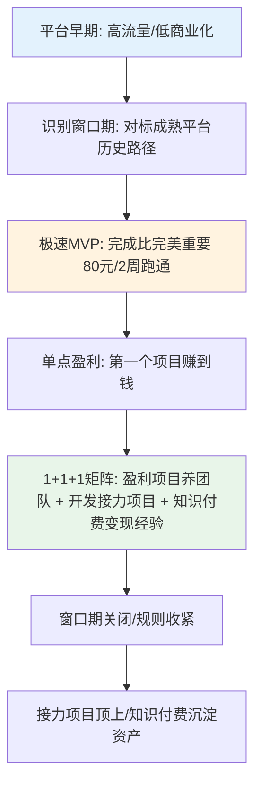

# 第 26 章 创业的底层逻辑：从痛点到闭环的完整方法论

## 学习目标

- 理解痛点驱动创业的第一性原理：从“哪里疼贴哪里”到构建商业闭环
- 掌握信息差变现的核心逻辑：识别信息断层、打通渠道、收取“降低搜索成本”的服务费
- 熟练运用“选品决定论”评估产品：深挖需求、涵盖面齐全、品牌背书、高复购结构
- 掌握最小MVP闭环验证方法：用最小成本（如80元、2周）跑通“产品-流量-销售-交付”全链路
- 学会判断行业周期窗口期：识别“高流量低商业化”红利期，在平台早期完成模型跑通与放大
- 能运用“1+1+1项目矩阵”规划业务组合：1个盈利养团队、1个开发接力、1个知识付费变现经验
- 学会从0到1的获客与转化实操：公域矩阵引流、蹭流截流开店、私域高客单SOP转化、裂变扩张
- 建立风险控制与合规底线：外包避坑、招聘偏好、投放渠道排序、融资防骗、平台规则红线

## 26.1 生活类比

想象创业像**开一家‘专科诊所’**：痛点 = 病人“哪里疼”的具体症状（荨麻疹、买房被坑、想赚钱没门路）；信息差 = 医生“知道病因和药方”而病人不知道的知识垄断；选品 = 开对症的“特效药”（深挖需求、高复购、有背书），而非卖“维生素”；MVP = 先用“土方子”治好第一个病人（挣第一块钱、跑通闭环），再建医院；窗口期 = 流感高发季“荒诞疗法”也能火（平台早期高流量低商业化），过季神药也卖不动；1+1+1矩阵 = 诊所里：1个主治医师看病赚钱、1个研发新药方、1个开培训班教徒弟；公域引流 = 在大街上发传单、蹭隔壁大医院溢出病人、在社区讲座留微信；私域转化 = 进诊室“破冰问诊→诊断病因→开方子→建立信任→收费开药”（五位一体成交飞轮）；裂变扩张 = 开分院、收徒弟、授牌匾（合伙人/加盟/城市管家），标准化复制“诊疗SOP”；股权治理 = 合伙开医院：谁担责谁控股（创始人身份）、按出工出力出钱分红（4C模型）、立规矩防撕逼；心态内功 = 医生必须“盲目自信”能治好病（内在比赛赢），靠“治好一个信一个”累积自信（成功是成功之母），站着收徒不跪着求教（俯视学习）。

## 26.2 概念地图

创业起点与商业模式设计 (第1章)
├── 痛点是创业的第一性原理
│   ├── 核心定义：用户急迫想解决且现有方案无法满足的具体问题
│   ├── 关键性质：天然刚需、越垂直越易建壁垒、需经专业验证
│   ├── 典型例子：夕子荨麻疹→科学护肤、胖龟买房痛点→0中介费、老杨TikTok赚钱难→娱乐直播
│   └── 边界条件：需具备付费意愿/能力、警惕政策/平台规则失效、自身痛点≠大众痛点需验证规模
├── 信息差就是金钱
│   ├── 核心定义：交易双方对关键信息认知不对等，变现即打通断层收取服务费
│   ├── 关键性质：随透明度收窄需挖新断层、核心壁垒在于获取渠道与效率、买家跳单因定价过高
│   ├── 典型例子：胖龟公开房东电话、夕子转化医美专业信息、老杨移植Twitch睡播玩法
│   └── 边界条件：不可持久需叠加服务/产品/品牌、非法获取信息有法律风险、纯信息差天花板低
├── 选品决定论
│   ├── 核心定义：寻找“深挖需求+涵盖面全+品牌背书+高复购+可溢价”的产品组合
│   ├── 关键性质：选品重于销售、口服/消耗型>耐用型、品牌背书可迁移(医生/博士/空壳品牌)
│   ├── 典型例子：夕子医美面膜→口服爆款→自建品牌、胖龟卖信息→卖会员→卖自有品牌、老杨声光电道具微创新
│   └── 边界条件：依赖平台规则动态适配、无绝对好产品只有特定人群时刻好、需持续迭代开发能力
└── 最小MVP闭环
    ├── 核心定义：仅含核心价值、能跑通“产品-流量-销售-交付”的最简版本
    ├── 关键性质：速度>完美(80元/2周)、要素齐全(缺啥补啥)、止损前置(设定最大投入)
    ├── 典型例子：夕子2万起步半月出单、胖龟小程序挂房源成交首单、老杨iPhone+道具峰值破万、美团80元跑通30店
    └── 边界条件：MVP≠简陋(核心体验必达标)、验证指标看硬数据(首单成本/回本/复购)、重服务类需先标准化SOP
行业周期与项目矩阵 (第1章延伸/第4章)
├── 行业周期窗口期
│   ├── 核心定义：平台流量释放>商业化收割、规则宽松、头部未垄断、普通人可入场的黄金期
│   ├── 关键性质：早期高流量低商业化(抖音早期/TikTok2022/视频号2023/美团电商)、窗口期有寿命(老杨预判2年)、完成比完美重要
│   ├── 典型例子：老杨TikTok对标抖音2017、胖龟扑中存量时代二手房红利、夕子疫期小红书红利、美团电商类比淘系铺货期
│   └── 边界条件：不可预测精确终点需敬畏市场、警惕伪窗口期平台收割、跨周期生存靠1+1+1矩阵
└── 1+1+1项目矩阵模式
    ├── 核心定义：1个盈利养团队、1个在开发、1个知识付费变现经验
    ├── 关键性质：项目生命周期2-6个月必须具备开发新项目能力、可复制快速执行门槛拔高
    └── 典型例子：老杨娱乐直播矩阵、夕子美业+加盟+课程、胖龟买房+租房+合伙人
获客转化与私域运营 (第3章)
├── 公域获客矩阵
│   ├── 内容不自嗨：定位→选题→模仿→优化→创新(学书法先临帖)
│   ├── 全域矩阵：抖音/快手/小红书/58/转转/豆瓣/知乎多平台撒网(撒网捕鱼)
│   ├── 蹭流截流：开在传统中介隔壁“0中介费”截流自然客流(借东风)
│   └── 租客全域发掘：评论区私聊、拼室友、求租广场、超话小组主动出击
├── 私域转化体系
│   ├── 金饭碗思维：专业用户服务高客单技术需求，非低价值团购(端金饭碗别讨饭)
│   ├── 咨询SOP表格：标准化回复模板提升速度/客单/成交率
│   ├── 五位一体成交飞轮：破冰→诊断→方案→信任→成交(解决为什么买/跟你买/现在买)
│   └── 单客价思维：关注用户生命周期总价值(LTV)而非单次客单价，拉长周期提复购
└── 裂变与扩张
    ├── 合伙人/城市管家：平台给房源库/配房/流程，合伙人只维护用户(铺铁路网)
    ├── 加盟赋能一条龙：脚本/SOP/课程/朋友圈/聊天SOP拿来即用(克隆直营店)
    └── 人海战术：单员工底薪3000月两单覆盖成本，批量招人放大利润
团队治理与风控 (第5-6章)
├── 股权与治理
│   ├── 4C动态量化模型：创始人身份/岗位权重/时间投入/资金投入四维定量分股
│   ├── 创始人身份本质：承担最大风险兜底责任=最大控制权(对外仅一把声音)
│   ├── 时间投入看产出匹配里程碑、资金投入是信心与风险意愿信号
│   ├── 招聘避坑：白纸可塑(应届生)>经验固化(房产销售)，旧瓶难装新酒
│   └── 股权起点非终点：需配套一致行动权/期权池/回购权/优先清算/领售权等合同
├── 融资与合规风控
│   ├── 融资防骗：有人推荐、不盲目缴费(看病找正规医院)
│   ├── 劳动合规：合同是枪附件是子弹(岗位考核/规章/廉洁/保密)、辞退最小化损失、及时签合同建考核
│   ├── 平台规则：敬畏风控、合规或规避获流量、内容审核应对(离线版/用户反馈/修订重传)
│   └── 止损决策：理性评估门槛(预算/资质/工期/流量源)果断放弃而非盲目投入
└── 认知与心态
    ├── 内在比赛理论：自我二(潜意识)认可目标才能赢外在比赛，盲目自信是理性选择
    ├── 成功是成功之母：过去成功体验累积潜意识自信推动更大成功，唤醒成功体验法
    ├── 俯视学习法：战略藐视战术重视，跪着学打不赢内在比赛
    ├── 正反馈驱动热爱：懒惰本质是无正反馈，突破口找热爱或纯为钱冲
    └── 战术勤奋逃避战略探索：用忙碌麻痹自己长期有毒，唯有战略突破带来真增长

## 26.3 痛点是创业的第一性原理 —— 哪里疼就贴哪里

### 为什么需要这个概念？

创业不是凭空发明，而是源于对用户真实痛点的深切感知。只有解决真痛点，生意才有刚需属性，不靠“忽悠”也能成交。这能帮你避开“伪需求”陷阱，不做出来没人用的产品。

### 核心定义

**痛点**（来源：《E1WGd70YLoaHGfxAYJTc4WoFnsd.md》、《PglAdRMiIoVTRyxc4Q3cw8hvnWf.md`）

> 用户急迫想解决、且现有方案无法满足的具体问题。创业切入点：从自身或他人的真实痛点出发，构建商业闭环。

### 关键性质

- **天然刚需**：痛点驱动的生意天然具备“刚需”属性，客单价与复购率更高。
- **越垂直越易建壁垒**：痛点越具体、越垂直，越容易建立专业壁垒（如夕子从荨麻疹切入科学护肤）。
- **需经专业验证**：痛点需经得起“找专业人士解决”的验证，伪痛点经不起专业推敲。

> "皮肤有问题最快捷的方式就是找专业人士解决。皮肤没啥问题，做好温和清洁+适度保湿+加强抗氧化+随时防晒，健康靓丽皮肤就完成80%。"
> 
> ——《E1WGd70YLoaHGfxAYJTc4WoFnsd.md》

### 典型例子

| 案例 | 核心痛点 | 商业转化 |
|------|----------|----------|
| **夕子** | 自身荨麻疹、敏感肌 | 辞职三甲医院做线上美业，年利润过百万 |
| **胖龟找房** | 买房遭遇“虚假低价、阴阳合同、高额代办费” | 创立0中介费平台，年入百万 |
| **老杨** | TikTok早期“想赚钱却没门路” | 切入娱乐直播，单小时均100美金 |

> "中介费为什么要收？就是因为买房及租房者不知道售房及出租转让业主的联系电话！"
> 
> ——《PglAdRMiIoVTRyxc4Q3cw8hvnWf.md》

> "回观抖音的发展路径，第一阶段就是高流量低商业化阶段，这时候要做的并不一定要跟平台的指向，而是要看清平台的现状。"
> 
> ——《FCiidWBeJoLOT1xreYnc9Se4nOf.md》

### 边界条件

- **仅有痛点不够**，还需具备“付费意愿”与“付费能力”（如<15岁用户爱看睡播但付费弱）。
- **痛点若被平台规则封杀**（如中介费被政策禁止），模式会失效。
- **自身痛点不等于大众痛点**，需验证市场规模（如“科学护肤金字塔”验证80%人只需基础护理）。

## 26.4 信息差就是金钱 —— 你知道而别人不知道的路径

### 为什么需要这个概念？

打破“中介费天经地义”的认知，揭示垄断信息赚差价的本质。理解为何“搬运信息”能成生意：信息不对称是商业利润的源头。指导选品与获客：找到信息断层处，即是流量与变现入口。

### 核心定义

**信息差**（来源：《PglAdRMiIoVTRyxc4Q3cw8hvnWf.md`）

> 交易双方对关键信息（价格、渠道、联系方式、规则）认知不对等。**信息差变现**：打通信息断层，收取“降低搜索成本/规避风险”的服务费。

### 关键性质

- **随透明度收窄**：信息差随透明度提升而收窄，需不断挖掘新断层（如从“房东电话”到“二房东渠道”）。
- **核心壁垒不在信息本身**：而在于“获取信息的渠道与效率”（物业关系、水电费号、同行转化）。
- **买家跳单动机**：本质是“信息差定价过高”（中介服务不值其费）。

### 典型例子

| 案例 | 信息断层 | 变现模式 |
|------|----------|----------|
| **胖龟找房** | 买房者不知道房东电话 | 小程序公开联系方式，“0中介费”截流，年入百万 |
| **夕子** | 用户不懂医美专业信息 | 转化“科学护肤金字塔”卖货，月利润5万+ |
| **老杨** | 国内不知Twitch睡播玩法 | 本地化移植到TikTok，单小时均100美金 |

> "生意的本质就是信息差，在互联网里也存在大量的信息差生意。"
> 
> ——《PglAdRMiIoVTRyxc4Q3cw8hvnWf.md》

> "我们不收中介费，是因为中介费本身就是个伪概念！为什么说是伪概念，因为是智商税……物业：通过与物业建立起关系，给予一定的费用，拿到业主电话。水电费号码：通过水电费号，找到相应的单位人员获取业主电话。"
> 
> ——《PglAdRMiIoVTRyxc4Q3cw8hvnWf.md`

### 边界条件

- **信息差不可持久**：政策推行“0中介费政府平台”、平台打击搬运、用户认知升级均会消灭信息差。
- **非法获取信息风险**：爬虫窃取、购买黑数据构成法律风险，需合规化（如物业付费合作、公开渠道监测）。
- **纯信息差天花板低**：需叠加“服务/产品/品牌”升维（如胖龟从卖信息转向卖会员服务、自有品牌）。

### 多源对照：信息差的获取渠道与壁垒

**共识**：信息差变现的核心是“降低搜索成本”，壁垒在于“渠道与效率”而非信息本身。

**分歧**：

- 《PglAdRMiIoVTRyxc4Q3cw8hvnWf.md》强调**线下物理渠道**（物业、水电费号、同行转化）的独家性与可控性；
- 《FCiidWBeJoLOT1xreYnc9Se4nOf.md》强调**跨平台/跨市场信息迁移**（Twitch→TikTok）的时间差价值；
- 《E1WGd70YLoaHGfxAYJTc4WoFnsd.md》强调**专业知识转化**（医生端→用户端）的认知差价值。

## 26.5 选品决定论 —— 产品好省一半心

### 为什么需要这个概念？

避免“拼运营、拼投流”内卷：好产品自带流量属性与转化属性。解决“后端无复购、利润薄”顽疾：选品即定商业模式上限。降低创业试错成本：选对赛道，笨功夫也能出活。

### 核心定义

**选品**（来源：《E1WGd70YLoaHGfxAYJTc4WoFnsd.md`）

> 在特定市场窗口期，寻找“深挖用户需求、涵盖面齐全、有品牌背书、高复购、可溢价”的产品组合。

**核心公式**：

$$
\text{好产品} = \text{精准痛点解决方案} + \text{信任背书} + \text{高复购结构}
$$

### 关键性质

- **选品重于销售**：夕子“果断花1.6万入货合伙人级别”，因产品好，客单价、成交率、利润率全上涨。
- **口服/消耗型 > 耐用型**：口服保养“一个人一单接受了不会轻易更换”，天然高复购。
- **品牌背书可迁移**：医生/博士创立、医院合作、空壳品牌故事，均能大幅降低信任成本。

> "所以选品很关键，产品好省了一半的心，后续回购率也高。"
> 
> ——《E1WGd70YLoaHGfxAYJTc4WoFnsd.md`

> "1.深挖用户需求，最好涵盖面齐全：比如说不仅祛痘、还有美白、抗衰等等 2.口服保养是趋势，一个人一单接受了某个品牌的口服，不会轻易更换牌子的 3.尽量能跟医院合作的产品，品牌背书这块强"
> 
> ——《E1WGd70YLoaHGfxAYJTc4WoFnsd.md`

### 典型例子

| 创业者 | 选品进化路径 | 核心逻辑 |
|--------|--------------|----------|
| **夕子** | 代购医美面膜（一单2元）→ 自选口服爆款（月利润5万）→ 自建品牌（985博士+医生背书） | 从低毛利非标品→高复购消耗品→强背书自有品牌 |
| **胖龟找房** | 卖“房源信息”→ 卖“会员服务”→ 卖“自有品牌租房/家居水光” | 客单价从百元到万元，产品化降低交付依赖 |
| **老杨** | 睡播核心“产品”是“声光电道具+剧本”，微创新（材质套利）延长红利期2-6个月 | 非标娱乐内容标准化、工具化、可复制 |

### 边界条件

- **依赖平台规则动态适配**：抖音打击无货源、TikTok限制娱乐直播、美团压价标品，选品需动态适配。
- **无绝对好产品**：只有“特定人群+特定时刻”的好产品（如真皮包在日本免税、在东欧做日牌）。
- **需持续迭代开发能力**：老杨强调“项目生命周期2-6个月，必须具备开发新项目能力”。

## 26.6 最小MVP闭环 —— 先造独木舟再过河

### 为什么需要这个概念？

避免“造航母”式创业：前期投入过大、周期过长、风险不可控。验证商业模型核心假设：产品有人要？流量买得起？能交付？利润为正？建立“从0到1”的标准动作：挣第一块钱，跑通闭环，再考虑放大。

### 核心定义

**MVP（最小可行产品）**（来源：《E1WGd70YLoaHGfxAYJTc4WoFnsd.md》、《FCiidWBeJoLOT1xreYnc9Se4nOf.md`）

> 仅包含核心价值、能跑通“产品-流量-销售-交付”闭环的最简版本。**闭环验证标准**：能否用最小成本（如2万、80元、1周）完成一次完整的商业交易。

### 关键性质

- **速度>完美**：老杨“第一家店跑通MVP仅花80元”，夕子“2万起步、半个月出单”。
- **要素齐全**：缺产品找代工/联营，缺流量做内容/投放，缺交付做SOP/找外包。
- **止损前置**：设定“最大投入时间/金钱/资源”，跑不通即切换（夕子知乎封号转小红书）。

> "1.做生意从自己身边资源入手，从挣1块钱开始，选一个天花板比较高的，持续3——5年。 2.跑通自己的生意环节，最小mvp（产品——流量—销售—交付）"
> 
> ——《E1WGd70YLoaHGfxAYJTc4WoFnsd.md`

> "第一个阶段：基本所有新号2天起量，峰值突破500，5天突破2000；...美团电商冷启动与红利验证：2022年8月末发现美团电商机会后不到两个月从0跑通并扩展到30家店...第一家店跑通最小MVP仅花费80元。"
> 
> ——《FCiidWBeJoLOT1xreYnc9Se4nOf.md`

### 典型例子

| 案例 | MVP成本 | 核心动作 | 验证指标 |
|------|---------|----------|----------|
| **夕子** | 2万 | 注册公司解决社保→ 微信诊断+医美面膜→ 知乎引流→ 淘宝交付 | 半月出单、月利润1-2万 |
| **胖龟找房** | 低 | 小程序挂房源→ 物业买电话→ 朋友圈成交第一单 | 验证“买家愿付会员费” |
| **老杨** | ~5600-8000元 | iPhone+电脑+道具→ 程序控制设备→ 简陋直播间 | 峰值破万、单小时100美金 |
| **美团电商** | 80元 | 开店→ 优选联盟选品→ 发货出单 | 两个月30店、单店月利6-12k |

### 边界条件

- **MVP不等于“简陋产品”**：核心体验必须达标（如睡播需“声光电联动”、美业需“专业诊断”）。
- **验证指标要硬**：看“首单成本、回本周期、复购率”，别看“点赞、曝光、注册数”。
- **非标品/重服务类MVP更难**：需先做“服务SOP标准化”（如夕子咨询SOP表格）再复制。

### 数据流图：MVP闭环的四要素流转

## 26.7 行业周期窗口期 —— 在“高流量低商业化”阶段入场

### 为什么需要这个概念？

同一项目，早做一年赚百万，晚做一年亏百万，核心差异在“入场时机”。识别平台/行业“红利期、成长期、成熟期、衰退期”，避免逆周期操作。利用“时间套利”：在平台鼓励、竞争弱、流量廉价时，用笨办法跑通模型。

### 核心定义

**窗口期**（来源：《FCiidWBeJoLOT1xreYnc9Se4nOf.md》、《PglAdRMiIoVTRyxc4Q3cw8hvnWf.md`）

> 平台流量释放 > 商业化收割、规则宽松、头部未垄断、普通人可入场的黄金时期。**判断依据**：平台战略重心、头部玩家动作、流量单价、违规容忍度、政策风向。

### 关键性质

- **早期高流量低商业化**：抖音早期、TikTok 2022年、视频号 2023年、美团电商 2022下半年。
- **窗口期有寿命**：老杨预判娱乐直播“至少2年”，胖龟扑中“存量消费时代”二手房红利。
- **窗口期内“完成比完美重要”**：美团电商“完成比完美更重要”，先跑通再优化。

> "按照抖音、映客花椒的发展路线图，初级阶段娱乐直播至少可以做2年的时间..."
> 
> ——《FCiidWBeJoLOT1xreYnc9Se4nOf.md`

> "早在 2018 的时候国内的新建楼房已经开始走下坡路...国内房产销售已经从存量与增量市场并重的方向，开始迈入存量消费时代。"
> 
> ——《PglAdRMiIoVTRyxc4Q3cw8hvnWf.md`

> "有模式，我称之为1+1+1，1个在盈利，1个在开发，1个在知识付费"
> 
> ——《FCiidWBeJoLOT1xreYnc9Se4nOf.md`

### 典型例子

| 平台/赛道 | 窗口期特征 | 入场者收益 |
|-----------|------------|------------|
| **TikTok娱乐直播** | 对标抖音2017-2018，高流量低商业化 | 老杨：单小时均100美金，峰值在线4.2万 |
| **胖龟找房** | 2018新房下行+疫情催化，存量时代红利 | 第一年8家店、104.7万营收、帮会员省574万中介费 |
| **夕子小红书** | 2020疫期封控期流量红利 | 封家半月→千粉变万粉→月利润5万+ |
| **美团电商** | 类比淘系“铺货期”红利 | 80元MVP→2个月30店、单店月利6-12k |

### 边界条件

- **窗口期不可预测精确终点**：只能“敬畏市场、与市场共舞”，保护弹药（现金流、团队）。
- **伪窗口期陷阱**：平台放水吸引商家入驻，实则收割（如TEMU压价至1688平齐、抖音本地生活后期严控合规）。
- **跨周期生存需“1+1+1矩阵”**：1个盈利养团队、1个开发接力、1个知识付费变现经验。

### 方法演进图：从平台红利识别到矩阵化生存

## 26.8 1+1+1项目矩阵模式

### 核心定义

**1+1+1项目矩阵**（来源：《FCiidWBeJoLOT1xreYnc9Se4nOf.md`）

> 1个项目在盈利（养团队、现金流）、1个在开发（接力、应对生命周期）、1个在做知识付费（变现经验、建立品牌护城河）。

### 关键性质

- **项目生命周期短**：娱乐直播类2-6个月，必须具备开发新项目能力。
- **可复制快速执行**：门槛能有多高拔多高，但要看人员配备现状。
- **三重保险**：现金流不断、新项目储备、经验资产化。

### 典型例子

| 创业者 | 盈利项目(1) | 开发接力项目(1) | 知识付费/经验变现(1) |
|--------|-------------|-----------------|----------------------|
| **老杨** | TikTok睡播/娱乐直播矩阵 | 新娱乐直播玩法(声光电微创新) | 将全套SOP/软件/硬件配置包装教学 |
| **夕子** | 线上美业私域高客单 | 实体皮肤管理店/自有品牌研发 | 科学护肤课程/加盟商赋能体系 |
| **胖龟找房** | 0中介费买房/租房会员费 | 城市合伙人/店中店扩张模式 | 房产创业实战课/合伙人招募 |

## 26.9 设计中的取舍

### 为什么不用“大而全”的产品规划起步？

因为资源有限，大而全意味着周期长、沉没成本高、反馈慢。MVP只验证核心假设：“有人愿为核心价值付费且流程可跑通”。夕子若一开始就想“自建品牌+实体店+全品类”，早死在2万启动资金里了。

### 为什么不在窗口期结束后才开发新项目？

因为开发新项目本身需要2-6个月磨合期。老杨的“1个在开发”正是在盈利项目红利期内启动下一个，实现无缝衔接。等风口过再找方向，只能吃残羹冷炙。

### 纯信息差模式与“产品+服务”模式的trade-off是什么？

纯信息差：启动快、边际成本零、但天花板低、极易被透明化消灭（如政府平台上线）。“产品+服务”：交付重、需SOP、但建立品牌资产、复购高、抗风险强。胖龟、夕子、老杨最终都走向了后者。

## 26.10 动手练习

### 练习1：为你的副业想法做一次‘痛点-信息差-选品’三步验证

假设你想做一个“考公上岸资料整理”副业：

1. 痛点验证：列出目标用户（考公小白/二战裸考生）最急迫的3个具体痛点，并判断哪些是“伪痛点”（如“想要免费资料”非付费痛点）。
2. 信息差挖掘：这些痛点背后，用户不知道而你知道的关键信息是什么？（如：哪个老师的押题卷命中率高、哪个岗位竞争比被低估、面试真题去哪找）。
3. 选品决策：基于以上，设计一个“最小可行产品”组合（如：9.9元“避坑指南电子书”+ 99元“高频考点押题卷”+ 299元“面试模拟陪练营”），标注每个产品的“深挖需求/涵盖面/品牌背书/复购/溢价”得分。

回答问题：
- 如果平台突然免费开放所有真题，你的信息差还在吗？如何升维？
- 为什么“免费资料包”不能作为核心付费产品？

### 练习2：设计一个‘最小MVP闭环’的7天执行计划

场景：你想验证“帮中小企业做抖音同城获客代运营”这个模式。

请按“产品-流量-销售-交付”四环节，列出第1-7天每天的关键动作、预算上限、验证指标（如：第3天前搞定1个种子客户免费试单、第5天跑通标准化交付SOP、第7天收到首笔意向金）。

标注你的“止损点”：最多投入多少钱/天/人力，未达标准即切换或放弃。

回答问题：
- 为什么“帮客户拍1条视频”不是合格的MVP交付？
- 如何用“咨询SOP表格”思维，把非标的“代运营”服务标准化？

### 练习3：推演你所在赛道的‘窗口期-矩阵-风控’策略

以“AI绘画小程序”或“视频号无货源店群”或“抖音本地生活代运营”任选一个为例：

1. 窗口期判断：该赛道目前处于“高流量低商业化”、“成长期”、“成熟期”还是“衰退期”？依据是什么（平台战略/头部动作/流量单价/违规容忍度）？
2. 1+1+1矩阵规划：你的“盈利项目”是什么？“开发中的接力项目”是什么？“知识付费变现经验”产品是什么？
3. 关键风控清单：列出该模式下的Top 3平台规则红线、Top 2合规成本、Top 1止损触发条件。

回答问题：
- 如果平台突然收紧规则（如抖音打击无货源、微信封小程序），你的“开发接力项目”能否在2周内顶上？
- 为什么“把鸡蛋放在一个平台篮子里”违背窗口期理论？

### 练习4：模拟一次‘股权分配与合伙人招聘’决策会

场景：你和两位合伙人（一位全职运营、一位出技术兼职、一位出资20万不参与运营）准备注册公司做“私域流量变现工具”。

1. 用4C模型（创始人身份/岗位权重/时间投入/资金投入）给三人分配初始股权比例，并写出每个维度的权重设定理由。
2. 列出必须配套的5项合同条款（如：一致行动权归属、期权池比例、退出回购价格公式、竞业限制、知识产权归属）。
3. 招聘第1名员工（运营助理）：你会倾向于“有2年抖音运营经验”还是“应届生但做过学生会组织过3场百人活动”？用“旧瓶难装新酒/白纸可塑”理论解释理由。

回答问题：
- 为什么“创始人身份”必须由一个人承担，不能共享？
- 如果出资合伙人要求“因为我出钱多，重大决策我有一票否决权”，你如何用“创始人身份=风险兜底=控制权”理论沟通？

## 26.11 本章小结

这一章中我们系统学习了创业从0到1再到N的完整方法论。首先，我们确立了**痛点是创业的第一性原理**：真痛点天然刚需、越垂直越易建壁垒，需经专业验证，且必须匹配付费意愿与能力。其次，我们揭示了**信息差就是金钱**的本质：生意核心是打通信息断层收取“降低搜索成本”的服务费，壁垒在于获取渠道与效率，且需通过“产品+服务+品牌”升维突破天花板。接着，我们掌握了**选品决定论**：好产品=精准痛点方案+信任背书+高复购结构，选品重于销售，消耗型优于耐用型，品牌背书可迁移。然后，我们实操了**最小MVP闭环**：速度>完美、要素齐全、止损前置，验证看硬指标（首单成本/回本/复购），非标服务需先SOP化。之后，我们判断了**行业周期窗口期**：平台早期“高流量低商业化”是普通人黄金入场期，完成比完美重要，窗口期有寿命需敬畏市场。进而，我们构建了**1+1+1项目矩阵**：1个盈利养团队、1个开发接力、1个知识付费变现经验，应对2-6个月的项目生命周期。最后，我们建立了**风控与认知底线**：4C股权模型（创始人身份=风险兜底=控制权）、招聘偏好白纸可塑、投放排序抖音>本地自媒体>广播、融资防骗不盲目交费、内在比赛理论（盲目自信是理性选择、成功累积自信、俯视学习）。

本章我们一起学习了以下概念：

| 概念 | 解释 |
|------|------|
| 痛点/第一性原理 | 创业源于对用户真实痛点的深切感知，解决真痛点生意才有刚需属性 |
| 信息差变现 | 生意本质是信息不对等，打通信息断层收取“降低搜索成本”服务费 |
| 选品决定论 | 好产品=精准痛点方案+信任背书+高复购结构，选品重于销售、自带流量转化属性 |
| 最小MVP闭环 | 用最小成本跑通“产品-流量-销售-交付”，速度>完美、止损前置、验证看硬指标 |
| 行业周期窗口期 | 平台早期“高流量低商业化”是普通人最易入场红利期，完成比完美重要、预判寿命做矩阵 |
| 1+1+1项目矩阵 | 1个盈利养团队、1个开发接力、1个知识付费变现经验，应对项目2-6个月生命周期 |
| 公域获客矩阵 | 内容不自嗨(模仿优化)、多平台撒网(抖音/小红书/58等)、蹭流截流(开隔壁店)、主动出击挖租客 |
| 私域高客单转化 | 端金饭碗别讨饭：专业用户服务高客单技术需求，靠咨询SOP+五位一体成交飞轮提效 |
| 单客价/LTV思维 | 关注用户生命周期总价值而非单次客单价，通过复购拉长周期提升整体销售额 |
| 裂变扩张体系 | 城市合伙人(平台给基建合伙人维用户)+加盟赋能(脚本/SOP/课程拿来即用)+人海战术(低底薪高提成) |
| 4C股权模型 | 创始人身份/岗位权重/时间投入/资金投入四维定量分股，创始人身份=风险承担=控制权 |
| 招聘偏好 | 白纸可塑(应届生)>经验固化(行业老手)，旧瓶难装新酒，思维转化比技能更关键 |
| 合规风控底线 | 劳动合同带附件、外包实地考察吸纳技术合伙人、投放排序抖音>本地自媒体>广播、融资防骗不盲目交费 |
| 内在比赛/心态 | 潜意识(自我二)认可目标才能赢，盲目自信是理性选择、成功累积自信、俯视学习、正反馈驱动热爱 |

下一章中，我们将学习**获客与流量实操方法论**：如何用“公域矩阵+蹭流截流+私域SOP”构建从流量到成交的完整闭环，并掌握“五位一体成交飞轮”与“单客价思维”的具体落地技巧。
