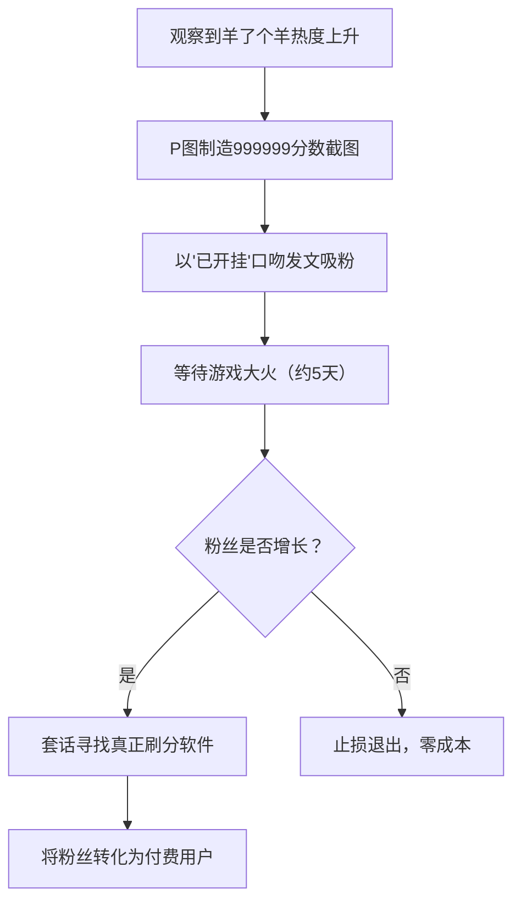
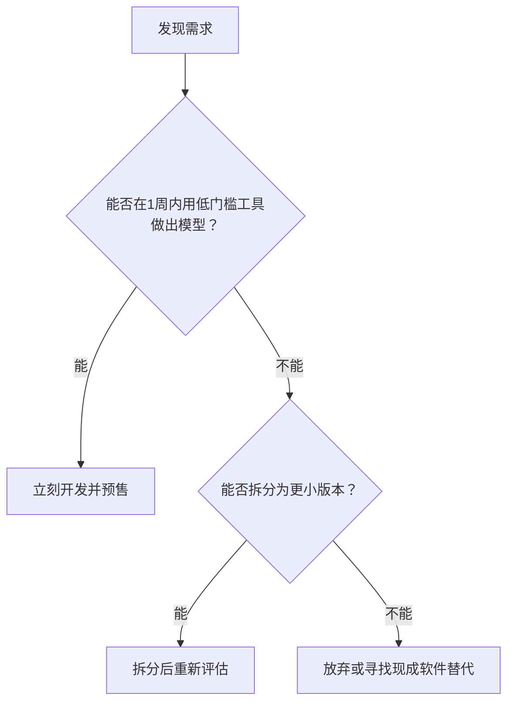

# 第 3 章 产品孵化 —— “卖空气”与“软文先行”的最小化验证

## 学习目标
- 理解传统“先开发后售卖”流程的痛点与风险
- 掌握“卖空气”预售法的定义、核心原则与操作路径
- 理解“软件的本质就是软文”这一反直觉起点及其推论
- 学会用“复述问题”建立信任基础的内容策略
- 掌握非规范化生产（野路子）的核心目标与工具选择
- 了解“有效噱头、无效产品”的心理学原理及其伦理边界
- 能根据产品特点判断“卖空气”方法的适用边界与风险

## 3.1 生活类比

想象产品孵化是一场在集市上预售“空气”的过程。传统做法是你先把菜做好、锅碗瓢盆准备齐全，然后再摆摊售卖——成本高、周期长，最致命的是你可能忙活了大半个月，最后发现根本没人想吃这道菜。而“卖空气”的思路则完全相反：你先在摊位上挂出一张色泽诱人、让人垂涎欲滴的菜品海报，告诉来往的顾客“这道菜马上就好”，有人愿意付定金预订了，你再去后厨开火做菜。这张海报就是你的模型截图，它让人相信你已经有这道菜了；顾客交的定金就是你的预售款，它验证了这道菜到底有没有人想吃。聪明的摊主还会像医生问诊一样，先问你“是不是这里疼”“是不是最近失眠”，你发现他说的全是你正在经历的，你会觉得“这次找对人了”——这就是复述问题建立信任的魔力。至于非规范化生产，则是用普通的锅具快速炒出一道能吃的菜，而不是先建一座五星级厨房再开工。就像聪明的摊主先收钱后出菜——能卖出去就做，卖不出去就收摊，个人开发者也需要用“卖空气”来先验证市场需求，再投入真正的开发。

## 3.2 概念地图

```
第3章 产品孵化 —— “卖空气”与“软文先行”的最小化验证
├── 核心起点：软件的本质就是软文
│   ├── 推广方式决定开发流程 —— 反推开发，甚至不开发而寻找现成软件
│   ├── 沟通成本高于开发成本 —— 用工具捏模型替代语言沟通
│   └── 程序思维 vs 反流程思维 —— “先有东西再推广”是误区
├── 核心方法：卖空气（预售验证）
│   ├── 核心定义 —— 制造“已具备功能”的假象来预售
│   ├── 核心原则 —— 假装已经有了，再去卖；卖不出去就不做
│   ├── 操作路径 —— 捏模型截图 → 发布预售 → 收钱测试需求
│   ├── 关键性质 —— 需求验证前置、零沉没成本、反流程性
│   └── 典型案例 —— 羊了个羊P图吸粉、橡皮擦工具预售
├── 信任基础：复述问题建立信任
│   ├── 心理机制 —— “这次找对了”的就医错觉
│   ├── 内容策略 —— 罗列用户症状而非给出解决方案
│   └── 应用场景 —— 软文撰写的第一性目标
├── 生产方式：非规范化生产（野路子）
│   ├── 核心目标 —— 降低成本、提升效率
│   ├── 工具路径 —— 中文编程工具等低门槛工具
│   ├── 时间红线 —— 单软件研发不超过1周
│   └── 反面警示 —— “没有正统的命，得了正统的病”
└── 理论支撑与边界：有效噱头与无效产品
    ├── 安慰剂效应 —— 糖豆当救命药也有30%+康复率
    ├── 名字决定认知 —— 连花清瘟案例
    ├── 伦理边界 —— 不适用于长期交付、复购或品牌信任
    └── 风险提示 —— 信任透支、法律与道德风险
```

## 3.3 卖空气 —— 先收钱、后造梦的预售魔法

传统的产品开发流程是“先开发，后售卖”：你花几个月时间写出代码、测试、上线，然后才开始寻找用户。这套流程在资源充足的大公司里没有问题，但对个人开发者或小团队来说，它意味着一个致命的风险——**如果你的需求判断失误，所有投入都将付诸东流**。更残酷的是，市场热点的窗口期往往极短。

> “或者直接做个模型，上架开卖，卖空气，卖预售。卖不出去就没必要继续做了！”

> ——《DNGrdODFBowfk2xwkNCc5GGSnRd.md》

这句话直接点出了“卖空气”的核心逻辑——**让市场在此之前告诉你答案**。我们先来看作者对传统思维的反击：

> “程序的思维总是先有东西再推广，不要等什么东西已经有了再去卖！假装已经有了足够！卖空气！”

> ——《DNGrdODFBowfk2xwkNCc5GGSnRd.md》

“程序思维”指的是一种职业惯性：先有产品，再找用户。作者认为这个顺序在个人开发场景下是完全错误的，因为它把最大的不确定性（用户是否买单）留到了最后。

> **卖空气**定义（来源：《个人开发者的“野路子”生存法则》）

**卖空气**是指在产品尚未开发或无法真正兑现功能时，先通过制造“已具备该功能”的假象（如模型截图、预售页面、演示视频）来收取用户资金，以此测试需求是否真实存在的产品验证策略。其核心原则是“假装已经有了，再去卖”，若预售效果不佳则果断放弃后续开发。

这个定义揭示了三个关键性质：

| 性质 | 含义 | 解决的问题 |
|------|------|-----------|
| 需求验证前置 | 把“市场是否买单”的验证从开发后提前到开发前 | 避免开发完才发现没人要 |
| 零沉没成本 | 卖不出去就不必继续做 | 避免投入打水漂 |
| 反流程性 | 销售先于产品存在 | 颠覆“先有东西再推广”的思维定式 |

**“假装已经有了，再去卖”的完整操作流程**

```
1. 观察到一个热门需求（如羊了个羊刷分神器）
2. 用现成工具捏一个模型界面，截取逼真截图
3. 以“已开发完成”的口吻撰写发布文案
4. 将截图+文案发布到目标用户聚集的社交平台
5. 收取用户询价、预订或直接付款
6. 若预售效果好 → 着手开发或寻找现成软件兑现
7. 若预售效果差 → 立即止损，不做任何进一步投入
```

这段伪代码将“卖空气”从一句口号变成了一个可执行的操作流程。请注意，整个流程的核心决策点在**第 5 步**——用户是否付费，而不是你是否能开发出来。这正是“需求验证前置”的体现。

让我们看一个实战案例来理解这套打法：

> “羊了个羊刚有点火，立刻就有人P一张分数999999截图，去社交软件用已经开挂的口吻发文，开始吸粉，差不多5天后《羊了个羊》大火火，这时他就可以，套话找真正能刷分软件了，直接把粉丝变现！”

> ——《DNGrdODFBowfk2xwkNCc5GGSnRd.md》

这个案例完美体现了“卖空气”的三个核心原则。第一，**时间窗口**——操作者并没有等游戏完全火爆后才行动，而是在“刚有点火”时就用 P 图制造了“已开挂”的假象。第二，**需求先行**——他先验证了“确实有人想刷分”这个需求，积累了粉丝，之后才去寻找真正的刷分软件。第三，**零沉没成本**——在整个过程中，他唯一的成本是一张 P 图的时间和发帖的几分钟，即使失败也不会有任何损失。



这个流程图清晰地展示了“卖空气”的决策分支结构。注意，无论结果如何，操作者的沉没成本都接近于零——这正是该方法最大的魅力。

**“卖空气”的边界条件**

任何方法都有它的适用范围。“卖空气”建立在“有效噱头、无效产品”这一伦理灰色地带之上，它虽然能加速赚钱，但存在明显的边界：

第一个边界是**产品形态**。该方法只适用于一次性、小额、需求急迫的短期生意。如果一个产品需要长期交付、持续复购或建立品牌信任，“卖空气”就完全不适用——因为预售承诺一旦无法兑现，用户的信任就会被透支，品牌随之崩塌。

第二个边界是**道德与法律风险**。通过制造虚假的“已具备功能”假象来收费，如果始终无法兑现，就不仅仅是“营销手段”而是涉嫌欺诈。作者的方法论建立在“后续能找到现成软件交付”的假设上，但并不是所有需求都能被现成软件满足。

## 3.4 软件的本质就是软文 —— 反推开发流程

本章最反直觉的起点，来自作者多年经验的总结：

> “多年经验总结一个观点：软件的本质就是软文。”

> ——《DNGrdODFBowfk2xwkNCc5GGSnRd.md》

这个观点听起来荒诞，但作者给出了一个非常务实的论证：

> “软件开发出来，怎么推广？还是通过写文章，发广告，介绍你这个软件，软件的最终的展现方式还是软文。”

> ——《DNGrdODFBowfk2xwkNCc5GGSnRd.md》

让我们把这个推理拆开来看。一个软件被用户接触和使用的完整链路是：**用户看到介绍文章（软文）→ 产生兴趣 → 下载或购买 → 使用**。也就是说，用户与软件建立联系的第一触点，永远是描述它的文字和图片——即软文。既然如此，为什么不在开发之前就把这篇软文写好呢？

> **软文先行**方法（来源：《个人开发者的“野路子”生存法则》）

```
1. 先撰写一篇介绍“某软件”的软文
2. 若预售效果好 → 反推开发流程，甚至不开发而寻找现成软件
3. 若预售效果差 → 直接放弃该想法
```

这个“软文先行”方法有三层推论：

第一层推论是**反推开发**——既然软文是最终呈现形式，那么可以从软文反推需要的功能，只开发软文里承诺的那些功能，而不是追求完整的“正规”产品。

第二层推论是**不开发**——如果存在现成软件能满足需求，直接寻找类似软件交付给客户，连开发环节都省掉。

第三层推论是**沟通降本**——作者观察到：

> “把需求完整的讲出来，又让他理解，本身就是一件不容易的事。沟通成本有时候比开发成本都高，还赶不上有一个趁手的工具，自己先捏一个模型给他看！”

> ——《DNGrdODFBowfk2xwkNCc5GGSnRd.md》

**为什么沟通成本比开发成本还高？** 因为语言是模糊的。你向客户描述一个软件功能，对方脑中生成的画面和你脑中的完全可能是两个东西。而一个粗糙的模型，哪怕功能不完整，却能在几秒钟内让对方看到“就是这个样子”。工具替代语言，这是“软文先行”的底层逻辑。

## 3.5 复述问题建立信任 —— 软文的第一性目标

现在我们知道了要先写软文、后做产品。但软文该怎么写？作者给出了一个极其简洁的答案——软文的核心目标只有一个：

> “写软文的核心是用户看到你这篇文章，内心在想‘这次找对了！’，就行了，不管他真找对了还是假找对了。”

> ——《DNGrdODFBowfk2xwkNCc5GGSnRd.md》

如何让用户产生“这次找对了”的感觉？答案既不是展示你的解决方案有多厉害，也不是自夸你的产品有多好，而是一个反直觉的技巧——**复述问题**：

> “举例：就拿看病举例子，医生会问你：‘有没有这个症状？有没有那个症状？’结果你发现：‘都是我现在症状’，所以你认为这个医生懂你的病，这次找对了！”

> ——《DNGrdODFBowfk2xwkNCc5GGSnRd.md》

> **复述问题建立信任**方法（来源：《个人开发者的“野路子”生存法则》）

```
1. 收集目标用户最常见的 5-10 个痛点/症状
2. 在软文中逐一罗列这些痛点（不做任何解决）
3. 观察用户反应：产生“这说的就是我”的感受
4. 信任建立完成 → 用户愿意继续阅读或与你联系
```

这段伪代码展示了“复述问题”的运作机制。请注意关键在第 2 步——**只罗列问题，不提供解决方案**。这和我们通常的直觉是相反的，我们总觉得应该先展示解决方案。但用户的真实心理是：他先要相信“你懂我”，才会相信“你能帮我”。

**为什么“复述问题”能建立信任？我们用心理机制来拆解：**

第一个心理机制是**确认偏误**。当医生问“是不是这里疼”时，你的大脑会自动从记忆中搜索“这里疼”的证据，搜索到了，你就会觉得“医生说得对”。同理，软文罗列的症状越多，用户找到与自己吻合的越多，就越相信作者理解他。

第二个心理机制是**稀缺性感知**。多数用户的问题长期得不到解决，是因为没人能够准确描述他的困境。当你第一个精准地复述出他的全部症状时，你在他眼中就成了稀缺的“懂行人”。

**“复述问题”在软文中的应用场景**

| 场景 | 复述内容 | 用户感受 |
|------|----------|----------|
| 涨粉工具软文 | “你是不是发了很多视频都没人看？” | “这说的就是我” |
| 刷分工具软文 | “羊了个羊第二关是不是怎么都过不去？” | “没错，卡了好几天了” |
| 解封工具软文 | “你是不是账号被莫名其妙封了？” | “对啊，申诉也没用” |

这三个场景的共同点是：**软文作者只负责“说出用户的痛苦”，不负责“解决用户的痛苦”**。信任建立之后，用户自然会对后面的内容（哪怕是广告）产生兴趣。

## 3.6 非规范化生产 —— 用“野路子”快速捏出模型

“卖空气”解决了需求验证的问题，“软文先行”解决了推广路径的问题，但还有一个关键问题没解决：当预售成功、你需要快速交付时，如何用最少的时间做出一个能用的产品？作者的答案是——**非规范化生产**：

> “个人开发者需要的是‘非规范化生产’俗称野路子。非规范化生产的核心是：‘降低成本’‘提升效率’”

> ——《DNGrdODFBowfk2xwkNCc5GGSnRd.md》

> **非规范化生产**定义（来源：《个人开发者的“野路子”生存法则》）

**非规范化生产**是指个人开发者在产品开发过程中，主动放弃企业级的正规流程（需求文档、架构设计、测试用例、代码评审等），采用最小可行工具和最短路径来快速产出可演示模型的开发模式。其核心目标是降低开发成本、提升产出效率。

作者用一个生动的比喻来警示个人开发者：

> “就怕个人开发者‘没有正统的命，得了正统的病！’”

> ——《DNGrdODFBowfk2xwkNCc5GGSnRd.md》

**“非规范化生产”的三大原则**

```
原则1：工具低门槛 —— 使用《中文编程工具》等无需英语能力的工具快速上手
原则2：周期红线 —— 单个软件研发时间不超过1周
原则3：功能最小化 —— 只做核心功能，其他全部砍掉
```

第一原则是**工具低门槛**。作者特别推荐中文编程工具：“使用《中文编程工具》，不会英语也能快速入门”。对个人开发者来说，英语能力和编程基础都可能成为阻碍，中文编程工具能把这两道门槛同时降到最低。

第二原则是**周期红线**，这是作者最重要的经验之一：

> “个人开发者研发一个软件的时间不应超过1周，超过1周的软件产品不适合个人开发者！”

> ——《DNGrdODFBowfk2xwkNCc5GGSnRd.md》

这句话背后是一个理性计算。个人开发者的优势是灵活、低成本，劣势是资源和时间都极其有限。如果一个软件需要超过一周才能做完，说明它的复杂度已经超出了个人开发者能驾驭的范围——要么砍功能，要么换方向，否则大概率是做了一个别人早已做好的东西。

第三原则是**功能最小化**。在时间红线的约束下，你只能保留核心功能，这恰恰是好事——它逼迫你想清楚什么才是用户真正需要的，而不是在一堆“锦上添花”的功能里迷失。



合理的开发决策应遵循以上流程，它贯彻了“非规范化生产”的核心思想——不追求完美，只追求快速验证。

## 3.7 有效噱头与无效产品 —— 心理学支撑与伦理边界

“卖空气”和“非规范化生产”描述了一套高效的产品孵化方法，但作者并不回避一个令人不安的事实：

> “但还有一个观点没说，那就是：‘不解决需求’，‘也不是好的产品’，并不会影响赚钱的速度！”

> ——《DNGrdODFBowfk2xwkNCc5GGSnRd.md》

为了论证这个观点，作者给出了两个论据。第一个是**安慰剂效应**：

> “医学上有一种安慰剂效应，说白了就是诈骗效应。一个糖豆卖的特别贵，就说这是救命药，你吃了也真管用，患者的康复率30%以上！”

> ——《DNGrdODFBowfk2xwkNCc5GGSnRd.md》

**安慰剂效应**是指患者在服用了并无实际治疗成分的物质（如糖豆）后，因相信其有效而产生真实生理改善的现象。在医学实验中，安慰剂组的康复率可达 30% 以上——这意味着，哪怕产品本身毫无功效，只要用户相信它有功效，就有相当比例的用户会“感觉”自己变好了。

第二个论据是**名字决定认知**：

> “连花之所以大卖，就是名字取得好，事实证明起个好名字，真的可以改变固有事实！”

> ——《DNGrdODFBowfk2xwkNCc5GGSnRd.md》

“连花”这个名字让人联想到“莲花”，而莲花在中国文化中象征清雅、纯净——这正是人们对健康的心理投射。好的名字自带情绪暗示，改变用户对产品的第一感知。

**“有效噱头、无效产品”的伦理分级**

| 等级 | 行为 | 性质 | 风险程度 |
|------|------|------|----------|
| 安慰剂效应 | 产品真实有效，但用户“感觉变好”可能包含心理因素 | 正常营销 | 低 |
| 名字营造认知 | 产品有一定功效，名字放大功效感知 | 夸大宣传 | 中 |
| 制造功能假象 | 产品完全没有此功能，但界面/文案暗示有 | 虚假宣传 | 高 |
| 预售不交付 | 预售收钱后始终不兑现 | 涉嫌欺诈 | 极高 |

这张表揭示了“卖空气”的真实光谱。**“卖空气”在“制造功能假象”和“预售不交付”这两级上运作**，它不解决需求，只贩卖预期。作者对此心知肚明——他用了“诈骗效应”来直白形容安慰剂，用“迷惑行为”来描述看到虚假好评时的感受——但他选择从纯粹商业效率的角度来描述这些现象，这让我们必须严肃思考伦理边界。

### 共识
- 无论是“卖空气”、“软文先行”还是“有效噱头”，所有方法论的共同点是：**产品验证的核心不是“做出来”，而是“卖出去”**。在资金和资源有限的前提下，先收钱后开发、用最小成本验证需求，是实现从 0 到 1 最有效率的路径。
- 方法之间是衔接关系：先写软文（复述问题） → 卖空气（预售验证） → 非规范化生产（快速交付），三者构成完整闭环。

### 分歧
- 作者的核心立场是**效率优先**：只要合法，先赚钱再谈产品品质。
- 但书中也坦承这些方法**不可持续**：预售承诺若无法兑现，信任会透支，无法支撑长期复购和品牌建设。
- 这与传统产品开发理念存在根本分歧：传统理念认为产品应该先打磨到足够好再推向市场，而作者认为“先卖再补”才是个人开发者的生存之道。

## 3.8 设计中的取舍

### 为什么不用传统“先开发后售卖”的流程？

传统流程是“先造好菜再摆摊”，它的优势是产品质量有保障，但代价是开发周期长、成本高。对个人开发者来说，最致命的是需求不确定——你花三个月做出一款产品，结果用户根本不需要，所有投入全部打水漂。“卖空气”把“市场是否买单”的验证提前到开发之前，用一次预售快速得到答案，哪怕答案是否定的，你的损失也只是一张 P 图的时间。这是用“产品完整度”换取“需求确定性”。

### “有效噱头、无效产品”的 trade-off 是什么？

“有效噱头”换来的快速收入与失去的长期信任之间，存在直接的对立。当你用一个“看起来有效但实际无效”的产品赚到了快钱，你同时也透支了这些用户的信任——他们也许永远不会再为你的任何产品付费，甚至可能向周围的人传播差评。这就是为什么作者虽然坦承其有效性，但也强调它不能作为持续性商业模式，只能用在一次性、小额、短期需求的场景。

## 3.9 动手练习

1. **设计一个“卖空气”预售方案**
   - 背景：假设你观察到一个热门需求——“一键生成周报的AI工具”，但你并不会开发。
   - 任务：按照“卖空气”方法论，设计一个完整的预售方案：
     1. 你会如何制造“已具备功能的假象？列出至少 2 种手段，如截图、演示视频、预售页。
     2. 你会用什么样的“复述问题”内容策略来撰写预售文案？写出文案开头的前三句话。
     3. 你计划用什么低门槛工具快速捏出一个可演示的模型？
     4. 如果你的预售效果不佳（如 24 小时内无人付费），你的止损计划是什么？
   - 回答问题：
     - 该方案中哪些环节利用了“需求验证前置”和“零沉没成本”的原理？
     - 如果该产品需要长期复购，你还会用“卖空气”策略吗？为什么？

2. **案例分析：羊了个羊P图吸粉事件**
   - 回顾素材中的案例：羊了个羊刚火时，有人P一张999999分数截图，以“已开挂”口吻发帖吸粉，5天后游戏大火，套话找出真正刷分软件直接变现。
   - 请拆解该案例：
     1. 该操作中“卖空气”体现在哪些环节？
     2. “复述问题建立信任”是如何被运用的？该帖以什么口吻、面向什么用户？
     3. “套话做局”在本案例中是如何进行的？
     4. 如果你是模仿者，你认为该案例最大的风险是什么？
     5. 如果该玩法被大量复制，你认为会发生什么？这体现了“卖空气”的哪个边界条件？

3. **“软件的本质就是软文”辩论与产品反推**
   - 作者主张“软件的本质就是软文”，因此可以“不开发软件，而是寻找类似的软件给客户使用”。
   - 请从正反两面分析：
     1. 支持该观点：列举至少 2 个这种策略能成立的理由，如热点窗口期短、沟通成本高。
     2. 反对该观点：列举至少 2 个这种策略可能失败或被用户识破的场景。
     3. 实操任务：找一个你熟悉的软件（如番茄钟、截图工具），尝试反推：
        - 如果让你“先写软文后开发”，你会为这个软件写一篇什么样的软文？
        - 不开发的情况下，你能找到哪个现成软件来交付给客户？
     4. 判断：你认为“软件的本质就是软文”适用于所有类型的软件吗？请说明你的边界条件。

4. **“有效噱头、无效产品”的道德边界与替代方案**
   - 作者提到“不解决需求，也不是好的产品，并不会影响赚钱的速度”，并举了“安慰剂效应”（糖豆当救命药有30%+康复率）和“连花清瘟名字好”两个例子。
   - 请思考并回答：
     1. 作者举例的“安慰剂效应”和“连花清瘟”案例在本质上有什么区别？（一个是骗，一个是信）
     2. “有效噱头”和“虚假宣传”的边界在哪里？请给出你的判断标准。
     3. 如果你是消费者，买到一个“噱头有效但功能无效”的产品，你的感受是什么？这会影响你对品牌的长期信任吗？
     4. 设计一个“既有噱头、又真实有用”的替代方案：为一个产品（如背单词App）设计一个吸引人的名字和宣传口吻，但确保宣称的功能至少80%真实。
     5. 总结：在什么条件下，“有效噱头”是可接受的？在什么条件下不可接受？

5. **开发周期红线：评估你的个人项目**
   - 作者提出“个人开发者研发一个软件的时间不应超过1周，超过1周的软件产品不适合个人开发者”。
   - 请完成以下评估：
     1. 列出你目前正在做或想做的 3 个产品想法。
     2. 对每个想法，估算你预计的开发周期（诚实估算）。
     3. 如果一个产品预计开发周期超过 1 周，请回答：
        - 它能不能被拆分成“1周内可交付的最小版本”？如果能，这个最小版本只包含哪些功能？
        - 它是否适合个人开发者？如果不适合，是否可以通过“卖空气”先验证需求后再决定？
     4. 选择其中一个产品想法，按照“非规范化生产”的思路，用“中文编程工具”或其他低门槛工具，设计一个不超过 3 天能完成的模型方案，并列出具体的工具和步骤。

## 3.10 本章小结

这一章中，我们系统学习了产品孵化的最小化验证方法论。首先，我们理解了传统“先开发后售卖”流程的高成本与高风险，发现了个人开发者的致命痛点——需求不确定性和沉没成本。其次，我们掌握了“卖空气”预售法的完整方法论，从核心定义（制造已具备功能的假象来预售）、核心原则（假装已经有了再去卖，卖不出去就不做）到操作路径（捏模型截图 → 发布预售 → 收钱测试需求），并深入理解了该方法三大关键性质——需求验证前置、零沉没成本、反流程性。接着，我们探讨了“软件的本质就是软文”这一反直觉起点的三层推论：反推开发流程、追求现成软件替代、用工具模型降低沟通成本。然后，我们学会了用“复述问题”建立信任基础的内容策略，理解了其背后的确认偏误与稀缺性感知心理机制。紧接着，我们掌握了非规范化生产（野路子）的核心目标——降低成本、提升效率，以及“开发周期不超过1周”这一关键时间红线，并选择了中文编程工具等低门槛工具作为实现路径。最后，我们直面“有效噱头、无效产品”这一伦理灰色地带，通过安慰剂效应和名字决定认知两个心理学原理理解了它为何有效，同时明确划定了该方法不适用于长期交付、复购或品牌信任的边界条件。

本章我们一起学习了以下概念：

| 概念 | 解释 |
|------|------|
| 软件的本质就是软文 | 软件最终靠软文推广，因此可反推流程：先写软文、后做产品，甚至不开发而寻找现成软件交付 |
| 卖空气 | 在产品未开发时制造“已具备功能”的假象来预售收钱，以此低成本验证需求，卖不出去就不做 |
| 复述问题建立信任 | 通过罗列用户症状让用户产生“这次找对了”的信任感，哪怕只是知道问题而无法解决 |
| 非规范化生产 | 个人开发者应放弃正规流程，用中文编程等低门槛工具快速捏出模型，核心是降低成本、提升效率 |
| 有效噱头、无效产品 | 产品不解决需求也不影响赚钱速度，借助安慰剂效应和好名字即可获利，但存在伦理灰色地带 |
| 需求验证前置 | 把“市场是否买单”的验证从开发后提前到开发前，最大程度降低试错成本 |
| 零沉没成本 | 卖不出去就不必继续做，避免传统开发模式下投入打水漂的风险 |
| 反流程性 | 销售先于产品存在，颠覆“先有东西再推广”的传统思维 |
| App门槛精准过滤 | App需下载安装的高门槛反而能过滤掉看客，留下有强烈需求的精准用户，并让其相信App“真的具有该功能” |
| 软件营销派碾压软营销派 | 逼真的App界面比纯文本攻略更显专业，让用户觉得“软件问题就要用软件解决” |
| 过审的艺术 | 通过超长文、干净截图、合集模板等技巧，让审核员觉得文章“长篇大论且专业”从而通过审核 |
| 居高临下的套话 | 以“已解决”口吻写文吸引同行，再反问套取真实方案，卖给未解决的客户盈利 |

下一章中，我们将解决流量收割与转化的问题——当产品以最小成本被验证可行后，如何精准地把“看客”变成“付费用户”。你将学到用 App 门槛过滤精准用户、软件营销派碾压软营销派、套话做局等实战技巧，并理解信息差搬运的底层原理，真正打通从“卖空气”到“收现金”的最后一公里。
