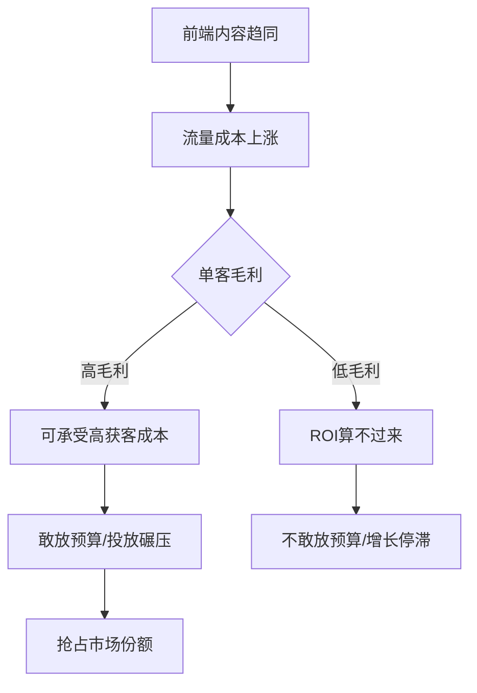
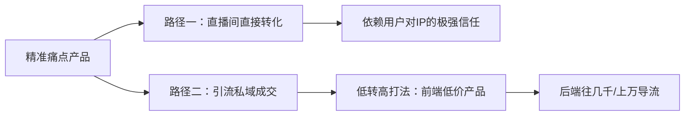
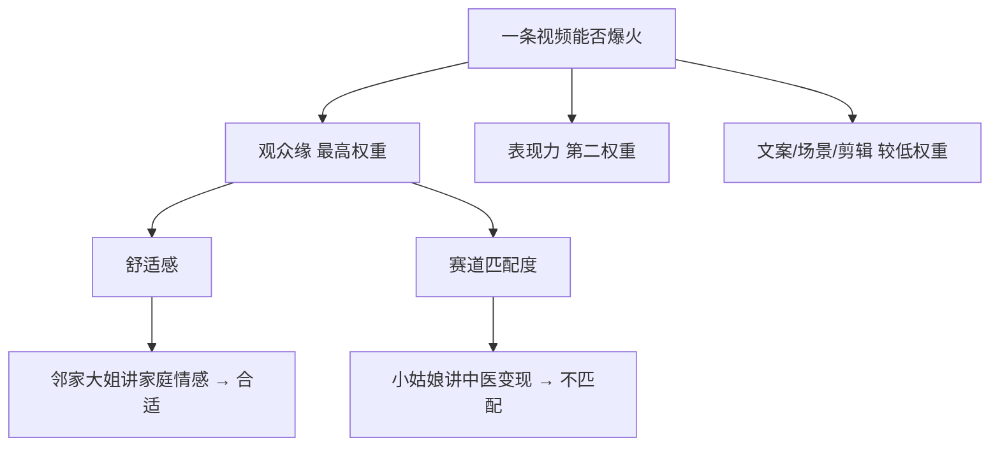
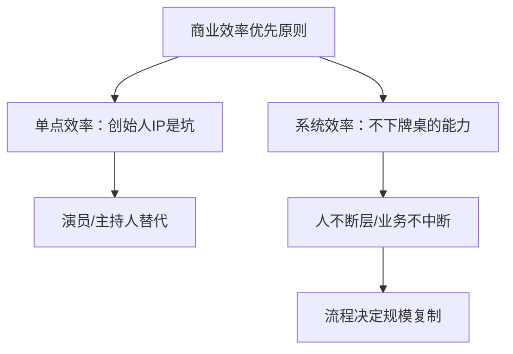
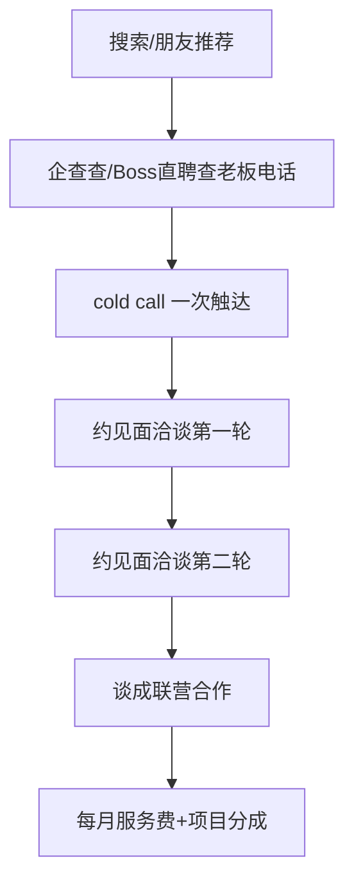

# 第 13 章 短视频IP矩阵 —— 从“内容”到“生意”的工业化复制

## 学习目标

- 理解后端变现效率为何是抖音IP项目成败的决定因素，并能用“单客毛利-获客成本”视角评估项目
- 掌握泛兴趣产品与精准痛点产品的分类标准，并能根据客单价匹配对应的成交路径
- 理解观众缘在短视频爆火要素中的优先级，能判断出镜人是否与赛道调性匹配
- 掌握通过“留存坏点”定位视频流失节点的方法，并能据此优化内容结构
- 理解创始人IP的局限性与演员替换的商业效率逻辑，能基于效率而非情感选择出镜人
- 理解“不下牌桌的能力”与“流程决定规模复制”的内在联系，能设计防止单点依赖的团队机制
- 掌握行业冠军联营的筛选、触达与合作框架，能评估该策略的适用条件

## 13.1 生活类比

想象一下，你在经营一家餐厅。**后端变现效率**，就是每桌客人平均能贡献多少利润——这决定了你敢不敢花大钱做广告拉客；如果每桌只赚 8 块，你花 20 块买一个客人，那就亏定了。**泛兴趣产品**，就是门口几块钱一份的小吃，靠走量吸引路过的人随手就买，不用太多信任。**精准痛点产品**，则是需要提前预约的高档套餐，价格高、利润厚，但客人必须先信任厨师的手艺才肯掏钱。**观众缘**，是服务员给客人的第一印象——一个不适合的人端着菜上来，客人扭头就走，再好的菜也白搭。**留存坏点**，是客人吃着吃着突然皱眉放下筷子，你要立刻找到是哪道菜出了问题赶紧撤掉。**创始人亲自下厨**，往往是个坑——老板的手艺未必比专业厨师好，而且他还要管店、见客户，没法整天泡在厨房里。**不下牌桌的能力**，意味着哪怕主厨离职，后厨也能靠标准菜谱照常出菜，餐厅不会关门。最后，**行业冠军联营**，就是傍上本地最火的餐饮集团，借他们的名气、食材供应链和招牌菜来给自己引流。这一整套类比，就是本章要拆解的短视频 IP 矩阵方法论。

## 13.2 概念地图

```
短视频IP矩阵方法论
├── 后端变现效率（决定成败）
│   ├── 定义：单位流量的变现能力
│   ├── 核心指标：单客毛利
│   └── 推论：高毛利可拉高获客成本碾压对手
├── 变现产品双轨制
│   ├── 泛兴趣产品（0-50元）
│   │   ├── 特征：大流量、高转化
│   │   └── 路径：短视频带货直接成交
│   └── 精准痛点产品（1000+元）
│       ├── 特征：精准刚需、依赖信任
│       └── 路径：直播间转化 / 引流私域
├── 出镜人选择
│   ├── 观众缘 > 表现力 > 文案 > 场景 > 剪辑
│   ├── 创始人IP是坑（效率论）
│   └── 演员/主持人替代策略
├── 内容生产与复盘
│   ├── 文案结构：泛流量开头+漏斗型观点+引导结尾
│   ├── 留存坏点：定位掉人元凶
│   └── 三维复盘：5秒完播率/总体完播率/留存坏点
├── 团队能力建设
│   ├── 不下牌桌的能力（人不断层）
│   ├── 流程决定规模复制（经验沉淀）
│   └── 人才培养路线：剪辑→运营→项目经理
└── 借力放大的组织结构
    ├── 行业冠军联营（预算/背书/变现体系）
    └── 服务费+项目分成的利益绑定
```

## 13.3 后端变现效率 —— 决定成败的“后端引擎”

你是否想过，为什么两个粉丝量几乎相同的账号，一个年入百万，另一个却连投放预算都不敢加？

答案往往不在前端内容，而在后端的变现能力。让我们先从俊达在《短视频IP矩阵》中提出的核心主张说起。

> “抖音是开卷考试，前端内容一定是趋同的，而真正决定了项目成败的，是我们的后端变现效率。”
>
> ——《短视频IP矩阵：后端变现效率决定项目成败》[P001, p.1]

这句话背后的逻辑，你需要先理解抖音的“开卷考试”本质。

**直觉：为什么前端趋同？**

抖音上，任何赛道的前端内容（文案、拍摄、剪辑）都是可以互相抄袭的。你今天发现一个爆款脚本，明天就有 100 个账号在做类似的结构。前端内容根本没有秘密可言。如果前端无法拉开差距，那差距就只能在后端——谁能把同样的流量变成更多的钱。

作者给出了一个非常犀利的对比：

> “同样的减肥粉，别人设计好了完善的变现体系，一个客户可以贡献1000块的毛利，而你只能做到500块，那么别人就可以通过投放，通过矩阵，把获客成本拉到900块。”
>
> ——《短视频IP矩阵：后端变现效率决定项目成败》[P001, p.1]

**后端变现效率** 的定义如下。

> 后端变现效率（来源：《短视频IP矩阵：后端变现效率决定项目成败》）

$$
\text{单客毛利} = \text{客户终身价值} - \text{履约成本}
$$

$$
\text{获客成本上限} = \text{单客毛利} - \text{期望利润}
$$

第一个公式展示了：变现效率的核心指标是**单客毛利**，即每一个客户能为整个变现体系贡献的毛利润。第二个公式则是它的直接推论——你愿意为获取一个客户付出的最高成本，等于单客毛利减去你期望保留的利润。

这个公式揭示了竞争的本质：当对手的单客毛利是 1000 元时，他可以承受 900 元的获客成本；而你只有 500 元毛利，最多只能承受 400 元。同一个流量池里，对手敢出价 900，你只敢出价 400——优质的流量自然被对手抢走，你只能捡剩下的。

**为什么敢花大钱本身就是一种碾压？**

> “抖音的流量成本一定是越来越高的，当你ROI算不过来的时候，你就不敢放预算。”
>
> ——《短视频IP矩阵：后端变现效率决定项目成败》[P001, p.1]

这里有一个关键机制值得你注意：

- 流量供给是有限的，但需求（所有想做抖音的商家）是无限的，所以流量价格必然上涨；
- 当流量价格上涨到超过你能承受的获客成本上限时，你的 ROI 就“算不过来了”；
- 此时你不敢放预算，增长停滞；而对手因为毛利高、上限高，反而可以加大投放、抢占更多份额。

这个过程的本质，是**变现效率决定了你在流量竞价中的“出价权”**。我们可以用一张数据流图来理解它是如何起作用的：



**边界条件。**

不过，这一指标并非万能。它成立的前提是：前端内容质量达标、流量规模相当。如果前端流量本身就很差，再高的变现效率也是无米之炊。另外，高毛利是拉高获客成本的前提——如果你的毛利本身就低，变现效率再高也难以支撑大规模投放。

## 13.4 泛兴趣产品与精准痛点产品 —— 变现产品的“双轨制”

做 IP 之前，你必须先回答一个问题：你要卖什么？

俊达的建议，是把适合做 IP 的变现产品分成两类，用完全不同的逻辑去运营。我们来看他的分类方法。

> “什么样的变现产品适合做IP呢？我认为有两种：一种是低客单价（0-50）的泛兴趣产品（比如书单号，低价知识付费课程）；还有一种是高客单价（1000+）的精准痛点产品（比如高考志愿填报）。”
>
> ——《短视频IP矩阵：变现产品选择》[P001, p.2]

**直觉：为什么要把产品分成两类？**

因为两类产品对应的人群规模、信任要求、成交路径完全不同。拿低客单价产品当高客单产品来经营，你会浪费流量；拿高客单产品当低客单产品来冲量，你会赚不到钱。我们来系统拆解这两种产品，形成完整的对照。

> 变现产品分类（来源：《短视频IP矩阵：变现产品选择》）

| 维度 | 泛兴趣产品 | 精准痛点产品 |
|------|------------|--------------|
| 客单价 | 0-50 元 | 1000+ 元 |
| 目标人群 | 大流量人群（1亿+） | 精准刚需人群 |
| 决策逻辑 | 冲动、低决策成本 | 理性、高决策成本 |
| 信任要求 | 低（不需要强信任） | 极高（极度依赖信任） |
| 成交路径 | 短视频带货直接成交 | 直播间转化 / 引流私域成交 |
| 典型例子 | 书单号、揭秘人性书籍 | 高考志愿填报、一对一咨询 |

这个表格展示了：两种产品的核心差异不在“价格”，而在“人群规模”和“信任要求”这两个维度。泛兴趣产品需要大流量和高转化率来弥补低客单价；精准痛点产品则依赖高信任来支撑高客单价。

**泛兴趣产品的运营逻辑。**

> “因为客单价低，所以一定要选择大流量，高转化率产品，比如书单号，比如揭秘人性的厚黑学，产品针对的用户人群规模在1亿+。”
>
> ——《短视频IP矩阵：变现产品选择》[P001, p.2]

对于低客单价产品，你要的不是“精准”，而是“量大”。一条视频爆了，可能有几十万人看到，哪怕转化率只有 0.1%，也足够产生可观的收入。这种产品的流量逻辑，靠的是短视频带货直接成交——用户看到视频里的书，觉得有意思，顺手就下单了。

**精准痛点产品的两条成交路径。**

> “对于高客单价产品，通常有两种成交路径，一种是直播间直接转化，一种是引流私域成交。”
>
> ——《短视频IP矩阵：变现产品选择》[P001, p.2]

高客单产品的成交逻辑完全不同。我们把它拆成两条路径，分别理解：



路径一是**直播间直接转化**：用户在直播间听你讲专业内容，对你产生信任后，当场下单高客单服务。这依赖极强的即时信任。路径二是**引流私域成交**：你先用低价产品（低转高打法）把用户引入私域，再通过后续服务往高客单产品导流。

**边界条件。**

需要注意的是，50-1000 元之间的“中间价位”不在这个分类讨论范围内。这个区间既没有大流量的冲动消费支撑，又没有高客单的信任深度支撑，需要单独设计成交路径。另外，高客单产品的直播间直接转化依赖用户对 IP 的极强信任，新号初期很难做到，通常需要先积累内容信任。

## 13.5 观众缘 —— 短视频爆火的“第一块敲门砖”

你有没有过这样的体验：刷到一条视频，内容讲得挺好，但出镜人让你不舒服，你划走了。这就是观众缘的力量。它甚至排在你可能认为更重要的文案、剪辑之前。

> “观众缘，不只是观众看的舒服，还得匹配。你让个小姑娘讲中医变现一定不好。”
>
> ——《短视频IP矩阵：观众缘》[P001, p.3]

**直觉：为什么观众缘比内容要素更重要？**

因为用户在刷到视频的前 3 秒内，还来不及看你的文案和剪辑技巧，他第一眼看到的就是出镜人。这个瞬间的“直觉判断”决定了是继续看还是划走。如果出镜人不匹配，再好的文案也白费。

俊达给出了一个非常明确的优先级排序：

> 短视频爆火要素优先级（来源：《短视频IP矩阵：观众缘》）

$$
\text{观众缘} > \text{表现力} > \text{文案} > \text{场景} > \text{剪辑}
$$

这个排序展示了：观众缘和表现力这两个“人选”维度的权重，远高于文案、场景、剪辑这些“制作”维度。这也解释了为什么同样一篇文案，不同的人念出来效果天差地别。

**观众缘的两个维度：舒适感与匹配度。**

注意，观众缘不是“长得好看”这么简单。它是两个维度的乘积：

- **舒适感**：观众看这个人是否觉得舒服、自然、没有违和感；
- **匹配度**：这个人是否与赛道、IP 调性契合——让一个亲和力强的邻家大姐讲家庭情感很合适，但让她讲严肃的财经分析可能就不匹配。

你可以把观众缘理解为一个“合适的人站在合适的赛道前”。匹配度是赛道选择的产物，而不是后天培养的结果。

为了更直观地理解观众缘在整个内容生产中的位置，我们来看它的权重分布：



**边界条件。**

需要提醒的是，观众缘是爆火的**必要非充分条件**。如果你选了合适的人，但文案和选题很差，依然不会爆。另外，表现力强的人可以在一定程度上弥补观众缘的不足，但反过来，观众缘不足的人，即使表现力强，也难以突破那个“第一眼被划走”的瓶颈。

## 13.6 留存坏点 —— 复盘中揪出“掉人元凶”

做短视频，我们当然想知道什么内容能留住人。但俊达提出了一个更反直觉的问题：你知道吗，什么内容在“赶人”？

> “留存坏点（哪一秒人数骤降，我们自己造的一个词），我们不能只看什么文案、什么方法能留住人，还需要不断的复盘去找到什么话、什么场景、什么动作会掉人，然后再把这个话、文案砍掉。”
>
> ——《短视频IP矩阵：留存坏点》[P001, p.3]

**直觉：为什么播放量会“骤降”而不是“均匀流失”？**

如果你的视频质量是稳定的，观众的流失应该是渐进的——有人看完了，有人中途退出。但俊达观察到一个现象：流失往往在某一秒突然发生，大量观众在同一时刻划走。这说明视频中某个特定瞬间触发了观众的集体反感。找到这个瞬间，就是找到视频的“掉人元凶”。

> 留存坏点定义（来源：《短视频IP矩阵：留存坏点》）

$$
\text{留存坏点} = \arg\min_{t} \left( \frac{N_t - N_{t+1}}{N_t} \right)
$$

这个公式展示了：留存坏点定位在观众留存率下降幅度最大的那一秒。当第 t 秒的留存率相对第 t+1 秒骤降时，说明第 t 秒的内容正在“赶人”。

**如何定位和修复留存坏点？**

定位留存坏点，你需要查看视频后台的“每秒留存曲线”。具体操作流程如下：

> 留存坏点修复流程（来源：《短视频IP矩阵：留存坏点》）

```
1. 打开视频后台的播放留存数据
2. 观察留存曲线，找到留存率骤降的秒数节点
3. 定位该秒对应的具体内容（话、场景、动作）
4. 分析该内容为何引起观众反感的可能原因
5. 毫不犹豫地砍掉该段内容，重新剪辑
6. 发布后再次观察留存曲线，验证是否改善
```

这段伪代码展示了：留存坏点的修复是一个“定位→分析→砍掉→验证”的闭环。关键在于第四步要做到准——你是说教了？场景切换太突兀了？还是动作让观众不适？

**留存坏点与留存好点的配合。**

留存坏点的价值，在于它和“留存好点”形成互补：

- **留存好点**：告诉我们哪些内容留人，让我们知道要放大什么；
- **留存坏点**：告诉我们哪些内容赶人，让我们知道要砍掉什么。

只关注前者，你会不断放大好内容，但坏内容依然在偷偷流失观众；只关注后者，你会不断删减，但好内容的优势没有强化。两者必须同时复盘，才能完整把握一条视频的留存逻辑。

**边界条件。**

留存坏点的定位依赖足够的播放量样本。播放量太低的视频，留存曲线会呈现随机波动，看不出明显趋势。另外，有时留存骤降是正常的内容转场导致的（比如从“开场钩子”切换到“正式内容”），需要结合具体内容判断，不能机械地看到骤降就砍。

## 13.7 多源对照：创始人 IP 与“不下牌桌”能力的效率之争

这一节我们把两个相互联系、又彼此支撑的概念放在一起对照：**创始人 IP 是坑** 与 **不下牌桌的能力**。它们分别从“出镜人选择”和“团队能力建设”两个角度，指向同一个核心——商业效率优先。

> “大部分老板的认知还是说要做创始人IP，但从我们经验，创始人IP真的是个坑。一方面，大部分老板的专业程度，不足以弥补在表现力上的差距；另一方面，老板本身时间比较值钱，没有办法全力all in在抖音流量端。”
>
> ——《短视频IP矩阵：创始人IP是坑》[P001, p.4]

**直觉：为什么老板出镜反而效率低？**

这里有两个关键矛盾。第一，老板的专业能力是做业务的，但短视频需要的“表现力”是另一回事——一个很懂高考志愿填报的专家，未必能在镜头前生动地讲出来。第二，老板的时间极其宝贵，他不可能每天花几个小时拍视频、做直播。当直播场次跟不上时，你已经花钱买来的流量就白白浪费了。

> 创始人IP缺陷分析（来源：《短视频IP矩阵：创始人IP是坑》）

$$
\text{视频产能} = \text{出镜人可投入时间} \times \text{出镜人表现力}
$$

$$
\text{商业效率} = \frac{\text{总变现}}{\text{运营成本} + \text{出镜人时间成本}}
$$

第一个公式展示了：视频产能是由投入时间和表现力两个因素共同决定的。老板的专业度可以解决内容质量，但无法解决表现力和时间投入的限制。第二个公式进一步说明，商业效率是整个变现系统与总成本的比值——老板的时间成本很高，如果由他出镜，运营成本中的“机会成本”会大幅上升。

**创始人出镜的代价：一个真实的踩坑案例。**

> “我们在这上面就踩坑了，当时和高考这个项目合作，就是让创始人出来做的，后面创始人时间有限，直播场次跟不上，浪费了很多流量（至少几十万的钱钱）。”
>
> ——《短视频IP矩阵：创始人IP是坑》[P001, p.4]

这个案例让我们看到，创始人 IP 的问题不是“能不能做”，而是“值不值得做”。当流量已经通过投放买回来，却因为创始人没时间直播而浪费掉时，损失是实实在在的现金。

**不下牌桌的能力：团队层面的“效率底线”。**

如果说“创始人 IP 是坑”讨论的是出镜人选择的效率，那么“不下牌桌的能力”讨论的就是团队整体运营的效率底线。

> “我认为一个真正能盈利的短视频团队，最重要的不是什么内容能力，而是不下牌桌的能力。人不断层，不会因为一个IP，一个运营退出不干，而让业务停下来了。”
>
> ——《短视频IP矩阵：不下牌桌的能力》[P001, p.5]

**共识与分歧。**

这两组概念虽然来源同一篇素材，但它们之间存在明显的视角差异：

**共识**：都指向“商业效率优先”的核心价值观。出镜人选择要讲效率，团队建设也要讲效率。两者的共同目标是让整个系统稳定、可持续地赚钱。

**分歧**：两者的关注层次不同——“创始人 IP 是坑”关注的是**单点效率**（出镜人选择），而“不下牌桌的能力”关注的是**系统效率**（团队稳健性）。前者解决的是“谁出镜更划算”，后者解决的是“怎么让业务不因任何一个人而停摆”。

我们用一张架构分层图来理解这两个概念在团队中的位置：



需要提醒的是，“创始人 IP 是坑”并非适用于所有情况。如果创始人本人就是专业演员、主持人，或者有极强的表达欲和充足的时间投入，那么“例外”是存在的。同样，“不下牌桌的能力”在个体创作者阶段没有意义——自己就是全部，团队化运营才是它发挥作用的土壤。

## 13.8 流程决定规模复制 —— 让经验不再“浪费”

你有没有想过，你的团队最大的浪费是什么？俊达给出的答案，可能颠覆你的认知。

> “内容营销团队，最大的浪费根本不是人才、时间，而是经验的浪费。没有好的流程，内容营销团队积累、探索的内容方法没办法积累下来，这个业务就根本没办法放大。”
>
> ——《短视频IP矩阵：流程决定规模复制》[P001, p.5]

**直觉：为什么经验的浪费比人才的浪费更严重？**

人才流失，只是失去一个“执行者”；经验流失，则是失去一套“方法”。如果团队的核心方法只存在于某个员工的脑子里，他一离职，方法就带走了——你不仅失去了人，还失去了业务最核心的竞争力。怎么才能让放大的前提稳固？答案是：把方法标准化为流程。

> 流程与规模复制关系（来源：《短视频IP矩阵：流程决定规模复制》）

$$
\text{规模化能力} = \frac{\text{沉淀的流程数量}}{\text{关键人物依赖度}}
$$

$$
\text{业务放大} = \text{标准化流程} \times \text{团队成员可复用度}
$$

第一个公式展示了：规模化能力与沉淀的流程数量成正比、与对关键人物的依赖度成反比。流程越多、依赖越少，你越能持续放大。第二个公式进一步说明，只有把经验固化为流程，并且让每个成员都能复用，业务才能真正规模复制。

**为什么“我相信用流程能规模复制”？**

俊达把这句话作为信念，而非单纯的技巧。这是因为：

- 只有流程，才能让团队不依赖某个天才——把“留存坏点”复盘法固化为每一条视频的必做流程，团队每一个成员都能用，而不是只有创始人会；
- 只有流程，才能让经验可积累——今天是 A 发现了某个爆款开头，明天 B 能复用这个结构，后天 C 能在此基础上迭代；
- 只有流程，才能让业务可扩张——当你从 1 个账号变成 10 个账号时，每个账号都按同一套 SOP 运作，才能保证质量下限。

**边界条件。**

流程管理不能僵化。如果流程变成了教条，反而会扼杀创新空间。此外，在业务探索初期（0 到 1 阶段），过度流程化可能拖慢速度——流程应该是在验证了某个方法有效之后，逐步固化的，而不是一开始就试图把一切都标准化。

## 13.9 行业冠军联营 —— 借力最强的“流量放大器”

前面的章节，我们都在讲“怎么把内容做好”。但俊达还有一套反直觉的策略：不靠自己做流量，而是直接去找“行业冠军”借力。

> “所以就搜、找朋友问，哪家机构是我们当地最大的，也就是行业冠军，然后企查查、boss直聘查老板电话，直接一个cold call打过去，也很顺利，约见面两次后，谈成联营合作，每月的服务费+项目分成。”
>
> ——《短视频IP矩阵：行业冠军联营》[P001, p.6]

**直觉：为什么要找“行业冠军”而不是自己从零做？**

中小团队自己做抖音，常常面临三重困境：预算不足、缺乏背书、变现体系不完整。与其单打独斗，不如直接找到行业里最强的机构合作，借力打力。行业冠军的优势，恰好就是这三点的完美补齐。

> 行业冠军联营定义（来源：《短视频IP矩阵：行业冠军联营》）

$$
\text{联营合作条件} = \text{有预算} + \text{有背书} + \text{变现体系完整}
$$

$$
\text{合作模式} = \text{每月服务费} + \text{项目分成}
$$

第一个公式展示了：行业冠军之所以适合合作，是因为它天然具备三大优势——有预算（不用担心投放没钱）、有背书（品牌本身就带来信任）、变现体系完整（后端已经跑通）。第二个公式则点明了合作模式：服务费保障基础收入，项目分成绑定利益，双方长期共赢。

**行业冠军联营的完整流程。**

我们可以把整个联营过程拆解成一个时序图，展示从“找”到“谈成”的完整链条：



第一步是**寻找**：通过搜索和朋友推荐，找到当地该行业的头部机构（比如最大的一家高考志愿填报机构）。第二步是**查联系方式**：用企查查、Boss直聘等工具查到老板电话。第三步是**cold call**：直接打过去，说明来意、摆出价值、预约见面。第四步是**洽谈**：两次见面后谈成合作，约定服务费和分成模式。

**为什么“行业冠军”比“大而全的平台”更适合联营？**

你可能会想，为什么不去找那些全国知名的大平台合作？原因在于：**行业冠军在本地，且有强烈的变现诉求**。本地冠军需要的是把品牌在当地放大，而你有短视频操盘能力，双方互补。而全国性大平台，要么轮不到你合作，要么你无法提供它需要的独特价值。

**边界条件。**

这套打法适用于有一定短视频操盘能力的服务方（乙方）。纯新手在还没有任何案例和数据时，很难打动行业冠军。另外，“行业冠军”需要前期充分的本地化调研——不同城市的冠军不同，你需要通过搜索、朋友推荐等方式确认你找的是真正的头部机构。

## 13.10 设计中的取舍

**为什么不用纯技术手段做 IP 矩阵，而要强调“观众缘”和“创始人 IP 是坑”？**

因为短视频的本质是“人影响人”，不是“技术影响人”。你当然可以用剪辑技巧、AI 工具提高效率，但观众最终是被“人”打动的。技术手段只能放大人的影响力，无法替代人的亲和力和信任感。

**这种设计的 trade-off 是什么？**

用演员替代创始人，你要接受“演员对业务的理解可能不如创始人”的成本；观众缘优先，你要接受“表现力强的演员可能不匹配赛道”的风险。但俊达的判断是：这些成本，远低于创始人出镜导致的时间瓶颈和流量浪费。

## 13.11 动手练习

1. **用后端变现效率评估两个竞品项目**：假设你运营两个抖音号，账号A卖泛兴趣产品（书单号），单客毛利8元，获客成本上限5元；账号B卖精准痛点产品（高考志愿填报），单客毛利800元，获客成本上限700元。请回答：如果平台流量成本上涨到20元/人，两个账号分别会面临什么局面？哪个账号更适合激进投放？如果你只有5万元预算，你会如何分配？

2. **分析一个视频的留存坏点**：你有一条3分钟的知识类视频，0-15秒留存率60%（优秀），15-16秒骤降至25%，16-90秒稳定在25%缓慢下降到18%，90-91秒再次骤降至8%，91-180秒缓慢下降至3%。请回答：这条视频有几个留存坏点？假设第16秒内容是“开始讲理论概念”，第91秒是“插入一段冗长的案例背景”，你会如何修改？为什么留存骤降比均匀流失更需要警惕？

3. **设计一个行业冠军联营的触达方案**：假设你在长沙，想为一家本地最大家装公司操盘抖音引流，请设计：如何找到这家“行业冠军”（至少3种检索渠道）？撰写一段不超过50字的cold call开场白（说明来意、摆出价值、预约见面）？如果对方拒绝，列出2个备选合作对象并说明理由。

4. **判断团队的“不下牌桌”能力**：对比团队X（核心运营小张掌握全部选题库和投放策略，他一离职账号停更2周）和团队Y（每个账号有标准化SOP，3名运营互相备份，任何一人休假/离职其余人可无缝接手）。请回答：哪个团队更符合“不下牌桌的能力”？团队X若要提升该能力，应该优先做什么（从流程/备份/知识沉淀三个角度）？结合“流程决定规模复制”说明为什么团队Y更容易扩张到10个账号？

5. **为一款产品匹配变现路径**：你正在为两款产品做IP变现规划——产品①售价29.9元的“人际沟通话术电子书”；产品②售价1999元的“一对一职场晋升教练”（6周服务）。请回答：分别判断属于泛兴趣产品还是精准痛点产品？为产品①设计一条短视频带货的脚本结构（用“泛流量开头+漏斗型观点+引导结尾”框架）？为产品②设计两条成交路径（直播间直接转化 vs 引流私域成交），各自的信任建设重点是什么？

## 13.12 本章小结

这一章中，我们系统学习了短视频 IP 矩阵的完整方法论。首先，我们理解了后端变现效率为何是项目成败的决定因素，并学会了用“单客毛利-获客成本”的视角评估一个项目是否值得投入；其次，我们掌握了变现产品的双轨制——泛兴趣产品靠大流量走量成交，精准痛点产品靠高信任实现高客单；接着，我们深入了出镜人选择的逻辑，理解了观众缘的权重和创始人 IP 的效率陷阱；然后，我们学会了用“留存坏点”定位视频流失节点，并用三维复盘优化内容结构；在团队层面，我们理解了“不下牌桌的能力”和“流程决定规模复制”的内在联系；最后，我们掌握了行业冠军联营这套借力放大的组织结构。

本章我们一起学习了以下概念：

| 概念 | 解释 |
|------|------|
| 后端变现效率 | 单位流量的变现能力（如单客毛利），决定获客成本上限，是抖音IP项目成败的真正决定因素 |
| 泛兴趣产品 | 低客单价（0-50元）面向大流量人群的产品，靠短视频带货走量成交 |
| 精准痛点产品 | 高客单价（1000+元）解决精准刚需的产品，靠直播间转化或引流私域成交 |
| 观众缘 | 出镜人的舒适感与赛道匹配度，是短视频爆火权重最高的因素 |
| 留存坏点 | 视频中某一秒观众人数骤降的流失节点，需复盘定位并砍掉对应内容 |
| 创始人IP是坑 | 创始人专业度难补表现力差距且时间成本高，应基于商业效率用演员替代 |
| 不下牌桌的能力 | 不因单个IP或运营退出而业务停滞的持续运营能力，是团队最重要的能力 |
| 流程决定规模复制 | 通过标准化流程把经验沉淀下来，才能实现从1到N的业务放大 |
| 行业冠军联营 | 筛选当地行业头部机构，以服务费+分成模式借力其预算、背书与变现体系 |

下一章中，我们将走进抖音 SEO 的蓝海世界，学习如何用搜索流量的逻辑，在推荐流量之外开辟精准、持久、低成本的获客渠道。

