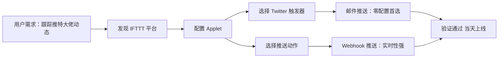

# 第 21 章 零代码自动化 —— 让工具替你盯梢和跑腿

## 学习目标

- 理解自动化工具如何解决跨平台信息流转的个人化需求
- 掌握 IFTTT 平台「如果这样，就会那样」的核心心智模型与 Applet 组装方式
- 区分触发器（Trigger）与动作（Action）在自动化任务中的职责分工
- 能够使用 Webhook 地址将消息推送到企业微信、钉钉等群聊工具
- 能评估零代码自动化方案的适用边界与免费额度限制

## 21.1 生活类比

想象你雇了一位贴心的私人助理，专门负责替你盯梢跑腿。IFTTT 就是这个助理的服务台，你不需要告诉他怎么一步步做事，只要交代清楚“看到什么信号就做什么反应”即可。If This（触发器）是助理盯着的信号灯，比如“老板一发朋友圈就立刻告诉我”；Then That（动作）则是助理听到信号后执行的事，比如“马上发微信通知你”。Webhook 是助理手中那条专属的“快递专线”，能把消息直接塞进你的群聊，省去你逐条查看的麻烦。而 Applet 就是你给助理下达的一张“注意事项卡片”，上面写清楚条件和动作。就像助理 7x24 小时替你监控事件、执行响应一样，IFTTT 也在后台不知疲倦地替你守着那些你关心的信号。

## 21.2 概念地图

```
零代码自动化
├── IFTTT 平台
│   ├── 定义：无需写代码的连接不同应用的自动化服务
│   ├── 核心心智模型：If This Then That（如果这样，就会那样）
│   └── Applet：用户组装的自动化任务（免费限额 2 个）
├── 触发器（Trigger）
│   ├── 职责：监听「事件发生」的条件（因果链的「如果」）
│   └── 案例：Twitter「指定用户更新推特触发」，需绑定自己的账号+监控账号
├── 动作（Action）
│   ├── 职责：执行「事件发生后」的结果（因果链的「那样」）
│   ├── 路径一：Email 推送（零配置首选，适合快速验证）
│   └── 路径二：Webhook 推送（实时性强，适合团队协作）
├── Webhook
│   ├── 定义：访问特定 HTTP 地址并携带规定格式内容即可推送消息的通用机制
│   ├── 企业微信群机器人为典型载体
│   ├── 鉴权简单：逻辑内置于地址（token）中
│   └── 边界：群含「外部联系人」则无法创建机器人
└── 应用边界
    ├── 免费额度：仅 2 个推送机器人，更多需付费
    ├── 平台依赖：触发源受第三方 API 策略影响
    └── 可迁移性：支持 Webhook 的平台（钉钉等）均可复用
```

## 21.3 IFTTT —— 一张不需要写代码的“数字胶水”

### 为什么需要这个概念？

你是否有过这样的念头：“如果有个工具，能把推特上某位大佬的发言在几分钟内推到我的微信，让我能第一时间跟进项目动态就好了？” 这正是无数普通人的真实困境——需求很具体，但自己不会写代码，也不可能为此雇一个程序员。

更麻烦的是，这类需求往往太小众、太琐碎，不值得为此开发专门的软件。自研软件意味着租服务器、写接口、做运维，成本高且周期长，等产品上线，热点早就过去了。我们真正需要的，是一个“恰到好处”的工具：既能解决当下的需求，又不必写代码、不必运维。

> "有需求，就能满足。"
>
> ——《P2XLdJF2yoivV8xUDszcz853nZg》

### 核心定义

IFTTT（If This Then That）正是这样一张“数字胶水”。它无需编写代码，以“如果这样（If This）… 就会那样（Then That）”的条件触发逻辑，将 Twitter、Email、企业微信、钉钉等异构应用粘合在一起。用户只需要配置参数，就能组装出自动化任务，官方称之为 **Applet**。

| 属性 | 说明 |
|------|------|
| 技术门槛 | 零代码，编辑参数即可完成配置 |
| 连接能力 | 可跨平台连接 Twitter、Email、企业微信、钉钉等异构应用 |
| 可复制性 | 配置好的同一套逻辑可迁移到其他支持 Webhook 的平台 |
| 免费额度 | 免费用户仅 2 个触发机器人，更多需付费 |

> IFTTT 平台**定义**（来源：《零代码自动化推送实操教程》）

```
用户注册 IFTTT 账号
    → 点击 My Applets 新建 Applet
    → 选择 If This（触发器）
    → 选择 Then That（动作）
    → 按提示填入参数（账号、邮箱、Webhook 地址等）
    → 提交并验证
```

这段流程展示了零代码自动化的核心操作范式：你不需要理解底层 API 如何被调用，只需在图形界面上像搭积木一样，把“触发条件”和“执行动作”两块拼起来。整个过程从注册到上线往往只需要几十分钟。

**典型例子**：作者想实时掌握 Web3 圈大佬的动态，以便“跟着他们的步伐做项目”。他没有写任何代码，而是直接找到了 IFTTT 平台，当天就完成了“监控指定推特账号 → 推送通知”的配置。这个案例完美诠释了零代码自动化的价值：需求产生后，几步配置即可上线。



### 边界条件

- **免费额度限制**：免费用户只能创建 2 个推送机器人，需要更多功能则需升级付费版本。
- **平台依赖**：IFTTT 依赖第三方平台（如 Twitter）的开放接口，一旦对方调整 API 策略，触发源可能失效。
- **网络环境**：IFTTT 是国外服务，访问稳定性受网络环境影响，国内用户使用时可能需要相应手段。

## 21.4 触发器与动作 —— 自动化任务的因果两端

### 为什么需要这个概念？

IFTTT 这类自动化工具需要一种统一的抽象，来描述“何时开始”和“做什么”。触发器与动作正是这个抽象——它们把复杂的编程逻辑拆解成可视化、可配置的两段式因果链，让非程序员也能搭建自动化任务。

### 核心定义

**触发器（Trigger）** 是自动化任务的“如果”条件部分，负责监听“事件发生”的条件。本案例中，我们选用 Twitter 平台下的“指定用户更新推特触发”（New tweet by a specific user）。

**动作（Action）** 是自动化任务的“那样”结果部分，负责执行“事件发生后”的结果。本案例对比了两种动作：发送 Email 到注册邮箱，或通过 Webhook 发起 web request 将内容推送到企业微信群。

> 触发器与动作**定义**（来源：《零代码自动化推送实操教程》）

```
触发器配置步骤：
1. 点击 If This 后的 Add
2. 搜索 Twitter，选择推特平台
3. 选择「指定用户更新推特触发」
4. 填写两个账号：
   - 第一行：自己的 Twitter 账号
   - 第二行：要监控的账号（Username to watch）
5. 点击 Create trigger

动作配置步骤（以 Email 为例）：
1. 点击 Then That 后的 Add
2. 搜索 Email，选择邮件服务
3. 使用默认模板，或通过 Add Ingredient 添加参数
4. 点击 Create Action 提交
```

这段伪代码展示了触发器和动作的参数化配置方式。值得注意的是，触发器需要同时绑定“自己的账号”和“监控目标账号”两个参数——前者用于授权，后者用于定义监控对象。而动作侧的配置则相对简单，大部分字段有默认值。

### 参数对比表

| 维度 | Email 推送 | Webhook 推送 |
|------|-----------|--------------|
| 配置复杂度 | 低（默认模板即可） | 中（需填 URL、Method、Body 等） |
| 实时性 | 一般（邮件可能有延迟） | 高（即时推送到群聊） |
| 触达率 | 中（可能被邮箱过滤） | 高（群聊消息强制提醒） |
| 适用场景 | 个人快速验证链路 | 团队协作、实时监控 |
| 目标载体 | 注册邮箱 | 企业微信/钉钉群 |

这个表格对比了两条推送路径的核心差异。**Email 推送是零配置首选**，适合快速验证整条链路是否打通；**Webhook 推送实时性更强**，消息直接进入群聊，适合需要团队成员即时响应的场景。

### 边界条件

- 触发器必须指定正确的账号——自己的账号用于授权，监控账号用于定义目标，两者缺一不可。
- 动作的执行依赖目标服务的可用性，如邮箱服务宕机或企业微信接口异常都会导致推送失败。
- IFTTT 对触发频率有限制，极端情况下可能合并或延迟触发，不适合对实时性要求极高的场景。

## 21.5 Webhook —— 一条给机器人的“专属快递通道”

### 为什么需要这个概念？

邮件推送虽然零配置，但实时性和触达率都不如群聊消息。我们真正想要的，是把消息直接“塞进”微信或钉钉的聊天窗口里，让团队成员第一时间看到。Webhook 正是这样一条“专属快递通道”——它能把消息从任何支持 HTTP 请求的地方，直接送进你的群聊。

### 核心定义

Webhook 是一种通过调用特定 HTTP 地址并携带规定格式内容，即可向群聊推送消息的通用机制。企业微信群（同钉钉）的 Webhook 机器人即此机制：创建机器人后会获得一个 Webhook 地址，访问该地址并以规定格式携带内容，即可把消息推送到企业微信中。

> Webhook**定义**（来源：《零代码自动化推送实操教程》）

$$
Push \xrightarrow{\text{HTTP Request}} \underbrace{\text{Webhook URL}}_{包含 token 的专属地址} \xrightarrow{\text{JSON Body}} \text{企业微信/钉钉群聊}
$$

这个公式展示了 Webhook 的本质：它就是一个带鉴权信息的 HTTP 接口。你不需要理解 token 背后的密码学原理，也不需要自己写请求代码，只要在 IFTTT 的配置界面里填入 Webhook 地址，再按规定的 JSON 格式写好事要推送的内容，剩下的工作全部由平台自动完成。

### 请求体详解

企业微信群机器人要求以 JSON 格式提交请求体。以下是素材中使用的标准模板：

```json
{
  "msgtype": "markdown",
  "markdown": {
    "content": "> 账号:{{UserName}} \n> 内容:{{Text}}\n> 链接:{{LinkToTweet}}"
  }
}
```

- **msgtype**：声明消息类型为 markdown，使机器人能以富文本格式展示内容。
- **markdown**：承载实际消息内容的对象。
- **content**：具体推送的文本，其中 `{{UserName}}`、`{{Text}}`、`{{LinkToTweet}}` 是 IFTTT 的占位符，会在推送时被自动替换为真实的账号名、推文内容和链接。

这段 JSON 展示了模板化推送的核心思想：**先搭框架，再填内容**。你把格式固定好，IFTTT 负责在每次触发时把占位符替换成实际数据。

### Webhook 配置流程

```
1. 在企业微信创建群聊（单人群需先拉人再 T 掉）
2. 在群设置中添加机器人
3. 获取 Webhook 地址（{WebhookUrl}）
4. 在 IFTTT 动作中选择 Webhooks → Make a web request
5. URL 填写 Webhook 地址
6. Method 选择 POST
7. Content Type 选择 application/json
8. Body 粘贴上文的 JSON 请求体
9. 提交配置
```

### 边界条件

- **外部联系人限制**：若企业微信群内包含“外部联系人”，则不能创建机器人，无法启用 Webhook 推送。单人群聊需先把人拉进来再 T 掉，才能规避此限制。
- **安全风险**：Webhook 地址本质上是群聊的“钥匙”，一旦泄露，任何人都可以向该群推送消息。因此应妥善保管，必要时定期更换。

## 21.6 多源对照

零代码自动化领域存在多篇素材，虽然它们来自不同的场景（推特监控、钉钉同步、SEO 内容分发），但都围绕相同的底层抽象展开。

### 共识

所有素材一致认为：**触发-动作的二元逻辑是自动化任务的普适心智模型**。无论是 IFTTT 的 Applet，还是钉钉/企业微信的 Webhook 机器人，其本质都是“事件（Event）→ 响应（Response）”的因果链。谁能理解这一点，谁就能在任意支持 Webhook 的平台之间自由迁移自己的自动化方案。

### 分歧

| 素材 | 关注焦点 | 立场倾向 |
|------|---------|---------|
| 《零代码自动化推送实操教程》 | 个人化需求快速响应的工具价值 | 强调“直接用工具解决问题，而非自研工具” |
| 《从关注特斯拉到实时推送的零代码自动化》 | 触发器的选择与多平台适配 | 强调“用户需要根据平台特性定制触发器” |
| 《如何用 IFTTT 打造第二大脑》 | 自动化与知识管理的结合 | 强调“自动化应服务于长期知识积累而非短期监控” |

**共识拆解**：三篇素材都将问题抽象为“当 X 事件发生时，执行 Y 动作”，这让读者能够举一反三，将同一套逻辑迁移到不同场景。

**分歧拆解**：分歧的核心在于“自动化的目的是什么”。实操教程聚焦短期需求响应（如监控某账号），知识管理素材强调长期积累（如自动存档文章到笔记工具）。理解这个分歧，有助于你判断自己的场景更适合哪种思路。

## 21.7 设计中的取舍

**为什么不用自研软件，而是 IFTTT 这种零代码平台？**

自研软件意味着你要租服务器、写接口、处理鉴权和运维，对于“监控某人推特动态并推送到群聊”这样的个人化需求，这是一笔完全不合理的时间与金钱投入。零代码平台的取舍是：牺牲了逻辑的复杂度和定制性，换来了极低的上手门槛和几乎为零的运维成本。IFTTT 能覆盖的需求，往往几天内就能上线；而自研可能需要几周甚至几个月。

**那 IFTTT 的边界在哪里？**

当你的需求涉及多条件分支判断（如“当 A 事件发生且满足 B 条件且 C 时间在深夜时，才推送”）、需要复杂的循环处理、或涉及商业敏感数据时，零代码平台就开始力不从心。Webhook 推送看似简单，但它的底层依赖相当脆弱——IFTTT 依赖 Twitter 的 API 策略，企业微信机器人依赖“群聊不含外部联系人”这一前提。任何一个环节出问题，整个自动化链路都可能中断。权衡之下，一些对稳定性和逻辑复杂度要求较高的场景，仍然需要回归传统代码开发。

## 21.8 动手练习

1. **设计一个自己的自动化 Applet**
    - 结合 IFTTT 的「If This Then That」逻辑，为以下场景设计自动化方案：
    - 场景：你关注的一位行业 KOL 在新浪微博发布新动态，你想第一时间收到通知，但不想频繁刷微博。
    - 明确触发器（Trigger）应该是什么？需要哪些参数？
    - 明确动作（Action）可以选择哪些？每种动作的优劣是什么？
    - 画出该自动化任务的因果链示意图。
    - 思考：若该 KOL 只在国外平台（如 X/Twitter）活跃，你的方案需要做哪些调整？
    - 回答问题：
        - 如果该平台不支持 Webhook，你还有哪些备选推送方式？
        - 如何评估这个自动化方案是否值得搭建（成本 vs 收益）？

2. **推演 Webhook 请求体的格式与字段**
    - 给定以下企业微信群机器人的 Webhook 地址：
      https://qyapi.weixin.qq.com/cgi-bin/webhook/send?key=xxxx-xxxx-xxxx
    - 素材中使用的 JSON 请求体为：
      ```
      {
        "msgtype": "markdown",
        "markdown": {
          "content": "> 账号:{{UserName}} \n> 内容:{{Text}}\n> 链接:{{LinkToTweet}}"
        }
      }
      ```
    - 解释上述 JSON 中 `msgtype`、`markdown`、`content` 三个字段各自的作用。
    - 若想对群聊发送一条「文本类型」的消息，且内容为“Stock price alert: ABC is up 5%”，请改写请求体。
    - 思考：`{{UserName}}` 这类占位符在 IFTTT 中是如何被替换的？
    - 若推送的消息包含敏感链接，你会如何设计 content 的内容以降低风险？
    - 回答问题：
        - 为什么企业微信要求使用 markdown 类型而不是纯文本类型？
        - 若将同样的请求体发送到钉钉的 Webhook 地址，会有哪些差异？

3. **评估零代码自动化的适用边界**
    - 考虑以下三个自动化需求，分别判断是否适合用 IFTTT/零代码工具实现，并说明理由：
    - 需求 A：监控某电商平台 5 个关键词的价格，降价超过 10% 时推送通知给自己。
    - 需求 B：将某公众号每日更新的文章自动同步到自己的知识星球。
    - 需求 C：根据用户输入的不同问题，自动生成定制化回复（含多条件分支判断）。
    - 对每个需求，判断：该需求是否小众/琐碎？是否值得自研？
    - 对适合用零代码工具的需求，设计触发器与动作；对不适合的，说明局限在哪里。
    - 若需要处理多个需求的叠加（如 A+B 同时运行），免费额度是否足够？
    - 回答问题：
        - 零代码工具的能力覆盖有限，哪些类型的逻辑它们无法实现？
        - 涉及商业敏感数据时，使用第三方自动化平台有哪些隐私风险？

## 21.9 本章小结

这一章中，我们系统学习了零代码自动化平台 IFTTT 的完整方法论。首先我们从“想实时掌握 Web3 圈大佬动态”这一真实痛点出发，理解了为什么普通人不该自研软件——个人化需求太小众，自研成本远超收益。其次我们掌握了 IFTTT 的核心心智模型“If This Then That”（如果这样，就会那样），看到触发器与动作如何构成一个完整的因果链。接着我们拆解了触发器与动作的各自职责：触发器负责监听“事件发生”的条件，动作负责执行“事件发生后”的结果。然后我们深入理解了 Webhook 这一通用推送通道，了解了它如何通过一个特定 HTTP 地址，把消息送进企业微信或钉钉的群聊。最后我们审视了零代码自动化的适用边界，包括免费额度只有 2 个机器人、群含外部联系人无法创建机器人、以及平台依赖第三方 API 策略的脆弱性。

本章我们一起学习了以下概念：

| 概念 | 解释 |
|------|------|
| IFTTT 自动化平台 | 无需写代码、以「如果这样，就会那样」逻辑连接不同应用的自动化服务 |
| 触发器（Trigger） | 自动化任务的「如果」条件部分，负责监听事件是否发生 |
| 动作（Action） | 自动化任务的「那样」结果部分，负责执行事件发生后的响应 |
| Webhook | 一种访问特定 HTTP 地址携带规定内容即可推送消息的通用机制 |
| 零代码自动化 | 用工具直接满足个人化需求，而非自研软件的方法论 |
| Applet 逻辑 | 「如果这样了，那就会那样」的普适理解框架，可衍生多元玩法 |
| 免费额度与边界 | 免费仅 2 个机器人，群含外部联系人无法创建机器人 |

下一章中，我们将学习流量变现，通过一个 AI 绘画小程序月收益 5W+ 的真实案例，拆解 C 端变现的整套商业逻辑——从收益公式建模到 SEO 蹭热点引流，看技术能力如何转化为商业收入。
