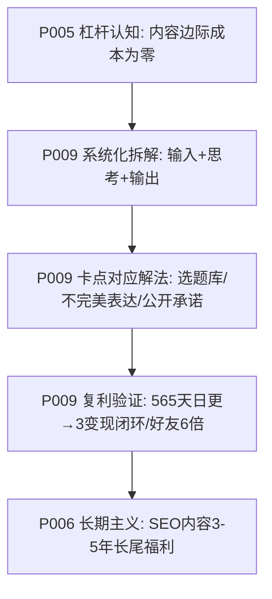
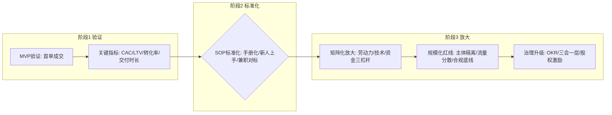

# 第 37 章 内容生产与变现体系 —— 从“日更写作”到“盈利验证与放大”的完整闭环

## 学习目标

- 理解日更写作如何构建普通人的内容复利系统
- 掌握渣男思维做内容的两大核心原则：撩完就跑与广撒网
- 掌握SEO思维布局精准流量的四步法与100-10-1聚焦法
- 掌握以结果倒推动作的逆向思考法与最小行动单元拆解
- 学会用资源盘点、项目拆解、匹配度评估三步法筛选高胜率项目
- 掌握盈利验证与放大法：先跑通1块钱MVP，再矩阵化复制放大
- 理解峰终定律在内容创作中的具体应用与边界条件
- 理解内容价值金字塔三层结构与变现路径的对应关系
- 了解平台风控本质与流量分配偏好的反向推导方法
- 能根据自身资源禀赋选择适合的流量策略（SEO vs 爆款）与变现模式
- 掌握内容价值金字塔三层结构：娱乐、工具、方法及其变现逻辑
- 掌握渣男思维做内容的边界：仅适用于给工具/给方法层级
- 理解日更写作系统的输入-思考-输出全链路卡点与解法
- 掌握超垂直个人IP的SEO精准流量获取实操流程
- 掌握100-10-1聚焦法的数据化选款/选题实操步骤

## 37.1 生活类比

想象你在经营一家**路边摊 vs 品牌连锁店**：日更写作 = 每天坚持摆摊，锅碗瓢盆（输入）、火候调料（思考）、出锅上桌（输出），日积月累形成“老字号”招牌（个人IP），食客慕名而来（精准流量）；渣男思维做内容 = 菜单只写“招牌菜”名字（撩完就跑），不教做法；同时在美团、大众、抖音、小区广告栏全贴广告（广撒网），垂的是“爱吃饭的人群”而非“川菜/粤菜”题材；SEO思维 = 在菜单、墙面、纸巾盒印上“附近哪家红烧肉好吃”“解馋快餐推荐”等长尾词（关键词布局），食客主动搜索上门，一传十十传百，三五年招牌不倒；逆向思考 = 先确定“卖红烧肉赚钱”（变现）→ 再定“开红烧肉馆”（定位）→ 再买锅买肉（产品）→ 最后才写菜单发朋友圈（内容/流量）；资源匹配度 = 你家有祖传红烧肉秘方（经验）、楼下固定食客（流量）、闲置店面（资产）→ 做红烧肉馆匹配度100% → 三个月回本；若去开寿司店（无技术、无供应链、无客群）匹配度<20% → 必亏；盈利验证与放大 = 先用电饭煲在家做10份红烧肉卖完（MVP验证）→ 再标准化配方SOP、招3个兼职学徒（劳动力杠杆）→ 复制开30家分店（矩阵化）→ 年入百万；内容价值金字塔 = 路边摊送试吃（给娱乐/情绪价值）→ 提供调料包带回家（给工具/实用资料）→ 教授开店秘籍（给方法/建立IP壁垒），层层递进，价值交换。就像餐饮生意：选对赛道（刚需）、验证口味（MVP）、标准化复制（SOP）、品牌化运营（IP）、合规经营（风控），才能从路边摊做成连锁品牌。

## 37.2 概念地图

内容生产与变现体系
├── 核心认知
│   ├── 内容复利杠杆          —— P001, P005, P009
│   ├── 峰终定律               —— P001, P005
│   ├── 内容价值金字塔         —— P002, P006
│   ├── SEO思维 vs 爆款思维     —— P002, P006, P011
│   └── 刚需生意观             —— P002, P005, P006
├── 方法论体系
│   ├── 日更写作复利系统构建法  —— P001, P005, P009
│   ├── 渣男思维做内容          —— P001, P005
│   │   ├── 撩完就跑
│   │   └── 广撒网
│   ├── SEO思维布局精准流量     —— P002, P006, P011
│   │   ├── 长尾关键词布局(300-500词)
│   │   ├── 问题-解决方案内容生产
│   │   ├── 多平台分发与关键词全覆盖
│   │   └── 100-10-1聚焦法
│   ├── 逆向思考法              —— P001, P005, P006, P009
│   │   ├── 变现→定位→产品→内容→流量
│   │   └── MVP先卖后做
│   ├── 资源匹配度评估三步法    —— P005, P006, P009
│   │   ├── 资源盘点
│   │   ├── 项目拆解
│   │   └── 匹配度评估
│   └── 盈利验证与放大法        —— P005, P006, P011
│       ├── MVP最小成本验证
│       ├── 盈利模型标准化(SOP)
│       └── 矩阵化/杠杆化放大
├── 执行与运营技术
│   ├── 流量切片分析法          —— P002, P006
│   ├── 流量流速控制            —— P002, P006
│   ├── 流量合并方法论          —— P002, P006
│   ├── 五位一体成交飞轮        —— P002, P006
│   ├── OKR制定与执行要点       —— P002, P006
│   ├── 股权顶层设计四要素法    —— P002, P006
│   ├── 三会一层治理架构        —— P002, P006
│   └── 热点套利技术栈          —— P002, P006
├── 典型项目验证案例
│   ├── 外卖CPS/副业课程        —— P005, P006, P009
│   ├── 抖音带货/视频号店群     —— P002, P006, P011
│   ├── 小红书资料号/小说推文   —— P002, P006, P011
│   ├── AI绘画/ChatGPT套利      —— P002, P006, P011
│   ├── 闲鱼倒爷套利            —— P006, P011
│   ├── 美团电商/TEMU跨境       —— P006, P011
│   ├── 微头条反向发帖/无人直播 —— P006, P011
│   └── 视频号带货/同城探店     —— P011
└── 边界与风控
   ├── 平台风控与流量分配本质  —— P006, P011
   ├── 非刚需项目失败规律      —— P002, P005, P006
   ├── 单店模型跑通前不加盟     —— P006, P011
   └── 硬件改机风险与寿命       —— P006, P011

## 37.3 日更写作 —— 打造普通人的内容复利系统

### 为什么需要这个概念？

普通人最容易触手可及的杠杆是内容，复制边际成本为零，可重复利用、多平台推广、放大价值。写作输出是能力和价值的放大器，持续输出倒逼输入与思考，构建个人复利系统。在信息爆炸时代，真正创造内容的仅1%，内容创作者是享受红利的稀缺群体。

> "《纳瓦尔宝典》一书中提到要最大限度的利用杠杆，而对于普通人来说，最容易触手可及的就是'内容'，它的复制边际成本为零，可以重复利用，多平台推广，放大价值。"
> 
> ——《P005, p.3》

> "我们把写作拆解一下，可以拆解为这样一个系统--输入+思考+输出~"
> 
> ——《P009, p.2》

> "写作就是最好的社交活动，是你最好的'身份证'，因为你的思考，经历，价值观都在你的文章中一一展现"
> 
> ——《P009, p.3》

### 核心定义

**持续输出力**（来源：《P009》）：指个人通过持续写作表达，倒逼输入与思考，从而积累知识、能力与影响力的能力，被视为普通人打造复利系统的基础。

**内容复利杠杆**（来源：《P009》）：指以内容为媒介，通过复制边际成本为零的特性，在多种平台重复传播、放大价值，从而为普通人带来被动收益的杠杆。

**写作即社交/身份证**（来源：《P009》）：主张写作是最佳社交活动，通过持续输出观点与价值观，内容本身成为个人筛选同频者、建立连接的“身份证”。

### 关键性质

- **复利效应**：时间越久、积累越多，价值指数级增长，而非线性增长
- **低门槛高上限**：无需特殊资质，仅需执行力和坚持，上限由思考深度决定
- **筛选机制**：内容自动筛选同频人群，建立高质量连接，降低社交成本

### 典型例子


### 边界条件

- 需解决“输入+思考+输出”全链路卡点，仅靠毅力不解决方法论会陷入“低水平勤奋”
- 必须允许“不完美表达”，追求完美会导致启动困难和中断
- 仅靠内容杠杆若无后端变现产品（课程、社群、咨询），难以直接转化为商业收入

### 方法论：日更写作复利系统构建法（来源：《P009》）

```
1. 输入端：建立选题积累库
   - 广度：每天阅读3-5篇优质文章/书籍章节，建立"素材卡片箱"
   - 深度：针对核心领域做"地毯式阅读"，打破信息茧房
   - 工具：Flomo/Notion/Obsidian 标记"可写作角度"的金句、案例、数据

2. 思考端：文章=问题+回答 的结构化拆解
   - 选题来源：用户提问高频词、同行爆款评论区痛点、自身实操复盘
   - 允许"不完美表达"：先发后改，定义"最小可行文章"（MVP Article）= 一个核心观点+一个支撑案例+一个行动建议
   - 富兰克林复写法：看优秀范文→合上→复写→对比差距→针对性优化

3. 输出端：公开承诺机制
   - 形式：朋友圈/社群打卡"第X天"，设置惩罚机制（如断更红包）
   - 节奏：前30天只求"日更"不求"质量"，建立肌肉记忆
   - 正反馈设计：每满7天复盘一次数据（阅读数/完读率/私域加人数），可视化进步
```

这个方法展示了如何将写作从“靠灵感”转变为“靠系统”，通过结构化拆解输入、思考、输出三端，并配合公开承诺与最小可行文章标准，解决了普通人启动难、坚持难、变现难的三大痛点。

### 方法演进图



## 37.4 渣男思维做内容 —— 撩完就跑与广撒网的爆款制造术

### 为什么需要这个概念？

传统内容创作陷入“自嗨式表达”或“完美主义瘫痪”，难以持续产出爆款。平台算法偏好情绪峰值与完结体验，用户注意力稀缺，需低成本提高命中率。垂直领域创作者常误解“垂直”为内容题材单一，实则应垂直人群、广撒网。

### 核心定义

**撩完就跑**（来源：《P005》）：基于峰终定律，在内容开头和结尾制造愉悦体验（戳中痛点/痒点），中间过程可简略，在用户情绪最高点戛然而止，制造意犹未尽感。

**广撒网**（来源：《P005》）：在多个圈子、多平台发布内容，垂直的是目标人群而非内容题材，通过增加曝光面提高爆款命中率。

**爆款模板复用**（来源：《P005》）：爆过的内容一定可以再爆，内容创作靠模板工业化而非灵感。

> "做渣男第一点：撩完就跑。戳痒点，意犹未尽。…… 咱们撩到用户的痒点就停，峰终定律，在情绪最高点停止，才能让人意犹未尽，印象最好。"
> 
> ——《P005, p.8》

> "做渣男第二点：广撒网 渣男怎么养鱼的？当然是混多个圈子，他们不止在一个圈子里寻找自己的猎物。所以，咱们做内容也需要广撒网，提高自己的内容命中率。"
> 
> ——《P005, p.9》

> "有同学就会问，咱们不是一直说做内容要垂直吗？为什么现在要广撒网呢，这不就不垂直了嘛。要注意，咱们垂直，并不是垂直内容，不是说你做母婴领域，你就天天发育儿相关的内容。咱们垂直垂的是人群。"
> 
> ——《P005, p.9》

### 关键性质

- **峰终定律驱动**：用户对体验的评价取决于峰值时刻和结束时刻，中间过程影响极小
- **低成本试错**：单条内容投入极低（如20分钟产出10万赞藏），可大规模并行测试
- **反直觉的垂直性**：内容题材可跨界，核心是精准击中同一类人群的不同需求面

### 典型例子

- “有钱人的生活”视频：开头无边泳池、结尾美妙画面，中间剪辑粗糙模糊，仍获大量点赞
- “做个人IP的40个APP”文：仅列名称不教用法，戳中痛点后即停，引发大量关注和咨询
- 作者小红书3个月从0涨粉8000、变现5万；20分钟产出10万赞藏大爆文，1万粉变现20万

### 边界条件

- 仅适用于“给工具/给方法”层级内容，“给娱乐”层级需完整剧情支撑
- “撩完就跑”若无真实价值支撑（如APP清单真实可用），会透支信任变成标题党
- “广撒网”需配合平台规则（如标题差异化避免判重），否则易触发限流封号

### 方法论：渣男思维内容实操SOP（来源：《P005, P006》）

**撩完就跑·脚本模板**：

```
1. 开头3秒（峰值制造）：
   - 痛点版："为什么你副业都不赚钱？因为你忽略了这个核心指标..."
   - 痒点版："月入5万的副业，全靠这3个免费工具..."

2. 中间（极简交付）：
   - 仅展示核心结论/清单/结果截图
   - 绝不展开方法论细节
   - 时长控制在总长度的30%以内

3. 结尾（戛然而止/引导）：
   - "完整操作手册/工具包/避坑指南 → 扣1/加微信/看置顶"
   - 留白设计：结尾画面/文字保持悬念感
```

**广撒网·分发矩阵**（以“职场副业”账号为例）：

| 平台/圈层 | 差异化处理策略 | 核心人群画像 |
|-----------|----------------|--------------|
| 知乎职场话题 | 标题改为问答式"如何用周末时间月入3000？"，正文保留核心清单 | 想通过副业增加收入的打工人 |
| 小红书副业标签 | 封面改为"3个工具图+收益截图"，话术改为"姐妹们自测" | 想搞副业的女性打工人 |
| 脉脉匿名区 | 发帖"刚发现公司同事用这招月入5k..."，引导私信 | 焦虑内卷的互联网从业者 |
| 抖音创业标签 | 剪辑成15秒快节奏视频，BGM用热门卡点音乐 | 碎片时间刷视频的泛创业人群 |
| 微信社群/朋友圈 | 发"内部福利"语音条+截图，强调"仅群友可见" | 高信任度的强关系链用户 |

这个分发矩阵展示了如何通过“同一核心内容、差异化包装”在多平台并行测试，垂直的是“想搞副业的打工人”这一人群，而非“副业教程”这一题材。

### 峰终定律的数学表达与应用边界

峰终定律源自心理学（Kahneman et al., 1993），在内容创作中的简化模型为：

$$
\text{用户体验评价} \approx \alpha \cdot \text{Peak} + \beta \cdot \text{End} \quad (\alpha, \beta > 0, \alpha+\beta \approx 1)
$$

其中 Peak = 内容中情绪/价值密度最高的时刻，End = 结束时刻的体验。

**这个公式展示了**：只需在开头（Peak）和结尾（End）投入精力设计高价值/高情绪节点，中间过程质量对整体评价影响边际极低。这就是“撩完就跑”敢于在中间“偷懒”的理论依据。

**失效条件（边界）**：
1. **剧情/娱乐类内容**：用户评价依赖叙事完整性，中间若逻辑断裂会直接导致弃看，峰终定律失效
2. **高客单价决策类内容**：用户会完整消费中间论证过程，跳过中间会破坏信任
3. **平台算法惩罚**：抖音/视频号的“完播率/有效播放时长”指标会直接惩罚中间注水内容

## 37.5 SEO思维布局精准流量 —— 长期主义者的隐形资产

### 为什么需要这个概念？

平台推荐流量（爆款思维）不稳定、周期短、泛粉多、变现难，追风者易陷入“流量焦虑”。精准搜索流量（SEO思维）用户意图明确、转化率高、长尾效应强、抗周期能力强。超垂直个人IP需建立护城河，SEO内容积累是难以复制的长期资产。

### 核心定义

**SEO思维**（来源：《P011》）：不追逐平台推荐，而是布局用户主动搜索的长尾关键词，通过“问题-解决方案”内容获取精准流量。

**100-10-1聚焦法**（来源：《P011》）：先找100个关键词/选款，每个测3-5条内容，筛选出10个能出单/引流的，最终聚焦1个爆款规模化。

**长尾福利**（来源：《P011》）：SEO内容发布后3-5年仍持续获得免费精准流量，实现“一次创作、终身收益”。

> "长期主义者，大部分都用SEO思维在做流量，而追风者往往是用爆款思维组流量，彻底理解这一点，起码受益 10 年"
> 
> ——《P011, p.3》

> "一个用户愿意通过各种关键词找到你的信息，进而添加到你的私域里。这样来的1个人会比你平台推荐来的100个人更有价值。"
> 
> ——《P011, p.3》

> "先辛苦一阵子，根据你的切割的细分领域，用心布局300-500个长尾关键词。每个关键词写一个解决方案...大概1个月后，你就会发现你每天都有人添加你"
> 
> ——《P011, p.4》

### 关键性质

- **精准度高**：主动搜索用户意图强，1个搜索粉丝价值 > 100个推荐粉丝
- **可控性强**：关键词布局、内容结构、发布节奏均可标准化SOP，不依赖算法玄学
- **复利确定性**：内容库随时间增厚，流量基数只增不减，形成护城河

### 典型例子

- 作者小红书/抖音发<200篇SEO内容，大半月不更新仍每天有人主动咨询
- 超垂直IP四步法：布局300-500长尾词 → 每词写1个解决方案/拍3分钟视频 → 多平台分发关键词全覆盖 → 1个月后每天自动来客
- 小红书资料号：通过SEO关键词布局，单账号月纯利1万+，内测10人8人单日盈利300+

### 边界条件

- 前期1-3个月无正反馈，需极强执行力支撑“坚持更新”
- 仅适合“给工具/给方法”高客单价或高复购业务，低客单泛娱乐内容ROI不划算
- 关键词挖掘需真实洞察用户语言（如用“举手”规则爬取真实提问），不能凭空臆造

### 方法论：超垂直个人IP·SEO精准流量四步法（来源：《P011》）

```
步骤1：长尾关键词挖掘（300-500词）
   - 来源A：微信搜一搜/抖音/小红书搜索框下拉词（真实用户语言）
   - 来源B：5118/巨量算数/百度指数 相关搜索/长尾词挖掘
   - 来源C：爬取同行社群/评论区高频提问（如P011用"#举手"规则爬取1.6万条记录→筛选1700提问→词频分析得出12大高频问题）
   - 筛选标准：有搜索量(指数>0)、竞争弱(同质内容<10篇)、意图精准(含"怎么/哪里/多少/推荐/教程"等动作词)

步骤2：问题-解决方案内容生产
   - 标准结构：标题含核心词 → 开头30秒直接给结论/核心步骤 → 中间分步骤/避坑/案例 → 结尾引导私域领取"完整版/清单/模板"
   - 形式：图文(600-1000字) + 短视频(3分钟) 双轨并行
   - 关键词布局位置：大标题、小标题、首段、尾段、图片ALT、话题标签 全覆盖

步骤3：多平台分发与关键词全覆盖
   - 主阵地：抖音、小红书、视频号、👸号、知乎、B站
   - 差异化：同一核心内容，按平台调整标题/封面/话术（规避判重）
   - 频率：每平台日更1-2条，持续3个月以上

步骤4：100-10-1聚焦法数据化筛选
   - 找100个关键词/选款 → 每个发3-5条内容 → 统计数据(搜索流量/咨询量/转化率)
   - 筛选出10个高转化关键词/款 → 资源倾斜：加大投放/做精细化内容/建合集/开直播
   - 聚焦1个超级爆款 → 打造系列课/社群/咨询等高客单产品
```

这个四步法展示了如何将SEO从“玄学”变为“工程”：用爬虫/工具替代主观猜测挖词，用标准化结构生产内容，用多平台矩阵放大覆盖，用数据漏斗筛选爆款，最终实现精准流量的可控获取。

### 多源对照：SEO思维 vs 爆款思维

**共识**：
- 两者均需优质内容支撑，无内容支撑的流量皆为泡沫
- 最终目的均为变现，流量只是手段

**分歧**：

| 维度 | SEO思维 (P006, P011) | 爆款思维 (P005, P011) |
|------|---------------------|----------------------|
| 核心逻辑 | 布局长尾词，等用户搜索 | 蹭热点/迎合算法，抢推荐流量 |
| 见效周期 | 慢 (1-3个月冷启动) | 快 (单条内容可当日爆发) |
| 流量稳定性 | 高 (长尾福利3-5年) | 低 (热点周期3-7天) |
| 粉丝质量 | 高 (主动搜索、意图明确) | 低 (泛娱乐、被动推荐) |
| 变现路径 | 高客单/高复购 (课程/咨询/高价品) | 广告/CPS/低客单 (流量主/带货佣金) |
| 适用阶段 | 长期主义、超垂直IP、有后端产品 | 冷启动、蹭风口、测试需求、无后端产品 |
| 典型案例 | 小红书资料号、超垂直知识IP | 渣男思维内容、热点追踪号、小说推文 |

**教科书建议**：新手建议“爆款思维冷启动（获取种子流量/测试选品）→ 同步铺SEO长尾（建立长期资产）→ 后期以SEO为主、爆款为辅”。

## 37.6 逆向思考法 —— 从“变现”倒推“动作”的最小行动单元

### 为什么需要这个概念？

正向流程（定位→内容→流量→产品→变现）易陷入“自嗨式创作”，做大量无效动作。新手资源有限，必须聚焦于直接产生收入的关键路径，避免资源分散。市场需求不确定，先验证“有人买单”再投入生产，降低试错成本。

### 核心定义

**逆向思考法**（来源：《P005, P006, P009》）：以结果为导向，逆向拆解步骤：变现 → 定位 → 产品 → 内容 → 流量。先找买家/需求，再找/造产品，最后才考虑内容和流量如何承接。

**最小行动单元 / MVP**（来源：《P006, P009》）：能在最短时间、最低成本验证商业闭环的最小动作集合。

> "以结果为导向，逆向思维需要的步骤，拆解出最小行动单元。正常流程：定位→内容→流量→产品→变现，我们可以以结果倒推内容：变现→定位→产品→内容→流量。先找买家，再找产品！（也可以理解为先找需求），一定要先考虑好怎么变现，然后再去开展业务，一定会事半功倍。"
> 
> ——《P005, p.11》

> "比如最重要的是先卖产品的想法，而不是做产品。如果聊了 100 个人，只有几个人买，肯定有问题；如果 20-30 个人购买，交了预售金，那这个不确定因素就解决了。"
> 
> ——《P006, p.5》

### 关键性质

- **目标导向性**：每个动作必须指向变现，无直接关联的动作坚决砍掉
- **快速验证性**：强调“先卖想法，后做产品”，用预售/意向金验证真需求
- **资源聚焦性**：将有限精力集中在“匹配度最高”的项目上，而非盲目All in新赛道

### 典型例子

- 外卖CPS项目：先有👸号流量资源 → 锁定“外卖红利”变现路径 → 对接美团/饿了么联盟 → 首日盈利100+ → 3个月月利润20万+
- 副业课程：先验证社群付费意愿 → 再录制课程交付 → 3个月盈利100万+
- AI绘画小程序：因预算超预期、无执照、周期长、流量依赖👸号，理性止损放弃

### 方法论：逆向思考五步拆解法（来源：《P005, P006, P009》）

```
输入：你想做的项目/赛道模糊想法

步骤1：锁定变现模型（变现）
   - 问：谁付钱？付多少？付几次？为什么付？
   - 产出：变现公式 = 流量 × 转化率 × 客单价 × 复购率
   - 例：外卖CPS = 👸号粉丝数 × 点击率 × 下单率 × 佣金比例

步骤2：确定定位与产品（定位→产品）
   - 基于变现模型，反推：需要什么产品承接？什么定位能吸引精准付费用户？
   - 产出：最小可行产品（MVP）定义 = 能完成一次完整交易的最简交付物
   - 例：外卖CPS的MVP = 一个配置好推广链接的👸号菜单/自动回复

步骤3：设计内容承接路径（内容）
   - 问：什么内容能把目标用户从公域筛选并引流到私域/成交页？
   - 产出：内容模板库（引流款/信任款/转化款）+ 发布节奏表

步骤4：规划流量获取动作（流量）
   - 问：用最小成本把内容推到目标用户面前？
   - 产出：流量动作清单（SEO布局/投放/互推/裂变/矩阵号）+ 预算/ROI阈值

步骤5：提取最小行动单元（MVP执行）
   - 原则：第一周内可完成、成本<100元、能产生真实数据反馈
   - 例：外卖CPS第一周动作 = 开通联盟后台(0元) → 配置👸号自动回复(0元) → 发1条推文测试点击率(0元)
```

这个五步法展示了如何将模糊的“我想做副业”转化为可执行、可验证、可迭代的具体动作清单，核心是始终以“变现”为锚点倒推，避免了“先做网站、再想怎么赚钱”的典型陷阱。

## 37.7 资源匹配度评估 —— 用“手里的牌”决定“打什么局”

### 为什么需要这个概念？

创业者常“严重低估已有项目，过分高估新项目”，导致频繁切赛道、资源归零。项目成败取决于“资源匹配度”而非“项目好坏”，同一项目资源匹配者赚钱，不匹配者亏钱。明确自身资源包（粉丝、经验、软件、团队、案例、渠道），能快速筛选高胜率项目。

### 核心定义

**资源盘点**（来源：《P009》）：系统梳理自身现有的有形/无形资产，包括流量资产、操作经验、技术工具、人脉团队、成功案例等。

**项目拆解**（来源：《P009》）：将目标项目拆解为“前端流量获取、中端转化交付、后端变现复购”所需的关键资源清单。

**匹配度评估**（来源：《P009》）：对比“手里有”与“项目需”，匹配度>80%可直接启动，50-80%需补齐关键资源，<50%坚决放弃。

> "很多人都有一个误区，那就是严重低估已有项目，同时过分高估新的项目"
> 
> ——《P009, p.4》

> "应该结合自身的资源，梳理新项目的资源和自己资源的匹配度，再决定重新做哪个项目"
> 
> ——《P009, p.4》

> "我以自己举例……那么我的资源就是：👸号经验+流量+人+项目=找到适合👸号变现的方法就可以直接开始"
> 
> ——《P009, p.5》

### 关键性质

- **动态性**：资源包随项目推进积累扩大，匹配度可随时间提升，需定期复盘更新
- **非对称性**：某些关键资源（如核心渠道、独家货源、信任背书）具有“一票决定”权重
- **复利性**：高匹配度项目执行过程本身在积累新资源，形成“资源-项目-更强资源”正循环

### 典型例子

- 作者：👸号经验+流量+人+项目 = 匹配“外卖CPS/副业课程”=100%匹配 → 3个月赚100万、总利润300万+
- 反面：非刚需项目（链条长、无核心资源匹配）连续创业4次失败、负债百万
- 招商加盟：必须先跑通单店模型（自有资源验证），再开放加盟（复制资源包），否则是收割加盟费

### 边界条件

- 资源盘点易受“沉没成本”偏见，高估沉没资产价值，低估新资源获取难度
- 匹配度高不等于必成功，执行力、时机、运气等外部变量仍占重要权重
- 早期资源极少时，匹配度评估参考价值低，需先通过“打工/兼职/小项目”积累种子资源

### 方法论：资源匹配度评估三步法（来源：《P009, P011》）

**第一步：资源盘点表（六维）**

| 维度 | 细分项 | 自评分(1-10) | 备注/证据 |
|------|--------|--------------|-----------|
| 流量资产 | 公域粉丝量/私域好友数/社群数/邮件列表 | | 标注精准度/活跃度 |
| 操作经验 | 曾跑通过的项目/平台/变现模式/避坑经验 | | 标注熟练度/可复用性 |
| 技术工具 | 掌握的软件/脚本/RPA/AI工具/建站能力 | | 标注可直接投入生产的工具 |
| 人脉团队 | 可调动的兼职/合伙人/供应链/导师/同行圈 | | 标注信任度/配合度 |
| 成功案例 | 可公开展示的收入/数据/学员结果/媒体报道 | | 标注可信度/关联度 |
| 资金/时间 | 可投入现金/周可用小时数/机会成本 | | 标注风险承受底线 |

**第二步：项目拆解清单（以“母婴资料号”为例）**

| 阶段 | 关键动作 | 所需核心资源 | 权重 |
|------|----------|--------------|------|
| 前端获客 | 小红书SEO选词/制图/发布/引流话术 | 选词工具/制图技能/养号经验/违规词库 | 30% |
| 中端转化 | 私域欢迎语/资料交付SOP/信任建立/成交话术 | 资料库/自动化工具/销售话术/客服人力 | 40% |
| 后端变现 | 资料更新/客单价设计/复购产品/售后服务 | 内容生产能力/产品迭代/社群运营 | 30% |

**第三步：匹配度评估矩阵**

```
匹配度 = Σ(各维度自评分 × 该维度在项目中权重) / 100

判读标准：
- ≥ 80%：直接启动，全力执行
- 50-80%：列出缺口资源，制定补齐计划(自学/招聘/合作/买)，再启动
- < 50%：坚决放弃，不做"愿望驱动"的项目
```

**作者自评案例（外卖CPS）**：
- 👸号经验(9) × 0.3 + 流量资产(8) × 0.2 + 运营团队(7) × 0.2 + 美团联盟对接经验(6) × 0.15 + 变现案例(8) × 0.15 = 7.95 ≈ 80% → 决定All in

这个矩阵展示了如何用量化方式克服“觉得行就行”的主观臆断，强迫自己面对资源缺口，做出理性的Go/No-Go决策。

## 37.8 盈利验证与放大法 —— 先跑通1块钱，再复制100万遍

### 为什么需要这个概念？

追求完美导致迟迟不上线，或上线即重资产投入，死亡率极高。商业模式核心不确定性在于“能否卖出去”，而非“能不能做出来”。单点盈利模型一旦跑通，边际复制成本极低，规模化收益呈指数级增长。

### 核心定义

**MVP先卖后做**（来源：《P005, P006》）：用最简单方式（预售页、人工服务、拼凑交付）完成第一笔交易，验证“有人愿付费”。

**盈利模型标准化**（来源：《P006》）：将跑通的“流量来源、转化话术、交付SOP、客单价结构”固化为可复制的操作手册。

**矩阵化放大**（来源：《P005, P006, P011》）：把月入3000的单号/单店/单人复制30遍，通过数量换确定性，实现规模化收益。

> "不要追求完美，用最快速度跑通盈利模型。（先用最简单的方式去验证商业模式是否正确，也就是完成第一单）"
> 
> ——《P005, p.10》

> "把 1 个号做到月入 10 万很难，但是把月入 3000 的号复制 30 多遍不难，把盈利的事情重复做。找到一点点能够获利的机会，再通过放大，将它变成个大生意，哪怕只能赚一元钱，只要他可以无限放大，那他就是一个年赚百万的项目！"
> 
> ——《P005, p.10》

> "在保证视频质量的前提下，量怼的越多，爆单的概率肯定就越大...纯靠怼量...累计带货10万+。"
> 
> ——《P011, p.15》

> "第一家店跑通最小MVP仅仅花费了80元...类目不同单店月利润6k-12k（零运营未优化）"
> 
> ——《P011, p.13》

### 关键性质

- **速度优先**：完成比完美重要，第一单验证比完美产品重要
- **可复制性**：核心判断标准是“能否一对多、能否快速复制、能否标准化SOP”
- **杠杆放大**：利用劳动力杠杆（招兼职）、技术杠杆（RPA/软件）、资金杠杆（投放）实现指数增长

### 典型例子

- 抖音带货：纯靠“怼量”发拼接视频，点赞>500仅10条、大部分个位数，但累计带货10万+
- 美团电商：首店MVP仅花80元跑通，2个月扩展到30家店，单店月利润6k-12k（零运营未优化）
- 视频号店群：7店日销7858元，单店日均1122元，毛利30%，精细化单店月利1万，10店即10万
- 外卖CPS：首日盈利100+，2个月月利10万，3个月突破20万/月，总盈利200万+

### 边界条件

- 单点模型未跑通前，任何放大动作都是放大亏损（如未盈利即招商加盟属于收割）
- 矩阵化需平台规则允许（账号主体、流量分配、风控红线），否则面临批量封号风险
- 规模化后管理复杂度指数上升，需同步建立OKR、三会一层、股权激励等治理体系

### 方法论：盈利验证与放大三阶段法（来源：《P005, P006, P011》）

**阶段1：MVP验证期（0-1个月，目标：跑通第一单）**

```
动作清单：
□ 确定变现模型（谁付费/多少/为什么）
□ 搭建最小交付闭环（人工/半自动/拼凑均可）
□ 设计获客钩子（免费资料/低价体验/预售定金）
□ 投入<100元/<20小时 完成首笔交易
□ 记录关键指标：获客成本(CAC)、转化率、客单价(LTV)、交付耗时

通过标准：连续3天日均盈利>0，且CAC < LTV/3
```

**阶段2：SOP标准化期（1-3个月，目标：单店/单号模型健康）**

```
标准化交付物：
1. 流量SOP：选词表/素材库/发布时间/账号配置/投放模板
2. 转化SOP：欢迎语/诊断表/方案模板/异议处理/成交话术（五位一体成交飞轮 P006）
3. 交付SOP：资料包结构/更新频率/群运营日历/售后标准
4. 财务模型：单客成本/单客收入/毛利率/回本周期/现金流预测

关键动作：
□ 复盘前50单完整链路，提炼可复制关键动作
□ 编写《操作手册》v1.0，新人3天可上手
□ 招募1-2名兼职/学徒，按手册执行，对标创始人产出达标
□ 建立周度复盘会：数据/问题/优化/下周重点
```

**阶段3：矩阵化放大期（3个月+，目标：规模化复制）**

```
劳动力杠杆：
- 招聘标准：按SOP可执行、按件/提成付费、无需核心决策
- 管理模式：组长制(1带5-10)/周报/数据看板/淘汰机制
- 成本控制：人均产出 > 3×薪资成本

技术杠杆：
- RPA/自动化：采集/发布/回复/数据统计/去重/混剪
- 工具链：剪映批量/飞书多维表格/影刀RPA/自建爬虫
- 核心指标：单条内容生产成本 < 人工成本 50%

资金杠杆：
- DOU+/千川/信息流投放：日预算测试 → ROI>1.5 放量 → ROI<1 停损
- 存量用户复购：私域运营/会员制/分销裂变
- 现金流管理：应收账款周期/垫资风险/利润再投资比例

规模化红线：
- 账号主体隔离：不同主体/不同设备/不同网络/不同素材库
- 流量分散：单账号流量<总流量20%，单平台流量<总流量50%
- 合规底线：无违规词/无诱导分享/无虚假宣传/有完整资质
```

**数学期望对比：单点冲刺 vs 矩阵复制**

假设单号月入分布：均值3000，标准差2000（高风险高波动）
- 策略A：全力做1个号冲刺月入10万 → 成功概率约 5%（需 3.5σ 事件）
- 策略B：复制30个号，每个月入3000 → 期望总收益 = 30 × 3000 = 9万，失败概率 < 0.1%（中心极限定理）

**这个计算展示了**：矩阵化复制本质上是用“数量换确定性”，将单点高方差的博弈转化为大数定律下的稳定收益，这是普通人创业“逆天改命”的核心数学原理。

### 数据流图：盈利模型从验证到放大的关键指标流转



## 37.9 多源对照：内容价值金字塔与变现路径

不同素材对“内容分层与变现”给出了高度一致的三层模型。

### 共识

| 层级 | 核心价值 | 典型形态 | 变现难度 | 客单价范围 | 用户留存 | 复购率 |
|------|----------|----------|----------|------------|----------|--------|
| L1 给娱乐 | 情绪价值/消遣 | 搞笑/剧情/颜值/八卦 | 极难 | 广告分成(极低) | 低(泛粉) | 近0 |
| L2 给工具 | 实用性/省时间 | 资料包/模板/工具/清单/速查表 | 中等 | 9.9-199元 | 中(需求型) | 10-30% |
| L3 给方法 | 认知/技能/体系 | 课程/社群/咨询/训练营/IP品牌 | 较易(信任转化) | 299-10万+ | 高(信任型) | 30-60%+ |

**P006原文**："①给娱乐：搞笑号、剧情号...很难变现。②给工具：给整合资料，帮用户节省时间...虚拟资料项目。③给方法：通过给方法，解决问题，抢占专业认知，打造个人IP。"

**P011佐证**：“超垂直个人IP”即L3层；“小红书资料号”即L2层；“小说推文/微头条反向发帖”多属L1向L2过渡。

### 分歧

- **P005（渣男思维）** 隐含主张：L2层（给工具）最适合“撩完就跑”批量生产，ROI最高
- **P006（长期主义）** 明确主张：L3层（给方法）是建立护城河的唯一路径，L2易被复制
- **P011（实操派）** 实测：L2层（资料号）冷启动最快、现金流最好，可作为L3的现金奶牛

**教科书综合建议**：新手“L2起步赚现金流 → 同步沉淀L3建护城河 → 后期L3为主、L2为引流品”，切忌直接裸奔L3（无信任背书转化极低）或长期停留L1（无变现能力）。

## 37.10 设计中的取舍

### 为什么不用“全平台同步分发同一内容”而要“差异化分发”？

平台算法对“搬运/重复内容”有严格查重机制（指纹/语义/标题/封面）。完全同步会导致：① 判重限流/不收录 ② 用户跨平台看到重复内容产生“刷屏厌烦” ③ 无法针对平台调性优化转化（如小红书重图/知乎重文/抖音重前3秒）。差异化分发的成本是“多套SOP”，收益是“全平台流量最大化”，这是典型的“工程成本换流量收益”的正向交易。

### “渣男思维”的信任透支边界在哪里？

- **安全区**：给工具层（如“40个APP清单”“提示词前5个”），用户获得即时可用价值，信任增强
- **警戒区**：给方法层（如“只给框架不给细节”），若后端转化产品交付不足，会被判定为“割韭菜”
- **禁区**：给娱乐层（如剧情断在高潮），直接破坏用户体验，算法会按完播率惩罚
- **量化红线**：单条内容“引导加微信/购买”后，30天内投诉率>1% 或 复购率<5% → 必须从“撩完就跑”升级为“完整交付”

### SEO冷启动期（1-3个月无反馈）如何坚持？

- **心理预期**：将“前90天”定义为“铺管道期”，不看流量只看“内容产出量/关键词覆盖率”
- **过程指标**：周产出≥5篇/覆盖关键词≥20个/私域添加≥10人（哪怕是朋友扫码）
- **最小正反馈**：每周复盘1篇“数据最好”的内容，拆解为什么好，复制结构
- **兜底方案**：同步跑1-2个“爆款思维”账号（渣男思维/热点蹭），获取即时正反馈维持心态，不影响SEO主航道

## 37.11 动手练习

### 练习 1：日更写作卡点拆解与系统搭建

某学员想开始日更👸号，但面临三个卡点：
1. 选题来源枯竭（输入端）
2. 想写深度但总写不完，追求完美导致断更（思考/输出端）
3. 发了半年无反馈，动力不足（正反馈缺失）

请基于“输入+思考+输出”系统，为该学员设计一套可执行的日更启动方案，包含：
- 选题积累的具体渠道与工具（至少3个）
- 允许“不完美表达”的操作标准（如：先发后改、最小可行文章定义）
- 公开承诺的具体形式与监督机制
- 前30天的关键里程碑与正反馈获取策略（非金钱）

回答问题：
- 为什么说“写作是最好的社交活动/身份证”？如何利用这一特性在冷启动期获取种子用户？
- 若该学员只有“打工经验”无特殊技能，如何定位其“超垂直细分领域”？（提示：结合资源盘点法）

### 练习 2：渣男思维内容实战演练

假设你运营一个“职场副业”账号，目标人群是“想搞副业的打工人”。请完成以下练习：
1. 设计一条“撩完就跑”短视频/图文脚本：
   - 开头3秒：戳中一个具体痛点/痒点（如：为什么你副业都不赚钱？）
   - 中间：仅展示核心结论/清单/结果（不展开方法论）
   - 结尾：戛然而止，引导“想要完整版扣1/加微信”
2. 制定一周“广撒网”分发计划：
   - 列出5个不同圈层/平台（如：知乎职场话题、小红书副业标签、脉脉匿名区、抖音创业标签、微信群）
   - 每个平台的内容差异化处理策略（标题/封面/话术）以规避判重
   - 垂直人群画像的统一定义（确保跨平台用户画像一致）

回答问题：
- 为什么“仅列APP名字不教用法”能戳中痛点？这种做法的信任透支边界在哪里？
- 如果内容题材跨度过大（如同时发职场、育儿、理财），如何判断是否破坏了账号标签？

### 练习 3：SEO精准流量冷启动实操

你决定用SEO思维打造一个“超垂直个人IP”，领域自选（如：考公上岸/宝宝辅食/跨境电商选品/编程副业）。请完成：
1. 长尾关键词挖掘（模拟）：
   - 列出核心大词3个
   - 用“搜索框下拉词/相关搜索/5118/微信搜一搜”挖掘该领域30个长尾关键词（列举10个示例）
   - 筛选标准：有搜索量、竞争弱、意图精准（如何判断？）
2. 内容生产计划：
   - 确定“每个关键词=一篇解决方案内容”的选题表（前10篇）
   - 内容结构模板：标题含关键词、开头30秒给结论、中间分步骤、结尾引导私域、图文/视频关键词布局位置
3. 分发与坚持机制：
   - 多平台分发渠道（至少4个）与发布节奏
   - 设定“前3个月无正反馈”的心理预期与执行保障措施

回答问题：
- 为什么说“1个搜索粉丝 > 100个推荐粉丝”？如何量化验证这一结论？
- SEO内容发布3-5年后仍有流量的底层逻辑是什么？平台算法变更会否失效？

### 练习 4：逆向思考与资源匹配度评估实战

某学员：3年运营经验、手里有5000精准母婴粉👸号、会简单剪辑、有过带货佣金2000/月经验、无自有产品、周末可投入20小时。

请为该学员完成：
1. 资源盘点表（按：流量资产、操作经验、技术工具、人脉团队、成功案例、资金/时间五维）
2. 筛选3个潜在项目（如：母婴资料号、亲子陪跑训练营、母婴好物带货、孕期咨询服务、二手玩具倒卖），每个项目拆解所需关键资源清单
3. 匹配度评估矩阵：给每个项目打分（0-100%），标注关键匹配项与缺口资源
4. 基于逆向思考法，为匹配度最高的项目设计“变现→定位→产品→内容→流量”路径图，并确定MVP验证动作（第一周可完成）

回答问题：
- 为什么“严重低估已有项目、过分高估新项目”是大多数人亏钱的核心原因？
- 如果匹配度最高的项目是“母婴资料号”，但学员抗拒“卖虚拟资料”觉得不值钱，如何用“内容价值金字塔”说服其转变认知？

### 练习 5：盈利验证与矩阵化放大推演

假设你已跑通一个“抖音同城探店带货”单号模型：月佣金3000元、出片SOP固定、选品库稳定、单条视频耗时2小时。

请设计放大方案：
1. 矩阵化账号架构：主号/子号/员工号数量与分工，主体资质解决方案
2. 劳动力杠杆：招聘兼职剪辑/发布SOP、薪酬结构（底薪+提成）、质检标准
3. 技术杠杆：RPA/剪映批量混剪/去重工具链选型与成本
4. 资金杠杆：DOU+投放测试模型（预算/ROI阈值/停损线）
5. 规模化目标：3个月内达成月佣金10万，关键节点与风控红线（账号关联、流量分配、平台规则变更）

回答问题：
- 为什么“把月入3000的号复制30遍比把1个号做到月入10万容易”？数学期望与风险分散的逻辑是什么？
- 单点模型未跑通前盲目矩阵化（如直接注册50个号发视频）会导致什么后果？如何用“流量切片分析法”诊断单号问题？
- 平台打击“矩阵号”风控升级时，如何调整策略从“量怼”转向“质精”？

### 练习 6：内容价值金字塔与渣男思维边界实战

某知识博主想做“AI绘画教程”内容，请完成：
1. 将该主题内容按内容价值金字塔三层拆解：
   - 给娱乐层：设计3个选题（如：AI生成的搞笑图片合集）
   - 给工具层：设计3个选题（如：Midjourney提示词速查表PDF）
   - 给方法层：设计3个选题（如：从零搭建AI绘画变现工作流体系课）
2. 对比三层内容的变现路径与客单价预期
3. 用渣男思维重写“给工具层”某选题的标题/开头/结尾：
   - 撩完就跑：仅给提示词清单前5个，引导“完整版扣1”
   - 广撒网：在小红书/知乎/抖音/👸号/微信群差异化分发

回答问题：
- 为什么“给娱乐层”内容不适用渣男思维？峰终定律在剧情类内容中的失效条件是什么？
- 如何判断某内容是“给工具”还是“给方法”？两者的用户留存与复购率差异在哪里？

### 练习 7：日更写作565天复盘数据建模

1. 假设第1天好友数为X，按复利公式计算日均增长率
2. 将565天拆解为：输入积累期/思考突破期/输出爆发期/变现收割期四阶段，标注各阶段关键动作与产出
3. 设计“输入+思考+输出”三端的KPI仪表盘（如：输入端-每周阅读书籍数/笔记条数）

回答问题：
- 为什么日更前期“坚持”比“质量”更重要？如何用“峰终定律”解释前30天的正反馈设计？
- 若某天断更，如何用“最小行动单元”快速重启而不陷入完美主义瘫痪？

## 37.12 本章小结

这一章中我们系统学习了内容生产与变现的完整体系。首先我们理解了内容复利杠杆的核心认知：普通人最易触及的杠杆是内容，通过日更写作构建“输入-思考-输出”系统，实现能力与价值的指数级积累。其次我们掌握了渣男思维做内容的两大原则：基于峰终定律的“撩完就跑”制造情绪峰值，以及垂直人群而非题材的“广撒网”提高命中率。接着我们深入讲解了SEO思维布局精准流量的四步法与100-10-1聚焦法，建立长期主义的隐形流量资产。然后我们掌握了逆向思考法，从变现倒推动作，提取最小行动单元MVP，避免自嗨式创作。随后我们学会了资源匹配度评估三步法，用手里的牌决定打什么局，克服愿望驱动的盲目创业。最后我们掌握了盈利验证与放大法：先跑通1块钱MVP，标准化SOP，再通过劳动力/技术/资金三大杠杆矩阵化复制，实现从单点盈利到系统增长的跃迁。

本章我们一起学习了以下概念：

| 概念 | 解释 |
|------|------|
| 内容复利杠杆 | 普通人最易触及的杠杆：复制边际成本为零、多平台分发、持续输出倒逼输入思考、构建被动收益系统 |
| 渣男思维做内容 | 基于峰终定律：撩完就跑（戳中痛点/痒点即停，制造意犹未尽）+ 广撒网（垂直人群而非题材，多平台多圈层提高命中率） |
| 峰终定律 | 用户体验评价取决于峰值时刻与结束时刻；内容开头结尾愉悦即可，中间过程影响极小 |
| SEO思维布局精准流量 | 长期主义者核心策略：布局300-500长尾词→每词一解决方案→多平台分发关键词全覆盖→1个月后日引精准咨询，享受3-5年长尾福利 |
| 100-10-1聚焦法 | 数据化选款/选题：找100个→每个测3-5条→筛10个能出单的→聚焦1个爆款规模化 |
| 逆向思考法 | 以结果为导向逆向拆解：变现→定位→产品→内容→流量；先找买家/需求，再造产品，最后做内容引流，确定最小行动单元(MVP) |
| 资源匹配度评估 | 三步法：盘点自身资源包(粉丝/经验/工具/团队/案例)→拆解项目所需关键资源→匹配度>80%直接启动，<50%坚决放弃 |
| 盈利验证与放大法 | 先用最简单方式跑通第一单(完成比完美重要)→固化SOP→矩阵化复制(月入3000复制30遍>单号月入10万)→劳动力/技术/资金杠杆放大 |
| 内容价值金字塔 | 三层递进：给娱乐(情绪价值难变现)→给工具(实用资料引流)→给方法(解决问题建立IP壁垒)，核心是价值交换 |
| 流量价值公式 | 流量价值 = 规模 × 相关性 × 信任度；规模只解决连接，相关性与信任度决定交易转化 |
| MVP先卖后做 | 验证产品优先卖想法/预售，聊100人买20-30人交定金即通过，短时间可测试几十个产品，筛选大于培养 |
| 非刚需项目失败规律 | 不够刚需链条太长推不动，项目本性成就人而非人推动项目；作者10年4次创业失败负债百万验证 |
| 平台风控本质 | 平台限流/违禁词/处罚机制本质是流量分配偏好；分析风控可反向推导获流策略，合规或规避均可行 |
| 三会一层治理 | 公司顶层架构：股东会(权力)、董事会(决策)、监事会(监管)、高管层(执行)；战略稳于执行，治理层定生死 |
| 健康单店模型前提 | 加盟扩张前必跑通单店盈利→区域多店验证→复制性与财务模型达标；取代过时的“两店一年”标准 |

下一章中，我们将学习如何将这些内容生产与变现能力，进一步内化为个人的认知体系与长期主义的人生复利系统，探讨“利他即利己”、“战略发挥优势”、“不流动稀缺资源优先”等高阶认知框架，帮助你从“赚快钱”进化为“复利人生”。
