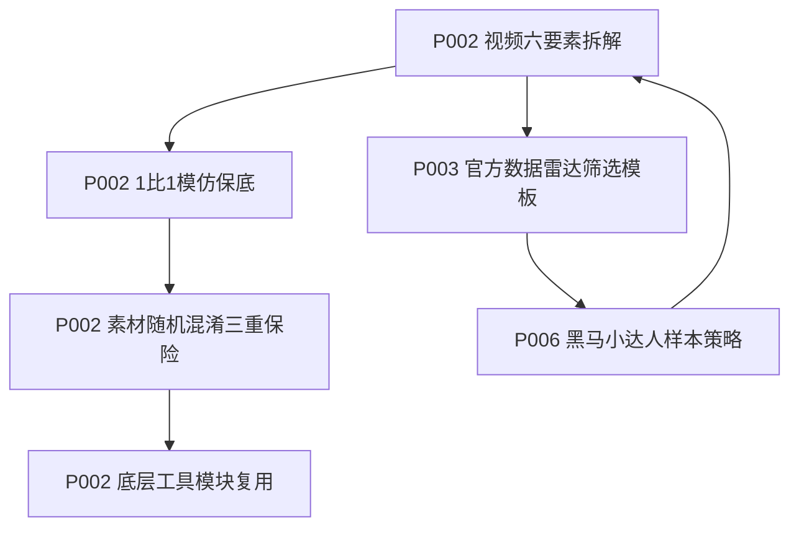
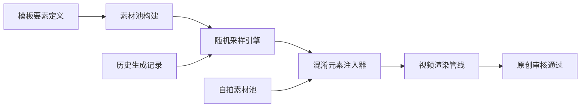
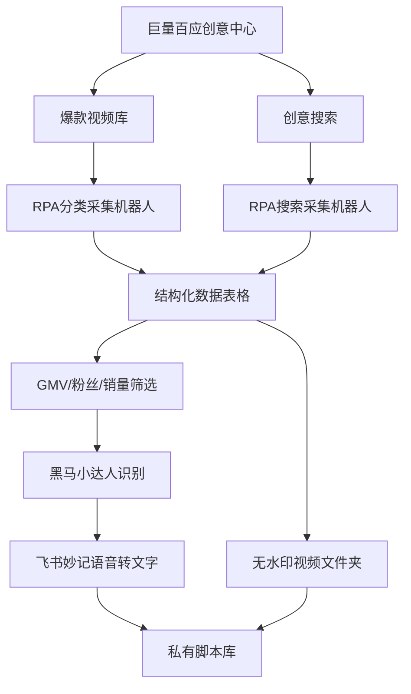
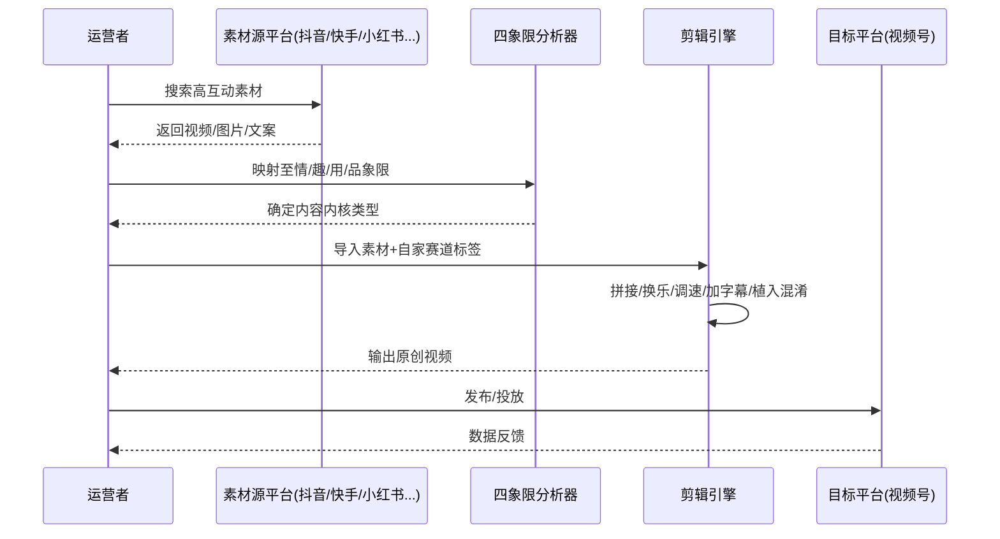
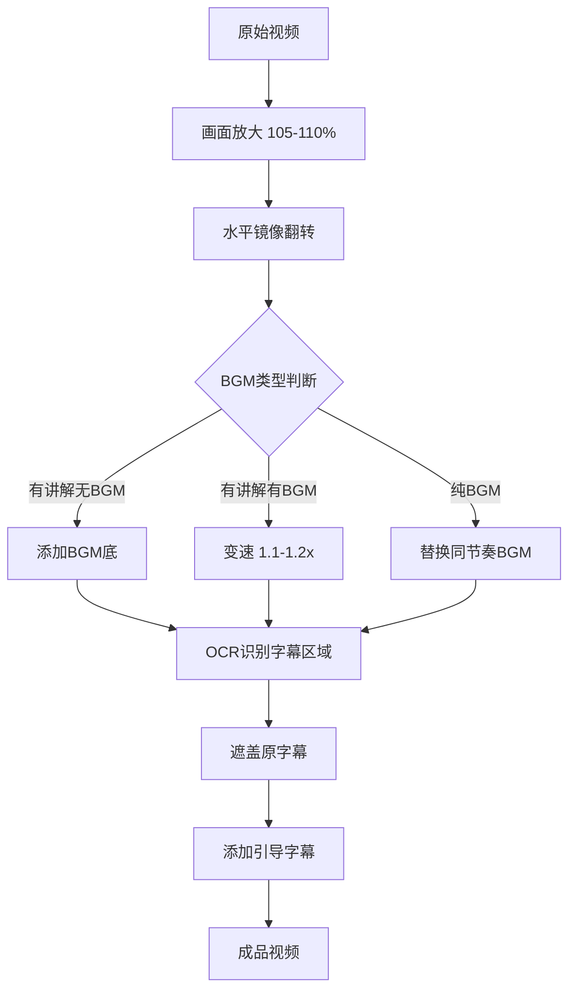
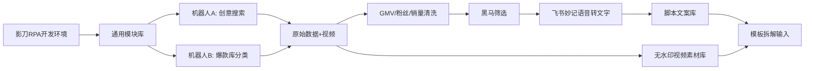

# 第 10 章 短视频带货内容工业化体系 —— 从“抄作业”到“自动化产线”
作者：龙哥

## 学习目标

- 掌握爆款视频模板化拆解的六要素法（背景、标题、内容、文案、字幕、BGM）
- 理解“原创优于二剪优于搬运”及“1比1模仿保底60分”的内容生产底层逻辑
- 掌握素材随机取用、时间段随机取用、混淆元素三重机制实现批量视频差异化与过原创审核
- 学会利用巨量百应创意中心官方数据+RPA工具构建私有竞品素材库，替代第三方工具
- 掌握‘做人群不做货’差异化策略及‘情、趣、用、品’四象限内容定位法
- 掌握黑马小达人（粉丝<5万、GMV高、视频>200条、画面干净、持续更新）筛选标准
- 掌握视频号新号流量扶持期（7天）的激进起号打法：放大→翻转→BGM处理→加字引导的固定去重流水线
- 理解‘视频即直播间流量入口’：视频破万播放才开播，视频不跑果断关播，反复开关播控制节奏
- 掌握爆款生命周期管理：起爆期(1-3天)全力直播→衰退期(4-7天)压缩时长引入基地托管→存量期靠自然单
- 克服‘知识诅咒’精神内耗：不看后台数据、定量化动作目标（日更10条/号）、看对标定变现
- 掌握RPA自动化采集流程：创意搜索/爆款库分类采集→飞书妙记语音转文字→脚本库沉淀
- 掌握小说推文精细化运营SOP：作者垂直+专栏垂直选文→核心剧情前置改文→模板化剪辑→评论区造互动

## 10.1 生活类比

想象短视频带货是一场**“工业化盖房子”**的游戏：

- **爆款视频模板 = 经过验证的标准化户型图纸**（六要素：地基/墙体/屋顶/水电/装修/景观），直接套用保证房子不塌（保底60分）
- **1比1模仿 = 照着样板间盖**，避免“自嗨式设计”导致烂尾楼
- **素材随机混淆 = 每套房子换不同瓷砖、壁纸、软装，并放入自家传家宝（自拍混淆元素）**，让验房师（平台查重）查不出重复，还能证明原创
- **官方数据雷达 = 用开发商自家的“卫星地图”（巨量百应）选地皮**，比中介（第三方工具）数据更准、更实时
- **黑马小达人 = 那些没背景、没资源、靠手艺盖出高价房的“草根工长”**，比靠家族资源（粉丝基数）的大包工头更值得学
- **做人群不做货 = 别盖“谁都住”的大通铺（通用品），要盖“专给带娃妈妈/养老独居/焦虑白领”定制的精装房（垂直人群需求）**
- **视频号新号扶持 = 新开发区前7天“买地送地、通水通电、带客源”**，必须在这7天疯狂盖房（发视频），过期作废
- **视频即直播入口 = 样板间（视频）带看客进售楼处（直播间）**，没样板间开售楼处纯属自嗨（场观十几人）
- **加字引导 = 售楼处关键位置贴的“毁约金翻倍/今天签送车位”横幅**（人设+痛点+行动指令），比样板间装修更直接成交
- **爆款生命周期 = 房子有“热销期/去化期/尾盘期”**，热销期自己卖，去化期外包给中介（基地托管），尾盘期靠口碑带看
- **克服知识诅咒 = 别在开工前纠结“未来房价涨跌/物业费贵不贵/能不能传家”**，定目标“每天盖1层”，只看隔壁工地（对标）怎么卖的
- **RPA自动化 = 派机器人（影刀）去竞品工地偷图纸、量尺寸、拍照、整理成册**，自己喝茶盯大局
- **小说推文 = 把知乎大神的长篇小说（原著）剪成“精华预告片”，挂链接卖会员卡**，选文垂直=只拍悬疑/只拍言情，核心剧情前置=预告片前3秒放高潮

## 10.2 概念地图

短视频带货内容工业化体系
├── 核心方法论层
│   ├── 爆款视频模板化拆解（六要素）  —— P002
│   ├── 1比1模仿保底原则（原创优于二剪优于搬运）  —— P002
│   ├── 做人群不做货（情/趣/用/品四象限）  —— P004
│   └── 知识诅咒破解（不看数据、定动作目标、看对标）  —— P011
├── 生产技术层
│   ├── 素材随机混淆三重保险（随机素材/随机时段/自拍混淆）  —— P002
│   ├── 视频去重标准化流水线（放大/翻转/BGM/加字）  —— P008
│   ├── RPA自动化采集体系（官方数据雷达/影刀/飞书妙记）  —— P003, P012
│   └── 底层工具模块复用（新模板几分钟开发）  —— P002
├── 选品与对标层
│   ├── 选品即定人群找需求（垂直需求>通用需求）  —— P004
│   ├── 官方数据雷达（巨量百应创意中心实时全量数据）  —— P003
│   ├── 黑马小达人筛选标准（低粉高销/视频量大/画面干净）  —— P006
│   └── 全平台二创法（跨平台素材库/非违规二创/赛道化植入）  —— P005
├── 分发与变现层
│   ├── 视频号新号流量扶持（7天窗口期/破万播放/激进发视频）  —— P009
│   ├── 视频即直播入口（视频跑才开播/反复开关播/话术样品转化）  —— P009
│   ├── 加字引导出单（人设化场景化文案/OCR友好/低成本A/B测试）  —— P007
│   ├── 爆款生命周期管理（起爆/衰退/存量三阶段/矩阵接力/基地托管）  —— P010
│   └── 小说推文精细化SOP（作者/专栏垂直/核心剧情前置/关键词说白话/评论造势）  —— P001
└── 规模化与资产层
    ├── 矩阵化账号体系（3-5号错峰/自动化发布/一鱼多吃）  —— P002, P010
    ├── 脚本/话术/素材/模板资产沉淀（账号死资产不死）  —— P010
    └── 超级个体模式（专注流量/输送基地/拿分成/借力打力）  —— P010

## 10.3 爆款视频拆解 —— 让模型学会“抄作业”

### 为什么需要这个概念？

短视频带货中，新手闭门造车极易生产低质内容，导致流量为零、变现无门。平台算法偏好已验证的爆款结构，模仿成功案例比盲目原创成功率高得多。缺乏系统化拆解方法，导致只能靠直觉“凑”，无法复制、无法规模化。

> "所有的视频都可以拆成以下元素：1. 背景：图或者视频 2. 标题：主、副标题 3. 内容：图、视频 4. 文案：5. 字幕：6. 背景音乐："
> 
> ——《P002, p.1》

> "视频模板有各种各样的形式，拆解的多了会发现其实都是上面提到的那些元素组成的"
> 
> ——《P002, p.1》

这段话告诉我们，短视频不是不可捉摸的艺术品，而是可以拆解、重组的工业零件。作者随后给出了形式化定义：

> **视频六要素模板定义**（来源：《P002》）

$$
\text{Video} = \langle \text{Background}, \text{Title}, \text{Content}, \text{Copy}, \text{Subtitle}, \text{BGM} \rangle
$$

这个定义展示了所有短视频形式（流量视频、带货视频）最终都由这六要素组成，具有普适性和可迁移性。

### 核心定义与推导

> **1比1模仿保底原则**（来源：《P002》）

$$
\text{Quality}(\text{Mimic}) \ge 60 \text{ points}
$$

这个不等式展示了核心主张：用验证过的爆款视频做模板，1比1模仿能保证生产内容质量≥60分，规避“自嗨式创作”。

> "用这样验证过的流量视频或者带货视频当模板，是要保证1比1模仿做出的内容都是60分以上的。"
> 
> ——《P002, p.2》

### 关键方法

> **Step1 视频模板拆解法**（来源：《P002》）

```
1. 选取目标赛道当下的爆款视频（流量视频或带货视频）
2. 按六要素逐项拆解：背景(图/视频)、标题(主/副)、内容(图/视频)、文案、字幕、BGM
3. 记录每个要素的具体形式（如：背景=中医大师照片放大模糊，标题="请等一下..."，内容=大师照片，文案="国医大师xxx"，字幕=无，BGM=舒缓纯音乐）
4. 建立模板卡片，标注赛道、视频类型、要素明细
```

这套流程展示了如何将非结构化的视频转化为结构化的“设计图纸”，为后续的素材替换和代码生成奠定基础。

> **Step2 相似素材搜集法**（来源：《P002》）

```
1. 针对拆解出的每个要素，在网上搜集形式相似的替代素材
2. 背景图：找同领域不同大师/场景的高清图/视频
3. 内容素材：找同类知识点/演示过程的视频片段
4. BGM：找同风格、无版权风险的音乐库
5. 建立素材池，按要素分类存储
```

这个方法展示了如何为模板中的每个“插槽”准备备选零件，实现内容的组合式生产。

### 典型例子

中医养生号案例（P002）：

| 要素 | 模板原样 | 替代素材池示例 |
|------|----------|----------------|
| 背景 | 中医大师照片放大模糊 | 10张不同大师照片、中医馆环境图、草药特写 |
| 标题 | "请等一下，这个穴位..." | "千万别忽略...", "后悔没早知道...", "收藏备用..." |
| 内容 | 大师照片 | 不同大师讲课片段、针灸演示、脉诊特写 |
| 文案 | "国医大师xxx教你..." | "张医生亲测...", "王主任揭秘...", "非遗传承人..." |
| 字幕 | 无 | 关键穴位名、操作步骤、注意事项 |
| BGM | 舒缓纯音乐 | 古筝、琵琶、自然白噪音、轻快钢琴曲 |

利用飞书妙记将对标视频语音转文字提取文案，结合RPA下载无水印素材，可快速完成拆解与素材库建设。

### 方法演进图



这张图展示了从模板拆解到模仿保底、差异化生成、工具复用的完整技术路线，以及如何用官方数据和黑马样本策略优化模板来源。

### 边界条件

- 仅适用于非重特效、结构化强的视频类型（如口播、图文、混剪），复杂特效视频难以还原
- 必须结合“混淆元素”（自拍素材）与“随机取用”策略，否则批量生成视频极易被平台判定重复/搬运
- 依赖对标样本质量：优先选“粉丝少、销量高”的黑马小达人视频，避免大号粉丝加成干扰判断

## 10.4 素材随机混淆 —— 让批量视频拥有“指纹”

### 为什么需要这个概念？

批量生产视频若完全一致，必被平台查重系统识别为搬运/重复内容，导致限流或封号。纯靠人工微调成本太高，必须用代码层面的随机化机制保证每条视频“千人千面”。平台原创审核机制升级，单纯去重（翻转、变速）已失效，需引入真实独家素材。

> "1、每个素材随机取用 2、如果模版视频有多个片段，那么每个片段素材内的时间段也随机取用 再加上混淆元素，这样能保证做出来的视频都是原创视频，且每个视频生成的都不相同，在任何一个平台都能过原创。"
> 
> ——《P002, p.3》

### 核心定义

> **混淆元素机制定义**（来源：《P002》）

$$
\begin{aligned}
\text{Video}_i &= \text{Render}\big(\text{RandomPick}(\text{BG Pool}), \text{RandomPick}(\text{Title Pool}), \\
&\quad \text{RandomSegment}(\text{Content Pool}), \text{RandomPick}(\text{BGM Pool}), \\
&\quad \text{Inject}(\text{SelfShot Pool}) \big)
\end{aligned}
$$

这个公式展示了三重保险机制：素材随机取用 + 时间段随机取用 + 自拍混淆元素 = 通过所有平台原创审核。

> "每个视频的生成时都加一些混淆元素，用自己拍的照片和视频"
> 
> ——《P002, p.3》

### 关键性质

- **差异性保证**：同一模板生成的N条视频，画面、时长、音频均不完全相同
- **原创性背书**：混入的自拍素材属于创作者独家版权，从源头规避版权纠纷与查重
- **低成本**：一次性拍摄少量自拍素材池，可支撑长期、大规模的自动化生产

### 典型例子

中医养生号（P002）：背景图随机抽取不同大师照片，内容视频随机截取不同时间段，BGM随机选同风格曲目，首尾各插入1秒“医生听诊自拍”片段。

带货视频：产品展示片段随机切入不同时长，字幕位置随机微调，结尾加入“打包发货实拍”混淆片段。

### 数据流图



这张图展示了从模板定义到素材池、随机采样、混淆注入、渲染输出的完整数据流向，自拍素材池作为唯一性的来源注入渲染管线。

### 边界条件

- 混淆元素需真实拍摄，不可使用网图/素材库，否则失去原创属性
- 随机范围需在“保持模板节奏感”的前提下设定，过度随机会破坏视频逻辑导致完播率暴跌
- 素材池需定期更新，长期复用同一组混淆素材仍会被平台建模识别为“固定水印”

## 10.5 官方数据雷达 —— 用平台自家的“望远镜”看对手

### 为什么需要这个概念？

第三方数据工具（蝉妈妈、抖查查等）存在数据延迟、采样偏差、覆盖不全等问题，误导选品与对标决策。平台官方后台（巨量百应创意中心）拥有全量实时数据，且按行业、作者等级、GMV、ROI等维度已结构化。免费、合规、最高权重的情报源，不利用等于裸奔。

> "一个是爆款视频,能找到各个行业,不同等级作者,近期的非常实时的最新带货效果最好的短视频."
> 
> ——《P003, p.1》

> "这个是比抖查查蝉妈妈这些第三方要更准确的行业优秀爆款视频库."
> 
> ——《P003, p.1》

### 核心定义

> **官方数据雷达定义**（来源：《P003》）

$$
\text{Radar} = \langle \text{HotVideoLib}, \text{CreativeSearch} \rangle
$$

其中：
- HotVideoLib：爆款视频库，支持按行业/等级/周期筛选
- CreativeSearch：创意搜索，支持按关键词/商品名搜索

结合RPA工具（如影刀）实现数据批量采集、表格导出、无水印视频下载，构建私有竞品素材库。

### 关键方法

> **Douyin百应创意中心爆款视频搜索采集（RPA机器人）**（来源：《P003》）

```
输入参数：搜索词/商品名、滚动刷新次数、GMV过滤阈值、导出路径、是否下载无水印视频
核心流程：
1. 登录巨量百应 → 进入创意中心 → 点击创意搜索
2. 输入搜索词 → 点击搜索
3. 循环滚动N页 → 提取每条视频(链接/GMV/销量/粉丝/作者/标题)
4. 按GMV阈值过滤 → 导出CSV
5. 可选：遍历列表下载无水印视频
6. 断点续爬/记忆上次参数
异常处理：验证码弹窗/登录失效/页面结构变更选择器失效/网络超时/磁盘空间不足
```

> "指定搜索词/商品名;滚动刷新次数;按gmv过滤视频,默认过滤0销量;数据采集表格导出,默认到桌面;可选视频下载(无水印);记住上次输入的内容"
> 
> ——《P003, p.2》

> "点击确定开始运行,不刷新页数,1页下载完就22秒左右吧"
> 
> ——《P003, p.2》

> **Douyin百应创意中心爆款视频分类采集（RPA机器人）**（来源：《P003》）

```
输入参数：大行业/子行业类目、作者等级、时间周期、滚动页数、导出路径、是否下载无水印视频
核心流程：
1. 登录巨量百应 → 进入创意中心 → 点击爆款视频
2. 选择大行业/子行业 → 选择作者等级(L1-L3等) → 选择时间周期(近7天/30天)
3. 循环滚动N页 → 提取视频数据 → 导出CSV
4. 可选：下载无水印视频
```

> "可选大行业,子行业类目;可选作者等级;可选时间周期;下拉刷新页数;数据采集表格导出,默认到桌面;可选视频下载(无水印);记住上次输入的内容"
> 
> ——《P003, p.2》

### 数据流图



这张图展示了从官方数据源出发，经RPA采集、筛选、语音转文字，最终沉淀为私有脚本库的完整情报流水线。

### 多源对照

不同素材对“数据源选择”的共识与分歧：

**共识**：
- 官方数据（巨量百应）比第三方工具（蝉妈妈、抖查查）更准确、更实时
- 数据驱动的对标优于凭感觉选品

**分歧**：
- 《P003》主张完全依赖官方后台+RPA自建数据库，强调数据主权与实时性
- 《P002》侧重于模板拆解后的素材搜集，认为“对标对标，上榜的出成绩的最新的就是最好的对标”，对数据源工具化要求较低
- 《P004》通过“搜品名在快手找对标”实操，侧重跨平台寻找素材库，而非单一平台官方数据

### 边界条件

- 需有广告账户权限访问巨量百应，纯自然流量玩家可能无法直接进入
- RPA脚本运行会占用本地电脑资源（锁鼠标/键盘），建议配备专用云服务器或闲置设备运行
- 官方界面更新频繁，RPA脚本需持续维护适配，或转用官方API（若开放）

## 10.6 做人群不做货 —— 让内容精准“钓鱼”

### 为什么需要这个概念？

同质化“卖货视频”陷入红海厮杀：大家都搬运同款商品视频，靠量博爆款概率，极易触发平台搬运打击。商品视频受众泛、意图弱，转化率低；人群视频针对特定人群情感需求，流量精准、变现效率高。大号有供应链/投流优势，小号硬碰硬必死，必须换赛道打“游击战”。

> "四、视频号别人做商品，我做人群，伪原创。"
> 
> ——《P004, p.1》

> "做商品类型的种草视频成功概率太小了，并且还有很多有船的大佬，现在都开始付费了，像我这样的单打独斗打不过。大路上的人太多了，我换条小路。"
> 
> ——《P004, p.1》

### 核心定义

> **做人群不做货策略定义**（来源：《P004》）

$$
\text{Strategy} = \text{Define}(\text{Persona}) \to \text{Dig}(\text{Needs}) \to \text{Create}(\text{Content}) \to \text{Match}(\text{Product})
$$

这个公式展示了从“选品找视频”转为“定人群、挖需求、做内容、再匹配品”的核心逻辑链路。

> "选品其实就是定人群然后找需求，大家能理解这句话，就很好选品了。"
> 
> ——《P004, p.2》

### 关键方法

> **人群定位四象限法**（来源：《P004》）

```
情-共情：喜怒哀乐细分至年龄/性别/收入/身份维度（如：50岁女性、独自养老、婆媳矛盾）
趣-有趣：反差实验、稀奇古怪、极限挑战（如：80岁老人口播、北方人没见过酸角糕）
用-有用：教学实用、技能传授、避坑指南（如：教做菜、教PPT、教电工、养生操）
品-新奇特：地域特产、冷门好物、黑科技产品（如：彼岸花盆栽、航天同源护腰带）
```

> "我把短视频内容分为'情趣用品'四个字...所有短视频平台的爆款内容，都可以纳入其中。"
> 
> ——《P004, p.2》

这四个板块的分支可延伸至上千种微人群，定位时“扣到一个点就够了”。

### 典型例子

| 账号 | 人群定位(四象限) | 核心内容逻辑 | 匹配产品 | 实测效果 |
|------|------------------|--------------|----------|----------|
| A号 | 白领虚荣穷(情/趣) | 月薪3k住大平层/买大牌平替 | 轻奢平替好物 | 2天破百万播、7天变现2万+ |
| B号 | 80-90后怀旧(情/品) | 老物件/老动画触发记忆 | 情怀文创/零食 | 变现稳健 |
| C号 | 50+女性亲情共情(情/用) | 儿女不孝/婆媳矛盾/独自养老 | 健康养生品 | 单日4000万播、7天破亿但变现仅3万(人群太泛) |
| D号 | 纯带货(对照组) | 直接展示商品 | 通用品类 | 20条无反馈放弃 |

### 多源对照

《P004》与《P008》对“选品逻辑”的对照：

| 维度 | P004(做人群) | P008(定人群找需求) |
|------|--------------|---------------------|
| 起点 | 人群情感需求 | 人群标签+特定需求 |
| 选品原则 | 内容先行，产品匹配 | 垂直需求>通用需求 |
| 典型案例 | 白领虚荣穷→轻奢平替 | 中老年下沉→关节贴/保养品 |
| 共识 | 拒绝“通用品/大通铺”，必须垂直细分 | 同上 |
| 分歧 | P004强调“情/趣/用/品”四象限内容分类作为底层逻辑 | P008强调“价格非首要，用户觉得有用才关键” |

### 边界条件

- 人群定位越细，总流量池越小，需权衡“精准度”与“流量上限”
- 内容生产需持续产出该人群专属的“情/趣/用/品”素材，素材库枯竭会导致断更
- 变现环节必须匹配人群支付能力：别给学生党卖千元课，别给养老群体卖潮玩

## 10.7 全平台二创法 —— 让全网爆款为我所用

### 为什么需要这个概念？

单一平台素材库有限，且易触发平台内部查重；跨平台搬运（抖音→视频号）因算法差异常导致“不适水土”。优质内容内核（情绪钩子、叙事节奏、视觉语言）具有跨平台通用性，只需“换皮”即可复用。零成本获取无限素材：抖音、快手、小红书、知乎、B站、TikTok 全是免费素材库。

> "抖音，快手，优酷，知乎，小红书，甚至TK，所有的短视频平台都是你的素材库。"
> 
> ——《P004, p.2》

### 核心定义

> **全平台二创法定义**（来源：《P004》）

$$
\text{Content}_{\text{target}} = \text{Recreate}\big( \text{Extract}(\text{Source}_{\text{all}}, \text{Quadrant}), \text{Inject}(\text{Persona}, \text{Product}) \big)
$$

这个公式展示了：以“情、趣、用、品”四象限为底层逻辑，跨平台搜索高互动素材，通过拼接、换音乐、调节奏、加字幕、植入混淆元素等“非违规二创”手段，生成符合目标平台调性的原创内容。

> "通过这个底层逻辑，你会发现很多爆款都是有迹可循，我们要做的无非是把这些素材不违规的二创成自己赛道的作品，进行发布。"
> 
> ——《P004, p.3》

### 关键性质

- **素材泛化**：不执着于“同品类”素材，而找“同逻辑”素材（如教PPT的节奏可用来教养生操）
- **经验沉淀**：制作几十条后，大脑自动建立“片段-音乐-节奏”的拼接直觉，从“找素材”进化为“造素材”
- **反脑裂机制**：多赛道并行时，需分时段找素材（如早做养生、晚做教辅），避免思维切换成本过高

### 典型例子

- 从抖音找“80岁老人做口播”反差感片段（趣），配上养生知识文案（用），BGM换轻音乐，首尾加自拍，发视频号成爆款
- 从小红书找“北方人没见过酸角糕”新奇特素材（品），改编为“南方人没见过的北方年货”，匹配食品带货

### 时序图



这张时序图展示了从跨平台搜素材到四象限分析、剪辑二创、发布验证的完整操作链路。

### 边界条件

- 必须理解目标平台“审核红线”与“推荐偏好”（如视频号偏好真人出镜/中老年语调，抖音偏好节奏快/视觉冲击）
- 严禁搬运含水印、Logo、可识别人像的原始素材，必须深度二创（重新剪辑、重新配音、重新包装）
- 素材来源平台若起诉版权，需保留二创证据链（工程文件、素材来源记录、修改痕迹）

## 10.8 对标黑马样本 —— 避开“大佬光环”看真功夫

### 为什么需要这个概念？

大号爆款往往依赖粉丝基数、投流加持、品牌溢价，去除这些外部变量后，内容本身未必可复制。小号（粉丝<5万）能跑出高GMV，说明其内容结构、选品、话术具有极强的“裸奔带货力”，最值得新手拆解。第三方工具常推荐大号案例，需自建筛选逻辑反向淘金。

> "我的思路是找那种,粉丝量少,但是销量高的视频,做参考"
> 
> ——《P003, p.2》

> "这种黑马小达人更是我们小达人适合学习的对象,毕竟大达人都是有粉丝基础加成在的,销量天然会高一点."
> 
> ——《P003, p.2》

### 核心定义

> **黑马小达人筛选标准**（来源：《P003, P006》）

$$
\begin{aligned}
\text{BlackHorse} = \{ & \text{Fans} < 50\text{K}, \text{Videos} > 200, \\
& \text{FixedVerticalProducts}, \text{CleanVisuals}, \\
& \text{MixedNonSalesContent}, \text{ActiveUpdating} \}
\end{aligned}
$$

核心指标：单视频GMV / 粉丝比（该比值越高，内容自带带货能力越强）。

> "粉丝在5W以下、视频在200以上、一直围绕几个品反复带、视频画面不是自己加很多字的、有一定的非带货视频、保持更新，这样的号我就会把它列入考察目标。"
> 
> ——《P006, p.2》

### 关键性质

- **可复制性强**：小号无团队、无投流、无供应链优势，其成功因子高度浓缩在“内容-货-场”基础动作中
- **素材安全**：小号视频被搬运概率低，且号主同步运营视频号概率小，降低跨平台撞车风险
- **素材丰富**：视频数>200提供充足拆解样本，可横向对比同一产品不同脚本的转化差异

### 典型例子

快手搜“护腰带”，找到粉丝2万、视频300条、固定带3款护腰的账号，其单条视频GMV达5万，远超同量级头部大号均值。该账号视频画面干净、无硬广感、穿插“医生科普”非带货视频建立信任，完美符合筛选标准。

### 边界条件

- 需人工逐个查看主页验证，无法完全自动化筛选（RPA难以判断“画面干净”“夹杂非带货”等主观指标）
- 部分黑马号实为大号小号/矩阵号/员工号，需警惕“伪黑马”，可通过注册主体、发布设备、相似度交叉验证
- 仅适用于“内容驱动型”赛道，强依赖“主播个人IP/供应链垄断/私域沉淀”的赛道，小号难复制大号逻辑

## 10.9 加字引导出单 —— 让视频会“说话”

### 为什么需要这个概念？

搬运/二创视频本身无语音讲解、无强引导，用户看完不知怎么买、为什么买、为什么现在买。视频号用户年龄偏大、阅读习惯强、对醒目文字敏感，一句精准文案胜过十个华丽转场。视频内容同质化严重时，“加的字”成为唯一差异化变量，直接决定点击率与转化率。

> "最后就是加字，这个点其实我感觉挺重要的，就是针对产品特色/作用/需求等方面，给他整个一两句话，然后弄个醒目的颜色加上去。"
> 
> ——《P008, p.3》

> "有时候出单可能不是因为视频，而是你加的字抓住了用户。"
> 
> ——《P008, p.3》

### 核心定义

> **加字引导文案公式**（来源：《P008》）

$$
\text{GuideCopy} = [\text{Persona/Scene}] + [\text{PainPoint/Pleasure}] + [\text{ProductAction}] + [\text{ImplicitCTA}]
$$

这个公式展示了针对产品特色/作用/目标人群痛点，添加1-2句醒目颜色、大字号、人设化/场景化的引导文案的标准结构。

### 关键性质

- **低成本高杠杆**：零拍摄成本、零技术门槛，修改文案即可A/B测试，迭代周期以分钟计
- **归因神器**：通过对比同款视频不同文案的出单数据，精准定位用户决策触发点，反哺选品与产品卖点提炼
- **算法友好**：文字信息可被平台OCR识别，辅助算法理解视频意图，提升推流精准度

### 典型例子

| 产品 | 原视频内容 | 加字文案 | 效果 |
|------|------------|----------|------|
| 拖把 | 拖地演示 | "今天惹老伴生气了，罚我做一天家务，还好有这个拖把" | 场景化+情绪化+隐性种草，出单激增 |
| 养生茶 | 倒茶喝茶 | "医生说这茶寒性重，脾胃虚寒的别喝，我家老伴喝了手脚不凉了" | 专家背书+人群筛选+对比反馈 |

### 边界条件

- 字幕遮挡核心画面/产品细节会得不偿失，需预留“安全区”布局文字
- 文案不可违规（绝对化用语、诱导分享、医疗承诺等），否则触发人工审核导致限流
- 需配合“评论区造互动”（置顶关键词回复、小号带节奏）形成闭环，单靠视频加字转化有天花板

## 10.10 视频去重流水线 —— 让搬运视频洗白上岸

### 为什么需要这个概念？

直接搬运必死：平台查重系统对MD5、特征码、关键帧、音频指纹全维度检测，原视频上传必判违规。手工去重效率低、标准不一、易漏项，必须固化为标准化SOP流程，配合工具/代码批量执行。去重不是目的，过审+保留原视频带货力才是目的，处理度要在“通过查重”与“保留完播率”间平衡。

### 核心定义

> **视频去重标准化流水线**（来源：《P008》）

```
1. 放大画面(105%-110%)
2. 镜像翻转(水平)
3. BGM处理(分级策略)
4. 识别遮盖原字幕+添加引导字幕
```

> "我基本是一个固定的处理流程，放大→翻转→bgm→加字。"
> 
> ——《P008, p.2》

> **BGM分级处理策略**（来源：《P008》）

$$
\text{BGM\_Process} = 
\begin{cases}
\text{AddBGMBottom} & \text{有讲解无BGM} \\
\text{SpeedChange}(1.1\times-1.2\times) & \text{有讲解有BGM} \\
\text{ReplaceBGM} & \text{纯BGM}
\end{cases}
$$

> "带讲解的但没有bgm的视频，我会给他加个bgm的底。本身又有讲解又有bgm的，我就会整个变速啥的，调个1.1倍1.2倍稍微弄一下。"
> 
> ——《P008, p.2》

> "没字幕的识别个字幕，有字幕的也识别个字幕，把原先的给他遮了。"
> 
> ——《P008, p.2》

### 关键性质

- **确定性高**：固定流程可稳定通过机器查重，将“不确定的搬运”变为“可控的二创”
- **可工具化**：每步均有成熟剪辑软件功能/命令行工具对应，极易封装为自动化脚本/剪映宏
- **保留语义**：不改变原视频核心展示逻辑（产品特写、使用演示、对比实验），保留带货转化力

### 典型例子

- 批量处理50条竞品带货视频：用Python+MoviePy脚本跑完四步流程，耗时20分钟，过审率95%以上
- 剪映宏：录制一次“放大-翻转-变速-智能字幕-导出”动作，保存为宏，后续一键套用

### 流程图



### 边界条件

- 过度处理（如变速1.5倍、强滤镜、大面积贴纸遮挡）会破坏视频观感，导致完播率暴跌，得不偿失
- 含真人出镜/特定场景/版权音乐的视频，去重后仍存肖像权/版权风险，建议仅作参考重拍
- 平台查重模型持续迭代，固定流程周期性失效，需建立“小号测试→大号发布”的灰度验证机制

## 10.11 视频即流量入口 —— 直播间的“引水渠”

### 为什么需要这个概念？

视频号直播间无自然推流入口，绝大部分流量来自“在跑”的短视频挂载直播预约/入口。盲目开播（无视频跑量）场观极低（十几人），浪费时间精力，还可能因“无人互动”被判无意义直播封禁。视频与直播是“种-收”关系，视频负责拉新、打标签、蓄水，直播负责深度转化、客单价提升。

> "终归还是要靠视频给直播间带流量。所以我后面都是看有没有视频在跑，或者就是按群里说的，有新视频破万了就去播。"
> 
> ——《P008, p.4》

> "视频没有在跑，就没必要直播了。"
> 
> ——《P008, p.4》

### 核心定义

> **视频-直播联动节奏**（来源：《P008, P004》）

```
Monitor(VideoMetrics) 
→ IF Video.PlayCount > 10K AND Video.Velocity > 0 
   THEN StartLive(Script_V1, Samples) 
   ELSE Wait
→ Monitor(LiveMetrics: Viewers, StayTime, Conversion)
→ IF Live.Viewers < Threshold OR Live.Velocity < 0 
   THEN StopLive
→ WaitForNextVideoPeak
→ Repeat
```

这个伪代码展示了：监控视频实时数据，仅当有视频破万播放/持续进人时开播；视频流量衰退立刻关播，不硬扛；反复开关播，单场1-3小时，一天可开5-10场。

### 典型例子

作者实操复盘（P008）：
- 第3天：新视频破万→开播1小时出6单 → 关播 → 另一视频起量 → 再开播 → 单天5场累计出20单
- 第4天流量衰减（从峰值4000万降至2000万） → 主动压缩直播时长至3小时，引入外部直播基地托管

### 关键性质

- **流量确定性**：视频数据是直播流量的领先指标，用视频数据决定开播，胜过凭感觉开播
- **节奏可控**：避免长时间无效直播消耗账号权重，也避免错过流量高峰期
- **话术复用**：同一产品的直播话术可标准化、模块化，配合视频流量波段反复使用

### 边界条件

- 仅适用于“视频带货→直播承接”模式，不适用于纯自然流量直播间/付费投流直播间/品牌自播间
- 需建立“视频-直播”复盘机制：记录每场直播对应的源视频ID、进人数、停留、转化、GMV，积累选品-排播规律
- 直播间违规风险随时长增加而累积，单场建议≤3小时，日累计≤5小时，避免“无意义直播”判责

## 10.12 爆款生命周期管理 —— 在流量枯竭前“换血”

### 为什么需要这个概念？

视频号爆款视频生命周期极短：通常爆发3天、第4天开始断崖式衰减，单账号持续变现窗口仅3-5天。死守单一账号/单一爆款会导致流量归零、账号废弃，必须建立“矩阵接力+外部托管”的延续机制。个人精力有限，无法同时兼顾内容生产、直播带货、供应链对接，需在巅峰期引入外部资源分担。

> "账号爆了三天，自己播了三天，真的坐下来开播就是钱。一个小时几千块的感觉，会让人沉迷。但我意识到不能这样，如果每时每刻都在直播，我没有精力去做内容，流量迟早被消耗完。"
> 
> ——《P004, p.4》

### 核心定义

> **爆款生命周期三阶段模型**（来源：《P004, P008》）

$$
\begin{aligned}
\text{Phase}_1 &: \text{起爆期}(Day 1-3) \to \text{全力直播收割} \\
\text{Phase}_2 &: \text{衰退期}(Day 4-7) \to \text{压缩直播、引入基地托管} \\
\text{Phase}_3 &: \text{存量期}(Day 7+) \to \text{仅靠视频自然单/老客复购}
\end{aligned}
$$

> **矩阵接力与外部托管策略**（来源：《P004》）

$$
\begin{aligned}
\text{Matrix} &= \{ \text{Account}_i \}_{i=1}^{3-5} \text{ 错峰起爆} \\
\text{Outsource} &: \text{MatureAccount} \to \text{LiveBase} \text{ (日不落直播, 分成制)} \\
\text{Creator} &: \text{专注流量} \to \text{拿分成}
\end{aligned}
$$

> "而且主要三个账号一起爆，我只能选择最好的账号直播。吃了三天最高峰流量。第四天大概只有2000万左右播放了，我把直播时间减少到3个小时。"
> 
> ——《P004, p.4》

> "在账号第四天我就想过招主播了...正好想到这个基地这个，我跟他聊把账号拿去给他们播...我只需要专注做流量，拿分润。"
> 
> ——《P004, p.5》

### 典型例子

作者4账号矩阵（P004）：AB号第7天破千万播、变现2万+；C号第7天破亿播、变现3万；D号20条无反馈放弃 → 整体7天10万粉、5万+利润。

第4天主动减少直播时长、联系直播基地合作：账号给基地播，基地给供应链、客服、发货，创作者只管发视频拉流量。

### 关键性质

- **反脆弱性**：单账号寿命短、风险高，矩阵+托管将风险分散，将“打工者”转型为“超级个体户”
- **现金流平滑**：避免单账号“三天赚五万、一个月没收入”的极端波动，实现相对稳定的现金流
- **资产沉淀**：账号、人群标签、内容模板、选品库、话术库均为可复用资产，账号死掉资产不死

### 边界条件

- 矩阵规模受限于内容生产能力：自动化生产可支撑更大矩阵，手工剪辑建议≤5号
- 托管分成比例需精算：基地通常分3-5成，需确保剩余利润覆盖内容生产成本+时间机会成本
- 账号所有权/运营权归属需合同约定，防止基地“养熟账号换人播”踢走创作者

## 10.13 克服知识诅咒 —— 让执行力穿透认知迷雾

### 为什么需要这个概念？

认知越深（看过太多课程、复盘、案例），越容易陷入“精神内耗”：担心变现难、资源浪费、未来风险、路径不纯。悖论：懂得越多的人反而做不起来，不懂/不怕死的“小白”反而跑通闭环拿到结果。副业/创业初期，执行力的边际收益远高于认知精度，先跑通再优化才是正道。

> "这部分人群其实对短视频平台，内容制作有很深刻的理解，但是考虑的太多。比如：我做情感账号应该怎么变现，变现效果万一不好怎么办，我的资源能不能尽量的都用上等等远处的困难。"
> 
> ——《P004, p.5》

> "反而没有顾虑的人执行起来更容易拿到结果，切勿陷入精神内耗。"
> 
> ——《P004, p.5》

### 核心定义

> **知识诅咒破解两招**（来源：《P004》）

```
招1：想知道怎么变现 → 去看对标账号怎么变现、赚多少钱（而非脑补）
招2：怕没播放焦虑 → 不看后台数据，定量化动作目标(日更10条/号)
```

> "第一点大多数人都会在意的点，账号如何变现，能赚多少钱？这点其实航海教练也说过很多次了，想知道你的赛道如何变现去看你的对标。"
> 
> ——《P004, p.5》

> "第二点没有播放量的焦虑如何克服？不去看他，我给自己定的目标是一天一个账号10条视频...一天最多看一次后台数据，去分析视频号的人群喜欢看什么类型的内容。"
> 
> ——《P004, p.5》

### 关键性质

- **认知降维打击**：用“傻瓜式执行力”击穿“聪明人的犹豫”，在行动中获得真实反馈修正认知
- **焦虑隔离层**：不看后台数据=切断焦虑源，用“发视频数量”替代“播放量”作为过程考核指标
- **正反馈循环**：完成日更目标→获得成就感→坚持次日执行，避免因数据波动导致情绪波动断更

### 典型例子

作者早期：深谙短视频逻辑、知晓变现难点、手握资源 → 陷入精神内耗、迟迟不发视频。

作者破局后：定目标“日更40条”、不看后台、只看对标变现 → 7天4号破亿播、5万+利润。

### 边界条件

- 仅适用于“0-1冷启动/探索期”，规模化阶段（1-N）必须引入精细化数据运营、风控、合规体系
- 不能用“盲目执行”掩盖“战略性懒惰”：方向错误时，越执行越偏离，需设置“周复盘/月复盘”战略检查点
- 核心前提：已完成基础信息收集（航海手册、群消息、关键词搜索阅读5遍+），非盲目裸奔

## 10.14 RPA自动化采集 —— 让机器人当你的“情报员”

### 为什么需要这个概念？

官方爆款视频库数据量大、更新快，人工逐条点击、复制、下载效率极低，且无法持续跟进。编程门槛高、维护成本高，非技术人员难以开发爬虫；RPA（影刀等）以可视化流程/低代码降低门槛。需将“采集-清洗-入库-下载”全链路自动化，才能支撑每日/每周级的对标迭代节奏。

> "rpa更自由吧,只要你有想法,加上一点点的编程思维,即使你不是专业的程序员,也能写出来能用的脚本.我不是程序员,最多算个半吊子的产品经理."
> 
> ——《P003, p.3》

### 核心定义

> **RPA采集机器人架构**（来源：《P003, P002》）

```
机器人类型：
1. 创意搜索采集：按关键词/商品名+GMV过滤
2. 爆款库分类采集：按行业/等级/周期

核心参数：
搜索词/类目、滚动页数、GMV阈值、导出路径、是否下载无水印视频、断点续爬/记忆上次参数

输出物：
结构化数据表格(视频链接、GMV、销量、粉丝、作者等) + 无水印视频文件夹
```

### 关键方法

> **RPA自动化采集全流程**（来源：《P003, P002》）

```
1. 环境准备：安装影刀RPA、配置巨量百应账号、准备飞书妙记账号
2. 开发通用模块：登录模块、滚动加载模块、数据提取模块、下载模块、异常处理模块
3. 组装机器人：
   - 机器人A：创意搜索采集(输入词→搜索→滚动N页→提取→过滤→导出→下载)
   - 机器人B：爆款库分类采集(选行业/等级/周期→滚动→提取→导出→下载)
4. 定时任务：每日/每周定时运行，增量更新私有素材库
5. 后处理：飞书妙记批量语音转文字 → 提取文案/脚本 → 入库脚本库
```

> "视频下载下来,可以用飞书妙记,语音转文字,你懂得."
> 
> ——《P003, p.2》

### 典型例子

- 创意搜索机器人：输入“护腰带”、滚动20页、GMV>1000、勾选下载 → 22秒/页 自动产出Top高GMV视频素材包
- 爆款库分类机器人：选“大健康-养生-L1-L3-近7天”、滚动50页 → 55秒/页 自动产出周度行业榜单
- 配合飞书妙记批量语音转文字，完成“视频→文案→脚本库”全自动化流水线

### 数据流图



### 边界条件

- RPA运行独占本地桌面（锁鼠标键盘），无法并行操作，建议部署云桌面/备用机/无头模式
- 官方页面结构变更会导致选择器失效，需建立“监控告警+快速修复”机制，或转向官方API
- 免费版影刀/其他RPA工具可能有并发数、运行时长、功能限制，规模化需评估付费版ROI
- 视频下载涉及版权灰色地带，仅限内部拆解学习，严禁直接搬运发布或商业分发

## 10.15 小说推文精细化SOP

### 为什么需要这个概念？

小说推文是“低门槛、高复利、可标准化”的典型赛道，但多数玩家止步于“发视频挂链接”，忽略选文、改文、剪辑、运营的精细化打磨，导致完播率低、转化差、账号权重起不来。需要一套从素材获取到变现闭环的标准化作业程序。

### 核心定义

> **小说推文精细化运营SOP**（来源：《P001》）

```
选文垂直化(作者垂直+专栏垂直) 
→ 核心剧情前置改文(关键词说白话) 
→ 模板化剪辑(游戏录屏/显眼字幕) 
→ 发布策略(预热/引导/抖加) 
→ 评论区造互动(主动回复/小号带节奏/热评置顶) 
→ 日更养号+三维复盘(内容/粉丝/策略)
```

### 关键方法

> **作者垂直+专栏垂直选文法**（来源：《P001》）

```
1. 关注8-10个符合账号定位的优质作者
2. 每天固定时间点在知乎动态“收菜”：查看作者点赞/回答/关注的内容
3. 选中文章后，追踪其所属盐选专栏，筛选同类型文章
4. 建立选文表：编号+关键词+一句话概括，分级管理(首选/备选/废弃)
```

> **改文套路化：关键词提取-剧情概括-适当改编-精简篇幅**（来源：《P001》）

```
1. 通读全文，提炼核心剧情关键词(角色/悬念/反差/泪点) —— 原则：准确/简洁/可读
2. 概括核心剧情，前置到视频开头(黄金5秒)
3. 添加情绪修饰词(竟然/偏偏/非要)强化冲突感
4. 删减无关文字，精简至800-1200字(适配8-15分钟长视频)
5. 关键词说白话：组词简单通俗、暗含核心剧情、避开人名/地名/代号红线
```

> **剪映模板化剪辑流程**（来源：《P001》）

```
1. 打开剪映 → 拖入素材(游戏录屏/图文/影视混剪)
2. 处理素材：倍速/裁剪/滤镜统一风格
3. 智能字幕 → 修正错别字 → 统一样式(黑字白边/黄字黑边) → 避开核心画面
4. 导出视频
5. 复制草稿形成模板，后续直接在模板基础上删改，单条≤15分钟
```

> **发布策略与评论区造互动**（来源：《P001》）

```
发布前15分钟：上线活跃、刷同行视频、点赞评论留言
发布后分级引导：
- 5k播放：主动回复评论、引导关键词
- 15w播放：置顶引导评论、私信批量发送
抖加投放：点赞评论/女性/18-23岁/全国/12小时，最多3次
评论区三板斧：主动回复+小号带节奏(关键词+表情包)+热评置顶引导
```

### 典型例子

作者实操数据（P001）：运营2个号，日投入≤1.5小时，单号周收益稳定400元，首个账号从完播率40提升至65-70，第73天迎来首篇爆文。

家庭教育虐文案例：黄金5s开头+代入强场景+悲剧联想+社会意义，在盐选专栏获近万赞、1400+评论，抖音多号发均上热门爆单。

### 边界条件

- 知乎盐选会员佣金政策变动风险：需关注官方结算规则调整
- 版权合规：仅推广知乎授权内容，严禁搬运盗版小说
- 账号垂直度维护：频繁切换题材会导致标签混乱，建议一个号只做一个细分赛道
- 素材去重难度随同行增多而上升：需持续开发新背景素材源(自制游戏录屏/实拍/独家图片)

## 10.16 设计中的取舍

### 为什么不用“纯原创拍摄”而是“模板化二创”？

纯原创拍摄需要编导、演员、场地、灯光、后期，单条成本高、周期长、成功率不可控。模板化二创利用已验证的爆款结构，仅替换素材/文案/混淆元素，边际成本趋近零，成功率有保底（≥60分），可规模化批量生产。Trade-off：牺牲了内容的独家性与深度IP积累，换取了生产确定性与放大速度。

### 为什么不用“第三方数据工具”而是“官方后台+RPA”？

第三方工具数据延迟1-3天、采样覆盖率<30%、无法筛选“低粉高销”黑马样本，且年费数万元。官方后台全量实时、免费、支持多维筛选，RPA一次性开发成本低、可定制化提取任意字段。Trade-off：需自建维护RPA脚本、承担反爬风险、占用本地算力，换取了数据主权与决策时效性。

### 为什么不用“大号投流起量”而是“新号扶持期激进发视频”？

大号投流需高预算、专业投手、抗风险能力强，非个人/小团队可负担。新号7天扶持期给予免费流量倾斜，激进堆量（日更10-40条）可用时间换空间，低成本验证模型。Trade-off：账号寿命短、需持续注册新号、单号资产累积弱，换取了极低的冷启动成本与快速正反馈。

### 为什么“视频不跑就不开播”而不是“坚持日播养号”？

视频号直播间无自然推流，无视频带流量开播场观个位数，不仅无转化还消耗账号权重、增加违规风险。按视频数据决定开播，符合平台“内容分发”逻辑，ROI最高。Trade-off：放弃了“固定时间直播养粉丝习惯”的长期价值，换取了短期变现效率最大化。

## 10.17 动手练习

### 练习 1：手拆一个爆款视频模板

在视频号/抖音找一条带货GMV>5万、粉丝<5万的黑马视频：

1. 将其拆解为六要素：背景(图/视频)、标题(主/副)、内容(图/视频)、文案、字幕、BGM
2. 针对每个要素，在网上搜集3-5个形式相似的替代素材（如：背景换同领域不同大师照片）
3. 设计一套“混淆元素”方案：拍摄/准备5-10张自己的照片或视频片段（如：手持产品特写、点头微笑、翻书页），标注插入位置（开头/结尾/中间切片）

回答问题：
- 如果不加混淆元素，仅靠素材随机取用，视频通过原创审核的概率会如何变化？
- 为什么要求背景/内容素材要“来源稀缺、门槛高”？这与平台查重逻辑有何关系？

### 练习 2：设计一个“情/趣/用/品”四象限人群定位练习

假设你要在视频号卖一款“中老年关节护理贴”：

1. 在“情-共情”象限：定义一个细分人群分支（如：55岁退休阿姨，膝盖疼不敢带孙子下楼，内心愧疚焦虑），写一条视频脚本大纲（开头冲突/中间共情/结尾植入）
2. 在“趣-有趣”象限：设计一个反差感画面（如：70岁大爷贴完贴现场挑战深蹲/爬楼），标注BGM风格与剪辑节奏
3. 在“用-有用”象限：列出3个硬核知识点（成分机制/贴敷时长/配合运动），设计“教学式”视频结构
4. 在“品-新奇特”象限：挖掘产品冷知识（如：航天同源技术/非遗膏药传承/极地探险队专用），设计“种草式”文案

回答问题：
- 哪个象限的内容最容易跑出大播放？哪个象限的转化率通常最高？为什么？
- 如果同时运营4个账号分别对应四象限，如何避免“脑裂”（思维切换成本过高）？

### 练习 3：模拟视频号新号7天冷启动排程

假设今日注册3个新号（健康养生/怀旧情怀/亲情共情三赛道），制定未来7天执行表：

Day 1-3：每号每天发10条视频（用去重流水线处理对标素材+加字引导），记录每条视频播放量、完播率、涨粉
Day 4-7：筛选播放>1万的视频，按“视频破万→开播1-3小时→关播→等下一条破万→再开播”节奏安排直播，准备话术版本V1/V2、样品展示清单
同步建立“视频-直播”复盘表：源视频ID、开播时长、进人数、停留秒数、成交单数、GMV

回答问题：
- Day 3某号单条视频播放300万但直播场观仅200人，可能原因是什么？如何调整？
- Day 5主力号流量衰减至峰值50%（第4天现象），是继续硬播、减少时长、还是引入外部基地托管？决策依据是什么？
- 为何建议单场直播≤3小时、日累计≤5小时？违规风险与流量边际收益如何权衡？

### 练习 4：RPA采集机器人需求文档设计

为影刀RPA编写“巨量百应创意搜索采集机器人”需求文档（伪代码/流程图描述即可）：

输入参数：搜索词列表、滚动页数、GMV过滤阈值、是否下载无水印视频、导出路径
核心流程：登录→进入创意搜索→输入词→点击搜索→循环滚动N页→提取每条视频(链接/GMV/销量/粉丝/作者/标题)→按GMV过滤→导出CSV→可选：遍历列表下载无水印视频→断点续爬/记忆上次参数
异常处理：验证码弹窗/登录失效/页面结构变更选择器失效/网络超时/磁盘空间不足

回答问题：
- RPA运行会锁鼠标键盘，如何解决“开发机无法并行操作”问题？对比：云桌面/备用物理机/无头模式/定时任务错峰，优劣势如何？
- 官方页面更新导致选择器失效，建立什么样的“监控告警+快速修复”机制成本最低？
- 采集下的视频仅限内部拆解学习，如何建立“素材来源台账”与“二创证据链”应对版权风险？

### 练习 5：小说推文单条视频从选文到发布的全链路复盘

选取一篇知乎盐选小说（或任意付费长文），完成：

1. 作者垂直验证：该作者是否持续产出同类爆款？近3篇数据如何？
2. 核心剧情提取：通读全文，标记核心冲突/悬念/反差/泪点，提炼5-8个关键词（准确/简洁/可读）
3. 改文实操：将核心剧情前置到开头（黄金5秒），添加情绪修饰词（竟然/偏偏/非要），精简至800-1200字适配8-15分钟长视频
4. 素材决策：选择游戏录屏(跑酷/解压) vs 实拍图文 vs 影视混剪，论证“创作简单/原创度高/互动潜力/易沉迷”四维度打分
5. 字幕样式：黑字白边/黄字黑边二选一，位置避开核心画面，字号适配手机竖屏
6. 发布策略：发布前15分钟预热动作、发布后5k/15w播放分级引导话术、抖加投放包(定向/金额/时长)

回答问题：
- 为什么“一篇一集长视频”优于“分三集”？从算法推荐机制与用户心理两个维度解释
- “关键词说白话”具体如何操作？举3个正例、3个反例，解释为何人名/地名/代号是底线红线
- 评论区造互动“三板斧”（主动回复+小号带节奏+热评置顶引导）各自成本与产出比如何量化？

## 10.18 本章小结

这一章中我们系统学习了短视频带货内容工业化的完整体系。首先建立了爆款视频六要素模板（背景、标题、内容、文案、字幕、BGM）作为标准化拆解的原子单元；其次确立了1比1模仿保底原则与素材随机混淆三重保险（随机素材/随机时段/自拍混淆），解决了“质量底线”与“原创过审”两大核心难题；接着引入官方数据雷达（巨量百应创意中心+RPA采集）替代第三方工具，并提出黑马小达人筛选标准（低粉高销/视频量大/画面干净）作为最佳对标样本；然后阐述做人群不做货的差异化策略与情/趣/用/品四象限定位法，以及全平台二创的跨平台素材复用逻辑；随后详解视频去重标准化流水线（放大/翻转/BGM/加字）、加字引导出单文案公式、视频即直播入口的联动节奏，与爆款生命周期三阶段管理（起爆/衰退/存量）及矩阵接力/基地托管的规模化路径；最后给出克服知识诅咒的执行心法（不看后台/定动作目标/看对标），并以小说推文精细化SOP为例演示全链路落地。

本章我们一起学习了以下概念：

| 概念 | 解释 |
|------|------|
| 视频六要素模板 | 背景、标题、内容、文案、字幕、BGM —— 所有短视频的通用拆解原子单元 |
| 1比1模仿保底原则 | 模仿已验证爆款模板，保证生产内容质量≥60分，规避自嗨式创作 |
| 混淆元素机制 | 自拍素材植入视频生成环节，配合随机取用策略，实现批量视频差异化与原创过审 |
| 官方数据雷达 | 巨量百应创意中心实时全量数据优于第三方工具，配合RPA批量采集 |
| 黑马小达人样本 | 粉丝<5万、视频>200条、围绕垂直品反复带、画面干净、持续更新 —— 最值得新手拆解的对标标准 |
| 做人群不做货 | 从“选品找视频”转为“定人群、挖需求、做内容、匹配品”，基于情/趣/用/品四象限细分上千微人群 |
| 全平台二创法 | 以全网短视频平台为素材库，基于四象限逻辑非违规二创，保留爆款内核植入自家赛道标签 |
| 视频号新号扶持 | 新号前7天享流量倾斜，发视频易破万播，是冷启动核心窗口，支持激进“作死式”堆量打法 |
| 视频去重流水线 | 放大(105-110%)→水平翻转→BGM分级处理(换/加底/变速)→识别遮盖原字幕+加引导字幕，固定四步过机审 |
| 加字引导出单 | 针对产品特色/痛点添加醒目文案(人设/场景+痛点/爽点+动作指令)，被认为是出单关键而非视频本身 |
| 视频即直播入口 | 视频号直播无自然推流，必须靠在跑视频拉流量；视频破万才开播，不跑即关，反复开关播控制节奏 |
| 爆款生命周期管理 | 起爆期(1-3天)全力直播→衰退期(4-7天)压缩时长引入基地托管→存量期靠自然单；矩阵接力+外部托管实现现金流平滑 |
| 知识诅咒破解 | 认知越深越易精神内耗；对策：不看后台、定量化动作目标(日更10条/号)、看对标定变现，用傻瓜式执行力穿透认知迷雾 |
| RPA自动化采集 | 影刀RPA低代码开发：创意搜索/分类采集机器人→数据表格+无水印视频→飞书妙记转文字→私有脚本库 |
| 小说推文精细化SOP | 作者垂直+专栏垂直选文→核心剧情前置改文(关键词说白话)→模板化剪辑(游戏录屏/显眼字幕)→评论区造互动(小号/热评/置顶引导)→日更养号+三维复盘 |

下一章中，我们将学习账号运营与私域转化，重点掌握新号起号的流量扶持期利用、对标账号筛选与黑马小达人策略、评论区造互动与羊群效应、直播转化话术扒取与样品展示、以及抖音公域转私域的五大入口、官方接口升级玩法、风险分级与双线防封、账号生命周期与设备风控管理等实操技能，帮你把公域流量“吃干抹净”转化为私域资产。
