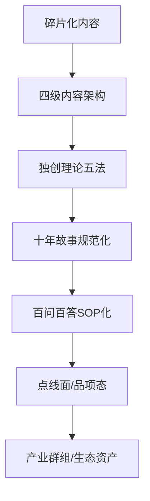

# 第 32 章 IP打造与Web3趋势体系

## 学习目标

- 理解母题作为IP护城河核心锚点的文化基因属性
- 掌握‘2层基因’（风骨与变现双螺旋）的互补逻辑与边界条件
- 理解‘3重身份’（工具/人/神）随用户生命周期动态切换的阶梯性规律
- 掌握‘4级观感’（松弛/对象/获得/氛围）驱动感性消费的组合设计法
- 理解‘5份资产’（用户/版权/实物/文化/生态）的协同复利与估值锚点作用
- 掌握‘内容体系五件套’（四级架构/独创理论/十年故事/百问百答/点线面）的闭环构建法
- 熟悉‘千万营收模型’全景价格表及‘4近原则’指导下的产品阶梯设计
- 理解Web3作为‘以虚促实’新范式的融资规模特征与熊期生存法则（敬畏市场、保护弹药、容错率）

## 32.1 生活类比

想象IP打造是在**经营一座‘文化主题公园’**：

- **母题** = 公园的**核心IP形象/世界观**（如迪士尼的‘童话梦想’），一切游乐设施、周边、故事皆由此延展，筑起护城河
- **2层基因** = **‘文化底蕴’（风骨）与‘商业运营’（变现）双引擎**：光有梦想不盈利会倒闭，光卖票无文化成不了经典
- **3重身份** = **游客不同阶段的‘导游角色’**：
  - **工具** = 发地图、借充电宝、排队系统（解决功能性问题）
  - **人** = 陪聊拍照、讲冷知识、成了朋友（情绪连接、价值认同）
  - **神** = 迷路时的‘救世主’、VIP定制专属行程（危机时刻掌握话语权、实现迭代升级）
- **4级观感** = **园区体验设计的‘四大杀手锏’**：
  - **松弛感** = 演职人员从容专业，让你觉得‘这儿啥情况都能搞定’
  - **对象感** = 米奇只对你耳语‘今天生日快乐’（私密专属感）
  - **获得感** = 买张票送限定手办、跳过排队（超预期惊喜）
  - **氛围感** = 烟花秀、巡游、背景乐让你沉浸‘不想走’
- **5份资产** = 公园的**资产负债表**：
  - **用户资产** = 年卡会员画像（决定你是谁）
  - **版权资产** = 米奇形象授权、电影改编权（边际成本趋零）
  - **实物资产** = 乐园实体、周边商品、酒店
  - **文化资产** = ‘迪士尼’本身成为‘童话/梦想’的文化符号
  - **生态资产** = 合作商家、供应商、人才体系协同产生的溢价
- **内容体系五件套** = **公园的‘标准化建设图纸包’**：
  - **四级架构** = 广告牌(引流)→ 导览图/APP(信任)→ 单次门票/快速通行证(付费)→ 年卡/会员/定制游(高客单)
  - **独创理论** = 独家‘快乐算法’（如节点法从‘接待流程’提炼‘水利理论’）
  - **十年故事** = 创始人‘从车库到王国’的5分钟院线级纪录片
  - **百问百答** = 客服标准话术库，覆盖‘厕所在哪’到‘如何求婚’全路径
  - **点线面** = 单个玩具(点)→ IP授权项目(线)→ 迪士尼宇宙生态(面)
- **千万营收模型** = **分层定价的‘商品菜单’**：
  - 爆米花/气球(低客单引流) → 纪念品/快速通行证(中客单) → VIP包场/会员权益/IP授权(高客单)
  - 遵循**‘4近原则’**：离钱包近(买水)、离痛点近(买雨伞)、离易用近(手机充电)、离信任近(官方旗舰店)

想象Web3转型是**‘淘金热中的卖铲人’与‘建铁路人’的博弈**：

- **Web3定义** = **‘虚拟大陆’（区块链）与‘现实大陆’（实体经济）之间新建的‘海底隧道’（虚实交互）**
- **融资规模** = 10年挖出**3万亿美元金矿**（流动价值），媲美全球传统VC总储量，a16z等巨头搬运设备入场
- **熊市生存法则** = **淘金热退潮时的‘生存手册’**：
  - **敬畏市场** = 不对抗洪水，造船（共舞）而非筑墙
  - **保护弹药** = 留足粮草（现金流），别让队友饿死（FTX连环暴雷教训）
  - **选对赛道** = **‘卖铲子/建铁路’（基建公司）比‘下矿淘金’（应用层投机）抗跌**
  - **选择>努力** = 你的启动资金（筹码）决定你能玩‘买矿山’还是‘卖水’，别All in一张彩票
  - **容错率** = 给自己留条后路，别把救生衣卖了买矿机

## 32.2 概念地图

IP打造与Web3趋势体系
├── IP外部打造框架（12345）
│   ├── 1个母题 —— 文化原型锚点，承载百变题型，搭建护城河
│   ├── 2层基因 —— 风骨（文化沉淀）与变现（商业能力）双螺旋，互补共生
│   ├── 3重身份 —— 工具（解决功能）→ 人（情绪连接）→ 神（危机再分配/迭代升级）
│   ├── 4级观感 —— 松弛感/对象感/获得感/氛围感，至少两两组合驱动感性消费
│   └── 5份资产 —— 用户/版权/实物/文化/生态，协同复利，构建资产负债表
├── IP内容体系五件套
│   ├── 四级内容架构 —— 公域引流/私域信任/付费入门/高客单深度
│   ├── 一套独创理论 —— 理想解法/节点法/词根法/母题法/核心法五大生成路径
│   ├── 一个十年故事 —— 5-8分钟中视频，素材/主支线/文案/音乐全规范
│   ├── 一份百问百答 —— 覆盖全路径高频问题，标准化交付核心资产
│   └── 一份点线面打通路径 —— 产品(点)→项目(线)→产业链/生态(面/品项态)
├── 千万营收模型（变现全景）
│   ├── 低客单引流：年度会员/199小课(1+1+1模式/月400w)
│   ├── 中客单利润：私教(3w/3月)/私董会(5-20w)/轻顾问(3w+)
│   ├── 高客单品牌：合伙徒弟(20-100w)/重顾问(20w/年)/图书(联合出品人)
│   └── 4近原则 —— 离钱近/离痛点近/离易用近/离信任近
├── 核心定理与洞察
│   ├── IP是少数人的领地，借鉴模型而非借用路径
│   ├── 危机再分配效应 —— 神身份承接用户瓶颈危机，获取话语权
│   ├── 用户资产幂次效应 —— 品牌势能>流量堆砌，边界更广
│   └── 定位非内容，母题才能细化延展筑护城河
└── Web3趋势与生存法则
    ├── 定义：区块链+虚实交互生态，以虚促实趋势
    ├── 融资规模：10年3万亿流动价值，头部资本/对冲基金重仓入场
    └── 熊市生存：敬畏市场共舞/保护团队弹药/选择基建赛道/资金规模定赛道/预留容错率

## 32.3 母题 —— IP护城河的文化基因锚点

> "指的是，文化传统中具有传承性的文化因子，或者人类社会中那些循环往复且普遍发生的事情。最简单的理解就是原型。"
> 
> ——《刘梦园：从零打造年入千万IP的系统方法论》

你可能熟悉“定位”这个词，但定位往往是从商业角度切入的，它不从内容生产逻辑出发，所以很难做细化的延展，更搭不建真正的护城河。母题的概念就是为了解决这个问题而生的。

**母题**是IP外部打造框架“12345”中的“1”，也是整个体系的核心锚点。它指向文化传统中具有传承性的文化因子，或者人类社会中循环往复、普遍发生的事情——通俗说，就是**文化原型**。

> "对于IP来说，掌握母题就是可以既搭建出来自己的护城河又能随时调整边界的……但这个定位有一个弊端就是，它不是从内容的角度出发的，也就没法做好更细化的延展更不可能把护城河做出来。"
> 
> ——《刘梦园：从零打造年入千万IP的系统方法论》

这个概念展示了三个关键性质：

- **可延展性**：母题下包含百变题型，题型可模块化、解法可标准化
- **抗周期性**：作为文化基因，不随短期热点波动而失效
- **区隔性**：区别于商业定位，从内容生产逻辑出发构建差异化壁垒

### 典型例子

**女性安全方向**：母题为“女性成长/安全”，题型涵盖家暴、户外安全、PUA、诈骗案例分析等。这些题型都能模块化拆解，形成标准化的内容生产线。

**李子柒IP**：母题为“东方田园美学/传统手作”，置于主文化之下构建文化资产，每一期视频都是该母题下的一个具体题型实例化。

### 边界条件

- 必须源于真实文化传统或普遍人性，不可人为强行编造伪概念
- 需配合“2层基因（风骨+变现）”落地，单有母题无商业能力无法持续
- 题型拆解需达到底层逻辑可复用，否则沦为选题库而非体系

---

## 32.4 2层基因 —— 风骨与变现的双螺旋基因

> "指文化沉淀价值（风骨）和商业持续能力（变现），这里重点需要说的有三点：一是不要做没有文化溢价的事情……二是IP是少数人的领地……三是不要相信天道酬勤那种鬼话。"
> 
> ——《刘梦园：从零打造年入千万IP的系统方法论》

如果只有母题，IP只是一个“空壳”。2层基因是IP外部打造框架中的“2”，指**文化沉淀价值（风骨）**与**商业持续能力（变现）**。

这个双螺旋结构揭示了三个核心要求：

1. **不要做没有文化溢价的事情**：纯流量变现没有护城河，只有沉淀为文化符号的内容才能产生溢价
2. **IP是少数人的领地，不要走别人的路径**：每个IP的花期和成长环境不同，直接复刻别人的爬坡路径会遗漏关键情境信息，形成路径依赖
3. **不要相信“天道酬勤”那种鬼话**：极大概率是幸存者偏差，所有的努力与坚持必须建立在清晰前景与两周可验证变现的基础上

### 关键性质

- **互补性**：风骨提供溢价与护城河，变现提供生存与再投资资金
- **稀缺性**：兼具两者的IP属于少数，形成“天然差异化”壁垒
- **反幸存者偏差**：警惕盲目坚持，变现反馈是坚持的前提

### 典型例子

**穿搭IP**：沉淀版权素材（风骨），一场线上发布会实现千万-上亿流水（变现）。版权素材是文化资产，发布会是商业变现的具象化。

**李子柒**：走文化资产路线（风骨），通过版权授权、衍生品实现商业闭环（变现）。她的IP本身已成为“东方美学”的文化符号。

### 边界条件

- 风骨不可虚无，必须落地为可版权化、可资产化的文化素材
- 变现不可透支风骨，需遵循“4近原则”（离钱近、离痛点近、离易用近、离信任近）
- 拒绝直接借用他人成熟模型（如博商199小课模式），需拆解多模型取长补短

---

## 32.5 3重身份 —— 工具、人、神的动态角色切换

> "指IP需要根据不同的状态下把自己当工具或者当人或者当神。工具是从解决用户问题的功能性上说的……人是从解决用户价值主张或情绪性的角度去说的……神是从解决用户迭代升级的角度去说的，危机具有强烈的再分配的效应。"
> 
> ——《刘梦园：从零打造年入千万IP的系统方法论》

用户在不同成长阶段的核心需求完全不同：初期要解决功能问题，中期要情绪价值与价值主张，瓶颈期要破局升级。如果你只扮演单一角色（如只做工具人），无法覆盖用户全生命周期，流失率极高。

3重身份是IP外部打造框架中的“3”，要求IP根据用户状态动态切换：

| 身份 | 核心功能 | 典型交付物 | 定价参考 |
|------|----------|------------|----------|
| **工具** | 解决功能性问题 | SOP模板、工具表格、自测量表 | 低价/免费 |
| **人** | 情绪连接、价值认同 | 月度复盘会、社群陪跑、情绪支持 | 中客单 |
| **神** | 迭代升级、危机再分配 | 年度战略顾问、组织诊断重组、认知重塑 | 高客单（50-100万/年） |

### 危机再分配效应 —— “神”身份的底层逻辑

> "当用户意识到自身的瓶颈之后便具有了一定的危机感，这时候谁解决这个危机感谁就具有一定的再分配话语权……"
> 
> ——《刘梦园：从零打造年入千万IP的系统方法论》

当用户感知瓶颈产生危机感时，能解决该危机的“神”身份获得话语权，将关系从平等转为“指挥/被指挥”。这是高客单价成交的核心心理机制。

### 典型例子

**私域顾问**：
- 工具：提供SOP工具包
- 人：年度陪伴服务
- 神：重构组织结构/商业模式的“水利私域理论”

**龙飞律师**：
- 工具：提供法律文书模板
- 人：婚姻连麦情绪陪伴
- 神：“你问题我都见过”的权威定性

### 边界条件

- “神”身份需有真才实学的体系理论支撑，否则沦为“忽悠”
- 身份切换需自然，不可生硬植入，核心在于“解决用户当下最核心痛点”
- 定价体系需匹配身份：工具低价/免费、人中价、神高价

---

## 32.6 4级观感 —— 让消费决策从理性回归感性

> "指的是IP的对外输出和呈现上要具备至少两个观感才可以让用户有被感性支配而非理性催生的消费行为。松弛感是说IP有一种尽在掌握的状态……对象感是指这些话我只对你一个人说……获得感指的是没能让你说卧槽就是我输……氛围感是指沉浸其中无法自拔。"
> 
> ——《刘梦园：从零打造年入千万IP的系统方法论》

传统营销靠理性说服（参数、对比、利益点），转化率低、决策链路长。感性消费决策快、复购高、抗价格敏感，但缺乏系统化构建方法。4级观感就是这套可操作的框架。

IP外部打造框架中的“4”，要求具备至少两种观感的组合：

| 观感 | 核心信号 | 用户心理体验 |
|------|----------|--------------|
| **松弛感** | 尽在掌握 | “你问题我都见过”，确定性信号 |
| **对象感** | 私密专属 | “这些话我只对你一个人说” |
| **获得感** | 超预期交付 | “卧槽，值了” |
| **氛围感** | 沉浸体验 | “无法自拔，不想走” |

### 关键性质

- **组合性**：单一观感不足，需至少两两组合（如松弛+获得、对象+氛围）
- **幂次效应**：品牌势能积累的IP（靠观感）用户资产边界更广、幂次效应更强，优于流量堆砌IP
- **可设计性**：观感非天生，可通过内容结构、语气、视觉、交互刻意设计

> "如果你的IP是靠品牌涨起来的，那品牌本身所具有的势能就是你的用户资产。显而易见，品牌性质的边界会更广，幂次效应更强，IP的多次“觉醒”就有了可能。"
> 
> ——《刘梦园：从零打造年入千万IP的系统方法论》

### 典型例子

**龙飞律师**：松弛感（连麦从容）+ 获得感（直接给方案），短期破千万粉

**穿搭IP发布会**：氛围感（沉浸秀场）+ 获得感（超预期福利），单场流水千万级

### 边界条件

- 观感需与母题、基因一致，不能为了制造观感而破坏人设真实性
- 过度营造“神秘感/高冷感”易翻车，松弛感源于真实掌控力而非表演
- 获得感必须有实物/实惠兜底，纯情绪画饼属于欺诈

---

## 32.7 5份资产 —— IP商业版图的资产负债表

> "指的用户资产、版权资产、实物资产、文化资产、生态资产这五种和个人IP息息相关的资产形态。用户资产指的是你的用户是谁决定了你是谁……版权资产首先要明确一个IP可以有17种版权，其中13种是可交易的……"
> 
> ——《刘梦园：从零打造年入千万IP的系统方法论》

传统自媒体只关注粉丝数（用户资产），忽略版权、实物、文化、生态等隐性资产。5份资产是IP外部打造框架中的“5”，构建IP的资产负债表：

### 五大资产形态

1. **用户资产**：用户画像决定IP定位，是变现基础
2. **版权资产**：IP可拥有17种版权，其中13种可交易（改编权、衍生品授权等），边际成本趋近零
3. **实物资产**：IP衍生品、周边、实体店等有形载体
4. **文化资产**：IP置身主流/亚文化语境，成为文化符号（如李子柒）
5. **生态资产**：组织内成员协同发展带来的经济效益（如星云IP计划产业群组）

### 关键性质

- **复利性**：版权、文化资产边际成本趋近零，可无限复用、授权、放大
- **协同性**：五种资产相互转化（用户→版权价值→实物销售→文化符号→生态合伙人）
- **估值锚点**：为IP估值、融资、并购、传承提供硬性指标体系

### 典型例子

**李子柒**：文化资产为核心，反哺版权授权、实物食品、用户心智

**星云IP计划**：20个S级IP+内容经纪人生态，年2亿盘子，整合供应链/政府/人才资源

> "我有一大批经过层层筛选的内容经纪人、还有一大批经过层层筛选的S级IP……从理论端、执行端、变现端、IP端、政府支持、人才端都OK了之后我做什么不行呢？"
> 
> ——《刘梦园：从零打造年入千万IP的系统方法论》

### 边界条件

- 版权资产需依法登记、主动维权，否则易被侵蚀
- 实物资产需警惕供应链风险，避免“卖货毁人设”
- 生态资产需建立利益分配机制（如S级基因分成），防止大锅饭

---

## 32.8 内容体系五件套 —— 从“写文章”到“造体系”

> "一个IP的内容体系包含5个部分，四级内容架构、一套独有理论、一个十年故事、一份百问百答和一份产品项目产业链打通路径。"
> 
> ——《刘梦园：从零打造年入千万IP的系统方法论》

碎片化内容无法形成体系护城河，易被平台算法吞噬、同行模仿。内容体系五件套是从“点（文章）”到“线（课程）”到“面（产业链）”跃迁的标准化基建：

### 五件套构成

1. **四级内容架构**：公域引流 → 私域信任 → 付费入门 → 高客单深度
2. **一套独有理论**：通过五大方法生成（见下文）
3. **一个十年故事**：5-8分钟中视频，素材/主支线/文案/音乐全规范化制作
4. **一份百问百答**：覆盖用户全路径高频问题，标准化交付核心资产
5. **一份点线面打通路径**：产品-项目-产业链（品项态）的结构化成长地图

### 独创理论五大生成方法

| 方法 | 核心逻辑 | 适用场景 |
|------|----------|----------|
| **理想解法** | 基于TRIZ/ARIZ算法六步推导：目标→障碍→理想解→资源→矛盾→方案 | 解决行业顽疾、颠覆性创新 |
| **节点法** | 从实际服务流程中抽取共性节点，抽象为理论框架 | 服务型IP、顾问型IP |
| **词根法** | 针对垂类优势提炼核心词根，延展为体系概念 | 垂直细分领域专家IP |
| **母题法** | 延展/结合母题，将文化原型转化为理论内核 | 文化型IP、生活方式IP |
| **核心法** | 直接提取自身内容体系核心点命名为理论 | 已有成熟内容体系的IP |

### 十年故事制作规范

- **时长**：5-8分钟中视频
- **素材**：前后对比（新手村→大佬村），关键节点标注（低谷、荣耀、转折）
- **故事结构**：主支线清晰，体现成长弧光
- **文案**：表达清晰、目的明确（增加信任）、契机合理
- **音乐**：体现品位，强化氛围感

### 点线面（品项态）打通路径

> "产品可以是一篇文章一份课程一个账号一个3折页甚至一个二维码等……那怎么做项目呢？是不是可以再做一个内容经纪人培训项目养一大批和我差不多的人呢？……组成一个S级为基因的产业群组是不是也可以呢？"
> 
> ——《刘梦园：从零打造年入千万IP的系统方法论》

将电商“人货场”概念转接到内容型IP，对应：
- **点（品）**：可交付的最小产品（文章、课程、账号、折页、二维码）
- **线（项）**：将点串联为培训项目（如内容经纪人培训）
- **面（态）**：理论端、执行端、变现端、IP端、政府支持、人才端齐备，构成产业群组

### 方法演进图

### 边界条件

- 理论生成必须基于实战服务沉淀，不可“闭门造车”编造概念
- 十年故事不可虚构，需经得起时间与细节考验
- 百问百答需持续迭代，随产品升级同步更新，避免“僵尸文档”

---

## 32.9 千万营收模型 —— 内容型IP变现的全景价格表

> "图里主要涉及到内容型IP可以变现的几乎所有方式……年度会员的年入百万像素级拆解……私教常规是3w3个月的一对一……私董会……花个5-20w买个圈子的门票……"
> 
> ——《刘梦园：从零打造年入千万IP的系统方法论》

大多数创作者只知单一变现（接广告、卖课），忽略高客单价渠道。千万营收模型是一张覆盖全生命周期、全客单价带的变现“菜单”：

### 全景价格表

| 层级 | 产品形态 | 定价区间 | 核心逻辑 |
|------|----------|----------|----------|
| **低客单引流** | 年度会员 | 标品化，交付成本趋近0 | 规模效应、信任沉淀 |
| **低客单引流** | 199小课/直播 | 199元，1+1+1模式 | 低成本量产、月入400万可复制 |
| **中客单利润** | 私教 | 3万/3个月（1v1深度陪跑） | 高溢价、强交付 |
| **中客单利润** | 私董会 | 5-20万/张门票 | 圈层资源+认知升级 |
| **中客单利润** | 轻顾问 | 3万起 | 标准化咨询产品 |
| **高客单品牌** | 合伙/徒弟 | 20-100万 | 核心资产授权+利益绑定 |
| **高客单品牌** | 重顾问 | 20万/年起 | 深度组织介入 |
| **高客单品牌** | 图书 | 一书一码/联合出品人 | 突破传统版税上限 |
| **高客单品牌** | 咨询/培训 | 1000+/小时；1天3万/1小时1万 | 时间杠杆变现 |

### 4近原则 —— 变现产品设计的底层逻辑

> "注意一个底层逻辑就是4近，离钱近好变现，离痛点近好卖出，离易用近好留存，离信任近好复购。"
> 
> ——《刘梦园：从零打造年入千万IP的系统方法论》

这四个“近”贯穿所有产品设计：
- **离钱近**：直接帮用户赚钱/省钱的产品最易变现
- **离痛点近**：直击用户最痛之处的产品最好卖
- **离易用近**：零门槛、即买即用的产品留存最高
- **离信任近**：背书强、信任度高的产品复购最好

### 典型验证案例

**199小课直播1+1+1模式**：一天两播、单场6万、月营收400万。核心杠杆：直播课→剪成小课→切条做短视频→再引流直播，内容三次复用。

**联合出品人计划**：传统出版卖5万册才有二三十万版税，且1万册已是畅销书。用“一书一码”技术招募1000个联合出品人众筹，打破版税天花板。

### 边界条件

- 高客单产品（私董会、顾问、徒弟）需极强信任背书（理论、案例、口碑）才能成交
- 直播带课模式极度依赖选品、话术、节奏，非标品复制难度大
- 必须警惕“单一变现渠道风险”，需布局多元组合

---

## 32.10 Web3 —— 基于区块链的虚实交互互联网生态

> "什么是Web3? 是一种基于区块链技术的互联网生态，并且还能实现与现实世界交互的虚拟世界。各大厂也都开始推出自己平台的NFT和线下结合，而这也符合国内所说的以虚促实的经济趋势。"
> 
> ——《传统金融转型Web3的行业扫描与躬身入局方法论》

传统互联网（Web2）流量见顶、数据垄断、创作者分成低。Web3作为新范式，核心定义包含三层：

1. **技术底座**：区块链（去中心化账本）
2. **经济模型**：代币激励 + 智能合约自动执行
3. **应用特征**：NFT确权 + 虚实交互（以虚促实）

### 核心洞察：融资规模指数级增长

> "Web3市场在10年内创造了3万亿美元的流动价值，已足以与传统投资基金投资的初创公司的总价值相媲美。Polychain、Paradigm、a16z、Multicoin、3AC以及一些其他专精的公司各自管理着数十亿或数百亿美元的资金。全球大量对冲基金正计划5年内将其资产的7%投入到web3的市场中，巨无霸养老基金也开始酝酿直投了。"
> 
> ——《传统金融转型Web3的行业扫描与躬身入局方法论》

这个数据展示了资本对Web3的确定性押注：10年3万亿流动价值，头部资本（a16z等管理百亿级）、对冲基金（5年配置7%）、养老基金直投，形成多层次资金池。

### 传统金融转型Web3的方法论

作者通过三步完成跨界：

1. **扫描风向标**：留意研报中的市场需求性，捕捉元宇宙、NFT、DeFi等热度词
2. **躬身入局**：用金融资源找到初创团队，以“初学者身份”参与项目，快速摸透可行性
3. **链接VC**：积极参加线上线下分享会，结识行业VC，完成资源置换

### 熊市生存法则

> "真正活下来能够完成远航的老鸟，都懂一句话：“敬畏它，并且与它共舞”。……在此温馨提示各位从事Web3的小伙伴：“不要浪费弹药”。如果你是一个有抱负的Web3公司的员工，在签约之前，记得去问招聘人员他们公司的赛道情况以及现金情况。在一个拥有大量资金弹药的“基建公司”工作绝对不是个坏的选择，这在熊市会是更好的选择。"
> 
> ——《传统金融转型Web3的行业扫描与躬身入局方法论》

熊市是筛选器，生存核心三条：

| 法则 | 具体含义 | 反面教材 |
|------|----------|----------|
| **敬畏市场，与市场共舞** | 不对抗周期，做市场中性策略，长期持有优质资产 | 做多杠杆、高频交易、抄底猜顶 |
| **保护团队弹药（现金流）** | 留足跑道，不让队友饿死（FTX连环暴雷教训） | 挥霍融资、高烧率扩张、忽略现金流 |
| **选择基建赛道** | “卖铲子/建铁路”（基建公司）比“下矿淘金”（应用层）抗跌 | All in单一应用层投机项目 |

### 选择比努力更重要 + 容错率

> "有句老话，选择比努力更重要。在看赛道之前，在于你前期资金规模有多大，再决定要关注什么赛道。从金融的角度来说，要给自己一定的容错率，如果在早期仅仅是ALL IN在一个方向，风险并不是特别好控制。"
> 
> ——《传统金融转型Web3的行业扫描与躬身入局方法论》

你的启动资金规模决定了你的牌桌位置：
- 资金量大 → 可关注基建、协议层、合规科技（高门槛、高护城河）
- 资金量小 → 关注应用层工具、内容社区、中间件（低门槛、快验证）
- **必须给自己留容错率**：分批次投入、设定止损线、保留“场外赚钱能力”

---

## 32.11 多源对照

### 共识

两篇核心素材（HiVkdfBYJo2H5xxWIemcMcMQnLc.md 与 T1Jad4VhIoPc2hxKJxwcUFPOnTc.md）在以下观点上达成高度一致：

1. **体系化优于单点突击**：无论是IP打造还是Web3创业，都需要框架性思维（12345框架 / 扫描-入局-验证-链接闭环），而非靠单篇爆款或单次投机
2. **文化/技术溢价是核心护城河**：IP靠“风骨”（文化溢价），Web3靠“以虚促实”（技术溢价），无溢价即无护城河
3. **选择大于努力，容错率决定生死**：IP领域“借鉴模型而非借用路径”，Web3领域“资金规模定赛道、预留容错率”，核心都是避免盲目All in

### 分歧

| 维度 | HiVkdfBY素材（IP打造视角） | T1Jad4Vh素材（Web3/金融视角） |
|------|---------------------------|------------------------------|
| **时间周期** | 强调长期主义、文化资产复利、十年故事 | 强调周期切换、熊市生存、敬畏市场共舞 |
| **资产观** | 重资产负债表（5份资产）、版权/文化资产边际成本趋零 | 重现金流/弹药库、代币流动性、资金池规模 |
| **身份定位** | IP扮演工具/人/神三重角色服务用户 | 创业者扮演扫描者/入局者/连接者链接资源 |
| **变现逻辑** | 阶梯定价（4近原则）、高客单靠信任背书 | 融资叙事、代币增值、二级市场流动性退出 |

---

## 32.12 设计中的取舍

### 为什么不用“定位/卡位”而是“母题”？

传统定位是从商业角度切入的静态标签，不从内容生产逻辑出发，无法做细化延展，更搭不起护城河。母题源于文化原型，具有传承性，能承载百变题型，题型可模块化、解法可标准化，实现“既搭建护城河又能随时调整边界”。

**Trade-off**：母题要求创作者具备深厚的文化素养和内容抽象能力，门槛高于简单的“贴标签定位”；但只有母题能支撑长期主义的IP资产积累。

### 为什么“神”身份定价必须极高（50-100万/年）？

“神”身份承接的是用户的“危机再分配效应”——当用户陷入瓶颈危机，能解决危机者获得话语权。这个定价不是溢价，而是**筛选机制**：只留下真正有破局意愿、有支付能力、值得深度投入资源的用户。低价会稀释“神”的权威感，破坏危机再分配的心理基础。

### Web3熊市为什么要选“基建公司”而非“应用层项目”？

基建公司（公链、中间件、合规科技、钱包基础设施）拥有确定性需求、长周期现金流、抗周期能力强；应用层项目高度依赖市场情绪、用户增长、代币价格，熊市极易归零。**Trade-off**：基建公司技术门槛高、商业化路径长、短期爆发力弱；但只有基建能活穿周期。

---

## 32.13 动手练习

### 练习1：为你的IP寻找‘母题’并拆解题型

1. 结合你的专业领域或兴趣，尝试提炼一个源于文化传统/普遍人性的‘母题’（如：‘匠人精神’、‘破茧成蝶’、‘守护者’）。
2. 在该母题下，列举至少5个可模块化、解法可标准化的‘题型’（如母题‘女性成长’下的‘职场突围’、‘亲密关系’、‘原生家庭和解’等）。
3. 判断：该母题是否具备‘抗周期性’（5年后仍有效）？题型之间是否存在可复用的底层逻辑？

**回答问题**：
- 为什么传统‘定位/卡位’无法替代‘母题’？
- 若题型无法标准化解法，会带来什么后果？

### 练习2：设计你的IP‘三重身份’服务菜单与定价

1. 假设你是某垂类专家（如：私域运营、职业规划、健身教练），分别设计对应‘工具’、‘人’、‘神’三重身份的核心交付物：
   - 工具（低价/免费，标品化）：如SOP模板、工具表格、自测量表
   - 人（中客单，陪伴服务）：如月度复盘会、社群陪跑、情绪支持
   - 神（高客单，深度干预）：如年度战略顾问、组织诊断重组、认知重塑训练营
2. 为每个身份设定参考价格带，并标注‘危机再分配效应’在‘神’身份中的具体体现（即：用户遇到何种瓶颈危机时，会买单你的‘神’服务？）。

**回答问题**：
- 为何‘神’身份必须有真才实学的体系理论支撑，否则为何易沦为‘忽悠’？
- 同一时间能否对不同用户扮演不同身份？如何避免人设崩塌？

### 练习3：构建‘4级观感’组合拳与‘千万营收模型’阶梯

1. 选取一个你熟悉的成熟IP（如：李子柒、罗振宇、某头部律师/医生IP），分析其内容输出中体现的‘4级观感’组合（至少两两组合），并举例说明具体内容片段。
2. 根据‘千万营收模型’全景表，为该IP梳理现有变现产品矩阵，标注缺失的价格带（低/中/高客单），并依据‘4近原则’提出1-2个补全产品的建议。

**回答问题**：
- 为什么‘品牌势能积累的IP’（靠观感）比‘流量堆砌的IP’用户资产幂次效应更强？
- ‘199小课直播1+1+1模式’的核心杠杆在哪里？为何非标品复制难度大？

### 练习4：Web3赛道选择与容错率压力测试

场景：你有一笔50万启动资金，想进入Web3赛道创业或投资。

1. 根据‘选择比努力更重要，前期资金规模决定关注赛道’原则，列举你会重点关注的2-3个细分赛道（如：基建/工具、DeFi协议、NFT应用、GameFi、合规/监管科技等），并说明理由。
2. 设计你的‘容错率’方案：设定止损线、分批次投入节奏、保留‘场外赚钱能力’的具体项目。
3. 模拟一次‘熊市压力测试’：若核心币种下跌80%、融资冻结6个月、核心开发者离职，你的团队能否存活12个月？关键靠什么？

**回答问题**：
- 为什么作者建议‘在资金弹药充裕的基建公司工作是熊市更优选择’？
- ‘敬畏市场，与市场共舞’在具体操作层面意味着什么？（提示：对比‘做多杠杆’vs‘做市场中性策略’、‘高频交易’vs‘长期持有优质资产’）

---

## 32.14 本章小结

这一章中我们系统学习了从零打造年入千万IP的完整方法论，以及Web3作为新范式的核心认知与生存法则。首先我们理解了**母题**作为IP护城河核心锚点的文化基因属性，它源于文化原型，承载百变题型，实现可延展与抗周期；其次我们掌握了**2层基因**（风骨与变现双螺旋）的互补逻辑——拒绝无溢价变现与自嗨式风骨；接着我们理解了**3重身份**（工具/人/神）随用户生命周期动态切换的阶梯性规律，其中神身份依托**危机再分配效应**获取话语权；然后我们掌握了**4级观感**（松弛/对象/获得/氛围）驱动感性消费的组合设计法，并理解了**5份资产**（用户/版权/实物/文化/生态）的协同复利与估值锚点作用；随后我们掌握了**内容体系五件套**（四级架构/独创理论/十年故事/百问百答/点线面）的闭环构建法，包括独创理论五大生成路径（理想解法/节点法/词根法/母题法/核心法）与十年故事制作规范；我们还熟悉了**千万营收模型**全景价格表及**4近原则**指导下的产品阶梯设计；最后我们理解了Web3作为**以虚促实**新范式的融资规模特征（10年3万亿流动价值）与熊期生存法则（敬畏市场、保护弹药、选择基建赛道、资金规模定赛道、预留容错率）。

本章我们一起学习了以下概念：

| 概念 | 解释 |
|------|------|
| 母题 | IP护城河的文化基因锚点，源于文化原型，承载百变题型，实现可延展与抗周期 |
| 2层基因 | 风骨（文化沉淀）与变现（商业能力）双螺旋，互补共生，拒绝无溢价变现与自嗨式风骨 |
| 3重身份 | 工具/人/神三角色随用户生命周期切换，阶梯性对应功能/情绪/迭代需求，神身份依托危机再分配效应 |
| 4级观感 | 松弛/对象/获得/氛围四感至少两两组合，驱动感性消费，可设计、幂次效应强于流量堆砌 |
| 5份资产 | 用户/版权/实物/文化/生态五资产协同复利，构建IP资产负债表，支撑估值、融资与传承 |
| 内容体系五件套 | 四级架构/独创理论/十年故事/百问百答/点线面打通，从碎片内容进化为结构化资产与产业链 |
| 独创理论五法 | 理想解法(TRIZ)/节点法(服务流程抽象)/词根法(垂类优势)/母题法(原型延展)/核心法(体系核心) |
| 十年故事规范 | 5-8分钟中视频，素材(新手村→大佬村/低谷荣耀转折)/主支线/文案(清晰/目的/契机)/音乐(品位) |
| 点线面(品项态) | 产品(点)→项目(线)→产业链/生态(面)，对应电商人货场，实现从可交付最小单元到产业群组跃迁 |
| 千万营收模型 | 年度会员/私教/私董会/合伙徒弟/图书联合出品/199小课直播/咨询顾问等全价格带阶梯，遵循4近原则 |
| 4近原则 | 离钱近好变现、离痛点近好卖出、离易用近好留存、离信任近好复购，变现产品设计的底层逻辑 |
| Web3 | 基于区块链的虚实交互互联网生态，符合以虚促实趋势，10年创造3万亿流动价值 |
| Web3熊市生存 | 敬畏市场共舞、保护团队弹药(现金流)、选择基建赛道、资金规模定赛道、预留容错率避免All in |

下一章中，我们将学习如何将这些IP打造方法论与Web3趋势洞察，整合到你的个人商业体系中，构建可持续复利的“认知升维与长期主义”框架，从“赚快钱”进化到“复利人生”。

感谢你读到了这里，恭喜你，你已经完成了IP打造与Web3趋势体系的核心认知构建！
