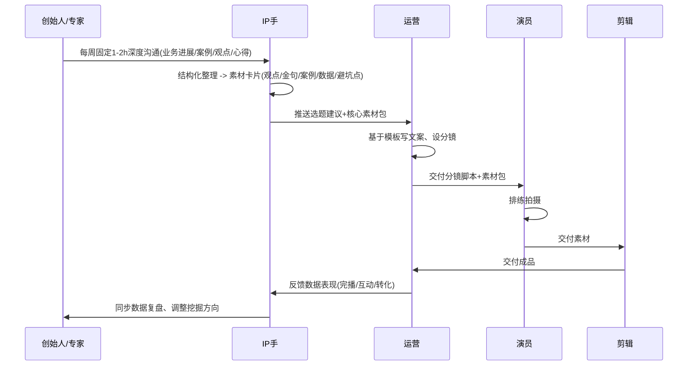

# 第 13 章 短视频 IP 矩阵与团队搭建 —— 从“个人作战”到“工业化复制”
作者：龙哥

## 学习目标

- 理解后端变现效率为何是抖音 IP 项目成败的核心决定因素
- 掌握变现产品双轨制（泛兴趣低客单 vs 精准痛点高客单）及其成交路径匹配
- 学会行业冠军联营打法：筛选、洽谈、利用头部机构资源放大流量
- 建立短视频 IP 团队五岗标准架构与核心考核指标体系
- 掌握剪辑→运营→项目经理的内部人才培养路线与操作步骤
- 熟练运用 IP 打造五步流水线：定位、选题、文案、拍剪、复盘的标准化执行
- 理解并能操作留存坏点复盘法，实现秒级流失诊断与精准优化
- 掌握爆款文案“钩子开头+漏斗观点+钩子结尾”结构的拆解与复制技巧
- 认清创始人 IP 的商业效率陷阱，学会用专业演员替代创始人出镜的决策标准
- 建立“不下牌桌”的组织能力：经验沉淀、流程固化、梯队备份的护城河思维

## 13.1 生活类比

想象打造短视频 IP 矩阵像**开一家连锁餐厅**：**后端变现效率** = **后厨出菜速度×毛利率**：前台（抖音内容）再怎么装修营销（趋同化），如果后厨（变现体系）出菜慢、毛利低，隔壁餐厅（竞品）用更高毛利支撑更贵食材和更大广告投放，你必死无疑。**变现双轨制** = **两条产品线**：一条是**平价快餐（泛兴趣 0-50 元）**，走大流量、标准化极速出餐（短视频带货）；一条是**高端定制宴席（精准痛点 1000+ 元）**，靠品牌信任、私厨上门（直播/私域成交），两条线互不干扰、各有各的 SOP。**行业冠军联营** = **加盟央厨/供应链龙头**：自己没中央厨房、没品牌背书、没配送体系，直接和本地最大的央厨（行业冠军）签“月费+分成”，借他们的预算、招牌、体系，你只负责卖（抖音获客）。**五岗架构** = **标准厨房编制**：大厨/演员（出镜）、菜单研发/运营（选题文案）、切配炒菜/剪辑（拍剪）、采购挖特产/IP 手（挖素材）、店长/PM（进度 ROI），每岗有 KPI，人走岗留。**剪辑转运营** = **从切配学徒培养成研发主厨**：切配（剪辑）最好招、最懂节奏食材，筛选有“灵性”（爱钻研菜品）的，跟着研发主厨（老运营）实战，逐渐接手研发菜单（选题文案），再晋升店长（PM）。**留存坏点** = **顾客放筷子的那一口**：监控全程就餐监控，发现第 8 分钟大家都放下筷子（流失），回看监控是那道“专业代码表”菜太难吃 → 换成“选错专业哭厕所”的故事菜，留住顾客吃完买单。**爆款文案结构** = **菜单设计三板斧**：封面页必须用**爆款钩子开头**（“后悔三年的家长都栽在这”）；内页按**漏斗逻辑**从大众口味收窄到招牌硬菜；封底留**钩子结尾**（“扫码领避坑指南”）。**创始人不出镜** = **老板别下厨**：老板专业度不够、时间碎、万一生病/离职全店瘫痪。请职业大厨（演员）按 SOP 出品，老板只管菜单定价（商业定位）、供应链（变现体系）、质检（核心审批）。**不下牌桌** = **把“厨师长的绝活”变成“标准菜谱手册”**：大厨走了菜谱在、切配走了流程在、研发走了选题库在。新店复制=复制手册+派学徒+按流程跑，不靠天才靠体系。

## 13.2 概念地图

短视频 IP 矩阵打造体系
├── 核心定律
│   ├── 后端变现效率决定成败  —— P001
│   ├── 爆火要素优先级：观众缘>表现力>文案>场景>剪辑  —— P001
│   ├── 创始人 IP 是坑  —— P001
│   └── 不下牌桌的能力（流程复制>内容能力）  —— P001
├── 变现产品体系
│   ├── 泛兴趣低客单产品（0-50 元）  —— P001
│   │   └── 成交路径：短视频带货直接成交  —— P001
│   ├── 精准痛点高客单产品（1000+ 元）  —— P001
│   │   ├── 成交路径一：直播间直接转化  —— P001
│   │   └── 成交路径二：引流私域成交（低转高）  —— P001
│   └── 行业冠军联营放大  —— P001
├── 组织架构与人才体系
│   ├── 标准五岗：演员/运营/剪辑/IP 手/项目经理  —— P001
│   │   └── 各岗核心考核指标  —— P001
│   ├── 剪辑→运营→项目经理成长路线  —— P001
│   └── IP 手（聊天手）：创始人 IP 内容挖掘岗  —— P001
├── 标准化内容生产流水线
│   ├── 定位：竞品调研→商业缺口→细节梳理  —— P001
│   ├── 选题：热点宝对标→选题库→多维评分  —— P001
│   ├── 文案：跨领域对标素材库+爆款开头句式结构  —— P001
│   │   └── 黄金结构：钩子开头+漏斗观点+钩子结尾  —— P001
│   ├── 拍剪：按分镜执行，重留存轻特效  —— P001
│   └── 复盘：三维指标法  —— P001
│       ├── 5秒完播率（诊断开头/场景）  —— P001
│       ├── 总体完播率（诊断结构/剪辑/场景）  —— P001
│       └── 留存坏点（秒级流失定位→砍掉优化）  —— P001
└── 实战验证案例
    ├── 高考志愿号：2个月精准涨粉 10万+、私信爆满  —— P001
    ├── 抗衰视频：单条导流 300 干细胞客户  —— P001
    ├── 垂类账号千粉变现六位数  —— P001
    └── 创始人出镜踩坑：浪费几十万流量  —— P001

## 13.3 后端变现效率 —— 让单位流量产出最大价值

### 为什么需要这个概念？

抖音前端内容同质化严重，大家都在抄爆款，流量获取难度和成本持续上升。同样一波流量，别人能变现 1000 元毛利，你只能变现 500 元，最终会被对手用高获客成本挤死。只有提升后端变现效率，才能在流量红利消退期依然跑得通商业模型。

### 核心定义与推导

> "抖音是开卷考试，前端内容一定是趋同的，而真正决定了项目成败的，是我们的后端变现效率。"
> 
> ——《短视频 IP 矩阵打造实战心得》

后端变现效率的核心公式可以表述为：

$$
\text{后端变现效率} = \frac{\text{单客毛利}}{\text{获客成本}} \times \text{复购系数}
$$

这个公式展示了三个层面的含义：(1) 分子端由变现产品设计（客单价、毛利率、复购率）决定；(2) 分母端由流量获取能力与转化路径决定；(3) 两者之比决定了你能承担多高的获客成本而不亏损。

作者进一步给出了竞争动态模型：

$$
\text{最大可承担获客成本} = \text{单客毛利} \times (1 - \text{安全边际})
$$

这个公式展示了为什么同行能把获客成本拉到 900 元而你只能承担 500 元：因为人家单客毛利 1000 元，你只有 500 元。当流量成本上涨到 600 元时，你已经 ROI<1 不敢投放，同行还在疯狂放量抢占流量份额，形成“高毛利→高投放→更多流量→更高毛利”的正向飞轮。

### 关键性质

- **决定性**：前端内容趋同（开卷考试），后端效率是项目成败的唯一变量
- **杠杆性**：高变现效率允许更高获客成本，反向碾压低效竞品，形成正向飞轮
- **阈值性**：当 ROI<1 时必须止损，不敢放预算即意味着项目死亡

### 典型例子

- **减肥粉案例**：同行设计完善变现体系，单客毛利 1000 元，可将获客成本拉至 900 元；你只能做到 500 元毛利，获客成本一旦超 500 元即亏损
- **高考志愿号**：两个月精准涨粉 10 万+，私信爆满，单客高客单价配合行业冠军联营实现高变现
- **抗衰视频**：单条视频导流 300 个干细胞客户，验证高客单内容的极致变现效率

### 边界条件

- 前提是已有稳定流量来源，无流量谈变现效率无意义
- 仅适用于非标品、高客单、强服务属性赛道，标品电商靠供应链比拼而非变现设计
- 需配合完整的交付 SOP，否则高客单带来的只是投诉而非复购

## 13.4 变现产品双轨制 —— 泛兴趣低客单 vs 精准痛点高客单

### 为什么需要这个概念？

很多创作者不分赛道盲目选品，要么低客单做私域累死，要么高客单靠短视频卖不动。必须根据产品属性匹配对应的流量规模和成交路径，才能实现商业闭环。这是从“做内容”到“做生意”的关键分水岭。

### 核心定义

> "什么样的变现产品适合做 IP 呢？我认为有两种：一种是低客单价（0-50）的泛兴趣产品（比如书单号，低价知识付费课程）……还有一种是高客单价（1000+）的精准痛点产品（比如高考志愿填报）。"
> 
> ——《短视频 IP 矩阵打造实战心得》

我们将变现产品定义为两个不相交的集合：

$$
\begin{aligned}
\text{泛兴趣低客单集合} &= \{p \mid \text{客单价} \in [0, 50], \text{目标人群} > 10^8, \text{成交路径} = \text{短视频直接成交}\} \\
\text{精准痛点高客单集合} &= \{p \mid \text{客单价} \in [1000, \infty), \text{目标人群} \ll 10^8, \text{成交路径} \in \{\text{直播转化}, \text{私域成交}\}\}
\end{aligned}
$$

这个定义展示了客单价、人群规模、成交路径三个维度的强绑定关系：低客单必须配大流量+即时成交，高客单必须配精准流量+延迟成交。

### 成交路径匹配矩阵

以下是两类产品的成交路径对照表：

| 维度 | 泛兴趣低客单（0-50 元） | 精准痛点高客单（1000+ 元） |
|------|------------------------|---------------------------|
| 目标人群 | 1 亿+ 大众泛人群 | 垂直细分刚需人群 |
| 核心杠杆 | 流量杠杆（量大） | 信任杠杆（价高） |
| 成交路径 | 短视频挂车直接下单 | 直播间转化 / 引流私域 1v1 咨询 |
| 典型案例 | 书单号《厚黑学》、9.9 元课程 | 高考志愿填报、干细胞抗衰 |
| 风险点 | 依赖算法推流，抗风险极弱 | 极度依赖 IP 人设，人设崩塌业务归零 |

这个表格展示了为什么中间地带（50-1000 元）最尴尬：短视频转化率低、私域运营成本高，既吃不到流量红利，又承担不起信任建设成本。

### 关键性质

- **互斥性**：低客单产品不适合私域高强度运营，高客单产品不适合短视频冲动下单
- **路径依赖**：低客单=短视频带货→即时成交；高客单=直播信任/私域咨询→延迟成交
- **杠杆差异**：低客单靠流量杠杆（量大）、高客单靠信任杠杆（价高）

### 典型例子

- **书单号《厚黑学》**：0-50 元客单价，针对 1 亿+ 人群，短视频直接挂小黄车成交
- **高考志愿填报**：1000+ 元客单价，针对高考家长精准痛点，直播间转化或私域 1v1 咨询成交
- **干细胞抗衰**：高客单精准痛点，单条视频导流 300 精准客户，私域高客单成交

### 边界条件

- 50-1000 元中间地带最尴尬：短视频转化率低、私域运营成本高，建议避开或改造为两极产品
- 低客单产品依赖平台算法推流，算法变动抗风险极弱
- 高客单产品极度依赖 IP 人设和专家信任，人设崩塌即业务归零

## 13.5 行业冠军联营 —— 借力放大流量的杠杆

### 为什么需要这个概念？

个人/小团队缺预算、缺背书、缺完整变现体系，单打独斗极难跑通高客单业务。传统找代理商/加盟商模式慢、管控弱，需要一种轻量级合作模式。利用当地头部机构的现成资源，实现 1+1>2 的放大效应。

### 核心定义

> "所以就搜、找朋友问，哪家机构是我们当地最大的，也就是行业冠军，然后企查查、boss 直聘查老板电话，直接一个 cold call 打过去，也很顺利，约见面两次后，谈成联营合作，每月的服务费+项目分成"
> 
> ——《短视频 IP 矩阵打造实战心得》

行业冠军联营的合作模型可形式化为：

$$
\begin{aligned}
\text{合作对象} &= \arg\max_{i \in \text{本地机构}} (\text{营收}_i \times \mathbb{1}_{\text{有预算}} \times \mathbb{1}_{\text{有背书}} \times \mathbb{1}_{\text{有体系}}) \\
\text{合作结构} &= \text{月服务费} + \text{项目分成比例} \times \text{GMV} \\
\text{资源交换} &= \{\text{抖音端: 流量获取能力}\} \leftrightarrow \{\text{线下端: 预算+品牌背书+交付体系}\}
\end{aligned}
$$

这个模型展示了三个关键点：(1) 筛选标准是“三位一体”（预算、背书、体系缺一不可）；(2) 合作形式是非股权绑定的业务深度绑定；(3) 核心交换是流量端与变现端的天然互补。

### 联营操作标准流程

```
1. 赛道确认：明确高客单产品赛道（高考/留学/医美/高端家装等强线下交付赛道）
2. 冠军筛选：企查查/抖音同城/朋友推荐 → 锁定当地营收 Top1 机构
3. Cold Call：30 秒建立信任 → 抛出“抖音流量+你的交付=共赢” → 约见面
4. 面谈验证：核实对方预算/背书/体系三位一体 + 展示己方流量数据/转化案例
5. 条款设计：月服务费范围、分成比例、数据归属、客户所有权、违约责任、退出机制
6. 启动运营：抖音端投流获客 → 线索实时推送企微/CRM → 线下端跟进转化 → 月度结算分账
```

这个流程展示了从筛选到落地的标准化动作，每一步都有明确的验证指标。

### 关键性质

- **非股权绑定**：不占股、不控股，仅业务层面深度绑定，灵活退出
- **资源互补性**：流量端（抖音强）+ 变现端（线下强）天然互补
- **门槛筛选**：只有行业冠军才有预算、背书、体系三位一体，二三名机构往往缺一项

### 典型例子

- **高考志愿项目**：作者冷电话联系当地最大教培机构，两次见面谈成联营，月服务费+分成，实现精准涨粉 10 万+、私信爆满
- **抗衰/干细胞项目**：联营当地头部医美/抗衰机构，借其专业资质和交付团队，抖音端负责获客

### 边界条件

- 仅适用于强线下交付、高客单、强合规属性的赛道（教育、医美、留学、高端家装等）
- 需要抖音端有稳定获客能力，否则无法兑现承诺，合作破裂
- 合同需明确数据归属、客户所有权、违约责任，防止“教会徒弟饿死师父”

## 13.6 短视频 IP 团队五岗架构 —— 从“人治”到“法治”的组织设计

### 为什么需要这个概念？

早期创业者身兼数职（策划、拍摄、剪辑、运营、客服），成为瓶颈。好运营极难招，剪辑好招但易流失，需要一套可复制、可替代的组织结构。只有标准化岗位职责和考核指标，才能实现“下牌桌”的持续运营能力。

### 核心定义

> "标准团队配置为演员/出镜人、运营（选题/文案/规划）、剪辑（拍摄剪辑）、IP 手（聊天手，面向创始人 IP 孵化）、项目经理，每个岗位有明确的核心考核指标。"
> 
> ——《短视频 IP 矩阵打造实战心得》

五岗架构的职责-指标矩阵如下：

| 岗位 | 核心职责 | 核心考核指标 (KPI) | 备注 |
|------|----------|-------------------|------|
| **演员/出镜人** | 按分镜脚本表演，配合拍摄，直播带货/讲课 | 5秒完播率、平均观看时长、互动率、直播转化率 | 建议用专业主播/演员，非创始人 |
| **运营** | 选题策划、文案撰写、账号规划、数据复盘 | 选题命中率、文案质量分、账号增粉/转化、复盘产出 | 核心大脑，需懂业务+懂内容 |
| **剪辑** | 视频拍摄、剪辑制作、包装特效、成品输出 | 视频产出量/质量、留存曲线优化、交付及时率 | 易招、易筛选、培养运营的蓄水池 |
| **IP 手 (聊天手)** | 深度沟通创始人/专家，挖掘结构化素材，喂给运营/演员 | 素材产出量/质量、选题转化率、账号数据对齐 | 仅创始人 IP 模式需要，演员矩阵模式不设 |
| **项目经理** | 多账号统筹、进度把控、资源协调、ROI 核算 | 项目进度达成率、团队人效、整体 ROI、梯队建设 | 后期设立，早期由创始人/资深运营兼任 |

这个矩阵展示了如何将“超级个体”拆解为可替代的功能模块，降低对天才的依赖。

### 关键性质

- **专业分工**：将“超级个体”拆解为可替代的功能模块，降低对天才的依赖
- **闭环协作**：运营定方向、剪辑出成品、演员演好、IP 手挖料、PM 兜底，形成标准化流水线
- **扩展性**：做创始人 IP 时必须加 IP 手；做矩阵号时可复制“运营+剪辑+演员”最小单元

### 典型例子

- **作者团队**：从自己下场做运营→招剪辑跑账号→筛选灵性剪辑转运营→循环复制，建立剪辑→运营→项目经理人才梯队
- **IP 孵化项目**：创始人只负责出镜/直播，IP 手每天深度沟通挖掘内容素材，运营负责文案和数据复盘

### 边界条件

- 早期（0-1 阶段）不需要全配置，创始人可兼运营+PM，先跑通流程再招人
- 演员岗建议用专业主持人/演员替代创始人，除非创始人极强表现力且全职 All in
- 薪资结构需设计：底薪+项目提成+账号分成，避免固定成本拖垮现金流

## 13.7 剪辑→运营→项目经理人才成长路线 —— 用流程造运营

### 为什么需要这个概念？

市场上成熟内容运营稀缺且昂贵，二线城市更难招，MCN 老板普遍反馈“好运营难招”。剪辑岗位供给充足、易筛选、成本可控，且优秀剪辑已具备节奏感、镜头感、数据敏感度。建立内部培养体系，比外部挖人更可控、更忠诚、成本更低。

### 核心定义

> "那么只招剪辑，筛选优秀人才往运营方向培养，是不是可行呢？我测试，完全行得通。1. 刚开始，让懂业务的团队老人或者自己下场做运营 2. 搭建初步内容生产流程 3. 招 1-2 个剪辑，跑 2-3 个账号实践 4. 找最灵性的剪辑，逐渐培养成运营 5. 循环 3-4"
> 
> ——《短视频 IP 矩阵打造实战心得》

人才成长路线的状态转移图如下：

```mermaid
graph TD
    A[创始人/老人亲自跑通 0-1] --> B[建立初始 SOP: 选题库/文案模板/复盘表]
    B --> C[招聘剪辑 1-2名]
    C --> D[实战 2-3个月: 产出量/质量/数据敏感度]
    D --> E{筛选"灵性": 主动复盘/提建议/关注留存曲线}
    E -- 是 --> F[逐步移交选题/文案职能]
    E -- 否 --> G[继续深耕剪辑/或淘汰]
    F --> H[晋升运营: 考核账号数据/选题命中]
    H --> I[优秀运营晋升 PM: 考核团队产出/ROI]
    I --> J[循环: 新账号=复制 SOP+派新人]
```

这个图展示了从“自己跑通”到“循环复制”的完整闭环，核心前提是步骤 B 的 SOP 必须先行建立。

### 关键性质

- **降维打击**：用低门槛岗位（剪辑）筛选高潜力人才，再赋能高技能（运营）
- **流程依赖**：必须先有标准化 SOP（选题库、文案模板、复盘表），新人才能“拿来即用”
- **考核驱动**：剪辑期看产出量/质量，运营期看账号数据/选题命中，PM 期看团队产出/ROI

### 典型例子

- **作者实测**：在二线城市招不到对口运营，但剪辑岗 Boss 直聘私信爆掉，按此路线成功孵化多名运营
- **步骤**：自己先做运营跑通 2-3 个账号 → 招 1-2 个剪辑配合 → 发现剪辑 A 对选题敏感、会提建议 → 逐步移交选题/文案职能 → 晋升运营

### 边界条件

- 前提是创始人/核心骨干必须懂业务、能亲自跑通 0-1 流程，否则无法建立初始 SOP
- “灵性”筛选标准主观，需量化：如主动复盘爆款、建议优化剪辑节奏、关注留存曲线等行为指标
- 培养周期约 3-6 个月，期间需承担试错成本，现金流紧张团队慎用

## 13.8 IP 打造五步法 —— 定位、选题、文案、拍剪、复盘的标准化流水线

### 为什么需要这个概念？

大部分团队靠灵感、靠大神、靠运气做内容，人一走业务就瘫痪。只有将爆款生产拆解为可执行、可检查、可迭代的标准动作，才能实现规模化复制。这是从“内容工作室”进化为“内容工厂”的核心基建。

### 核心定义与流程拆解

> "第一件事，竞品调研...这个行业在抖音有多少竞品？这个行业竞品做了多久？最近赚了多少钱？他们定位是什么？不同在哪？内容形式是啥？我们能不能抄/超？"
> 
> "第二件事，找定位缺口。先想商业定位，然后再想内容定位。"
> 
> "写文案最重要的就是开头，重要性占比 70% 以上"
> 
> "开头一定要复制爆款开头的句式结构，我要求我们运营写的每一个开头，都要找到对应的爆款对标（点赞 10w+）"
> 
> "我们自己测一篇文案最好的结构就是：泛流量开头+漏斗型观点+引导结尾，也可以理解为钩子开头+内容框架+钩子结尾"
> 
> "5秒完播率不行：开头、场景的问题"
> 
> "总体完播率不行：文案结构、剪辑、场景的问题"
> 
> "留存坏点（哪一秒人数骤降）"
> 
> ——《短视频 IP 矩阵打造实战心得》

五步流水线的标准化执行标准如下表所示：

| 步骤 | 核心动作 | 关键工具/方法 | 交付物 | 验收标准 |
|------|----------|--------------|--------|----------|
| **1. 定位** | 竞品调研(数量/时长/营收/定位/形式) → 找商业+内容缺口(先商业后内容) → 定细节(IP/演员/简介/头像/选题规划/模板/抖+预算) | 热点宝、企查查、飞书文档 | 定位文档、商业模型表、账号包装包 | 商业变现路径清晰、内容差异化可落地 |
| **2. 选题** | 热点宝收集对标 → 一键整理爆款转文字归纳选题库 → 多维评分(热度/相关性/可复制性)高分优先 | 热点宝、自研转文字工具、选题评分表 | 选题库 (百级)、本期选题清单 | 选题库覆盖率>80%、高分选题占比>60% |
| **3. 文案** | 跨领域找顶级高赞对标素材 → 开头强制复制 10w+ 爆款句式结构 → 最优结构: 泛流量钩子开头+漏斗型观点+引导结尾钩子 | 跨领域对标库、爆款句式库、文案模板 | 完整分镜文案脚本 | 开头有对标源、结构符合黄金模板、通过自查清单 |
| **4. 拍剪** | 按分镜执行，演员表现力>场景>剪辑，重留存轻特效 | 分镜脚本、拍摄清单、剪辑 SOP | 成品视频 | 无硬伤、节奏符合文案设计、留存曲线无明显坏点 |
| **5. 复盘** | 三维指标: 5秒完播率(诊断开头/场景)、总体完播率(诊断结构/剪辑/场景)、留存坏点(定位流失秒数/话/动作→砍掉) | 抖音创作者中心、留存曲线工具、复盘记录表 | 复盘报告、优化动作清单 | 问题定位准确、优化动作可执行、下期指标改善 |

这个表格展示了每一步的“动作-工具-交付物-验收”闭环，使流程可被新人接手、可被考核、可被迭代。

### 关键性质

- **先商业后内容**：定位缺口本质是变现产品缺口，内容服务商业
- **开头决定生死**：文案质量 70% 看开头，必须工业化复制爆款结构
- **数据驱动迭代**：不看主观好坏，只看三大指标，指标 OK 再投抖+，数据差直接砍重练

### 典型例子

- **高考志愿号**：竞品调研发现同行只做干货不做情感 → 定位缺口“焦虑陪伴型专家” → 选题库收录“志愿填报避坑/复读决策/专业解读” → 文案开头复制“后悔三年的家长都犯了这个错”结构 → 复盘发现第 8 秒讲专业代码掉人 → 砍掉专业代码改讲故事 → 5 秒完播率稳定 50%+
- **抗衰号**：对标医美赛道 → 定位“科学抗衰科普官” → 选题聚焦“成分/项目/避坑” → 开头用“别再花冤枉钱”钩子 → 留存坏点定位在展示证书环节 → 调整为展示真实案例对比图

### 边界条件

- 适用于有明确变现产品、需持续产出的 IP/矩阵号，不适用于纯品牌形象片、一次性活动宣传
- 依赖对标账号质量，若赛道无优质对标（蓝海新赛道），需自行探索模板，风险较高
- 文案模板化易导致内容同质化，需定期注入新对标、新结构，防止审美疲劳

## 13.9 留存坏点 —— 视频流失的“显微镜”

### 为什么需要这个概念？

传统复盘只看完播率、点赞率等宏观指标，无法定位具体哪句话、哪个动作让用户划走。完播率高不代表没流失，可能前半段流失补了后半段，掩盖了结构性问题。需要秒级颗粒度的诊断工具，指导精准剪辑优化。

### 核心定义

> "留存坏点（哪一秒人数骤降，我们自己造的一个词），我们不能只看什么文案、什么方法能留住人，还需要不断的复盘去找到什么话、什么场景、什么动作会掉人，然后再把这个话、文案砍掉。"
> 
> ——《短视频 IP 矩阵打造实战心得》

留存坏点的数学化定义：

$$
\text{留存坏点}_t = \begin{cases}
1, & \text{若 } \frac{N_{t-1} - N_t}{N_{t-1}} > \theta \text{ 且 } N_{t-1} > N_{\min} \\
0, & \text{否则}
\end{cases}
$$

其中 $N_t$ 为第 $t$ 秒的留存人数，$\theta$ 为异常流失阈值（建议 5%），$N_{\min}$ 为最小样本量门槛。这个公式展示了如何用数学方式将主观的“感觉掉人”转化为客观的“可定位、可验证”的坏点标记。

### 复盘三维指标体系

三大指标的诊断映射关系：

| 指标 | 正常基准线 | 异常时诊断方向 | 典型优化动作 |
|------|------------|----------------|--------------|
| **5秒完播率** | ≥50% | 开头钩子弱 / 场景不适配 / 首帧无吸引力 | 替换开头钩子、换场景/首帧、重拍前 3 秒 |
| **总体完播率** | ≥35% | 文案结构松散 / 剪辑节奏拖沓 / 场景单一 | 重构文案漏斗、加快剪辑节奏、增加场景切换 |
| **留存坏点** | 单秒流失 <5% | 具体某秒话术/动作/转场导致流失 | 砍掉该段、替换话术、调整转场、重拍该段 |

这个映射表展示了从“看数据”到“定问题”再到“改动作”的完整诊断链路。

### 典型例子

- **高考志愿号**：第 8 秒讲“专业代码对照表”流失率飙升 → 砍掉代码表改讲“选错专业哭厕所的真实故事” → 留存曲线平滑，完播率提升 15%
- **抗衰号**：展示医院资质证书第 12 秒掉人 → 替换为“用户做项目前后对比图+真实聊天记录” → 咨询转化率翻倍
- **书单号**：第 3 秒展示书籍封面特写流失 → 改为“翻开书第 1 页就看到的扎心金句” → 5 秒完播率从 35%→52%

### 边界条件

- 需要单条视频播放量 >1 万才有统计显著性，小流量视频留存曲线抖动大、误导性强
- 仅诊断“内容层面”流失，无法诊断“标题/封面/推荐机制”导致的进不来问题
- 过度优化坏点可能导致内容支离破碎，需平衡“流失点修复”与“逻辑完整性”

## 13.10 爆款文案结构 —— 钩子开头 + 漏斗观点 + 钩子结尾

### 为什么需要这个概念？

90% 创作者写文案靠灵感，开头平淡、中间发散、结尾无力，完播率极低。平台算法极度偏好前 3 秒和完播率，文案结构直接决定分发上限。需要一个可复制、可教学、可考核的标准模板，实现文案工业化。

### 核心定义

> "绝大多数内容质量的问题，都可以用调研更多竞品来解决"
> 
> "写文案最重要的就是开头，重要性占比 70% 以上"
> 
> "开头一定要复制爆款开头的句式结构，我要求我们运营写的每一个开头，都要找到对应的爆款对标（点赞 10w+）"
> 
> "我们自己测一篇文案最好的结构就是：泛流量开头+漏斗型观点+引导结尾，也可以理解为钩子开头+内容框架+钩子结尾"
> 
> ——《短视频 IP 矩阵打造实战心得》

爆款文案结构的三段式模板：

$$
\text{VideoScript} = \text{Hook}_{\text{开头}}(0\sim3s) \oplus \text{Funnel}_{\text{中段}}(3\sim T-3s) \oplus \text{Hook}_{\text{结尾}}(T-3\sim Ts)
$$

其中：
- $\text{Hook}_{\text{开头}}$：必须复制跨领域 10w+ 爆款句式结构，类型∈{反直觉判断、痛点人群、悬念设问、利益承诺}
- $\text{Funnel}_{\text{中段}}$：从大众认知（宽口）分 3-4 层漏斗到核心专业观点（窄口），每层配 1 个留人锚点（金句/数据/案例/反问）
- $\text{Hook}_{\text{结尾}}$：引导互动（评论/关注/私信/挂链接），制造未完成感或承诺价值

这个结构展示了如何将“文案写作”从创作型工作转化为“模具注塑”型标准作业。

### 钩子类型与句式骨架库

以下是常用钩子类型的句式骨架对照表：

| 钩子类型 | 句式骨架 | 跨领域示例 | 适用场景 |
|----------|----------|------------|----------|
| **反直觉判断** | "别再 [常见动作] 了，[反直觉结论]" | "别再花冤枉钱买智商税抗衰了" / "别再盲目刷题了，考研英语核心就这 200 词" | 科普避坑、专业建议类 |
| **痛点人群** | "[后悔/痛苦] 的 [人群]，都在 [关键节点] 栽跟头" | "后悔三年的家长，都在这一步栽了跟头" / "被坑惨的装修小白，都在水电环节翻车" | 高焦虑决策类 |
| **悬念设问** | "为什么 [看似合理的事] 却导致 [糟糕结果]？" | "为什么努力复习却考不上？" / "为什么越护肤皮肤越差？" | 认知冲突、深度解析类 |
| **利益承诺** | "[极短时间/极低成本] 就能 [高价值结果]，方法在视频里" | "3 分钟教你选对专业，避开 90% 坑" / "1 元买到 100 元价值的二手书" | 工具方法、性价比类 |

这个表格展示了如何将“开头写作”标准化为“从库里选骨架、填内容”的工业化动作。

### 典型例子

- **高考志愿文案**：开头“后悔三年的家长，都在这一步栽了跟头”（痛点钩子） → 中段“从分数线/专业/城市/就业四维漏斗拆解避坑指南” → 结尾“想要同款避坑表，评论‘志愿’发你”（引导钩子）
- **抗衰文案**：开头“别再花冤枉钱买智商税抗衰了”（反直觉钩子） → 中段“成分/仪器/医生/方案四维漏斗建立科学认知” → 结尾“私信‘抗衰’送避坑清单”（引导钩子）
- **书单号文案**：开头“读完这本书，我终于原谅了那个渣男”（情感钩子） → 中段“书中三个核心观点漏斗式拆解” → 结尾“点赞收藏，明天分享第二本治愈神作”（引导钩子）

### 边界条件

- 仅适用于“口播/讲解/干货”类视频，不适用于剧情、Vlog、纯视觉美学类内容
- 过度模板化易被平台判定“低质同质内容”，需定期注入新钩子库、新结构变体
- 高客单产品结尾钩子应改为“私信/挂链接/预约咨询”，而非单纯求互动

## 13.11 创始人 IP 是坑 —— 用专业演员替代创始人出镜

### 为什么需要这个概念？

绝大多数创始人误以为“个人 IP=创始人出镜”，导致时间精力被无限占用。创始人通常表现力弱、专业度不足以支撑人设、时间碎片化无法高频产出。创始人一旦出事/离职/精力分散，账号即归零，业务极度脆弱。

### 核心定义

> "大部分老板的认知还是说要做创始人 IP，但从我们经验，创始人 IP 真的是个坑。一方面，大部分老板的专业程度，不足以弥补在表现力上的差距；另一方面，老板本身时间比较值钱，没有办法全力 all in 在抖音流量端。从商业效率角度，比创始人自己出镜或者签约专家老师效率更高。"
> 
> ——《短视频 IP 矩阵打造实战心得》

创始人出镜 vs 专业演员的商业效率对比模型：

$$
\begin{aligned}
\text{创始人出镜效率} &= \frac{\text{专业度} \times \text{表现力} \times \text{可用时间}}{\text{机会成本}} \approx \text{低} \\
\text{专业演员效率} &= \frac{\text{专业表现力} \times \text{全职可用时间} \times \text{可替换性}}{\text{薪资成本}} \approx \text{高}
\end{aligned}
$$

这个模型展示了为什么“老板下厨”通常是亏本生意：分子端专业度×表现力×时间通常远小于分母的机会成本（老板的核心职责是战略、融资、招人、定方向）。

### 替代方案：演员矩阵 + IP 手支撑

```
创始人幕后角色：
├── 商业定位决策（变现产品、定价、目标人群）
├── 核心内容审批（价值观把关、合规红线、专业准确性）
├── 资源调度（预算、团队、联营谈判）
└── IP 手沟通（每周 1-2 次深度同步，输出核心观点/案例/金句）

演员矩阵前台角色：
├── 演员 A：主账号出镜，风格温暖陪伴型
├── 演员 B：副账号出镜，风格硬核干货型  
├── 演员 C：直播专场主播，风格高转化成交型
└── 统一标准：同一套 SOP、同一选题库、同一文案模板、同一复盘体系

IP 手桥接角色：
├── 每日深度沟通创始人（1 小时），挖掘结构化素材
├── 整理为素材卡片 → 喂给运营写文案、演员排练
└── 考核指标与运营对齐：选题命中率、素材转化率、账号数据
```

这个架构展示了如何将“创始人个人品牌”解耦为“创始人决策层+IP手挖掘层+演员执行层”三层架构，实现可复制、可替代、可规模化。

### 关键性质

- **商业效率更高**：演员全职、可批量拍摄、表现力稳定、可替换、成本可控
- **资产归属企业**：账号、粉丝、内容模板、SOP 均属公司，不绑定自然人
- **规模可复制**：同一套 SOP 可同时跑多个“演员号”矩阵，创始人 IP 无法矩阵化

### 典型例子

- **高考志愿项目踩坑**：最初让创始人出镜直播，因创始人时间有限场次跟不上，浪费至少几十万流量 → 后换专业主播，场次稳定、转化提升
- **作者多个 IP 账号**：均由签约演员出镜，创始人从未露面，账号数据稳定、可批量复制
- **头部知识付费 MCN**：如樊登读书、混沌大学，创始人极少出镜，均由专业讲师/主播矩阵化运营

### 边界条件

- 适用于“知识/技能/服务”类 IP，不适用于“颜值/才艺/生活方式”强依赖真人魅力的赛道
- 强个人品牌属性赛道（如名医、名师、网红大咖）创始人本身是核心资产，不可替代
- 需建立严格的“IP 手-运营-演员”内容生产链路，确保演员输出内容符合创始人专业调性，防止“空壳化”

## 13.12 不下牌桌的能力 —— 经验沉淀与流程复制的护城河

### 为什么需要这个概念？

短视频行业人员流动极大，运营/剪辑/演员频繁跳槽，团队不能因核心人员离职而停摆。多数团队经验只存在于个人脑海/聊天记录，人走经验走，每次重新探索成本极高。只有建立“经验沉淀→流程固化→新人上手→持续迭代”的闭环，才能构建真正的商业护城河。

### 核心定义

> "我认为一个真正能盈利的短视频团队，最重要的不是什么内容能力，而是不下牌桌的能力。人不断层，不会因为一个 IP，一个运营退出不干，而让业务停下来了。内容营销团队，最大的浪费根本不是人才、时间，而是经验的浪费。没有好的流程，内容营销团队积累、探索的内容方法没办法积累下来，这个业务就根本没办法放大。我相信用流程能规模复制。"
> 
> ——《短视频 IP 矩阵打造实战心得》

“不下牌桌”能力的三维度定义：

$$
\text{不下牌桌能力} = \{\text{人员不断层: 梯队备份机制}\} \cap \{\text{业务不停摆: 标准化 SOP}\} \cap \{\text{经验不流失: 知识库沉淀}\}
$$

这个定义展示了三个必要且充分条件的交集：缺一不可。

### 知识库资产体系

核心沉淀资产清单（建议用飞书/Notion 建立）：

| 知识库 | 内容 | 更新频率 | 维护责任人 | 核心价值 |
|--------|------|----------|------------|----------|
| **选题库** | 百级选题池、评分记录、发布历史、爆款标记 | 周更 | 运营/PM | 新人接手即有选题、避免重复造轮子 |
| **文案模板库** | 爆款开头句式库(跨领域)、漏斗结构变体、结尾钩子库、违禁词库 | 月更 | 运营 | 文案工业化、新人 1 天上手 |
| **复盘案例库** | 留存坏点案例、优化前后对比、投放 ROI 记录、踩坑避雷清单 | 视频级更 | 运营/剪辑 | 经验显性化、防止同类错误重复 |
| **话术/素材库** | 直播话术、私域转化话术、IP 手挖掘的专家金句/案例/数据 | 周更 | IP 手/运营 | 核心内容资产、护城河核心 |
| **招聘/培养 SOP** | JD 模板、面试题库、试用期考核表、晋升路径、薪酬结构 | 季更 | PM/HR | 组织复制能力、人才梯队自给自足 |

这个清单展示了“经验不流失”落地为哪些具体文档资产，每个资产都有明确的更新节奏和责任人。

### 关键性质

- **反脆弱性**：人员变动反而倒逼流程完善，新人带来新视角优化旧流程
- **复利性**：每个项目积累的选题库/文案模板/复盘案例，边际成本递减、边际收益递增
- **规模化前提**：没有流程，矩阵号扩张必然导致质量失控、数据方差巨大

### 典型例子

- **作者团队**：核心运营离职后，按 SOP 提拔剪辑转运营，账号数据无波动；新城市复制矩阵，2 周搭建团队、1 月跑通模型
- **对比**：某 MCN 核心运营离职带走 3 个百万粉账号，公司半年未恢复元气，因无 SOP、无梯队、无知识库
- **经验沉淀工具**：飞书文档/Notion 建立“选题库-文案模板-复盘案例-违禁词库-话术库”五大知识库

### 边界条件

- 前期投入大：建立完整 SOP 和知识库需 3-6 个月沉淀期，早期 ROI 为负，需创始人坚定投入
- 必须指定专人（PM/IP 手）负责知识库维护和迭代，否则文档即成“死档案”
- 核心创意/策略决策不可完全流程化，需保留“创始人/合伙人决策层”把控方向

## 13.13 观众缘与表现力 —— 短视频爆火的“先天基因”

### 为什么需要这个概念？

很多团队疯狂优化文案、场景、剪辑，却忽略了最核心的“人”的因素。选错人（观众缘差/表现力弱），后续所有投入都是沉没成本。需要在选人阶段建立量化筛选标准，避免主观喜好决策。

### 核心定义

> "观众缘 > 表现力 > 文案（选题 > 开头 > 结构 > 结尾）> 场景 >剪辑"
> 
> "观众缘，不只是观众看的舒服，还得匹配。你让个小姑娘讲中医变现一定不好。"
> 
> "大部分老板的专业程度，不足以弥补在表现力上的差距"
> 
> ——《短视频 IP 矩阵打造实战心得》

爆火要素优先级的权重分配模型：

$$
\text{视频表现} = w_1 \cdot \text{观众缘} + w_2 \cdot \text{表现力} + w_3 \cdot \text{文案} + w_4 \cdot \text{场景} + w_5 \cdot \text{剪辑}
$$

其中 $w_1 \gg w_2 > w_3 > w_4 > w_5$，且 $\text{观众缘} = \text{舒适度} \times \text{赛道匹配度}$。这个模型展示了为什么“选对人”比“写好稿”重要 10 倍：权重差距决定了边际投入产出比的天花板。

### 观众缘匹配度测试标准

演员选拔的量化评分卡（建议小样投放 500 元抖+测试）：

| 维度 | 权重 | 测试指标 | 及格线 | 优秀线 |
|------|------|----------|--------|--------|
| **舒适度** | 30% | 5 秒完播率、主观舒适打分(1-10) | 5 秒完播>45%、主观≥7 | 5 秒完播>55%、主观≥9 |
| **赛道匹配度** | 40% | 目标人群画像契合度、专业可信度评分 | 契合度≥80%、可信度≥7 | 契合度≥95%、可信度≥9 |
| **表现力** | 30% | 镜头感/语感/节奏感/情绪感染力综合打分 | 综合≥70 分 | 综合≥85 分 |

这个评分卡展示了如何将主观的“感觉不错”转化为可量化、可对比、可决策的选人标准。

### 典型例子

- **高考志愿号**：初用创始人（中年男性，严肃风）表现力弱、观众缘差 → 换专业主播（年轻女性，温暖陪伴风）观众缘极强匹配“焦虑妈妈”人群 → 完播率、私信量双倍提升
- **抗衰号**：筛选 10 位候选演员试拍同一脚本，仅 1 位“气质优雅、语速舒缓、眼神坚定”的女性通过观众缘测试（小样投放 5 秒完播率>55%）
- **书单号**：男性深沉音色适合《厚黑学》《人性》类；女性温柔音色适合《情绪疗愈》《亲子教育》类，不可混用

### 边界条件

- 仅适用于真人出镜口播/讲解类账号，纯剪辑/动画/混剪账号不涉及
- 观众缘测试需小样投放（抖+500 元/条），无预算团队可用内部投票/小范围发朋友圈测试代替
- 长期来看，表现力可通过专业训练（播音/表演课）显著提升，建议纳入演员培养体系

## 13.14 IP 手（聊天手） —— 创始人 IP 的“内容挖掘机”

### 为什么需要这个概念？

创始人/专家通常“不善表达”“无时间整理”“思维跳跃”，直接让运营采访效率极低。运营不懂业务深度，无法挖掘高价值内容点；创始人不懂内容逻辑，无法输出可用素材。需要一个“懂业务+懂内容+高情商”的中间角色，连接专家大脑与内容工厂。

### 核心定义

> "如果你是面向创始人/专家做 IP 孵化，那工作岗位还得加个 IP 手（聊天手），工作内容核心是了解 IP、和 IP 沟通、不断挖掘 IP 可以表达内容，核心考核指标和运营对齐。"
> 
> ——《短视频 IP 矩阵打造实战心得》

IP 手的工作流程图：



这个时序图展示了 IP 手如何作为“翻译官”连接专家大脑与内容工厂，形成闭环反馈。

### 关键性质

- **翻译官角色**：将专家的“专业语言”翻译为“大众内容语言”，保留专业度又降低理解门槛
- **挖掘式沟通**：非访谈式问答，而是基于选题库反向追问、挖案例、找金句、抠细节
- **信任锚点**：成为创始人最信任的“内容合伙人”，掌握创始人未公开的核心方法论/案例库

### 典型例子

- **高考志愿项目**：IP 手每天与创始人 1 小时深度聊天，挖掘“真实咨询案例/政策解读/避坑细节” → 整理为 500+ 结构化素材卡片 → 运营按模板高产出文案
- **医美抗衰 IP**：IP 手整理院长“手术实录/失败复盘/患者心理变化”非标素材 → 转化为“避坑指南/科普干货/情感共鸣”三大内容系列
- **作者建议**：IP 手最好是资深运营/资深编辑转型，或懂该行业的内容型运营，纯采编/纯销售均不适合

### 边界条件

- 仅适用于“创始人/专家强个人 IP”模式，演员矩阵号模式不需要（演员按剧本演即可）
- 创始人必须配合：每周固定时间沟通、愿意分享真实案例/内心独白、尊重内容专业判断
- 薪资成本高（通常需资深运营级薪资），早期现金流弱团队可由运营兼任或创始人自行整理

## 13.15 多源对照

本章核心概念主要基于单一核心素材（P001 俊达《短视频 IP 矩阵打造实战心得》）构建，该素材系统性强、自洽度高，覆盖了从变现逻辑到组织架构、从内容流水线到人才培养的完整体系。以下是与其他常见观点的对照：

### 共识

- **后端变现决定生死**：业界公认“前端获流、后端变现”，高客单价+高转化是小团队生存关键
- **标准化流程是规模化前提**：头部 MCN（如交个朋友、无忧传媒）均有极度标准化的内容生产 SOP
- **创始人不宜亲自出镜**：除非创始人本身是超级网红，否则专业主播/演员矩阵化 ROI 更高
- **人才内部培养优于外部挖人**：成熟运营稀缺，从剪辑/助理培养是主流做法

### 分歧

- **IP 手岗位的必要性**：
  - P001 观点：创始人 IP 必设 IP 手，考核与运营对齐
  - 部分 MCN 观点：由资深运营直接对接创始人，不设专岗，节省成本
  - 共识：必须有人做“专家大脑→内容素材”的翻译工作，形式可灵活
- **观众缘 vs 表现力权重**：
  - P001 观点：观众缘>表现力，匹配度核心
  - 部分剧情/颜值号观点：表现力/颜值>观众缘，人设可塑性更强
  - 共识：知识/服务类 IP 观众缘优先；娱乐/颜值类表现力优先
- **留存坏点的统计显著性门槛**：
  - P001 观点：单条>1 万播放有参考价值
  - 部分数据分析师观点：需>5 万播放且控制流量来源单一性
  - 共识：小流量视频留存曲线噪声大，决策需结合多条视频横向对比

## 13.16 设计中的取舍

### 为什么不直接招成熟运营，而要“剪辑转运营”？

成熟运营在二线城市极难招、薪资高、忠诚度低、带来旧习惯难融合新 SOP。剪辑岗供给充足、成本低、已具备节奏感和数据敏感度，“灵性”筛选后培养 3-6 个月，得到的运营更懂落地、更忠诚、成本可控。Trade-off：前期需创始人亲自跑通 0-1 并建立 SOP，承担 3-6 个月培养期的试错成本。

### 为什么不做“中客单价（50-1000 元）产品”？

短视频转化率随客单价指数级下降，50-1000 元区间既无冲动下单优势，又无私域高客单的信任溢价，获客成本极高且转化周期长。Trade-off：放弃中间地带市场份额，集中资源做两极产品，风险是错过某些适合中客单的细分赛道（如 299 元训练营、 999 元工具软件）。

### 为什么不用创始人出镜建立个人品牌？

创始人时间是稀缺资源，All in 抖音流量端机会成本极高（战略/融资/招人/联营谈判全耽误）；创始人表现力通常不如专业主播；人设绑定自然人风险极大。Trade-off：牺牲“创始人个人品牌”的长期资产价值，换取“企业品牌/矩阵账号”的可复制、可控制、可放大。

### 为什么要投入巨大前期成本建知识库（3-6 个月 ROI 为负）？

不建知识库，每次人员变动都要重新探索，经验浪费是最大隐性成本。知识库是“复利资产”，边际成本递减、边际收益递增。Trade-off：前期现金流压力大、需创始人强意志力支撑，风险是团队死在沉淀期之前。

## 13.17 动手练习

### 练习 1：变现产品分类与路径匹配实战

某团队拟做抖音 IP，有以下三个备选产品：
A. 9.9 元《人性心理学》电子书（泛人群）
B. 299 元《考研英语词汇速记训练营》（考研生）
C. 4999 元《家族财富传承顶层设计咨询》（高净值人群）

任务：
1. 判断每个产品属于“泛兴趣低客单”还是“精准痛点高客单”，或处于“中间地带（50-1000 元）”，并说明理由。
2. 为每个产品设计最适合的成交路径（短视频带货/直播间转化/引流私域成交/低转高）。
3. 针对产品 B（处于中间地带），提出改造建议：如何将其拆分或组合为两极产品？
4. 思考：若该团队只有 3 人、无直播能力、私域运营经验为 0，应优先选择哪个产品？为什么？

### 练习 2：留存坏点诊断与优化演练

某知识付费账号发布一条《高考志愿避坑指南》视频，时长 60 秒，投放抖+ 500 元后数据如下：
- 5 秒完播率：42%（基准线 50%）
- 总体完播率：28%（基准线 35%）
- 留存曲线显示：第 3 秒流失率骤增 8%（开头钩子后），第 15 秒流失率骤增 12%（讲到“专业代码对照表”），第 45 秒流失率骤增 5%（展示证书资质）。

任务：
1. 根据三大指标诊断：开头/场景、文案结构/剪辑、具体流失点分别存在什么问题？
2. 针对第 15 秒“专业代码对照表”导致的最大流失坏点，提出具体的文案/画面替换方案（参考素材中“砍掉代码表改讲真实故事”的做法）。
3. 针对第 3 秒开头流失，结合“钩子开头”结构，设计一个新的泛流量钩子开头（需包含反直觉/痛点/悬念/利益中至少一种元素）。
4. 优化后，如何用最低成本验证修改效果？（提示：重剪 vs 重拍 vs 小样投放）

### 练习 3：从 0 到 1 搭建短视频 IP 团队的招聘与培养计划

你是二线城市创业者，打算做高客单价（1999 元）考公上岸课程的抖音 IP，预算有限，自己懂业务但不懂内容运营、不愿出镜。

任务：
1. 列出初期（0-3 个月）必须到岗的岗位（从五岗中选），说明每个岗位的核心职责与考核指标。
2. 设计“剪辑→运营”培养方案：招聘 JD 怎么写？试用期前 2 周让剪辑做什么？第 3-4 周如何筛选“灵性”？转运营后首月考核什么？
3. 你是否需要招 IP 手？判断依据是什么？若暂不招，由谁承担挖掘素材职能？
4. 制定“演员选拔标准”：针对考公赛道目标人群（备考焦虑的大学生/家长），观众缘匹配度指标是什么？如何用 500 元抖+小样测试？
5. 梳理前 3 个月的关键里程碑：第 1 周、第 2 周、第 1 月、第 3 月各要跑通什么关键动作？（参考素材：自己先跑通→招剪辑→筛选培养→循环）

### 练习 4：行业冠军联营谈判模拟与风控设计

你运营一个抖音“留学规划”IP 账号，粉丝 2 万、精准咨询量日均 30 个，但无线下文书/申请交付团队。你在企查查锁定本地最大留学机构“启航留学”（年营收 5000 万、有文书团队、有海外导师资源）。

任务：
1. 设计 Cold Call（冷电话）开场白：30 秒内建立信任、抛出合作价值、约见面。
2. 列出见面谈判时需核实的对方“三位一体”资质清单（预算、背书、体系），及你方需展示的流量数据证明。
3. 设计合作模式条款：月服务费范围、分成比例、数据归属、客户所有权、违约责任、退出机制。
4. 识别三大核心风险及应对：①对方“教会徒弟饿死师父”截流客户 ②对方交付翻车导致投诉 ③抖音端流量波动无法兑现承诺。
5. 思考：若对方要求独家合作（你不得接其他留学机构广告），你如何评估利弊并谈判？

### 练习 5：爆款文案结构拆解与跨领域复刻

素材中提到的黄金结构：钩子开头（泛流量钩子）+ 漏斗型观点 + 钩子结尾（引导钩子）。

任务：
1. 从抖音/视频号找 3 个不同赛道（如情感、汽车、健身、理财、育儿）的点赞 10w+ 爆款视频，仅拆解其前 3 秒开头句式结构（不看内容，看句式骨架），填入下表：
   | 赛道 | 爆款开头原文 | 句式骨架（如：反直觉判断+痛点人群+后果预警） | 钩子类型 |
2. 选取你熟悉的一个副业赛道（如：AI 绘画变现/宠物训练/二手书翻新），用上述 3 个句式骨架各写 1 个开头（内容替换为你的赛道，结构不变）。
3. 为同一赛道设计“漏斗型观点”中段大纲：从大众认知（宽口）分 3-4 层漏斗到核心专业观点（窄口），每层配 1 个留人锚点（金句/数据/案例/反问）。
4. 设计 2 个不同引导目的的钩子结尾：一个引导“评论区留资”，一个引导“私信/挂链接转化”。
5. 反思：直接套用跨领域句式结构可能面临什么风险？（提示：平台查重、赛道调性冲突、用户认知断层）

## 13.18 本章小结

这一章中我们系统学习了短视频 IP 矩阵从 0 到 1 再到 N 的完整打造体系。首先，我们确立了**后端变现效率**是项目生死线——抖音前端内容趋同、流量成本上升，单客毛利高者可承担更高获客成本碾压对手。其次，我们掌握了**变现产品双轨制**：泛兴趣低客单（0-50 元）走短视频带货大流量路线，精准痛点高客单（1000+ 元）走直播/私域深度信任路线，中间地带（50-1000 元）坚决避开。接着，我们学会了**行业冠军联营**打法：筛选当地头部机构，以“月费+分成”借力放大，实现流量端与变现端的天然互补。然后，我们建立了**五岗标准架构**（演员/运营/剪辑/IP 手/项目经理）与**剪辑→运营→项目经理**人才内部培养路线，用流程造运营、用梯队抗风险。之后，我们熟练运用了**IP 打造五步流水线**（定位→选题→文案→拍剪→复盘），特别是**留存坏点**秒级诊断法与**爆款文案黄金结构**（钩子开头+漏斗观点+钩子结尾）两大核心工具。最后，我们认清了**创始人 IP 是坑**的商业效率陷阱，确立**不下牌桌**的组织护城河思维：经验沉淀、流程固化、梯队备份，让业务不因人走而停摆。

本章我们一起学习了以下概念：

| 概念 | 解释 |
|------|------|
| 后端变现效率 | 抖音前端内容趋同、流量成本上升，单客毛利高者可承担更高获客成本碾压对手，是项目生死线 |
| 泛兴趣低客单产品（0-50 元） | 面向 1 亿+ 大众人群，依赖大流量高转化，走短视频带货直接成交路径（如书单号、厚黑学课程） |
| 精准痛点高客单产品（1000+ 元） | 面向垂直刚需人群，依赖深度信任，走直播间直接转化或引流私域 1v1 咨询成交（如高考志愿、干细胞抗衰） |
| 行业冠军联营 | 筛选当地最大机构，以月服务费+项目分成合作，借其预算/背书/交付体系放大抖音流量，非股权绑定 |
| 短视频 IP 团队五岗架构 | 演员/出镜人、运营（选题文案规划）、剪辑（拍摄剪辑）、IP 手（聊天手挖素材）、项目经理，各岗有明确 KPI |
| 剪辑→运营→项目经理人才路线 | 只招剪辑，筛选有灵性者实战培养成运营，优秀运营晋升 PM，解决好运营难招、剪辑易筛选的供给矛盾 |
| IP 打造五步流水线 | 定位(竞品调研→商业缺口)→选题(对标→选题库→评分)→文案(跨领域对标+爆款开头结构)→拍剪→复盘(三维指标) |
| 留存坏点 | 视频播放中某秒观众骤降节点，通过留存曲线定位具体话/场景/动作并砍掉优化，实现秒级精准诊断 |
| 爆款文案结构：钩子开头+漏斗观点+钩子结尾 | 开头复制跨领域 10w+ 爆款句式结构（权重 70%），中段漏斗式递进专业观点，结尾引导互动/私信，可工业化复制 |
| 创始人 IP 是坑 | 创始人表现力弱、时间碎、专业度不足、人设绑定风险大，商业效率远低于专业演员/主播矩阵化出镜 |
| 不下牌桌的能力 | 人员不断层、业务不停摆、经验不流失，核心资产是可复制的内容生产流程与持续迭代的知识库（选题/文案/复盘库） |
| 观众缘与表现力 | 观众缘（舒适度+赛道匹配）>表现力（镜头感/语感/节奏/情绪感染力），是爆火先天基因，优先于文案场景剪辑 |
| IP 手（聊天手） | 创始人 IP 专设岗位，充当专家大脑与内容工厂的翻译官，高频深度沟通挖掘结构化素材喂给运营/演员 |

下一章中，我们将学习**项目风控与实验复盘**——从多个真实项目（视频号带货、抖音盲盒、公转私）的实操复盘中提炼规律，重点关注风控管理、平台规则、成本收益测算及不同阶段的决策逻辑，帮助你在实践中少踩坑。
