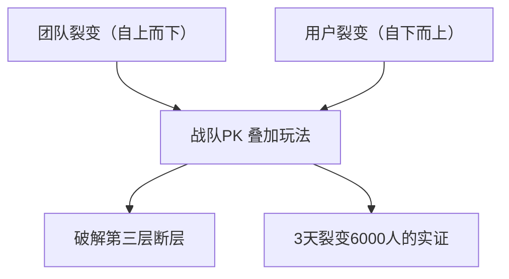

# 第 18 章 流量冷启动 —— 从“无人问津”到“第一批客户”

## 学习目标

- 理解私域的本质是长远而忠诚的客户关系，而非单纯的好友数量
- 掌握销售额三要素公式，并能据此分析业务增长的潜在杠杆
- 学会运用个人品牌、群红策略和抱大腿三种路径实现冷启动
- 理解知识营销作为被动引流方式的核心逻辑与适用场景
- 掌握裂变营销的两种基本模型，并能分析其失效原因与叠加策略
- 理解私域转化的信任积累机制与精细化运营链路

## 18.1 生活类比

想象经营私域就像经营一家**老友记里的咖啡店**。在这家咖啡店里，最有价值的资产不是你每天迎来送往的陌生面孔，而是那些与你关系深厚、愿意每周都来的熟客。他们了解你的手冲脾气，你记得他们的口味偏好——这就是私域的本质：你和常客之间建立的信任与情谊，而非店里涌进过多少生面孔。咖啡店的营收往往不取决于一次涌入多少客人，而取决于"进店人数 × 人均消费 × 回头次数"这三驾马车并驱——这正是销售额三要素公式的直观图景。如果你在某个街区的"手冲最专业"小有名气，这就是你的个人品牌；你不在大马路上发传单，而是在社区兴趣小组里成为公认的咖啡达人，这就是群红策略；你开店之余在社区分享"如何在家冲出一杯好咖啡"的教程、吸引同好上门，这就是知识营销。当老顾客觉得咖啡好喝、主动拉朋友来办卡，朋友再拉朋友，形成口碑扩散——这就是裂变营销。但熟客不是第一次进店就办卡，而是你无数次用心服务、几次恰到好处的推荐之后，他才成为忠实会员——这就是"有间隔的重复触达"。最终，你从散客中筛出最懂咖啡的几位老饕，为他们定制专属手冲、预留新品优先品尝权——这就是铁粉精细化运营。而你发起的"咖啡打卡赢免单"活动，顾客越坚持、你越赚钱，双方都赢——这才是利益一致的健康规则。

## 18.2 概念地图

```
私域流量冷启动与裂变
├── 底层认知
│   ├── 私域的本质：长远而忠诚的客户关系 —— VAA8dQLTZolMlJx1jxrcKaPrnzd
│   ├── 销售额三要素公式：客户数 × 客单价 × 购买频次 —— VAA8dQLTZolMlJx1jxrcKaPrnzd
│   └── 好友质量 > 好友数量（信任驱动、复利属性）—— VAA8dQLTZolMlJx1jxrcKaPrnzd
├── 冷启动三法
│   ├── 个人品牌：差异化身份标签 —— VAA8dQLTZolMlJx1jxrcKaPrnzd
│   ├── 群红策略：有限竞争的社群红人 —— VAA8dQLTZolMlJx1jxrcKaPrnzd
│   └── 抱大腿：用可交换价值撬动贵人 —— VAA8dQLTZolMlJx1jxrcKaPrnzd
├── 引流方法
│   ├── 知识营销：把干货内容化，被动吸引精准客户 —— VAA8dQLTZolMlJx1jxrcKaPrnzd
│   └── 公域平台内容分发（如"人人都是产品经理"）—— VAA8dQLTZolMlJx1jxrcKaPrnzd
└── 放大策略
    ├── 裂变营销：团队裂变（自上而下树状）—— VAA8dQLTZolMlJx1jxrcKaPrnzd
    ├── 裂变营销：用户裂变（自下而上网状）—— VAA8dQLTZolMlJx1jxrcKaPrnzd
    └── 战队PK：用户裂变叠加团队裂变，破解断层 —— VAA8dQLTZolMlJx1jxrcKaPrnzd
├── 信任转化
│   ├── 成交取决于"有间隔的重复次数"—— HfJEd0huioyShvxowVfcOMQYnHb
│   └── 铁粉精细化运营：广撒网→精细化→筛铁粉—— ELHqdhiI5oSQAxxItLJctNAhnah
└── 健康社群规则
    ├── 利益一致性：挑战成功大家获得更多 —— ELHqdhiI5oSQAxxItLJctNAhnah
    └── 钩子理论：引流钩子不必是出售产品 —— ELHqdhiI5oSQAxxItLJctNAhnah
```

## 18.3 私域的本质 —— 从"好友列表"到"信任账户"

先看一段素材原文：

> "私域的本质，是长远而忠诚的客户关系！什么样的关系才能长远而忠诚？不是只有用户了解你，而是我们彼此了解！把用户当朋友，关系才能更紧密！"

—— 阿may，《无资源无资本，如何搞定冷启动流量》

这段话颠覆了一个常见的认知误区：很多人把私域运营等同于"加更多好友"，以为好友数量就等于销售额。但事实恰恰相反——如果你搞不清私域的本质，就会陷入"数量崇拜"，越做越累却不赚钱。

> **私域的本质** 定义（来源：《无资源无资本，如何搞定冷启动流量》）

$$
\text{私域运营的核心} = \text{有信任度、有粘性的长远客户关系} \notag
$$

其中：

- **信任驱动**：成交的催化剂是信任，而非信息推送
- **复利属性**：关系越深，复购率越高，客户终身价值越大
- **抗风险性**：即使公域流量波动，私域关系依然稳定

这个定义展示了：私域的本质不是"我了解用户"的单向关系，而是"彼此了解、互为朋友甚至互为客户"的双向关系。最好的私域状态是——你和用户相互服务，关系才能长久。

### 数据验证：好友越多真的越好吗？

阿may给出了两组极具冲击力的对比数据，我们来看：

| 对比组 | 好友数量 | 成交结果 | 结论 |
|--------|---------|---------|------|
| 公司资源 | 4万好友 | 转化20人 | 数量多但转化低 |
| 个人资源 | 3万好友 | 转化80人（4倍） | 精准好友转化率更高 |
| 朋友A | 800好友 | 月成交超20万元 | 小而美的高粘性 |
| 朋友B | 3万好友 | 月成交仅5万元 | 大而无当的低效 |

第一组对比中，阿may在推广生财有术时，公司4万好友只转化了20人，而她个人3万好友却转化了80人——成交是公司资源的4倍。第二组对比更戏剧化：一个朋友只有800微信好友，每月却能成交超过20万元；另一个朋友有3万好友，每月仅成交5万元——好友数量相差近40倍，成交额却不足别人的四分之一。

这两组数据指向同一个结论：**好友质量远胜于好友数量**。这背后的逻辑是——信任度和粘性才是成交的催化剂，而非信息触达的广度。你可以把这理解为"信任账户"：每笔成交都是一次"取款"，而之前的每一次价值输出、每一次真诚互动都在"存款"。

### 边界条件

需要强调的是，私域关系需要长期维护投入，短期内难以看到回报。此外，如果产品本身无复购价值或缺乏信任基础，私域关系也难以成为成交杠杆。正如素材所指出的："有信任度、有粘性的好友，远胜过泛泛之交"——这句话值得反复咀嚼 [P001, p.2]。

## 18.4 销售额三要素公式 —— 从"只盯客户数"到"三驾马车并驱"

> "计算销售额有条公式：销售额=客户数×客单价×购买频次。以往的我们，都太过关注客户数这个指标了，而大大忽略了客单价和购买频次。企业营收也有28原则，20%的客户给你带来80%的利润，复购比拉新更重要！"

—— 阿may，《无资源无资本，如何搞定冷启动流量》

这段话指出了一个影响深远的思维陷阱：绝大多数从业者评估业务时只盯着"客户数"这个指标，但销售额并不只由客户数决定。

> **销售额三要素公式** 定义（来源：《无资源无资本，如何搞定冷启动流量》）

$$
\text{销售额（GMV）} = \text{客户数} \times \text{客单价} \times \text{购买频次} \tag{18.1}
$$

公式（18.1）展示了三个核心性质：

1. **乘法关系**：任何一个变量翻倍，总销售额即翻倍——这告诉我们增长有三条可独立发力的杠杆
2. **复购权重**：公式右侧的三项并非同等地位——企业营收服从二八定律，20%的老客户贡献80%的利润
3. **战略指导**：公式指出了三条可独立发力的增长杠杆——拉新、提价、促复购

这个公式**最被低估的部分是第三项"购买频次"**。阿may分享了自己过去的转变：以前只关注"客户数"，后来转向提高客单价和复购率后，客单价从几千元提升到10万元。每次成交的客户都有机会复购，如果你只有一个产品SKU，相当于把复购的机会直接砍掉了。

### 边界条件

三个变量并非完全独立——过度提高客单价可能降低购买频次。公式更适用于C端零售场景，对于项目制、一次性客制化的B端生意适用性有限 [P001, p.3]。

## 18.5 冷启动三法之一：个人品牌 —— 普通人的"差异化身份证"

> "所以她就要强化她在品牌营销上的标签，这样一来，她就是营销圈里最懂投资的，是投资圈里最懂品牌营销的，这就是一种差异化的身份。这种差异化的身份可以帮助到她获得流量。而且这种获得流量的方式其实是几何倍数的速度。我认为，垂直行业的专家也将会是普通人，做个人品牌最好的切入口！也是我们普通人起盘最好的切入口！"

—— 阿may，《无资源无资本，如何搞定冷启动流量》

无资源、无资本的普通人在公域平台面临"无限竞争"，很难突围——个人品牌是成本最低、复利最强的杠杆。

> **个人品牌** 定义（来源：《无资源无资本，如何搞定冷启动流量》）

$$
\text{个人品牌} = \text{差异化身份标签} = \text{在某垂直领域中强化"唯一性"定位} \notag
$$

例如：

$$
\text{"营销圈里最懂投资，投资圈里最懂品牌营销"}
$$

这个定义揭示了**差异化身份标签**的核心在于清晰的差异化定位：不是"更好的同类"，而是"不同类的唯一"。阿may在打磨"增长女黑客"标签之前，微信好友只有200多人、想找工作还要投简历；打造标签后，大量牛人大咖主动找上门来介绍项目资源——这就是个人品牌的杠杆效应。

**关键词：几何级数传播**。阿may特别强调，通过个人品牌获得流量的方式是"几何倍数的速度"，而非线性增长。为什么？因为标签清晰的人更容易被记住、被转介绍——每一个接触过你的人，都可能成为你的"传播节点"。标签不仅带来了流量，还在与人交往的过程中快速建立了信任。

### 边界条件

个人品牌需要持续输出与维护，标签名不副实会反噬信任。过于泛化的标签（如"什么都懂"）反而无法形成记忆点。建议从垂直行业的"专家"定位切入——这正是普通人做个人品牌最好的方式 [P001, p.4]。

## 18.6 冷启动三法之二：群红策略 —— 从"无限竞争的网红"到"有限竞争的社群红人"

> "我认为，普通人做个人IP最好的起盘方式，不是去做抖音、小红书、知乎、👸号等，而是扎扎实实地做好社群的群红。社群的群红是有限竞争！不要一开始就把自己定位要去做'网红'，而是想办法让自己变成'群红'！这种模式，很好复制，比去做抖音，要容易复制多了。"

—— 阿may，《无资源无资本，如何搞定冷启动流量》

这段话提出了一个**反直觉的主张**：在人人争当"网红"的时代，普通人更优的起盘路径是成为"群红"。

> **群红策略** 定义（来源：《无资源无资本，如何搞定冷启动流量》）

$$
\text{群红} = \text{在垂直社群（几十到几千人）中通过持续分享价值、展示特点而成为有影响力的人} \notag
$$

我们将"群红"与"网红"做一次系统性对比：

| 维度 | 网红（公域） | 群红（社群） |
|------|-------------|-------------|
| 竞争环境 | 无限竞争，面对算法筛选 | 有限竞争，对手少且同质化低 |
| 信任建立 | 需通过内容海量触达，周期长 | 互动频繁、关系紧密，易建真实信任 |
| 复制难度 | 需持续产出爆款内容 | 模式简单，可迁移到多个垂直社群 |
| 起盘门槛 | 需理解平台算法与流量机制 | 只需在一个小圈子内建立口碑 |

这张对比表展示了：**群红策略的核心优势在于"有限竞争"**。阿may认为，普通人如果去做公域，面对的是无限竞争——如果没有好的创新，很容易被别人赶超、淹没在人海当中。而社群群红的竞争是有限的——在一个几十到几千人的社群里，你更容易展示特点和标签、建立信任并获得铁杆粉丝。

**实操提示**：找到目标社群的前提是明确目标人群——"当细分到素描、吉他这一层时，你就会发现，再去寻找这样的社群，就容易多了！明确目标人群，是做销售、做推广的前提！"如果目标客户定位太泛（如"艺术"），根本找不到社群 [P001, p.5]。

### 边界条件

需要有持续输出有价值内容的能力，纯"混脸熟"无法形成信任。单一社群天花板有限，需在多个社群复制才能放大影响力。

## 18.7 冷启动三法之三：抱大腿 —— 用"可交换价值"撬动贵人

> "人生不要只靠自己傻傻奋斗，一定要有老师，一定要有贵人，否则没有任何机会成功。1、要抱行业的大腿（站对风口）2、要抱行业里有影响力的人的大腿（找准贵人）。抱大腿不能靠钱去换，因为大腿不缺钱……靠什么去交换呢？你要去创造资源、创造价值！正所谓'你不牛逼，认识再多牛逼的人也与你无关'，抱大腿一定要提供可交换的价值。"

—— 阿may，《无资源无资本，如何搞定冷启动流量》

很多人以为"抱大腿"就是请客送礼、花钱买关系，却往往碰壁。这段话点破了借势的正确打开方式。

> **抱大腿** 定义（来源：《无资源无资本，如何搞定冷启动流量》）

$$
\text{抱大腿} = \text{与牛人、行业领袖和权威平台建立价值链接与合作} \notag
$$

其中包含两个层面：

$$
\text{抱行业的大腿（站对风口）} + \text{抱行业里有影响力的人的大腿（找准贵人）} \notag
$$

这个定义的精髓在于**"价值交换"逻辑**：

- 大腿不缺钱，缺的是资源和价值——必须创造可交换的价值
- 对于普通人，**练好一身本领**就是最好的抱大腿方式
- 一旦你有价值，大腿也会自然主动来结识你——**吸引法则**

阿may强调"练好一身本领"——这是普通人"抱大腿"的底层逻辑。在你创造可交换价值之前，任何"人脉"都是空中楼阁。个人核心能力就是你抱大腿的"敲门砖"和"可持续燃料"。

### 边界条件

需要自身具备某方面的独特能力或资源，单纯索取无法维系。要避免"伪抱大腿"——只晒合影、只加微信而无实质合作。回归素材原文，阿may的"增长饭局"就是"抱大腿"理念的实践：4场饭局、深入沟通50人，创造了30万业绩，客单价从几千元提升到10万元——这就是"可交换价值"带来的杠杆 [P001, p.5]。

## 18.8 知识营销 —— 让"干货"替你吸引精准客户

> "现在呢，比较流行的是什么？去推广你这个产品的知识，通过知识吸引到你的精准客户。传统销售是主动销售，就是发硬广……而知识营销是被动引流，他们会把自己的营销内容化，变成'分享'、变成'硬核干货'。我有些文章，发布到自己的👸号，只有一两千的阅读，但是发布到人人都是产品经理的网站上，却有几万的阅读，而我在那里发布内容，其实很简单，就是把我👸号的内容，复制过去，稍微修改一下即可。"

—— 阿may，《无资源无资本，如何搞定冷启动流量》

传统的主动销售（发硬广、群发广告）越来越遭人反感，效果递减。用户对"被推销"天然有防备心理——知识营销提供了一种不打扰、靠吸引的获客方式。

> **知识营销** 定义（来源：《无资源无资本，如何搞定冷启动流量》）

$$
\text{知识营销} = \text{通过推广产品相关的知识内容来吸引精准客户，而非直接推销产品} \notag
$$

核心做法：

$$
\text{营销内容化} = \text{把产品卖点转为"分享"} + \text{把销售话术转为"硬核干货"} \notag
$$

这个定义揭示了知识营销的三大关键性质：

| 性质 | 说明 | 类比 |
|------|------|------|
| 被动引流 | 用户因内容搜索或刷到而主动关注，而非被硬推 | 像磁铁吸引铁屑，而非渔夫撒网 |
| 信任前置 | 在成交前通过知识输出了价值，建立初步信任 | 相当于提前"试用"了你的人 |
| 适合高客单 | 尤其适合需要长时间决策的高客单价产品 | 决策越重，越需要知识支撑 |

**典型案例**：阿may将👸号文章同步到"人人都是产品经理"网站，同一篇内容的阅读量从一两千提升到几万。这个案例告诉我们——**高质量的干货内容在任何平台都是稀缺资源**，平台方愿意给好内容更大的曝光。

### 多源对照：知识营销的共识与补充

| 来源 | 侧重点 | 补充观点 |
|------|--------|---------|
| VAA8dQLTZolMlJx1jxrcKaPrnzd | 内容化 = 把营销变成"分享" | 强调从"主动硬广"到"被动引流"的转变 |
| ELHqdhiI5oSQAxxItLJctNAhnah | 钩子理论外延 | 泛内容引流虽不精准，但能引入私域、保留转化可能 |

**共识**：知识营销是被动引流的核心方式，通过输出内容价值吸引精准客户。

**分歧**：VAA8dQLTZolMlJx1jxrcKaPrnzd强调内容要"硬核干货"、价值密度高；而ELHqdhiI5oSQAxxItLJctNAhnah则指出——泛内容引流虽然不够精准，但只要用户进了私域，就有转化可能（概率为0只是最坏情况）——"如果用户不进私域，那在私域带货成功的概率为0"。

### 边界条件

需长期持续输出高质量内容，见效周期较慢。内容受众与产品买家若错位，则流量难以转化为销售。但根据"钩子理论"，只要泛内容能引流到产品目标人群，就是好钩子——不必苛求内容即产品 [P001, p.6][P002, p.5]。

## 18.9 裂变营销 —— 只靠自己转发，永远等不来指数增长

> "第一种是团队裂变，这是一种自上而下的裂变模型……这个模型，是有明确清晰的上下级推荐关系的，常见的微商团队、经销商网络、社交电商等玩法，就是靠这种模型搭建起来的。第二种是用户裂变，这是一种自下而上的裂变模型。大部分裂变营销活动策划者策划的活动之所以效果不好，往往最大的原因是在于，只有激发层的用户愿意分享，到了第三层裂变层，就断层了。因此就根本裂变不动！"

—— 阿may，《无资源无资本，如何搞定冷启动流量》

流量获取的最快方式不是"自己拉新"，而是让用户帮你"拉新"。但为什么大部分裂变活动效果差？因为用户只转发一层就断层了。

> **裂变营销** 定义（来源：《无资源无资本，如何搞定冷启动流量》）

$$
\text{裂变营销} = \text{通过设计利益诱饵或社交机制，激励用户主动分享、邀请新用户参与的营销方式} \notag
$$

裂变营销有两种基本模型，它们的结构与驱动力截然不同：

| 维度 | 团队裂变 | 用户裂变 |
|------|---------|---------|
| 结构 | 自上而下，树状结构 | 自下而上，网状结构 |
| 关系 | 有明确的上下级推荐关系 | 用户之间是社交网络状态，彼此可能互相认识 |
| 驱动力 | "躺赚逻辑"——加入早、层级高者可享被动收益 | "圈层效应"——需针对不同人群设计不同玩法 |
| 典型案例 | 微商团队、经销商网络、社交电商 | 口碑传播、裂变营销活动 |

### 关键问题：裂变为什么会在第三层断层？

阿may指出：**大部分裂变活动效果差的根源，是只有激发层的用户愿意分享，到了第三层裂变层就断层了**。为什么？

- 第一层（激发层）：被利益诱饵直接触动的人，积极性最高
- 第二层（传播层）：被朋友的分享"安利"到的人，动力衰减
- 第三层（裂变层）：信息被二次转发后，触动力度大幅下降，用户失去分享动力

### 解法：战队PK玩法 —— 用户裂变叠加团队裂变

> "我们会在用户裂变的营销活动玩法的基础上，还会叠加一层'团队裂变'的玩法，这种玩法我们称之为'战队PK'的玩法，也就是组织中的动销系统。"

—— 阿may，《无资源无资本，如何搞定冷启动流量》

> **战队PK** 方法（来源：《无资源无资本，如何搞定冷启动流量》）

```
1. 设计一个用户裂变营销活动（利益诱饵：如免费课程、优惠券）
2. 在用户裂变之上叠加"团队裂变"机制
3. 将参与者分为若干"战队"（团队）
4. 以战队为单位进行PK（比拼拉新人数、成交额等）
5. 胜出的战队获得额外奖励（如更高比例佣金、额外奖品）
```

这段伪代码展示了战队PK破解裂变断层的核心逻辑：**在用户自发的"分享—邀请"之外，增加一层团队竞争机制**。每个用户被绑定到一个战队中，他的每次分享不仅是个人行为，还关系到整队的胜负——这就把"躺赚"和"圈层"两种动力整合到了一起。

**实战验证**：阿may操盘的跨境电商峰会，通过"活动裂变+战队PK"的组合玩法，3天内裂变近6000名用户报名线下活动。加上主办方助推，最终活动报名人数累积1.8万人，到展会现场4000人——火爆到警察到场维持秩序 [P001, p.7]。

### 方法演进图



### 边界条件

需要有足够吸引力的诱饵或社交货币，否则用户没有分享动力。裂变需要精准种子用户启动，冷启动阶段效果有限。

## 18.10 信任转化 —— 成交前的"有间隔的重复次数"与铁粉运营

> "打广告，是成交前的最后一步，而不是唯一的步骤！在打广告之前，还有：价值输出、个性展现、信任建立。我发现，打动别人，让人下单这事，除了强度之外，还有【有间隔的重复次数】。有些人会在认识你的第一天就买单。而有些人会在第10天、第30天、第50天、第100天...第N次看到你的干货，看到你的生活，了解你这人的性格、三观，第N次被你触动后，才会买单的。"

—— 某作者，《如何破除打广告的认知和心态卡点》

很多运营者打完广告没成交就陷入自我怀疑，甚至放弃。实际上，成交不是一次广告的"临门一脚"，而是前期无数次价值输出与信任积累的结果。

> **有间隔的重复次数** 定义（来源：《如何破除打广告的认知和心态卡点》）

$$
\text{成交概率} \propto \text{价值输出次数} \times \text{时间间隔优化} \times \text{信任建立} \notag
$$

其中：

- **重复有间隔**：不是疯狂刷屏，而是有节奏地持续输出价值
- **信任前置**：价值输出与个性展现先于广告，广告只是最后的引爆点
- **时间效应**：不同的人需要多次（3次、10次、30天、100天）被你触动后才会买单

### 广告本质：放大与筛选

> "打广告这动作，本质是一种「放大」和「筛选」。让喜欢你的人，更深入的理解你在做的事情……喜欢你的人，更喜欢你；不喜欢你的人，更烦你。此为「放大」。喜欢你的人，觉得你的广告，是一个能更好的了解你的窗口……此为筛选。"

—— 某作者，《如何破除打广告的认知和心态卡点》

这段话揭示了广告的正确心法：广告不是"说服所有人"，而是"放大喜欢你的人的理解，筛选出愿意靠近你的人"。理解了这一点，你就不会因为部分人的反感而不敢打广告——因为对于无关人员是"打扰"的东西，对于你的客户恰是一种"吸引"。不打广告，就无法吸引你的客户 [P002, p.2]。

### 铁粉精细化运营：从"广撒网"到"复利回报"

> "用心地精细化对铁粉，获得复利。一年卖货120W需要运营多少位用户？泳怡的答案是800位。项目逻辑是先广撒网，从各种精准的宝妈流量池积累40位种子用户，在精细化运营前期用户获取信任后，筛选其中的铁粉进行转介绍、转卖，最终实现总购买次数16000+次。"

—— 丽丽，《2023元旦"云监工"挑战复盘》

> **铁粉精细化运营** 方法（来源：《2023元旦"云监工"挑战复盘》）

```
1. 广撒网：从精准的垂直流量池（如宝妈群）积累种子用户
2. 精细化：用心运营前期用户，获取深度信任
3. 筛铁粉：识别高活跃、高复购、高转发的核心用户
4. 转介绍：鼓励铁粉转介绍新客户
5. 复利循环：铁粉带来新用户，新用户又转化为铁粉
```

这套五步法的核心是**"从数量到质量"的运营升级**：泳怡仅运营800位用户就实现了120万年销售额、总购买次数16000+次——平均每位用户购买20次。这表明**高粘性社群的核心不是用户多，而是用户深**。

### 多源对照：信任积累的不同侧重

| 来源 | 侧重点 | 关键观点 |
|------|--------|---------|
| HfJEd0huioyShvxowVfcOMQYnHb | 转化节奏 | 成交依赖"有间隔的重复次数"，广告只是临门一脚 |
| ELHqdhiI5oSQAxxItLJctNAhnah | 运营链路 | 广撒网→精细化→筛铁粉→转介绍，实现复利 |

**共识**：成交依赖于前期持续的价值输出与信任建立，而非一次触发。

**分歧**：HfJEd0huioyShvxowVfcOMQYnHb强调"有间隔的重复"的节奏感——不同用户需要不同的触动次数；ELHqdhiI5oSQAxxItLJctNAhnah则从运营角度给出了一套系统性的"链路设计"——种子用户怎么来、铁粉怎么筛、复利怎么转。两者其实是"心法"与"手法"的关系。

### 边界条件

信任积累需建立在高质量产品与服务之上，纯营销无法持续。转化周期较长，不适合追求短期爆发的场景。

## 18.11 健康社群规则 —— 从"利益对立"到"三方共赢"

> "以前我见过一些目标挑战群，规则一般只是挑战失败后瓜分1000元或XXXX元。这是不太健康的，这会把群主、群友的利益对立起来。所以我的规则中设置的是如果我挑战成功了，大家能获得更多。另外规则中挑战失败瓜分的金额设置得很低，这能筛选掉只是被红包吸引的人。"

—— 丽丽，《2023元旦"云监工"挑战复盘》

很多社群/挑战群运营者设计了"失败瓜分红包"的机制——短期有效但长期损耗信任。健康的规则应该让群主与成员利益一致。

> **利益一致性规则** 定义（来源：《2023元旦"云监工"挑战复盘》）

$$
\text{健康规则} = \text{群主挑战成功，大家获得更多} \notag
$$

而非：

$$
\text{不健康规则} = \text{群主挑战失败，大家瓜分红包} \notag
$$

这个定义的妙处在于**用规则设计而非个人自觉来保障可持续性**：

- 利益一致性：群主越努力，成员收益越大，形成正向循环
- 门槛筛选：低额失败基金可筛选掉纯粹被红包吸引的泛用户，留下真正关注成长的铁杆
- 三方共赢：老师、分享者、普通学员都能从健康的社群生态中获益

**典型案例**：丽丽的"云监工"快闪群——挑战成功送心得+优惠+盲盒，失败仅瓜分200元。结果3天招募102人、超额完成挑战、群内意外变成"夸夸群"产生强激励。这个结果验证了利益一致性规则的有效性 [P002, p.5]。

### 补充：钩子理论

> "为了在私域卖货或做转化，引流的钩子不一定必须就是出售的产品，只要能引流到产品目标人群的钩子，就是好钩子。虽然用泛内容引流的用户没那么精准，但如果用户不进私域，那在私域带货成功的概率为0。"

—— 丽丽，《2023元旦"云监工"挑战复盘》

**钩子理论**的核心在于：引流钩子不必是产品本身，只要能引流到目标人群就是好钩子。这拓宽了引流的思路——你可以在公域用泛内容（如育儿知识、职场技巧）吸引用户，只要他们进入私域就有转化可能 [P002, p.4]。

### 边界条件

需要群主有足够的内容/价值输出能力，否则"成功后大家获得更多"也无从谈起。纯靠机制无法替代优质内容，机制是放大器而非内容本身。

## 18.12 设计中的取舍

### 为什么私域不追求好友数量而追求质量？

这是本章反复出现的问题。如果用"数量"驱动，你会把精力花在引流动作上——加更多好友、进更多群、发更多广告。但数据说明一切：4万好友的转化不如3万好友，3万好友的成交不如800好友。**数量驱动的最大问题是"关系稀释"**——好友越多，你越难以深度经营每一段关系，信任度自然下降。而质量驱动的逻辑是：少量高信任度的用户带来稳定成交，且复购率高、转介率高，边际成本趋近于零。这是从"流量思维"到"留量思维"的根本转变。

### 为什么裂变活动往往在第三层断层？

多数裂变活动设计者只关注了"诱饵力度"，而忽略了传播的动力衰减问题。诱饵对第一层用户（被直接触动）很有效，但对第二层、第三层用户（通过朋友的朋友触达）的吸引力大幅衰减——这就是断层。破解之道就是战队PK：用团队竞争机制在每一层都注入新的分享动力。这个取舍的本质是——你愿意花多少设计成本来对抗"人性衰减"。

## 18.13 动手练习

- **案例诊断：谁的私域经营更健康？**
  对比以下两个私域运营案例：
  案例A：运营者拥有3万好友，月成交额5万元，但朋友圈广告频繁，用户互动率低。
  案例B：运营者只有800好友，但通过精细化服务和深度互动，月成交额超过20万元。
  请回答：
  1. 根据"销售额三要素公式"和"私域的本质"，分析两个案例的差异在哪里？
  2. 如果你是案例A的运营者，你会如何调整策略？请给出至少三条具体可执行的建议。

- **模拟操盘：为"零基础"的普通人设计冷启动方案**
  假设你是一位没有任何资源和背景的普通人，希望进入"宠物营养"这个垂直领域创业。
  请基于本章学习的知识，设计一份为期3个月的冷启动方案：
  1. 如何运用"个人品牌"理论为自己打造一个差异化的身份标签？
  2. 如何运用"群红策略"找到并进入目标社群？你会如何在这些社群中建立信任？
  3. 结合"知识营销"和"抱大腿"，规划你的内容输出列表和潜在合作对象类型。
  最终请以文字形式完整阐述你的方案。

- **模型分析：设计一次"战队PK"裂变活动**
  请回答：
  1. 根据"团队裂变"和"用户裂变"的定义，分析"战队PK"玩法是如何叠加这两种模型的？
  2. 请为你的社群设计一个"战队PK"裂变方案，包含：活动诱饵是什么？如何分组？PK规则如何设定才能确保多数参与者有动力持续分享？
  3. 分析你的方案中，如何避免"裂变到第三层就断层"的常见问题？

- **信任积累模拟：拆解一次成交前的"铺垫"链路**
  假设你是一位理财顾问，微信里有500位潜在客户，但你从未主动推销过产品。
  请运用"有间隔的重复次数"与"铁粉精细化运营"的思路，设计一个90天的信任培育计划：
  1. 你计划在这90天内发布多少条朋友圈？内容类型如何搭配（干货/生活/软广）？
  2. 你如何识别并筛选出其中的"铁粉"？（给出至少3个识别信号）
  3. 当你开始私聊转化时，如何判断对方是否已经到了"该下单"的时机？

## 18.14 本章小结

这一章中我们系统学习了私域流量冷启动与裂变的完整方法论。首先，我们重新理解了私域的本质——它核心是与用户建立有信任度、有粘性的长远关系，而非追求好友数量，并通过两组真实对比数据验证了"好友质量远胜于好友数量"这一核心主张。其次，我们掌握了销售额三要素公式——销售额=客户数×客单价×购买频次，明白了复购比拉新更重要、20%的老客户贡献80%利润的增长逻辑。接着，我们学习了冷启动三法——个人品牌（差异化身份标签）、群红策略（有限竞争的社群红人）和抱大腿（用可交换价值撬动贵人），三者分别从定位、社群和借势三个维度解决了"第一批客户从哪来"的问题。随后，我们深入理解了知识营销作为被动引流方式的核心逻辑——把营销内容化，用干货吸引精准客户而非主动推销。在放大端，我们拆解了裂变营销的两种基本模型（团队裂变自上而下、用户裂变自下而上），并掌握了"战队PK"叠加玩法如何破解第三层断层的难题。最后，我们讨论了信任转化机制——成交取决于"有间隔的重复次数"而非一次广告的轰炸，以及如何通过铁粉精细化运营实现从数量到质量的运营升级。

本章我们一起学习了以下概念：

| 概念 | 解释 |
|------|------|
| 私域的本质 | 核心是与用户建立有信任度、有粘性的长远关系，而非追求好友数量 |
| 销售额三要素公式 | 销售额 = 客户数 × 客单价 × 购买频次，是指导增长的三驾马车 |
| 复购比拉新更重要 | 企业营收服从二八定律，20%的老客户贡献80%的利润 |
| 个人品牌 | 一种"差异化身份标签"，是普通人起盘成本最低、复利最强的信任杠杆 |
| 群红策略 | 在有限竞争的垂直社群中成为红人，是普通人做个人IP最佳的起盘方式 |
| 抱大腿 | 借势的本质是用"可交换价值"而非金钱撬动贵人，练好本领是最好方式 |
| 知识营销 | 通过推广产品相关知识而非产品本身来被动吸引精准客户的引流方式 |
| 裂变营销 | 通过设计利益诱饵激励用户主动分享的营销方式，有团队裂变与用户裂变两种模型 |
| 战队PK | 在用户裂变基础上叠加团队裂变，以PK机制破解裂变第三层断层的叠加玩法 |
| 有间隔的重复次数 | 成交依赖前期持续的价值输出与信任建立，用户需被多次触动后才买单 |
| 利益一致性规则 | 健康的社群规则应让群主与成员利益一致，如"挑战成功大家获得更多" |
| 铁粉精细化运营 | 先广撒网积累用户，再精细化运营筛出铁粉，通过转介绍与复购实现复利 |

下一章中，我们将进入"高效社群运营"的专题学习——从本章"流量冷启动"的获客思维，转向"流量进来后如何接住并持续变现"的深度运营。你将学会三大交付策略（把时间卖多次、撬动学员时间、让学员意识到责任），用"操作手册+直播录播+百问百答"替代低效的1v1沟通，并理解如何通过"优秀学员分享机制"实现老师、分享者、普通学员的三方共赢。
