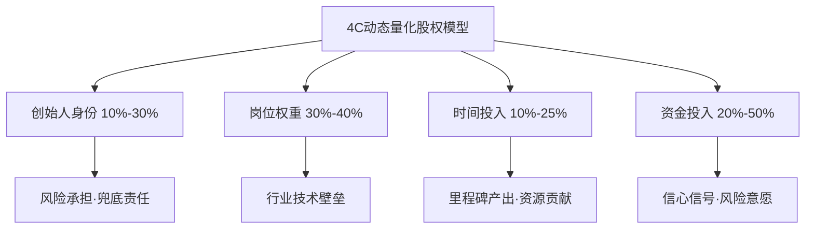
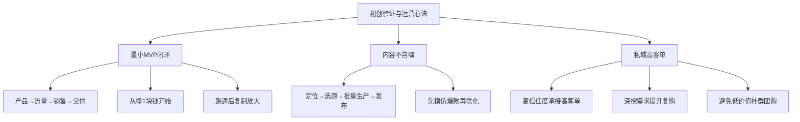

# 第二十四章 创业与股权分配 —— 从“拍脑袋”到“算着分”
作者：龙哥

## 学习目标

- 理解分配模型从“拍脑袋”到“定量计算”的转变逻辑
- 掌握4C动态量化股权模型的四个维度及其评估要点
- 掌握股权分配五步法的操作流程
- 理解“创始人身份=风险承担”“时间投入=里程碑产出”等核心观点的要义
- 能运用最小MVP思维验证初始商业模式
- 能应用“内容不自嗨、私域高客单”等原则优化获客与转化策略

## 24.1 生活类比

想象创办一家公司的那张“股权分配表”是一张**按不同口味切分的披萨**。**创始人身份**就是谁在深夜打烊后还愿意留下来锁门（兜底），谁就拿到那把唯一的钥匙（控制权）；**岗位权重**则是厨师长的配方决定了披萨的味道，因此他分到的那块总比别人厚一点（技术壁垒）；**时间投入**不是看谁在店里坐得久，而是看谁端出的菜正好赶上饭点（匹配里程碑的产出）；**资金投入**则是谁愿意掏出真金白银买下第一批面粉，谁就更有资格关心店里的招牌怎么挂（信心与风险意愿）。

就像一份披萨需要按配料、工时、出资与担责来公平切分，合伙创业的股权也需要依据这四个维度来量化切割，才能让大家吃得心服口服。如果只是凭感觉“你一块、我一块”地切，总有人觉得自己的那块小了，等到店里生意越来越好，这块披萨就越切越别扭——这正是大多数合伙人最终拆伙的根源。

## 24.2 概念地图

```
创业与股权分配
├── 4C动态量化股权分配模型 —— P001
│   ├── 创始人身份（风险承担）  —— P003
│   ├── 岗位权重（技术壁垒）    —— P002
│   ├── 时间投入（里程碑产出）  —— P004
│   └── 资金投入（信心信号）    —— P005
├── 股权分配五步法 —— P002
│   ├── 确定行业与赛道          —— P002
│   ├── 收集创始团队信息        —— P002
│   ├── 确定维度权重（自评互评）—— P002
│   ├── 确定股东权重系数        —— P002
│   └── 计算股权比例（加权汇总）—— P002
└── 初创验证与运营心法
    ├── 最小MVP闭环（验证优先）  —— P006
    ├── 内容不“自嗨”（先模仿）  —— P007
    └── 私域高客单（价值匹配）    —— P008
```

## 24.3 4C动态量化股权分配模型 —— 把“分饼的刀”变成“称重的秤”

### 为什么需要这个概念？

多个合伙人创业时，分股权是极易引发矛盾的点：大家往往凭感觉、凭资历或凭关系分配，容易造成“出力最多的人拿得最少”的不公平感。大多数合作伙伴拆伙的原因，就是觉得自己最重要、出力最多，但分到的钱不是最多；根源在于前期做股权设计时，大家对各自重要程度的判断不一致。传统“拍脑袋”分股权在公司尚未盈利时看似和谐，但随着公司壮大，分歧会逐渐积累成隐患。

> “今天给大家提供一个工具，这个工具的名称叫 4C 动态量化股权分配模型。4C中的C，就是资本的意思，资本我们分为人力资本和货币资本。再细分成4个维度的话，就是创始人身份、岗位权重、时间投入、资金投入。这四个维度是这个工具里面已经给大家植入的一个参数，这个参数是在一定的范围内波动的。”
>
> ——《4C动态量化股权分配模型》

### 核心定义

**4C动态量化股权分配模型**定义（来源：《4C动态量化股权分配模型》）

4C模型是一个用于初创团队量化股权分配的工具，将资本分为人力资本和货币资本，再细分为四个维度：创始人身份、岗位权重、时间投入、资金投入。每个维度带有可波动的建议权重范围，通过加权计算得出各股东应得的股权比例。

四个维度的权重并非固定，需要创始团队通过自评和互评达成共识。以下是各个维度的参考权重区间：

| 维度 | 权重范围 | 核心含义 |
|------|----------|----------|
| 创始人身份 | 10%-30% | 风险承担与兜底责任 |
| 岗位权重 | 30%-40% | 行业技术壁垒所在 |
| 时间投入 | 10%-25% | 有效产出与资源贡献 |
| 资金投入 | 20%-50% | 信心与风险意愿信号 |

### 各维度深度解析

让我们逐一拆解每一个维度，理解它们各自承载的含义。

**创始人身份**代表风险承担：谁承担最大风险和兜底责任，谁就最有控制企业的需要。正如素材所述：“谁来最后承担这个兜底的人，那么我会认为这个人他就是发起人和创始人。”这告诉我们，创始人身份的本质不是荣耀而是责任——创始人需要对项目有与其他人完全不同的付出程度，并且创始人身份必须从一开始极度明确，因为“一家公司最后对外的时候，应该只有一个声音”。

**岗位权重**反映行业技术壁垒所在：哪个岗位对项目重要性最高，那个岗位获得的权重就越大。比如在一家技术驱动型的科技公司，技术岗的权重必然高于行政岗。素材提醒我们，这个维度上的分歧最难在前期发现：“这个分歧在我们前期做股权设计的时候，大家可能不容易发现，但是在公司发展壮大的过程中，越到后面越会产生一些隐患。”

**时间投入**最简单的划分是全职还是兼职、投入精力大小，但素材特别强调了一个容易被忽视的事实：约60%项目的合伙人都全职参与。因此，时间投入不能只看“来了多少小时”，更要看“产出是否匹配项目里程碑”。正如素材所问：“你全职参与的这个产出它是不是就能匹配的到这个项目的所有的进展，项目到达的里程碑是不是跟你全职参与有必然关系。”

**资金投入**指项目前期资金的投入，可用于判断合伙人对项目的信心和承担风险意愿。愿意投入多少真金白银，直观反映了合伙人对项目的看好程度。素材指出：“我们可以通过时间投入和资金投入去判断这个合伙人他对项目的信心和他愿意承担多大的风险。”资金投入的权重区间最大（20%-50%），因为它直接决定项目能否启动，且不同行业对资金的需求差异巨大。

### 典型例子

三个朋友（小明、小磊、小胡）合伙做儿童体能训练项目，预期启动资金200万：

- **小明**：发起人，前期准备出资50万，之前加盟过一个幼儿游泳馆品牌，有相关行业经验
- **小磊**：负责市场，不太愿意出钱，认为“市场为王，能搞定市场就不需要出钱”
- **小胡**：在国企上班，家里拆迁户特别有经济实力，愿意投资150万

通过自评互评，团队确定岗位权重为7:2:1、时间投入为6:3:1，再结合各自的出资额加权计算，最终得出各股东股权比例。



### 边界条件

该模型特别适合刚起步的初创型项目，给非常明确的参考指引。但并非放之四海而皆准：按五步法计算出的股权比例只是最简单的环节，并非最终体现在工商商事主体上的最终结果。素材明确提醒：“在算完初步的股权分配后，我们还会有其他一系列的合同规范和调整，比如一致行动权，期权池，分红奖励，回购权，纯资金方投资的优先清算权，领售权，等等等等。”最终比例必须依靠创始团队协商达成共识，工具只是辅助决策，不能替代沟通。

## 24.4 股权分配五步法 —— 从“商量着分”到“算着分”

### 为什么需要这个概念？

有了4C模型提供四个维度的框架，还需要一套具体可执行的操作流程，否则模型只是空谈。创始团队需要一套标准化的步骤来收集信息、确定权重、计算比例，避免遗漏关键环节或凭感觉乱定。五步法将“定性的讨论”转化为“定量的计算”，让股权分配结果更透明、可解释、可追溯。

> “在确认四个维度的权重比例后，我们会按照五步法来计算出各个股东的最终股权比例……第一个步骤：确定行业和赛道……第二个步骤：收集创始团队信息……第三个步骤：确定每个维度的权重比例……第四个步骤：确定股东四个维度的权重系数……第五个步骤：计算出各个股东的股权比例。”
>
> ——《股权分配五步法》

### 核心定义

**股权分配五步法**定义（来源：《4C动态量化股权分配模型》）

```
第一步：确定行业和赛道
  - 将行业分为技术驱动型/资金驱动型 × 自主创业型/集团孵化型
  - 不同赛道对资金和技术的权重需求不同

第二步：收集创始团队信息
  - 谁是全职、谁负责哪个岗位、各自出资额度

第三步：确定每个维度的权重比例
  - 创始团队自评互评，达成共识
  - 在建议区间内波动微调

第四步：确定股东四个维度的权重系数
  - 按1到10各自打分

第五步：加权计算各股东股权比例
  - 将各维度权重与各股东系数相乘并汇总
```

这套五步法的精妙之处在于：它将“谁更重要”这种容易引发争吵的定性讨论，转化为“给每个维度打几分”的定量打分。每个步骤都透明、可追溯，最终结果可以通过公式复现。

### 关键推导

让我们用数学形式把五步法的核心计算表达出来。

假设有 n 个股东、4 个维度，设第 j 个维度的权重为 $w_j$（$j = 1,2,3,4$），第 i 个股东在第 j 个维度的权重系数为 $c_{ij}$（取值1-10），则该股东的股权比例 $S_i$ 为：

$$
S_i = \frac{\sum_{j=1}^{4} w_j \times c_{ij}}{\sum_{k=1}^{n} \sum_{j=1}^{4} w_j \times c_{kj}} \times 100\%
$$

这个公式展示了股权分配的核心计算逻辑：每个股东的股权比例等于其加权总分除以所有股东加权总分之比。分母的归一化保证了所有股东的股权比例之和恰好为100%，分子则体现了“维度权重×个人系数”的核心思想——维度权重由赛道特征决定，个人系数由自评互评决定。

让我们以儿童体能训练项目为例演示具体运算。假设三人通过自评互评确定了各维度权重：创始人身份30%、岗位权重40%（技术驱动型赛道）、时间投入20%、资金投入10%（已有三人出资）。三人在各维度的系数如下表：
（注：此处系数为演示设定值，实际应根据团队自评互评结果调整）

| 股东 | 创始人身份 | 岗位权重 | 时间投入 | 资金投入 | 加权总分 |
|------|-----------|---------|---------|---------|---------|
| 小明 | 9 | 7 | 6 | 2 | 6.7 |
| 小磊 | 2 | 2 | 3 | 1 | 2.1 |
| 小胡 | 3 | 1 | 1 | 9 | 2.2 |

$$

S_{小明} = \frac{0.3\times9 + 0.4\times7 + 0.2\times6 + 0.1\times2}{0.3\times9 + 0.4\times7 + 0.2\times6 + 0.1\times2 + \cdots} \approx 61\%

$$

这个计算展示了小明的加权总分6.7远高于小磊的2.1和小胡的2.2，因为他在创始人身份和岗位权重两个关键维度上都得到了高分。这也说明了为什么“创始人身份”被强调为最重要的维度——它在加权计算中被赋予高权重，且直接影响总分的量级。

### 边界条件

五步法计算出的比例只是起点，还需配合合同规范和调整工具（如一致行动权、期权池、回购权等）。方法依赖创始团队自评互评的诚实与共识，若团队成员不愿坦诚沟通则难以有效执行。素材提醒：“在最后不得不提醒大家的是，这个股权比例分配是最最简单的一个环节，并不是说，按这个比例算出来的，就是最终体现在工商商事主体上的最后结果。”该方法适合初创阶段，公司发展壮大后需根据实际情况动态调整。

## 24.5 多源对照：创始人的本质与时间投入的理解

当我们把4C模型与素材中关于创业方法论的多个视角放在一起时，会发现不同来源对“创始人本质”和“努力程度”给出了高度互补的解读。

### 共识

**创始人身份的本质是风险承担，而非头衔荣耀**。4C模型素材强调“谁承担最大的风险，谁就最有控制整个企业的需要”，这与创业项目中“从自身痛点出发”的动机高度一致——那些愿意为项目兜底的人，往往是从自己切身问题出发、对解决它有执念的人。

**时间投入应以产出为准而非以工时为准**。4C模型素材明确指出“全职参与的这个产出它是不是就能匹配的到这个项目的所有的进展”，这与创业方法论中“快速测试、快速看到结果”的MVP思维一脉相承——投入的价值最终由可验证的产出定义。

### 分歧

**关于“创始人是否必然等于最大股东”存在不同侧重**。4C模型建议通过多维度加权计算得出比例，创始人身份只是其中一个维度（权重10%-30%）；而创业案例中（如胖龟找房）创始人往往是项目的灵魂人物，实际控制权高度集中。这说明模型更强调“科学分配”，而实践更看重“控制权集中”。

**关于“全职投入”的价值判断**。4C模型素材指出约60%项目的合伙人都全职参与，因此需要看里程碑产出；而部分创业复盘案例中，兼职合伙人的资源贡献（如小胡的150万出资）在早期同样能撬动项目起步。二者并不矛盾——前者告诉我们“全职≠高产出”，后者提醒我们“资源也是产出的一部分”。

## 24.6 初创验证与运营心法 —— 从“最小MVP”到“私域金饭碗”

### 最小MVP闭环：用“独木舟”先过河再造“航母”

很多副业/创业失败源于一开始就追求“完美产品”，投入大量时间金钱开发后才验证需求，结果发现无人买单。从自己身边资源入手、从挣1块钱开始，先以最小可行产品验证商业模型，远比一上来就造大船更稳健高效。

> “1.做生意从自己身边资源入手，从挣1块钱开始，选一个天花板比较高的，持续3——5年。2.跑通自己的生意环节，最小mvp（产品——流量—销售—交付）。”
>
> ——《线上美业创业复盘》

**最小MVP闭环**定义（来源：《线上美业创业复盘》）

```
产品 → 流量 → 销售 → 交付 →（复购）→ 闭环验证 → 复制放大
```

这条链路的精妙之处在于它不仅仅是“做一个简单产品”那么简单，而是要求你**完整跑通每一个环节**。许多创业者做了一个不错的产品，但忽视流量；或者是有了流量，但交付环节跟不上。任何一个环节断裂，整个生意就不成立。

让我们看一个真实案例：夕子的线上美业创业。她从自身皮肤病痛点出发，以2万元成本起步，通过知乎引流、小红书种草、微信私域成交，跑通了“专业→流量→成交→深挖需求→复购”闭环。这个案例揭示了一个关键洞察：**最小MVP不是“简陋交付”，而是“用最少的资源完成真实商业验证”**。一旦闭环跑通，哪怕规模很小，只要能复制放大，就是年赚百万的种子。

### 内容不“自嗨”：先临帖，再写字

很多内容创作者闭门造车，写自己感兴趣的内容却无人问津，陷入“只有输出没有反馈”的自嗨困境。内容创作最有效的起点不是“原创”，而是先模仿爆款、再优化创新。

> “做内容有个很重要的点，一定不要自嗨。先从模仿开始。做好定位，之后模仿，再优化。”
>
> ——《线上美业创业复盘》

**内容生产SOP**（来源：《线上美业创业复盘》）

```
1. 定位（如“科学护肤”）—— 明确内容方向和目标人群
2. 选题（每天收集1-3个爆款分析）—— 建立素材库
3. 统一写3-5个脚本，统一录制3-5个视频 —— 批量生产
4. 定期发布 —— 形成内容流水线
```

这四条看似简单，实则是将“靠灵感创作”转变为“靠系统生产”的关键。夕子严格按照这套SOP执行，其中录制的实操刷酸视频走红，小红书从千粉直接到万粉。这正是内容工业化的力量——它不依赖单次灵感的爆发，而是通过稳定的流程让爆款的概率持续累积。

### 私域高客单：端着“金饭碗”别去“讨饭”

私域用户因专业价值而来，如果只做低价值的社群团购（吃喝拉撒），等于用专业身份做廉价交易，是对私域价值最大的浪费。

> “私域老师有句话点醒了我：‘端着金饭碗在讨饭。’当时我兼着一个社群团购业务，就是吃喝拉撒的这些，我私域的用户更多奔着我专业，看皮肤来的，我居然做这种事情，真的在讨饭。私域的用户需要花费时间和精力去交流，这种需要技术的事情，就应该收高客单。”
>
> ——《线上美业创业复盘》

这段话揭示了一个尖锐的洞察：**私域的价值不在于好友数量而在于关系的信任度与粘性**。当用户因为你的专业能力而加你微信时，这份信任是稀缺的、有付费意愿的。如果你只卖几十块钱的日用品，等于把金子卖成了白菜价。

**私域高客单原则**（来源：《线上美业创业复盘》）

```
关键认知：
- 私域用户因专业而来，具有天然的高信任度，适合承接高客单产品
- 一对一的专业咨询需要花费时间和精力，因此必须收取与价值匹配的价格
- 深挖用户需求是关键：不仅要解决单一问题，还要涵盖多维度需求（祛痘、美白、抗衰等），提升复购率

反面教材：
- 一个私域老师仅用3000粉变现300万，核心在于后端变现产品和高质量的私域信任关系
- 如果只做低价值社群团购，等于端着金饭碗在讨饭
```

这个案例给我们的启示是：**私域运营的核心不是“加更多好友”，而是“让每个好友创造更大的价值”**。与其吸引1000个只看不买的泛粉，不如深耕100个愿意付高价的专业用户。



## 24.7 设计中的取舍

**为什么股权分配不能简单地按出资比例来？**

如果只按出资比例分股权，会出现一个致命问题：资金驱动型的项目可能没问题，但绝大多数创业项目是人力资本驱动的——一个全职的技术合伙人贡献的不只是钱，更是时间、技能和风险承担。如果小胡出资150万就占75%股权，那小明全职做产品、承担日常运营风险的贡献就被完全忽略了。这会导致“出力最多的人拿得最少”，最终走向拆伙。4C模型的取舍是：用四个维度综合衡量，牺牲了“出资即话语权”的简单直观，换取了更持久、更公平的合作关系。

**为什么时间投入不能只看“全职兼职”？**

如果只看全职兼职，那所有全职合伙人拿到的权重都一样，实际上全职的人产出差异巨大——有的人全职坐班但业务推进缓慢，有的人兼职但每个里程碑都超额交付。素材指出约60%项目的合伙人都全职参与，因此简单的全职兼职区分没有任何区分度。但“里程碑产出”的衡量标准也更主观、更难定义。这里的取舍是：牺牲了“硬性指标”的清晰性，换取了“实际贡献”的准确性。这也是为什么需要创始团队通过自评互评来达成共识，而不是由一个外部标准来强加。

## 24.8 动手练习

1. **动手实操：用5步法给一个初创项目分股权**
   - 假设你、小凡和小韩共同创立一家“AI健身课程”公司，预期启动资金100万元：你是发起人并出资30万（全职做产品）；小凡出资60万（兼职做渠道）；小韩出资10万（全职做运营，并引入其教练资源）。
   - 请按“股权分配五步法”操作：先确定你们所处的赛道类型（技术驱动型/资金驱动型、自主创业型/集团孵化型），再结合赛道特点在建议区间内设定四个维度的权重，然后通过“自评互评”方式确定三人在四个维度上的权重系数（1-10），最后进行加权计算得出初步股权比例。
   - 回答问题：小韩全职且带来资源，他的“时间投入”维度的权重系数是否应该高于兼职的小凡？为什么？如果小凡要求按出资比例（60%）占股，和4C模型的结果相比谁更合理？为什么？在什么情况下，你们计算的股权比例需要启动“一致行动权”或“期权池”来调整？

2. **案例救火：找出四位合伙人的分配分歧点**
   - 阅读以下情境：四位合伙人共同创立一家餐饮连锁品牌。A提出品牌概念并负责供应链（全职），B出资200万占最大资金份额（全职），C负责门店运营（全职），D只在周末帮忙做营销策划（兼职）。品牌创立半年后，A认为自己是创始人应拿最大股份，B认为自己出了最多钱应拿最多回报，C认为自己每天在门店投入时间最长，D认为自己虽然兼职但营销策略决定了品牌成败。
   - 请运用“创始人身份”和“时间投入”两个概念诊断：按4C模型的“创始人身份”定义，谁最有资格被认定为创始人？为什么？分析题干中“全职兼职”的简单区分在“时间投入”维度上存在什么误区？如何用“里程碑产出”来衡量C和D的时间投入价值？为解决他们的分歧，你会提议按照什么流程重新谈判？关键步骤是什么？

3. **“最小MVP”策划案：验证你的副业想法**
   - 假设你想利用业余时间做一个“职场PPT模板定制”副业，目标是月入5000元。请设计一个最小可行的MVP闭环方案：明确你的最小可交付产品（必须能在3天内完成）、设计获取第一批种子用户的渠道（至少2个公域/私域渠道）、制定一个简单的销售话术或页面来测试付费意愿、设定交付方式和客户反馈收集机制。
   - 回答问题：你的MVP中“产品—流量—销售—交付”哪一环最容易断裂？如何补上？如果测试过程中发现只有5%的咨询者愿意付费，你会选择继续还是止损？判断依据是什么？结合“内容不自嗨”与“私域高客单”原则，你会如何设计你的获客内容与定价策略？

## 24.9 本章小结

这一章中我们学习了从“拍脑袋分股权”到“定量计算分股权”的完整方法。首先我们理解了为什么多数合伙人最终会拆伙——根源在于前期对各自重要程度的判断不一致；其次我们掌握了4C动态量化股权分配模型，它通过创始人身份、岗位权重、时间投入、资金投入四个维度加权计算股权比例；接着我们学习了股权分配五步法的具体操作流程，从确定赛道、收集信息到加权计算；然后我们深入理解了创始人身份的本质是风险承担、时间投入应以里程碑产出为准等核心观点；最后我们学习了初创验证与运营心法，包括最小MVP闭环、内容不自嗨和私域高客单等原则。

本章我们一起学习了以下概念：

| 概念 | 解释 |
|------|------|
| 4C动态量化股权分配模型 | 将资本拆分四维度（创始人/岗位/时间/资金）加权计算的股权分配工具 |
| 创始人身份 | 本质是风险承担与兜底责任，而非头衔，权重10%-30% |
| 岗位权重 | 反映行业技术壁垒所在，权重30%-40% |
| 时间投入 | 关键看产出是否匹配项目里程碑，而非单纯全职兼职，权重10%-25% |
| 资金投入 | 既是启动基础，也是合伙人对项目信心与风险意愿的信号，权重20%-50% |
| 股权分配五步法 | 定赛道→收信息→定维度权重→定股东系数→加权计算的具体操作流程 |
| 最小MVP闭环 | 用最小可行产品跑通“产品-流量-销售-交付”闭环，验证后再复制放大 |
| 内容不“自嗨” | 先模仿爆款再优化创新，避免闭门造成内容无人问津 |
| 私域高客单 | 因专业而来的私域用户应服务高客单需求，而非做低价值交易 |
| 蹭流截流 | 在传统中介旁开0中介费门店，利用自然客流与门头标语实现精准截流 |
| 全域获客矩阵 | 通过抖音、快手、小红书、58、转转等多平台矩阵式发掘客户 |

下一章中，我们将进入“商业模式设计”的进阶部分——从“拍脑袋”到“跑得通”的盈利模式设计。我们将学习最小MVP验证方法、付费方的精准定位、以及如何通过4C模型为创始团队建立股权分配的公平秤。这些工具将帮助你不仅“会分钱”，更“会赚钱”。

