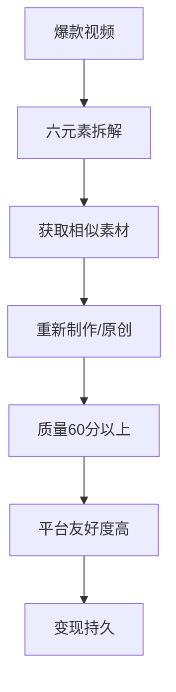

# 第 14 章 爆款内容生产线 —— 从“搬运”到“自动化原创”

## 学习目标

-   理解财务逻辑的底层含义：把账号当作消耗品而非资产，用成本收益打正来判断项目是否值得继续
-   掌握从众心理在直播冷启动中的应用场景与具体操作，理解其低成本的信任催化作用
-   了解爆款生命周期的演化规律，能根据流量峰谷主动调整变现策略，避免流量红利耗尽
-   掌握“做人群替代做商品”的差异化竞争策略，理解人群细分与情感驱动的底层逻辑
-   能区分原创、二剪、搬运的内容质量梯度，理解原创在平台友好度与变现持久性上的护城河作用
-   掌握视频模板元素化拆解的方法论（六元素模型），能将爆款视频解构为可复用的标准化零件
-   理解混淆元素机制的核心目的是保证批量生成视频的差异性与原创性，掌握其基本操作手段
-   掌握黑马小达人策略的筛选标准与学习价值，理解粉丝基础加成导致的幸存者偏差
-   理解脚本模板复用为何优于盲目原创，掌握跨品类复用与累积沉淀的方法

## 14.1 生活类比

想象内容创作是一条**食品加工流水线**。在这条流水线上，**原创**就像从农田里自己种的新鲜食材，最健康、最受欢迎——平台算法和观众都青睐这样的内容，它天然带有“新鲜”与“个性”的标签；**二剪**则像是买来的半成品菜再加工，省时省力但味道平平，既难以在众多竞品中脱颖而出，也时不时面临“添加剂超标”（平台查重）的风险；**搬运**无异于直接端别人的成品菜上桌，虽然最快最省事，但迟早会被查罚、被平台限流乃至封号。而这条流水线的精髓，在于**爆款模板**——它就像经过市场验证的经典菜谱，你不需要每次从零发明新菜，只要在已验证的框架上换配料、调摆盘，就能源源不断出品新菜。这一过程的关键支撑是**六元素拆解**：将一道招牌菜拆成食材、调料、火候、摆盘等标准工序，每一道工序都可独立替换与优化。在此基础上，**混淆元素**如同在每道菜里加入一点自己独家腌制的配料，让每一盘菜都独一无二又挂上你的“原创”招牌。就像厨师不会每道菜都从零发明，而是基于经典菜谱做微创新，内容创作者也应基于验证过的爆款模板做元素替换与差异化生产。

## 14.2 概念地图

```
爆款内容生产线
├── 内容质量分层
│   ├── 原创优于二剪优于搬运 —— 平台友好度与变现持久性
│   └── 1比1模仿爆款保底 —— 保证内容质量60分以上
├── 差异化竞争策略
│   ├── 做人群替代做商品 —— 避开红海，切入情感蓝海
│   ├── 情/趣/用/品四象限 —— 爆款内容的底层分类逻辑
│   └── 人群精准度与变现效率 —— 泛流量vs精准流量权衡
├── 视频模板化生产
│   ├── 六元素拆解法 —— 背景/标题/内容/文案/字幕/BGM
│   ├── 相似素材搜集 —— 逐元素寻找替代素材
│   ├── 混淆元素机制 —— 自拍素材保证原创性与差异性
│   └── 自动生成与发布 —— 代码批量生产 + 多平台分发
├── 爆款生命周期管理
│   ├── 三天流量高峰 —— 集中收割变现
│   ├── 第四天流量衰减 —— 主动调整直播时长
│   └── 外部合作延长窗口 —— 引入直播基地、供应链
├── 对标学习方法论
│   ├── 官方实时爆款视频库 —— 优于第三方工具
│   ├── 黑马小达人策略 —— 低粉高销更值得学习
│   └── 脚本模板复用 —— 旧瓶装新酒，成功率更高
└── 直播间冷启动
    ├── 从众心理 —— 小号带头，激发羊群效应
    ├── 福袋留存 —— 接住极速流，构建互动数据
    └── 财务逻辑 —— 账号是消耗品，收入与成本打正
```

## 14.3 财务逻辑 —— 把账号当消耗品，让账本决定方向

### 为什么需要财务逻辑？

做副业或项目时，我们很容易被短期的涨粉、爆单冲昏头脑。当你看到某个账号一夜涨粉十万、直播间打赏刷屏时，很容易忘记问一个最基础的问题：我投了多少钱，赚了多少钱？缺乏财务视角的人，往往会持续在一个亏损的项目上投入而不自知，直到账号被封、预算耗尽，项目才在崩溃中戛然而止。

> “我们做任何项目都需要具备财务逻辑。投多少钱，赚多少钱。只要创造的收入和号的成本打的正就行。”
>
> ——《抖音盲盒引流项目实操经验汇总》

这段话点出了一个被很多人忽视的真相：财务逻辑不是事后算账，而是事前定方向的战略工具。它回答的是“这个项目值不值得继续”这一根本问题。

### 财务逻辑的核心定义与性质

> **财务逻辑**定义（来源：《抖音盲盒引流项目实操经验汇总》）

**财务逻辑**是指：做任何项目，只要创造的收入与号的成本（含运营成本）打正，就值得继续做；否则，应止损退出。

这个定义包含三层关键性质：

| 性质 | 含义 | 实操体现 |
|------|------|----------|
| 战略导向 | 财务逻辑是事前定方向的基础，而非事后追悔 | 开新号前先算设备、养号、时间成本 |
| 成本容忍 | 账号是工具、是消耗品，坏了就换，不必心疼 | 某个号连续多日无产出，直接放弃 |
| 动态平衡 | 成本与收入需持续滚动核算，而非只看单次盈亏 | 每日/每周更新账本，滚动评估 |

这个框架的核心主张是：**把心态放平，号只是工具，是消耗品**。一旦你把账号视为“消耗品”而非“资产”，你在决策时就不会被沉没成本绑架——号废了，换一个就是，重要的是这个项目的整体账本是否打正。

### 财务逻辑的典型应用

让我们看一个具体的应用场景。在抖音盲盒项目中，一套直播设备加上养号成本，如果能在数天内通过打赏或佣金收回，这笔投入即为“打正”，你可以放心地加号放大。反之，如果一个账号连续多日无产出，财务逻辑告诉你：直接放弃，不要因为“已经投入了那么多”而恋战。

这里有一个更深层的洞察：

> “一个账号能播的越久，直播间给的推流就越精准，转化也会越好。不是说考虑账号成本的问题，而是考虑产值的问题。”
>
> ——《抖音盲盒引流项目实操经验汇总》

这段话展示了财务逻辑的动态视角：**账号寿命越长，推流越精准，产值越高**。因此保护账号、延长其寿命，本质上是在做大产值，而不是在节省成本。这是一个从“成本最小化”到“产值最大化”的思维跃迁。

### 边界条件

财务逻辑适用于可量化的项目。对于品牌建设、IP积累等长期资产，你需要引入更宽口径的价值评估——短期账本可能显示“亏损”，但品牌资产的复利效应会在未来兑现。同时，算账时必须包含隐性成本（时间、精力、人工），否则账本会失真。一个只算显性成本、忽略你每天投入的5小时时间的账本，会让你错误地判断一个项目“值得继续”。

## 14.4 从众心理 —— 用小号点燃直播间的第一把火

### 为什么需要从众心理？

新直播间冷启动时，最尴尬的场景莫过于：明明直播间有几十人在线，福袋也发了，却没有人参与互动。整个直播间陷入一种“死寂”——观众在看，但没人行动。这种沉默会迅速传导，导致留存率下降、转化率归零。

> “直播间明明也有人，福袋也发了，就是没人会去抢。在这个时候，只要有人开了这个头，你就会发现后面突然一下，会跟着好几个人都参与了福袋。”
>
> ——《抖音盲盒引流项目实操经验汇总》

这段话描述了一个普遍存在的现象：**观众存在观望心态，需要有人带头示范才会跟随行动**。

### 从众心理的机制与操作

> **从众心理**方法（来源：《抖音盲盒引流项目实操经验汇总》）

**从众心理**是指：在直播间无人互动时，通过安排小号（托）率先参与福袋或发送弹幕，利用观众跟随心理带动真实用户参与的机制。

操作流程如下：

```
1. 开播前充少量抖币（如6元）
2. 开播第一件事：发福袋，设置评论指定内容，时长5/10分钟
3. 在无人参与时，安排小号先带头抢福袋
4. 观察真实用户是否陆续跟上
5. 用福袋接住极速流，构建留存和互动数据
```

这段操作的巧妙之处在于它精确卡位了人性的一个微妙节点：**观众并非不想参与，而是需要一个“安全”的信号**。当看到有人已经参与，观众会默认“这很安全、这很正常”，从而降低决策门槛。小号先开这个头，后面自然就有人跟了——这叫从众心理。

### 从众心理的边界条件

从众心理的边际效用随观众数增加而递减。当直播间已有人气、弹幕自然滚动时，托的作用就让位于真实互动——此时再依赖托反而可能显得造作。更重要的是，过度依赖托可能导致数据失真，如果被平台判定为虚假互动，会有风控风险。因此，从众心理是**冷启动期的催化工具**，而非长期运营策略。

## 14.5 爆款生命周期 —— 流量有峰谷，收割要趁早

### 为什么需要理解爆款生命周期？

爆款视频带来的流量并非无限，而是有明确的衰减周期。新手最容易犯的错误是：在流量高峰期沉迷于“坐着开播就是钱”的幻觉，忽视了流量必然衰减的规律，结果在峰值期没有充分变现，在衰减期又没有及时调整策略，白白浪费了流量红利。

> “账号爆了三天，自己播了三天，真的坐下来开播就是钱。一个小时几千块的感觉，会让人沉迷。但我意识到不能这样，如果每时每刻都在直播，我没有精力去做内容，流量迟早被消耗完。”
>
> ——《视频号带货7天破亿播放的复盘》

这段话揭示了爆款生命周期管理的核心矛盾：**流量的“收割”与“续命”之间的精力争夺**。

### 爆款生命周期的规律

> **爆款生命周期**定义（来源：《视频号带货7天破亿播放的复盘》）

**爆款生命周期**是指爆款视频在发布后约三天达到流量高峰，随后高峰期流量开始衰减（如第四天播放量较峰值明显下降）的自然规律。

让我们用一个时间轴来可视化这个过程：


这个生命周期的关键性质有三点：

- **时效性**：流量不会等人，必须在高峰期集中精力收割变现
- **衰减性**：流量衰减不可避免，但可通过主动管理（如缩减直播时长、引入合作）延长变现窗口
- **可预测性**：爆款生命周期有基本规律，便于提前规划资源分配

### 实战中的数据验证

作者在复盘中的具体操作为我们提供了范本：

> “而且主要三个账号一起爆，我只能选择最好的账号直播。吃了三天最高峰流量。第四天大概只有2000万左右播放了，我把直播时间减少到3个小时。”
>
> ——《视频号带货7天破亿播放的复盘》

这个案例展示了一个精准的节奏控制：前三天高峰期，集中所有精力在最好的账号上直播收割；第四天流量降至约2000万（较峰值减半），立即将直播时间从全天缩减到3小时，把节省下来的精力重新投入内容生产。这正是“用主动管理延长变现窗口”的实操注脚。

### 边界条件

爆款生命周期适用于平台算法驱动的流量分发。品牌广告或私域流量不存在此衰减规律——私域流量的价值恰恰在于它的“长效性”。此外，不同平台（抖音、视频号、快手）的周期长度可能存在差异，需要实测调整。平台算法更新也可能改变周期节奏，保持对数据的敏感观察是必要的。

## 14.6 做人群替代做商品 —— 在红海赛道换一条小路

### 为什么需要差异化竞争？

当平台内大量玩家以搬运商品视频为主，内容同质化严重时，直接竞争的成功率极低。更要命的是，头部玩家已经开始了付费投放——他们“在船上用网捕鱼”，而普通散户“在岸边用钓竿”，正面竞争无异于以卵击石。

> “做商品类型的种草视频成功概率太小了，并且还有很多有船的大佬，现在都开始付费了，像我这样的单打独斗打不过。大路上的人太多了，我换条小路。”
>
> ——《视频号带货7天破亿播放的复盘》

这段话的核心洞察是：**当主路拥堵时，换一条小路往往比硬挤更快到达目的地**。

### “做人群”策略的定义与操作

> **做人群替代做商品**方法（来源：《视频号带货7天破亿播放的复盘》）

**做人群替代做商品**是一种差异化竞争策略：放弃与同行在商品种草视频上的直接竞争，转而选择细分人群，以人群的情感需求为出发点制作内容，从而实现流量的高效获取。

作者的具体操作是围绕“情、趣、用、品”四象限展开人群定位：

| 象限 | 含义 | 细分示例 |
|------|------|----------|
| 情 | 共情（喜怒哀乐） | 20岁穷白领的虚荣、50岁女性的亲情共情 |
| 趣 | 有趣（反差/实验） | 80岁老人做口播、反差较大的内容 |
| 用 | 有用（教学/实用） | 教做菜、教做PPT、教做电工 |
| 品 | 新奇特产品 | 北方人没见过的酸角糕、彼岸花盆栽 |

> “这四个板块的分支的延伸可以细分到上千种。做好定位应该是每个内容创作者最初期的想法，但是往往想要的越多越陷入困境。这些成千上万的分支里面能扣到一个点，其实就够了。”
>
> ——《视频号带货7天破亿播放的复盘》

### 实战效果验证

作者用四个账号验证了这一策略的效果：

| 账号 | 人群定位 | 播放数据 | 变现 |
|------|----------|----------|------|
| A | 20-30岁刚毕业白领（虚荣心强但穷） | 2天破百万、7天破千万 | 2W+ |
| B | 35-45岁（80-90怀旧情怀） | 2天破百万、7天破千万 | 2W+ |
| C | 50+女性（亲情共情） | 3天破千万、单天4000万、7天破亿 | 约3W |
| D | 纯带货账号 | 20条无反馈，被放弃 | 0 |

这个对比清晰地展示了“做人群”策略的效果：精准人群定位的账号（A、B、C）快速起量并变现，而纯带货的D账号则因内容同质化而沉寂。

### 人群泛化与变现效率的权衡

这里有一个值得注意的边界：

> “大爆款的人群会泛，产品可能也没选好，实际变现其实只有3万左右。”
>
> ——《视频号带货7天破亿播放的复盘》

C账号虽然播放量最高（7天破亿），但变现仅约3万，与AB账号（7天破千万、变现2W+）相比，播放量的巨大差距并未带来等比的变现提升。这说明**大爆款带来的人群泛化，反而降低了变现效率**。精准人群虽播放量不如泛人群，但变现效果更好。做人群策略需要在“播放量”与“变现效率”之间做出权衡。

## 14.7 原创优于二剪优于搬运 —— 内容质量的护城河

### 为什么内容质量分层如此重要？

平台算法日益成熟，对搬运内容的打击力度不断加大。纯搬运账号面临限流、封号的风险与日俱增。更重要的是，原创内容在平台推荐权重、用户信任度、变现持久性上都优于搬运——这直接决定了你的账号能活多久、能赚多少。

> “内容创作上，原创优于二剪优于搬运，所以直接1比1模仿当下的爆款视频去做原创。”
>
> ——《短视频带货矩阵自动化实现方法》

这段话说出了一个看似矛盾实则深刻的结论：**做原创的最好方式，是直接1比1模仿当下的爆款**。这里的“原创”不是指凭空创造，而是指在爆款模板的基础上进行重新制作——用你自己的素材、你自己的方式，做出与爆款结构相同但内容不同的视频。

### 质量梯度与保底原则

> **原创优于二剪优于搬运**原则（来源：《短视频带货矩阵自动化实现方法》）

**原创优于二剪优于搬运**是指：在内容创作方式上，原创内容的质量和平台友好度最高，次之是二次剪辑，最后才是搬运，因此应优先做原创。

支撑这一原则的是“1比1模仿保底原则”：

> **1比1模仿保底**方法（来源：《短视频带货矩阵自动化实现方法》）

**1比1模仿保底**是指：通过模仿已经验证过的爆款流量视频或带货视频作为模板，能保证1比1模仿做出的内容质量都在60分以上，避免低质内容。

让我们用一个数据流图来理解这一策略的逻辑：



这段流程图展示了从“模仿爆款”到“原创产出”的路径：爆款视频提供的是“结构合法性”，你用自己的素材和制作方式赋予了它“内容原创性”。验证过的爆款模板，就是保底60分的“配方”。

### 质量分层的实操意义

下表总结了三个层级的关键差异：

| 层级 | 平台友好度 | 变现持久性 | 制作成本 | 推荐场景 |
|------|-----------|-----------|---------|----------|
| 原创 | 最高，易过审、获推荐 | 最强，可持续复用 | 最高 | 成熟账号、矩阵化生产 |
| 二剪 | 中等，需配合去重 | 中等，依赖素材源 | 中等 | 冷启动快速测品 |
| 搬运 | 最低，限流封号风险高 | 极弱，随时可能清零 | 最低 | 不推荐，除非短期试水 |

需要特别指出的是，二剪若太过接近原素材，仍可能被判定搬运，需配合去重手段。而纯原创的创作成本较高，不适合冷启动期快速测品——你可以先用二剪验证需求，再逐步过渡到原创。这条“由搬入创”的阶梯，是很多团队的实际成长路径。

## 14.8 视频模板元素化 —— 把爆款解构成六个零件

### 为什么需要模板元素化？

手工逐个制作视频效率极低，无法支撑矩阵化批量产出的需求。而爆款视频看似千变万化，实则背后有可复用的结构规律。你需要一种抽象方法，把视频从“灵感创作”变成“标准化组装”——就像汽车生产线上的零件装配。

> “所有的视频都可以拆成以下元素：1. 背景：图或者视频 2. 标题：主、副标题 3. 内容：图、视频 4. 文案：5. 字幕：6. 背景音乐：”
>
> ——《短视频带货矩阵自动化实现方法》

### 六元素拆解模型

> **视频模板元素化**定义（来源：《短视频带货矩阵自动化实现方法》）

**视频模板元素化**是指：将所有短视频拆解为背景、标题、内容、文案、字幕、背景音乐六种基本元素，这是实现视频自动生成的核心抽象模型。

这六种元素的完整定义如下表：

| 元素 | 定义 | 示例（中医养生流量视频） |
|------|------|--------------------------|
| 背景 | 图或视频，作为画面底层 | 一张中医大师的照片，放大模糊 |
| 标题 | 主标题和副标题文字 | “请等一下，xxxx” |
| 内容 | 图、视频，作为画面主体 | 一张中医大师的照片 |
| 文案 | 口播或字幕文字内容 | “国医大师xxx” |
| 字幕 | 是否叠加字幕，字体风格 | 无 |
| 背景音乐 | 音乐风格、节奏 | 固定BGM |

> “视频模板有各种各样的形式，拆解的多了会发现其实都是上面提到的那些元素组成的。”
>
> ——《短视频带货矩阵自动化实现方法》

这一模型的关键性质有三点：

- **完备性**：任何形式的视频模板都能拆成这六种元素
- **可替换性**：每个元素都可以独立寻找相似替代素材，实现差异化
- **可编程性**：拆解后可用代码自动生成，实现批量生产

### 从拆解到自动生成的完整流程

将六元素模型落到实处的完整方法如下：

> **视频模板元素化拆解与自动生成**方法（来源：《短视频带货矩阵自动化实现方法》）

```
Step1、拆解视频模板
        - 将爆款视频拆解为六元素
        - 对每个元素分别定位其具体形式
Step2、找素材
        - 针对每个元素寻找形式相似的替代素材
        - 例如背景图、内容素材、背景音乐等
Step3、原创视频内容自动生成
        - 编写代码自动生成视频
        - 关键手段：素材随机取用、时间段随机取用、加入混淆元素
Step4、自动发布
        - 开发自动发布工具
        - 向抖音、视频号等多平台多账号自动发布
```

这段流程的精髓在于：**把创作问题转化为工程问题**。当你把视频拆解为六个可替换的零件后，剩下的就是“找到好素材 + 写好生成代码”的工程执行，而非依赖每次的灵感闪现。

作者还分享了一个降低次生成本的技巧：

> “写的模板多了就会发现很多方法都可以共用，把他们抽出来做成底层的工具模块，以后再有新的视频模板，拼一下就出来了，很简单。现在几分钟就能实现一个新的模板。”
>
> ——《短视频带货矩阵自动化实现方法》

这就是“底层工具模块抽取法”：在编写多个视频模板的生成代码过程中，将可复用的代码抽取成底层工具模块，使新模板的开发时间缩短到几分钟。

### 边界条件

元素化拆解适用于模板化、套路化的视频类型（如带货、口播）。对于强创意、特效复杂的视频，拆解与复现难度极大。同时，元素相似素材的收集质量直接决定生成视频的质量上限——素材库的厚度，就是你的生产线的产能天花板。

## 14.9 混淆元素机制 —— 给批量视频打上“原创”水印

### 为什么需要混淆元素？

批量生成的视频若高度雷同，会被平台判定为搬运或低质量内容，无法通过原创审核。但手动为每条视频制作差异化内容，又违背了“自动化生产”的初衷。你需要的是一种机制，在自动化生产的同时保证每条视频的独特性——这就是混淆元素机制。

> “每个视频的生成时都加一些混淆元素，用自己拍的照片和视频。再加上混淆元素，这样能保证做出来的视频都是原创视频，且每个视频生成的都不相同，在任何一个平台都能过原创。”
>
> ——《短视频带货矩阵自动化实现方法》

### 混淆元素的机制与操作

> **混淆元素机制**方法（来源：《短视频带货矩阵自动化实现方法》）

**混淆元素机制**是指在自动生成的视频中加入自己拍摄的照片和视频作为混淆元素，以保证生成内容在平台上能通过原创审核。

其操作框架可归纳为三个手段的叠加：

| 手段 | 原理 | 效果 |
|------|------|------|
| 素材随机取用 | 每个元素从素材库中随机选取 | 每条视频内容不同 |
| 时间段随机取用 | 多片段模板每个片段随机截取素材内时间段 | 相同素材不同画面 |
| 混淆元素（自拍素材） | 随机插入自己拍摄的照片/视频 | 通过任何平台原创审核 |

> **差异化生成保障原创**原理（来源：《短视频带货矩阵自动化实现方法》）

**差异化生成保障原创**是指：通过素材随机取用、时间段随机取用和结合混淆元素，可以确保自动生成的每个视频内容都不相同且能通过任何平台的原创审核。

### 混淆元素的边界条件

混淆元素应与视频主题有一定相关性，否则可能影响内容质量和观众体验。试想一个严肃的中医养生视频里突然插入一张你吃火锅的自拍——这种违和感会损害信任度。同时，混淆元素的密度需适度：过少起不到区分作用，过多会稀释核心信息。

## 14.10 多源对照 —— 三份素材的交汇与分岔

本章的九个核心概念分散在四份素材中。当同一概念有多篇素材支撑时，我们以并列小标题呈现其共识与分歧。

### 共识

| 概念 | 《SvdFdfi3》 | 《JmBgdr70》 | 《V-》/《CGZ4dZq4》 |
|------|-------------|--------------|---------------------|
| 账号是消耗品 | ✓ 财务逻辑核心 | — | — |
| 原创优于搬运 | — | ✓ 原创>二剪>搬运 | ✓（视频号7月打击搬运的行业判断） |
| 流量有生命周期 | ✓ 账号寿命越长产值越高 | — | ✓ 三天高峰后衰减 |
| 对标学习 | — | ✓ 1比1模仿爆款 | ✓ 官方视频库+黑马小达人 |

### 分歧

- **《SvdFdfi3》（抖音盲盒）** 主张通过**福袋+小号托**构建直播冷启动的互动数据，其核心是“用工具撮合从众心理”；而《JmBgdr70》（矩阵自动化）则主张用**代码+混淆元素**直接解决内容生产的原创性问题，两者路径完全不同——前者是运营手段，后者是生产手段。
- **《V-》（视频号带货）** 将“做人群”视为对抗同质化的核心武器，强调**情感驱动的精准定位**；《CGZ4dZq4》（巨量百应）则将“黑马小达人”视为对标学习的黄金样本，强调**数据驱动的内容拆解**。前者偏向内容创意，后者偏向数据工程。
- 《JmBgdr70》主张“1比1模仿爆款做原创”，《V-》则强调“做人群”要避开爆款集中的商品赛道——两者对“模仿”的态度存在张力：一个是模仿的结构，一个是避开的内容。

## 14.11 设计中的取舍

### 为什么不用 RPA 脚本无脑批量搬运，而要坚持原创？

很多新手的第一反应是：既然搬运最快，为什么不直接用 RPA 批量搬运？原因有二。其一，平台打击搬运是明确的趋势——正如《V-》素材中观察到的“从7月开始搬运受打击严重”，纯搬运账号面临0播、封号的高风险，这种“一波流”策略无法累积账号资产。其二，原创的护城河在于可复用性——正如《JmBgdr70》展示的，原创内容的自动生成流程一旦跑通，可以标准化、规模化放大到多个赛道、多个账号，而搬运永远只能吃“即时红利”。**原创的前期成本高，但边际成本递减；搬运的前期成本低，但风险递增**。

### 为什么对标大达人不如对标黑马小达人？

大达人（粉丝数百万）的销量天然偏高，因为他们有粉丝基础加成——观众会因为“这个人很出名”而下单，而非因为视频内容本身的说服力。这种“幸存者偏差”会让你误以为“只要模仿他们的脚本就能卖爆”，但当你复制过来时，你并没有他们的粉丝基础，效果天差地别。**黑马小达人（低粉高销）则不同**：他们几乎没有任何粉丝加成，其成功几乎完全归因于内容、选品和脚本本身，这才是你可以复制的部分。因此，黑马小达人更适合普通玩家对标学习。

### 为什么“做人群”虽然播放量不如爆款商品视频，仍是更优策略？

从数据看，C账号破亿播放仅变现3万，而AB账号破千万变现2W+——播放量与变现并不成正比。原因在于“人群泛化”：大爆款带来的是广泛但模糊的人群，他们对你的产品没有精准需求；而精准人群虽少，但每个粉丝都带着明确的情感需求和生活痛点，转化率天然更高。**“做人群”的取舍是：牺牲播放量的上限，换取变现效率的下限保障**。你做出来的内容可能不会一夜爆红，但每一份流量都更值钱。

## 14.12 动手练习

1.  **拆解一个爆款视频的六元素**
    -   选择一个你所在赛道近期播放量最高的爆款视频，完成以下拆解：
        1.  背景：是静态图片还是动态视频？具体内容是什么？是否做了模糊、缩放等处理？
        2.  标题：主标题和副标题分别是什么文字？
        3.  内容：视频主体画面是什么？
        4.  文案：完整口播或字幕文案抄录下来
        5.  字幕：是否有字幕？字体风格如何？
        6.  背景音乐：是什么音乐？风格如何？
    -   回答问题：
        -   这个视频属于“情/趣/用/品”四象限中的哪一类？
        -   如果让你为“中年女性的情感共鸣”这个人群做一个类似模板，你会替换哪些元素？
        -   如何通过素材随机取用和混淆元素机制保证批量生成的视频各不相同？

2.  **设计一个“做人群”的差异化内容方案**
    -   假设你所在的赛道是“家居好物带货”，目前大量同行都在搬运商品种草视频，竞争白热化。
        1.  从“情/趣/用/品”四个维度中任选一个，定义一个细分人群（如“独居青年”、“新手妈妈”、“银发族”等）
        2.  写出该人群的3个核心情感需求或生活痛点
        3.  为该人群设计3条内容选题（不是直接卖货，而是以情感或兴趣切入）
        4.  评估：这种“做人群”的策略相比“做商品”有什么优势？有什么潜在风险？
        5.  如果你是平台算法，你会如何给这类内容打标签和分配流量？

3.  **爆款生命周期管理沙盘推演**
    -   假设你运营的视频号账号今天有一条视频播放量突然暴涨，达到1000万播放，你预测明天还会涨。
        1.  根据爆款生命周期规律，你认为流量高峰大概在第几天？第几天开始明显衰减？
        2.  你计划在流量高峰期采取哪些变现动作？（直播、带货、引流私域等）
        3.  到了第4天，播放量从峰值4000万降至2000万，你会如何调整策略？
        4.  如果流量继续衰减至每天仅50万播放，你还会继续投入时间做内容吗？依据财务逻辑，你会如何决策？
        5.  除了等平台自然衰减，你还能主动做哪些事情来延长变现窗口？（提示：考虑外部合作）

4.  **构建你的对标学习体系**
    -   以你正在做或想做的赛道为例：
        1.  列出你获取对标数据的3种渠道（官方平台/第三方工具/人工搜索），并说明各自的优劣势
        2.  设定你的“黑马小达人”筛选标准（粉丝量上限、视频条数、垂直度、画面质量等）
        3.  从巨量百应创意中心或其他平台找到3个“低粉高销”的黑马视频，拆解其脚本结构
        4.  将这3个脚本提炼为可复用的模板，并思考：如何改文案、换产品，推送到不同账号？
        5.  思考：为什么大达人（粉丝数百万）的视频不适合作为你的学习对象？这体现的是什么统计偏差？

## 14.13 本章小结

这一章我们系统学习了爆款内容生产线的完整方法论。首先，我们确立了财务逻辑的底层思维——把账号当作消耗品而非资产，用成本收益打正来判断项目是否值得继续，让账本而非情绪指导决策；其次，我们掌握了从众心理在直播冷启动中的应用，理解了小号带头激发羊群效应的低信任成本催化机制；接着，我们了解了爆款生命周期的演化规律，学会了根据流量峰谷主动调整变现策略，避免流量红利耗尽；然后，我们掌握了“做人群替代做商品”的差异化竞争策略，理解了人群细分与情感驱动的底层逻辑，并建立了原创、二剪、搬运的内容质量梯度认知；在此基础上，我们深入学习了视频模板元素化的六元素模型，掌握了把爆款解构为可复用标准化零件的拆解方法，理解了混淆元素机制如何保证批量生成视频的差异性与原创性；最终，我们掌握了黑马小达人策略的筛选标准与脚本模板复用的方法逻辑。

本章我们一起学习了以下概念：

| 概念 | 解释 |
|------|------|
| 财务逻辑 | 把账号当消耗品而非资产，只要创造的收入与成本打正就值得继续做，用账本而非情绪指导决策 |
| 从众心理 | 直播间冷启动时用小号带头参与福袋或弹幕，利用观众跟随心理带动真实用户互动，是低成本的信任催化机制 |
| 爆款生命周期 | 爆款视频约三天达到流量高峰后开始衰减，需在高峰期集中收割变现，并通过主动管理延长变现窗口 |
| 做人群替代做商品 | 当商品种草视频竞争白热化时，转而选择细分人群、以情感需求为内容出发点，实现差异化流量获取 |
| 原创优于二剪优于搬运 | 内容创作存在质量梯度，原创的平台友好度与变现持久性最高，应优先直接1比1模仿爆款做原创 |
| 视频模板元素化 | 所有短视频可拆解为背景、标题、内容、文案、字幕、背景音乐六种元素，是实现自动生成的核心抽象模型 |
| 混淆元素机制 | 在自动生成的视频中加入自拍照片/视频作为混淆元素，保证每条内容互不相同且能通过任何平台原创审核 |
| 黑马小达人策略 | 优先筛选粉丝量少但销量高的视频做对标学习，因为大达人有粉丝基础加成，黑马的成功更归因于内容本身 |
| 脚本模板复用 | 经过验证的爆款脚本模板通过替换文案和商品即可复用，成功率大概率高于盲目原创，应持续积累模板库 |

下一章中，我们将进入“账号运营与私域转化”的世界，学习如何把公域流量“吃干抹净”——从新号起量、评论区运营、直播转化到抖音公转私的自动化工具与防封策略，让你的内容生产线不仅会造流量，还会接流量、变现金。
