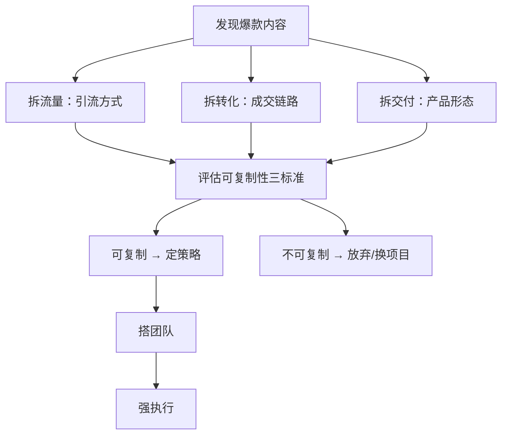

# 第 4 章 流量收割与转化 —— 从“看客”到“付费用户”的狩猎场

## 学习目标

- 理解信息差思维的核心逻辑：从“自己发明”到“发现并复制已验证的商业模式”
- 掌握商业项目拆解的八步法，能将一个“赚钱的别人”拆解为流量、转化、交付三大可复制的模块
- 熟练运用六维评估模型（流量效率、销转效率、交付效率、客单价、毛利率、复购率）为项目“称重”，判断其可复制性与收入天花板
- 能通过案例对比，直观理解“客单价跃升”如何改变项目的量级与商业天花板
- 能根据自己的资源禀赋，将六维模型应用于评估自身的副业构想，并识别其短板与补偿策略

## 4.1 生活类比

想象你是一个美食城的档口老板，想开一家新店。大多数人会怎么做？他们会走进厨房，关起门来研发一道从未有人吃过的“暗黑料理”，投入大量成本反复试错，却不知道有没有人愿意买单——这就是典型的“产品思维（自嗨）”。而聪明的档口老板会怎么做？他会先在美食城里转一圈，观察哪家档口排队长、回头客多——这些档口的招牌菜已经被市场验证过了，然后他选择去复制那道招牌菜，或者把 A 城火爆的小吃搬到还没人卖的 B 城。这就是“信息差思维（抄作业）”。接下来，他还会把那家火爆档口“拆开”研究：他的客流从哪来（流量）、他用什么话术让顾客下单（转化）、他的出餐流程怎么这么快（交付）。最后，他给这家档口“算一笔账”：出餐快不快（交付效率）、员工要不要高厨艺（销转效率）、排队流量大不大（流量效率），以及每份卖多少钱（客单价）、赚多少（毛利率）、顾客会不会常来（复购率）。就像聪明的档口老板“后发制人”，先复制别人验证过的爆款，再微调出自己的特色，而不是冒险发明无人问津的新菜——这正是副业变现的底层逻辑。

## 4.2 概念地图

```
副业变现的底层逻辑：从“看到”到“复制变现”
├── 认知起点
│   ├── 副业失败的根源
│   │   ├── 从零发明的产品思维（高成本、高风险） —— P001
│   │   └── 忽视已验证的商业模式
│   └── 信息差思维
│       ├── 发现并复制已验证项目 —— P001
│       ├── 后发制人原则（不盲目原创） —— P001, P002
│       └── 信息差客观存在（平台/人群不对称） —— P001
├── 核心方法：商业项目拆解
│   ├── 拆解对象
│   │   └── 爆款内容、已验证的盈利项目 —— P001
│   ├── 三大核心模块
│   │   ├── 流量获取
│   │   ├── 转化链路
│   │   └── 产品交付
│   ├── 拆解八步法 —— P001
│   │   ├── 找项目 → 拆流量 → 拆转化 → 拆交付
│   │   ├── 评估可复制/可持续 → 定策略 → 搭团队 → 强执行
│   └── 可复制性判定三标准
│       ├── 非偶然爆发
│       ├── 货源可寻
│       └── 消费场景验证有需求 —— P001
└── 评估框架：六维模型 —— P002
    ├── 效率维度（决定可复制性）
    │   ├── 流量效率（时间/素材/流量）
    │   ├── 销转效率（专业度/SOP/时间利用率）
    │   └── 交付效率（时间/人力）
    ├── 财务维度（决定收入天花板）
    │   ├── 客单价
    │   ├── 毛利率
    │   └── 复购率
    ├── 核心判定法则
    │   ├── 三效率高 → 可复制，赚多赚少取决于流量
    │   ├── 任一体低 → 难以复制，需财务维度补偿
    │   └── 六个点满足越多越好，满足四个点及格 —— P002
    └── 应用：案例对比（称重）
        ├── 小说推文（三效率高，低客单价，天花板低） —— P002
        ├── 教育资料1.0/2.0（客单价跃升，天花板提升） —— P002
        ├── 减肥食谱（高流量规模驱动，高复购） —— P002
        ├── 项目拆解IP（低流量效率，高客单价补偿） —— P002
        └── 知识付费（高客单价+高毛利+高效率，天花板高） —— P002
```

## 4.3 副业失败的本质与信息差思维——从“自己造”到“抄作业”

几乎所有副业新手的第一个动作，都是打开脑海里的“发明家模式”：我要做一个独一无二的产品，我要解决一个别人没解决的问题。这种“产品思维”听起来很英雄，却隐藏着一个致命的陷阱——从零开始研发不仅投入巨大、周期漫长，而且失败率极高，绝大多数个人创业者根本不具备这样的资源和能力。与此同时，一个被忽视的事实是：大量已被验证的商业模式，就像美食城里的爆款档口一样，明晃晃地摆在你眼前。

> “拆下来之后，我就发现很多时候有些项目是完全可以复制的，是不需要投入几十万也可以复制的。复制了之后，用跟他一样的内容生产方式、转化链路，你也能拿到一定的结果。”
>
> ——《I9OAdzzs2oBliNxsmPjcHnBUnzf》

这段话揭示了一个核心洞察：你不需要成为哥伦布去发现新大陆，你只需要做一个精明的航海家，沿着别人已经探明的航线航行。商业世界存在大量“信息差”——A 平台做烂的内容在 B 平台可能爆火，A 地成熟的模式在 B 地尚属空白。这正是“信息差思维”的立论基础。

> 信息差思维**定义**（来源：《I9OAdzzs2oBliNxsmPjcHnBUnzf》）

**信息差思维**是一种区别于“产品思维”的副业认知模式。它主张成功副业的起点不是“从零发明一个好产品”，而是“发现并拆解一个被验证过的赚钱项目，然后复制或二次创作”。其核心逻辑是**后发制人**：

```
后发制人原则：
1. 不追求原创
2. 不做赌博式 All in
3. 等别人做成了、连续做了好几个月验证可行后
4. 再去复制或二次创作
```

这条原则的妙处在于，它把副业的试错成本从“自己承担”转移给了“先行者”。当别人已经用真金白银验证了项目的可行性，你只需要做匹配性的微调，就能吃到同样的红利。

> “有一个词叫做后发制人。就是你去做别人做过的事情，将其进行复制或者二次创作。”
>
> ——《I9OAdzzs2oBliNxsmPjcHnBUnzf》

**信息差搬运论**进一步解释了为什么这条路径如此可行（来源：《I9OAdzzs2oBliNxsmPjcHnBUnzf》）：

> “渠道其实是有信息差的，我们做过很多项目，其实吃的就是信息差，有些项目在抖音上做得很烂的，但是如果你搬到小红书上面，瞬间就爆了。”
>
> ——《I9OAdzzs2oBliNxsmPjcHnBUnzf》

不同平台、不同人群之间存在天然的信息不对称，这为搬运和复制提供了空间。但需要注意的是，“抄作业”不等于盲目 copy——它要求你拆解出项目的底层链路（流量来源、转化方式、交付形式），而非只模仿表面。同时，复制的前提是“已验证”：项目需有人做了好几个月并稳定盈利，纯偶然爆火的项目不具备复制基础。以下案例可以帮助你建立直观感受：

| 案例 | 拆解要点 | 变现结果 |
|------|----------|----------|
| 儿童游乐项目 | 8.4w 赞、1.1w 转发、3000 条评论验证需求 | 3 人团队、2 万加盟费，3 个月变现 40 万 |
| 文川手写 logo | 评论区大量客资（“怎么找你设计 logo”） | 收 599 元设计费，付大学生 200-250 元，赚差价 |
| 艺术签名账号 | 持续内容引发咨询，9.9 元/个 | 日成交几十个客户 |
| 抓娃娃卖娃娃+收徒 | 闲鱼卖娃娃 + 私域收徒 599 元/人 | 年入约 100 万 |

这些案例的共同点是什么？它们都不是从零发明的新物种，而是把别人已验证的商业模式“搬到”了更合适的位置，或者把已有的流量资源二次变现。这正是信息差思维的力量。

## 4.4 商业项目拆解——把“赚钱的别人”拆成“可复制的零件”

看到别人赚钱很容易，但要“看透”别人为什么赚钱，却是一件需要方法论的事。很多人模仿了一个成功账号的视频、话术，结果发出去石沉大海——因为他们只模仿了“表皮”，没有触及到底层链路。

> “通过刷抖音或者刷小红书的过程发现商业案例，再拆解复制这样的案例去形成一个商业模式，去发展自己的副业。”
>
> ——《I9OAdzzs2oBliNxsmPjcHnBUnzf》

商业项目拆解，就是把“赚钱的别人”拆成“可复制的零件”的系统化方法论。它把爆款内容或商业案例拆解为流量获取、转化链路和产品交付三个核心模块，并评估其可复制性与可持续性，据此复制出类似的副业项目。

> 商业项目拆解**定义**（来源：《I9OAdzzs2oBliNxsmPjcHnBUnzf》）

**商业拆解八步法**是这个方法论的核心工具：

```
商业拆解八步法：
1. 找项目：建立项目库
2. 拆流量：通过什么方式引流？是否固定内容分享？是否投放？
3. 拆转化：通过什么转化？直播间直接卖？私域社群？朋友圈+私聊？转化周期多久？
4. 拆产品交付：有形还是无形？货物/课程/招商加盟？客单价？是否有同行做了半年以上？
5. 评估可复制性和可持续性：投入是否过大？同行是否坚持三个月以上？
6. 定策略：产品、流量、转化三端口怎么做？复制全部还是微创新？
7. 搭团队：产品端、流量端、转化端是否一个人就够？
8. 强执行：没有强执行，前面所有一切都是自嗨
```

这段伪代码展示了从“发现项目”到“落地执行”的完整链路。它打破了“看到别人赚钱→自己也去做”的模糊直觉，把复制过程拆解为八个可操作的步骤。

其中，**第 5 步的评估环节**是整个方法成败的关键。作者为此给出了三条可复制性判定标准：

> 可复制性判定三标准（来源：《I9OAdzzs2oBliNxsmPjcHnBUnzf》）

```
1. 非偶然爆发：视频/项目不是偶然爆火，而是有稳定的流量逻辑
2. 货源可寻：货源不是独家的，可以通过其他方式找到
3. 消费场景验证有需求：该消费场景已被验证存在需求，且需求量不小
```

> “首先，这个视频爆得偶然；其次，他货源不是他自己的，也就是说我可以通过别的方式找到他的货源；最后，这个消费场景经过验证是证明是有需求的，而且需求量还不小。”
>
> ——《I9OAdzzs2oBliNxsmPjcHnBUnzf》

三条标准缺一不可。偶然爆火说明没有稳定的流量逻辑可复制；货源独家说明你拿不到同样的供给；需求未验证则说明你是在赌一个未证实的市场。只有当三条全部满足时，项目才具备低成本复制的条件。

为了让你更直观地理解这套方法的运作方式，下面用一条数据流图来呈现拆解过程：



需要注意的是，拆解的对象必须是已验证的、可持续盈利的项目，而不是偶然爆火的项目。同时，拆解出的模块需要结合自身优势进行“微创新”，而非生搬硬套。评估可复制性时还需考虑自身资金和时间限制——比如投入五万十万的项目，短期内就无法复制。最后，拆解的最终目的是“强执行”，缺少这一步，前面所有分析都是自嗨。

## 4.5 六维评估模型——给项目算一笔“复制账”

商业项目拆解解决了“如何复制”的问题，但还缺一把衡量“值不值得复制”的尺子。面对五花八门的副业机会，凭直觉和感觉做判断，极易被表面的“赚钱故事”迷惑。你需要一把统一的“量尺”，把笼统的“这项目行不行”拆解为可量化、可比较的具体指标——这就是六维评估模型。

> “任何项目都可以拆解成：「流量效率，销转效率，交付效率，客单价，毛利率，复购率」，这六个点”
>
> ——《NxhWdJj3UoPKvmxaBqkcz8wlntf》

> 六维评估模型**定义**（来源：《NxhWdJj3UoPKvmxaBqkcz8wlntf》）

**六维评估模型**将任何商业/副业项目拆解为六个可量化指标，并据此评估项目的可复制性和收入天花板。这六个维度分为两组：**效率维度**（决定可复制性）和**财务维度**（决定收入天花板）。

以下是三个效率维度的定义与评估标准：

> 效率维度**定义**（来源：《NxhWdJj3UoPKvmxaBqkcz8wlntf》）

```
流量效率：以「时间，素材，流量」为指标
→ 花的时间少，素材难度低，获得流量大，即为流量效率高

销转效率：以「专业度」为指标
→ 专业度要求低（能SOP），能一对多，即为销转效率高
→ 本质也是时间，是销售的时间利用率

交付效率：以「时间」为指标
→ 花的时间少（人力少），即为交付效率高
→ 资料、低价课：付款那一刻，交付已经做完
→ 训练营、陪跑咨询：需要花时间精力设计方案、流程、回答问题
```

> “流量效率高，意味着内容极其好复制，可以通过矩阵，培训等方式，把这一块单独拎出去，进行放大。”
>
> ——《NxhWdJj3UoPKvmxaBqkcz8wlntf》

这个公式揭示了效率维度的核心意义：它决定了项目能否被复制放大。当一个项目的流量、销转、交付三效率都高时，意味着内容好复制、销售可 SOP 化、交付不占时间——那么“赚多赚少，取决于流量的多少”。相反，如果三个效率中有一个偏低，项目就很难被复制放大，这时就需要靠财务维度来补足。

正是基于这个逻辑，作者给出了一个核心判定法则：

> 可复制化底层逻辑**定理**（来源：《NxhWdJj3UoPKvmxaBqkcz8wlntf》）

```
三效率决定可复制性定理：
- 流量效率高 → 内容极其好复制，可通过矩阵、培训放大
- 销转效率高 + 交付效率高 → 销售可SOP化，流量来了能接得住
- 三效率皆高 → 「赚多赚少，取决于流量的多少」
- 任一效率低 → 很难复制放大，需靠客单价、毛利率、复购率弥补

六维满足度及格线定理：
- 六个点，满足的越多越好，满足四个点，及格
```

> “如果流量效率，销转效率，交付效率，这三块有一块低的话，就很难复制放大，那就得在客单价，毛利率，复购率这三块下功夫，比如通过提高客单价来增加收入。”
>
> ——《NxhWdJj3UoPKvmxaBqkcz8wlntf》

这段论述展示了六维模型的运作逻辑：效率维度决定“能不能复制”，财务维度决定“靠什么赚钱”。当效率不足时，你仍然可以通过提高客单价、毛利率、复购率来维持收入——但要清醒地认识到，财务补偿机制是有上限的：当三个效率维度都极低时，仅靠提高客单价难以维系长期收入。

下面是六个维度的完整评估框架表：

| 维度 | 类型 | 评估指标 | 高表现特征 |
|------|------|----------|------------|
| 流量效率 | 效率 | 时间、素材、流量 | 花的时间少、素材难度低、获得流量大 |
| 销转效率 | 效率 | 专业度 | 专业度要求低（能 SOP）、能一对多 |
| 交付效率 | 效率 | 时间 | 花的时间少（人力少）、支付即完成交付 |
| 客单价 | 财务 | 单次交易金额 | 越高则收入天花板越高 |
| 毛利率 | 财务 | 收入中毛利占比 | 越高则单位收入利润越大 |
| 复购率 | 财务 | 用户重复购买比例 | 越高则用户生命周期价值越大 |

用这张表去“称量”你手中的项目，可以快速定位它的优势与短板——这正是六维模型的价值所在。

## 4.6 案例对比与框架实操——用六维模型给项目“称重”

有了六维这把尺子，我们来看看它如何在实际项目中发挥作用。本节用五个真实项目做横向对比，让你直观感受六维模型如何区分项目的量级与天花板。

> “你自己现在的项目或者将来想做的项目，都可以参考这六块去拆解。”
>
> ——《NxhWdJj3UoPKvmxaBqkcz8wlntf》

### 案例一：小说推文——三效率高但天花板低

小说推文项目是一个典型的“三效率皆高但客单价低”的案例。它的流量效率高（内容素材获取简单、框架固定自带流量）、销转效率高（用户搜索暗号充值即有佣金）、交付效率高（无需交付），但客单价仅十几二十块、复购率低。作者标注其月收益为 1000\~2W。

> “小说推文项目：月收益1000~2W。流量效率高：内容素材获取简单，且素材大量，框架固定自带流量。销转效率高：搜索对应的暗号，充值会员就有佣金。交付效率高：无需交付。客单价低：十几二十块。毛利率高：50%以上。复购率低：没有复购。”
>
> ——《NxhWdJj3UoPKvmxaBqkcz8wlntf》

这个案例告诉我们：即便三个效率维度都满分，低客单价仍然会牢牢锁住收入天花板。它验证了“三效率高则赚多赚少取决于流量”的定理——但这里的“赚多”也有上限。

### 案例二：教育资料 1.0 → 2.0——客单价跃升改变量级

教育资料项目的两代进化，是本章最值得反复品味的案例。1.0 版本卖考研、高考资料，客单价低（十几块到小几十块）、毛利率高（50\~100%）、复购率低，月收益 1000\~2W。2.0 版本增加了一步“高客单价合作转化”，客单价跃升至数千到十几二十万，月收益提升至 2W\~100W——但毛利率骤降至 10%。

> “教育资料1.0项目：月收益1000-~2W。客单价低：十几块~小几十块，毛利率高：50~100%，复购率低：基本没有复购。教育资料2.0项目：月收益2W~100W。客单价低：几千到十几二十万不等，毛利率高：10%，复购率低：基本没有复购。”
>
> ——《NxhWdJj3UoPKvmxaBqkcz8wlntf》

这个对比揭示了一个关键规律：**客单价跃升**——通过模式升级（从“卖资料”到“卖合作/转化”），可以显著放大项目的收入天花板。但同时要注意，客单价提升往往伴随毛利率下降（2.0 毛利率仅 10%），需要更大的流水才能支撑同等利润。这是一笔需要精算的账。

### 案例三：减肥食谱——高流量规模驱动

减肥食谱项目展现了另一种收入增高路径：依靠流量规模。它的特征是流量效率高（小红书/抖音发食谱）、销转效率高（网销按 SOP 发）、交付效率低\~高（产品无需交付，训练营需专人陪跑）、复购率高（减肥是重复的过程）。月收益 10W\~200W。

> “复购率高：减肥是个重复的过程。”
>
> ——《NxhWdJj3UoPKvmxaBqkcz8wlntf》

这里的关键变量是复购率。减肥这件事天然具有重复性——减了又胖、胖了再减，这使得同一批用户可以被反复转化。高复购率让它的月收益上限（200W）显著高于小说推文（2W）。

### 案例四：项目拆解 IP——以高客单价补偿低效率

项目拆解商业 IP（如小徐）则是一个“效率低、财务补”的典型。它的流量效率低（项目拆解需要时间及好的信息源，难以批量产出）、销转效率高（网销按 SOP 发）、交付效率低（社群、陪跑、合作都需要时间和专业知识）。但客单价高（几千到六位数）、毛利率高（70%以上），月收益 10W\~200W。

> “流量效率低：项目拆解需要时间，以及好的信息源，所以很难批量产出。客单价高：从几千到六位数。毛利率高：70%以上。”
>
> ——《NxhWdJj3UoPKvmxaBqkcz8wlntf》

这个案例完美演示了六维模型的补偿机制：当效率维度偏低时，通过高客单价 + 高毛利率来弥补，依然可以达到可观的收入水平。但它的可复制性也因此受限——你很难把“需要深度思考的项目拆解”矩阵化、培训化。

### 案例五：知识付费——六维中的“五边形战士”

知识付费（以李一舟为代表）是六维模型的“优等生”：流量效率高（口播即可）、销转效率高（直播间挂小黄车）、交付效率高（课卖掉即交付完）、客单价高（小几千）、毛利率高（100%）。月收益 10W\~500W。

> “知识付费，以李一舟为代表：月收益10W~500W。流量效率高：内容门槛不高，口播就完事。销转效率高：直播间挂小黄车。交付效率高：课卖掉那一刻，就交付完了。客单价高：小几千。毛利率高：100%。复购率低：没有复购。”
>
> ——《NxhWdJj3UoPKvmxaBqkcz8wlntf》

五个维度满足，仅有复购率低——这解释了为什么它的收入天花板（500W）远高于其他案例。毛利率 100% 意味着每一分收入都是利润，这为投放获客留下了巨大的空间。

### 多源对照

**共识**：以上五个案例全部来自单一素材《NxhWdJj3UoPKvmxaBqkcz8wlntf》，作者用统一的六维框架逐一标注，结论具有内部一致性——三效率决定可复制性、财务维度决定天花板、客单价跃升改变量级。

**分歧**：对比《I9OAdzzs2oBliNxsmPjcHnBUnzf》中强调的“渠道信息差”和“后发制人”，《NxhWdJj3UoPKvmxaBqkcz8wlntf》并没有把信息差作为核心变量，而是用可量化的六维指标来评估项目。两者的差异在于：前者偏重“发现机会”的视角（去哪里找项目），后者偏重“评估项目”的视角（如何判断项目好坏）——它们其实是同一枚硬币的两面。

下面是五类项目的六维模型汇总表，帮助你快速对比：

| 项目 | 流量效率 | 销转效率 | 交付效率 | 客单价 | 毛利率 | 复购率 | 月收益 |
|------|----------|----------|----------|--------|--------|--------|--------|
| 小说推文 | 高 | 高 | 高 | 低（十几二十） | 高（50%+） | 低 | 1000\~2W |
| 教育资料 1.0 | 高 | 高 | 高 | 低（几十） | 高（50-100%） | 低 | 1000\~2W |
| 教育资料 2.0 | 高 | 高 | 高 | 高（数千-数十万） | 低（10%） | 低 | 2W\~100W |
| 减肥食谱 | 高 | 高 | 低~高 | 低~高 | 高 | 高 | 10W\~200W |
| 项目拆解 IP | 低 | 高 | 低 | 高（数千-六位数） | 高（70%+） | 低~高 | 10W\~200W |
| 知识付费 | 高 | 高 | 高 | 高（小几千） | 高（100%） | 低 | 10W\~500W |

这张表让你可以一眼看出：**收入量级的差异，主要由客单价和毛利率的乘积决定**。当一个项目同时具备高效率和高客单价时（如知识付费），它的收入天花板就会显著拉高。

## 4.7 设计中的取舍

### 为什么不用“产品思维”从零发明，而是“后发制人”？

想象两种路径的投入产出比。从零发明需要承担产品研发、市场验证、用户教育的全部成本和风险——绝大多数个人不具备这个条件。而后发制人只需要等别人验证可行后再复制，试错成本几乎降为零。但它的代价是什么？你永远是“第二个人”，吃的是被验证过的市场，很难吃到“第一个人”的垄断红利。因此“后发制人”并不适用于所有场景——当你拥有差异化的资源和能力时，适度原创仍然值得尝试。

### 六维模型补偿机制的上限在哪里？

当效率维度偏低时，提高客单价确实可以补偿收入，但这个补偿有边界。以项目拆解 IP 为例，它的高客单价（数千到六位数）依赖于极高的专业交付能力，而这种能力本身就是稀缺资源，无法无限复制。当三个效率维度都极低时，仅靠提高客单价难以维系长期收入——因为流量基数太小，高客单价能触达的用户也就那么几个。这就是为什么“满足四个点及格”会被作为经验性的判断基准。

### 为什么“客单价跃升”会伴随毛利率下降？

教育资料从 1.0 到 2.0 的跃升中，客单价提升了近千倍，但毛利率从 50-100% 骤降至 10%。原因在于：高客单价的合作转化往往需要引入更多外部资源（渠道分成、人工服务、平台费用），这些都会侵蚀毛利。所以客单价跃升并不必然等于利润跃升——你需要同步计算毛利率的变化，才能判断这个跃升是否真正有利可图。

## 4.8 动手练习

1. **用六维模型给项目“称重”**

   根据第 3 节和第 4 节所学内容，用六维模型（流量效率、销转效率、交付效率、客单价、毛利率、复购率）为以下三个项目逐项标注“高/中/低”，并给出你的判断理由：
   1. 直播带货（达人自播模式）
   2. 线下美容院（高客单服务）
   3. 知识付费课程（如 PPT 教程）

   回答问题：
   - 这三个项目中，哪个最容易通过“矩阵+培训”进行复制放大？为什么？
   - 哪个项目的收入天花板最高？请结合财务维度解释。
   - 如果上述某个项目的“流量效率”很低，你会建议通过什么方式来补偿？

2. **商业项目拆解实战：拆解一个“赚钱的别人”**

   请你在抖音或小红书上，找到一条你认为“能赚钱”的爆款商业视频或账号（例如：卖手工饰品、教宠物训练、接定制设计等）。

   按照“商业拆解八步法”的前五步，对该项目进行拆解分析：
   1. 找项目：这个项目的商业模式是什么？（卖货？卖课？卖服务？）
   2. 拆流量：它是通过什么方式引流？内容形式是否固定可持续？有没有其他引流渠道？
   3. 拆转化：它是如何把流量转化为收入的？（直播间直接卖？私域社群？私聊？）
   4. 拆产品交付：产品是有形还是无形？交付过程是怎样的？客单价大约多少？
   5. 评估可复制性与可持续性：用“三标准”判断（非偶然爆发、货源可寻、需求验证），并评估其可持续性（是否有人坚持做了半年以上）。

   最后，基于你的拆解结果，判断这个项目是否值得复制，并说明理由。

3. **“抄作业” vs “自嗨”：一次模式选择分析**

   假设你是一位刚入行的副业新手，手里有 2 万元的启动资金，面临两个选择：

   **方案 A（自嗨式）**：自己研发一款“智能提醒喝水”的手机 App，预计开发周期 4 个月，投入 2 万元外包开发，你相信市场会很需要它。

   **方案 B（抄作业式）**：发现一个在抖音上已经稳定运营半年、通过“减肥食谱”进行私域变现的账号，其模式清晰（发食谱→私域→卖训练营），且目前在小红书上还没有同类型账号。你只需要投入少量时间复制内容并微调，即可启动。

   请运用本章学到的“信息差思维”、“商业项目拆解”和“六维模型”，回答以下问题：
   - 从投入产出比和风险角度，分析为什么方案 B 通常优于方案 A？
   - 用六维模型分别对方案 A（假设成功开发后）和方案 B 进行初步评估，并对比两者的“可复制性”和“收入天花板”。
   - 在方案 B 的执行过程中，如果要启动“拆解八步法”中的第 6-8 步（定策略、搭团队、强执行），你会如何规划？

## 4.9 本章小结

这一章中我们学习了副业变现的底层逻辑——从“看到”到“复制变现”的完整认知框架。首先，我们剖析了多数副业失败的根源：从零发明的“产品思维”投入巨大、失败率极高，而真正聪明的做法是切换到“信息差思维”，去发现并复制已被验证的商业模式，核心是“后发制人”原则。其次，我们掌握了商业项目拆解的系统方法：通过八步法把“赚钱的别人”拆解为流量、转化、交付三大可复制的模块，并用“非偶然爆发、货源可寻、需求验证”三标准判定可复制性。接着，我们引入了六维评估模型作为项目的“称重尺”：效率维度（流量/销转/交付）决定可复制性，财务维度（客单价/毛利率/复购率）决定收入天花板。然后，我们通过小说推文、教育资料 1.0/2.0、减肥食谱、项目拆解 IP、知识付费五个真实案例的横向对比，直观理解了“客单价跃升”如何改变项目的量级与商业天花板。最后，我们探讨了设计中的取舍——后发制人的代价、补偿机制的上限、客单价与毛利率的此消彼长。

本章我们一起学习了以下概念：

| 概念 | 解释 |
|------|------|
| 信息差思维 | 副业成功的起点不是从零发明，而是发现并复制已被验证的商业模式，核心是“后发制人” |
| 后发制人原则 | 不追求原创，等别人验证可行后再复制或二次创作，极大降低试错成本 |
| 商业项目拆解 | 将“赚钱的别人”系统性拆解为流量获取、转化链路、产品交付三大可复制模块的方法论 |
| 拆解八步法 | 从找项目、拆流量/转化/交付、评估可复制性，到定策略、搭团队、强执行的完整落地链路 |
| 可复制性判定三标准 | 项目能否复制的三条标准：非偶然爆发、货源他人可寻、消费场景验证有需求 |
| 六维评估模型 | 衡量项目的六个维度：流量效率、销转效率、交付效率、客单价、毛利率、复购率 |
| 三效率与可复制性 | 流量/销转/交付三效率共同决定项目能否被复制放大；三效率高则赚多赚少取决于流量 |
| 财务维度补偿机制 | 当效率维度偏低时，可通过提高客单价、毛利率、复购率来维持或提升收入 |
| 六维满足度及格线 | 六个点满足越多越好，满足四个点为及格线，用于快速评估项目优劣 |
| 客单价跃升 | 通过模式升级（如教育资料 1.0→2.0）大幅提升客单价，可显著放大项目的收入天花板 |

下一章中，我们将学习交付与项目管理——当流量进来之后，如何“接住”并持续变现。你将学会用“策划案+执行案”双案法管理项目，按交付效率对产品分类，用止损点保护自己，避免陷入自嗨和沉没成本的陷阱，真正把“买卖”做成“生意”。
