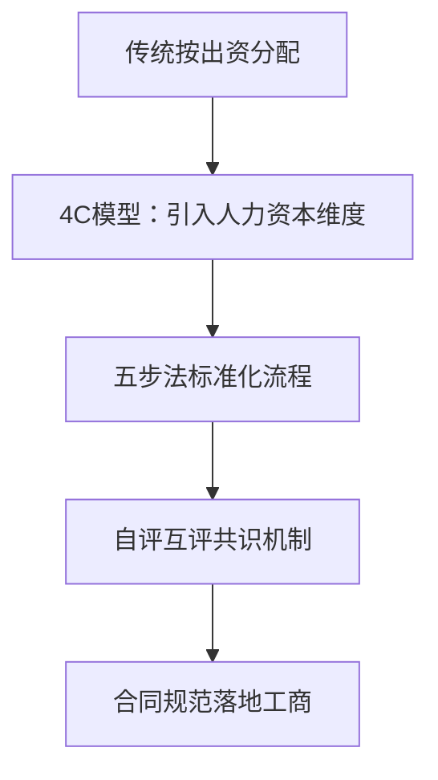

# 第 24 章 实体+互联网闭环创业实战体系

## 学习目标

- 理解 4C 动态量化股权分配模型的四个核心维度与参考权重范围
- 掌握股权分配五步法的操作流程与自评互评共识机制
- 理解最小 MVP 闭环（产品-流量-销售-交付）的验证逻辑与实操要点
- 掌握“中介费伪概念”信息差洞察及个人房屋分享平台的商业模式设计
- 了解店中店联营赋能、二房东渠道、蹭流截流开店等低成本获客与扩张策略
- 理解城市合伙人制度（城市管家）的标准化赋能体系与非对称分工逻辑
- 掌握抖音本地投放实测数据与渠道 ROI 对比方法论
- 了解外包选型、招聘偏好、融资防骗、劳动合同合规等创业避坑指南
- 理解存量时代行业周期判断与新旧模式切换的切入时机
- 能综合运用上述工具与方法，从 0 到 1 再到 N 搭建可复制的实体+互联网闭环创业项目

## 24.1 生活类比

想象创业像**在荒岛上建立一个“自给自足的村庄”**：**4C股权模型** = **《村庄宪章》**：明确谁是酋长(创始人身份/兜底风险)、谁造工具最强(岗位权重)、谁干活最勤/带来外部资源(时间投入)、谁垫资买种子(资金投入)，用量化规则替代拍脑袋分粮食，避免内斗导致村子散伙。**最小MVP闭环** = **“先挖口井、种块地、换盐、再盖房”**：别一上来就造宫殿(完美产品)，先用最小成本跑通“水-粮-盐-屋”生存闭环，验证村子能活下去，再考虑扩建。**中介费伪概念/信息差** = **“打破酋长垄断水源地图”**：原来只有酋长(中介)知道水在哪(房东电话)，收高额过路费；你画张公开地图(平台)，让村民直饮，收点会员费维护地图，村民省钱、你赚服务费，双赢。**店中店/二房东/蹭流截流** = **“不买地盖房，借别人院子摆摊”**：在集市(便利店/驿站)摊位卖水、找囤水大户(二房东)批发、在竞争对手摊位旁挂牌“半价水”截流，零租金、借流量、极速铺开。**城市合伙人/城市管家** = **“铺铁路、设车站、招站长”**：总部铺轨道(房源库/配房/带看流程/系统)，授权站长(合伙人)只管卖票服务乘客，标准化基建前置，复制开站不靠背诵靠SOP。**抖音本地投放实测** = **“撒网前先试网眼”**：别凭感觉砸钱(广播/自媒体)，小额实测抖音LBS定向网，算清每条鱼(C端会员/B端加盟)成本多少、值多少，再加大投网力度。**避坑指南** = **“村长防坑手册”**：外包盖房要验收/核心技术自掌握；招人要肯学的愣头青不要油滑老手；融资遇收费的直接拉黑；劳动合同没附件(考核/制度/廉洁/保密)等于废纸。**存量时代法则** = **“荒岛资源没新增了，拼的是效率与服务”**：新水源(增量)枯竭，旧模式(垄断水源图)必死；赢家是把水管铺到家里(标准化服务)、水质有保障(品牌溢价)的新模式。抢在官方派水车(政府平台)和大财团挖深井(贝壳)前，先跑通模型、占住心智。就像村长必须既懂《宪章》分粮、又懂挖井种地、还懂借摊位铺铁路、更懂防坑识周期，才能带着村民在荒岛上活下来、壮大起来、走出去。

## 24.2 概念地图

第24章：实体+互联网闭环创业实战体系
├── 顶层设计工具
│   ├── 4C动态量化股权分配模型 —— P001
│   │   ├── 创始人身份(风险兜底/控制权) 10%-30% —— P001
│   │   ├── 岗位权重(技术壁垒/核心岗) 30%-40% —— P001
│   │   ├── 时间投入(全职/里程碑匹配/引入资源) 10%-25% —— P001
│   │   ├── 资金投入(前期出资/信心信号) 20%-50% —— P001
│   │   └── 股权分配五步法(确定赛道→收集信息→定维度权重→定股东系数→算比例) —— P001
│   └── 配套合同规范(一致行动权/期权池/回购权/优先清算权/领售权) —— P001
├── 0-1 验证闭环
│   ├── 最小MVP闭环(产品-流量-销售-交付) —— P002
│   │   ├── 从挣1块钱开始验证商业模型 —— P002
│   │   ├── 夕子线上美业：微信诊断+医美面膜跑通闭环 —— P002
│   │   └── 胖龟找房：单店模型月两单覆盖成本 —— P002
│   └── 信息差核心洞察
│       ├── 中介费伪概念：信息差=智商税 —— P003
│       └── 个人房屋分享平台：双方直接对接、不收中介费 —— P003
├── 获客与扩张矩阵
│   ├── 线下低成本触点
│   │   ├── 店中店联营赋能(便利站/驿站/理发店+小程序锁码) —— P004
│   │   ├── 二房东渠道(空置即损失、高付费意愿、批量决策) —— P005
│   │   └── 蹭流截流开店(隔壁开店+0中介费门头+仅引流转化) —— P006
│   ├── 线上精准投放
│   │   ├── 抖音本地投放>本地自媒体>汽车广播 —— P008
│   │   ├── LBS定向+兴趣标签双重筛选 —— P008
│   │   └── 双重收益：C端会员(获客~600元)+B端加盟线索(成本~8000元) —— P008
│   └── 全域发掘法
│       ├── 房东电话：物业/水电费号/同行转化 —— P003
│       └── 租客发掘：抖音/快手/小红书/58/转转/豆瓣/知乎矩阵 —— P003
├── 标准化运营与复制
│   ├── 配房-带看-成交SOP(3-5-7套匹配/密码锁自看/线上签约/周复盘) —— P003
│   ├── 城市合伙人制度(城市管家) —— P007
│   │   ├── 总部四大基建：房源库/配房人员/带看流程/小程序系统 —— P007
│   │   ├── 合伙人仅维护用户/聊天成交 —— P007
│   │   ├── 非对称赋能：总部重供给履约、合伙人重需求转化 —— P007
│   │   └── 前置条件：健康单店模型+区域模型验证+强管控标准 —— P007
│   └── 加盟赋能一条龙(脚本/拍摄剪辑SOP/看脸课程/私域朋友圈SOP) —— P002
├── 避坑与合规底线
│   ├── 外包选型：实地考察/吸纳技术合伙人内部化核心资产 —— P009
│   ├── 招聘偏好：白纸可塑(应届生)>固化思维(老销售) —— P009
│   ├── 融资防骗：收前置费(尽调费/通道费)99%是骗子 —— P009
│   ├── 劳动合同四大附件：考核表/规章制度/廉洁协议/保密协议 —— P009
│   └── 平台生命周期：增长期激进投放、存量期合规生存 —— P003
└── 周期判断与战略定力
    ├── 存量时代生存法则(增量→存量切换=旧模式出清+新模式窗口) —— P010
    ├── 痛点迁移：买不到房→买贵了/被坑了(信息透明+标准化服务) —— P010
    ├── 窗口期有限：政策托底/巨头下场会关闭窗口，抢跑建护城河 —— P010
    └── 向有结果的人学习，复制再创新(付费学习/复制策略/再创新) —— P002

## 24.3 4C动态量化股权分配模型 —— 给分蛋糕找把“量尺子”

### 为什么需要这个概念？

创业初期合伙人对股权分配往往凭感觉、谈关系，导致后期因“谁更重要”争执不下、甚至拆伙散场。传统按出资额分配忽略了人力资本（全职投入、核心技术、创始人风险承担）的价值。我们需要一个可量化、可协商、有参考标准的工具，把定性争论转化为定量计算。

> "今天给大家提供一个工具，这个工具的名称叫 4C 动态量化股权分配模型。"
> 
> "4C中的C，就是资本的意思，资本我们分为人力资本和货币资本。再细分成4个维度的话，就是创始人身份、岗位权重、时间投入、资金投入。这四个维度是这个工具里面已经给大家植入的一个参数，这个参数是在一定的范围内波动的。"
> 
> ——《P001: 初创公司如何科学量化股权分配？》

### 核心定义与四个维度

**4C 动态量化股权分配模型**（来源：《P001》）

该模型将资本分为人力资本和货币资本，细分为四个维度，每个维度设定参考权重区间：

$$
\begin{aligned}
\text{创始人身份权重 } & W_{founder} \in [10\%, 30\%] \\
\text{岗位权重 } & W_{role} \in [30\%, 40\%] \\
\text{时间投入权重 } & W_{time} \in [10\%, 25\%] \\
\text{资金投入权重 } & W_{capital} \in [20\%, 50\%] \\
\end{aligned}
$$

这个公式展示了股权分配的四个核心维度及其经验权重区间。权重非固定，需创始团队自评互评达成共识锚定。

**维度详解：**

1.  **创始人身份**（权重 10%-30%）：代表谁承担最大风险和兜底责任，谁就最有控制企业的需要。公司对外只能有一个声音，创始人身份必须从一开始极度明确。
2.  **岗位权重**（权重 30%-40%）：反映行业技术壁垒所在，即哪个岗位对项目重要性最高。例如技术驱动型项目中 CTO 岗位权重最高，销售驱动型则是市场合伙人。
3.  **时间投入**（权重 10%-25%）：不只看全职/兼职，核心看产出是否匹配项目里程碑及引入资源。约 60% 的项目中，除纯财务投资人外所有合伙人全是全职，但产出匹配度各异。
4.  **资金投入**（权重 20%-50%）：前期出资额，兼作判断合伙人信心与风险意愿的信号。

### 股权分配五步法（来源：《P001》）

```
1. 确定赛道：将行业分为技术驱动型/资金驱动型、自主创业型/集团孵化型四类，不同赛道权重侧重不同
2. 收集信息：汇总各合伙人全职/兼职、负责岗位、出资额度、过往经历等关键信息
3. 定维度权重：创始团队自评互评，在参考区间内确定四个维度的具体权重比例（如 15:35:15:35）
4. 定股东系数：对每位合伙人四个维度按 1-10 分打分（如创始人身份：A=10,B=0,C=0）
5. 算比例：加权求和得出初步股权比例
```

这段伪代码展示了从定性分析到定量计算的标准化流程，将“拍脑袋”变成“算账本”。

### 典型案例：儿童体能训练项目（来源：《P001》）

三人合伙，启动资金 200 万：
- 小明（发起人/运营/全职/出资 50 万）
- 小磊（市场/全职/不出资）
- 小胡（资方/兼职/出资 150 万）

团队自评互评确定：
- 岗位权重系数：小明 7 : 小磊 2 : 小胡 1（运营为核心壁垒）
- 时间投入系数：小明 6 : 小磊 3 : 小胡 1（兼职资方投入低）

代入模型计算，得出初步股权比例。注意：计算结果仅为起点，还需配套一致行动权、期权池、回购权、优先清算权、领售权等合同规范。

### 方法演进图



## 24.4 最小 MVP 闭环 —— 先造独木舟再过河

### 为什么需要这个概念？

创业者常陷入“完美产品陷阱”，花大量时间金钱开发全功能产品，上线才发现无人买单。传统商业计划书往往是拍脑袋，缺乏市场真实反馈验证。我们需要一种最低成本、最快速度验证“产品-流量-销售-交付”商业闭环是否跑通的方法。

> "做生意从自己身边资源入手，从挣1块钱开始，选一个天花板比较高的，持续3——5年。"
> 
> "跑通自己的生意环节，最小mvp（产品——流量—销售—交付）"
> 
> ——《P002: 线上美业创业复盘》

### 核心定义

**最小 MVP 闭环**（来源：《P002》《P004》《P005》）

$$
\text{MVP闭环} = \text{产品(核心价值)} \times \text{流量(获客渠道)} \times \text{销售(转化话术)} \times \text{交付(兑现承诺)}
$$

这个公式展示了商业验证的四个不可或缺要素。缺一不可：有产品无流量=自嗨；有流量无销售=烧钱；有销售无交付=骗钱。

**核心原则：** 从挣 1 块钱开始，用最小成本验证模型成立，再考虑复制放大。核心指标是“有人愿意为核心价值付费”，而非营收规模。

### 典型案例

**案例 1：夕子线上美业**（来源：《P002》）

辞职后注册公司解决社保，无实体店，微信诊断 + 搭配医用面膜，从挣第一单 2 元开始，跑通“诊断-开单-发货-复购”闭环。2 万成本起步，月利润从 1-2 万提升至 10 万+，年利润过百万。

**案例 2：胖龟找房租房业务**（来源：《P005》）

先跑通“获租客-配房-带看-签约-裂变”单店模型：单房月租金 1000-2000 元，基础员工底薪 3000 元，**月成交两单即覆盖成本**。验证模型后，再推广城市合伙人、拓展杭州/上海/深圳。

### 关键性质

- **目标是验证而非盈利**：核心指标是“有人愿意为核心价值付费”
- **可迭代**：基于真实用户反馈快速修正产品方向，避免沉没成本
- **资源聚焦**：将 80% 精力集中在最关键的“不确定性”上（如：用户到底愿不愿意为这项服务付费？）

### 边界条件

- 不适用于强监管、重资产前置（如制造业生产线、生物制药）的赛道
- MVP 不能太烂，必须体现核心差异化价值，否则无法区分“需求不存在”还是“产品太差”
- 验证通过后必须果断切换到“放大模式”，长期停留在 MVP 阶段会被竞品超越

## 24.5 中介费伪概念 —— 信息差就是生意的本质

### 为什么需要这个概念？

传统房产中介靠垄断房东联系方式收取高额中介费，用户痛点极强但长期无解。创业者需要识别行业中“被默认合理”的隐性收费，寻找信息不对称被打破的切入点。理解“生意本质是信息差”，能从现象（收费）穿透到本质（信息垄断），设计颠覆性模式。

> "我们不收中介费，是因为中介费本身就是个伪概念！为什么说是伪概念，因为是智商税，中介费为什么要收？就是因为买房及租房者不知道售房及出租转让业主的联系电话！"
> 
> "生意的本质就是信息差，在互联网里也存在大量的信息差生意。以这个信息差为市场的切入点我们创办了胖龟找房的 1.0——没有中介费的个人房屋分享平台。"
> 
> ——《P003: 胖龟找房创业复盘》

### 核心定义

**中介费伪概念**（来源：《P003》）

$$
\text{中介费合理性} = \frac{\text{信息垄断程度}}{\text{服务实际价值}} \xrightarrow{\text{信息透明化}} 0
$$

这个公式展示了中介费的本质：其存在合理性完全建立在信息不对称之上。一旦平台让买卖双方直接对接（信息透明化），中介费即失去存在基础。

**个人房屋分享平台**（来源：《P003》）

区别于“网上中介公司”（贝壳/58），定位为让买卖双方直接对接的第三方平台，**不收中介费**。
盈利模式转移：不赚中介费，转而赚会员费（买方）、开发商返佣/代办费（卖方）、推广奖（裂变）。

### 典型案例：胖龟找房 1.0/2.0/3.0 迭代（来源：《P003》）

| 版本 | 核心动作 | 盈利模式 | 关键数据 |
|------|----------|----------|----------|
| 1.0 卖房 | 小程序发布真实房源+房东电话 | 年费会员制 | 帮 287 会员省 574 万中介费 |
| 2.0 居家 | 切入装修/家居等高客单周边 | 返佣/代办费 | 拓展服务边界 |
| 3.0 租房 | **二房东付费模式** + 店中店 + 城市合伙人 | 租房佣金(二房东付) + 加盟费 | 月入 15w+，获天使轮融资 |

**核心洞察：** “买房用户跳单的深层动机是省中介费，中介提供的价值不值得收取这么高的费用。”——这一洞察是创业机会的源头。

### 多源对照：信息差商业模式的不同表达

**共识**：信息不对称是传统中介收费的根本来源；打破信息垄断、让供需双方直接对接，是颠覆性切入点。

**分歧**：

- 《P003》主张**彻底不收中介费**，靠会员费/返佣/代办费盈利，平台定位“个人房屋分享平台”；
- 《P002》夕子美业虽非中介，但同样利用**专业信息差**（皮肤诊断+医美选品）建立高客单私域，本质同构；
- 《P006》TikTok 睡播利用**认知信息差**（国内已验证玩法搬运到海外平台），实现降维打击。

## 24.6 店中店联营赋能 —— 借别人的店卖自己的货

### 核心定义

**店中店联营赋能**（来源：《P003》）

在成熟社区业态店内（便利店、菜鸟驿站、理发店）设立专区/柜台，通过小程序“锁码”追踪订单归属。

- **赋能合作方**：为便利店等引入高客单房产服务增收，不占库存、无库存压力
- **赋能自身**：以极低成本（无租金/低分成）获得核心商圈精准流量入口

> "通过合伙人计划，开设联营店中店，有便利店，社区菜鸟驿站，理发店等各种贴近顾客的地方。我们通过小程序锁码跟踪，为社区业态附能，为合作方增收。"
> 
> ——《P003》

### 关键性质

- **轻资产扩张**：不买房、不装修、不雇店长，复制速度快
- **利益深度绑定**：小程序锁码确保订单归属透明，合作方分成即时到账，信任成本低
- **标准化输出**：总部提供话术、物料、流程、培训，合伙人“拿来即用”

### 典型案例

胖龟找房：在便利店、菜鸟驿站、理发店开设联营店中店，合作方只需引导客户扫码/留资，成交分成。城市合伙人“只需维护用户，聊天就行”，后台配房、带看、签约全由总部标准化团队完成。

## 24.7 二房东渠道 —— 找到真正为“空置买单”的人

### 核心定义

**二房东渠道**（来源：《P003》）

二房东：从房东手中整租房源，再分租获利的中间商（长租公寓、二房东个体）。

**核心洞察：** 二房东手上房源多、空置一天损失一天房租，有极强动力付费（原中介费）快速出房。

**商业模式反转：** 租客不付费 → 二房东付“推广费/服务费” → 平台赚二房东的钱。

> "我们推演了很多，也会见了很多房东，最后我们找准了二房东这个渠道。因为二房东手上不单单就一间房子，他需要快速的让自己的房子租出去不能有空置，因为每空置一天，房租的费用就需要自行来承担。"
> 
> ——《P003》

### 关键性质

- **精准匹配痛点与付费能力**：二房东 = 高频需求 + 强付费意愿 + 批量决策
- **绕过 C 端漫长决策链**：B 端决策快、标准化程度高、可建立长期供给关系
- **供给侧抓手**：掌握二房东房源 = 掌握核心供给，反向倒逼平台完善配房/带看/签约 SOP

### 典型案例

胖龟找房 3.0：通过 58 同城、美团公寓、长租公寓老板渠道批量获取二房东，建立“房源库-配房人员-带看流程”标准化作业线。单房佣金 1000-2000 元，员工底薪 3000 元，**月成交 2 单覆盖成本**，人海战术可规模化放大。一线城市单房佣金可达 1-2 万，模型收益显著。

## 24.8 蹭流截流开店 —— 借势打力，隔壁开店割韭菜

### 核心定义

**蹭流截流开店**（来源：《P003》）

在传统强竞对（如头部中介门店）隔壁/楼上楼下开设小型门店，门头标语直接对标竞对痛点（如“0中介费”对标“高中介费”），仅保留“引流咨询+转化签约”功能，后置仓/后台运营集中化，店面极小即可。

> "传统的中介店会有大量的客户到店，我们只需要在隔壁开一家小店，很小的一家店，就会有源源不断的客流通过我们店铺门前。只用做好引流跟转化就行了。"
> 
> "用互联网的专有名词，就是蹭，蹭其他中介的流量，然后通过我们的门头标语：买二手房，租房，\"0\"中介费。来吸引用户到店，以达到截流的目的。"
> 
> ——《P003》

### 关键性质

- **精准流量**：进竞对店看房的客户 = 高意向准客户，转化率极高
- **降维打击**：用“免费/极低价”击穿竞对商业模式防线，迫使竞对被动防御
- **品牌声量放大**：物理位置相邻 + 极致反差标语 = 天然广告位，路人自带传播属性

### 典型案例

**胖龟找房涧西区案例**：在全市销冠中介隔壁开“0中介费”店，截流大量客户，致使对手销售额连跌、员工不敢带客进店。

**瑞幸早期**：开在星巴克隔壁/楼下，用“便宜+快+外带”截流高客单咖啡人群。

### 边界条件

- 仅适用于高频、标准化程度高、价格敏感型、决策周期短的业务（房租/咖啡/快餐/剪发）
- 法律风险：需规避不正当竞争（虚假宣传、诋毁竞对）、商标侵权、租赁合同竞业限制条款
- 竞对反击：头部品牌可通过续约涨租、独家排他协议、品牌方压货挤占库位等手段清理截流者

## 24.9 城市合伙人制度 —— 用“铁路网”思维复制单店模型

### 核心定义

**城市合伙人制度 / 城市管家**（来源：《P003》《P002》《P006》）

总部提供“四大基建”：房源库、配房人员、带看流程、小程序系统，合伙人仅负责“维护用户、聊天成交”。

> "我们通过区域合伙人计划——城市管家，快速让合伙人上手。我们有自己平台，房源库、配房人员、带看流程、合伙人只需要维护用户，聊天就行。"
> 
> ——《P003》

### 财务模型与非对称赋能

| 角色 | 核心职责 | 资产属性 | 盈利来源 |
|------|----------|----------|----------|
| **总部** | 房源库建设、配房调度、带看标准化、系统开发维护 | 重资产/重标准化（供给端、履约端） | 服务费/分成/品牌费/保证金 |
| **城市管家** | 用户维护、咨询转化、本地社群运营 | 轻资产/重关系（需求端、转化端） | 佣金分成/会员费差价 |

**非对称赋能**：总部做重资产/重标准化事（供给端、履约端），合伙人做轻资产/重关系事（需求端、转化端）。

### 前置条件（来源：《P006》）

必须先跑通：
1. **健康单店模型**：门店模型测算到位、单店财务模型健康
2. **区域模型验证**：多店复制、复制性和财务模型达标
3. **强管控标准**：品牌 VI、服务 SOP、价格体系、数据回流必须强管控，否则品牌稀释

> "健康的单店模型是加盟扩张的前提——最新评估标准：门店模型测算到位、单店财务模型健康、区域模型验证、复制性和财务模型达标。"
> 
> ——《P006: 招商加盟与单店模型》

### 典型案例

**胖龟找房**：从洛阳复制到杭州/上海/深圳，单房佣金从千元级升至万级，合伙人仅需“聊天”即可高产出。

**蜜雪冰城 vs 奈雪的茶**：加盟模式年赚 19 亿 vs 直营亏 1.5 亿，印证“加盟品牌利润能力远高于直营”。

> "对比即将上市的蜜雪冰城和已经上市的奈雪的茶（21年19亿利润 VS 亏损1.5亿）...加盟品牌的利润能力要比直营品牌高非常非常多。"
> 
> ——《P006》

### 加盟赋能一条龙（来源：《P002》）

为合伙人提供现成脚本（改人设即可发布）、拍摄剪辑 SOP（含 3 条视频剪辑）、专业课程喂饭教程、私域朋友圈/聊天 SOP，实现“脚本、案例共享”的重复-复制-重复模式。

## 24.10 抖音本地投放实测 —— 用数据说话，别凭感觉砸钱

### 核心定义

**抖音本地投放实测**（来源：《P003》《P004》）

以获客成本（CAC）、付费会员数、投产比（ROI）、加盟商线索成本为核心指标，建立“投放→数据→复盘→调整”闭环。

> "以此 抖音推广>本地自媒体>汽车广播"
> 
> "品牌营销这部分营销推广直接带来了 4000+的粉丝，付费会员大概在 100 多名，获客成本大概在 600 左右一名，投产比还不错。"
> 
> "招商版块推广带了 100+的意向客户，最后成交变成加盟客户 5 位，单个加盟商成本在 8000 左右。因为我们有个 1w 左右的利润，所以也是有盈余的。"
> 
> "汽车广播这个板块不建议大家做，薅羊毛的客户比较多~。这个版块我们大概扔进去 2w，水花都看不到。"
> 
> ——《P003》

### 关键性质

- **抖音算法精准**：LBS 定向 + 兴趣标签双重筛选，能触达“近期有买房/租房/装修意向”的同城用户
- **数据可追踪**：表单/私信/电话/到店均可归因，支持精细化优化素材/定向/出价
- **双重收益**：既获取 C 端付费会员（获客成本 ~600 元），又获取 B 端加盟商线索（成本 ~8000 元，利润 ~1 万）

### 实测数据对比表

| 渠道 | 投入 | 产出 | ROI 评价 | 适用性 |
|------|------|------|----------|--------|
| **抖音本地投放** | 可控预算 | 4000+粉、100+付费会员、5位加盟商 | **优** | 本地项目首选 |
| 本地自媒体 | 中等 | 一般 | 中 | 辅助 |
| 汽车广播 | 2 万 | “水花都看不到” | **极差** | 不建议 |

### 铁律

**做本地项目，投抖音必须投定向本地（同城/同区），否则钱烧给路人。**

## 24.11 全域发掘法与标准化运营 SOP

### 房东电话获取三法（来源：《P003》）

1. **物业关系**：通过与物业建立关系，给予一定费用，拿到业主电话
2. **水电费号码**：通过水电费号，找到相应单位人员获取业主电话
3. **同行转化**：传统中介房源共享、客户共享，切入同行获取业主电话

### 租客全域发掘矩阵（来源：《P003》）

| 平台 | 玩法 | 关键动作 |
|------|------|----------|
| 抖音/快手/小红书 | 发帖+评论区私聊 | 搜“城市租房”热点，回复有意向用户私聊破冰 |
| 58/安居客 | 拼室友板块 | 主动联系求租者 |
| 转转/咸鱼 | 求租广场 | 直接对接发帖用户 |
| 豆瓣/🧣/知乎 | 超话/小组 | 进入“杭州租房超话”等讨论组发帖回复 |

### 配房-带看-成交标准流程（来源：《P003》）

```
配房：后台按租户需求精准匹配 3-5-7 套房子，不满意接着二配、三配
带看：提供位置+楼牌号+房间号+密码锁密码，引导客户自看
成交：联系房东/二房东最短时间内签约，大量采用线上签约
复盘：每人每日总结、每周复盘，数据驱动优化
```

## 24.12 避坑指南：外包选型、招聘偏好、融资防骗、劳动合同

### 外包选型避坑（来源：《P003》《P002》《P001》）

> "在本地选择的时候，一定要深入公司内部去考察，看看外包团队的人员构成，人员数量，还有他们实施过的案例... 所以在做互联网项目创业的时候，最好的方式吸纳一位优秀的技术开发人员最好。"
> 
> ——《P003》

- **核心原则**：核心资产（技术/供应链/核心数据）必须内部化，外包只能过渡
- **实操**：深入实地考察团队构成/案例/代码质量；最佳方案 = 吸纳技术合伙人

### 招聘偏好避坑（来源：《P003》《P002》）

> "一开始我们在线下招聘的时候偏向于找寻一些从事过相关房产行业的销售人员...这波人有个严重的问题，固化思维太重，难以改变思维...后来我们把招聘重点放到了刚毕业的大学生身上..."
> 
> ——《P003》

- **核心原则**：思维 > 经验。早期创业探索期，固化经验是负资产，学习力/执行力/价值观对齐是核心筛选标准
- **偏好**：白纸可塑（应届生）> 固化思维（老房产销售）

### 融资防骗（来源：《P003》）

> "如果你想去融资，想去找投资人。最好有人推荐，市面上很多打着投融资的旗号的骗子公司，他们让创始团队缴纳各种名义的费用...一定不要盲目缴纳各种费用。"
> 
> ——《P003》

- **红线**：凡要求创始团队先缴纳各类费用（尽调费、通道费、材料费）的融资中介/机构，**99% 是骗子**
- **正规路径**：FA 机构按成功费收费、投资人直投、政府引导基金、银行信贷，均不收前置费用

### 劳动合同合规（来源：《P002》《P001》）

> "品牌部张先生赔付22500元、运营部徐女士赔付4500元、短视频部李女士赔付2500元——三个案例总结出劳动合同必须及时签...建立考核表和周考核表、完善合同体系的经验。"
> 
> ——《P002》

**四大附件（枪要有子弹）：**
1. 岗位考核表
2. 公司规章制度
3. 廉洁自律协议
4. 员工保密协议

> "这个股权比例分配是最最简单的一个环节...我们还会有其他一系列的合同规范和调整，比如一致行动权，期权池，分红奖励，回购权，纯资金方投资的优先清算权，领售权，等等等等。"
> 
> ——《P001》

## 24.13 存量时代生存法则 —— 换季清仓时才是新模式进场时

### 为什么需要这个概念？

多数创业者盯着增量市场（新需求、新技术、新平台）厮杀红海，忽视存量市场的结构性机会。行业周期切换（增量→存量）会淘汰旧模式，同时为解决存量痛点的新模式打开窗口期。理解周期位置，能避免在夕阳产业硬扛，也能在黎明前入场布局。

> "早在 2018 的时候国内的新建楼房已经开始走下坡路，大规模的城镇化建设也接近尾声。加上自 2019 年底疫情开始...国内房产销售已经从存量与增量市场并重的方向，开始迈入存量消费时代。"
> 
> "任何一个行业都有其周期性...房地产行业正在进入低利率时期，房产中介未来会比较煎熬。"
> 
> ——《P003》

> "回观抖音的发展路径，第一阶段就是高流量低商业化阶段...按照抖音、映客花椒的发展路线图，初级阶段娱乐直播至少可以做2年的时间..."
> 
> ——《P006: TikTok 娱乐直播项目》

### 核心定义

**存量时代生存法则**（来源：《P003》《P006》《P002》）

- **存量消费时代**：城镇化见顶、新建楼房下滑、人口红利消退，市场从“争新用户”转为“争存量用户/提频增购”
- **旧模式出清**：传统中介靠信息差赚暴利的时代结束，面临“虚假房源、阴阳合同、乱收费”信任崩塌
- **新模式窗口**：平台撮合 + 信息透明 + 标准化服务 + 品牌溢价，成为存量博弈的核心竞争力

### 关键性质

**周期判断先于模式选择**

| 判断节点 | 信号 | 动作 |
|----------|------|------|
| 2018 年 | 新房见顶 | 确认存量时代到来 |
| 2019 年底 | 疫情爆发 | 加速存量切换 |
| **此时切入** | **“0中介费”模式** | **精准卡位新模式窗口** |

**痛点迁移：**
- 增量期痛点：**“买不到房”** → 解决方案：抢房源、抢指标
- 存量期痛点：**“买贵了/买坏了/被坑了”** → 解决方案：信息透明 + 标准化服务 + 品牌溢价

**时间窗口有限：**
政策兜底（政府推官方平台）、巨头下场（贝壳垂直整合）会关闭窗口，需抢跑建立护城河。

### 多领域验证

**房产（胖龟找房）**：二手房成交占比逐年升高，用“信息透明+标准化服务”收割传统中介红利。

**美业（夕子）**：从“卖面膜”转“私域高客单皮肤管理”，应对博主广告变现下滑、用户转向专业服务的存量趋势。

> "2024年一年都没有广告...品牌投广告的越来越少，很多是直接投到直播间了，要产出。所以你会看到很多护肤博主，美妆博主停更了。"
> 
> ——《P002》

**直播（老杨 TikTok）**：判断 TikTok 处于“高流量低商业化”早期（类似抖音 2017），主攻娱乐直播而非带货，**抢跑 2 年红利期**。

> "回观抖音的发展路径，第一阶段就是高流量低商业化阶段...初级阶段娱乐直播至少可以做2年的时间，在这段时间里面，不需要对某个项目进行深度的运营和挖掘，就可以赚到一桶金。"
> 
> ——《P006》

### 向有结果的人学习，复制再创新（来源：《P002》《P006》）

> "赚钱，向有结果的人学习，复制再创新"
> 
> "不断付费学习,付费最有价值的两个星球，一个是生财星球，一个是玩赚星球。除了付费星球，还付费了私域老师。"
> 
> ——《P002》

> "如果开发，只有三个办法：多看、多拆解、多测试。拆多了，看到一个直播间，大体就知道怎么玩了。"
> 
> ——《P006》

## 24.14 多源对照：核心概念的跨素材映射

### 共识表

| 核心概念 | P001(股权) | P002(美业) | P003(房产) | P006(直播) | 共识结论 |
|----------|------------|------------|------------|------------|----------|
| **最小验证** | 隐含于起点 | 显性 MVP 闭环 | 单店模型月两单覆盖成本 | 新号 2 天破 500、5 天破 2000 | **先跑通最小单元，再考虑复制** |
| **信息差变现** | - | 专业诊断信息差 | 中介费伪概念/房东电话垄断 | 国内玩法搬运海外认知差 | **打破信息垄断是核心切入点** |
| **标准化复制** | 五步法/合同规范 | 加盟赋能一条龙 | 城市管家/店中店/SOP | 1+1+1矩阵/程序化控制 | **总部做基建，一线做转化** |
| **周期判断** | - | 广告渠道下滑→基本盘 | 2018新房见顶→存量时代 | TikTok类抖音2017→娱乐直播窗口 | **识别周期位置，卡位窗口期** |

### 分歧表

| 维度 | P002 夕子美业 | P003 胖龟找房 | P006 老杨直播 | 差异本质 |
|------|---------------|---------------|---------------|----------|
| **核心杠杆** | 内容+私域（媒体杠杆） | 平台+线下触点（网络杠杆） | 算法流量+自动化（代码杠杆） | 不同赛道的杠杆形态差异 |
| **扩张方式** | 加盟赋能（重品牌/重服务） | 城市合伙人（重基建/重供给） | 项目矩阵 1+1+1（重开发/重复制） | 业务模式决定组织形态 |
| **风控重点** | 劳动合同/单一变现渠道 | 外包/招聘/融资/平台规则 | 设备寿命/平台风控/玩法生命周期 | 资产形态决定风险画像 |

## 24.15 设计中的取舍

### 为什么不用“平均分配/按出资分配”做股权？

因为早期创业的核心资产是**人力资本**（全职投入、核心技术、创始人风险兜底），而非货币资本。按出资分配会导致“全职干活的少分、出钱躺平的多分”，必然引发后期拆伙。**Trade-off**：量化模型增加了前期沟通成本（自评互评、定权重），但换取了长期的利益对齐与控制权清晰。

### 为什么 MVP 阶段不追求“完美产品”？

完美产品需要大量前置投入，一旦市场不买单，沉没成本极高。MVP 只保留核心价值主张，**用“有人付费”这一个指标替代十个虚荣指标**。**Trade-off**：MVP 可能丢失边缘用户、体验粗糙，但换取了极低的试错成本和极快的反馈速度。

### 为什么不直接做“直营连锁”而选“城市合伙人”？

直营连锁受限于管理半径、资金压力、人才梯队，扩张速度慢、边际成本高。城市合伙人模式下，**总部只做标准化基建（边际成本趋零），合伙人自带资金和人力负责转化**，实现非对称杠杆放大。**Trade-off**：牺牲了对终端服务的绝对控制权，换取了指数级复制速度；必须通过“强管控标准”守住品牌底线。

### 为什么抖音本地投放不投“全域”而只投“LBS定向+兴趣标签”？

全域投放会把预算烧给无关路人，CAC 失控。本地生意的流量价值半径极强，**LBS 5km + 意向标签**能将流量精准度提升 10 倍以上。**Trade-off**：放弃了品牌曝光的广度，换取了转化的精度和 ROI 的确定性。

### 为什么招聘偏好“应届生”而非“老销售”？

老销售带着“推房子”的固化思维，极难转型为“转化会员/服务用户”的咨询型角色。应届生虽无经验，但思维可塑、价值观易对齐、成本可控，配合标准化 SOP 可快速复制。**Trade-off**：前期培训投入大、出单慢，但换取了团队的高度一致性和可塑性。

## 24.16 动手练习

### 练习 1：4C 模型股权分配实战推演

假设三人合伙做“社区养老陪诊”项目，启动资金 100 万：
- 老大 A：发起人、CEO、全职、出资 30 万
- 老二 B：CTO、技术合伙人、全职、出资 10 万
- 老三 C：资方、兼职、出资 60 万

请按 4C 模型完成：
1. 根据行业属性（服务重运营、轻技术），自行设定四个维度的权重比例（需在参考区间内）
2. 对三位合伙人四个维度分别打分（1-10分），计算加权得分
3. 算出初步股权比例
4. 思考：若 B 技术极强但仅兼职，如何调整“时间投入”维度定义与权重？初步比例还需补充哪些合同条款才能落地工商登记？

### 练习 2：最小 MVP 闭环设计与验证

针对“社区养老陪诊”项目，设计最小 MVP 验证方案：
1. 定义核心产品（单次陪诊/月度包陪/年费会员？）、核心流量获取动作（地推/抖音本地/医院合作？）、销售话术（一句话价值主张）、交付标准（陪诊报告/用药提醒/复诊预约？）
2. 设定“验证通过”的量化标准（如：单次陪诊毛利>50元、获客成本<100元、复购率>30%、NPS>8）
3. 列出验证期内“绝不做”的事项清单（避免功能蔓延）
4. 思考：若验证失败，是“需求不存在”还是“产品/渠道/交付”没做好？如何用数据区分？

### 练习 3：信息差商业模式拆解与迁移

以“中介费伪概念”为范式，挖掘生活中另外两个“信息差=智商税”场景（如：二手车/留学中介/装修/招聘/医疗陪诊等），完成：
1. 画出现状链路：谁垄断了什么关键信息？谁在收费？收费合理性何在？
2. 设计“个人分享平台”雏形：如何让供需双方直接对接？平台不收中介费靠什么盈利（会员费/返佣/代办费/广告/数据？）
3. 识别核心信任成本（如：车况真实性/留学文书质量/装修偷工减料/医生资质）及解决方案（第三方检测/标准化SOP/担保支付/专家背书）
4. 评估政策/巨头降维打击风险及应对护城河

### 练习 4：城市合伙人扩张财务模型测算

假设“社区养老陪诊”单店模型已跑通：单单均价 300 元、毛利 40%、月均 60 单、房租人力月固定成本 2 万。拟向杭州/宁波/温州复制，采用城市合伙人模式：
1. 测算单店盈亏平衡点、健康单店月净利
2. 设计城市合伙人分成/品牌费/保证金结构，使合伙人投资回本期<6个月、总部现金流为正
3. 列出总部必须前置建设的“四大基建”清单（房源库/配房/带看/系统 对应 陪诊师池/调度系统/服务SOP/小程序）
4. 设定“强管控”红线清单（VI/价格/服务流程/数据回流/陪诊师准入），违规处理机制

### 练习 5：抖音本地投放 ROI 实测方案设计

为“社区养老陪诊”在杭州启动抖音本地投放测试，预算 1 万元，设计：
1. 素材方向（3 条）：痛点剧情/专家背书/用户见证，各拍 2 版（横/竖）
2. 定向设置：LBS（杭州主城区 5km）+ 兴趣标签（养老/陪诊/慢病/子女不在身边）
3. 转化路径：表单留资→企微添加→单次陪诊下单/年费会员咨询
4. 核心指标看板：曝光/点击/留资/加微/成单/获客成本(CAC)/ROI，日度复盘模板
5. 止损/加仓决策规则：如单日 CAC>150 元连续 3 天暂停优化素材；ROI>1.5 连续 3 天加仓至日预算 1000 元

## 24.17 本章小结

这一章中我们学习了如何从 0 到 1 再到 N 搭建一个可复制的实体+互联网闭环创业项目。首先我们掌握了 4C 动态量化股权分配模型，用四个维度的量化权重替代拍脑袋分蛋糕，并通过五步法与自评互评达成共识；其次我们理解了最小 MVP 闭环的验证逻辑，从挣 1 块钱开始跑通“产品-流量-销售-交付”最小单元；接着我们深度拆解了“中介费伪概念”这一信息差核心洞察，以及个人房屋分享平台的商业模式设计；然后我们系统学习了店中店联营赋能、二房东渠道、蹭流截流开店等低成本获客与扩张策略，并掌握了抖音本地投放的实测数据与 ROI 对比方法论；随后我们理解了城市合伙人制度（城市管家）的标准化赋能体系与非对称分工逻辑，以及加盟赋能一条龙的标准化交付包；同时我们建立了外包选型、招聘偏好、融资防骗、劳动合同合规等创业避坑指南；最后我们确立了存量时代行业周期判断与新旧模式切换的切入时机，明确了周期判断先于模式选择的战略定力。

本章我们一起学习了以下概念：

| 概念 | 解释 |
|------|------|
| 4C动态量化股权分配模型 | 将股权分配量化为创始人身份、岗位权重、时间投入、资金投入四维度，配合五步法与自评互评共识机制，解决早期团队分蛋糕难题 |
| 创始人身份 | 代表最大风险承担与兜底责任，权重10%-30%，是控制权基石，必须从一开始极度明确 |
| 岗位权重 | 反映行业技术壁垒核心岗位，权重30%-40%，需团队自评互评达成共识，避免后期因“谁更重要”拆伙 |
| 时间投入 | 不只看全职兼职，核心看产出是否匹配项目里程碑及引入资源，权重10%-25% |
| 资金投入 | 前期出资额，兼作判断合伙人信心与风险意愿的信号，权重20%-50% |
| 股权分配五步法 | 确定赛道→收集信息→定维度权重→定股东系数→算比例，计算结果仅为起点，需配套合同规范 |
| 最小MVP闭环 | 产品-流量-销售-交付四要素最小验证，从挣1块钱开始，跑通模型再放大，核心指标是“有人愿为核心价值付费” |
| 中介费伪概念 | 中介费本质是信息差智商税，买房/租房者不知房东电话才被收费，信息透明化即可取消 |
| 个人房屋分享平台 | 区别于网上中介公司，定位让买卖双方直接对接的第三方平台，靠会员费/返佣/代办费/推广奖盈利 |
| 店中店联营赋能 | 在社区业态(便利店/驿站/理发店)设专区，小程序锁码追踪，总部赋能合作方增收、自身获低成本精准流量 |
| 二房东渠道 | 租房业务核心付费方：手握多房源、空置即损失、高频批量决策，动力付费快速出房 |
| 蹭流截流开店 | 在强竞对隔壁开小店，利用其自然客流+极致性价比门头(0中介费)截流，仅做引流转化 |
| 抖音本地投放实测 | 抖音LBS+兴趣标签双重筛选，ROI显著优于本地自媒体/汽车广播，本地项目必投本地定向 |
| 城市合伙人制度(城市管家) | 总部提供房源库/配房/带看/系统四大基建，合伙人仅维护用户聊天成交，非对称赋能实现轻量化复制 |
| 加盟赋能一条龙 | 提供现成脚本、拍摄剪辑SOP、专业课程喂饭教程、私域朋友圈/聊天SOP，实现拿来即用 |
| 避坑指南 | 外包深考察/核心资产内部化；招白纸可塑应届生；融资拒收前置费；劳动合同配齐四大附件(考核/制度/廉洁/保密) |
| 存量时代生存法则 | 增量见顶转存量，旧模式(信息差中介)出清，新模式(信息透明+标准化服务+品牌)窗口期有限，抢跑建护城河 |
| 周期判断先于模式选择 | 2018新房见顶+疫情=存量时代确认，此时切入“0中介费”精准卡位；TikTok高流量低商业化期主攻娱乐直播抢跑2年红利 |

下一章中，我们将学习如何将这些实战方法论内化为个人的认知体系，构建长期主义的复利人生框架。

