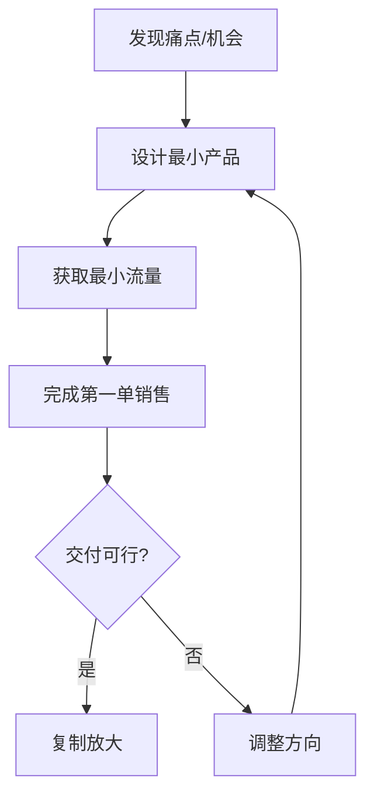
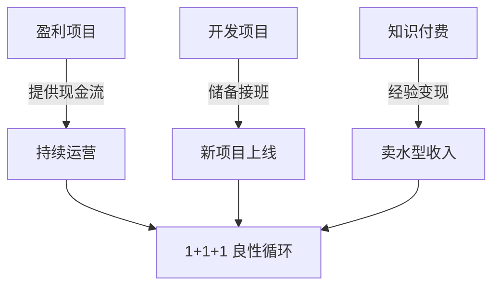

# 第 23 章 副业闭环实战 —— 从“最小验证”到“体系放大”

## 学习目标

- 理解最小可行产品（MVP）闭环的核心定义与验证目标
- 掌握选品决定论的核心逻辑与三要素
- 理解信息差在商业模式中的关键作用与价值创造机制
- 学会用投产比（ROI）量化评估不同渠道的营销效率
- 掌握平台演化周期的四阶段模型，能预判新平台红利期
- 理解1+1+1项目矩阵模式的构成与协同逻辑
- 掌握私域高客单策略的适用前提与核心价值
- 学会用逆向开发方法论从痛点反推产品与卖点


## 23.1 渡河般验证，播种般选品

想象商业验证是一场**渡河**。你站在岸边，望着对岸的商业机会，目标是过河。如果你一上来就想造一艘航母，投入几个月时间、几十万资金，那么一旦河对岸根本没有人需要你的产品，你会损失惨重。但如果你先造一艘独木舟，用最少的成本快速试水，验证船不沉、方向对，再回头造更大更稳的船，那么即使失败，损失也可控。这就是最小 MVP 闭环：用小成本快速试水，验证商业模式的可行性。同样，渡河前你还要考虑用什么样的船、走哪条水路——这就好比选品决定论。好的种子自带生命力，差的种子即使加倍施肥浇水也难有好收成。而在选择水路时，如果你知道一条别人不知道的近路，你就能靠带路赚钱——这就是信息差。当你决定在哪里下网捕鱼时，你会用探鱼器测量哪个区域鱼最多，而不是凭感觉撒网——这就是渠道投产比的量化思维。最后，如果你选在早春播种，土地尚未被瓜分，你的收成会远超等到夏天才入场的竞争者——这就是平台演化周期的红利窗口。

## 23.2 概念地图

```
最小MVP闭环
├── 核心目标
│   └── 验证"有人愿意付钱"和"交付可行" —— P001
├── 关键性质
│   ├── 低成本性：投入小，失败损失可控 —— P001
│   ├── 快验证性：最短时间判断模式是否成立 —— P003
│   └── 可复制性：跑通后可无限放大 —— P001
└── 典型应用
    └── 线上美业：甲油胶代购一单挣2元起跑通闭环 —— P001
选品决定论
├── 核心主张
│   └── 产品好省一半心，自带转化力 —— P001
├── 选品三要素
│   ├── 深挖用户需求，涵盖面齐全 —— P001
│   ├── 口服保养是趋势，客户粘性强 —— P001
│   └── 与医院合作，强化品牌背书 —— P001
└── 边界条件
    └── 需验证利润空间：无利润空间不如不做 —— P001
信息差赚钱论
├── 底层逻辑
│   └── 生意的本质是信息差 —— P002
├── 核心概念
│   └── 中介费伪概念：信息差造成的智商税 —— P002
└── 关键性质
    ├── 广泛存在：互联网与线下均有 —— P002
    ├── 可被消除：技术进步可颠覆旧模式 —— P002
    └── 价值创造：撮合匹配解决需求产生良性循环 —— P002
渠道投产比（ROI）
├── 定义
│   └── 收益与投入成本的比值，衡量渠道效率 —— P002
├── 关键性质
│   ├── 可比较性：同一标准横向对比 —— P002
│   ├── 本地相关性：本地项目必投本地 —— P002
│   └── 差异巨大：最优与最差可能差数十倍 —— P002
└── 典型实测
    └── 抖音推广 > 本地自媒体 > 汽车广播 —— P002
平台演化周期
├── 四阶段模型
│   └── 铺货 → 动销 → 精细化 → 玩趋势 —— P003
├── 关键窗口
│   └── 高流量低商业化阶段是普通人最佳切入 —— P003
├── 核心性质
│   ├── 周期普遍性：所有平台底层逻辑相通 —— P003
│   ├── 窗口有限性：红利被快速消耗 —— P003
│   └── 风险递进性：后期需更合规精细 —— P003
└── 典型应用
    └── TikTok睡播：判断平台早期主攻娱乐直播 —— P003
1+1+1项目矩阵
├── 构成
│   ├── 1个在盈利：提供现金流 —— P003
│   ├── 1个在开发：提前储备接班 —— P003
│   └── 1个做知识付费：经验溢价变现 —— P003
└── 关键性质
    ├── 现金流稳定 —— P003
    ├── 储备项目延续性 —— P003
    └── 经验溢价 —— P003
私域高客单
├── 核心主张
│   └── 私域用户因专业而来，应服务高客单技术型需求 —— P001
├── 金饭碗比喻
│   └── 端着金饭碗讨饭是对专业价值的浪费 —— P001
└── 关键性质
    ├── 高信任度：用户因专业而来 —— P001
    ├── 高利润空间：技术型服务可收更高价格 —— P001
    └── 可持续性：专业信任带来更长客户生命周期 —— P001
逆向开发方法论
├── 核心链条
│   └── 发现痛点 → 定义产品形态 → 快速验证 → 复制放大 —— P002, P001
├── 关键性质
│   ├── 需求导向性：从用户真实反馈出发 —— P002
│   ├── 高效执行性：无需开发完再找市场 —— P002
│   └── 信息差驱动性：常与信息差套利结合 —— P002
└── 典型应用
    └── 胖龟找房：先发现中介费痛点，再反向搭建平台 —— P002
```

## 23.3 最小 MVP 闭环 —— 从“挣 1 块钱”到“复制放大”

你有没有想过，为什么很多副业或创业项目最终失败了？往往不是因为能力不足，而是因为他们在一开始就投入了过多资源，最后才发现方向错了。这就是我们需要 MVP——最小可行产品——的原因。

> "1.做生意从自己身边资源入手，从挣1块钱开始，选一个天花板比较高的，持续3——5年。 2.跑通自己的生意环节，最小mvp（产品——流量—销售——交付）。"
>
> ——《线上美业创业复盘》

这段话传达了执行力的重要性。传统思维是"先造航母再过河"，但个人和小团队根本承担不起这种试错成本。MVP 的价值在于用最小的成本、最快的速度，检验一个商业闭环能否成立。

**最小 MVP 闭环定义**（来源：《线上美业创业复盘》）

$$
\text{MVP闭环} = \text{产品} \rightarrow \text{流量} \rightarrow \text{销售} \rightarrow \text{交付}
$$

这个公式展示了最小可行产品闭环的完整链路。它不追求完美，而是先完成第一单交易——哪怕只赚 1 块钱。夕子以 2 万资本起步，从代购医美面膜一单挣 2 元开始，逐步跑通了这条链路，最终年利润过百万。这告诉我们：**先证明"有人愿意付钱"，再考虑如何做大**。

关键性质：

- **低成本性**：投入小，即使失败损失也可控
- **快验证性**：能在最短时间内判断模式是否成立
- **可复制性**：跑通后可以无限放大，从月入 3000 的号复制 30 遍变成大生意

老杨在开发新项目时也强调"快速测试，快速看到结果"，认为 MVP 方法论"真是让各行各业都能大放异彩"。这正是对 MVP 核心价值的验证。

**边界条件**：MVP 验证的目标不是追求利润最大化，而是确认"有人愿意付钱"和"交付可行"。如果 MVP 阶段连 1 块钱都挣不到，说明模式本身有问题，应果断调整而非加大投入。



## 23.4 产品好省一半心 —— 选品决定论

你是否曾经花了很多精力推销一款产品，却发现用户根本不为所动？很多创业失败并非销售能力不足，而是从一开始就选错了产品。差产品需要花大量精力推销，好产品自带转化力。

> "所以选品很关键，产品好省了一半的心，后续回购率也高。1.深挖用户需求，最好涵盖面齐全：比如说不仅祛痘、还有美白、抗衰等等。2.口服保养是趋势，一个人一单接受了某个品牌的口服，不会轻易更换牌子的。3.尽量能跟医院合作的产品，品牌背书这块强。"
>
> ——《线上美业创业复盘》

这段话给出了选品决定论的核心逻辑。选品重于销售：选择好的产品比销售技巧更重要，好产品自然带来转化和复购。

**选品三要素**（来源：《线上美业创业复盘》）

$$
\text{选品} = \underbrace{\text{用户需求覆盖}}_{\text{祛痘+美白+抗衰}} + \underbrace{\text{客户粘性}}_{\text{口服保养}} + \underbrace{\text{品牌背书}}_{\text{医院合作}}
$$

这个"等式"展示了选品的三个核心维度。第一，深挖用户需求并涵盖面齐全，例如不仅祛痘，还有美白、抗衰等多条产品线，一次满足用户的多种诉求。第二，选择高粘性品类，口服保养品一旦用户接受某个品牌，不会轻易更换，复购率自然高。第三，尽量与医院等专业机构合作，强化品牌背书，用户信任度更高。

**典型例子**：夕子选品时优先选择能涵盖祛痘、美白、抗衰等多种需求的产品线，而非单一的某个爆品；同时，她投入 1 万 6 千元入货，是因为该折扣级别属于合伙人级别，有足够利润空间。

**边界条件**：选品考察的是后端供应链和产品力，而非单一价格优势。需结合自身资源验证：没有利润空间的产品（如合伙人级别才能拿到低折扣）不如不做。

## 23.5 信息差就是金钱 —— 卖“你知道而别人不知道的路径”

你有没有想过，为什么中介费动辄几千上万，却依然有人心甘情愿地支付？商业的本质是交易，而交易的前提是买卖双方对同一个商品的价值认知存在差异。理解了信息差，你就理解了大多数生意的根基。

> "生意的本质就是信息差，在互联网里也存在大量的信息差生意。以这个信息差为市场的切入点我们创办了胖龟找房的 1.0——没有中介费的个人房屋分享平台。我们不收中介费，是因为中介费本身就是个伪概念！为什么说是伪概念，因为是智商税，中介费为什么要收？就是因为买房及租房者不知道售房及出租转让业主的联系电话！"
>
> ——《胖龟找房创业复盘》

这段话是信息差赚钱论最直白的阐述。胖龟找房的创始人意识到，传统中介费之所以能收取，本质是买方不知道房东电话。一旦信息透明，这笔费用就可以被取消。

**信息差赚钱论定义**（来源：《胖龟找房创业复盘》）

$$
\text{信息差} = \text{你知道而别人不知道的路径}
$$

这个定义展示了信息差的本质：它是利用买卖双方对市场、产品、价格等信息的不对称，通过撮合、搬运或服务创造价值并获利。关键性质包括：

- **广泛存在**：互联网和线下都存在大量信息差生意
- **可被消除**：技术进步和模式创新能消除信息差，从而颠覆原有商业模式
- **价值创造**：平台撮合买卖双方匹配，解决需求及痛点，产生良性循环

**典型例子**：胖龟找房不向租客收中介费，而是让二房东承担佣金（因为空置一天损失一天房租），本质是重新分配了"信息差红利"。另一个例子是闲鱼套利：利用不同平台间的价格信息差低买高卖。

**边界条件**：信息差会随时间和技术进步被消除，需要持续寻找新的信息差或建立其他壁垒。单纯依赖信息差而无实际服务价值，容易被视为"智商税"并面临竞争者的颠覆。

## 23.6 渠道投产比 —— 用数据说话，不凭感觉花钱

创业者的资源永远有限。投放预算必须花在回报最高的渠道上。凭经验和"听说"选择渠道往往导致资金浪费——你可能投入了 2 万元，却连水花都看不到。

> "品牌营销这部分营销推广直接带来了 4000+的粉丝，付费会员大概在 100 多名，获客成本大概在 600 左右一名，投产比还不错。招商版块推广带了 100+的意向客户，最后成交变成加盟客户 5 位，单个加盟商成本在 8000 左右。因为我们有个 1w 左右的利润，所以也是有盈余的。汽车广播这个板块不建议大家做，薅羊毛的客户比较多~。这个版块我们大概扔进去 2w，水花都看不到。"
>
> ——《胖龟找房创业复盘》

这段话给出了三个渠道的实测对比：抖音推广效果最优、本地自媒体次之、汽车广播最差。胖龟找房的实测经验给出了直观的投产比排序，如果你想做本地项目，投放时必须选择本地渠道，否则外地流量对你毫无价值。

**渠道投产比定义**（来源：《胖龟找房创业复盘》）

$$
\text{ROI} = \frac{\text{渠道带来的收益}}{\text{投入成本}}
$$

这个公式展示了投产比的定义：它是某渠道带来的收益与投入成本的比值，是衡量营销渠道效率的核心指标。关键性质包括：

- **可比较性**：不同渠道用同一标准（获客成本、付费转化数）横向对比
- **本地相关性**：做本地项目时投放必须选本地渠道，外地流量无效
- **差异巨大**：最优与最差渠道的回报可能相差数倍到数十倍

**典型例子**：胖龟找房在抖音投放带来 4000+ 粉丝、100+ 付费会员，获客成本约 600 元/名；汽车广播投入 2 万几乎看不到水花。这就是数据说话的威力。

**边界条件**：投产比受行业、地域、内容质量影响，需在自身业务场景中实测，不能直接照搬他人结论。投放效果有滞后性，需给短中期观察期后再评估是否追加或放弃。

## 23.7 平台演化周期 —— 从“以史为鉴”到“预判红利”

新平台（如 TikTok、美团、TEMU）的发展路径高度相似。历史规律可预判新机会的窗口期。只有理解平台演化阶段，才能判断"什么时间用什么打法"最容易被奖励。

> "回观抖音的发展路径，第一阶段就是高流量低商业化阶段，这时候要做的并不一定要跟平台的指向，而是要看清平台的现状。按照抖音、映客花椒的发展路线图，初级阶段娱乐直播至少可以做2年的时间，在这段时间里面，不需要对某个项目进行深度的运营和挖掘，就可以赚到一桶金。对于大部分想要在tiktok上赚到钱的小伙伴，娱乐直播是最简单也是最容易拿到结果的方向。"
>
> ——《TikTok娱乐直播项目实战》

这段话展示了作者对平台周期的判断。TikTok 正处于类似抖音早期的"高流量低商业化"阶段，此时做娱乐直播是普通人最轻松、最容易拿到现金流的方向。

**平台演化周期定义**（来源：《TikTok娱乐直播项目实战》）

$$
\text{平台演化} = \text{铺货} \rightarrow \text{动销} \rightarrow \text{精细化} \rightarrow \text{玩趋势}
$$

这个公式展示了平台演化的四阶段模型。早期平台流量红利最大但商业化不成熟，普通人有最轻松的切入窗口。关键性质包括：

- **周期普遍性**：所有平台演变的底层逻辑相通（淘系历史可类比视频号、抖音）
- **窗口有限性**：每个阶段的红利被快速消耗，错过早期的简单模式就进入竞争激烈的精细化阶段
- **风险递进性**：后期平台管控加强，需要更合规、更精细的打法

**典型例子**：老杨判断 TikTok 处于抖音早期类似阶段，主攻娱乐直播而非带货直播，预判风口至少可持续 2 年。另一个例子是美团电商冷启动：2022 年 8 月末发现机会，不到两个月从 0 跑通并扩展到 30 家店，验证了新平台初期红利效应。

**边界条件**：平台政策可能突变，早期蓝海也可能是"灰色地带"，需留意合规风险。平台生命周期判断需要结合多方数据（用户增长、监管政策、竞对动态），不能只看单一指标。

## 23.8 项目矩阵 —— 一个盈利、一个开发、一个变现方法论

你有没有遇到过这样的困境：辛苦做了一个项目，好不容易赚到钱，结果两三个月后项目衰落了，你又得从零开始？单项目都有生命周期（约 2-6 个月），不做储备就会陷入"断粮"的困境。

> "有模式，我称之为1+1+1，1个在盈利，1个在开发，1个在知识付费。毕竟是免费流量，要像投流一样稳是不可能的，那么怎么做到一次又一次推流呢？就看直播运营能力了，另外同一个项目在不升级的情况下生命周期从2-6个月不等，所以在开发项目时必须要可复制，快速执行，门槛能有多高拔多高，不过也要看自己的人员配备现状。因为所有的项目都会有内容同质化或者平台管控的时候，这个时候没有项目开发运营能力，就不能升级项目，不能开发新项目，结果就被淘汰。"
>
> ——《TikTok娱乐直播项目实战》

这段话揭示了 1+1+1 项目矩阵的核心逻辑。单项目都有生命周期，只盯着一个项目容易被内容同质化或平台管控淘汰。

**1+1+1 项目矩阵定义**（来源：《TikTok娱乐直播项目实战》）

$$
\text{项目矩阵} = \underbrace{1个在盈利}_{\text{现金流}} + \underbrace{1个在开发}_{\text{储备}} + \underbrace{1个知识付费}_{\text{经验变现}}
$$

这个公式展示了项目矩阵的构成。1 个项目在盈利提供当前收入，1 个在开发确保生命周期结束前有新项目接班，1 个做知识付费将已验证的方法论打包变现，实现"卖水"型收入。关键性质包括：

- **现金流稳定**：盈利项目提供当前收入
- **储备项目延续性**：开发中的项目确保生命周期结束前有新项目接班
- **经验溢价**：将已验证的方法论打包成知识付费产品

**典型例子**：老杨的娱乐直播矩阵——一个睡播项目在盈利，同时开发新的娱乐直播玩法，并做知识付费输出方法论。

**边界条件**：项目开发必须可复制、快速执行、门槛尽量拔高（但也需根据人员配备现状调整）。知识付费需要建立在真实可验证的成果之上，否则伦理风险很高。



## 23.9 私域高客单 —— 端着“金饭碗”别讨饭

你辛辛苦苦在公域引流，把用户加到微信，却发现他们只是来领个优惠券、参加个团购？这可能是对私域价值的最大浪费。私域用户因专业价值而来，如果只做低客单价社群团购，是把稀缺资源浪费在低价值场景。

> "私域老师有句话点醒了我：'端着金饭碗在讨饭。'当时我兼着一个社群团购业务，就是吃喝拉撒的这些，我私域的用户更多奔着我专业，看皮肤来的，我居然做这种事情，真的在讨饭。私域的用户需要花费时间和精力去交流，这种需要技术的事情，就应该收高客单。"
>
> ——《线上美业创业复盘》

这段话是私域高客单策略最生动的诠释。夕子原本兼着社群团购业务，虽然辛苦，但收入低、价值感弱。被私域老师点醒后，她意识到私域用户是奔着她的专业能力来的，应该服务高客单、技术型的需求。

**私域高客单定义**（来源：《线上美业创业复盘》）

$$
\text{私域价值} = \frac{\text{专业信任度} \times \text{服务深度}}{\text{客单价}}
$$

这个"等式"展示了私域高客单的底层逻辑。私域用户因专业而来，天然带着信任，因此应该用技术型服务承载高客单需求，而不是做低价值团购。关键性质包括：

- **高信任度**：用户因专业而来，天然带着信任
- **高利润空间**：技术型服务可以收取更高价格
- **可持续性**：专业信任带来的客户生命周期更长

**典型例子**：夕子曾被一个私域老师 3000 粉变现 300 万的案例触动，关键在于老师后端变现产品是高客单技术型服务。她随后梳理了咨询 SOP 表格，复制给联创合伙人后，她们的客单价、成交率、利润率都上来了。

**边界条件**：私域高客单的前提是专业能力能解决用户真实问题，否则高客单只是"割韭菜"。需要时间与精力深度交流，不适合追求"短平快"的运营者。

## 23.10 逆向开发方法论 —— 从“问题”到“卖点”的转化路径

大多数新手做产品是"我会做什么就卖什么"，但市场不一定需要。高手则是通过"看到问题→确定卖点→反向开发/包装"来保证产品从出生就自带需求。这解决了"做出一个没人要的东西"的尴尬。

> "我们不收中介费，是因为中介费本身就是个伪概念！为什么说是伪概念，因为是智商税，中介费为什么要收？就是因为买房及租房者不知道售房及出租转让业主的联系电话！生意的本质就是信息差，在互联网里也存在大量的信息差生意。以这个信息差为市场的切入点我们创办了胖龟找房的 1.0——没有中介费的个人房屋分享平台。"
>
> ——《胖龟找房创业复盘》

这段文字展示了逆向开发的完整链条。胖龟找房不是先想"我要开一家房产中介公司"，而是先发现"中介费是信息差伪概念"这一痛点，再反向搭建平台+线下门店。

**逆向开发方法论定义**（来源：《胖龟找房创业复盘》《线上美业创业复盘》）

$$
\text{核心链条} = \text{发现痛点} \rightarrow \text{定义产品形态} \rightarrow \text{快速验证} \rightarrow \text{复制放大}
$$

这个公式展示了逆向开发的核心链条。一切从用户和市场的真实反馈出发，不需要先开发完产品再寻找市场。关键性质包括：

- **需求导向性**：一切从用户和市场的真实反馈出发
- **高效执行性**：围绕最小可行闭环快速迭代，无需先开发完产品再寻找市场
- **信息差驱动性**：常与信息差套利结合（发现别人用旧方法赚钱，用新方法做到更高效）

**典型例子**：胖龟找房先发现"中介费是信息差伪概念"的痛点，再反向搭建平台+线下门店，最终月入 15w。线上美业先观察到皮肤问题人群的需求，反向整合医美产品和医生品牌，再制作内容获客。

**边界条件**：逆向开发不等于"没产品也卖空气"，最终交付物必须真实解决用户问题。对信息差的依赖度高，需要持续保持对市场动态的敏感度。

## 23.11 多源对照

当同一概念有多篇素材支撑时，让我们以并列视角来看它们各自的贡献与侧重点。

这里的核心概念是"最小 MVP 闭环"和"逆向开发方法论"，它们分别来自《线上美业创业复盘》（P001）、《TikTok娱乐直播项目实战》（P003）和《胖龟找房创业复盘》（P002）。

### 共识

- **验证先于放大**：三篇素材都强调先以最小成本、最快速度验证商业模式，再考虑复制放大。夕子从 2 元一单的代购开始，老杨用 MVP 快速测试直播玩法，胖龟找房先在洛阳实验再扩张。
- **痛点驱动**：三篇素材都以真实痛点为出发点——皮肤问题、信息差伪概念、平台机会窗口。
- **闭环思维**：三篇素材都强调"产品-流量-销售-交付"的完整闭环，而非孤立地做某个环节。

### 分歧

- **切入路径不同**：《线上美业》从"自身痛点"出发（自己的皮肤问题），强调资源禀赋；《TikTok娱乐直播》从"平台机会"出发，强调窗口判断；《胖龟找房》从"行业痛点"出发，强调信息差洞察。
- **验证周期差异**：老杨强调项目生命周期 2-6 个月，需要快速迭代；夕子强调"持续 3-5 年"的长期主义。前者看短期窗口，后者看长期复利。
- **放大路径不同**：夕子通过加盟赋能复制（标准和 SOP 的输出）；老杨通过 1+1+1 项目矩阵复用方法论；胖龟找房通过城市合伙人制度铺设线下网络。

## 23.12 设计中的取舍

### 为什么不用"先开发完再找市场"的传统方式？

传统方式的风险在于：你投入大量时间和资金做出的产品，可能根本没有人需要。MVP 的核心价值是把"开发-验证"的顺序倒置，先验证需求再开发产品。代价是：你无法一次性交付完美的产品，可能因为产品太简陋而错过早期用户。但在个人和小团队资源有限的现实约束下，这种取舍是理性的。

### 放大路径：为什么有人选加盟，有人选城市合伙人？

加盟模式的核心是把方法论产品化，通过收取加盟费快速回笼资金，代价是需要强大的培训体系和标准输出能力。城市合伙人制度则更依赖线下网络的铺设和总部与分部的协同，代价是扩张速度慢、管理复杂度高。选择哪种路径取决于你的核心资产：如果你强在标准化培训，选加盟；如果你强在区域化运营，选合伙人。

### 私域为什么不做"既收高客单又做团购"？

理论上可以并行，但现实是：私域用户的信任是稀缺资源，如果一边做专业诊断一边推团购，会稀释你的专业形象——用户会觉得"原来你也做团购"，从而怀疑你的专业纯度。夕子的经验是果断砍掉团购业务，专注高客单技术型服务。

## 23.13 动手练习

- **设计一个最小MVP验证方案**：假设你想做一款“AI智能食谱推荐”小程序，目标用户是忙碌的职场白领。请回答：(1) 用最小MVP闭环框架设计一个完整的验证方案（产品-流量-销售-交付），要求明确每个环节的“最小动作”和“最短周期”；(2) 你的MVP阶段“有人愿意付钱”的验证标准是什么？准备如何衡量“交付可行”？(3) 如果MVP跑通了，如何设计复制放大路径？请给出具体的放大倍数和资源需求估算；(4) 如果MVP阶段连1块钱都挣不到，你如何判断是模式问题还是执行问题？给出你的决策依据和止损条件。

- **选品三要素评估练习**：以下有三个候选产品，请用“选品决定论”的三要素（深挖需求涵盖面、客户粘性、品牌背书）为每个产品打分（1-10分），并说明理由：产品A（一次性口罩，无品牌低价走量）、产品B（私人定制护肤方案，含祛痘/美白/抗衰三线组合，与皮肤科医生合作）、产品C（通用果蔬清洗剂，品牌成熟超市有售）。请回答：(1) 哪个产品最符合“产品好省一半心”的标准？为什么？(2) 如果让你优化产品A使其更具竞争力，你会如何调整？(3) 结合自身资源，你会选择哪个产品作为创业切入点？考虑你的投入资本和预期回本周期分析可行性。

- **信息差地图绘制练习**：选择一个你熟悉的行业（如餐饮、教育、本地生活），完成以下练习：(1) 列出该行业中至少5个“信息差”存在的场景（例如：消费者不知道的价格差异、服务差异、渠道差异）；(2) 对每个信息差，判断是“可持续信息差”还是“可被消除的信息差”，并给出理由；(3) 从中选择一个信息差，用“逆向开发方法论”设计一个商业切入点（痛点→产品形态→验证→放大）；(4) 与其他学员交换练习结果，互相找出对方方案中“信息差会被消除”的潜在风险点。

- **渠道投产比实测设计**：假设你的预算是5000元，要在抖音、小红书、本地微信公众号三个渠道中选择投放一个推广本地瑜伽工作室的广告。请设计一个投产比实测方案：(1) 定义每个渠道的“收益”指标（注意要可量化）和“成本”指标；(2) 设计一个公平的对比方法（时间周期、目标人群、落地页等如何统一）；(3) 根据你自己的经验或调研，预测三个渠道的投产比排序，并给出你的判断依据；(4) 如果测试结果与你的预期不符，你如何决定是“追加预算”还是“放弃该渠道”？给出具体的决策阈值。

- **平台演化周期预判练习**：选择一个你正在关注的新兴平台（如小红书电商、TEMU、视频号带货），回答：(1) 根据平台演化周期四阶段模型，判断该平台目前处于哪个阶段？给出至少3个判断依据（用户增长、平台政策、商业化程度等）；(2) 结合抖音的历史路径，预测该平台下一阶段可能发生的变化（竞争程度、平台管控、新玩法）；(3) 如果你是普通个体，现在入场应该采用什么打法？如果晚一年入场，打法需要如何调整？(4) 识别该平台当前可能存在“灰色地带”机会，并评估其合规风险。

## 23.14 本章小结

这一章中我们学习了副业闭环的八件核心武器，它们分别来自三个真实创业案例：线上美业、TikTok娱乐直播和胖龟找房。首先，我们理解了最小 MVP 闭环：以最小成本、最快速度跑通"产品-流量-销售-交付"完整循环，目标是确认"有人愿意付钱"而非追求利润最大化。其次，我们学会了选品决定论：好产品自带转化力，深挖用户需求、优选高粘性品类、强化品牌背书，选品重于销售。接着，我们探讨了信息差赚钱论：生意的本质是信息差，中介费是信息差造成的伪概念，平台撮合匹配产生良性循环。然后，我们掌握了渠道投产比：用收益与投入比值衡量渠道效率，需实测而非凭感觉，做本地项目必投本地渠道。接下来，我们理解了平台演化周期：平台经历铺货-动销-精细化-玩趋势四阶段，高流量低商业化早期阶段是普通人最佳切入窗口。我们还学习了 1+1+1 项目矩阵：同时运营一个盈利项目、一个开发项目、一个知识付费项目，实现现金流、储备、溢价的良性循环。此外，我们掌握了私域高客单策略：私域用户因专业而来，应服务高客单技术型需求而非低价值团购。最后，我们学会了逆向开发方法论：从用户真实痛点反推产品形态与卖点，需求导向、高效执行、信息差驱动，而非自我喜好出发。

本章我们一起学习了以下概念：

| 概念 | 解释 |
|------|------|
| 最小MVP闭环 | 以最小成本、最快速度跑通“产品-流量-销售-交付”完整循环，目标是确认“有人愿意付钱”而非追求利润最大化 |
| 选品决定论 | 好产品自带转化力，深挖用户需求、优选高粘性品类、强化品牌背书，选品重于销售 |
| 信息差赚钱论 | 生意的本质是信息差，中介费是信息差造成的伪概念，平台撮合匹配产生良性循环 |
| 渠道投产比（ROI） | 用收益与投入比值衡量渠道效率，需实测而非凭感觉，做本地项目必投本地渠道 |
| 平台演化周期 | 平台经历铺货-动销-精细化-玩趋势四阶段，高流量低商业化早期阶段是普通人最佳切入窗口 |
| 1+1+1项目矩阵 | 同时运营一个盈利项目、一个开发项目、一个知识付费项目，实现现金流、储备、溢价的良性循环 |
| 私域高客单 | 私域用户因专业而来，应服务高客单技术型需求而非低价值团购，端着金饭碗别讨饭 |
| 逆向开发方法论 | 从用户真实痛点反推产品形态与卖点，需求导向、高效执行、信息差驱动，而非自我喜好出发 |

下一章中，我们将进入这本书的核心操作篇章——短视频带货。你会看到如何把本章学到的 MVP 验证、选品决定论和信息差思维应用到抖音、视频号等真实平台上，从流量获取到直播转化建立完整的闭环能力。

