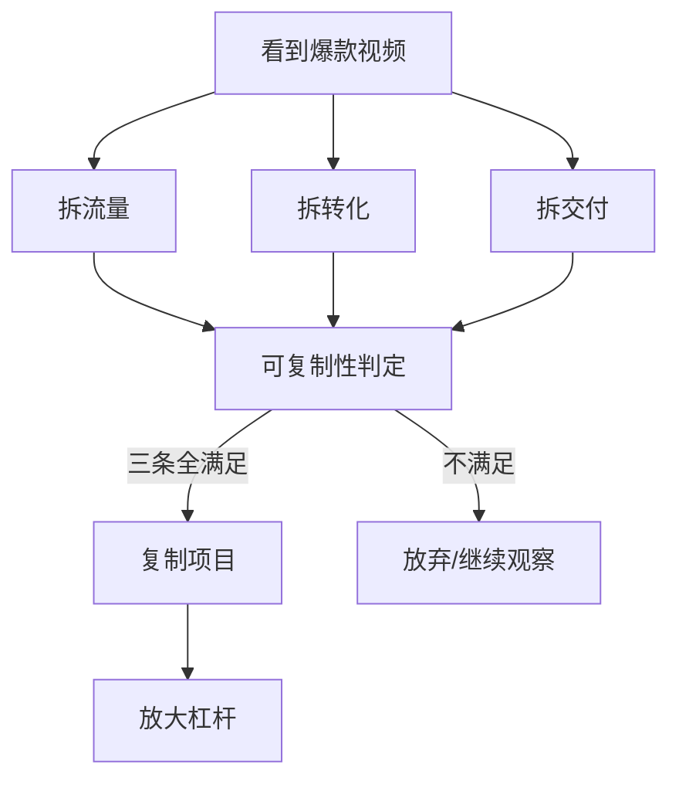
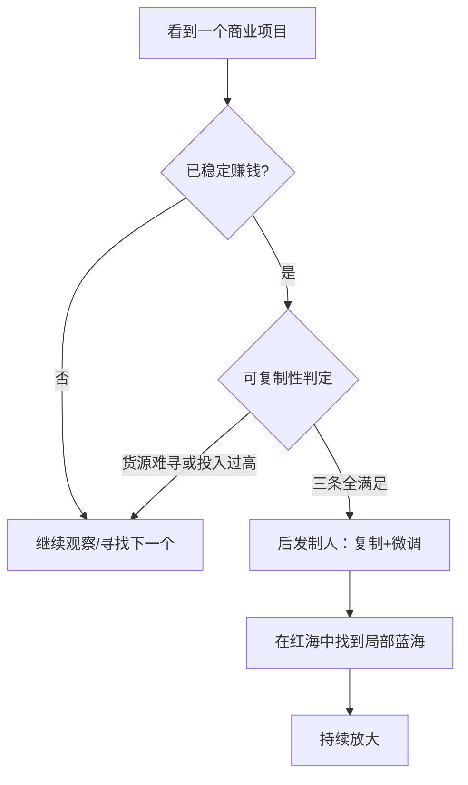

# 第 1 章 副业变现的底层逻辑 —— 从“看到”到“复制变现”

## 学习目标

- 理解从产品思维到信息差思维转变的核心逻辑
- 掌握商业项目拆解的核心公式与判定标准
- 理解信息差搬运论的底层原理与适用条件
- 认识私域前端流量作为生意第一性原理的地位
- 掌握后发制人原则并通过红海赛道案例破除心理障碍

## 1.1 生活类比

想象商业项目是一台**别人正在运转的印钞机**。**产品思维**等于闭门研发一台全新的机器，赌它能印出钱——你可能花光积蓄造出一台永远不工作的废铁。**拆解思维**则是拆开这台正在运转的印钞机，看清它的齿轮（流量）、传动（转化）、出口（交付），然后用同样的零件仿造一台。**后发制人**意味着等这台机器连续运转几个月不出故障，再照着图纸仿造一台，而不是在机器设计图还没画完时就押上全部身家。**信息差搬运**就像把东边集市卖不动的货，搬到西边缺货的集市——货物本身没变，但供需关系变了，价格自然不同。至于**红海赛道**，它是一篇挤满淘金者的河滩，看似毫无机会，但总有高手能挖到金子，因为河滩下的矿脉早已被反复验证过。就像淘金者不自己开矿，而是等别人挖出矿脉后再顺着矿脉跟进，成功的副业也从不从零发明，而是发现、拆解并复制已验证的商业模式。

## 1.2 概念地图

```
副业变现底层逻辑
├── 思维转变
│   ├── 产品思维（从零发明）  —— 高成本、高失败率
│   ├── 信息差思维（发现复制） —— 低成本、已验证
│   └── 后发制人原则 —— 等别人验证后再上桌
├── 商业项目拆解
│   ├── 核心公式：看到→拆解→复制→放大 —— P001
│   ├── 拆解三步骤：流量/转化/交付 —— P001
│   └── 可复制性判定定理 —— P001
├── 信息差搬运论
│   ├── 渠道存在信息差 —— P001
│   ├── A平台烂内容=B平台爆款 —— P001
│   └── 搬运需优化而非直接复制 —— P001
├── 私域前端流量
│   ├── 私域只是渠道并非终点 —— P001
│   ├── 前端流量是成败关键 —— P001
│   └── 流量是活水需持续引入 —— P001, P002
└── 红海赛道
    ├── 竞争激烈=需求已验证 —— P001
    ├── 红海不缺年赚几十万的人 —— P001
    └── 微调即可赚钱 —— P001
```

## 1.3 商业项目拆解 —— 把“赚钱的别人”拆成“可复制的零件”

### 为什么多数副业失败：从“产品思维”到“信息差思维”

让我们从三份素材的共同点开始。秦汉唐在复盘自己拆解过的几百个项目时，反复强调一个词——“后发制人”。而那位个人开发者则主张“软件的本质就是软文”，即先有推广、后有产品。两位实战派作者都指向同一个结论：**成功的副业不是从零发明，而是发现、拆解并复制已验证的商业模式。**

> “拆下来之后，我就发现很多时候有些项目是完全可以复制的，是不需要投入几十万也可以复制的。复制了之后，用跟他一样的内容生产方式、转化链路，你也能拿到一定的结果。”
>
> ——《I9OAdzzs2oBliNxsmPjcHnBUnzf.md》

这段话奠定了本章的核心方法论。注意其中的关键词：“**不需要投入几十万**”和“**完全可复制**”。传统创业思维把“产品创新”奉为圭臬，认为只有做出独一无二的东西才能赚钱。但秦汉唐的观点截然相反：你不需要发明，你只需要**发现**——发现别人已经验证可行的项目，然后复制其内容生产方式与转化链路。

以下表格列出两种思维模式的差异：

| 维度 | 产品思维 | 信息差思维 |
|------|---------|-----------|
| 出发点 | 从零发明新产品 | 发现已验证的商业模式 |
| 成本 | 高（研发、试错） | 低（拆解、复制） |
| 失败率 | 高（未被验证） | 低（已被验证） |
| 核心动作 | 开发 | 拆解与复制 |
| 典型心态 | “我要做一个新产品” | “我找到了一个能赚钱的模式” |

为什么“信息差思维”更优？因为**验证成本被转移了**。你不需要花几个月甚至几年去测试一个想法是否成立，你只需要观察别人是否已经靠它稳定赚钱。如果一个人连续做了三个月以上，说明钱的流水是真实的、模式是跑得通的。这就是“后发制人”的精髓——等别人把坑都踩完了，你再优雅地上桌。

### 商业项目拆解的定义与核心公式

> “通过刷抖音或者刷小红书的过程发现商业案例，再拆解复制这样的案例去形成一个商业模式，去发展自己的副业。”
>
> ——《I9OAdzzs2oBliNxsmPjcHnBUnzf.md》

**商业项目拆解**是指从爆款内容中发现可复制的商业项目，拆解其流量获取、转化链路和产品交付方式，并据此复制出类似的副业项目的过程。它的核心公式是：

$$
\text{副业变现} = \text{看到} \rightarrow \text{拆解} \rightarrow \text{复制} \rightarrow \text{放大}
$$

这个公式展示了四个递进阶段。“看到”是前提——你得先能识别出那些隐藏在日常刷视频中的商业机会；“拆解”是核心——把别人赚钱的完整过程拆成流量、转化、交付三个零件；“复制”是执行——照着他的内容生产方式和转化链路搭建自己的系统；“放大”是杠杆——通过人力、技术、资源三大杠杆将月入几千的项目变成月入几万的系统。

现在我们给出拆解的具体操作步骤。秦汉唐将其系统化为“八步法”，但其中前三步构成了本章的核心解剖刀：

> 商业项目拆解三步骤（来源：《I9OAdzzs2oBliNxsmPjcHnBUnzf.md》）

```
1. 拆流量：该账号通过什么方式引流？是固定的内容分享方式，还是投放？有没有其他引流渠道？
```

“拆流量”回答的是“**人从哪里来**”的问题。你要看清对方的流量源头：是靠每天发布固定内容吸引自然流量，还是花钱投放广告？一个账号如果只靠内容分享就能持续获得流量，说明它的内容生产方式是可复制的——你只需要照着同样的内容模板生产即可。

```
2. 拆转化：通过什么方式转化？直接在直播间内卖，还是引流到私域后通过社群转化？
```

“拆转化”回答的是“**人为什么愿意掏钱**”的问题。你要看清从流量到成交的链路：是直播间直接成交，还是先加微信再在私域里慢慢转化？转化周期是当天还是一个月？这决定了你复制时的运营节奏。

```
3. 拆交付：产品是有形还是无形？是货物、课程还是招商加盟？客单价多少？有没有同行做了半年以上？
```

“拆交付”回答的是“**你卖的是什么**”的问题。你要看清产品的形态与客单价：是实物商品需要发货，还是虚拟课程交付即完成？客单价的高低直接影响你需要的流量规模。最后问“有没有同行做了半年以上”，是为了验证可持续性——如果对方只做了两周就消失了，说明这个项目可能并不赚钱。

这三步共同构成了一套完整的解剖流程，将“正在赚钱”的商业项目分解为你可以照做的零件。下面我们通过一个具体案例，看看这套方法如何落地。

### 典型例子：儿童游乐项目

> **儿童游乐项目案例**（来源：《I9OAdzzs2oBliNxsmPjcHnBUnzf.md》）

秦汉唐在刷抖音时注意到一条商场儿童游乐（挖掘机模拟工地）的爆款视频，其数据表现如下：

```
- 点赞量：8.4w
- 转发量：1.1w
- 评论数：3000+
- 预估播放量：1000w+
```

他随即按照拆解三步骤进行分析。拆流量：该视频通过固定内容分享获得千万级播放，说明玩法本身自带传播属性；拆转化：评论区有大量咨询“怎么加盟”的留言，说明转化路径是“评论区咨询→私信→加盟”；拆交付：交付物是游乐设备的加盟权，客单价2万元，且该模式已有同行验证。

三条判定标准全部满足。于是秦汉唐组建3人团队、定制设备、双渠道引流，最终在三个月内招了40多个加盟商，实现收入约80万元（刨去成本后约赚40万）。这个案例完整展示了“看到→拆解→复制→放大”的全过程。

### 可复制性判定定理

你可能会问：是不是所有爆款视频背后的项目都值得复制？答案是否定的。秦汉唐给出了三条判定标准：

> **可复制性判定定理**（来源：《I9OAdzzs2oBliNxsmPjcHnBUnzf.md》）

$$
\text{可复制} \iff 
\begin{cases}
\text{爆得非偶然} \\
\text{货源可寻（非独家）} \\
\text{消费场景经过验证}
\end{cases}
$$

这个定理给出了三个必要条件。第一条“爆得非偶然”排除了运气因素——如果一条视频爆火纯属意外，那不构成可复制的商业模式；第二条“货源可寻”排除了独家资源壁垒——如果你找不到同样的货源，复制就无从谈起；第三条“消费场景经过验证”确认了真实需求存在。三条同时满足，项目才值得低成本复制。

这个定理在实践中特别有用。以“文川手写logo”账号为例，秦汉唐发现该账号粉丝不多，但评论区有一堆人问“怎么找你设计logo”——这说明需求已被验证（第三条满足）；设计外包给大学生，货源（设计人力）容易寻找（第二条满足）；账号持续更新、生产方式固定，并非偶然爆火（第一条满足）。于是他把交付外包给50个设计专业大学生：收客户599元，付学生200-250元，自己赚中间差价。这个案例展示了判定定理的实际应用——**只有三条全满足，复制才低成本且可行。**

### 小提示：拆解的边界

最后需要提醒你，拆解并非万能。它不适用于需要极高资金投入（如五万以上）或难以获取的独家货源项目；可复制的前提是模式已被验证持续盈利至少3个月以上。更重要的是，**拆解只能解决“从0到1”，后续的“从1到100”还依赖执行力和局部创新。**



## 1.4 信息差搬运论 —— 用“东边日出西边雨”的套利逻辑收割流量

### 为什么需要这个概念？

许多副业新手认为创业必须靠原创能力。但秦汉唐在拆解几百个项目后发现，**多数成功者都在利用平台间的信息不对称**——同一内容在不同平台的热度差异可能巨大到令人惊讶。理解搬运逻辑，能大幅降低内容生产成本、缩短启动周期，是副业项目的基本盘之一。

> “渠道其实是有信息差的，我们做过很多项目，其实吃的就是信息差，有些项目在抖音上做得很烂的，但是如果你搬到小红书上面，瞬间就爆了。有些项目在小红书上面做的人很多了，那你把同样的内容优化一下，搬到抖音上，也有可能把它做爆。”
>
> ——《I9OAdzzs2oBliNxsmPjcHnBUnzf.md》

这段话说出了信息差搬运论的核心：**渠道之间存在信息差**。内容本身的价值没有变，但平台用户画像、算法机制、竞争环境共同决定了最终的呈现效果。你在抖音上发布一条表现惨淡的内容，可能是因为该平台此内容供给已经饱和；但同样的内容搬到小红书，可能因为竞争小而“矮子里拔将军”般脱颖而出。

> **信息差搬运论**（来源：《I9OAdzzs2oBliNxsmPjcHnBUnzf.md》）

$$
\text{内容效果} = \text{内容价值} \times f(\text{平台用户}, \text{算法}, \text{竞争环境})
$$

这个公式揭示了搬运论的底层逻辑：**内容效果不是一个常量，而是内容价值与平台函数的乘积**。同样的内容，在不同平台代入不同的平台函数，得到截然不同的效果。当A平台的竞争环境趋于饱和（函数值低），而B平台的竞争环境尚有空间（函数值高），搬运就有套利空间。

但请注意，搬运绝不是“复制粘贴”那么机械。秦汉唐特意用了“优化一下”这个词——你需要根据新平台的用户习惯，调整标题、封面和语言风格。纯复制不优化，只是把烂内容换个地方继续烂。

### 典型例子：艺术签名账号

> **艺术签名账号案例**（来源：《I9OAdzzs2oBliNxsmPjcHnBUnzf.md》）

秦汉唐的团队验证了一个具体案例：在小红书上发布“设计艺术签名”的笔记，爆的概率远高于其他平台。具体操作流程如下：

```
1. 在小红书持续发布艺术签名设计的内容
2. 吸引用户评论区咨询“怎么定制”
3. 引流至微信，以9.9元/个收费
4. 使用免费素材网站完成交付
5. 每天成交几十个客户，月入小几千元
```

这个案例的关键在于**找到平台与内容的匹配点**：小红书的用户群体对个性化签名有天然兴趣，且较少有同类供给，因此同样的内容更容易获得流量。这个逻辑还可以推广：把B站深度攻略简化搬运至抖音，更容易获得年轻泛用户的点赞收藏；把抖音的短视频内容扩展成长文发到公众号，更容易获得搜索流量。

### 信息差搬运的边界

信息差搬运论不是永动机。你要注意三个关键限制：

| 限制因素 | 具体表现 |
|---------|---------|
| 平台查重 | 各平台原创保护机制日益严格，纯复制存在限流和封号风险 |
| 窗口期有限 | 信息差红利会随搬运者大量涌入而快速摊薄 |
| 用户匹配 | 搬运前需做平台用户画像匹配度评估，不可盲目跨平台 |

特别是“窗口期有限”这一点，需要你建立时间意识。当一个搬运玩法被曝光后，会有大量从业者涌入，红利窗口通常只有数周到数月。所以，**搬运不是长期战略，而是切入一个赛道的低成本起点**——你要在搬运的基础上，逐步沉淀出自己的原创能力和内容风格。


## 1.5 私域前端流量 —— 做生意的第一性原理是“水从哪里来”

### 为什么需要这个概念？

你可能见过这样的朋友：花了大量时间学习朋友圈话术、社群运营技巧、私聊转化套路，结果发现朋友圈根本没人看、也没新增好友。秦汉唐认为，这类人的失败不在转化环节，而在一个被普遍忽视的环节——**前端流量**。

> “私域只是一个渠道，是帮助我们企业更好地跟客户建立关系和发展粘性的一个渠道，其实更重要的是前端的流量，你有没有打开流量，每个月是否有稳定的流量进来。”
>
> ——《I9OAdzzs2oBliNxsmPjcHnBUnzf.md》

这段话定义了一个核心主张：**私域不是目的，只是渠道**。真正的目的，是通过私域这个渠道与客户建立长期关系。但如果没有稳定的前端流量进入私域，这个渠道就是一条干涸的河道——空有完善的沟渠，没有水。

> **私域前端流量定理**（来源：《I9OAdzzs2oBliNxsmPjcHnBUnzf.md》）

$$
\text{私域成交额} = \text{前端流量} \times \text{转化率} \times \text{客单价}
$$

这个公式展示了私域运营的完整逻辑：**成交额由前端流量、转化率和客单价三者共同决定**。多数人把精力集中在“转化率”和“客单价”上——研究话术、设计套餐，却忽视了乘法中的第一个因子“前端流量”。如果前端流量为零，后面两个因子再大，乘积也是零。

秦汉唐用一句话点破了这个误区：“**如果项目前面流量的问题没有搞定的话，都没有用！**”原因在于，转化链路和员工培训都建立在“有人进来”的前提下。没有前端流水的注入，后端一切的精细化运营都是自嗨。

### 流量是“活水”：持续引入而非一次性获取

前端流量的另一个关键性质是：**它不是一锤子买卖，而是需要持续引入的活水**。

> 流量是活水模型（来源：《I9OAdzzs2oBliNxsmPjcHnBUnzf.md》）

```
流量活水循环：
公域平台（抖音/小红书/视频号） → 内容引流 → 私域（微信/社群） → 转化成交
        ↑                                                      │
        └────────────── 持续发布内容 ← 喂养算法 ←──────────────┘
```

这个循环展示了“活水”运作机制：公域流量通过内容引入私域，转化为成交；成交的利润和反馈又支撑你持续发布内容，再从公域引入新流量。这意味着你每个月都要有稳定的新流量进来，私域才能保持活力。

如何保障稳定的前端流量？秦汉唐给出了“**喂养算法**”这一具体方法：

> **喂养算法**（来源：《I9OAdzzs2oBliNxsmPjcHnBUnzf.md》）

```
1. 每天保持2小时的商业内容泛阅读
2. 主动点赞、收藏、关注商业类内容
3. 坚持1-2个月后，算法会持续推送同类型商业内容
4. 从中发现潜在的副业项目情报
```

这个方法的核心是主动性：你不是被动接收平台推送，而是通过有意识的互动“训练”算法，让它成为你的商业雷达。秦汉唐的几百个项目拆解中，很多都是通过喂养算法刷到的。这种方法不仅解决了“前端流量从哪来”的问题，还解决了“如何发现新项目”的问题——一举两得。

### 前端流量与后端转化：缺一不可

需要注意的是，“前端流量”不等于“精准流量”。引入流量时需同时兼顾质量——没有后端转化能力的“裸流量”同样危险。私域运营的成功，依赖前端与后端的协同：前端解决“连接”，后端解决“转化”，二者缺一不可。

| 环节 | 核心任务 | 常用方法 | 失效表现 |
|------|---------|---------|---------|
| 前端流量 | 解决“人从哪里来” | 内容引流、喂养算法、付费投放 | 私域无人问津 |
| 后端转化 | 解决“为什么买” | 话术、朋友圈、社群活动 | 流量来了留不住 |

## 1.6 后发制人 —— 等别人把坑踩完，你再上桌

### 后发制人原则的定义

**“后发制人”**是你做副业时最重要的心态之一。它的核心操作非常简单，却极少有人真正坚持：

> **后发制人原则**（来源：《I9OAdzzs2oBliNxsmPjcHnBUnzf.md》）

$$
\text{项目选择} \implies 
\begin{cases}
\text{别人已经做成} \\
\text{连续做了好几个月（验证可行）} \\
\text{稳定赚钱}
\end{cases}
\implies \text{复制或二次创作}
$$

这个式子的意思是：**只有当一个项目同时满足“有人做成”“做了几个月”“稳定赚钱”三个条件时，你才选择入场**。为什么要等这么久？因为这三个条件共同排除了大部分失败风险：做成说明模式成立，做几个月说明能持续，稳定赚钱说明利润真实。

> “有一个词叫做后发制人。就是你去做别人做过的事情，将其进行复制或者二次创作。我一定是看别人已经做成了，已经做了好几个月了，我才会选择做这个项目做这个赛道。”
>
> ——《I9OAdzzs2oBliNxsmPjcHnBUnzf.md》

这段话是后发制人原则的原始出处。注意“**二次创作**”这个限定词——后发不等于照抄，你需要在复制的基础上加入自己的局部调整。这与“信息差搬运”中“优化”的思路一脉相承：完全照搬会被平台限流，也会因为没有差异化而陷入价格战。

### 后发制人的收益与代价

后发制人之所以有效，是因为它把**试错成本转移给了先行者**。新模式的坑（供应链断裂、平台规则调整、需求证伪）大多数人都踩不起，而后发者站在先行者的肩膀上，可以完全避开这些坑。但也要清醒认识到它的代价：

| 维度 | 后发者的收益 | 后发者的代价 |
|------|------------|------------|
| 验证成本 | 先行者已帮你验证需求 | 市场可能已进入红海 |
| 市场教育 | 竞争对手已教育用户 | 竞争加剧、利润下降 |
| 启动速度 | 直接复制成型模式 | 窗口期可能很短 |
| 差异化 | 可做局部微调 | 需避免陷入价格战 |

一个关键的能力要求是：**后发者需要快速评估和行动**。秦汉唐的案例中，从发现爆款视频到组建团队落地，他只用了几周时间。如果你看到一个已验证项目却拖了半年才行动，窗口期可能已经关闭。

### 红海赛道——大浪淘沙后，岸边仍有金子可捡

后发制人必然面临的质疑是：“等别人做成了再进入，这赛道早就红海了，还有机会吗？”对此，秦汉唐的回答异常坚定：

> “任何一个红海的赛道都不缺一个一年赚几十万的人，都不缺你一个一年赚几十万的人。”
>
> ——《I9OAdzzs2oBliNxsmPjcHnBUnzf.md》

> **红海赛道定理**（来源：《I9OAdzzs2oBliNxsmPjcHnBUnzf.md》）

$$
\underbrace{\text{红海赛道}}_{\text{竞争者众多}} = \underbrace{\text{需求已验证}}_{\text{市场容量大}} + \underbrace{\text{用户付费意愿已确认}}_{\text{他人已教育市场}} + \underbrace{\text{局部蓝海仍存在}}_{\text{特定平台/人群竞争尚小}}
$$

**这个公式揭示了红海的本质：竞争激烈不是坏事，是“需求被验证”的信号**。当大量同行涌入一个赛道，说明他们用真金白银验证了市场规模和用户付费意愿——这恰恰是你后发制人最需要的确定性。你不需要教育市场，只需要在红海中找到自己的局部蓝海：新平台、新人群或新场景。

秦汉唐的例子印证了这一点：阳澄湖大闸蟹电商是典型的红海，但他仍然在4个月内赚了20多万。这并非因为他有什么独家资源，而是因为“红海不缺一个年赚几十万的人”——只要需求真实存在，总有人能分到一杯羹。更重要的是，他在复盘时指出“不喜欢电商”也照样赚钱——**红海带来的需求确定性，可以弥补一定程度的个人不适**。

当然，红海也有边界条件。竞争激烈意味着利润率被压缩，你需要精细化运营才能盈利；如果没有差异化优势，容易陷入价格战泥潭。所以秦汉唐的建议是：找到一个已验证可赚的项目，确定好赛道后进行**匹配性调整**——即根据自身优势做局部微调，而不是盲目进入。



## 1.7 多源对照

### 共识

三份素材（秦汉唐的项目拆解方法论、个人开发者的产品开发哲学、以及私域运营者的流量观点）虽然在具体领域不同，但在底层逻辑上高度一致：

| 共识 | 素材支撑 |
|------|---------|
| 不做从零发明，复制已验证模式 | I9OAdzzs2oBliNxsmPjcHnBUnzf.md（后发制人）、DNGrdODFBowfk2xwkNCc5GGSnRd.md（软文先行） |
| 前端流量是成败关键 | I9OAdzzs2oBliNxsmPjcHnBUnzf.md（私域前端流量）、DNGrdODFBowfk2xwkNCc5GGSnRd.md（App下载精准过滤） |
| 内容生产要考虑平台差异 | I9OAdzzs2oBliNxsmPjcHnBUnzf.md（跨平台搬运）、DNGrdODFBowfk2xwkNCc5GGSnRd.md（下拉词发现需求） |
| 成本控制在低位，快速验证 | I9OAdzzs2oBliNxsmPjcHnBUnzf.md（拆解复制）、DNGrdODFBowfk2xwkNCc5GGSnRd.md（卖空气/预售） |

### 分歧

当然，两份素材在具体策略上存在分歧，理解这些分歧有助于你在实际应用中做出选择：

- **产品开发的起点不同**：秦汉唐认为应先拆解别人的成功能模式再复制（模式驱动），那位个人开发者却主张“先写软文反推产品，甚至不开发产品而寻找现成软件交付”（软文驱动）。前者是“看到再复制”，后者是“写到再找”——你需根据自身资源选择：有技术实力的可走前者，纯营销驱动的可走后者。

- **对“伪原创”的态度不同**：秦汉唐强调“二次创作”和“微调整”，注重在复制基础上做差异化；那位个人开发者则更激进，声称“不解决需求也不是好产品，并不影响赚钱速度”，提倡利用“安慰剂效应”。前者的路线更可持续，后者的路线需警惕长期信誉风险。

- **对前端流量的定义不同**：秦汉唐指公域平台内容引流（抖音/小红书/视频号）；那位个人开发者则认为“App的不便是精准过滤需求”的天然筛选机制。两者都强调前端重要性，但引流载体不同——你需根据目标用户的使用习惯选择。

## 1.8 设计中的取舍

### 为什么不能一味追求原创，非要“抄别人的”？

原创听起来光荣，但在副业语境下，原创=高成本+高失败率。你花三个月研发一个“全新”产品，结果发现市场根本不需要——这个试错成本对个人是毁灭性的。而“抄别人的”意味着需求已验证、模式已跑通，你只需要在细节上做微调就能开始变现。**选择后发制人，本质上是把试错成本转移给先行者，用“不追求超额利润”换取“更高的确定性”。**

### 信息差搬运能“躺赚”吗？它的核心 trade-off 是什么？

搬运论看似“躺赚”——把A平台内容搬到B平台就能爆，但trade-off在于**内容质量与合规风险**。纯搬运虽然成本极低，却面临平台查重和封号风险；优化搬运虽然更安全，却需要你投入时间分析平台用户画像、调整标题封面。更深层的trade-off是：**搬运只能作为切入手段，不能作为长期战略**。红利窗口有限，你必须在搬运期间积累出自己的原创能力和内容风格，否则平台规则一变，你的收入来源就断了。

### 前端流量靠“喂养算法”是长期策略吗？

喂养算法能帮你建立稳定的商业情报来源（持续发现新项目），但它无法直接带来用户流量。它的核心价值在于**决策支持**而非**流量供给**。真正的流量仍需靠内容引流或付费投放解决。所以，喂养算法应该是你日常习惯的一部分，而不是唯一的流量来源——两者需并行。

## 1.9 动手练习

- **拆解一个你刷到的爆款视频（练习1）**：
  打开抖音或小红书，找到一条近期数据表现好（高赞、高评论）的商业类视频：
  1. 拆流量：该账号通过什么方式引流？是固定内容分享还是投放？有没有其他引流渠道？
  2. 拆转化：通过什么方式转化？直播间直卖、引流私域社群转化、还是朋友圈+私聊？转化周期多久？
  3. 拆交付：产品是有形还是无形？是货物、课程还是招商加盟？客单价多少？有没有同行做了半年以上？
  4. 用可复制性判定定理（爆得是否偶然、货源是否可寻、消费场景是否验证）评估该项目是否可复制。
  回答问题：
  - 这个项目符合几条可复制性标准？哪条最关键？
  - 如果让你复制，你会全盘照抄还是做哪些微调？

- **验证信息差搬运论（练习2）**：
  选取一个你在抖音上见过的、表现平平的账号（粉丝少、播放低），去小红书搜索同类型内容：
  1. 记录该类型内容在两个平台的供给数量与质量差异
  2. 分析为什么同样的内容在不同平台效果差异巨大（用户画像、算法机制、竞争环境）
  3. 尝试将抖音的一条内容优化（改标题、封面、语言风格）后发到小红书，观察数据变化
  回答问题：
  - 信息差搬运的套利窗口期通常能持续多久？
  - 如何判断一个平台的内容已饱和、不适合继续搬运？

- **用后发制人原则筛选项目（练习3）**：
  列出3个你一直想做但还没开始的副业方向，对每个项目做以下评估：
  1. 是否找到同行已经稳定做了3个月以上？他们赚钱的证据是什么？
  2. 这个项目的货源/资源是否容易获取？是否需要投入5万以上资金？
  3. 你对该项目的兴趣程度如何？是否愿意投入至少半年时间？
  4. 在这个红海赛道中，你打算做什么微调来形成差异化？
  回答问题：
  - 三个项目中，哪个最符合后发制人原则？哪个最应该放弃？
  - “红海不缺年赚几十万的人”这句话在什么情况下不成立？

## 1.10 本章小结

这一章中我们学习了副业变现的底层逻辑。首先，我们从“产品思维”与“信息差思维”的对比出发，理解了为什么多数副业失败——不是因为不够努力，而是因为选择了从零发明的高成本路径。其次，我们掌握了“商业项目拆解”这一核心方法论，通过“看到→拆解→复制→放大”的公式和三步解剖刀（拆流量、拆转化、拆交付），把“赚钱的别人”拆成“可复制的零件”。接着，我们深入理解了“信息差搬运论”的底层原理——渠道之间存在信息差，A平台做烂的内容优化后搬到B平台可能瞬间爆火，本质是吃平台函数差异的红利。然后，我们确立了“私域前端流量”作为生意第一性原理的地位——私域只是渠道，前端流量是否打通才是决定成败的关键。最后，我们通过“后发制人”原则和“红海赛道”案例，破除了“害怕竞争”和“追求原创”两大心理障碍——等别人验证后再上桌，在红海中找到局部蓝海。

本章我们一起学习了以下概念：

| 概念 | 解释 |
|------|------|
| 商业项目拆解 | 从爆款内容中拆出流量、转化、交付三大环节，复制出类似副业项目的方法论 |
| 可复制性判定定理 | 爆得非偶然、货源可寻、消费场景验证有需求，三条满足即可低成本复制 |
| 信息差搬运论 | A平台做烂的内容优化后搬到B平台可能瞬间爆火，本质是吃渠道信息差红利 |
| 私域前端流量 | 私域只是渠道，前端流量是否打通才是决定成败的第一性原理 |
| 后发制人 | 不追求原创，等别人做成并稳定盈利后再复制或二次创作，换取更高确定性 |
| 红海赛道 | 竞争激烈说明需求已验证，任何红海都不缺年赚几十万的人，关键是微调适配 |
| 喂养算法 | 通过点赞、收藏、停留等行为引导平台推送商业内容，建立自己的情报来源 |
| 杠杆 | 人力、技术、资源三大杠杆可将月入3000的项目放大为月入30000的系统 |

下一章中，我们将进入“发现与筛选”环节，学习如何像猎人一样建立“项目情报库”。你会掌握三个关键技能：一是“喂养算法”以外，如何通过搜索技巧和数据监测持续获取商业情报；二是利用百度、微信、小红书等搜索框的**下拉词**，从用户真实搜索行为中“淘金”发现需求；三是系统学习**八步筛选法**，将拆解过的项目归档并按权重打分，筛选出真正值得投入的副业方向。
