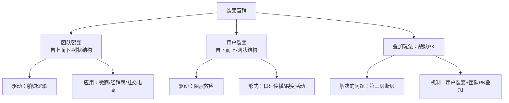

# 第 15 章 私域运营与裂变增长 —— 从“流量池”到“铁杆朋友圈”

## 学习目标

- 理解私域的本质是长远而忠诚的客户关系，而非简单的好友数量
- 掌握销售额公式（客户数×客单价×购买频次）并理解复购比拉新更重要
- 掌握个人品牌差异化身份的构建逻辑与三种借流量方法（公域引流、群红、抱大腿）
- 能对比分析团队裂变（自上而下）与用户裂变（自下而上）两种模型及其适用场景
- 了解战队PK等叠加玩法如何破解裂变断层问题

## 15.1 生活类比

想象私域运营是**经营一家精品咖啡馆**：好友数量就像每天路过的客流，再多也可能是匆匆过客，他们不会为你的生意带来稳定收入。信任度则是顾客和店主的熟络程度，熟客才会专程再来，甚至带着朋友一起来。粘性体现了顾客的复购频次，常来的老客比一次性新客贡献更大，他们才是生意的根基。个人品牌好比咖啡馆的招牌特色（如“手冲最专业的店”），让顾客慕名而来，即使周边新开了更便宜的店也依然选择你。抱大腿则类似于与知名咖啡豆供应商合作，借其名气和资源提升自己的身价，让顾客觉得“这家店用的豆子都是大牌，品质一定不错”。就像好咖啡馆靠熟客生意而非一次性游客盈利，私域运营的本质也是经营长期忠诚的客户关系，而非堆砌好友数量。

## 15.2 概念地图

```mermaid
graph TD
    A[私域的本质：长远而忠诚的客户关系 —— P001] --> B[核心主张]
    B --> B1[信任性：基于信任转化效率更高 —— P001]
    B --> B2[粘性：复购率提升 —— P001]
    B --> B3[双向性：彼此了解、互为客户 —— P001]
    A --> C[价值衡量：销售额三要素公式]
    C --> C1[客户数 × 客单价 × 购买频次 —— P001]
    C --> C2[误区：过度关注客户数 —— P001]
    C --> C3[关键：复购比拉新更重要（20%客户贡献80%利润） —— P001]
    A --> D[个人品牌（差异化身份）]
    D --> D1[定位：强化领域标签（如'营销圈里最懂投资'） —— P001]
    D --> D2[作用：带来流量 + 快速建立信任 —— P001]
    D --> D3[结论：普通人起盘最好的切入口 —— P001]
    A --> E[获客方法：借流量三法]
    E --> E1[公域平台内容引流（知识营销/内容化） —— P001]
    E --> E2[社群群红（有限竞争优于无限竞争） —— P001]
    E --> E3[抱大腿（价值交换而非金钱交换） —— P001]
    F[裂变营销] --> G[模型一：团队裂变（自上而下树状）]
    G --> G1[驱动：躺赚逻辑 —— P001]
    G --> G2[应用：微商/经销商/社交电商 —— P001]
    F --> H[模型二：用户裂变（自下而上网状）]
    H --> H1[驱动：圈层效应 —— P001]
    H --> H2[形式：口碑传播 / 裂变活动 —— P001]
    F --> I[叠加玩法：战队PK]
    I --> I1[目的：解决裂变第三层断层问题 —— P001]
    I --> I2[机制：在用户裂变上叠加团队PK —— P001]
```



概念地图展开了一幅完整的认知框架：左侧以“私域的本质”为根，生长出核心主张、价值衡量、个人品牌与获客方法四大分支；右侧则以“裂变营销”为根，延伸出团队裂变、用户裂变与叠加玩法三条路径。整幅地图的阅读顺序是从“关系经营”到“流量放大”，恰好对应了私域从 0 到 1、再从 1 到 N 的两个阶段。

## 15.3 私域的本质 —— 把“流量池”变成“朋友圈”

> “私域的本质，是长远而忠诚的客户关系！什么样的关系才能长远而忠诚？不是只有用户了解你，而是我们彼此了解！把用户当朋友，关系才能更紧密！相互彼此互为客户，更能长久。”
> 
> ——《P001，增长女黑客阿may分享》

这段话用四个感叹号强调了同一个主题：私域不是通讯录，而是**关系**。我们可以用“朋友关系”来类比：你和真正的朋友之间不是单向推销，而是互相了解、互相帮助。私域也是如此——不只是用户了解你的产品，你也要主动了解用户的需求和处境。

在传统营销中，公域流量获取成本逐年攀升，且往往是一次性买卖——用户买完就走，缺乏持续变现能力。而私域的价值恰恰在于它能**重复触达、反复成交**。用一个公式来总结私域的底层逻辑：

> **私域的本质**（来源：《P001，增长女黑客分享》）

$$
销售额 = 客户数 \times 客单价 \times 购买频次
$$

这个公式展示了销售额由三个变量共同决定，而非单一维度的“客户数”。传统思维过于关注如何增加客户数，却忽略了客单价和购买频次这两个同样重要的杠杆。购买频次反映的是客户的忠诚度和粘性，它和“客户数”“客单价”一样重要。

三个性质的拆解可以帮助我们更深入理解：

| 性质 | 含义 | 运营启示 |
|------|------|----------|
| 信任性 | 基于信任而非流量红利，转化效率更高 | 先建信任，再谈成交 |
| 粘性 | 客户与企业建立长期关系，复购率提升 | 设计复购机制，而非一锤子买卖 |
| 双向性 | 不只是用户了解企业，企业也要主动了解用户 | 深度沟通，而非单向广播 |

关于“双向性”，作者给出了一个很有说服力的数据对比：在推广生财有术时，作者公司有 4 万微信好友，但只转化了 20 人；作者个人有 3 万好友（多为私域增长从业者），却转化了 80 人——数量上公司资源更多，但成交上个人好友是公司资源的 **4 倍**。另一组数据：一位朋友只有 800 个微信好友，每月却能成交超 20 万元；另一位有 3 万好友，月成交仅 5 万元——好友数量相差近 40 倍，但成交额不足前者的四分之一。

这背后的道理其实很简单：**有信任度、有粘性的好友，远胜过泛泛之交。**

私域运营的边界条件也值得注意：如果只是把人拉进群发广告，而没有建立信任与互动，那就只是“伪私域”。好友数量再多，若没有信任关系作为基础，成交效率依然低下。

## 15.4 个人品牌 —— 普通人的差异化起盘切入口

> “所以她就要强化她在品牌营销上的标签，这样一来，她就是营销圈里最懂投资的，是投资圈里最懂品牌营销的，这就是一种差异化的身份。这种差异化的身份可以帮助到她获得流量。而且这种获得流量的方式其实是几何倍数的速度。我认为，垂直行业的专家也将会是普通人，做个人品牌最好的切入口！”
> 
> ——《P001，增长女黑客阿may分享》

这段原文提出了“差异化身份”的概念。所谓差异化身份，就是在两个领域的交叉点上找到自己的独特标签。比如“营销圈里最懂投资，投资圈里最懂品牌营销”——单看任何一个领域，你可能不是最顶尖的，但两个领域的交叉让你拥有了独一无二的位置。

为什么要强调“差异化”？因为公域平台是**无限竞争**——如果没有创新和独特定位，你很容易被淹没在人海当中。而差异化身份让你在特定标签下几乎没有竞争者，用户因为你的独特标签而记住你。

作者用自己的亲身经历佐证了这一主张：

> “我在做增长女黑客之前，我的微信好友只有区区200多人，想要去找工作，恐怕还要去招聘平台投简历，但是当我做了增长女黑客这个个人标签之后，就有很多牛人大咖开始找到我，给我介绍各种项目、资源。一方面个人品牌给我带来了流量，另一方面个人品牌也帮我在与人交往的过程中，快速建立了信任。”
> 
> ——《P001，增长女黑客阿may分享》

这说明了个人品牌的双重价值：**带来流量 + 快速建立信任**。在你还没开口推销之前，一个清晰的差异化标签已经替你完成了自我介绍和信任背书。

**个人品牌定位方法**（来源：《P001，增长女黑客分享》）

1. 列出你的核心领域和优势标签（如“营销”“投资”）
2. 找到你与同行之间的差异化交叉点（如“营销圈里最懂投资”）
3. 在内容输出和社交互动中持续强化这一标签
4. 让标签成为你的“社交身份证”，代替冗长的自我介绍

这套方法的核心是“聚焦”。不要试图成为“全能的专家”，而要在垂直领域深耕，成为“垂直行业的专家”。这正是普通人做个人品牌最好的切入口——因为越垂直，竞争者越少，越容易被记住。

## 15.5 借流量三法 —— 获取第一批客户的三种路径

> “没有流量，那就去借流量。可以去哪里借？我认为非常有效的是以下三个地方：1、去公域平台……2、去当群红……3、去抱大腿……”
> 
> ——《P001，增长女黑客阿may分享》

冷启动阶段最难的莫过于“第一批客户从哪里来”。作者给出的答案是：**借**。不是从零创造流量，而是借已有平台的流量池。以下是三种“借”的具体路径。

### 方法一：公域平台内容引流

> “现在呢，比较流行的是什么？去推广你这个产品的知识，通过知识吸引到你的精准客户。传统销售是主动销售，就是发硬广……而知识营销是被动引流，他们会把自己的营销内容化，变成‘分享’、变成‘硬核干货’。”
> 
> ——《P001，增长女黑客阿may分享》

公域引流的核心理念是**知识营销**：不是直接卖产品，而是通过分享与产品相关的知识，吸引精准客户主动找上门。尤其适合需要长时间决策的高客单价产品。

作者给出了一个数据案例：

> “我有些文章，发布到自己的公众号，只有一两千的阅读，但是发布到人人都是产品经理的网站上，却有几万的阅读，而我在那里发布内容，其实很简单，就是把我公众号的内容，复制过去，稍微修改一下即可。”
> 
> ——《P001，增长女黑客阿may分享》

同样的内容，不同平台带来的阅读量差异巨大。这说明**平台的流量池比内容本身更重要**——找到自带流量的公域平台，把内容“搬”过去，就能获得杠杆效应。

```
公域引流操作步骤：
1. 确定目标公域平台（视频号、公众号、知乎、小红书、人人都是产品经理等）
2. 将内容转化为多种形式（图文、音频、视频、图片）
3. 按平台特性微调内容格式和表达方式
4. 持续发布，积累平台的算法推荐权重
```

### 方法二：社群“群红” —— 有限竞争的突围

> “我认为，普通人做个人IP最好的起盘方式，不是去做抖音、小红书、知乎、公众号等，而是扎扎实实地做好社群的群红。社群的群红是有限竞争！不要一开始就把自己定位要去做‘网红’，而是想办法让自己变成‘群红’！”
> 
> ——《P001，增长女黑客阿may分享》

“群红”是作者提出的一个原创概念，它的核心洞察是：

| 对比维度 | 网红（公域） | 群红（社群） |
|----------|--------------|--------------|
| 竞争环境 | 无限竞争（算法筛选） | 有限竞争（几十到几千人） |
| 出圈难度 | 极高，容易被淹没 | 较低，容易展示特点 |
| 信任建立 | 慢，需持续内容输出 | 快，社群互动更直接 |
| 可复制性 | 低，依赖平台算法 | 高，可重复操作 |

为什么群红更适合普通人？因为在公域平台，你面对的是算法推荐下的无限竞争——没有创新，就容易被赶超、被淹没。但在一个几百人的社群里，竞争是有限的，你的特点容易被看到，信任能够在互动中快速建立。

实际操作路径是：找到与你目标人群匹配的垂直社群 → 在群内展示专业能力和差异化标签 → 通过持续输出价值建立信任 → 获得铁杆粉丝。

但这里有一个前提：**目标人群要足够细分**。

> “这里面最大的问题，其实出在自己根本不知道目标客户是谁……当细分到素描、吉他这一层时，你就会发现，再去寻找这样的社群，就容易多了！明确目标人群，是做销售、做推广的前提！”
> 
> ——《P001，增长女黑客阿may分享》

如果目标人群定位太泛（比如“艺术爱好者”“音乐爱好者”），你是找不到对应社群的——没有人会用这么宽泛的名字命名社群。需要将目标人群不断细分（如艺术→绘画→素描、油画；音乐→钢琴→吉他），细分到具体的关键词，才能找到精准社群。

### 方法三：抱大腿 —— 价值交换的借势逻辑

> “抱大腿不能靠钱去换，因为大腿不缺钱……那么，靠什么去交换呢？你要去创造资源、创造价值！对于普通人的我们来说，练好一身本领，就是最好的方式！只要你有价值，‘大腿’也会自然主动来结识你的。”
> 
> ——《P001，增长女黑客阿may分享》

抱大腿的本质不是金钱交换，而是**价值交换**。大腿不缺钱，缺的是真正能创造价值的人。因此抱大腿有两个层面：一是抱行业的大腿（站对风口），二是抱行业里有影响力的人的大腿（找准贵人）。

对于普通人，最好的抱大腿方式是：**练好一身本领**。当你有了核心能力，你就不再是“求人帮忙”的弱者，而是有资格与大腿进行价值交换的伙伴。

> “正所谓‘你不牛逼，认识再多牛逼的人也与你无关’，抱大腿一定要提供可交换的价值。”
> 
> ——《P001，增长女黑客阿may分享》

作者分享了一个反直觉的结论：当你真正有了价值之后，不是你去抱大腿，而是大腿会主动来结识你。这与个人品牌打造的逻辑完全一致——先让自己值钱，再谈链接贵人。

## 15.6 裂变营销 —— 从“拉新”到“指数增长”

> “在做裂变营销活动过程中，最重要的是有多少用户真正去行动帮你去做分享。因为大部分裂变营销活动策划者策划的活动之所以效果不好，往往最大的原因是在于，只有激发层的用户愿意分享，到了第三层裂变层，就断层了。因此就根本裂变不动！”
> 
> ——《P001，增长女黑客阿may分享》

当私域有了第一批用户后，如何快速放大？答案是**裂变**。但绝大多数裂变活动的失败，不是因为奖品不够好，而是裂变在第三层就断裂了——只有最初被激发的用户愿意分享，更外层的用户不再行动。要理解为什么，我们需要先了解裂变的两种基本模型。



### 模型一：团队裂变（自上而下，树状结构）

> “第一种是团队裂变，这是一种自上而下的裂变模型……这个模型，是有明确清晰的上下级推荐关系的，常见的微商团队、经销商网络、社交电商等玩法，就是靠这种模型搭建起来的。这种模型吸引人们参与的核心关键点，就是诱饵足够大：躺赚逻辑！只要设计好机制，保障终端能卖得出去货，靠这种模型，的确可以快速裂变。”
> 
> ——《P001，增长女黑客阿may分享》

团队裂变的核心是**上下级关系**和**躺赚逻辑**。你邀请的人越多，你的层级越高，你从下级收益中获得的分成也越多。这是一个典型的“先到先得”模型——加入早、层级高的人具有先发优势。

这种模型适合微商团队、经销商网络、社交电商等场景，关键在于设计好激励机制，让终端能卖得出去货，否则整个金字塔就会崩塌。

### 模型二：用户裂变（自下而上，网状结构）

> “第二种是用户裂变，这是一种自下而上的裂变模型。用户与用户之间是社交网络的状态，ABCD之间有可能相互认识的，彼此关系是网状结构，不是树状结构。用户裂变讲究的就是圈层效应，所以一般都是针对不同人群去设计不同的裂变玩法。口碑传播，就是用户没有基于任何利益诱惑的前提下，就愿意帮你分享和传播！还可以用到的一种裂变形式，那就是举办裂变营销活动，通过利益诱饵的方式，促进我们的员工/渠道/老顾客帮我们分享。”
> 
> ——《P001，增长女黑客阿may分享》

用户裂变的驱动力不是躺赚逻辑，而是**圈层效应**——用户因为自己的社交圈子而分享。这种裂变有两种形式：

1. **口碑传播**：用户没有利益诱惑，纯粹因为产品好而主动分享
2. **裂变营销活动**：通过利益诱饵，促进员工、渠道、老顾客帮你分享

两种模型的关键差异可以总结为：

| 对比维度 | 团队裂变 | 用户裂变 |
|----------|----------|----------|
| 结构 | 自上而下，树状 | 自下而上，网状 |
| 驱动 | 躺赚逻辑 | 圈层效应 |
| 关系 | 上下级，明确推荐关系 | 平等社交关系，相互认识 |
| 适用 | 微商/经销商/社交电商 | 口碑传播/裂变营销活动 |
| 风险 | 终端卖不出去货 | 第三层断层 |

### 叠加玩法：战队PK —— 破解裂变断层

> “我们会在用户裂变的营销活动玩法的基础上，还会叠加一层‘团队裂变’的玩法，这种玩法我们称之为‘战队PK’的玩法，也就是组织中的动销系统。”
> 
> ——《P001，增长女黑客阿may分享》

单纯依赖用户裂变时，只有激发层的用户愿意分享，到了第三层裂变层就断掉了。战队PK的核心思路是：在用户裂变的基础上，叠加一层“团队裂变”，通过团队间的竞争机制**促使更多用户产生持续分享行动**。

```
战队PK玩法机制：
1. 将参与裂变的用户随机或按特征分为多个战队
2. 设定PK指标（如邀请人数、成交额、分享次数）
3. 加入排名机制和竞争奖励
4. 团队内部形成“躺赚”激励（队长受益于队员业绩）
5. 通过竞争压力和团队归属感，推动用户持续分享
```

最终效果如何？作者给出了一组硬核数据：

> “通过活动裂变+战队PK裂变的方式，我们实现了3天内裂变近6000个用户参加线下活动，加上主办方的助推，最终活动报名人数累积1.8万人，到展会现场的有4000人，由于活动过于火爆，展会进行途中警察赶到现场维护秩序，还有1万人只能在场外听分享；在展会现场，我们通过精准洞察在场用户需求，我们一小时引流用户5000多人，还使用了冲榜裂变+群裂变的玩法吸引到1000多位新用户进入私域流量池。”
> 
> ——《P001，增长女黑客阿may分享》

3天裂变近 6000 人、最终报名 1.8 万人、现场 4000 人火爆到警察维护秩序——这是叠加战队PK玩法的真实效果。值得注意的是，即便是如此成功的裂变活动，也仍然需要“主办方助推”才能达到 1.8 万人的规模，这说明**裂变的放大效应需要强有力的机制保障**，而不是靠自然传播。

## 15.7 多源对照

本章的所有核心概念均来源于同一篇素材（P001，增长女黑客阿may的分享），因此不存在跨素材的分歧。但有两个概念的内部张力值得注意：

### 共识

- **私域的本质是关系而非数量**：无论是“有信任度、有粘性的好友远胜过泛泛之交”，还是“销售额=客户数×客单价×购买频次”的公式强调购买频次，都指向同一个结论——质量重于数量。
- **裂变的核心是行动而非奖品**：裂变活动能否成功，取决于有多少用户真正去分享，奖品只是诱因，不是驱动力。
- **借势而非造势**：公域引流、群红、抱大腿三个方法共同的前提是——普通人不应该从零创造流量，而应该“借”已有平台的流量池。

### 分歧

- **团队裂变 vs 用户裂变的选择**：素材提出了两种模型，但并未给出明确的“何时选哪种”的决策标准。从案例来看，“躺赚逻辑”更适合有清晰产品体系和渠道网络的场景（微商、经销商），而“圈层效应”更适合产品本身具备社交货币属性的场景（口碑传播、裂变活动）。
- **增量的边界**：战队PK案例中 1.8 万人的成绩包含了“主办方助推”的成分，这暗示裂变活动的大规模成功可能依赖于既有的渠道和资源，而非纯靠机制驱动。对于从零起步的个人，裂变效果可能远低于案例数字。

## 15.8 设计中的取舍

- **为什么不用“买流量”的方式做冷启动？**

很多人的第一反应是“没有流量就去买”。但在冷启动阶段，你还没有验证产品是否真的有市场需求，贸然投钱买流量是高风险行为。相比之下，借流量三法（公域引流、群红、抱大腿）的核心优势在于**低成本试错**——你不花一分钱，甚至还能在过程中积累内容和信任资产。买流量解决了“看到”的问题，但解决不了“信任”的问题；而私域的本质恰恰是信任。

- **为什么“群红”比“网红”更适合普通人？**

做“网红”意味着进入无限竞争的算法擂台，你的内容要与全网创作者比拼。而“群红”只需要在一个几百人的社群里脱颖而出。前者的成功概率可能不到万分之一，后者只要你的专业能力过硬，几乎必然能建立信任。代价是——群红的流量天花板有限，你需要在多个社群中复制才能放大；网红一旦爆款，流量是几何级数的。

- **为什么“抱大腿”是价值交换而非金钱交换？**

大腿不缺钱，他们缺的是能解决问题的人。如果你用钱去换，你只是众多“付费客户”中的一个；但如果你用能力去换，你就成了大腿的“伙伴”。这个取舍的本质是：**你愿意投入时间练本事，还是花钱买捷径？**前者慢但复利，后者快但一次性。

- **团队裂变和用户裂变的取舍是什么？**

团队裂变的优势是裂变速度快、结构清晰、激励明确（躺赚），但风险是如果终端卖不出去货，整个金字塔会迅速崩塌。用户裂变的优势是更持久、更健康（基于口碑和圈层效应），但容易在第三层断层。最优雅的方案是**叠加**——像战队PK一样，在用户裂变上叠加团队裂变的竞争机制，既保持圈层效应的传播力，又通过竞争压力推动持续分享。

## 15.9 动手练习

1. **拆解你的“私域好友资产”**
   - 以你自己的微信好友为例（或假设的典型账号），完成以下评估：
   - 1. 列出你的好友总数，并按“泛泛之交”和“有信任度/粘性”两个维度粗略分类，估算各自占比
   - 2. 用销售额公式（客户数×客单价×购买频次）分析：如果你要变现，最应该提升哪个变量？为什么？
   - 3. 给自己设计一个“差异化身份”标签（如“健身圈里最懂营养学的”），并写出这个标签如何为你带来流量和信任
   - 回答问题：
     - 为什么800个高粘性好友的成交能超过3万个泛泛之交？
     - 你身边或你关注的人中，有谁是靠“群红”而非“网红”起盘的？

2. **设计一场“战队PK”裂变活动**
   - 假设你运营一个私域社群（约200人），要在3天内通过“战队PK”玩法提升分享转化：
   - 1. 设计你的裂变诱饵：什么奖品/权益能激励用户分享？分什么层级（邀请1人/3人/10人）？
   - 2. 画出你的裂变模型：说明你的设计是“用户裂变叠加团队裂变”中的哪一层，并标出激发层、裂变层分别是谁
   - 3. 设计战队PK机制：如何分组？PK指标是什么（邀请人数/成交额）？奖品如何分配（躺赚逻辑是否适用）？
   - 回答问题：
     - 为什么单纯的“用户裂变”容易在第三层断层？你的设计如何避免？
     - 团队裂变的“躺赚逻辑”在什么情况下会失效？

3. **搭建你的“抱大腿”价值交换方案**
   - 选择一个你所在行业（或想进入的行业）里的一位“大腿”（有影响力的人或平台），制定一份借势方案：
   - 1. 明确你的“差异化价值”：你能为这位大腿提供什么独有资源或能力？（注意：不是钱，而是可交换的价值）
   - 2. 设计“练好一身本领”的具体计划：你需要掌握什么技能/积累什么资源，才能让大腿主动找你？
   - 3. 规划“链接路径”：除了直接找到他，还有哪些间接渠道（如通过其社群、课程、活动）可以建立联系？
   - 回答问题：
     - 为什么“抱大腿不能靠钱去换”？其底层逻辑是什么？
     - 结合“群红”概念，如何先在社群中建立自己的小影响力，再向大腿借势？

4. **公域引流与私域承接的落地模拟**
   - 假设你要做“高客单价健身私教”的冷启动，运用“借流量三法”设计完整方案：
   - 1. 公域引流：选择1个平台（如小红书），设计3个能吸引精准客户的“知识营销”内容选题（结合你的差异化身份）
   - 2. 群红路径：找到2个目标人群（如“健身爱好者”细分社群），设计你在群内的“自我介绍+价值展示”话术
   - 3. 承接闭环：流量进入私域后，如何用销售额公式设计首个成交动作？（如通过咨询诊断提升客单价）
   - 回答问题：
     - 如何判断你的目标人群是否细分到位（能否找到对应社群）？
     - 对比“网红”和“群红”两条路径，哪条更适合你的产品？为什么？

## 15.10 本章小结

这一章中我们系统地学习了私域运营与裂变增长的完整方法论。首先理解私域的本质不是好友数量，而是长远而忠诚的客户关系，信任性、粘性和双向性是它的三大核心性质。其次掌握销售额三要素公式（客户数×客单价×购买频次），明白了复购比拉新更重要。接着学习了个人品牌作为差异化身份的构建逻辑——在领域交叉点找到独特标签，从而获得流量与信任的双重杠杆。然后深入拆解了借流量三法的具体操作路径：公域平台内容引流、社群“群红”和抱大腿的价值交换逻辑。最后对比分析了团队裂变（自上而下、躺赚逻辑）与用户裂变（自下而上、圈层效应）两种模型，以及战队PK叠加玩法如何破解裂变第三层断层的难题。

本章我们一起学习了以下概念：

| 概念 | 解释 |
|------|------|
| 私域的本质 | 长远而忠诚的客户关系，而非简单的好友列表 |
| 销售额三要素公式 | 客户数、客单价、购买频次的乘积，复购比拉新更重要 |
| 个人品牌（差异化身份） | 强化领域标签获得流量与信任，是普通人起盘最好的切入口 |
| 借流量三法 | 公域内容引流、社群群红、抱大腿，是获取第一批客户的三种路径 |
| 群红 | 在有限竞争的社群中建立信任和铁杆粉丝，优于公域的无限竞争 |
| 抱大腿 | 通过与行业/牛人链接借势，本质是创造可交换的价值而非金钱交换 |
| 团队裂变 | 自上而下、有明确上下级关系的树状模型，靠躺赚逻辑驱动 |
| 用户裂变 | 自下而上、用户间呈网络关系的网状模型，讲究圈层效应 |
| 战队PK | 在用户裂变上叠加团队PK的玩法，解决裂变第三层断层问题 |

下一章中，我们将学习高效社群运营的方法论，从“消耗自己”到“三方共赢”——你将学会如何通过利益一致性设计、复用时间的交付策略和激发学员主动性的责任分配，构建一个能自动运转、多方受益的社群生态。
