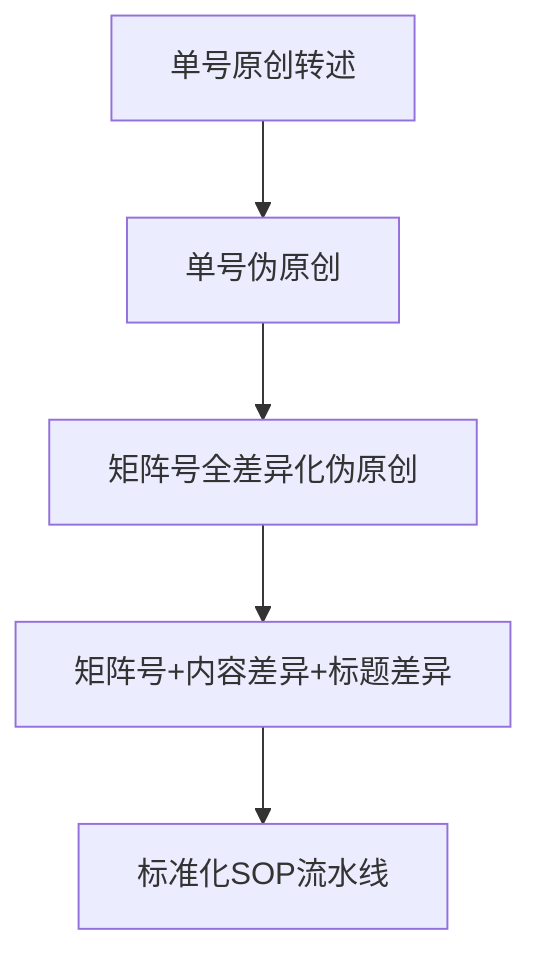
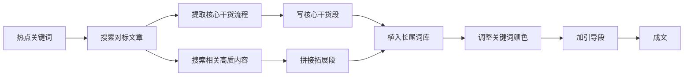
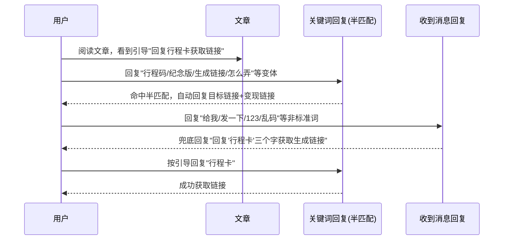

# 第 30 章 公众号热点收割：从“水流湍急处下网”到“系统化印钞机”

## 学习目标

- 理解搜索流量追热点的底层逻辑：为何主动布局长尾词优于被动等待推荐
- 掌握批量做号矩阵的操作要点：内容差异化、标题差异化与账号有效率的关系
- 熟练运用长尾关键词获取三法：微信下拉词、相关搜索、5118工具的组合拳打法
- 掌握迎合算法的爆款文章撰写法：字数控制、伪原创整合、关键词隐形植入
- 掌握爆款标题双法：关键词组合原创与爆款标题伪原创的适用场景判断
- 搭建流量承接双模块：半匹配关键词回复与收到消息回复的组合配置
- 理解手动文中广告位设计原理：利用用户肌肉记忆与平台推荐机制提升单价
- 掌握自动回复CTA承接CPS/CPA的落地操作：蓝字链接、多链接叠加与转化路径设计
- 认清泛粉与洗粉的商业边界：泛粉价值密度低、取关率高，需匹配淘宝客或筛选转化路径
- 建立热点决策与前置能力模型：快速判断模型、经验复用机制、矩阵兜底止损

## 30.1 生活类比

想象热点追踪是在**水流湍急的河流中下网捕鱼**：**热点事件** = 季节性洪峰，鱼群（用户搜索需求）集中爆发、来去匆匆；**搜索长尾词** = 网眼大小与位置的精心设计，只捞精准鱼群不捞杂草；**批量矩阵号** = 在河流不同支流同时撒下多张网（12张），单网收获不确定但群体确定性高；**伪原创文章** = 快速编织的网具，不求精美耐用，只求在洪峰期‘能用、耐冲、过检’；**手动文中广告** = 网口设置的‘诱饵陷阱’，利用鱼群冲势（用户急于获取链接的肌肉记忆）误入广告位；**自动回复CTA** = 收网时的分拣台：蓝字链接把高价值鱼（付费意向）分流到CPS/CPA箩筐；**泛粉与洗粉** = 捕获的大量杂鱼（泛流量粉丝），多数只能制成鱼露（淘宝客低价变现），少量经筛选养大（洗粉入私域）。就像老渔夫懂得‘在水流湍急处下网、多网齐撒、网眼适配鱼群、收网快速分拣’，热点收割也是‘主动布局、矩阵对冲、算法迎合、即时变现’的系统工程。

## 30.2 概念地图

公众号热点收割方法论
├── 流量获取层
│   ├── 搜索流量追热点  —— U01
│   ├── 批量做号矩阵  —— U02
│   └── 长尾关键词获取三法  —— U03
├── 内容生产层
│   ├── 爆款文章撰写法  —— U04
│   └── 爆款标题双法  —— U05
├── 流量承接层
│   ├── 流量承接双模块  —— U06
│   └── 半匹配关键词回复  —— U06
├── 变现设计层
│   ├── 手动文中广告位  —— U07
│   ├── 自动回复CTA承接CPS/CPA  —— U08
│   └── 泛粉与洗粉  —— U09
└── 决策与能力层
    ├── 热点决策与前置能力  —— U10
    └── 经验复用与止损机制  —— U10

## 30.3 搜索流量追热点 —— 在水流湍急的地方下网

> "我们做的是搜索流量，那相关的搜索长尾词、搜索下拉框词语都可以放进来。文章被收录之后，读者搜索相关长尾词会搜到我们这篇文章。"
> 
> ——《火火：行程码下线热点复盘》

这段话揭示了本章的核心范式转移：**不再坐等平台推荐，而是主动去“搜一搜”里拦截流量**。当“行程码下线”这类全民热点爆发时，用户会第一时间搜索“纪念版怎么生成”“截图怎么保存”，而推荐算法分发需要时间、且不确定。你如果在文章正文里提前埋好这些长尾词，文章被收录后，就是用户搜什么、看到什么——这是一种**确定性极强的主动获客逻辑**。

**搜索流量追热点**的核心定义可以概括为：

> **定义**：在突发热点事件发生后，迅速产出文章，在正文（而非标题）中大量铺设热点相关的搜索长尾词、下拉词，利用微信“搜一搜”收录机制，在用户搜索热点关键词时获得精准展现，实现流量的主动拦截与即时变现。

**关键性质**：

- **时效性强**：热点生命周期通常仅 24-48 小时，决策与产出必须极速完成
- **低门槛**：不依赖粉丝基数，新号、小号均可通过搜索流量冷启动
- **可批量化**：通过矩阵号放大收录概率，单号上限低但群体确定性高
- **非粉丝流量**：以泛流量为主，粉丝粘性低、取关率高（实测超 50%）

**典型例子**：2022年12月14日“行程码下线”热点，作者用 12 个号发 96 篇文，9 个号有效，净增 4.5 万粉，流量主收入 6514 元。这验证了“搜索流量+批量矩阵”在短期收割上的威力。

**边界条件**：

- 仅适用于全民关注度高、搜索需求明确的突发性热点（政策变更、节日、重大社会事件）
- 依赖微信搜一搜算法规则，平台若收紧收录或打击关键词堆砌即失效
- 泛粉商业价值密度低，需配合“洗粉”或淘宝客等二次变现手段
- 需前置积累：对标体验能力、伪原创写作速度、多账号管理 SOP

---

## 30.4 批量做号矩阵 —— 用概率思维对抗算法不确定性

> "总共用12个公众号批量操作来追这个热点，其中3个公众号发文没有上排名没有流量，不统计数据。要注意的一点是我96篇文章，每一篇内容都不一样；并且标题都不一样；这样做能够更好的增加被公众号系统收录的概率。"
> 
> ——《火火：行程码下线热点复盘》

这段复盘直接给出了矩阵策略的**实战数据支撑**：12 个号，3 个无流量，**有效率 75%**。这不是运气，是概率思维的工程化应用。单个账号能否被收录、上排名，受账号权重、历史违规、当下算法抖动等多重不可控因素影响；但把“账号数 × 篇数 × 差异度”三维拉满，群体层面的命中率就变得可控。

**批量做号矩阵**的核心定义：

> **定义**：同时运营多个同类型公众号（实战中为 12 个），同一热点下每个号发多篇（8 篇）内容完全不同、标题完全不同的文章，通过“账号数 × 篇数 × 差异化”三维组合，最大化被搜一搜收录与排名的概率。

**关键性质**：

- **差异化是核心**：内容、标题必须全不同，否则触发平台去重判定为刷量
- **成本结构**：账号获取成本低（闲置号/小号），边际产出递增
- **有效率约 75%**：实测 12 个号中 9 个上排名，3 个无流量，符合二八定律
- **运营复杂度可控**：通过标准化 SOP（对标→写文→起标题→设后台）实现流水线化

**方法演进图**：



**典型例子**：行程码热点复盘中，12 号矩阵、9 号有效、单日净增 4.5 万粉。特别注意：**单号追热点建议原创转述；矩阵号追热点必须全差异化**，两种模式互不通用。

**边界条件**：

- 账号质量参差不齐，部分号可能因历史违规被限流、不收录
- 需解决多账号登录、内容分发、数据聚合的工程化协同问题
- 平台若升级“同主体关联账号”打击策略，矩阵优势将大幅削弱
- 仅适合短期收割型玩法，不利于长期 IP 资产沉淀

---

## 30.5 长尾关键词获取三法 —— 从用户搜索框里“淘金”

> "1、微信搜一搜下拉词：打开微信搜一搜，输入关键词，会有对应的下拉词弹出；把这些下拉词全部放入文章中。2、微信搜索栏中的相关搜索：这里的相关搜索是根据你搜索的关键词来展示，也是其他用户在搜索时经常用到的词语。3、5118网站查询长尾词：5118网站有个查询长尾词功能，用这个功能查找相关长尾词。"
> 
> ——《火火：行程码下线热点复盘》

这是全章最**可标准化、最零成本**的工具方法论。三大渠道各司其职，互补覆盖用户搜索意图的全谱系：

**长尾关键词获取三法**：

| 方法 | 数据来源 | 反映意图 | 操作成本 | 适用阶段 |
|------|----------|----------|----------|----------|
| 微信下拉词 | 微信搜一搜实时补全 | 当下最真实、最高频的搜索意图 | 零成本、秒级 | 热点爆发初期 |
| 相关搜索 | 微信搜索结果页底部 | 延展、关联、长尾需求 | 零成本、秒级 | 热点持续期 |
| 5118 长尾词 | 第三方数据库聚合 | 历史积累、挖掘极长尾词 | 免费额度/会员 | 深度挖掘、补全词库 |

**关键性质**：

- **实时性**：下拉词随热点演变动态变化，捕捉的是“此刻”的用户语言
- **互补性**：下拉词覆盖核心变体，相关搜索覆盖延展需求，5118 覆盖长尾数据库
- **可标准化**：三步操作固化为 SOP，新手可在 10 分钟内完成一个热点的词库搭建

**典型例子**：行程码热点中，下拉词含“纪念版生成链接”“截图保存”“电子版”；相关搜索含“如何获取”“查询入口”；5118 挖出“行程卡纪念版生成器”“行程码截图生成”等高精准长尾词，均植入文章正文。

**边界条件**：

- 仅适用于微信生态内搜索流量，不适用于抖音、小红书等平台算法
- 热点衰退后长尾词搜索量迅速归零，词库无复用价值
- 关键词堆砌过度会被判定违规，需控制密度、调整颜色隐形植入

---

## 30.6 爆款文章撰写法 —— 迎合算法而非文笔

> "追热点文章不是需要文笔写的多好，内容迎合平台算法喜好能被收录就行。我写追热点文章的时候，我会有意识的把文章内容写到七八百字左右；让文章更加容易被公众号收录，也能符合公众号在文中添加广告的要求。为了阅读体验感好一些，我在文章中就把这些关键词的颜色调暗淡一些。我第一部分内容先写了如何获取行程卡纪念版生成链接，第二部分内容是在公众号平台/百度平台搜索行程码，把其他相关的文章内容复制加入到后面半段；凑够八百字并且读的还流畅就行。"
> 
> ——《火火：行程码下线热点复盘》

这是**反直觉**但极其务实的写作范式：在热点收割赛道，**文笔是负资产，结构才是生产力**。平台算法偏好特定结构（字数达标、原创度过线、关键词覆盖、广告位预留、有互动引导），我们只需按图纸造房子。

**爆款文章撰写法**的核心定义：

> **定义**：围绕“迎合算法而非文笔”原则写文，要点包括：字数卡在 700-800 字（满足文中广告门槛）；伪原创整合法（第一段核心干货+后段拼接凑字数）；关键词隐形植入（颜色调暗淡）；结构模板化（核心流程+相关拓展+引导关注/回复）。

**公式化结构模板**：

```
文章 = 核心干货段（200-300字，解决用户最急问题） 
     + 拼接拓展段（300-400字，搜同词高质内容拼接凑字数） 
     + 引导转化段（100字，关注/回复/点广告引导）
```

**关键性质**：

- **产出极快**：熟手可在 20 分钟内产出一篇合格文章
- **算法友好**：字数达标、关键词覆盖、结构完整、有互动引导
- **可批量复制**：核心干货段固定，拼接段可换源，标题换词，形成流水线

**数据流图**：



**典型例子**：行程码文章：第一段教生成纪念版链接，第二段拼接公众号/百度搜到的相关介绍，全文 800 字，关键词暗色植入。

**边界条件**：

- 长期账号若长期发此类低质拼接文，会降低账号权重、掉粉、甚至被限流
- 仅适用于“追热点”这类短平快项目，不适用于个人 IP、深度内容账号
- 依赖平台当前算法偏好，微信若升级原创识别或打击拼接内容即失效

---

## 30.7 爆款标题双法 —— 原创度与吸睛度的动态平衡

> "方法1：提取关键词自己原创：把排名在前面阅读量比较好的文章标题全部copy下来当参考，找到共同的关键词...火爆全网、免费获取；然后再加上关键词个人行程卡。方法2：找爆款标题伪原创：我搜对应关键词，直接把排名在前面的文章标题复制下来，轻微改动；但不能全部一样。标题更改的原理是在于原创性以及吸引眼球，原创度有助于算法收录文章，吸引眼球有助于读者搜索到第一栏点击进去阅读。"
> 
> ——《火火：行程码下线热点复盘》

标题是搜索结果页的**唯一入口**，决定点击率（CTR）。完全原创容易不含热词、不被搜；完全复制被判重、不收录。这双法就是在“原创度助收录”与“热词助排名、吸睛助点击”之间走钢丝。

**爆款标题双法**：

**方法一·关键词组合原创（矩阵号首选）**  
提取排名靠前文章标题中的高频热词（如“火爆全网”“免费获取”“教程”“生成”“下载”），重新组合生成新标题。  
*产出示例*：《行程卡纪念版火爆全网，免费获取生成链接教程》

**方法二·爆款标题伪原创（单号首选）**  
直接复制爆款标题，微调语序、增减词、换符号，保持核心关键词不变。  
*产出示例*：《行程码下线！纪念版生成入口免费获取（附教程）》

**选择原则**：矩阵号用方法一保差异化；单号用方法二蹭精准流量。

**关键性质**：

- 双重目标：原创度助收录，热词助排名，吸睛助点击
- 可批量化：建立热词库（火爆全网、免费、教程、生成、下载等），套用模板生成
- 实测有效：两种方法产出的标题在实战中均获得大量搜索展现

**边界条件**：

- 标题党过度会被平台打击（如夸大、诱导、与内容不符）
- 热词生命周期极短，今日热词明日即废，需实时提取
- 矩阵号间标题若重复，会触发关联判定，导致整体降权

---

## 30.8 流量承接双模块 —— 关键词回复+收到消息回复的组合拳

> "模块1：设置关键词回复承接住流量：我们设置好的流程是粉丝关注公众号之后，回复关键词，公众号自动回复行程码生成链接。关键词回复有一个半匹配功能，意思就是读者回复半匹配中任意一个词语，公众号后台都会自动回复对应链接。模块2：设置收到消息回复减少举报率：我还在收到消息回复这里也设置了文案，这里的作用是让读者不管回复什么消息，都能看到这句话；知道回复哪几个字才能拿到链接。这里其实起到了一点作用啊，就是减少粉丝举报的概率。"
> 
> ——《火火：行程码下线热点复盘》

公众号文章内链接不生效，**必须引导用户回关键词触发自动回复**。但用户回复极不规范：错别字“行程卡/行程码”、简写“卡/码”、语气词“给我/发一下/要链接”。全匹配会漏掉大量流量，半匹配就是为此而生。

**流量承接双模块**的核心定义：

> **定义**：模块一·关键词回复（半匹配模式）：设置核心词“行程卡”，半匹配词库覆盖“行程码”“纪念版”“生成链接”“怎么弄”等高频变体，任意命中即回复目标链接。模块二·收到消息回复：兜底引导语“回复‘行程卡’三个字获取生成链接”，覆盖所有未命中关键词的用户，降低举报率。

**关键性质**：

- **半匹配是核心增量**：实测大量用户回复非标准词，半匹配挽回超 30% 流量
- **兜底引导降举报**：用户不知回复什么时收到提示，而非陷入死循环
- **双模块互补**：关键词回复高效分发，收到消息回复托底体验

**时序图**：



**典型例子**：行程码案例：核心词“行程卡”，半匹配词 10+ 个，自动回复含纪念版生成链接+电话卡 CPS 链接+外卖群 CPA 链接。

**边界条件**：

- 仅适用于订阅号/服务号自动回复功能，不适用于小程序、视频号等其他载体
- 半匹配词库需基于历史数据持续维护，新热点新词汇需及时补充
- 过度营销链接（如同时放 3 个以上广告链接）会触发用户反感与平台风控

---

## 30.9 手动文中广告位 —— 利用人性弱点与平台机制的“印钞机”

> "我把广告添加在点击关注下方公众号进入主页这句话下面，很多读者第一反应就会直接点击广告，稍微带了一些诱导性质；另外平台推荐广告的时候，文中广告位直接就推荐其它公众号，很有误导性。这也是为啥我公众号这次追热点流量主收入那么高的原因。一定是要设置手动添加广告，不要智能插入广告。给大家截图3张我这边最好的流量主收益，每一个收益都是破千元。对比追热点时同一个账号同一天这两个地方的收入差别，如果不是文中广告手动添加的位置找得好，那文中广告的收入就不会远远超出底部广告的收入了。"
> 
> ——《火火：行程码下线热点复盘》

这是全章**最具杠杆率、也最走灰色边界**的变现技巧。智能插入广告位置随机、单价低、用户忽视度高；而热点文章阅读完成率高、用户急于获取链接，是植入“诱导性广告”的最佳时机。

**手动文中广告位**的核心定义：

> **定义**：关闭智能插入，手动在“点击关注下方公众号进入主页/回复关键词获取链接”等引导语**正下方**插入文中广告，利用用户“第一反应点击最近的按钮/链接”的肌肉记忆误触广告；同时利用平台文中广告推荐策略——常推荐其他公众号名片，视觉上与“关注下方公众号”高度相似，强化误导。

**收益公式拆解**：

$$
\text{流量主收入} = \text{阅读数} \times \text{文中广告展现率} \times \text{点击率} \times \text{单价}
$$

手动定位同时拉升了**点击率**（肌肉记忆+视觉误导）与**单价**（优质广告主竞价更高），实测文中广告收入远超底部广告（单号破千元全靠文中广告）。

**关键性质**：

- **单价杠杆**：实测文中广告收入远超底部广告（单号破千元全靠文中广告）
- **边界游走**：属于“弱诱导/误导灰色地带”，平台未明确封禁但不鼓励
- **仅限热点文**：普通文章阅读完读无紧迫感，点击率极低，不具备复制性

**典型例子**：行程码热点：3 个单号流量主破千元，文中广告收入占比超 80%，作者称“这是为啥我收入那么高的原因”。

**边界条件**：

- 平台随时可能收紧“诱导点击”判定标准（如识别引导语+广告位固定组合），导致封号/扣款
- 长期使用会降低账号信任度，粉丝精准度进一步下降
- 仅适合“收割后弃号”或“矩阵号轮换”策略，不适合长期品牌号

---

## 30.10 自动回复CTA承接CPS/CPA —— 订阅号变现的“最后一公里”

> "订阅号文章页面放链接不会生效跳转，但是它放在自动回复里面就可以实现。我在这次追热点的过程中，自动回复里放入两个链接；一个是电话卡销售CPS，一个是外卖进群加粉CPA。注意，自动回复链接是可以用篮字的方式展示，当时太赶就没有来得及做这个处理。一个是电话卡销售CPS，一个是外卖进群加粉CPA。电话卡总共卖了6张，平均每张70元的佣金；总共四百多佣金。外卖进群路径太长诱惑力度小，导致外卖这一块没有产出，失策了。"
> 
> ——《火火：行程码下线热点复盘》

订阅号正文链接不支持跳转（仅服务号认证后可用），**自动回复消息支持蓝字链接跳转，是订阅号唯一可点击的外链承接位**。热点文章带来的泛流量即时性强，必须在自动回复中即时完成变现动作。

**自动回复CTA承接CPS/CPA**的核心定义：

> **定义**：在关键词自动回复/收到消息自动回复中，植入可点击的蓝字链接（短链/小程序卡片），链接指向 CPS 商品页（如电话卡办理）、CPA 落地页（如外卖进群）、或私域入口。核心公式：自动回复打开率 × 链接点击率 × 转化佣金 = 非广告变现收入。

**关键性质**：

- **独家承接位**：订阅号文章页无其他可点击外链位置
- **高转化前提**：用户已产生强动机（回复关键词），此时推高客单/高佣产品转化极高
- **可叠加**：一条自动回复可放多个不同性质链接（工具链接+带货链接+引流链接）

**典型例子**：行程码案例：自动回复放电话卡 CPS 链接（卖 6 张，佣金 400+ 元）+ 外卖进群 CPA 链接（路径长转化 0）。蓝字链接未做（因赶时间），作者强调“做了蓝字效果会更好”。

**边界条件**：

- 仅限订阅号/服务号自动回复场景，小程序、视频号、企业微信另有一套承接逻辑
- 链接域名需在微信白名单或通过安全检测，否则拦截/红字警告杀转化
- CPS/CPA 产品需高佣、高转化、强关联，杂乱广告会破坏工具属性信任感

---

## 30.11 泛粉与洗粉 —— 热点流量的二次变现与天然局限

> "泛粉也有变现的价值，专业一点的小伙伴一般还会洗粉，筛选出比较高价值的粉丝来变现；简单暴力一些的变现方式就是拉群发单做淘宝客。如果四万多粉丝按照单粉一毛钱的价格来算，算价值四千元；然后加上流量主六千元，卖手机卡400元；理论上是我昨天追热点变现一万元。9个公众号总共新增97385个粉丝；取消关注52430个粉丝；净增44955个粉丝。"
> 
> ——《火火：行程码下线热点复盘》

热点追踪吸引的粉丝**无垂直标签、无信任基础、取关率极高（实测 53.8%）**。直接卖高客单课程/服务几乎零转化，必须承认“泛粉”属性并寻找匹配变现路径。“洗粉”即筛选高价值用户沉淀为私域资产，是长期主义者的必修课。

**泛粉与洗粉**的核心定义：

> **定义**：泛粉：因单一热点事件关注，无领域兴趣绑定，低粘性、高流失、低客单价。洗粉：通过低门槛福利（资料包、低价课、实物）筛选有付费意愿/高活跃用户，迁移至私域/垂直号。淘宝客/导购变现：利用泛粉广泛性，发泛品类优惠券/好物，赚佣金差价，不追求复购。

**关键性质**：

- **价值密度低**：单粉估值约 0.1 元（作者自估），远低于垂直粉（1-10 元/粉）
- **变现窗口短**：取关高峰在 3-7 天内，必须在流量热期内完成首次变现动作
- **二八分层**：20% 可洗粉为精准用户，80% 仅适合淘宝客/广告曝光变现

**典型例子**：行程码 4.5 万净增粉，按 0.1 元/粉估值 4000 元，实际通过电话卡 CPS 变现 400 元，淘宝客潜力未测。专业玩家会建立“泛粉洗粉 SOP”：进群→发福利→标签分层→精准转化。

**边界条件**：

- 泛粉不可复用：下一个热点用户画像完全不同，无法累积成稳定流量池
- 洗粉成本高：需投入运营人力、福利成本、私域承接体系，ROI 需精算
- 平台打击“诱导分享/诱导关注/低质内容”，泛粉获取成本持续上升

---

## 30.12 热点决策与前置能力 —— 机会留给有准备的矩阵

> "基于上面的信息以及自身经历，我认为这个热点我可以做；就算这个热点信息我获取的时间晚，但经过我操作的公众号还是能获取到一点点流量。我之前追过热点，秋天第一杯奶茶引流了3000多的公众号外卖粉；本身也比较擅长公众号SEO。"
> 
> ——《火火：行程码下线热点复盘》

热点来得快、去得快，**决策窗口往往只有几小时**。作者 11 点才获知行程码下线，凭借前置能力 2 小时内完成 12 号×8 文=96 篇产出与配置，次日收割万粉万收益。无前置能力者：当天看到热点→研究规则→注册号→学写文→配后台→热点已过，零收益。

**热点决策模型**：

$$
\text{决策分数} = \text{全民关注度} \times \text{搜索需求明确度} \times \text{自身能力覆盖度} \times \text{变现路径清晰度}
$$

> 阈值判断：分数 > 阈值 → 立即执行；否则放弃或观望。

**前置能力包**：

| 能力项 | 具体内涵 | 积累周期 |
|--------|----------|----------|
| 公众号 SEO 操盘经验 | 懂收录规则、排名因子、关键词布局 | 数月-年 |
| 伪原创写作肌肉记忆 | 20 分钟产出合格文章、关键词隐形植入熟练 | 数周 |
| 多账号管理工具/流程 | 批量登录、内容分发、数据聚合 SOP | 数周 |
| CPS/CPA 资源对接 | 高佣电话卡、外卖、小说推文等现成变现通路 | 长期积累 |
| 自动回复标准化配置 | 半匹配词库、兜底话术、多链接叠加模板 | 数天 |

**关键性质**：

- **信息获取晚（11 点才知）不等于出手晚**：前置能力允许压缩执行周期至 2-3 小时
- **经验复用**：“秋天第一杯奶茶”热点已跑通“搜索流量+引流+变现”全链路，行程码热点直接复用
- **止损机制**：若热点判断失误（如收录差、限流），矩阵号兜底，单号损失可控

**典型例子**：作者 11 点获知热点，凭借前置能力 2 小时完成全链路部署，次日收割。对比无前置能力者：热点过后才配置好后台。

**边界条件**：

- 前置能力建设周期长（作者耕耘公众号 SEO 数月），非短期可速成
- 仅适用于“已知玩法+新热点”模式，遇全新玩法（如视频号直播带货兴起）仍需重新积累
- 依赖平台规则稳定期，微信若调整搜一搜收录/排名/广告规则，前置能力可能归零

---

## 30.13 多源对照

本章核心方法论主要来源于单一素材（火火的行程码热点复盘），但在**“伪原创与原创的边界”**、**“矩阵号与单号策略差异”**上，可与第 2 章“爆款内容生产线”中的相关论述形成对照。

### 共识

- **内容差异化是收录前提**：无论单号还是矩阵号，内容高度同质化会被平台判重、限流
- **关键词布局决定搜索流量**：长尾词植入正文而非标题，是微信搜一搜 SEO 的核心共识
- **自动回复是订阅号变现核心载体**：正文链接失效，自动回复蓝字链接是唯一出路

### 分歧

| 维度 | 本章（热点收割/矩阵号） | 第 2 章（长期内容生产线/单号IP） |
|------|-------------------------|----------------------------------|
| **原创度要求** | 矩阵号必须伪原创+全差异化，单号建议原创转述 | 核心主张“直接 1 比 1 模仿当下爆款去做原创”，反对伪原创 |
| **账号策略** | 12 号矩阵、批量收割、号可弃 | 单号深耕、打造个人 IP、长期复利 |
| **内容质量标准** | 700-800 字凑字数、拼接凑合、算法友好即可 | 强调“给方法”层级内容、打造独创理论、建立护城河 |
| **变现逻辑** | 流量主+泛粉淘宝客+CPS 即时变现 | 千万营收模型：会员/私教/私董/合伙/咨询/顾问分层 |
| **风险偏好** | 走灰色边界（诱导广告、伪原创）、高周转 | 合规优先、品牌资产沉淀、抗周期 |

**教学提示**：如果你的目标是**“周末赚个几千块零花钱”**，用本章矩阵收割法；如果目标是**“打造年入百万的个人品牌”**，请回到第 2 章、第 3 章的长期主义路径。两者**底层逻辑互斥，不可混用**。

---

## 30.14 设计中的取舍

**为什么不用“养号→发优质原创→等推荐”这条常规路径？**  
因为热点生命周期只有 24-48 小时，养号需要 1-2 周，等推荐算法分发需要不可控的时间窗口。**搜索流量是唯一“即买即用、主动可控、不依赖粉丝基数”的流量来源**。常规路径在短期热点面前是彻底失效的。

**手动文中广告位的“诱导性质”合规吗？**  
作者承认“稍微带了一些诱导性质”，平台未明确封禁但属灰色地带。**取舍逻辑是**：矩阵号本身作为消耗品（收割后可弃），单号风险可控；若用于主力品牌号，**绝对不可复制此招**——长期信任资产比短期广告收入贵重得多。

**为什么矩阵号不用原创、单号反而建议原创？**  
矩阵号核心矛盾是**“去重”**：12 号×8 文=96 篇，若有重复内容/标题，平台判定为刷量、关联号群体降权。单号核心矛盾是**“权重”**：单号依靠历史原创积累的账号权重吃推荐+搜索双流量，伪原创会稀释权重。这是**群体概率博弈**与**个体信用积累**的根本区别。

---

## 30.15 动手练习

### 练习 1：实战推演：某突发热点（如“某地发放消费券”）的全流程操作设计

假设今天上午 10 点爆出某二线城市发放 1 亿消费券，领取入口复杂，用户急需教程。你手头有 5 个闲置公众号，每个号可发 3 篇文章。请设计：

1. **关键词获取**：用三法各挖掘 5 个长尾词，说明你会把哪些词植入正文、哪些词用于半匹配回复
2. **文章生产**：设计一篇符合算法的 800 字文章结构（核心干货段+拼接段+引导段），并给出 3 个差异化标题（矩阵号用法一）
3. **后台配置**：关键词回复核心词设什么？半匹配词库列 10 个高频变体？收到消息回复文案怎么写？
4. **变现组合**：文中广告手动插在哪句话下？自动回复放哪 2-3 个 CPS/CPA 链接（需真实可行）？预估单号流量主与 CPS 收入
5. **复盘指标**：设定“决定是否追下一个热点”的三个核心数据阈值

### 练习 2：对比实验：单号原创 vs 矩阵号伪原创的收录与流量差异

找一个近期微信指数日均 >5 万的热点词（非重大节日），用两个同权重的小号测试：

1. A 号：发 1 篇纯原创转述文章（自己话复述全流程），标题原创组合法
2. B 号：发 3 篇伪原创整合文章（核心干货相同，拼接段换源），标题伪原创法
3. 观测 24 小时内：收录情况、搜一搜排名、阅读数、涨粉数、取关率

回答问题：
- 为何矩阵号必须“内容标题全不同”而单号反而建议原创？
- 若 A 号收录优于 B 号，是否说明“伪原创失效”？还可能是什么原因？
- 如何量化“原创度成本”与“矩阵号成本”的临界点？

### 练习 3：手动文中广告位 A/B 测试设计

同一篇热点高阅读文章（阅读 >5 万），在两个相似时段分别测试两种广告位策略（需两篇内容相似的文章或同一文章不同时段切换）：

1. 策略 A：智能插入（平台自动分布）
2. 策略 B：手动插入在“回复关键词获取链接”引导语正下方，且该引导语加粗、置顶

记录对比：文中广告展现数、点击率、单价、总收入；底部广告展现数、点击率、单价、总收入

回答问题：
- 为何策略 B 的文中广告单价往往显著高于底部广告？
- 平台推荐“其他公众号名片”广告时，为何会增强策略 B 的误导性点击？
- 若平台升级“诱导点击”识别模型（如检测到“引导语+广告位固定组合”），策略 B 的风控边界在哪里？如何微调规避？

### 练习 4：泛粉洗粉 ROI 测算与决策模型

某热点追踪单号净增粉 2000，取关率 55%，历史单粉淘宝客收益 0.08 元/天，洗粉方案：进群发“消费券领取工具包”→标签“已领工具包”→推 9.9 元“消费券变现课”→转化率 3%→复购率 10%→客单价 199 元

请计算：
1. 纯淘宝客模式：7 天内预估收益（考虑每日取关衰减）
2. 洗粉模式：福利成本 0.5 元/人、运营人力 200 元/天，7 天内预估净利润
3. 临界点分析：净增粉多少时，洗粉模式净利润超过纯淘宝客模式？

回答问题：
- 为何作者称“泛粉单粉估值约 0.1 元”远低于垂直粉？核心变量是什么？
- 若热点生命周期缩短至 48 小时，洗粉窗口期是否足够？如何压缩洗粉链路？

---

## 30.16 本章小结

这一章中我们学习了一套完整的**公众号热点收割系统工程**。首先理解了**搜索流量追热点**的主动拦截逻辑：在水流湍急处下网，用长尾词拦截用户即时搜索需求；其次掌握了**批量做号矩阵**的概率思维：12 号×8 文×全差异化，用量换命中率，实测有效率 75%；接着熟练运用**长尾关键词获取三法**：下拉词、相关搜索、5118 三源互补，10 分钟建词库；然后掌握了**爆款文章撰写法**：700-800 字卡广告门槛、核心干货+拼接凑字数、关键词暗色隐形植入，迎合算法而非文笔；紧接着掌握了**爆款标题双法**：矩阵号用关键词组合原创保差异化，单号用爆款标题伪原创蹭精准流量；随后搭建了**流量承接双模块**：半匹配关键词回复挽回 30%+ 非标回复流量，收到消息回复兜底引导降举报率；随后理解了**手动文中广告位**的印钞机原理：利用用户肌肉记忆与平台推荐公众号名片的视觉误导，拉高点击率与单价，实测单号破千元；接着掌握了**自动回复 CTA 承接 CPS/CPA**的最后一公里：订阅号正文链接失效，唯一可点击外链在自动回复，蓝字链接+多链接叠加；然后认清了**泛粉与洗粉**的商业边界：取关率超 50%、单粉估值 0.1 元，仅适合淘宝客或筛选转化；最后建立了**热点决策与前置能力模型**：全民关注度×搜索明确度×能力覆盖度×变现清晰度>阈值即执行，前置能力包含 SEO 经验、写作肌肉、账号储备、变现通路、后台 SOP。

本章我们一起学习了以下概念：

| 概念 | 解释 |
|------|------|
| 搜索流量追热点 | 主动在文章正文铺设长尾词，利用微信搜一搜收录机制拦截热点搜索流量，而非等待推荐 |
| 批量做号矩阵 | 多账号、多篇次、全差异化发文，用概率思维对抗算法不确定性，实测有效率约 75% |
| 长尾关键词获取三法 | 微信下拉词（实时意图）、相关搜索（延展需求）、5118（数据库长尾）三源互补，10 分钟建词库 |
| 爆款文章撰写法 | 700-800 字卡广告门槛，核心干货+拼接凑字数，关键词暗色隐形植入，迎合算法而非文笔 |
| 爆款标题双法 | 矩阵号用关键词组合原创保差异化，单号用爆款标题伪原创蹭精准流量，兼顾收录与点击 |
| 流量承接双模块 | 关键词回复半匹配覆盖非标回复挽回 30% 流量，收到消息回复兜底引导降举报率 |
| 手动文中广告位 | 关闭智能插入，广告置于引导关注语下方，利用用户第一反应点击与平台推荐公众号名片误导性拉高单价 |
| 自动回复 CTA 承接 CPS/CPA | 订阅号正文链接失效，唯一可点击外链在自动回复，支持蓝字跳转，可叠加工具链接+带货链接+引流链接 |
| 泛粉与洗粉 | 热点粉取关率超 50%、单粉估值约 0.1 元，仅适合淘宝客/广告曝光或筛选高价值用户沉淀私域 |
| 热点决策与前置能力 | 全民关注度×搜索明确度×能力覆盖度×变现清晰度>阈值即执行；前置能力包含 SEO 经验、写作肌肉、账号储备、变现通路、后台 SOP |

下一章中，我们将学习**内容生态与模式洞察——从“追热点”到“做 IP”的进化**，看两个真实案例如何剖析内容生态中两种典型的生存与增长模式：短期热点收割与长期个人 IP 沉淀，帮助你建立对内容行业底层逻辑的全局认知。
