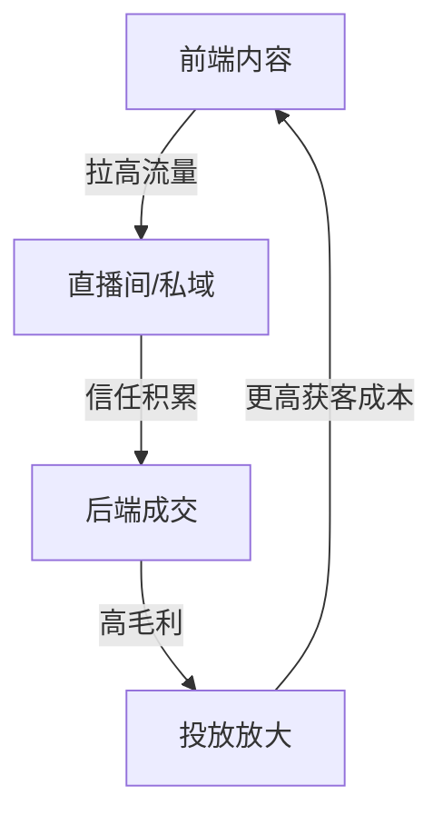
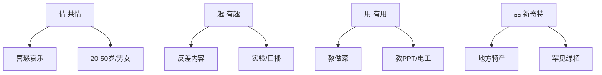
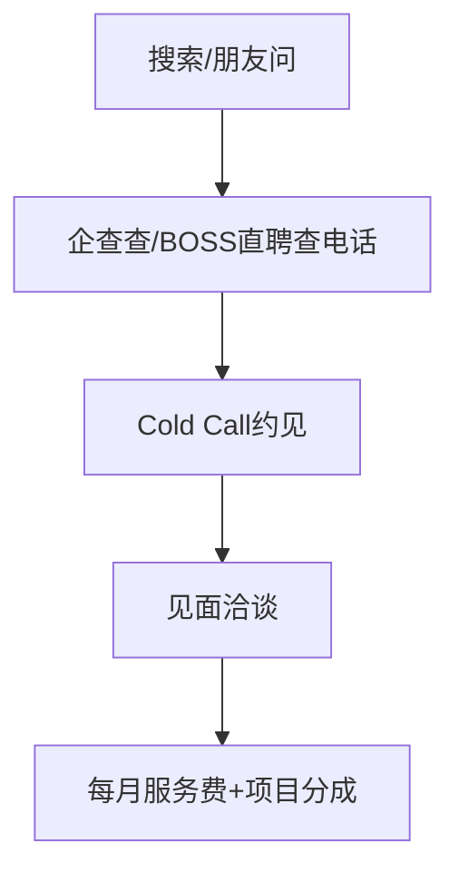
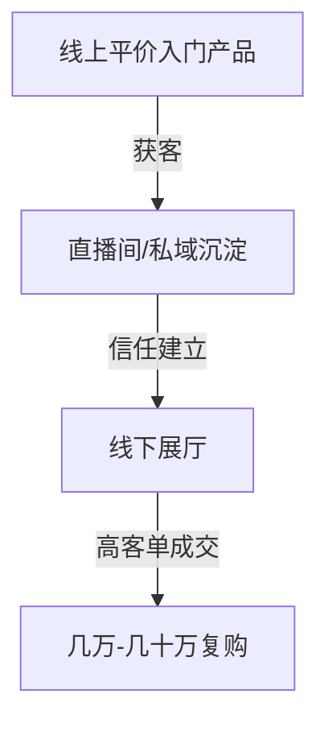

# 第 8 章 短视频带货 —— 从“内容”到“生意”的必修课

## 学习目标

-   理解短视频带货「流量→信任→成交」的底层链路与内容决定流量的全局观
-   掌握「做人群 vs 做商品」的差异化竞争策略，并能判断何时切换
-   能按客单价与痛点强度划分变现产品的双轨制，匹配对应成交路径
-   了解行业冠军联营打法的操作流程与适用条件
-   掌握「选品即定人群找需求」的选品核心原则，并能独立完成品类筛选
-   了解高客单非遗产品通过价值塑造与场景化直播实现溢价的方法
-   能综合运用本章方法为给定赛道制定内容与变现方案

## 8.1 生活类比

想象短视频带货就像在**美食街开一家属于自己的档口**。流量→信任→成交，就是先让路人试吃（内容），觉得好吃（信任），再掏钱买（成交）——如果试吃都没人尝，后面全白搭。做人群 vs 做商品，是别人都在卖同款炸串（商品红海），你专做"给健身人群的高蛋白小吃"（人群），避开同质化竞争。情、趣、用、品四象限，相当于档口的四大菜系：共情（妈妈的味道）、有趣（分子料理）、有用（营养搭配）、新奇（异域小吃），选一个方向做到极致。泛兴趣品 vs 精准痛点品，就像奶茶店（低客单走量）vs 私房定制宴（高客单重信任），前者开在人流大的地方，后者靠口碑和私域。行业冠军联营，则是你厨艺好但没本钱，找当地最火的餐厅合作，你出菜他出店面和客源，利润分成。选品即定人群找需求，是别先想"卖什么"，先想"给谁吃"——给熬夜加班的人，就做提神解压的；给宝妈，就做营养健康的。

## 8.2 概念地图

```
短视频带货的底层逻辑
├── 流量→信任→成交链路 —— P028
│   ├── 性质：内容种草→直播/私域收割 —— P028
│   └── 核心主张：前端内容决定流量、后端变现决定成败 —— P028
├── 后端变现效率决定项目成败 —— P028
│   ├── 抖音是开卷考试，前端内容趋同 —— P028
│   ├── 单一毛利高可拉高获客成本碾压对手 —— P028
│   └── ROI算不过来时不敢放预算 —— P028
差异化竞争与内容定位
├── 做人群 vs 做商品 —— P046
│   ├── 核心逻辑：大路上人太多，换条小路走 —— P046
│   ├── 方法：以细分人群情感需求为出发点 —— P046
│   └── 典型例子：白领虚荣穷/80-90怀旧/50+亲情共情 —— P046
├── 情、趣、用、品四象限 —— P046
│   ├── 情(共情)、趣(有趣)、用(有用)、品(新奇特产品) —— P046
│   ├── 性质：所有平台爆款内容皆可纳入 —— P046
│   └── 原则：分支上千种，扣到一个点就够了 —— P046
├── 伪原创二创方法 —— P046
│   ├── 全平台素材库(抖音/快手/知乎/小红书/TK) —— P046
│   └── 基于底层逻辑不违规拼接换乐 —— P046
变现产品双轨制与成交路径
├── 泛兴趣品(0-50元) —— P028
│   ├── 特征：大流量、高转化、人群规模1亿+ —— P028
│   └── 成交：短视频直购 —— P028
├── 精准痛点品(1000+元) —— P028
│   ├── 特征：高客单价、强信任、刚需痛点 —— P028
│   ├── 路径一：直播间直接转化(强信任) —— P028
│   └── 路径二：引流私域成交(低转高打法) —— P028
选品方法论
├── 选品即定人群找需求 —— P012
│   ├── 人群导向：先锁定谁要再决定卖什么 —— P012
│   ├── 需求垂直：垂直刚需优于通用品 —— P012
│   └── 价格次要：需求匹配比价格更重要 —— P012
└── 对标账号筛选 —— P012
    ├── 标准：粉丝<5W、视频>200、垂直、画面干净 —— P012
    └── 目的：规避搬运重复、获取可持续素材 —— P012
高客单价值塑造
└── 非遗高客单产品 —— P039
    ├── 产品思维：八层装裱工艺塑造品质感 —— P039
    ├── 场景化直播：佛堂/玄关/茶室/书房 —— P039
    └── 人群定位：新锐白领、资深中产 —— P039
放大打法
└── 行业冠军联营 —— P028
    ├── 筛选：当地最大机构(行业冠军) —— P028
    ├── 操作：冷电话+见面洽谈 —— P028
    └── 模式：服务费+分成，借预算/背书/体系 —— P028
```

## 8.3 短视频带货的底层逻辑 —— 让「内容」成为生意的引擎

很多新手做短视频带货，只盯着"怎么拍视频"或"怎么挂链接"，却忽略了整条链路。短视频带货是当前最主流的电商形态之一，但它的成功不是靠单一技巧，而是靠一套完整的链路：**流量→信任→成交**。不理解这条链路，你就无法在不同环节做出正确决策。

> "抖音是开卷考试，前端内容一定是趋同的，而真正决定了项目成败的，是我们的后端变现效率。"
>
> ——《抖音IP矩阵，从0到1的全套搭建心法》

这段话点出了一个反直觉的核心：前端内容只是表象，**后端变现效率**才是决定项目成败的真正因素。前端内容决定了你能获取多少流量，后端变现决定了你能把流量变成多少钱。

> 后端变现效率**定义**（来源：《抖音IP矩阵，从0到1的全套搭建心法》）

$$
\text{后端变现效率} = \frac{\text{单客毛利}}{\text{单位流量成本}}
$$

这个公式展示了：后端变现效率的本质是"单位流量能贡献多少毛利"。当别人一个客户贡献1000元毛利，而你只能做到500元时，别人就可以通过投放、矩阵，把获客成本拉到900元——他依然赚钱，而你已经亏了。

作者随后给出了更具体的对比场景：

"同样的减肥粉，别人设计好了完善的变现体系，一个客户可以贡献1000块的毛利，而你只能做到500块，那么别人就可以通过投放，通过矩阵，把获客成本拉到900块。"——《抖音IP矩阵，从0到1的全套搭建心法》

这段描述揭示了"开卷考试"的特性：抖音前端内容必然趋同，真正的差异藏在后端。高毛利账号可以承受更高的投放成本，形成对低毛利账号的碾压式竞争。



## 8.4 做人群 vs 做商品 —— 从「跟在红海后面」到「换一条小路」

平台打击搬运、同行激增，纯商品视频越来越难爆。当所有人在同一条赛道上挤破头时，你需要一个差异化的突破口。

> "做商品类型的种草视频成功概率太小了，并且还有很多有船的大佬，现在都开始付费了，像我这样的单打独斗打不过。大路上的人太多了，我换条小路。"
>
> ——《视频号带货：7天破亿播放的复盘》

"做人群"的核心理念是：**选择细分人群，以人群的情感需求为出发点制作内容**，而不是从商品功能出发。先锁定"谁"，再决定"卖什么"。

> 做人群**定义**（来源：《视频号带货：7天破亿播放的复盘》）

```
1. 选定细分人群（年龄、身份、情感特征）
2. 挖掘该人群的情感需求（虚荣、怀旧、亲情共情等）
3. 以情感共鸣为内容出发点制作视频
4. 通过内容吸引精准人群，再匹配相应变现产品
```

这段流程展示了"做人群"的核心逻辑：通过情感共鸣获取精准流量，而非通过商品功能吸引泛流量。

作者的实际案例验证了这一策略的有效性：

"做了四个账号。A:20岁-30岁，刚毕业的大学生白领群体，特征：虚荣心强但穷。B:35岁-45岁，80-90年代的怀旧情怀。C:50+的女性，亲情共情。D:还有一个带货账号。"——《视频号带货：7天破亿播放的复盘》

四个账号的差异化定位带来显著效果：AB账号2天破百万播放，7天破千万播放并变现2W+；C账号7天破亿播放。但值得注意的是，C账号破亿播放的变现仅约3万元，说明**大爆款的人群较泛，变现效率可能低于精准人群**。

### 共识

"做人群"与"做商品"并非互相排斥，而是同一账号在不同阶段的策略选择。所有素材都认同：前端内容决定流量规模，后端变现决定收入高低。

### 分歧

-   《P046》认为做人群的核心价值在于"避开红海"，用情感共鸣以低成本获取流量；
-   《P012》则更强调从"定人群找需求"出发选品，从品类源头解决竞争问题，而非仅在内容层面差异化。

## 8.5 情、趣、用、品四象限 —— 给内容创作装上「导航仪」

内容创作最常陷入的困境是"不知道做什么"。面对海量素材和无数选题方向，你需要一套分类模型来理解爆款内容产生的底层逻辑。

> "我把短视频内容分为'情趣用品'四个字。情-共情（举例：喜怒哀乐）；趣-有趣（有意思的实验，80岁老人做口播）；用-有用（你教会我做菜了）；品-新奇特的产品（北方人大多数没见过酸角糕）。所有短视频平台的爆款内容，都可以纳入其中。"
>
> ——《视频号带货：7天破亿播放的复盘》

> 情、趣、用、品四象限**定义**（来源：《视频号带货：7天破亿播放的复盘》）

$$
\text{内容} \in \{\text{情（共情）}, \text{趣（有趣）}, \text{用（有用）}, \text{品（新奇特）}\}
$$

这个公式展示了：所有爆款内容都可以归入一个四象限模型。每个象限的分支可以延伸上千种——情的分支下有小朋友的喜怒哀乐、男人的、女人的、有钱男人的、没钱女人的；趣的分支下有反差、实验、口播；用的分支下有教做菜、教做PPT、教做电工；品的分支下有酸角糕、彼岸花盆栽。

使用这个模型的要点是克制："这些成千上万的分支里面能扣到一个点，其实就够了。"——《视频号带货：7天破亿播放的复盘》



## 8.6 伪原创的二创方法 —— 让别人的爆款变成「你的原创」

纯搬运会被平台限流，原创成本又太高。伪原创的二创方法，是一条兼顾效率与过审的中间路线。

> "抖音，快手，优酷，知乎，小红书，甚至TK，所有的短视频平台都是你的素材库。通过这个底层逻辑，你会发现很多爆款都是有迹可循，我们要做的无非是把这些素材不违规的二创成自己赛道的作品，进行发布。"
>
> ——《视频号带货：7天破亿播放的复盘》

> 伪原创二创方法（来源：《视频号带货：7天破亿播放的复盘》）

```
1. 建立全平台素材库（抖音/快手/优酷/知乎/小红书/TK）
2. 基于情、趣、用、品四象限，拆解爆款的底层规律
3. 将不同素材的片段、音乐进行合适拼接
4. 确保"不违规"：不直接侵犯原创权益
```

这段伪代码展示了伪原创的核心：以全平台为素材库，基于底层逻辑进行拼接创作。作者的经验是，经过几十条作品的制作后，你会开始留意那些没上热门但画面或音乐很好的视频，脑海里面会自然给它做一个合适的拼接。

用这个素材库思维，还需用小红书/抖音的"搬运去重"方法论配合操作：放大→翻转→BGM处理→加字，其中"加字引导"被认为是出单的关键——针对产品特色/作用/需求，给它整个一两句话，然后弄个醒目的颜色加上去。

## 8.7 变现产品的双轨制 —— 从「走量」到「走心」的两条成交路径

不同客单价的产品，其成交逻辑完全不同。低客单需要大流量和高转化率，高客单需要强信任和精准人群。如果你把高客单产品当低客单卖，流量会被浪费。

> "什么样的变现产品适合做IP呢？我认为有两种：一种是低客单价（0-50）的泛兴趣产品（比如书单号，低价知识付费课程）；还有一种是高客单价（1000+）的精准痛点产品（比如高考志愿填报）。"
>
> ——《抖音IP矩阵，从0到1的全套搭建心法》

> 变现产品双轨制**定义**（来源：《抖音IP矩阵，从0到1的全套搭建心法》）

$$
\text{成交路径} = \begin{cases}
\text{短视频直购} & \text{if } \text{客单价} \in [0, 50] \\
\text{直播间转化 或 私域成交} & \text{if } \text{客单价} \in [1000, \infty)
\end{cases}
$$

这个公式展示了成交路径的核心分叉逻辑。泛兴趣产品因为客单价低，必须选择大流量、高转化产品，比如书单号、揭秘人性的厚黑学，产品针对的用户人群规模在1亿+。而精准痛点产品（如高考志愿填报）解决刚需，客单价高，成交路径有两种：一种是直播间直接成交，需要用户对IP有非常强的信任；第二种是引流私域成交，需要低转高打法——前端卖低价产品，后端再往几千块上万块导流。

下表整理了双轨制的关键差异：

| 维度 | 泛兴趣品 | 精准痛点品 |
|------|----------|------------|
| 客单价 | 0-50元 | 1000+元 |
| 面向人群 | 1亿+泛人群 | 精准刚需人群 |
| 成交路径 | 短视频直购 | 直播间转化或私域成交 |
| 核心要求 | 大流量、高转化 | 强信任、精准匹配 |
| 典型例子 | 书单号、低价课程 | 高考志愿填报 |

## 8.8 行业冠军联营 —— 借「大象的力气」撬动你的杠杆

个人或小团队资源有限，难以与头部玩家正面竞争。行业冠军联营，是借力放大的一种合作打法。

> "所以就搜、找朋友问，哪家机构是我们当地最大的，也就是行业冠军，然后企查查、boss直聘查老板电话，直接一个cold call打过去，也很顺利，约见面两次后，谈成联营合作，每月的服务费+项目分成。"
>
> ——《抖音IP矩阵，从0到1的全套搭建心法》

> 行业冠军联营方法（来源：《抖音IP矩阵，从0到1的全套搭建心法》）

```
1. 筛选：当地最大机构（有预算、有背书、变现体系完整）
2. 查电话：通过企查查、BOSS直聘找到老板联系方式
3. Cold Call：直接电话约见，30秒内体现对方利益
4. 见面洽谈：约见面两次，谈成联营合作
5. 收费模式：每月服务费 + 项目分成
```

这段流程展示了行业冠军联营的操作路径。行业冠军的好处是有预算、有背书、变现体系完整，这种是更适合抖音放大的好企业。作者的实战案例是两个月高考志愿号精准涨粉10万+，私信爆满。



## 8.9 选品即定人群找需求 —— 先锁定「谁要」，再决定「卖什么」

盲目选品容易陷入同质化竞争，导致视频流量差、转化低。不同人群的需求差异巨大，只有精准匹配才能提高成交率。

> "选品其实就是定人群然后找需求，大家能理解这句话，就很好选品了。年纪大了就想身体好，年纪大了就想重返青春，所以运动锻炼类的品和有关保养方面的品，都可以考虑。"
>
> ——《视频号新号起号复盘》

> 选品即定人群找需求**定义**（来源：《视频号新号起号复盘》）

$$
\text{选品} = \text{定义人群标签} \rightarrow \text{挖掘特定需求} \rightarrow \text{选择垂直品类}
$$

这个公式展示了选品的核心逻辑：先锁定"谁要"，再决定"卖什么"。视频号用户以中老年人+下沉城市为主，他们的特定需求是"身体好、重返青春"，因此运动锻炼类和保养类产品优先考虑。相反，服装、食品等通用品因需求普遍（是所有人的需求，而非目标人群的特定需求），不作为第一梯队。

"我个人的想法……价格什么的反而不是特别的重要，重点在于我觉得这玩意对我有用。"——《视频号新号起号复盘》

选品后还需结合蓝海判断：做的人多（尤其视频号也少），可以考虑测；做的人多则谨慎考虑。

## 8.10 高客单非遗产品的价值塑造 —— 用「工艺与场景」撑起价格

高客单价产品无法靠低价促销成交，必须通过价值塑造让用户觉得"值"。非遗类产品自带文化价值，但需要正确的呈现方式才能转化为溢价。

> "第一层实木框，这个实木框我们尝试了20多个材质，最后选择了俄罗斯黑松木材质。第二层有机玻璃，第三层卡纸，第四层拓片，第五层背纸，第六层龙骨架，第七层整张封板，第八层防尘封条。"
>
> ——《竹庐拓艺：高客单非遗的抖音实践》

> 高客单价值塑造方法（来源：《竹庐拓艺：高客单非遗的抖音实践》）

```
1. 八层装裱工艺（黑松木实木框+有机玻璃+卡纸+拓片+背纸+龙骨架+封板+防尘封条）
2. 场景化直播（佛堂/玄关/茶室/书房）
3. 人群定位（新锐白领/资深中产）
4. 漏斗模型（线上平价入门获客→私域沉淀→线下展厅高客单成交）
```

这段流程展示了高客单非遗产品的价值塑造路径。竹庐拓艺的直播间1小时场观500人，但千次成交4000-6000GMV，高的时候1-2万。抖音客单价1000-1200元，单一平台年销售额几百万。

高客单产品必须线上引流、线下承接成交变现——线上平价入门获客，线下展厅服务高客单复购人群，客单价几万、几十万。



## 8.11 设计中的取舍

**为什么不用低价促销策略来做高客单产品？**

低价促销会破坏产品在用户心中的价值感知。当用户习惯了用低价购买你，就很难再接受高价。高客单产品必须通过价值塑造（工艺、场景、人群定位）来支撑价格，而不是用降价来换取订单。竹庐拓艺的八层装裱工艺，本质是在向用户传递"你花的钱买到了工艺品质"，而非"我们便宜"。

**这种设计的 trade-off 是什么？**

高客单路线的代价是场观低、客群窄，成交依赖强信任和精准人群；低客单路线虽然流量大，但需要极高转化率和规模支撑。选择高客单意味着放弃"大流量"的效率，换取"单位流量更高毛利"的确定性——这就要求你必须在内容质量与后端体系上投入更多。

## 8.12 动手练习

1.  **为给定赛道设计内容定位与变现双轨方案**
    假设你要在视频号运营一个带货账号，产品方向已定为"中老年健康养生"：
    1. 用"选品即定人群找需求"原则，写出你定义的目标人群标签及其核心需求（至少3个）
    2. 从"情、趣、用、品"四象限中，为这个人群各设计1个内容选题方向，共计4个
    3. 根据"变现产品双轨制"，为这个账号设计低客单（泛兴趣）和高客单（精准痛点）两档产品及其对应成交路径
    回答问题：
    - 你会选择"做商品"还是"做人群"策略？为什么？
    - 如果你的内容走"情"（共情）路线，目标人群会泛，你如何控制变现效率的下降？

2.  **行业冠军联营：为一家"当地最大健身房"设计抖音合作方案**
    假设你是一名短视频操盘手，想与当地最大的一家健身房（3000+会员）达成联营合作：
    1. 列出你筛选这家"行业冠军"时考察的3个关键维度及其理由
    2. 设计一个联营方案：你的服务内容、你的收费模式（服务费+分成比例）、健身房的获益点
    3. 写出你cold call约见老板时第一段话术（30秒内，体现对方利益而非你的诉求）
    回答问题：
    - 如果健身房老板担心"你们做不起来怎么办"，你怎么回应？
    - 联营与合作（比如付费代运营）的本质区别是什么？为什么联营对初创操盘手更有利？

3.  **高客单非遗产品：为"陶艺手作"设计价值塑造方案**
    假设你要在抖音销售一款客单价2000元的非遗陶艺花瓶：
    1. 参考竹庐拓艺的"产品思维"，设计该产品的"价值塑造点"（工艺、材质、装裱/包装、文化故事等，至少4点）
    2. 设计3个直播间场景方案（参考佛堂/茶室/书房）及每个场景对应的人群画像
    3. 设计线上引流+线下承接的转化路径：线上用什么产品获客、线下如何承接高客单
    回答问题：
    - 为什么高客单产品必须"线上引流、线下承接"而不能全靠线上成交？
    - 如果直播间场观只有500人，你会如何提升成交效率而非追求流量？

4.  **从爆款拆解到伪原创二创：为你的赛道设计3条内容**
    假设你已选定"35-45岁80后怀旧"这个人群赛道：
    1. 在抖音/快手各找1条该人群的高赞爆款视频，拆解其属于"情、趣、用、品"哪个象限，并记录其画面、BGM、文案结构
    2. 按"伪原创二创方法"，将这两个素材重新拼接设计成1条新视频，写出：画面片段顺序、BGM选择理由、加字引导文案
    3. 设计这条视频的"加字引导"文案（一两句话，针对怀旧人群心理）
    回答问题：
    - 你如何判断拆解的素材"可复制"（上文提到的三标准：爆得偶然/货源非独家/场景有需求）？
    - 如果这条二创视频发布后播放量只有200，你会如何调整：换素材、改文案、还是换赛道？依据是什么？

## 8.13 本章小结

这一章中我们学习了短视频带货从"内容"到"生意"的完整闭环。首先建立了"流量→信任→成交"的底层链路认知，明白前端内容决定流量、后端变现决定成败；其次掌握了"做人群 vs 做商品"的差异化竞争策略，理解了为何在红海竞争中选择细分人群的情感需求切入；接着我们学习了"情、趣、用、品"四象限内容分类模型，知道如何为内容创作装上导航仪；然后我们掌握了"伪原创二创方法"，学会让别人的爆款变成你的原创；随后我们了解了变现产品的双轨制，知道低客单泛兴趣品走短视频直购、高客单精准痛点品走直播间或私域成交；我们还学习了"行业冠军联营"打法和"选品即定人群找需求"的选品原则；最后我们通过竹庐拓艺的案例，理解了高客单非遗产品如何通过价值塑造与场景化直播实现年销数百万。

本章我们一起学习了以下概念：

| 概念 | 解释 |
|------|------|
| 流量→信任→成交链路 | 短视频电商的基本链路：以内容种草获取流量，通过内容建立信任，最终在直播间或私域完成成交；前端内容决定流量，后端变现决定成败 |
| 后端变现效率 | 抖音前端内容趋同，真正决定成败的是后端对单位流量的变现能力；高毛利可拉高获客成本碾压对手 |
| 做人群替代做商品 | 以细分人群的情感需求为出发点制作内容，避开同质化商品视频的竞争红海，实现低成本流量获取 |
| 情、趣、用、品四象限 | 将所有爆款内容归纳为共情、有趣、有用、新奇特产品四类，是内容定位与选材的底层逻辑 |
| 伪原创二创方法 | 以全平台为素材库，基于底层逻辑将爆款素材不违规地拼接、换乐，变成自己赛道的作品 |
| 泛兴趣品与精准痛点品双轨制 | 低客单泛兴趣产品(0-50元)走短视频直购，高客单精准痛点产品(1000+元)走直播间转化或私域成交，两类产品匹配不同成交路径 |
| 行业冠军联营 | 筛选当地行业头部机构，以冷电话+见面洽谈达成联营合作（服务费+分成），借其预算、背书与完整变现体系放大流量 |
| 选品即定人群找需求 | 选品核心是从目标人群的特定需求出发选择垂直品类，而非从通用产品出发；优先选择垂直刚需而非通用品 |
| 高客单非遗产品的价值塑造 | 通过极致产品工艺（八层装裱）、场景化直播（佛堂/茶室）和精准人群定位（新锐白领/资深中产）支撑高客单价，实现年销数百万 |

下一章中，我们将进入"爆款内容生产线"，学习如何从"搬运"到"自动化原创"，建立可持续的内容供给能力。
