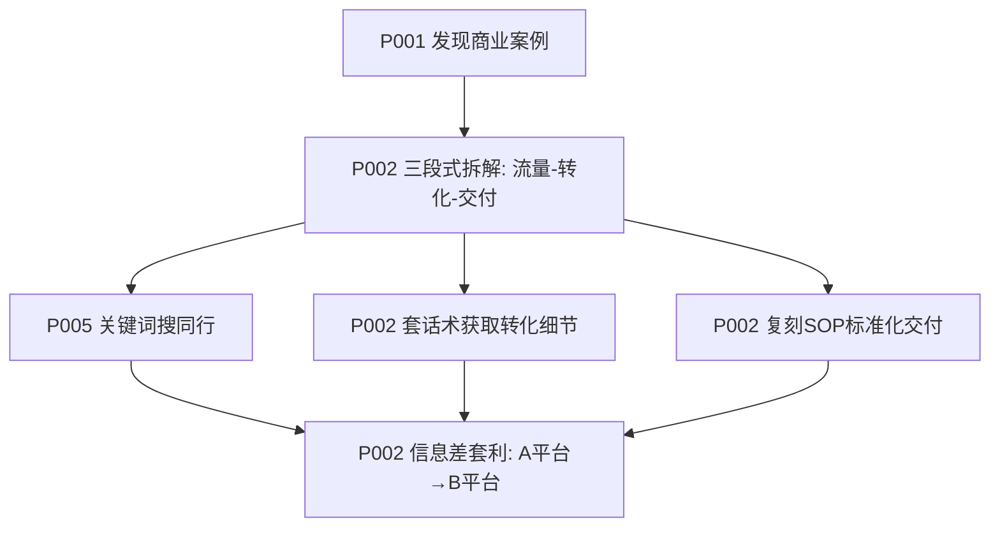

# 第 34 章 副业变现的底层逻辑 —— 从“看到”到“复制变现”

## 学习目标

- 理解副业变现的核心底层逻辑：从“产品思维”转向“信息差思维”，掌握“解项目、算账、走流程”的实操框架
- 掌握商业项目拆解的标准化方法：能将同行项目拆解为流量、转化、交付三段式可复制链路，并量化关键指标
- 熟练运用六维评估模型（流量效率、销转效率、交付效率、客单价、毛利率、复购率）给项目算“复制账”，判断可复制性与收入天花板
- 洞察不同商业模式的量级差异：理解为何小说推文天花板低而教育资料/IP能到百万，掌握“客单价提升”作为核心杠杆的补偿法则
- 建立全书四部曲学习路径：项目库建立（选赛道）→ 最小产品验证（卖空气/软文先行）→ 流量转化运营（软件营销/套话/公转私）→ 三大杠杆放大（人力/技术/资源/全球化）
- 识别“野路子”打法的边界与风险：平台规则收紧、侵权灰色地带、安慰剂效应伦理，并能制定“合规优先、投机转投资”的长期主义策略

## 34.1 生活类比

想象做副业像**开一家“复刻名店”的加盟店**：
- **选品（六维模型）** = 选一个‘已验证盈利、流程可标准化、供应链非独家’的成熟品牌，而非自创菜谱
- **拆解（商业项目拆解）** = 拿到总部的《运营手册》：选址流程（流量）、出餐SOP（转化）、中央厨房配送（交付），照单全收
- **验证（MVP/卖空气）** = 先在朋友圈发海报预售（软文先行），收够定金再向总部要货，没人买就止损换品牌
- **放大（三大杠杆）** = 用人力杠杆招店员（SOP+兼职）、技术杠杆接入外卖系统（RPA/自动化）、资源杠杆谈独家食材价
- **避坑（第7章）** = 知道‘总部可能跑路’（平台风控）、‘菜谱可能侵权’（灰色地带），所以要同时开发自有招牌菜（真产品/IP），不把命运全交给加盟品牌

## 34.2 概念地图

副业变现底层逻辑 (Ch.1)
├── 核心认知转变
│   ├── 产品思维 → 信息差思维        —— P001/P005/P007
│   ├── 后发制人：复制已验证模式    —— P001/P003/P005
│   └── 执行力可变现                  —— P005/P003
├── 分析工具：六维评估模型
│   ├── 效率维度（可复制性判据）
│   │   ├── 流量效率  —— P003/P005
│   │   ├── 销转效率  —— P003/P005
│   │   └── 交付效率  —— P003/P005
│   └── 财务维度（收入天花板判据）
│       ├── 客单价     —— P003/P005
│       ├── 毛利率     —— P003/P005
│       └── 复购率     —— P003/P005
├── 方法论：商业项目拆解
│   ├── 三段式拆解：流量-转化-交付     —— P002/P005
│   ├── 核心口诀：定位即人群...转化即模式  —— P002/P006
│   ├── 关键动作：关键词搜同行、套话术、复刻SOP  —— P002/P005
│   └── 信息差套利：A平台烂内容→B平台爆款  —— P002/P005
├── 实战案例对比
│   ├── 小说推文：三高效率+三低财务 → 天花板低  —— P004/P006
│   ├── 教育资料/IP：低流量效率+高财务指标 → 天花板高  —— P004/P006
│   └── 补偿法则：高客单价/高复购补偿低流量效率  —— P004/P006
├── 全书框架：四部曲
│   ├── 发现与筛选（猎人/情报库/八步法）    —— P005/P003
│   ├── 产品孵化（卖空气/软文先行/MVP）     —— P005/P007
│   ├── 流量收割与转化（软件营销/套话/公转私）  —— P005/P007
│   └── 放大与变现（三大杠杆/全球化/复购魔力）  —— P005/P007
└── 避坑与长期主义
    ├── 安慰剂效应与诈骗边界           —— P007/P007
    ├── 抄袭与二次创作灰色地带         —— P007/P007
    ├── 平台规则风险与合规优先           —— P007/P007
    └── 从投机到投资：沉淀个人资产       —— P007/P007

## 34.3 核心认知转变：从“产品思维”到“信息差思维”

### 为什么需要这个概念？

多数人做副业失败，是因为陷入“产品思维”，试图从零发明产品，却忽略了商业的本质是发现并复制已验证的模式。素材中三位作者（夕子、老杨、胖龟）的共同成功路径均是：拆解同行 -> 验证需求 -> 低成本复制 -> 放大。

> "成功的副业不是从零发明，而是发现、拆解并复制已验证的商业模式。用“后发制人”类比，让读者理解“抄作业”的合理性。"
> 
> ——《docs/202301-02/I9OAdzzs2oBliNxsmPjcHnBUnzf.md》

> "多数情况下没有不赚钱的项目，只有不赚钱的人。凡是大一些的，能拿出来卖的项目就不会是一个纯坑。因为只有有一部分人操作这个项目挣到过钱，这个项目才会流出来，才会被拿出来卖。"
> 
> ——《docs/202301-02/20230207_03.md》

### 核心定义

**副业变现的本质**不是“做产品”，而是“解项目、算账、走流程”。

- **后发制人**：利用已验证项目的成熟链路（流量、转化、交付），避开试错成本
- **信息差即核心壁垒**：你知道而别人不知道的“已验证路径”就是钱
- **复制优于创新**：成熟商业模式“换汤不换药”，新客户群体不断涌现，十年前的项目今天依然可做
- **执行力可变现**：持续的执行力本身具有经济价值，可被奖励（如宝妈加好友号被高价收购）

### 关键性质

| 性质 | 说明 | 来源 |
|------|------|------|
| 信息差壁垒 | 核心竞争力在于掌握“已验证路径”的信息差 | P001, P005 |
| 复制优于创新 | 商业模式周期性重复，新客户群体不断产生 | P003 |
| 执行力变现 | 持续执行力本身可被奖励变现 | P003, P005 |

> "商业模式不断的换汤不换药，新的客户群体也不断产生。这就会导致，玩了很多年的项目，甚至是十年前的项目，现在依然有人做的很好。"
> 
> ——《docs/202301-02/20230207_03.md》

> "执行力是值钱的，执行力是可以变现的。亦仁大概花了 7W 买了她坚持 4 个月加了 4000 多好友的微信号。"
> 
> ——《docs/202301-02/20230207_03.md》

### 典型例子

**案例 1：夕子（线上美业）**
从皮肤痛点出发，付费学习 -> 小红书爆款 -> 私域高客单 -> 自建品牌 -> 开放加盟，年利润百万。

> "想着离职后先要搞定社保问题，找了代办公司注册公司...疫情影响，加上资本不多，我也不敢开实体店，从有结果的出发，做线上美业...专业——流量——成交——深挖需求——复购，不断做好这个闭环。"
> 
> ——《docs/202301-02/E1WGd70YLoaHGfxAYJTc4WoFnsd.md》

**案例 2：老杨（TikTok睡播）**
用简陋直播间跑通MVP -> 1+1+1项目矩阵（盈利/开发/知识付费）持续造血。

> "有模式，我称之为1+1+1，1个在盈利，1个在开发，1个在知识付费...同一个项目在不升级的情况下生命周期从2-6个月不等，所以在开发项目时必须要可复制，快速执行，门槛能有多高拔多高。"
> 
> ——《docs/202301-02/FCiidWBeJoLOT1xreYnc9Se4nOf.md》

**案例 3：胖龟（0中介费找房）**
用“蹭流截流”低成本获客 -> 城市合伙人制度标准化复制 -> 第一年104.7万营收。

> "我们将所有的流程模板化，标准化，我们通过区域合伙人计划——城市管家，快速让合伙人上手。"
> 
> ——《docs/202301-02/PglAdRMiIoVTRyxc4Q3cw8hvnWf.md》

### 边界条件

- 仅适用于“已有人盈利且流出”的项目，纯科研型/硬核技术壁垒项目不适用
- 核心风险：平台规则变更导致流量链路失效（如抖音打击无人直播、引流），需持续关注平台红利窗口
- 认知前提：必须承认“商业英雄是平台红利的产物”，避免陷入“个人能力决定论”的幸存者偏差

> "商业英雄只是平台以及市场红利的产物。今天所有的大佬，都是在某一个时间，抓到了某一个市场红利，再匹以执行力，就赚到了第一桶金。"
> 
> ——《docs/202301-02/20230207_11.md》

> "目前国内的互联网环境没那么好，软件全球化是大势所趋，甚至可能是唯一的出路！"
> 
> ——《docs/202301-02/DNGrdODFBowfk2xwkNCc5GGSnRd.md》

---

## 34.4 商业项目拆解：把“赚钱的别人”拆成“可复制的零件”

### 为什么需要这个概念？

盲目模仿表面（文案、封面）无法复制核心利润，必须拆解出“流量从哪来、转化怎么做、交付什么、利润怎么分”的底层链路。素材强调：同行是最好的老师，抄同行是避开弯路最快途径。

> "同行就是最好的老师，抄同行永远是做项目最快的途径，能避开多数弯路和无用功。"
> 
> ——《docs/202301-02/20230207_03.md》

### 核心定义

**商业项目拆解**：将一个成熟项目按“前端流量获取 -> 中端转化承接 -> 后端交付变现”三段式拆解，并量化关键指标（ROI、客单价、复购率）。

**核心口诀**：定位即人群、人群即内容、内容即流量、流量即转化、转化即模式

### 关键性质

- **可迁移性**：拆解出的“关键词搜索同行”、“以客户身份套话术”、“复刻SOP”可跨平台、跨品类复用
- **低门槛验证**：通过“MVP先卖后做”（预售/聊100人看付费意向）在低成本下验证拆解链路是否通顺
- **信息差套利**：A平台的烂内容优化后搬到B平台可能爆火（如抖音->小红书），渠道差异即利润空间

> "A平台的“烂内容”就是B平台的爆款。类比为“东边日出西边雨”。"
> 
> ——《docs/202301-02/I9OAdzzs2oBliNxsmPjcHnBUnzf.md》

> "每个项目都有关键词，通过关键词在各个推广渠道搜索这个项目的关键词就一定可以找到同行。我们以客户的角度去思考如果我想要买这个产品，我会在哪去搜关键词，自然也可以找到同行的流量渠道。"
> 
> ——《docs/20230207_03.md》

### 典型例子

**案例 1：胖龟找房**
拆解传统中介“带看-成交”链路，改为“平台撮合-会员制”，把中介费转嫁给二房东（空置损失大），实现0中介费截流。

> "生意的本质就是信息差...中介费为什么要收？就是因为买房及租房者不知道售房及出租转让业主的联系电话！"
> 
> ——《docs/202301-02/PglAdRMiIoVTRyxc4Q3cw8hvnWf.md》

**案例 2：小红书资料号**
拆解同行“发半截资料引流 -> 私域转单9.9-199元”全流程，8人内测8人单日盈利300+。

> "早在 2021 年 9 月，我们团队就开始实操小红书流量变现...为了验证这套方法...我在 2022 年 5 月开启了内测，有 10 个信任的老朋友，参与报名，其中 8 个人都轻松做到了单日盈利 300 以上"
> 
> ——《docs/202301-02/20230207_06.md》

**案例 3：闲鱼倒爷**
拆解“抵账/抵债/批量出”关键词找低价货 -> 闲鱼高价出 -> 赚差价，三案例验证可行性。

> "三个案例验证了闲鱼低买高卖套利的可行性：飞利浦音响5台购入1400卖出2250；360U盘20个购入300卖出550；72个欧普台灯...旺季时以149元包邮价格卖出，单日最高卖出9个。"
> 
> ——《docs/202301-02/20230207_11.md》

### 方法演进图

### 边界条件

- 仅适用于“无绝对核心壁垒、标品/半标品、流程可SOP化”的项目
- 风险：平台风控收紧（如引流限制、违禁词）会切断流量链路，需建立“合规优先”与“多平台分发”兜底策略
- 核心判断：项目是否“货源非独家、场景验证有需求、流程可标准化”，三者缺一不可

---

## 34.5 六维评估模型：给项目算一笔“复制账”

### 为什么需要这个概念？

面对海量副机会，缺乏统一度量衡导致决策拍脑袋；需要一套既能判断“可复制性”又能判断“收入天花板”的量化框架。素材明确提出：用“效率维度”判断可复制性，“财务维度”判断收入天花板。

> "系统提出全书分析工具——六维模型：流量效率、销转效率、交付效率、客单价、毛利率、复购率。用“效率维度”判断可复制性，“财务维度”判断收入天花板。"
> 
> ——《docs/202301-02/NxhWdJj3UoPKvmxaBqkcz8wlntf.md》

### 核心定义

**六维模型** = 流量效率、销转效率、交付效率（效率三维）+ 客单价、毛利率、复购率（财务三维）

- **效率维度** = 单位投入产出比（时间/人力/金钱）
- **财务维度** = 单客全生命周期价值

### 核心公式

$$
\text{收入} = \text{流量} \times \text{转化率} \times \text{客单价} \times \text{复购率} \times \text{毛利率}
$$

这个公式展示了六维模型的六个变量直接对应商业收入公式的六个可干预杠杆：流量效率决定流量获取成本，销转效率决定转化率，交付效率决定履约成本，客单价/毛利率/复购率决定单客终身价值。

> "流量价值=流量规模×交易相关性×信任度。"
> 
> ——《docs/202301-02/20230207_06.md》

> "电商有个'客单价'的概念，而在私域流量运营的思维下，真正值得关注的不是'客单价'，而是'单客价'，就是一个消费者总共贡献了多少销售额。"
> 
> ——《docs/202301-02/20230207_03.md》

### 关键性质

| 维度 | 指标 | 判断标准 | 来源 |
|------|------|----------|------|
| 流量效率 | 时间/素材/流量 | 时间少、素材易、流量大 = 高 | P003 |
| 销转效率 | 专业度/SOP化 | 专业度低、可SOP、一对多 = 高 | P003 |
| 交付效率 | 时间/人力 | 时间少、人力少 = 高（支付即交付最高） | P003 |
| 客单价 | 单次交易金额 | 越高天花板越高 | P003 |
| 毛利率 | (收入-成本)/收入 | 越高抗风险越强 | P003 |
| 复购率 | 重复购买比例 | 越高生命周期价值越大 | P003 |

**补偿机制**：当效率维度有短板（如流量效率低），可通过提升财务维度（高客单价、高毛利、高复购）补偿，维持总收入。

> "当效率维度中有一项低时，如何通过提高客单价、毛利率、复购率来维持收入。以“项目拆解IP低流量效率+高客单价”为例。"
> 
> ——《docs/202301-02/NxhWdJj3UoPKvmxaBqkcz8wlntf.md》

### 多源对照：不同素材对六维维度的定义

#### 共识
- 六个维度构成完整的项目评估体系
- 前三维（效率）决定可复制性，后三维（财务）决定天花板
- 存在补偿关系：效率短板可用财务指标补偿

#### 分歧

| 维度 | P003《六维框架原文》 | P005《周报合集》 | P006《实战复盘》 |
|------|----------------------|------------------|------------------|
| 流量效率 | 强调“时间、素材、流量”三指标 | 强调“流量切片分析”和“流速控制” | 强调“新号扶持期”和“矩阵怼量” |
| 销转效率 | 强调“专业度低、可SOP、一对多” | 强调“五位一体成交飞轮”和“演员氛围” | 强调“套话做局”和“话术扒取” |
| 交付效率 | 强调“时间/人力指标，支付即交付最高” | 强调“标准化交付：手册+录播+百问百答” | 强调“非规范化生产/周级MVP” |

### 典型例子

**案例 1：小说推文**
- 高流量效率（平台分发）、高销转（低决策成本）、高交付（自动发文）
- 但客单价低(~10元)、复购近0、毛利薄
- **结果**：单靠规模放大，极限月入2万

**案例 2：教育资料/IP**
- 低流量效率（需精准搜索/私域沉淀）、中销转（需信任建立）、低交付（需人工/社群服务）
- 但客单价高(299-9999)、复购高(课程/社群/咨询阶梯)、毛利>90%
- **结果**：单客价极高，百万级可达

**案例 3：减肥食谱**
- 交付效率中（需食谱更新）、复购高（周期性复购）、毛利高
- **结果**：适合长线运营

> "小说推文：流量效率高、销转效率高、交付效率高，但客单价低、复购率低 -> 天花板低。教育资料/知识付费：流量效率低，但客单价高、毛利率高、复购率高 -> 天花板高，能到百万。"
> 
> ——《docs/202301-02/NxhWdJj3UoPKvmxaBqkcz8wlntf.md》

> "内容价值由低到高分为三层：给娱乐（情绪价值难变现）、给工具（实用性可引流）、给方法（打造个人IP壁垒最高）。"
> 
> ——《docs/202301-02/20230207_06.md》

---

## 34.6 案例对比：小说推文 vs 教育资料 —— 为什么一个天花板低，一个能到百万

### 为什么需要这个概念？

直观展示六维模型如何解释同类“内容变现”项目巨大的收入差异，帮助读者建立“选赛道比努力重要”的战略认知。素材以此为核心教学案例，演示模型实操。

### 核心定义

通过六维雷达图对比：
- **小说推文**：三高效率、三低财务
- **教育资料/知识付费**：低流量效率、高财务指标

**核心洞察**：客单价是改变项目量级的杠杆，10元客单价需10万单才能百万，1000元客单价仅需1000单。

### 关键性质对比表

| 维度 | 小说推文 | 教育资料/IP | 说明 |
|------|----------|-------------|------|
| 流量效率 | 高（平台分发） | 低（需精准搜索/私域沉淀） | 推文靠算法分发，资料靠SEO/私域 |
| 销转效率 | 高（低决策成本） | 中（需信任建立） | 推文冲动消费，资料需咨询转化 |
| 交付效率 | 高（自动发文） | 低（需人工/社群服务） | 推文数字化交付，资料需服务 |
| 客单价 | ~10元 | 299-9999元 | **核心杠杆：100倍差距** |
| 毛利率 | 薄 | >90% | 虚拟产品边际成本近零 |
| 复购率 | 近0 | 高（阶梯产品） | 推文一次性，资料可持续升级 |
| **月收入天花板** | **~2万** | **百万级** | **量级差异源于财务维度** |

### 补偿法则演示

教育资料/IP用“高客单价+高复购”补偿了“低流量效率”，实现了商业模式闭环：

$$
\text{小说推文收入} \approx \text{大流量} \times \text{高转化} \times 10元 \times 0复购
$$

$$
\text{教育IP收入} \approx \text{小流量} \times \text{中转化} \times 3000元 \times 3次复购 \times 90\%毛利
$$

**数量级对比**：前者需10万单/月达百万，后者仅需约100单/月达百万。

### 典型例子

**小说推文作者**：日更拼命，月入1-2万天花板，想突破只能做矩阵号或收徒(收徒即转型教育IP)。

**夕子/龙哥/小懒**：做项目拆解/副业培训/社群IP，客单价299-几万，复购率高(续费/升级/咨询)，年入百万级。

> "依靠出租自己的时间是很难致富的，要想获得财富，就要充分利用杠杆效应。"
> 
> ——《docs/202301-02/20230207_05.md》

> "长期主义者，大部分都用SEO思维在做流量，而追风者往往是用爆款思维组流量。一个用户愿意通过各种关键词找到你的信息，进而添加到你的私域里。这样来的1个人会比你平台推荐来的100个人更有价值。"
> 
> ——《docs/202301-02/20230207_11.md》

### 边界条件

- 高客单价模式对“个人信任/专业度”要求高，新人冷启动难，需先做低客单价积累信任再升级
- 知识付费面临“交付效率低”瓶颈，规模化需SOP化交付（手册/录播/助教/社群运营），否则创始人成瓶颈
- 行业周期：小说推文红利期短(平台打击/同质化)；知识付费周期长(信任复利)，但竞争加剧需持续迭代内容

---

## 34.7 本书框架预览：四部曲学习路径

### 为什么需要这个概念？

读者需要全书宏观地图，理解各章节逻辑串联，避免碎片化学习；明确“学习路径建议”降低认知负荷。素材将全书逻辑串联为：建立项目库（选赛道） -> 开发最小产品（卖空气/软文先行） -> 流量与转化运营 -> 三大杠杆放大。

### 核心定义

**四部曲结构**：
1. **发现与筛选**（猎人建立情报库）—— 第2章
2. **产品孵化**（卖空气/软文先行/MVP验证）—— 第3章
3. **流量收割与转化**（软件营销派/套话做局/公转私）—— 第4-5章
4. **放大与变现**（人力/技术/资源杠杆/全球化）—— 第6章

**学习路径**：
新手先读第1-2章建立认知 -> 第3章低成本验证 -> 第4-5章跑通闭环 -> 第6章规模化放大 -> 第7章合规长期主义

### 关键性质

- **闭环思维**：每章解决一个核心环节（选品、造品、卖品、放大），环环相扣
- **实战导向**：拒绝理论堆砌，每章给出具体方法（喂养算法、卖空气、软文技巧、SOP、止损点、杠杆操作）
- **批判收尾**：第7章专门反思“野路子”边界（安慰剂效应、侵权风险、平台规则、投机转投资），建立长期主义护城河

### 典型章节速览

| 章节 | 核心任务 | 关键方法 | 来源 |
|------|----------|----------|------|
| 第2章 | 发现与筛选 | 喂养算法、下拉词淘金、八步筛选法 | P005, P003 |
| 第3章 | 产品孵化 | 软文先行(复述问题/超长文/过审)、卖空气预售、非规范化生产 | P005, P007 |
| 第4-5章 | 流量转化 | 软件营销派、套话做局、公转私五大入口、风控分级 | P005, P007 |
| 第6章 | 放大与变现 | 人力杠杆(SOP+兼职矩阵)、技术杠杆(RPA爬虫/批量搬运)、复购魔力、全球化 | P005, P007 |

> "串联后续章节逻辑：建立项目库（选赛道）→ 开发最小产品（卖空气/软文先行）→ 流量与转化运营 → 三大杠杆放大。并给出学习路径建议。"
> 
> ——《docs/202301-02/I9OAdzzs2oBliNxsmPjcHnBUnzf.md》

> "软件的本质就是软文。软件开发出来，怎么推广？还是通过写文章，发广告，介绍你这个软件，软件的最终的展现方式还是软文。"
> 
> ——《docs/202301-02/DNGrdODFBowfk2xwkNCc5GGSnRd.md》

> "MVP先卖后做：验证产品应优先卖想法而非做产品，通过高意向付费人数判断需求是否成立。"
> 
> ——《docs/202301-02/20230207_06.md》

### 设计中的取舍

**为什么不用“从零开发产品”而是“卖空气/软文先行”？**

传统思维：先开发完美产品 -> 再找流量 -> 再转化
- 缺点：开发周期长、沉没成本高、需求未验证就投入大量资源

本书思维：先写软文/预售验证 -> 收到定金/预售款 -> 再低成本生产/找现成方案交付
- 优点：验证快、成本低、现金流为正、可短时间测试几十个产品

> "个人开发者研发一个软件的时间不应超过1周，超过1周的软件产品不适合个人开发者！"
> 
> ——《docs/202301-02/DNGrdODFBowfk2xwkNCc5GGSnRd.md》

**为什么强调“合规优先”而非“全盘野路子”？**

部分“野路子”手段（强制分享裂变、擦边软文、搬运伪原创）处于平台灰色地带，长期主义者需逐步转向合规白帽。

> "平台内容合规审核与应对...应对方式包括提供离线版分发渠道、征集用户敏感内容反馈、修订后重新上传。"
> 
> ——《docs/202301-02/20230207_10.md》

### 边界条件

- 框架假设读者具备基本互联网操作能力（注册账号、发视频、加微信、简单剪辑）
- 部分“野路子”手段处于平台灰色地带，长期主义者需逐步转向合规白帽
- 全球化路径需解决收款(Stripe/PayPal)、合规(GDPR/当地法)、语言本地化等新挑战，非零门槛

---

## 34.8 多源对照：核心概念的不同素材视角

### 共识

1. **副业本质是复制已验证模式**，而非从零创新
2. **商业项目拆解**必须按流量-转化-交付三段式进行
3. **六维模型**是评估项目可复制性与天花板的统一度量衡
4. **MVP先卖后做**是低成本验证的核心方法
5. **杠杆放大**（人力/技术/资源）是从月入千到月入百万的关键

### 分歧

| 概念 | P001《私域实战》 | P003《周报认知》 | P005《产品开发》 | P007《IP打造》 |
|------|------------------|------------------|------------------|----------------|
| **核心动力** | 前端流量是关键 | 时代红利+执行力 | 软文先行/卖空气 | 母题/文化溢价 |
| **验证方式** | 八步拆解+打分 | 聊100人看20-30人付费 | 软文预售/非规范化生产 | 两周可验证变现 |
| **放大路径** | 三大杠杆 | 矩阵化/招人/代理 | 全球化/非规范化生产 | 点线面打通/产业群组 |
| **风险边界** | 平台风控/止损点 | 战术勤奋逃避战略/亏钱反期望 | 安慰剂效应/侵权/平台审核 | 幸存者偏差/路径依赖 |

---

## 34.9 动手练习

### 练习 1：六维模型实战：给你的副业想法算一笔账

假设你想做一个‘考公上岸资料包’项目（虚拟资料，客单价29.9元），请按六维模型估算：

1. **流量效率**：小红书发笔记引流，预计日产出50个精准加微信，单条笔记制作耗时30分钟，如何计算‘单位时间获客数’？
2. **销转效率**：私域成交话术成熟，预计加微信后30%付费，如何计算‘流量转现金比’？
3. **交付效率**：支付即自动发网盘链接，耗时0，如何量化？
4. **客单价/毛利率/复购率**：虚拟产品毛利~100%，复购极低（买一次够用），如何评价财务天花板？

**回答问题**：
- 若想把月收入从3千提到3万，六个维度哪个最容易撬动？为什么？
- 如果改做‘考公全程陪跑班’（客单价2999元），六维模型会如何变化？交付效率下降如何补偿？

---

### 练习 2：商业项目拆解演练：拆解一个‘小红书资料号’同行

找到一个做‘公考资料/教资资料/建筑资料’的小红书同行账号（粉丝1万-10万），按三段式拆解：

1. **【前端流量】**：它的笔记选题是什么？封面/标题模板长什么样？发布频次/时间？关键词布局在哪？是否有矩阵号？
2. **【中端转化】**：主页简介怎么写？置顶笔记是什么？自动回复/私信话术？引流钩子（免费资料/低价体验）？
3. **【后端交付】**：加微信后发什么？成交话术几步？交付形式（网盘/群/小程序）？是否有后端复购产品？

**回答问题**：
- 该同行的流量/转化/交付中，哪个环节最强？最弱？
- 如果你复制这个项目，哪3个关键动作必须‘照抄’，哪3个可以‘微创新’？

---

### 练习 3：MVP验证设计：卖空气测试‘AI生成简历优化服务’

你想做一个‘上传简历→AI优化→输出STAR法则版本’的服务，客单价拟定99元。请设计一个‘卖空气’验证流程：

1. **软文先行**：写一篇‘复述用户痛点’的小红书笔记（参考‘复述问题建立信任’技巧），标题怎么拟？封面怎么做？
2. **预售页/钩子**：没有产品时，用什么作为‘已有假象’？（如：演示视频/对比截图/名额限制/创始人背书）
3. **验证标准**：聊多少人、收多少定金/预售款，才算‘不确定因素解除’？（参考‘聊100人、20-30人付预售金’标准）

**回答问题**：
- 如果预售转化极低，是‘痛点不真’还是‘信任不够’？如何用‘套话’快速区分？
- 验证通过后，如何用‘非规范化生产’在1周内搭建可交付的最小系统？（提示：中文编程/现成API/人工兜底）

---

## 34.10 本章小结

这一章中我们学习了副业变现的底层逻辑：首先理解了**从“产品思维”转向“信息差思维”**的核心认知转变，即商业本质是发现并复制已验证模式；其次掌握了**商业项目拆解**的三段式标准化方法，能将同行项目拆解为流量-转化-交付可复制链路；接着熟练运用**六维评估模型**（流量/销转/交付效率 + 客单价/毛利率/复购率）给项目算“复制账”，判断可复制性与收入天花板；然后通过**小说推文 vs 教育资料**的案例对比，洞察了“客单价提升”作为核心杠杆的补偿法则；接着预览了**全书四部曲学习路径**（项目库→MVP验证→流量转化→杠杆放大）；最后识别了“野路子”打法的边界与风险，制定“合规优先、投机转投资”的长期主义策略。

本章我们一起学习了以下概念：

| 概念 | 解释 |
|------|------|
| 信息差思维/后发制人 | 副业本质是发现并复制已验证模式，而非从零发明；同行是最好的老师 |
| 商业项目拆解 | 将成熟项目按流量-转化-交付三段式拆解，量化关键指标，提炼可迁移的SOP |
| 六维评估模型 | 流量/销转/交付效率（判断可复制性）+ 客单价/毛利率/复购率（判断天花板）；效率短板可用财务指标补偿 |
| 小说推文 vs 教育资料 | 前者三高效率但低客单价/复购→天花板低；后者低流量效率但高客单价/高复购/高毛利→天花板高 |
| MVP先卖后做/卖空气 | 先预售/软文验证需求，再低成本生产；完成第一单即验证模型，而非造完产品找买家 |
| 软件营销派/套话做局 | 用App界面/专业感碾压纯文本；以‘已解决者’口吻引流→套同行话术→卖给‘未解决者’ |
| 三大杠杆放大 | 人力杠杆（SOP+兼职矩阵）、技术杠杆（RPA/爬虫/批量搬运）、资源杠杆（合伙人/全球化/复购魔力） |
| 野路子边界与长期主义 | 安慰剂效应/侵权/平台风控是红线；需将验证思维转向真产品打造，把能力沉淀为可复利资产 |

下一章中，我们将学习**如何像猎人一样建立“项目情报库”**——通过喂养算法、下拉词挖掘、八步筛选法，持续低成本地发现可复制的副业机会，并用权重打分筛选出真正值得投入的项目。
