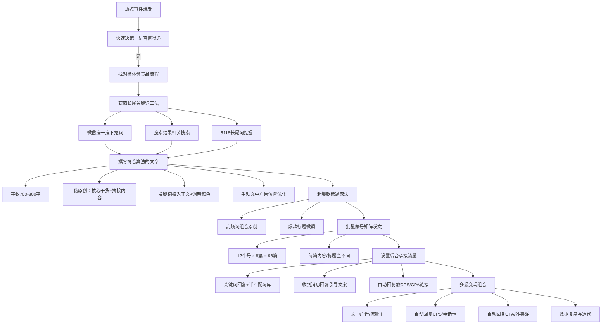
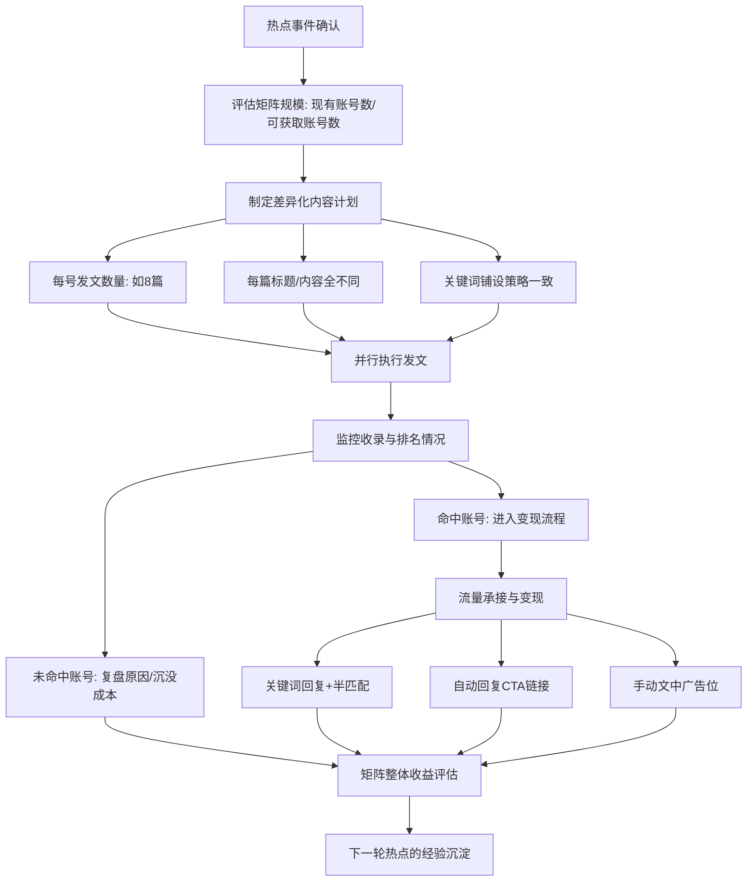
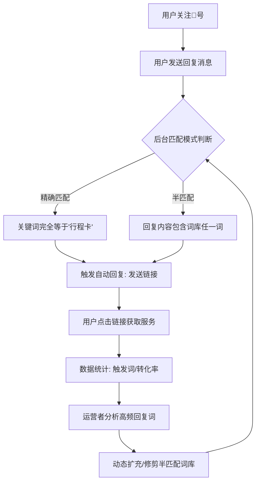
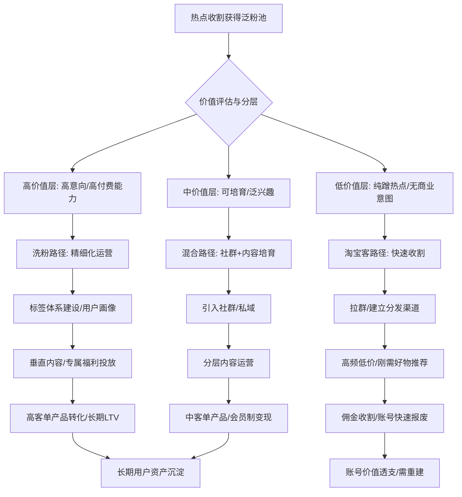

# 第 30 章 搜索流量与热点收割 —— 从“被动等待推荐”到“主动截获搜索”

## 学习目标

- 理解搜索流量追热点与推荐流量追热点的本质差异
- 掌握批量做号矩阵的核心逻辑与操作要点
- 学会使用半匹配关键词回复提升流量承接效率
- 理解泛粉与洗粉的变现逻辑及其适用边界
- 能独立设计一套从内容生产到流量承接再到达成的完整热点收割流程

## 30.1 生活类比

想象搜索流量追热点像是在一条热闹的街上开一家店：推荐流量好比逛街的人随机进店，完全看运气；搜索流量则是顾客拿着购物清单专程来找你，目的明确。长尾词铺设就像在街角立一块写着具体商品的指示牌，让对应需求的顾客一眼看到你；批量做号矩阵则是在街的多个位置同时开分店，总有一家店能被顾客找到；半匹配关键词好比店里设置多语言或多种叫法的服务台，无论顾客怎么问都能得到回应。就像聪明的店主不会只等客人路过，而是主动在路口立招牌、多开店来增加被找到的概率，搜索流量追热点也是通过主动铺设关键词、批量发文来主动截获精准流量。

## 30.2 概念地图

搜索流量追热点
├── 为什么需要？
│   ├── 推荐流量不确定性强，守株待兔
│   ├── 搜索用户意图明确，转化率高且稳定
│   └── 热点同质化内容泛滥，需差异化渠道
├── 核心定义
│   └── 在文章正文铺设长尾词，被搜一搜收录
├── 关键性质
│   ├── 主动性：控制关键词铺设影响流量入口
│   ├── 可预测性：热词搜索量预测流量规模
│   ├── 长尾效应：收录后持续获取流量
│   ├── 精准性：搜索意图明确，点击率高
│   └── 收录视角：关键词位置与方法需符合算法
├── 典型例子 —— 行程码下线收割
│   ├── 12个👸号批量发文
│   ├── 96篇全差异化内容
│   └── 9个账号净增4.5万粉
├── 边界条件
│   ├── 时效性强，需与内容产出速度竞争
│   ├── 依赖平台收录机制
│   └── 关键词铺设位置策略关键
├── 批量做号矩阵
│   ├── 用概率对抗不确定性
│   ├── 规模效应：多账号放大整体命中率
│   ├── 内容差异性：每篇标题/内容不同
│   ├── 冗余容错：个别失败不影响整体
│   └── 边界：规模过大管理成本上升
├── 长尾关键词获取三法
│   ├── 下拉词：微信搜一搜输入核心词获取即时热搜
│   ├── 相关搜索：搜索结果页底部反映用户联想路径
│   └── 5118挖掘：数据工具提供全量长尾词支撑
├── 爆款文章撰写法
│   ├── 字数控制：七八百字满足文中广告与收录要求
│   ├── 伪原创生产：核心干货+拼接相关内容凑字数
│   └── 关键词隐形：调暗颜色兼顾阅读体验
├── 爆款标题双法
│   ├── 高频词组合：提取爆款标题共性词自行组合
│   └── 轻微改动：复制爆款标题微调规避重复风险
├── 手动广告位
│   ├── 位置控制：放在引导关注文案下方诱导点击
│   ├── 误导性利用：平台推荐其他👸号广告增加收入
│   └── 单价优势：文中广告收入远超底部广告
└── 追热点快速决策
    ├── 前置能力积累：👸号SEO与过往追热点经验
    └── 果断入局：即使获取信息晚也能快速执行
半匹配关键词回复
├── 为什么需要？
│   ├── 用户回复五花八门，词不达意
│   └── 固定关键词僵硬，遗漏真实流量
├── 核心定义
│   └── 回复含半匹配词库任意词即触发推送
├── 关键性质
│   ├── 容错性强：包容错别字/多字少字
│   ├── 体验友好：降低用户理解成本
│   ├── 规则灵活：需动态维护词库
│   └── 反漏斗效应：挽回流失的转化机会
└── 边界：词库过泛可能误触发
泛粉与洗粉
├── 为什么需要？
│   ├── 泛粉数量大但价值密度低
│   └── 需回答“流量来了怎么办”
├── 核心定义
│   ├── 泛粉：低门槛吸引的未过滤关注者
│   └── 洗粉：筛选高价值粉丝精细化变现
├── 关键性质
│   ├── 价值分层：需主动过滤
│   ├── 二次加工：通过低/高门槛洗出价值
│   ├── 成本收益匹配：粗暴变现损耗信任
│   └── 取关率天然高：该案例达53.8%
└── 边界
    ├── 需较强用户运营能力
    └── 过度推销透支长期价值

## 30.3 搜索流量追热点 —— 从“被动等待推荐”到“主动截获搜索”

### 为什么需要这个概念？

你有没有过这种经历：辛苦写了一篇蹭热点的文章，结果平台一点推荐都不给，阅读量只有个位数？这就是典型的“守株待兔” —— 单纯依赖平台推荐算法，流量具有极大的不确定性与偶然性。但如果换个角度：当用户主动在微信搜一搜输入“行程码纪念版怎么生成”时，ta 的意图是无比明确的。此时如果你的文章恰好被收录并展示在前几位，转化率会高得多，流量来源也稳定得多。2022年12月14日“行程码下线”热点爆发时，同质化推送泛滥，大家都在抢推荐流量。作者火火选择了一条差异化渠道 —— 搜索流量。他在文章正文铺设长尾词，让文章被微信搜一搜收录，从而在用户搜索热点关键词时主动截获流量。

> "我们做的是搜索流量，那相关的搜索长尾词、搜索下拉框词语都可以放进来。文章被收录之后，读者搜索相关长尾词会搜到我们这篇文章。"
> 
> ——《👸号热点收割复盘：行程码下线案例》 (docs/202301-02/AmKRdF2Z9oQjDExxxuAc18a5nbb.md)

> "我在追短期热点的时候，会把这个长尾词放进文章内容中。"
> 
> ——《👸号热点收割复盘：行程码下线案例》 (docs/202301-02/AmKRdF2Z9oQjDExxxuAc18a5nbb.md)

这就是搜索流量追热点的核心逻辑：区别于传统依赖平台算法推荐的被动模式，主动在文章正文（而非标题）中铺设与热点相关的搜索长尾词，使文章被平台搜索系统（如微信搜一搜）收录，当用户搜索对应关键词时即可获取精准的搜索流量。

### 核心定义与关键性质

**搜索流量追热点**（来源：《👸号热点收割复盘：行程码下线案例》，docs/202301-02/AmKRdF2Z9oQjDExxxuAc18a5nbb.md）

这个概念包含五个关键性质：主动性，即通过控制关键词铺设主动影响流量入口，而非被动等待推荐分发；可预测性，即流量通常与搜索热度直接挂钩，热词搜索量可直接预测流量规模；长尾效应，即文章收录后可持续获取相关搜索流量，具有长期价值；精准性，即搜索用户意图明确，内容与搜索词的强相关性带来较高点击率；收录视角，即核心在于“文章被收录”，关键词铺设位置（正文）和方法需符合搜索算法收录机制。

### 关键方法：长尾关键词获取三法

要在文章中铺设长尾词，首先得知道铺什么词。素材给出了三种免费获取长尾词的方法（来源：《👸号热点收割复盘：行程码下线案例》，docs/202301-02/AmKRdF2Z9oQjDExxxuAc18a5nbb.md）：

1. 微信搜一搜下拉词：打开微信搜一搜，输入核心关键词（如“行程码”），记录下拉框弹出的所有词语，全部放入文章中。这反映了最即时的热搜趋势。
2. 微信搜索栏相关搜索：搜索核心关键词后，查看搜索结果页底部的“相关搜索”，这些是其他用户经常用到的词语，同样放入文章。这反映了用户的联想搜索路径。
3. 5118网站查询长尾词：访问5118.com长尾词挖掘功能，输入核心词查询，导出相关长尾词列表，筛选搜索量大、竞争小的词。这提供了更全量的数据支撑。

这三种方法互补：下拉词反映最即时的热搜趋势，相关搜索反映用户联想路径，5118提供更全量的数据支撑。运营者应当组合使用，构建完整的关键词覆盖网。

### 关键方法：爆款文章撰写法 —— 迎合算法而非文笔

> "追热点文章不是需要文笔写的多好，内容迎合平台算法喜好能被收录就行。"
> 
> ——《👸号热点收割复盘：行程码下线案例》 (docs/202301-02/AmKRdF2Z9oQjDExxxuAc18a5nbb.md)

作者总结了三个写作要点（来源：《👸号热点收割复盘：行程码下线案例》，docs/202301-02/AmKRdF2Z9oQjDExxxuAc18a5nbb.md）：第一，字数控制，有意识写到 700-800 字，满足文中广告插入要求，也更易被收录；第二，伪原创生产，第一部分写核心干货（如如何获取链接），第二部分在平台搜索关键词，复制加入其他相关文章内容拼接，凑够字数且读起来流畅；第三，关键词隐形，为了阅读体验，将铺设的关键词颜色调暗淡，不影响正文阅读。这个方法的本质是：把文章当成“被收录的载体”而非“被阅读的作品”。你不需要文采飞扬，只需要让算法觉得“这篇内容丰富、原创度够、关键词覆盖全”。

### 关键方法：爆款标题双法

标题决定点击率，素材给出两种策略（来源：《👸号热点收割复盘：行程码下线案例》，docs/202301-02/AmKRdF2Z9oQjDExxxuAc18a5nbb.md）：

以下表格展示了两种起标题策略的对比，核心在于兼顾原创度与吸引力：

| 策略 | 操作步骤 | 核心逻辑 |
|------|----------|----------|
| **方法1：提取关键词自行组合** | 1. 把排名靠前文章标题全复制下来<br>2. 找共同高频词（如"火爆全网""免费获取"）<br>3. 组合成新标题：高频词+核心关键词 | 兼顾原创度（利于收录）与吸引力（引导点击） |
| **方法2：爆款标题轻微改动** | 1. 直接复制排名前列的标题<br>2. 做微调（换词、增删）<br>3. 确保不完全一样 | 借力爆款标题的验证済吸引力，规避完全复制风险 |

方法1通过提取高频热词（如“火爆全网”“免费获取”）自行组合新标题，兼顾原创度与吸睛度；方法2直接摘录爆款标题做轻微改动伪原创，借力已验证的吸引力。标题更改的原理在于原创性有助于算法收录，吸引眼球有助于读者搜索到后点击进去阅读。

### 关键方法：流量承接双模块设置

作者通过👸号后台自动回复的两个模块来承接流量（来源：《👸号热点收割复盘：行程码下线案例》，docs/202301-02/AmKRdF2Z9oQjDExxxuAc18a5nbb.md）：模块1是设置关键词回复承接住流量，流程为粉丝关注👸号后回复关键词，👸号自动回复行程码生成链接；模块2是设置收到消息回复减少举报率，让读者不管回复什么消息都能看到引导文案，知道回复哪几个字才能拿到链接，起到了减少粉丝举报概率的作用。

### 典型例子：行程码下线收割实战

这是一个教科书级别的完整案例（来源：《👸号热点收割复盘：行程码下线案例》，docs/202301-02/AmKRdF2Z9oQjDExxxuAc18a5nbb.md）：

**背景**：2022年12月14日，微信宣布行程码下线。作者在上午11点多才得知消息，但凭借前置的👸号SEO能力和追热点经验（此前“秋天第一杯奶茶”引流3000+外卖粉），果断判断“这个热点我可以做”。

**执行流程**：
1. 找对标体验：搜索“行程卡纪念版”，体验竞品生成流程
2. 批量产出：12个👸号，每号8篇，共96篇文章，全部内容、标题各不相同
3. 铺设关键词：文章正文植入“行程卡纪念版”“行程码生成”等长尾词
4. 设置后台：关键词回复+收到消息回复双模块承接流量
5. 变现组合：文中广告（流量主）+ 自动回复CPS（电话卡）+ 自动回复CPA（外卖群）

**结果数据**：
- 12个号中9个有效上排名，命中率 75%
- 累计新增 97,385 粉，取关 52,430，净增 44,955 粉
- 取关率高达 53.8%（泛粉特征明显）
- 流量主收入 6,514 元（3个单号破千）
- 电话卡 CPS 卖出 6 张，佣金 400+ 元
- 理论单日总变现约 1 万元

> "基于上面的信息以及自身经历，我认为这个热点我可以做；就算这个热点信息我获取的时间晚，但经过我操作的👸号还是能获取到一点点流量。"
> 
> ——《👸号热点收割复盘：行程码下线案例》 (docs/202301-02/AmKRdF2Z9oQjDExxxuAc18a5nbb.md)

> "我之前追过热点，秋天第一杯奶茶引流了3000多的👸号外卖粉；本身也比较擅长👸号SEO。"
> 
> ——《👸号热点收割复盘：行程码下线案例》 (docs/202301-02/AmKRdF2Z9oQjDExxxuAc18a5nbb.md)

### 边界条件与避坑指南

以下表格总结了搜索流量追热点的边界条件及应对策略：

| 边界条件 | 说明 | 应对策略 |
|----------|------|----------|
| **时效性强** | 热点关键词流量峰值集中在事件爆发后短窗口 | 建立前置能力（SEO、矩阵号），缩短决策-执行链路 |
| **依赖收录机制** | 未被收录=零流量 | 遵循平台收录偏好：原创度、字数、关键词覆盖 |
| **关键词位置策略** | 标题 vs 正文影响收录与体验 | 短期热点词放正文（不影响标题原创度），长期SEO词可放标题 |
| **内容同质化风险** | 批量发文若高度同质可能被判恶意营销 | **强制差异化**：每篇内容、标题必须不同 |

以下是搜索流量追热点的完整操作流程图：



## 30.4 批量做号矩阵 —— 用概率对抗不确定性

### 为什么需要这个概念？

单一账号的命中率有多高？素材给出的答案是：不可控。即使你做得再好，也可能遇到：平台不收录、关键词竞争太激烈、账号权重不够、违规限流。作者用 12 个👸号同时操作，这就是用概率对抗不确定性的教科书式演示。

> "我用12个👸号，每个👸号8篇文章；总共发布了96篇文章，全部是这样子整合内容。"
> 
> ——《👸号热点收割复盘：行程码下线案例》 (docs/202301-02/AmKRdF2Z9oQjDExxxuAc18a5nbb.md)

> "要注意的一点是我96篇文章，每一篇内容都不一样；并且标题都不一样；这样做能够更好的增加被👸号系统收录的概率。"
> 
> ——《👸号热点收割复盘：行程码下线案例》 (docs/202301-02/AmKRdF2Z9oQjDExxxuAc18a5nbb.md)

> "总共用12个👸号批量操作来追这个热点，其中3个👸号发文没有上排名没有流量，不统计数据。"
> 
> ——《👸号热点收割复盘：行程码下线案例》 (docs/202301-02/AmKRdF2Z9oQjDExxxuAc18a5nbb.md)

### 核心定义

**批量做号矩阵**（来源：《👸号热点收割复盘：行程码下线案例》，docs/202301-02/AmKRdF2Z9oQjDExxxuAc18a5nbb.md）

同时运营多个账号（如同一作者运营12个👸号），每个账号发布多篇内容（每号8篇），且要求所有文章内容与标题均保持各不相同，以最大化增加被平台系统收录的总概率，进而在热点事件中获取规模化的搜索流量。

### 关键性质

批量做号矩阵包含四个关键性质：规模化效应，即单账号命中率有限，多账号能将“小概率事件”放大为可预期的总体流量；内容差异性，强调“每篇标题、内容都不一样”是增加收录概率的核心前提，避免同质化相互挤占；冗余与容错，个别账号（如3个未上排名）失败不影响整体大盘，具有天然容错机制；管理复杂性，账号数量越多，需要同时维护的后台资源与操作成本越高。

### 数据演示：概率的力量

以下表格展示了矩阵操作的关键数据指标，直观呈现概率的力量：

| 指标 | 数值 | 含义 |
|------|------|------|
| 账号总数 | 12 | 矩阵规模 |
| 单号发文数 | 8 | 单账号产出 |
| 总发文数 | 96 | 总产出 |
| 有效账号数 | 9 | 命中账号 |
| 命中率 | 75% | 单账号成功概率 |
| 单有效号平均净增 | ~5,000 | 单账号产出 |
| 总净增粉丝 | 44,955 | 矩阵总产出 |

关键洞察：如果只有 1 个号，成功概率只有 75%，且单号产出波动大；12 个号组合，总产出变得可预期、可规划。

### 边界条件

矩阵规模并非越大越好，账号过多导致管理和投入成本急剧上升；若内容高度同质化而未做差异化处理，可能被平台判为恶意营销或影响收录；该策略更适合短期热点收割，长期 IP 或个人品牌沉淀并不适合铺量模式。

以下是批量做号矩阵的决策与执行流程图：



## 30.5 半匹配关键词回复 —— 让机器人听懂“人话”

### 为什么需要这个概念？

你设置了关键词回复“行程卡”，用户却回：“行程码”“卡”“链接”“给我”“怎么弄”。固定关键词匹配下，这些用户全都收不到自动回复，体验断裂，甚至投诉举报。这就是“词不达意”导致的流量浪费。

> "关键词回复有一个半匹配功能，意思就是读者回复半匹配中任意一个词语，👸号后台都会自动回复对应链接。文章中让读者回复的关键词是'行程卡'三个字，很多读者其实不会回复成完整的3个字，各种各样的回复都有。我为了让读者体验感更好一些，半匹配词语我设置成他们经常回复的文字。"
> 
> ——《👸号热点收割复盘：行程码下线案例》 (docs/202301-02/AmKRdF2Z9oQjDExxxuAc18a5nbb.md)

### 核心定义

**半匹配关键词回复**（来源：《👸号热点收割复盘：行程码下线案例》，docs/202301-02/AmKRdF2Z9oQjDExxxuAc18a5nbb.md）

👸号后台关键词回复中的一种匹配模式：用户回复内容只要包含半匹配词库中任意一个词（而非精确等于），即可自动触发后台推送预先设置的链接或内容。

### 关键性质

以下表格梳理了半匹配关键词回复的四大关键性质及其价值：

| 性质 | 说明 | 价值 |
|------|------|------|
| **容错性强** | 包容错别字、多字少字、简写 | 提升触达率 |
| **体验友好** | 用户无需记标准指令 | 降低理解成本 |
| **规则灵活** | 需根据用户反馈动态维护词库 | 持续优化 |
| **反漏斗效应** | 承接本会因回复错误流失的转化 | 挽回流量 |

### 实战操作：如何建立半匹配词库

以“行程卡”为例，作者通过后台数据分析用户真实回复，建立词库：

核心词：行程卡
半匹配词库（8个变体）：行程码（同义词）、卡（简写）、链接（意图词）、生成（动作词）、纪念版（场景词）、行程卡纪念版（长尾词）、码（简称）、怎么弄（疑问词）。

**设置路径**：👸号后台 → 自动回复 → 关键词回复 → 添加规则 → 匹配模式选“半匹配” → 输入词库。

以下代码块展示了半匹配词库的配置示例，运营者可根据实际用户回复数据动态调整：

```
核心关键词：行程卡
半匹配词库配置：
1. 行程码        # 同义词变体
2. 卡            # 简写变体
3. 链接          # 意图导向词
4. 生成          # 动作导向词
5. 纪念版        # 场景导向词
6. 行程卡纪念版  # 长尾组合词
7. 码            # 简称变体
8. 怎么弄        # 疑问导向词
```

该配置的作用是覆盖用户最常见的 8 类回复模式，确保无论用户用何种表达方式，都能触发自动回复获取链接，从而最大化流量承接率并降低举报率。

### 边界条件

词库设置过泛（如设“的”“是”“我”）会导致误触发，推送无关内容；受限于平台功能支持（微信后台原生功能），非所有平台均具备；仅适用于明确指令型交互，无法替代复杂人工客服。

以下是半匹配关键词回复的工作流程图：



## 30.6 泛粉与洗粉 —— 从“虚胖”到“真金”的筛选术

### 为什么需要这个概念？

热点追来的 4.5 万粉丝，取关率 53.8%，这就是典型的泛粉 —— 数量大但价值密度低。如果不处理直接推广告，不仅转化低，还会加速取关、透支账号信用。素材明确指出：任何流量策略都必须回答“流量来了之后怎么办”的变现闭环问题。

> "泛粉也有变现的价值，专业一点的小伙伴一般还会洗粉，筛选出比较高价值的粉丝来变现；简单暴力一些的变现方式就是拉群发单做淘宝客。"
> 
> ——《👸号热点收割复盘：行程码下线案例》 (docs/202301-02/AmKRdF2Z9oQjDExxxuAc18a5nbb.md)

### 核心定义

| 概念 | 定义 | 特征 |
|------|------|------|
| **泛粉** | 通过低门槛、大范围内容吸引而来的、未经过滤的普通关注者 | 兴趣泛化、价值密度低、取关率高 |
| **洗粉** | 从泛粉中通过特定策略筛选出高价值、高意向粉丝进行精细化二次变现的过程 | 需运营能力、周期长、单粉价值高 |

### 关键性质

泛粉与洗粉包含四个关键性质：价值分层，泛粉价值密度低，高价值粉丝占比小，需要主动过滤；二次加工，泛粉需通过低门槛（如淘宝客拉群）或高门槛（筛选）洗出价值；成本与收益匹配，粗暴变现损耗信任，精细化筛选更着眼于长期；取关率天然高，泛粉因兴趣不垂直，对内容失去兴趣后流失严重（本案例 53.8%）。

### 两种变现路径对比

以下表格对比了洗粉与淘宝客两种变现路径的核心差异：

| 维度 | **洗粉（精细化）** | **淘宝客/拉群（粗暴化）** |
|------|-------------------|--------------------------|
| 门槛 | 高（需用户分层、精细运营） | 低（建群+发单） |
| 单粉价值 | 高（高客单、复购） | 低（佣金薄、一次性） |
| 信任损耗 | 低（提供真价值） | 高（频繁推广引反感） |
| 适用人群 | 有团队、有产品、有运营能力 | 个人、无产品、求快 |
| 长期价值 | 沉淀高质量用户资产 | 透支账号、账号报废快 |

### 典型例子：行程码热点的泛粉处理

作者给出两条路径（来源：《👸号热点收割复盘：行程码下线案例》，docs/202301-02/AmKRdF2Z9oQjDExxxuAc18a5nbb.md）：

1. **专业玩家路径**：洗粉 → 筛选高价值人群（如旅游从业者、高频出行者） → 推高客单产品（旅游卡、保险、会员权益）
2. **简单玩家路径**：拉群 → 发淘宝客单品（外卖红包、日用百货、好物推荐） → 吃佣金差价

**数据印证**：9 个号净增 4.5 万粉，若按 0.1 元/粉估值 = 4,500 元；流量主 6,514 元；CPS 400 元。单日总变现 ~1 万元。但取关率 53.8% 意味着：不持续运营，这批粉丝半个月内就会流失大半。

> "9个👸号总共新增97385个粉丝；取消关注52430个粉丝；净增44955个粉丝。"
> 
> ——《👸号热点收割复盘：行程码下线案例》 (docs/202301-02/AmKRdF2Z9oQjDExxxuAc18a5nbb.md)

### 边界条件

洗粉需要较强的用户运营与细分能力，不适合无团队的新手直接操作；过度推销可能耗尽粉丝信任，造成账号长期价值的透支；泛粉对内容质量容忍度低，若持续推送不相关内容将迅速流失。

以下是泛粉转化为商业价值的决策流程图：



## 30.7 策略对照：手动广告位 vs 智能插入、自动回复 CTA 的必要性

素材中作者通过实测数据揭示了两个反直觉的变现细节，值得专门对照分析。

### 文中广告位置策略对照

共识：文中广告是流量主收入的主要来源，广告位置直接决定单价。

分歧：以下表格对比了手动添加文中广告与智能插入广告的核心差异：

| 维度 | **手动添加文中广告（作者主张）** | **智能插入广告（平台默认）** |
|------|--------------------------------|------------------------------|
| **位置控制** | 可精准放在“点击关注下方👸号”文案下方 | 算法自动决定，通常在文中段落间 |
| **点击诱导** | 利用用户第一反应点击 + 平台推荐其他👸号的误导性 | 无诱导设计，纯自然展示 |
| **单价表现** | **文中广告收入远超底部广告**（作者截图为证） | 文中广告收入通常低于底部广告 |
| **操作成本** | 需人工逐篇设置 | 一键开启，零成本 |

> "我把广告添加在点击关注下方👸号进入主页这句话下面，很多读者第一反应就会直接点击广告，稍微带了一些诱导性质；另外平台推荐广告的时候，文中广告位直接就推荐其它👸号，很有误导性。这也是为啥我👸号这次追热点流量主收入那么高的原因。一定是要设置手动添加广告，不要智能插入广告。"
> 
> ——《👸号热点收割复盘：行程码下线案例》 (docs/202301-02/AmKRdF2Z9oQjDExxxuAc18a5nbb.md)

### 变现载体对照：文章内链接 vs 自动回复链接

共识：订阅号文章正文链接不生效，无法直接跳转。

分歧：以下表格对比了两种变现载体的跳转能力与适用场景：

| 变现载体 | **文章内放链接** | **自动回复放链接（作者主张）** |
|----------|------------------|-------------------------------|
| **跳转能力** | 无法跳转，用户需长按复制 | **可点击蓝字链接，直接跳转** |
| **适用场景** | 品牌曝光、引导关注 | **CPS/CPA 等需点击转化的变现** |
| **作者实测** | 未测试 | 电话卡 CPS 卖 6 张，佣金 400+；外卖群 CPA 路径过长失败 |

> "订阅号文章页面放链接不会生效跳转，但是它放在自动回复里面就可以实现。我在这次追热点的过程中，自动回复里放入两个链接；一个是电话卡销售CPS，一个是外卖进群加粉CPA。"
> 
> ——《👸号热点收割复盘：行程码下线案例》 (docs/202301-02/AmKRdF2Z9oQjDExxxuAc18a5nbb.md)

结论：**手动文中广告位 + 自动回复 CTA 链接** 是热点收割变现的“黄金搭档”。

## 30.8 设计中的取舍

### 为什么不用“原创深度文”而是“伪原创拼接文”？

成本考量：热点时效性极强（通常 24-48 小时窗口），原创深度文产出太慢，来不及吃流量红利；算法偏好：平台搜索收录更看重“关键词覆盖度”“字数”“原创度阈值”，而非内容深度；商业目标：热点收割的核心是“快速获取流量→快速变现”，而非建立内容护城河。Trade-off：牺牲内容质量与长期品牌，换取短期流量红利与变现确定性。

### 为什么要把关键词放正文而不是标题？

标题原创度保护：标题若全是关键词拼凑，原创度极低，难以通过收录审核；正文容错高：正文可容纳更多长尾词，且通过颜色调淡不影响阅读体验；搜索匹配逻辑：微信搜一搜对正文关键词匹配权重高，标题权重虽高但原创度要求更高。

### 矩阵号规模多大合适？

太小（1-3个）：抗风险能力弱，命中率波动大；适中（8-15个）：管理成本可控，命中率稳定在 70%+，规模效应明显；过大（20+）：账号注册、认证、维护成本指数级上升，边际收益递减。作者选择 12 个：基于已有账号资源与人力成本的平衡点。

## 30.9 动手练习

### 练习 1：设计一套完整的搜索流量追热点方案

假设今天🧣热搜出现「某知名品牌宣布退出中国市场」这一事件，请基于搜索流量追热点方法论，设计一套完整的操作方案：

1. 列出你认为用户会搜索的 10 个相关长尾关键词（提示：可从下拉词、相关搜索、5118 角度思考）
2. 设计 3 篇不同的文章标题，要求：包含搜索热词、具有吸引力、且三篇各不相同
3. 描述一篇 800 字符合算法收录要求的文章结构（如何铺关键词、如何伪原创、如何插入广告）
4. 规划👸号后台的流量承接方案：关键词回复设置、收到消息回复文案、半匹配词库（至少5个变体词）、自动回复内可放置的 2 种 CPS/CPA 链接

回答问题：
- 如果只运营 1 个👸号，与运营 12 个👸号的策略有何不同？
- 如何判断这个热点是否值得追？你需要哪些前置信息？

### 练习 2：量化收益与成本：给你的追热点方案算一笔账

参考课程案例（12个号发96篇、9个有效、净增4.5万粉、流量主6514元、取关率53.8%），为练习1中你设计的方案做财务测算：

1. 假设你运营 5 个👸号，每个号发 6 篇文章，按 75% 命中率计算，预期几个号能获得流量？
2. 若每个有效号平均净增 3000 粉，总净增粉丝数是多少？按单粉 0.1 元估值，粉丝价值多少？
3. 若流量主单号收益平均 500 元，5 个号的流量主总收入预期多少？
4. 结合人工成本（写文、排版、设置后台）与平台风险，判断这个项目的投入产出比是否合理？

回答问题：
- 如果取关率达到 80%，你的方案还赚钱吗？
- 你会在什么条件下放弃这个热点？

### 练习 3：半匹配词库设计与反例分析

课程案例中作者设置半匹配关键词回复来承接流量，假设你在文章中引导用户回复关键词「AI教程」获取下载链接：

1. 请列举 8 个你可能需要设置的半匹配词（覆盖用户可能的错误回复、简称、联想词、错别字等）
2. 如果用户回复了「AI」或「教程」这样的词（包含在半匹配词库中但同时很宽泛），你如何判断是否触发推送？
3. 设计一段「收到消息回复」的引导文案，要求：既能让各种回复的用户知道如何拿到链接，又能降低举报率

回答问题：
- 半匹配词设置过泛和过窄各有什么风险？如何找到平衡点？
- 除了👸号，还有哪些平台支持类似的关键词自动回复机制？

### 练习 4：从热点收割到长期运营：设计粉丝转化路径

你通过热点追了一个「考研查分」事件，净增了 3 万粉丝。这些泛粉中可能包含考研学生、家长、培训机构从业者等不同类型的人群。

1. 用「价值分层」思维，将这 3 万泛粉粗略分为 2-3 个价值层级，并说明各层级的特征
2. 设计一套「洗粉」方案：如何筛选出高价值的考研学生或家长？需要什么内容和机制？
3. 设计一套「淘宝客」式的低门槛变现方案：适合这群泛粉的商品品类有哪些？为什么？
4. 如果你选择「不洗粉也不推淘客」，而是通过持续内容运营把这批泛粉转化为垂直粉丝，你需要连续发布什么主题的内容？预期需要多长时间？

回答问题：
- 洗粉和直接淘宝客变现，你认为哪个更适合个人运营者？为什么？
- 如何避免在洗粉过程中透支粉丝的信任？

## 30.10 本章小结

这一章中我们学习了如何利用搜索流量主动截获热点红利，而不是被动等待平台推荐。首先，我们理解了搜索流量与推荐流量的本质差异：前者用户意图明确、转化率高、可预测；后者不确定性强、不可控。其次，我们掌握了搜索流量追热点的核心操作链路：通过三法获取长尾词、伪原创撰写符合算法的文章、双法起爆款标题、批量矩阵发文对抗不确定性。接着，我们学习了半匹配关键词回复这一关键细节技巧，它能包容用户的多样化表达，显著提升流量承接率。然后，我们认清了泛粉的本质（价值密度低、取关率高），并对比了洗粉与淘宝客两条变现路径的适用边界。最后，我们通过手动文中广告位与自动回复 CTA 的实战对照，理解了变现环节的关键杠杆。

本章我们一起学习了以下概念：

| 概念 | 解释 |
|------|------|
| 搜索流量追热点 | 在文章正文铺设长尾词，主动截获平台搜索流量的热点收割方法 |
| 推荐流量 vs 搜索流量 | 推荐流量被动且不确定，搜索流量主动且精准稳定 |
| 长尾关键词获取三法 | 下拉词、相关搜索、5118网站，解决铺什么词的问题 |
| 批量做号矩阵 | 多账号差异化发内容，用概率对冲单账号不确定性 |
| 内容差异性 | 批量发文时每篇内容/标题不同，是增加收录率的前提 |
| 半匹配关键词回复 | 回复含任一预设词即触发推送，提升体验降低举报率 |
| 自动回复 CTA | 订阅号文章内链接不生效，CPS/CPA变现载体应放自动回复中 |
| 泛粉 | 低门槛吸引的未过滤流量，价值密度低且取关率高 |
| 洗粉 | 从泛粉中筛选高价值粉丝进行精细化二次变现 |
| 手动广告位 | 手动把文中广告放在引导关注文案下方，可显著拉高流量主单价 |
| 追热点快速决策 | 前置能力积累+快速决策，即使信息晚也可果断入局 |

下一章中，我们将学习 IP 打造的长线方法论 —— 从“母题、基因、身份、观感、资产”的 12345 框架出发，理解如何构建有文化溢价、可持续复利的个人品牌，与本章的短期热点收割形成鲜明互补。


