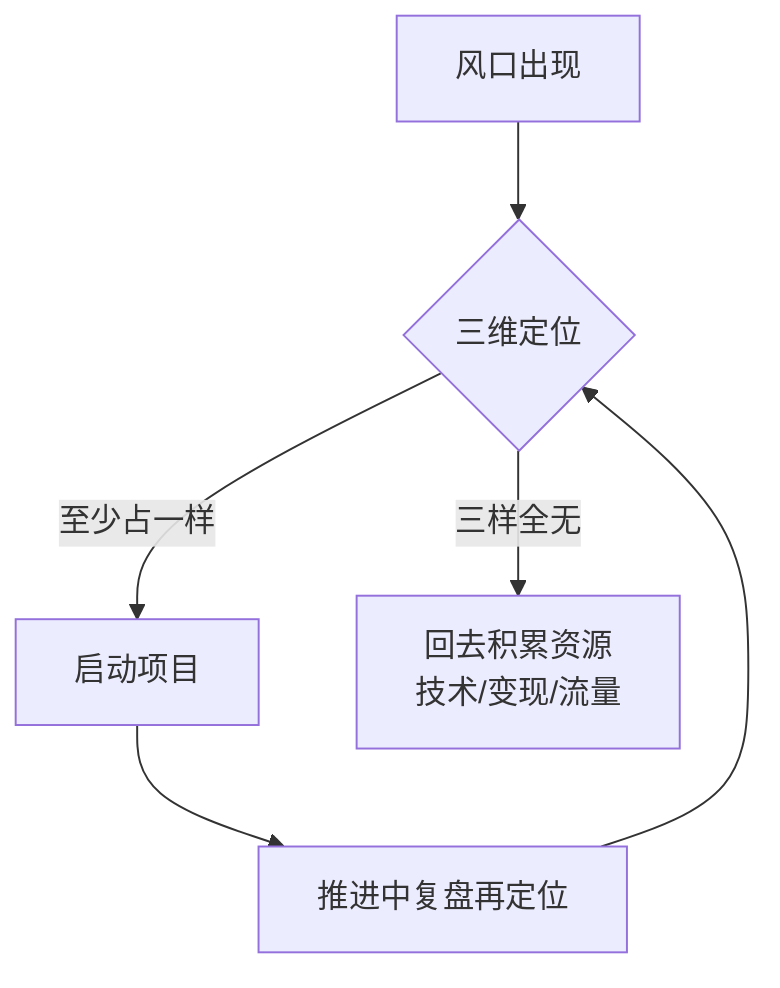
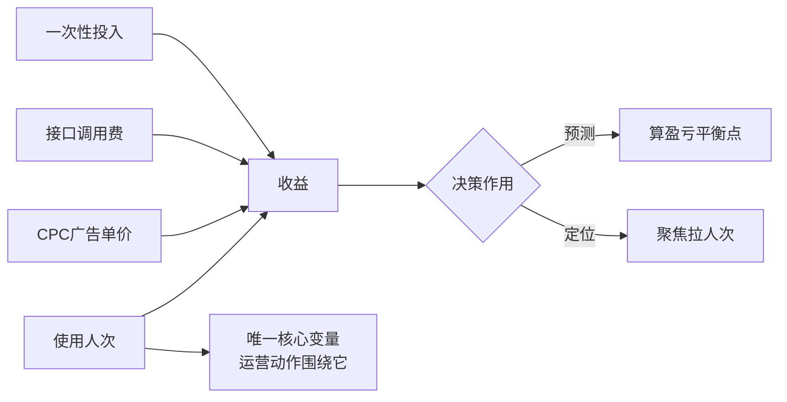
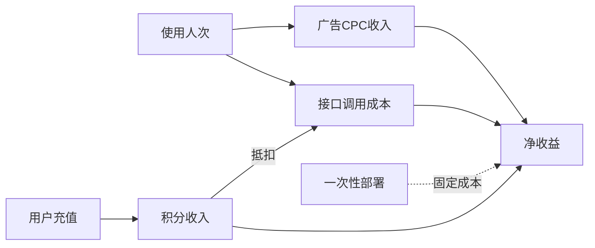
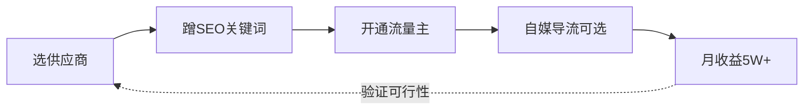
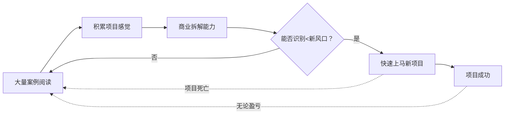

# 第 22 章 风口项目的运营与变现 —— 从"看到风口"到"算清账再动手"

## 学习目标

- 理解风口项目启动前先做三维定位（技术/变现/流量）的必要性
- 掌握用收益公式抽象化商业模式并定位核心增长变量的方法
- 学会拆解成本与收入的构成，判断差价生意的可行性
- 掌握蹭关键词SEO这一低成本精准获客手段及其边界条件
- 能复制一条从选型到变现的可跑通流水线，并理解其适用前提
- 理解风口生意的天花板在于能力沉淀而非项目本身

## 22.1 生活类比 —— 水库钓鱼的启发

老渔夫老张在水库边生活了大半辈子。他见过太多"听说水库里鱼群爆发"就匆匆赶来的人：有人带着一杆精致鱼竿却忘了带鱼饵，有人扛着渔网却不会看水流，还有人手提一桶蚯蚓却连船都没有租——最终只能看着鱼群在远处翻腾，空手而归。而老张每次出钓前，都会先在自家院子里清点三样东西：**鱼竿（技术）、鱼饵（变现渠道）、渔网（流量资源）**，至少确认带齐一样，才值得动身。这便是"三维定位"——带错工具，再好的鱼群也与你无关。

老张心里还有一本"鱼获账"：鱼获 = 下网次数 ×（每条鱼的市场价 − 捕捞成本）− 买渔具的钱。他一眼就看明白了，这算式里唯一能由自己掌控的，是**下网次数**，就像作者清楚"使用人次"是唯一核心变量。收网时，老张还会细算成本与收入：鱼价是市场定的（好比广告CPC）、鱼饵消耗（好比接口调用费）会随捕捞量升高，但抵不过鱼获的收益；他专挑水流湍急的洄游通道下网——不用划船到处找鱼，鱼会自己游过来，这便是"蹭关键词SEO"。至于整套流程，老张早已熟稔于心：先向邻村借一条船（选供应商），再选好洄游通道（蹭SEO），把网支好（开通流量主），然后静待收成。

听起来简单，但老张还有一句常挂在嘴边的话："鱼获的命门是下网次数，但真正让我年年有鱼的不是哪一次的收获，而是几十年看水看风积攒下的眼力。"这眼力如同作者的"项目感觉"——风口会过，但眼力长存。

## 22.2 概念地图

```
AI绘画变现项目
├── 前置定位
│   └── 三维定位（技术 / 变现 / 流量）  —— 定位错则方向迷失
├── 商业模式与公式
│   ├── 收益公式: 使用人次×（CPC单价−接口费用）−一次性投入
│   ├── 收入侧：广告CPC + 充值积分 —— 摊薄接口成本
│   └── 成本侧：接口调用费 + 一次性部署 —— 可变成本随量
├── 流量获取
│   └── 蹭关键词SEO —— 植入高指数词，98%流量来自搜索，主导性/长尾效应
├── 落地流程
│   └── 四步走：选供应商→蹭SEO→开通流量主→自媒导流 —— 门槛低、可复制
└── 本质与天花板
    └── 风口+运气 → 沉淀"项目感觉" —— 可迁移/复利/反脆弱
```

## 22.3 风口下的冷思考 —— 先把"三张底牌"亮出来

每当一项新技术（如 ChatGPT、AI 绘画）刚冒头时，社交平台上总会涌现一大批"月入十万"的造富神话。面对这种耸动的钩子，很多人第一反应是冲动入场，生怕错过窗口。但问题是：**你在这个链条里到底能扮演什么角色？**

如果连"我有什么、我会什么、我能触达谁"都没想清楚就冲进去，大概率是给别人当燃料。我们需要一个系统化的前置思考，把三张底牌翻开来看看。

> "任何技术的革新都会带来新的机会，不过冷静下来，还是要找好自己在这个事情中的定位，定位错了，方向就迷失了。"
>
> ——《AI绘画小程序淘金：月入5W+的实操复盘》（中等）[ID: P001][素材路径：docs/202301-02/Zjr6dgbHIoxcp0x21SVcrwlqn8d.md]

作者提出的**三维定位**，就是在拥抱风口前，先盘一遍自己三个维度的资源禀赋：

- **技术**——你能不能开发，或者会不会用相关工具？
- **变现**——你有没有现成的变现渠道（如👸号流量主、私域社群）？
- **流量**——你有没有粉丝基础，或者内容生产能力？

> **三维定位**定义（来源：《AI绘画小程序淘金：月入5W+的实操复盘》）[ID: P001][素材路径：docs/202301-02/Zjr6dgbHIoxcp0x21SVcrwlqn8d.md]

$$
\text{资源禀赋} = \langle \text{技术能力}, \text{变现渠道}, \text{流量基础} \rangle
$$

这个公式把"我适不适合做这个项目"从一个模糊的感觉，变成了三个可检查的维度。作者自己在复盘 AI 绘画小程序时就坦白：没有开发能力、也没有私域流量，所以选择"照猫画虎"蹭关键词 SEO，而不是自研。

**三维定位是一个"前置过滤器"**：只有三样里至少占一样，这个项目才值得启动。三样可以互相弥补，但必须有一个确定性的起点。它也不是一次性动作——项目每推进一步，你都要回头重新检查这三个维度是否依然匹配。

**为什么必须前置过滤？** 因为风口项目有一个残酷的时间窗。如果你三样全无，硬冲进去的结果往往是：等你学完技术、攒够粉丝，红利期已经结束。所以正确的顺序是：先定位，再启动；定位不过关，宁可错过也不硬上。

**边界条件**：三维定位只适用于"以个人或小团队为主体"的项目启动阶段，不适用于大公司的资源型布局。如果你三样全无，正确做法不是硬上，而是先回去积累资源。



这张图展示了三维定位作为前置过滤器的工作方式：它不是一次性的检查，而是一个循环。每推进一步都要回到定位这个节点，确认三个维度依然匹配，否则随时调整方向。

## 22.4 收益公式 —— 用一道乘法题看穿生意的底牌

一个生意看起来热闹，但值不值得做，不能凭感觉，得先把"钱从哪里来、差价在哪里"算清楚。很多新手做副业时只看到"别人赚了多少"，却从不算自己的账，结果一做就亏。

把复杂的商业模式压缩成一道公式，能让你一眼看到最关键的增长变量，避免被表象迷惑。

> "所以这个生意对于我来说，收益 = 使用人次 * （ CPC的广告价格 - 接口调用费用） - 一次性投入 ，其实这里边还有个充值积分的钱，可以平摊到接口调用费用中。"
>
> ——《AI绘画小程序淘金：月入5W+的实操复盘》（中等）[ID: P001][素材路径：docs/202301-02/Zjr6dgbHIoxcp0x21SVcrwlqn8d.md]

作者给出的**收益公式**，把整个生意的底牌翻了个底朝天。但公式不是凭空蹦出来的，它是从业务流中一步步"抽"出来的。我们不妨推导一遍，看看它是怎么来的：

> **收益公式推导**（来源：《AI绘画小程序淘金：月入5W+的实操复盘》）[ID: P001][素材路径：docs/202301-02/Zjr6dgbHIoxcp0x21SVcrwlqn8d.md]

```
总收入 = 使用人次 × CPC广告单价 （广告主按点击付费）
总成本 = 使用人次 × 接口调用费用 + 一次性投入（部署成本）
净收益 = 总收入 − 总成本
       = 使用人次 × CPC广告单价 − 使用人次 × 接口调用费用 − 一次性投入
       = 使用人次 × (CPC广告单价 − 接口调用费用) − 一次性投入
```

这样一步步推导下来，公式的每一项都有了业务对应物：**使用人次**是用户看广告的次数，**CPC广告单价**是每看一次广告你能拿到的钱，**接口调用费用**是每次生成图片要付给 AI 供应商的成本，**一次性投入**是你购买或部署小程序的固定支出。

所以：

> **收益公式**定义（来源：《AI绘画小程序淘金：月入5W+的实操复盘》）[ID: P001][素材路径：docs/202301-02/Zjr6dgbHIoxcp0x21SVcrwlqn8d.md]

$$
\text{收益} = \text{使用人次} \times (\text{CPC广告单价} - \text{接口调用费用}) - \text{一次性投入}
$$

这个公式的意义不只是"算个数"，更是一个**商业决策模型**。它的作用体现在三方面：

1. **预测**：在启动前就能估算盈亏平衡点——一次性投入 3000 元，每单差价 0.15 元，需要至少 20000 人次才能回本，从而判断项目是否值得做。
2. **决策**：公式揭示出四个变量中只有一个是你能主动控制的，从而指导你把有限的资源集中投放到"拉人次"这个动作上。
3. **定位核心变量**：一眼看出命门所在，不被"提升广告单价"这类不可控选项分散精力。

在 CPC 单价和接口成本相对固定的前提下，公式右侧只剩下"使用人次"这一个自由变量。你的所有运营动作，都必须围绕"让更多人用"展开。

这个公式还天然具备**杠杆性**：使用人次每增加一倍，由于固定成本已经摊薄，利润会以更快的速度放大。边际成本几乎不增加，这正是工具类小程序生意的魅力所在。

**边界条件**：这条公式只对"广告变现型"的工具类小程序成立。如果你的产品依赖直接付费购买，需要另建模型。公式忽略了平台政策变动、竞品涌入导致的 CPC 下跌，属于理想态估算。一次性投入如果摊销周期短于风口存活期，公式也会失效——你必须考虑回本周期。



这张图揭示了收益公式的核心逻辑：四个输入变量中，CPC 单价是市场定的、接口费是供应商定的、一次性投入是固定成本，唯一你能主动改变的只有使用人次——这就是为什么作者说它是"唯一变量"。

## 22.5 成本与收入的构成拆解 —— 把账本摊开算清楚

光知道公式还不够，还得知道公式两侧每一项具体装的是什么。否则算出来也是"假账"。你需要拆清成本和收入，才能判断这个差价生意是否真的有肉吃，以及哪里能再抠出利润。

> "小程序广告和充值变现 看一次30s广告的CPC大概在0.1-0.3之间"
>
> ——《AI绘画小程序淘金：月入5W+的实操复盘》（中等）[ID: P001][素材路径：docs/202301-02/Zjr6dgbHIoxcp0x21SVcrwlqn8d.md]

作者把账本摊开，分两侧来算。**收入侧**装的是平台给的广告费和用户充值的积分，**成本侧**装的是按次计算的接口费和一次性部署支出。下表总结了收入侧各项的性质与作用：

| 收入项 | 单价区间 | 性质 |
|--------|----------|------|
| 小程序广告 CPC | 0.1-0.3 元/次 | 平台定价，相对刚性 |
| 抖音小程序广告 CPC | 0.1-0.3 元/次 | 平台定价，相对刚性 |
| 充值积分 | 按次抵扣 | 二次收入，摊薄接口成本 |

下表总结了成本侧各项的计价方式与性质：

| 成本项 | 计价方式 | 性质 |
|--------|----------|------|
| AI 绘画接口调用费 | 按生成次数计费 | 随使用人次线性增加 |
| 一次性部署成本 | 选型供应商、开发/购买小程序 | 固定投入，一次性 |

为什么要拆得这么细？因为每一项的性质决定了你的运营策略：

**广告 CPC 是"平台定价"类收入**——单价刚性，波动空间小。你不能指望提高单价，只能靠堆量。**充值积分是"二次收入"**——它能把接口固定成本进一步摊薄，是隐藏的利润调节阀。**接口调用费是"随量而动的可变成本"**——使用人次越多，这块成本也跟着线性增加，但它通常被广告收入盖过。

**典型例子**：用户充值一笔积分（如 10 元），获得一定使用次数。这些次数消耗的接口成本直接从充值里抵扣，等于多出来的广告费全是净赚。这是充值积分作为"利润调节阀"的具体运作方式。



上图展示的是资金流向：使用人次同时驱动收入和成本两侧，但充值积分像一道闸门，可以直接抵扣掉一部分接口成本，让更多广告收入变成净收益——这就是"利润调节阀"的运作机制。

**边界条件**：此拆解仅适用于"按次调用"的 API 模式；若采用包月固定接口费，成本结构完全不同。充值积分如果设置太便宜，反而会拉低净利率，甚至补贴重度用户导致亏本。

## 22.6 蹭关键词SEO —— 在水流湍急的地方下网

AI 绘画小程序刚上线时，没有自然流量、没有粉丝基础，主动投广告又费钱。这时候最需要的是一种近乎零成本的获客方式，把平台的搜索流量"白嫖"过来。

关键词就在于：**搜索流量的用户是带着明确需求来的**，转化率远高于刷到的泛流量。

> "流量方面我首先采用的是蹭关键词的方法……简单的设置下小红书的名字和简介就能够蹭来很多流量。"
>
> ——《AI绘画小程序淘金：月入5W+的实操复盘》（中等）[ID: P001][素材路径：docs/202301-02/Zjr6dgbHIoxcp0x21SVcrwlqn8d.md]

作者所用的**蹭关键词SEO**方法，核心逻辑是：

> **蹭关键词SEO**方法（来源：《AI绘画小程序淘金：月入5W+的实操复盘》）[ID: P001][素材路径：docs/202301-02/Zjr6dgbHIoxcp0x21SVcrwlqn8d.md]

```
1. 用微信指数等工具观察当下热门关键词（如"AI绘画"）
2. 把这些词植入小红书、抖音等平台的账号名称与简介中
3. 用户在搜索这些词时能刷到你的账号
4. 获得平台的搜索自然流量（最低成本、最精准）
```

这段伪代码展示了蹭关键词SEO的完整路径：先借助数据工具锁定高热度词，再通过简单的名称和简介设置，利用平台自身的搜索分发机制获取流量。整个过程几乎零成本，核心是"提前预判"——在别人还没反应时就把词占住。

作者实测："几乎百分之 98 的流量都来源于小程序搜索，所以关键词SEO这块目前非常重要。"注意这个数字：**98%**。这意味着在本项目里，SEO 不是补充手段，而是命脉。没有它，整个生意就转不起来。

**这个方法为什么有效？** 因为关键词本身带有用户的明确意图。搜"AI 绘画"的人，就是想要用 AI 画画的人，点击即意向。相比之下，刷推荐流量的用户动机模糊，转化率低得多。

**边界条件**：该方法依赖平台算法与搜索规则，关键词热度会随风口消退而衰减。若平台对"蹭词"行为限流，或要求内容与关键词高度相关，则可能失效。且它仅适合早期零成本冷启动，后期仍需内容或投放来承接流量。此外，关键词热度与搜索量的具体数值会随时间变化，不同平台的搜索算法与分发规则也存在差异，读者在实际操作时需自行验证当期的数据与平台政策。[需要补充文献：建议读者查阅微信指数官方数据、目标平台最新搜索规则及同行业实操对照组]

## 22.7 从选型到躺赚 —— 复制一条可跑通的流水线

很多新手面对 AI 绘画项目，第一反应是"我要自己开发一个"。但自研的代价是：投入大、周期长、风险高。在风口期，等你开发完，红利早被别人吃完了。

你需要一条现成的、别人已经跑通的路，照着做就能快速落地。

> "1、选一个靠谱的小程序供应商 2、照猫画虎一样的去蹭SEO关键词 3、开通流量主，设置广告 4、如果有私域流量和做内容的能力，可以自己发布视频引流量"
>
> ——《AI绘画小程序淘金：月入5W+的实操复盘》（中等）[ID: P001][素材路径：docs/202301-02/Zjr6dgbHIoxcp0x21SVcrwlqn8d.md]

作者总结的**四步流水线**，把整个项目拆成了固定步骤：

> **四步流水线**方法（来源：《AI绘画小程序淘金：月入5W+的实操复盘》）[ID: P001][素材路径：docs/202301-02/Zjr6dgbHIoxcp0x21SVcrwlqn8d.md]

```
Step 1: 选一个靠谱的小程序供应商（照猫画虎，不自研）
Step 2: 做关键词SEO引流（把高热度词植入账号名称与简介）
Step 3: 开通流量主、配置广告位（把流量转化为收入）
Step 4: 有私域流量和内容能力，可自行发布视频导流（可选增强项）
```

这段伪代码展示了整套操作的可复制性：不需要开发能力，选型即可。关键原则是**先选型后引流**——把"货架"搭好再引客，避免流量来了没处接。

作者本身不做开发、没有私域，仅靠前三步就实现了月收益 5W+。如果你有内容能力和私域基础，第四步还能进一步放大。

**边界条件**：这条流水线依赖第三方供应商的质量与稳定性，若供应商跑路或服务降级，项目即受冲击。它仅适合广告变现型工具类小程序；若你想做品牌或长期资产，需要更深的产品与技术投入。更关键的是，该流程是"复制"而非"创新"——可复制意味着竞争者涌入后红利迅速衰减。



这张流程图展示了四步流水线的执行顺序：每一步都为下一步打基础，选供应商解决"货从哪来"，蹭 SEO 解决"客从哪来"，开流量主解决"钱从哪来"，自媒导流是锦上添花。顺序不能乱，每一步都是前一步的前提。而虚线箭头代表一个隐性回路——当你验证项目跑通后，可以回到第一步，优化供应商选择或换新供应商复制到下个风口。

## 22.8 风口生意的天花板 —— 从"追风口"到"建能力"

风口总有消退的一天。靠运气赚的钱，最终会靠实力亏掉——这句话在副业圈反复应验。如果只停留在"复制一个爆款项目"的层面，项目死了你就一无所有。

你需要把一次性的项目经验，沉淀为可复用的商业拆解能力，才能在下个风口来临时再次抓住机会。

> "这个项目其实做起来目前来说，还属于风口和运气成分居多，不过这背后其实是无数次在生财阅读各种文章后积累的项目的感觉"
>
> ——《AI绘画小程序淘金：月入5W+的实操复盘》（中等）[ID: P001][素材路径：docs/202301-02/Zjr6dgbHIoxcp0x21SVcrwlqn8d.md]

作者很坦诚：这个项目能赚钱，"风口和运气成分居多"。但他话锋一转，点出了真正的护城河——**"无数次在生财阅读各种文章后积累的项目的感觉"**。

这里的"项目感觉"，本质上是一种**商业拆解能力**。下表列出了它的三个核心特质及其含义：

| 特质 | 含义 |
|------|------|
| 可迁移性 | 不绑定于单一项目，能应用于新风口、新赛道 |
| 复利性 | 每复盘一个案例，能力就增长一分，长期积累形成判断力 |
| 反脆弱性 | 即便当前项目失败，能力还在，随时能东山再起 |

**典型例子**：作者并非只做 AI 绘画，而是长期在生财等平台"攒感觉"。等到 AI 绘画风口一来，用之前练就的"项目感觉"快速上马并变现。风口是偶然的，但抓住风口的能力是长期积累的必然。



上图展示了能力沉淀的演进路径：大量案例输入形成"项目感觉"，进而升级为可迁移的商业拆解能力。这种能力在下个风口到来时被调用，无论是成功还是失败，都会反哺回案例库，让能力进一步增长——这就是复利与反脆弱的内在机制。

**边界条件**：这种"感觉"需要长期、大量的案例输入，短期速成不可能。它只在"信息差型"副业项目中适用；对于需要核心技术壁垒的生意，单纯拆解能力不足够。方法有效的前提是持续学习——一旦停止输入，能力也会停滞。

## 22.9 设计中的取舍

有人会问：**为什么不自研小程序，而是选供应商？**

自研的诱惑在于"掌控感"，但代价是周期长、成本高。风口期的核心是速度——晚一个月上线，流量就少一大截。作者选供应商"照猫画虎"，本质是用可控的成本换时间窗口。这是典型的"复制优先于创新"思维：在利润确定性验证之前，不押注于自研。

还有人会问：**为什么不投广告，而蹭SEO？**

投广告见效快，但需要预算；蹭 SEO 几乎零成本，但见效慢、需要提前布局。作者的取舍是：项目初期没有粉丝、没有预算，唯一能"白嫖"的就是搜索流量。98% 的流量来自搜索，说明 SEO 在本项目中的性价比远高于投放。但当竞争者涌入后，SEO 的边际收益会下降，届时才需要考虑投放。

## 22.10 动手练习

1. **模拟运行一次收益公式沙盘**
   假设你运营一个 AI 绘画小程序，已知：看一次 30s 广告的 CPC 单价为 0.2 元，接口调用费用为每次 0.05 元，一次性部署成本为 3000 元。问题：
   1. 若每日使用人次为 10000 次，日收益和月收益各是多少？
   2. 如果充值积分收入能摊薄 40% 的接口成本，新的月收益是多少？
   3. 若要实现月净收益 5W+，每日至少需要多少使用人次？
   4. 当竞品涌入导致 CPC 跌至 0.1 元时，同样的使用人次下月收益会发生什么变化？

2. **设计一次关键词SEO冷启动方案**
   假如现在是 2024 年，你想复制"蹭关键词SEO"的方法做一个 AI 数字人小程序：
   1. 你会选择哪个平台（小红书/抖音/微信）作为主阵地？为什么？
   2. 请用微信指数或百度指数工具，找出 3 个你判断为"当下热门"的潜在关键词
   3. 尝试为你的账号撰写一份包含这些关键词的"名称+简介"（不超过 30 字）
   4. 判断这些关键词的流量真实性——例如"AI数字人"是高频搜索词，还是仅在小圈子内被讨论？

3. **编写一份三维定位自测清单**
   借鉴素材中"技术/变现/流量"三维定位法，为一个你感兴趣的风口项目（如 ChatGPT、AI 数字人、短剧推广）做定位分析：
   1. 技术维度：你会开发或会用相关工具吗？若不会，能否找到现成供应商？
   2. 变现维度：你是否有现成的变现渠道（如👸号流量主、私域社群）？
   3. 流量维度：你有多少粉丝？是否有内容生产能力？
   4. 综合判断：这份自测清单是否显示该项目适合你？如果不适合，请给出 1-2 条具体的资源补强建议（例如先积累 100 个精准粉丝）。

## 22.11 本章小结

这一章里，我们拆解了一个 AI 绘画小程序月入 5W+ 的真实案例，从中提炼出一套从"看到风口"到"算清账再动手"的完整方法论。首先，我们学习了三维定位法——在动手前先盘清技术、变现、流量三张底牌，定位错了方向就迷失了。其次，我们用收益公式"使用人次 ×（CPC单价 − 接口费用）− 一次性投入"把生意抽象成一道乘法题，通过逐步推导看清每一项的业务来源，并一眼定位到"使用人次"这个唯一核心变量。接着，我们把账本摊开，看清收入侧（广告 CPC + 充值积分）和成本侧（接口调用费 + 一次性部署）的具体构成，理解了为什么充值积分是隐藏的利润调节阀。然后，我们掌握了蹭关键词 SEO 这一近乎零成本的精准获客手段，并意识到它在本项目中的命脉地位——98% 的流量来自搜索。最后，我们提炼出一条四步可复制的流水线，并清醒地认识到风口生意的天花板在于沉淀可复用的"项目感觉"而非项目本身。

本章我们一起学习了以下概念：

| 概念 | 解释 |
|------|------|
| 三维定位（技术/变现/流量） | 风口项目启动前的资源前置过滤器，三样至少占一样才值得动手 |
| 收益公式 | 用"量×差价−固定成本"抽象商业模式，一眼定位命门变量 |
| CPC广告单价 | 平台定价的刚性收入，波动空间小，只能靠堆量提升总收益 |
| 充值积分 | 隐藏的二次收入，能摊薄接口固定成本，是利润调节阀 |
| 接口调用费 | 随使用人次线性增加的可变成本，被广告收入盖过 |
| 蹭关键词SEO | 在平台名称/简介植入高热度词，低成本获取精准搜索流量 |
| 98%搜索流量占比 | 实测数据证明SEO是本项目的命脉而非补充手段 |
| 四步流水线 | 选供应商→蹭SEO→开流量主→自媒导流的可复制启动路径 |
| 风口天花板 | 项目是风口+运气，长期护城河在于沉淀可复用的"项目感觉" |

下一章中，我们将把视野从单项目提升到人生复利系统：如何通过利他即利己、战略发挥优势、不流动稀缺资源优先等认知框架，把一次性的项目经验沉淀为长期可复利的个人资产。这是从"赚快钱"到"复利人生"的认知升维。

