# 第 44 章 商业认知与实战方法论全景图

## 学习目标

- 理解商业认知的底层逻辑：时代红利、流量价值公式、财富积累四阶段、战略即选择
- 掌握选品方法论的核心四步：找蓝海、走捷径（合规平替）、加光环（空壳品牌）、微创新（材质套利）
- 掌握公域引流私域变现的完整链路：流量切片分析、流速控制、流量合并、单客价思维、五位一体成交飞轮
- 理解内容创作与IP打造的核心逻辑：内容价值金字塔、渣男思维（撩完就跑/广撒网）、SEO思维布局精准流量、爆款模板复用
- 掌握项目操盘从MVP验证到规模复制的方法：先卖后做、商业拆解复制、资源匹配度评估、矩阵化怼量、加盟扩张前提
- 建立创业心态与内在比赛的认知：盲目自信、成功是成功之母、唤醒成功体验、俯视学习法、战术勤奋不逃避战略探索
- 掌握高净值客户销售核心：需求上升为痛点、失去掌控权痛点、买家/卖家系统博弈、破局引起好奇、合作思维
- 建立趋势判断与机会窗口的框架：确定性窗口期推演、平台电商四周期、热点套利技术栈、需求共振、信息差挖掘
- 建立风险管理与合规底线：劳动合同有效性、辞退损失最小化、非刚需项目规避、无壁垒项目本质、理性止损、平台风控本质
- 掌握杠杆复制与放大的系统方法：盈利验证放大、剥离式拆解问题、OKR执行、股权顶层设计四要素、三会一层治理、矩阵化复制
- 内化认知升维与长期主义：利他等于利己、战略发挥优势法、争是不争不争是争、不流动稀缺资源优先、商业模式道术器用、5WHY分析、合格总结三要素、产品Idea五种构思法、好名字公式

## 44.1 生活类比

想象商业世界是一场**大型狩猎游戏**：**时代红利** = 季节性的动物大迁徙：不论你射术多好（能力），赶上迁徙季（红利）随便射射都有收获；错过季节，神射手也空手而归。**选品** = 选择猎物：蓝海是没人去的狩猎场（小语种国家/高门槛平台），合规平替是用低成本陷阱捕获高价值猎物，空壳品牌是披着名兽皮毛吓退竞争对手，微创新是给陷阱加个改良扳机。**流量获取** = 引诱猎物进陷阱：公域流量是公共草原上的兽群（归平台所有），私域流量是自家围场里的养殖场（归自己所有）。流量切片像解剖兽群迁徙路径，流速控制像调节诱饵投放节奏，流量合并像雇佣其他猎人帮你围猎。**内容创作** = 涂抹诱饵：娱乐内容是糖浆（只贪嘴不入套），工具内容是盐砖（有实用价值常来舔），方法内容是费洛蒙（让猎物产生依赖性）。渣男思维是“撩完就跑”在最香时收走诱饵，“广撒网”在多个水源地都撒诱饵。**项目操盘** = 试错造枪：MVP先卖后做是先画枪图收定金再造枪，商业拆解是拆解猎王的枪自己组装，矩阵化怼量是造30把一样的枪分给猎手轮番射击。**内在比赛** = 猎人的心魔：自我一是理智教练（总说别贪心）、自我二是本能射手（真正扣扳机）。盲目自信是射手潜意识里“我百发百中”的信念，成功体验是过往命中靶心的肌肉记忆，俯视学习是站在制高点向大师请教弓法。**销售成交** = 给猎物套马甲：需求是猎物饿了（理性），痛点是猎物被狼追（恐惧情绪驱动）。高净值客户痛点是“失去掌控权”像头狼怕失去领地。买家系统是猎物的警惕本能，破局要先激发好奇心（晃个新奇玩意），再升级痛点（这玩意能保命）。**趋势判断** = 读天象识兽迁：确定性窗口像根据气压预判雨季草长兽肥，平台四周期像草原植被演替规律，热点套利像看见兽群突然出现立马架枪（技术基建是预埋好的架枪架），需求共振像迁徙路线恰好经过你的围场。**风险管理** = 穿护具带急救包：劳动合同附件是护具细节（护膝护肘），辞退最小化是受伤后止血分级，非刚需项目是追捕不存在的幻兽，无壁垒项目是买别人的狩猎日记，理性止损是发现陷阱有毒果断撤退。**杠杆复制** = 组建猎人军团：盈利验证是确认一把枪好用，剥离式拆解是拆解狩猎全流程100个细节分工，OKR是给每个猎手量化猎杀指标，股权设计是分配猎物分肉规则，三会一层是军团指挥部。**认知升维** = 从猎人进化为草原生态守护者：利他等于利己是分享猎物情报换取更多盟友，发挥优势法是用擅长长矛就不练弓箭，争是不争是建水源吸引兽群而非抢猎物，不流动稀缺资源是守住水源地而非追逐单次猎物。

## 44.2 概念地图

商业认知底层逻辑
├── 时代红利决定论（90%红利+10%能力）
├── 流量价值公式（规模×相关性×信任度）
├── 财富积累四阶段（出卖劳动力→一份时间多卖→买他人时间→钱生钱）
├── 人生四阶段（扩广度→做管理→找第二曲线→复制放大）
├── 战略即选择（核心是不做什么）
├── 杠杆效应（劳动力、媒体、代码边际成本零）
├── 商业模式换汤不换药
├── 执行力可变现
├── 战术勤奋不逃避战略探索
└── 做事依据能力资源非愿望
选品方法论
├── 选品即运营（提前解决流量转化）
├── 蓝海分层（最蓝/次蓝/微蓝/不蓝）
├── 蓝海方向（垂直方向自带搜索流量）
├── 四步打造爆款：找蓝海→走捷径→加光环→微创新
│   ├── 合规平替（90%体验1/5价格）
│   ├── 空壳品牌（抢注/虚构故事获溢价）
│   └── 材质套利（升级式/热点嫁接差异化）
├── 抖音发散选品四法（代金券/影视/场景/技能）
└── 追求确定性非彩票
流量获取与私域运营
├── 公域引流私域变现（核心心法五句）
├── 流量切片分析法（横向纵向切片）
├── 流量流速悖论（不快不慢持续不断）
├── 交易目的论（曝光无价值交易为目的）
├── 流量合并（让流量主赚更多钱）
├── 私域单客价思维（长期总贡献）
├── 实时真实ROI（含私域产值）
├── 视频号引流工具（企微弹出/金句卡片）
├── 捡漏群闭环（选品/排品/演员/催单）
├── 五位一体成交飞轮（破冰/诊断/方案/信任/成交）
└── 社群分销增长公式（供应链×顶层设计×动员能力）
内容创作与IP打造
├── 内容杠杆（边际成本零复利系统）
├── 内容价值金字塔（娱乐/工具/方法）
├── 渣男思维：撩完就跑（峰终定律）+ 广撒网（垂人群非题材）
├── 逆向思考（变现→定位→产品→内容→流量）
├── 超垂直IP+SEO思维（300-500长尾词）
├── 爆款引流库（100-10-1聚焦法）
├── 反向发帖/挨骂流派（争议共鸣）
├── 写作即社交（身份证筛选同频）
└── 模板化限制创造力边界
项目操盘与变现
├── MVP先卖后做（高意向付费验证）
├── 商业拆解复制副业法
├── 资源盘点与匹配度评估
├── 买卖/生意/商业三分论
├── 招商加盟四级别（轻/中/重/魔鬼级）
├── 矩阵化怼量（质量前提下量大概率爆单）
├── 健康单店模型是加盟前提（测算/财务/区域/复制）
├── 奶茶加盟优于直营（蜜雪vs奈雪）
├── 无人直播素材风险（去重/违禁词/平台处罚）
├── 视频号店群（后端商品缺乏/矩阵思维/5店起）
├── 抖音本地生活（POI加热/爆品/矩阵/好评/10倍空间）
└── 平台生命周期调整打法
创业心态与内在比赛
├── 内在比赛理论（自我一理性/自我二潜意识）
├── 内在比赛决定外在成败
├── 盲目自信（我是国王潜意识信念）
├── 成功是成功之母（成功体验累积自信）
├── 唤醒成功体验法
├── 俯视学习法（战略藐视/战术重视）
├── 老虎伍兹/李宗伟案例（失去不可战胜信念）
├── 正反馈驱动热爱（懒惰=无正反馈=不够爱）
├── 战术勤奋逃避战略探索（有毒）
└── 做事依据能力资源非愿望（老鹰/鲨鱼）
销售与成交
├── 需求vs痛点（理性vs情绪驱动）
├── 高净值痛点：失去掌控权
├── 买家系统vs卖家系统（自我保护机制）
├── 破局：好奇→痛点/权威→提问依赖
├── 成交核心：需求/信任/购买力
├── 闲鱼倒爷套利（底层逻辑/市场调研/关键词找货）
├── 合作思维（利他即利己）
├── 发圈动力公式（佣金/设计交压力）
├── 分销佣金分配平衡（一级稳/二级快）
├── 抖音爆单承接（同内容合集/双路/直播共振）
└── 微头条爆文（争议/共鸣/点击率>10%/互动3%）
趋势判断与机会窗口
├── 确定性窗口期（疫情数据类比推演）
├── 平台电商四周期（铺货/动销/精细化/玩趋势）
├── 热点套利技术栈（基建决定响应速度）
├── 行业切入：旅游/健康/餐饮
├── 需求共振（季节性需求高峰重合）
├── 信息差生意（身边被忽视机会）
├── SEO长尾福利（3-5年持续流量）
├── Web3熊市生存（敬畏/保护弹药/基建公司）
└── 反期望：逆向操作不保证赚钱
风险管理与合规底线
├── 劳动合同有效性（合同枪/附件子弹）
├── 辞退损失最小化（谈/签/结/证）
├── 优雅亏大钱三步骤（反讽警示）
├── 非刚需项目规避（本性成就人）
├── 无壁垒项目本质（付费买试错经验）
├── 平台内容合规应对（离线/反馈/修订）
├── AI绘画小程序理性止损
├── 平台风控本质（反向推导分配偏好）
├── TikTok硬改设备风险（寿命短/一锤子买卖）
├── TEMU标品议价空间小（10%利润/压价）
└── Web3新人23条建议（小成本/不杠杆/会卖/见好就收）
杠杆复制与放大
├── 盈利验证放大（跑通第一单/复制30遍）
├── 剥离式拆解问题（10大问题→100小问题）
├── OKR制定执行（战略坚定/KR推动O/MVP验证/高频同步）
├── 三会一层治理（股东会/董事会/监事会/高管层）
├── 股权四要素（控制权/进入/分配/退出）
├── 副业转老板（招人建立杠杆）
├── 矩阵化抖音怼量（质量前提/累计10万+）
├── 招商加盟0到1操盘（分类/模式/准备工作）
├── 健康单店模型前提（新标准四项）
├── 奶茶加盟优于直营（19亿vs亏1.5亿）
└── 战略稳于执行（治理层根源/慎之又慎）
认知升维与长期主义
├── 利他等于利己（越分享越幸运）
├── 战略发挥优势法（筹码-出牌框架）
├── 争是不争不争是争（贡献视角胜利）
├── 不流动稀缺资源优先（品牌/数据/人才/信任）
├── 卓越策略师五大能力（调研/归纳/项目管理/决断/双重叙事）
├── 道术器用四层（道本质/术9维/器工具/用执行）
├── 5WHY分析法（连问5个为什么找根因）
├── 合格总结三要素（比目标/要事实/发现问题）
├── 产品Idea五法（原生/抄竞品差异化/搜索词/预付费/生造）
├── 好名字公式（低触达/理解/记忆/传播成本+体验理由+延展）
├── 战略非目标论（目标非战略）
├── 持续增长悖论（成功后放弃价值创造陷瓶颈）
└── 抓住势能开创新品类（LV/耐克/索尼/宝洁/柯达反例）

## 44.3 商业认知底层逻辑 —— 从“赚钱思维”看懂商业世界

### 为什么需要这个概念？

普通人赚取的绝大部分收入来自时代红利，仅有少部分是对个人能力的补偿，商业英雄是平台与市场红利的产物，因此识别红利窗口比提升能力更紧迫。

很多创业者陷入“被想拥有的东西绑架”的怪圈：越追求增长反而距离增长越远，表现为投机跟风、计算利弊、抓取资源等短视行为。

必须从“我如何得到增长”切换为“我如何成为一个值得被奖赏增长的人”，需要三种勇气：面向未来而非过去、面向用户而非计算利弊、积累价值而非抓取资源。

### 核心定义

**赚钱的本质是交易，交易的本质是满足用户需求** —— 只要满足用户需求就能赚到钱，关键在选定付款者与打动方式。

> "赚钱的本质是交易，交易的本质是满足用户需求。只要满足用户需求，就能赚到钱，你需要做的就是选谁作为付款者，以及怎么打动付款者，这个需求可以是物质需求，也可以是精神需求。"
> 
> ——《龙哥赚钱周报 2022年11月29日精华帖汇总》（素材 ID：20230207_09.md）

**流量价值公式** —— 流量的实际价值由三因素乘积决定：

$$
\text{流量价值} = \text{流量规模} \times \text{交易相关性} \times \text{信任度}
$$

这个公式展示了流量规模只解决连接问题，不解决交易问题。相关性和信任度才决定交易转化。

**逐变量推导：**

1. **流量规模（连接层）**：UV/PV只是连接的建立。当相关性=0或信任度=0时，乘积结果恒为0，说明规模本身不产生交易价值。
2. **交易相关性（匹配层）**：衡量流量人群与产品的契合度。如抖音带货中，看中老年保健视频的人群卖台灯相关性极低，价值趋近0。
3. **信任度（转化层）**：衡量用户对卖家/产品的信心。同等相关性下，KOL推荐信任度>陌生人广告，转化率差异可达10倍以上。
4. **乘法结构的必然性**：三者缺一不可，呈短板效应。加法模型会掩盖“相关性为0仍有价值”的谬误。独立事件联合概率原理决定乘法：流量规模建立连接（概率P1），相关性决定意向（概率P2），信任度决定成交（概率P3），联合概率P = P1×P2×P3。短板效应体现：任一环节为0，整体交易价值为0。

> "流量价值=流量规模×交易相关性×信任度，流量规模只解决连接的问题，不解决交易的问题。有时候我们面对一篇阅读量很高的文章……会感到困惑或焦虑。因为我们只看到了表层的流量规模……比流量规模更重要的是流量相关性。"
> 
> ——《龙哥赚钱周报 2022年12月20日精华帖汇总》（素材 ID：20230207_06.md）

**战略即选择** —— 战略的本质是取舍，核心决策在于明确不做什么，而非做什么。

> "什么是战略呢？就是选择。选择，其最重要的就是不做什么，而不是做什么。"
> 
> ——《龙哥赚钱周报 2023年1月中旬合集》（素材 ID：20230207_03.md）

**财富积累四阶段**（不可跳跃跃迁）：

1. 出卖劳动力（打工）
2. 一份时间多次卖（写书/卖课/代码/媒体）
3. 购买他人时间（当老板，建立杠杆）
4. 钱生钱（投资）

> "财富积累分为四个阶段，第一：出卖劳动力；第二：一份时间多次卖；第三：购买他人时间；第四：钱生钱。"
> 
> ——《龙哥赚钱周报 2022年12月20日精华帖汇总》（素材 ID：20230207_06.md）

**人生四阶段**与财富阶段对应：
- 30岁前：初入职场，扩广度（尝试不同行业/岗位）
- 30岁后：中年危机，做管理拉高度
- 主业之外：寻找第二曲线（副业/改命机会）
- 第二曲线跑通MVP后：组建团队复制放大

### 关键性质

**时代红利决定论**：普通人每赚100元，90元是时代红利，10元是能力补偿；英雄只是时势的产物。

> "可能所有夸张，我们所赚的每一百块钱，有九十块钱是时代红利，仅有十块钱是时代对我们个人能力的补偿，英雄只是时势的产物。"
> 
> ——《龙哥赚钱周报 2023年1月中旬合集》（素材 ID：20230207_03.md）

**增长瓶颈怪圈**：被增长预期绑架后，会失去开创性习惯，变得投机、计算利弊、抓取资源，距离增长越来越远。

> "进入增长瓶颈的一个典型现象，就是越想要增长，却距离想要的增长越远。我们被我们想拥有的东西绑架了。"
> 
> ——《龙哥赚钱周报 2022年11月15日合集》（素材 ID：20230207_07.md）

**价值创造破局**：唯有从“追求增长”切换到“价值创造”视角，才能破除增长焦虑。

> "破除增长焦虑唯一的方法，就是怎么从追求增长的视角，切换成价值创造的视角。从一个'我如何得到增长'，变成'我如何成为一个值得被奖赏增长的人'。"
> 
> ——《龙哥赚钱周报 2022年11月15日合集》（素材 ID：20230207_07.md）

**杠杆效应**：依靠出租时间很难致富，应利用劳动力、自媒体和复制边际成本为零的产品（代码、内容）作为杠杆。

> "《纳瓦尔宝典》里面也有一句话记忆犹新：想要获得财富，就必须充分利用杠杆效应。商业杠杆来自资本、劳动力和复制边际成本为零的产品（代码和媒体）。"
> 
> ——《龙哥赚钱周报 2023年1月中旬合集》（素材 ID：20230207_03.md）

**商业模式换汤不换药**：互联网商业模式周期性重复，新客户世代不断产生，十年前的项目今天依然可行。

> "商业模式不断的换汤不换药，新的客户群体也不断产生。这就会导致，玩了很多年的项目，甚至是十年前的项目，现在依然有人做的很好。"
> 
> ——《龙哥赚钱周报 2023年1月中旬合集》（素材 ID：20230207_03.md）

### 典型例子

- 作者半年淘系红利期经历：原以为赚的是实力钱，实则是红利钱，这是最大感悟（素材 ID：20230207_11.md）。
- 柯达案例：自认成功源于坚持成像品质，实则源于创始人开发低价便捷相机抓住大众化趋势；用过去定义自己导致错失数码相机趋势（素材 ID：20230207_07.md）。
- LV/耐克/索尼/宝洁：巨大增长来自抓住大趋势并做开创性举动（铁路普及推旅行箱、电视转播赞球星、晶体管做随身听、广播媒体建全国品牌）（素材 ID：20230207_07.md）。

### 边界条件

- **战术勤奋无法逃避战略探索**：用忙碌工作麻痹自己、以战术勤奋逃避战略突破，短期轻松但长期有毒（素材 ID：20230207_03.md）。
- **没有壁垒的项目本质是付费买试错经验**：普通人能接触的互联网项目几乎无绝对核心壁垒，培训本质是买别人的试错经验和时间（素材 ID：20230207_03.md）。
- **反期望**：逆向操作也不能保证赚钱，因为“赚钱方式千差万别，亏钱方式殊途同归”，亏钱是赚钱路上不可缺少的部分（素材 ID：20230207_07.md）。
- **执行力是值钱的、可以变现的**：宝妈4个月加4000好友微信号被亦仁花7万购买，作者因执行力被邀请至生财办公室（素材 ID：20230207_03.md）。
- **做事依据是能力与资源而非愿望**：老鹰吃兔子，鲨鱼吃鱼；鲨鱼不应羡慕老鹰，应努力捕捉更多鱼（素材 ID：20230207_05.md / 20230207_07.md）。

### 方法演进图：财富积累四阶段跃迁路径

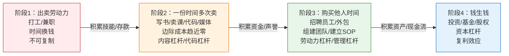

### 方法演进图：杠杆效应分层模型

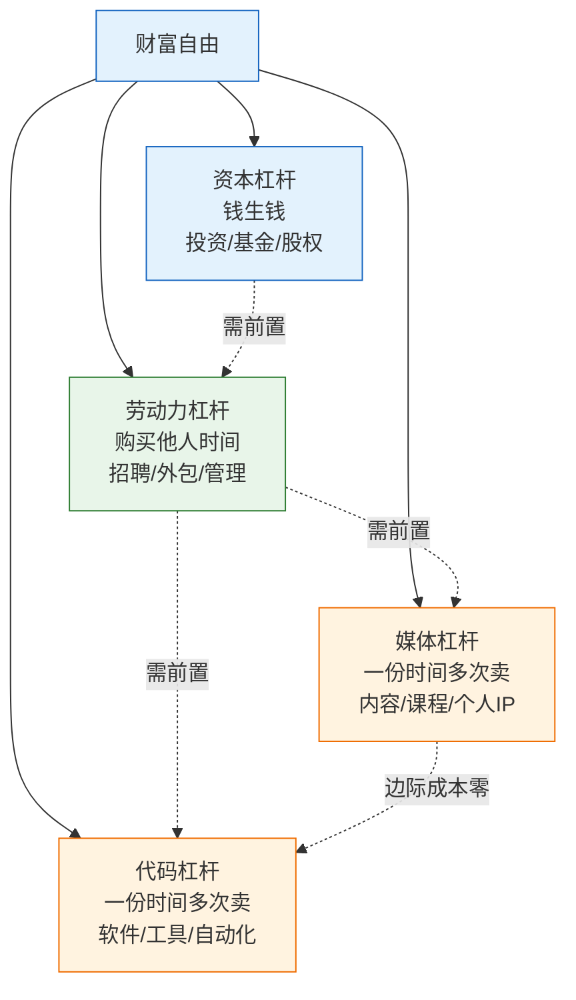

### 方法演进图：战略选择决策树

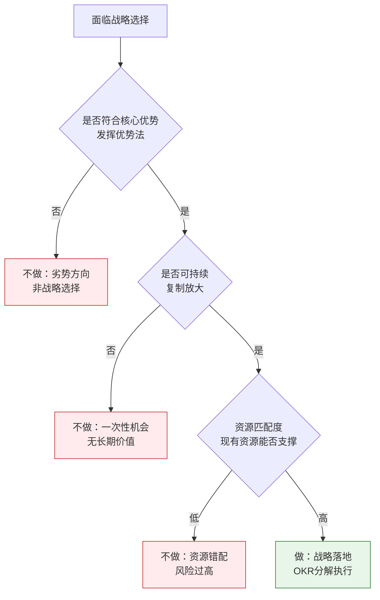

---

## 44.4 选品方法论 —— 从“选什么”到“为什么能卖爆”

### 为什么需要这个概念？

选品过程本身就决定了引流方法和转化卖点，好的选品必须提前解决流量和转化中的一个或两个，而不是分离地看待选品与运营。

成功的生意人追求确定的、可持续的赚钱模式，而非依赖偶然爆单的“彩票逻辑”；新手不应沉迷于“货找人”流量下的彩票逻辑。

蓝海市场分层明确：最蓝（小语种发达国家、有本地入驻门槛的头部平台）、次蓝、微蓝、不蓝（所有低价平台）。

### 核心定义

**选品即运营**：选品过程本身包含了引流方法和转化卖点，好的选品提前解决流量和转化问题。

> "七分选品，三分运营？我们认为选品就是运营，运营要解决的问题主要就是两个：流量，转化。好的选品，在确定具体产品的时候，就已经确定引流方法，和转化方法（卖点）。"
> 
> ——《龙哥赚钱周报 2022年11月8日精华帖汇总》（素材 ID：20230207_02.md）

**蓝海方向**：相对垂直的产品方向（如真皮、科技材料），自带精准搜索流量，连接宽泛蓝海和具体选品。

> "蓝海方向不是蓝海品类，真皮或者科技材料，可以做的品类有好几个……蓝海方向虽然有了，但还是很宽泛的……但这一步，我们已经开始解决精准流量了，因为真皮就是一个相对垂直的关键词。"
> 
> ——《龙哥赚钱周报 2022年11月8日精华帖汇总》（素材 ID：20230207_02.md）

**合规平替**：通过低成本材料或产品还原高端明星产品核心体验（90%），价格仅为原品五分之一甚至更少，同时解决流量和转化问题。

> "合规平替不仅可以平替具体明星产品，也可以平替高端材质，这两种做产品的方向都是自带流量的，因为明星产品和高端材质，是有相应的搜索流量的。具体标准就是要达到原产品的客户体验的 90%，但是价格只有五分之一甚至更少。"
> 
> ——《龙哥赚钱周报 2022年11月8日精华帖汇总》（素材 ID：20230207_02.md）

**微创新**：不创新的差异化——基于大标品做升级式和热点嫁接式差异化，其中材质套利（头层皮换二层皮、帆布升级真皮）是推荐路径。

> "微创新其实就是不创新。新手做差异化，不要去考虑原创设计，痛点迭代，这些方向没有专业积淀，很难拿到成功确定性，新手适合基于大标品，去做升级式的和热点嫁接式的差异化产品。"
> 
> ——《龙哥赚钱周报 2022年11月8日精华帖汇总》（素材 ID：20230207_02.md）

### 关键性质

**四步打造百万爆款**：

1. **找蓝海**（市场→平台→方向）：筛选蓝海市场和蓝海平台，定位带精准搜索流量的蓝海方向，通过海关壁垒、平台搬运、材质升级等方式告别红海竞争。
2. **走捷径**（合规平替/山寨对标明星产品）：直接对标拥有巨大搜索流量的明星产品或高端材质，以极致的性价比和精准词布局获得优势；只要产品合规有品牌，可大胆投放竞品品牌关键词广告。
3. **加光环**（空壳品牌获信任）：抢注国外品牌、策划虚构外国品牌故事，快速获得品牌溢价与复购；成功的空壳品牌可做到10%复购，净利提升可达30%，但只有特定窗口期。
4. **微创新**（材质套利打造护城河）：基于大标品做升级式和热点嫁接式差异化，延长产品红利期。

> "本文通过描述一个四步选品范式，来带大家感受一下这个 4 层结构是如何被满足的。第一步【找蓝海】、第二步【走捷径】、第三步【加光环】、第四步【微创新】"
> 
> ——《龙哥赚钱周报 2022年11月8日精华帖汇总》（素材 ID：20230207_02.md）

**抖音平台选品发散思维**：电子代金券搬运、热门影视剧找产品、特定场景视频选品、技能类视频找灵感，半小时可挖十几个蓝海产品。

> "视频的好处在于我们所看到的场景和产品非常的直观，如果你细心留意，半个小时挖出十几个蓝海产品完全是没有问题的。"
> 
> ——《龙哥赚钱周报 2023年1月10日精华帖汇总》（素材 ID：20230207_04.md）

### 典型例子

- 日本海关关税信息筛选发现真皮制品蓝海方向（素材 ID：20230207_02.md）。
- 粒上皇代金券：抖音刷到代金券，闲鱼搜有商家加利润卖，妥妥的信息差（素材 ID：20230207_04.md）。
- 《去有风的地方》剧集中的保温餐炉：刷剧片段立马去闲鱼搜，果然有需求（素材 ID：20230207_04.md）。
- 理发店场景视频：洗头床、置物架等触发批发单的产品值得上架测试（素材 ID：20230207_04.md）。
- 春节画兔灯笼视频：联想春节相关产品在闲鱼需求高，搜索验证确有需求（素材 ID：20230207_04.md）。

### 边界条件

- 所有低价平台为“不蓝”海：卖家算来算去都是亏的，新手不建议入局（素材 ID：20230207_02.md / 20230207_11.md）。
- 空壳品牌只有特定窗口期，非长久之计（素材 ID：20230207_02.md）。
- 新手不适合做原创设计和痛点迭代，应基于大标品做升级式/热点嫁接式差异化（素材 ID：20230207_02.md）。
- 追求确定性而非彩票：成功生意人追求可持续模式，而非依赖偶然爆单（素材 ID：20230207_02.md）。

### 方法演进图：四步打造百万爆款全流程

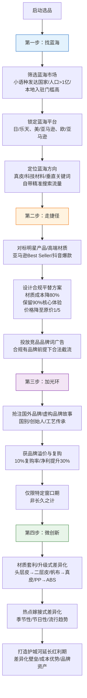

### 方法演进图：蓝海分层筛选决策树

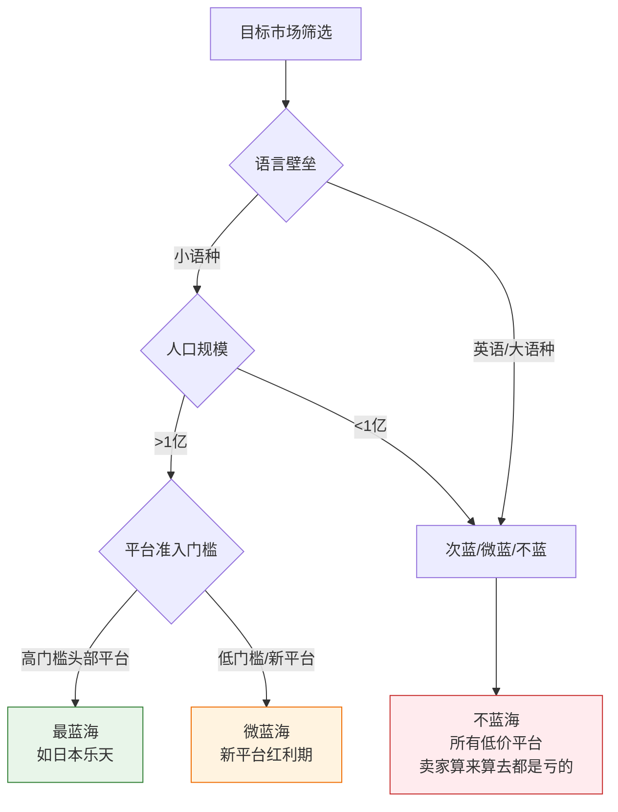

### 方法演进图：合规平替操作标准流程

```mermaid
flowchart LR
    A[锁定明星产品/高端材质\n搜索流量大/客单价高] --> B[拆解核心体验要素\n功能/手感/外观/场景]
    B --> C[寻找低成本替代材料\n供应链调研/样品测试]
    C --> D[打样验证90%体验标准\n盲测/用户反馈/数据对比]
    D --> E[定价策略：原价1/5甚至更低\n保留合理利润空间]
    E --> F[上架布局精准关键词\n竞品品牌词/材质词/场景词]
    F --> G[投放竞品关键词广告\n合规前提：自有品牌/无侵权]
    G --> H[规模化复制到其他品类\n同材质套利/同方向延展]
    
    style A fill:#e3f2fd,stroke:#1565c0
    style D fill:#fff3e0,stroke:#ef6c00
    style F fill:#e8f5e9,stroke:#2e7d32
```

### 多源对照：蓝海定义与平台分层

**共识**：蓝海市场存在分层，核心判断标准是语言壁垒、人口规模、平台准入门槛。最蓝海 = 小语种发达国家 + 亿级人口 + 本地入驻门槛高的头部平台。

**分歧**：
- 素材 20230207_02.md 将所有低价平台定义为“不蓝”，理由是卖家算来算去都是亏的。
- 素材 20230207_11.md 指出 TEMU 虽为低价平台，但通过筛选有海外资质工厂、英文包材、稀缺度把握，仍可在非标品类打造爆款，议价空间虽小但非完全不可做。
- 素材 20230207_04.md 通过抖音场景视频发散选品，认为半小时可挖十几个蓝海产品，强调“细心留意”即可发现机会。

**设计中的取舍**：
- **主张**：新手应优先选择“最蓝/次蓝”市场（如日本乐天、亚马逊日站/欧美站），利用合规平替+材质套利构建确定性业务。
- **理由**：低价平台（TEMU/速卖通/TikTok Shop美区）虽存非标机会，但要求供应链深度整合（海外资质、英文包材、稀缺度把控），新手资源匹配度极低，属“战术勤奋逃避战略探索”。
- **适用边界**：已有成熟供应链、海外公司实体、精通平台规则的团队可尝试 TEMU 非标品；纯新手坚决不碰“所有低价平台”。

---

## 44.5 流量获取与私域运营 —— 从“公域捕捞”到“私域养殖”

### 为什么需要这个概念？

公域流量属于平台，私域流量属于自己；整套商业模式目标是把公域流量导入微信私域进行一对一反复成交。

单纯的页面曝光（UV/PV）没有价值，无互动曝光反而是负价值；一切运营应以交易为最终目的。

流量必须保持不快不慢、持续不断的流速才能产生最大价值：太快无法形成连接和停留、太慢丧失规模。

谁能让流量主赚更多钱，谁就拥有其所有积累流量；世界不缺流量，缺的是把流量价值最大化的方法。

### 核心定义

**公域引流私域变现**：核心心法五句话——定位即人群、人群即内容、内容即流量、流量即转化、转化即模式。

> "整个项目的 5 句核心心法：1. 定位即人群、2. 人群即内容、3. 内容即流量、4. 流量即转化、5. 转化即模式。"
> 
> ——《龙哥赚钱周报 2022年12月20日精华帖汇总》（素材 ID：20230207_06.md）

**流量切片分析法**：将流量数据按横向（来源渠道、涨跌趋势、干预动作）和纵向（用户需求、行为路径、业务价值）切片分析。

> "横向你要看：这 200 个 UV 从哪里来？有哪些渠道？哪些涨了？哪些跌了？趋势如何？原因是什么？可干预的运营动作是什么？纵向你要看：UV 的背后是用户……能不能形成业务价值？流量要切成片来看，才有可优化的空间。"
> 
> ——《龙哥赚钱周报 2022年12月20日精华帖汇总》（素材 ID：20230207_06.md）

**流量流速悖论**：流量核心是流和量，要流动也要停留、不快不慢、持续不断，增加用户停留时间才能最大化价值。

> "流量的速度太快、没有停留、规模再大也没有用，流量一直停留不动也不行……流量的核心是流和量，就要流动也要停留、不快不慢、持续不断。"
> 
> ——《龙哥赚钱周报 2022年12月20日精华帖汇总》（素材 ID：20230207_06.md）

**交易目的论**：单纯曝光无价值，内容页有曝光无反馈是负价值，无互动就没有价值，平台不给流量。

> "从交易目的来看，单纯的页面曝光是没有太大价值的，如果是内容页面，有曝光无反馈反而是负价值。"
> 
> ——《龙哥赚钱周报 2022年12月20日精华帖汇总》（素材 ID：20230207_06.md）

**私域单客价思维**：关注单个消费者长期贡献的总销售额（单客价），而非单次客单价，通过拉长生命周期和增加复购提升销售额。

> "电商有个'客单价'的概念，而在私域流量运营的思维下，真正值得关注的不是'客单价'，而是'单客价'，就是一个消费者总共贡献了多少销售额。"
> 
> ——《龙哥赚钱周报 2023年1月中旬合集》（素材 ID：20230207_03.md）

**实时真实ROI**：将私域流量产生的额外年产值计入投放产出计算综合投产比，显著高于仅计算直播间直接回报的ROI。

> "roi2.5 也就是我 100 万的营业额，需要有 40 万的广告投放，那么在这 40 万的投放算到私域中，我将额外有 100 万×60%×60/150=24 万的私域营业额，这么一算我的 roi 就从 2.5 提升到了 3.5。"
> 
> ——《龙哥赚钱周报 2023年1月中旬合集》（素材 ID：20230207_03.md）

### 关键性质

**视频号直播引流工具**：企业微信弹出、金句卡片，不跳出直播环境即可高效引流转化，一小时可加200人私域。

> "第一个，用好企业微信，直播时候点弹出，引流到私人微信……第二个，金句卡片。"
> 
> ——《龙哥赚钱周报 2023年1月中旬合集》（素材 ID：20230207_03.md）

**捡漏群商业闭环**：免费/付费引流到企微→拉500人大群→原价1-3折超高性价比商品吸引用户→佣金变现。核心：稳定企微主体、靠谱流量、精细化社群运营、规模大小、多重变现。

**演员氛围与催单节奏**：配置30-50个“演员”模仿真实用户抢购晒单，有演员和没演员社群产出至少相差一倍；配合4-6次递进式催单提升转化。

> "演员是捡漏群的灵魂，有演员和没演员的情况，社群产出起码相差一半以上。"
> 
> ——《龙哥赚钱周报 2023年1月中旬合集》（素材 ID：20230207_03.md）

**五位一体成交飞轮**：破冰（好感建立）→ 诊断（放大需求）→ 方案（成交铺垫）→ 信任（突破抗拒）→ 成交（引导下单），解决为什么必须买/跟你买/现在买。

> "私域成交有逻辑、有章法……五位一体成交飞轮：①破冰——好感建立、②诊断——放大需求、③方案——成交铺垫、④信任——突破抗拒、⑤成交——引导下单。"
> 
> ——《龙哥赚钱周报 2022年12月20日精华帖汇总》（素材 ID：20230207_06.md）

**社群分销增长公式**：收入增长 = 供应链强度 × 顶层设计 × 动员能力。冷启动关键是选品（标品、有社交货币），触达1-2个核心意见领袖即引发指数级裂变。

> "收入增长=供应链强度×顶层设计×动员能力。冷启动关键不是运营而是选品，选择标品、有社交货币的产品；触达1-2个核心意见领袖即引发指数级裂变。"
> 
> ——《龙哥赚钱周报 2022年11月15日合集》（素材 ID：20230207_07.md）

### 典型例子

- 视频号直播实测：一小时加私人微信近200人，生财新年预约51个、加曹大星球49个（素材 ID：20230207_03.md）。
- 捡漏群数据：新起盘<1000群月佣100W+，行业有团队群过万月佣几千万，单群成本3500-10000元，回本2-3个月（素材 ID：20230207_03.md）。
- 社群生命周期模型：约2年，2-3个月回本后单群月利润1000元，21个月产生2.1W纯利，投资回报率3-4倍（素材 ID：20230207_03.md）。
- 抖音本地生活：美团880万商家覆盖全国地级市，抖音仅覆盖一线新一线城市，二三线覆盖率低，存在10倍增长空间（素材 ID：20230207_03.md / 20230207_11.md）。
- 书里有品案例：0预算冷启动，首月进10万分销员，2年做到80万+分销员、1.5亿销售额（素材 ID：20230207_11.md）。

### 边界条件

- 非刚需项目做不起来：不够刚需链条太长，你认为推得动结果挣不到钱；最终是项目本性成就人，而非人推动项目（素材 ID：20230207_06.md / 20230207_07.md）。
- 没有爆品就不做推广：无爆品强推转化极差甚至适得其反，一切动作如同赌博（素材 ID：20230207_03.md）。
- 平台生命周期要求调整打法：增长期适合激进投放，存量期重视生态建设需从自身找原因（合规、原创、发货时效），否则被清理（素材 ID：20230207_08.md / 20230207_11.md）。
- 流量合并需让流量主赚更多钱：设计方案让KOL卖货月赚20万，其四五年积累流量即为我所用（素材 ID：20230207_06.md）。

### 方法演进图：公域引流私域变现核心心法五步法

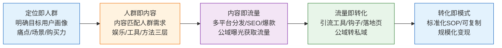

### 方法演进图：流量切片分析法双维度框架

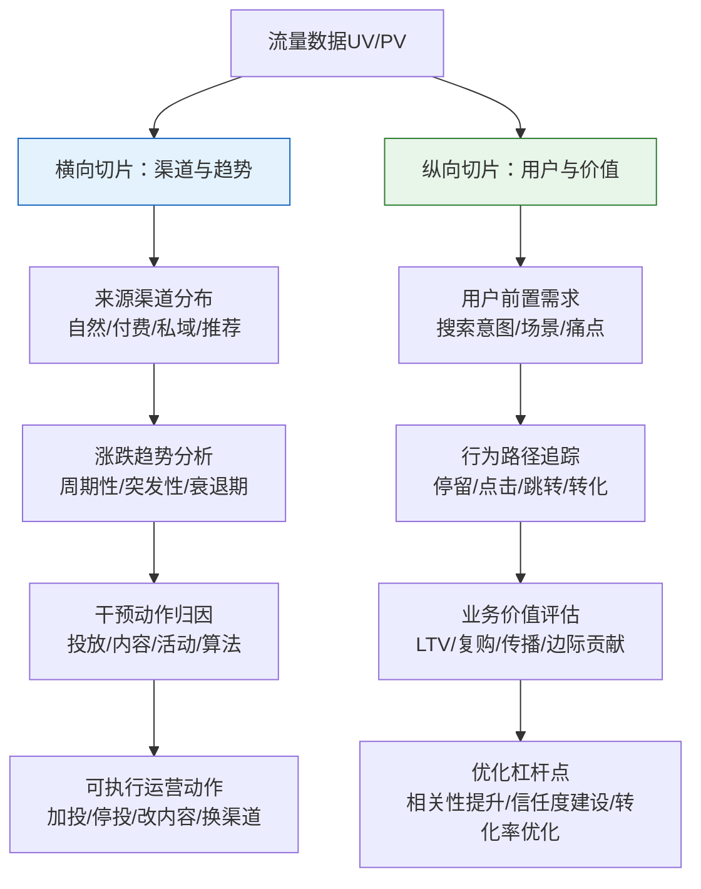

### 方法演进图：五位一体成交飞轮闭环

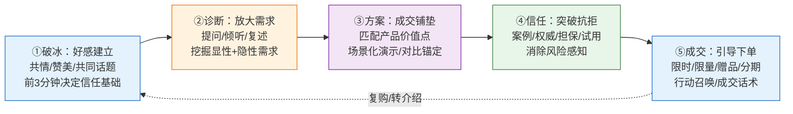

### 方法演进图：社群分销增长公式三要素

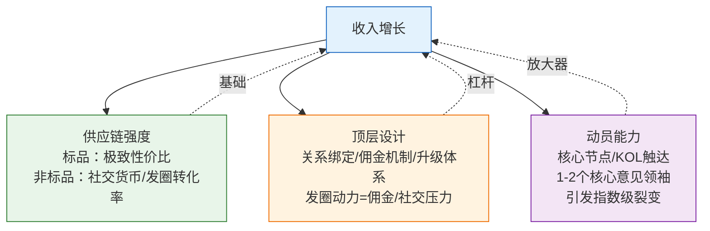

---

## 44.6 内容创作与IP打造 —— 从“写什么”到“为什么爆”

### 为什么需要这个概念？

普通人最容易触手可及的是内容杠杆——复制边际成本为零，可重复利用、多平台推广、放大价值；写作输出是能力和价值的放大器，持续输出倒逼输入与思考。

内容价值由低到高分三层：给娱乐（情绪价值难变现）、给工具（实用性可引流）、给方法（打造个人IP壁垒最高），核心逻辑是价值交换。

爆款内容可复制再利用：爆过的内容一定可以再爆；内容创作不要靠灵感，要靠爆款模板持续输出，这是内容生产工业化的基础认知。

以结果倒推的逆向思考：正常流程定位→内容→流量→产品→变现，逆向流程变现→定位→产品→内容→流量——先找买家，再找产品。

### 核心定义

**内容价值金字塔**：
- 娱乐层：情绪价值，难变现（搞笑号、剧情号）
- 工具层：实用性，可引流（整合资料、虚拟资料项目）
- 方法层：解决问题，抢占专业认知，打造个人IP壁垒最高

> "①给娱乐：搞笑号、剧情号，他们的数据很好，用情绪价值交换了用户的注意力，但是很难变现。②给工具：给工具满足更加实用性的需求……这就是当下很火的虚拟资料项目。③给方法：通过给方法，解决问题，抢占专业认知，打造个人 IP。"
> 
> ——《龙哥赚钱周报 2022年12月20日精华帖汇总》（素材 ID：20230207_06.md）

**超垂直个人IP与SEO思维**：在极度细分领域坚持长期主义，布局300-500个长尾关键词、每个词写一个解决方案、多渠道发布、坚持更新，1个月后每天有人主动添加。

> "先辛苦一阵子，根据你的切割的细分领域，用心布局300-500个长尾关键词。每个关键词写一个解决方案……大概1个月后，你就会发现你每天都有人添加你。"
> 
> ——《龙哥赚钱周报 2022年11月15日合集》（素材 ID：20230207_07.md）

**峰终定律应用**：如果体验的高峰和结尾愉悦，整体感受即愉悦；让用户在开头和结尾体验愉悦（中间无关紧要），就会对内容产生好感。

> "有个定律，叫做峰终定律：如果在一段体验的高峰和结尾，体验是愉悦的，那么对整个体验的感受就是愉悦的。"
> 
> ——《龙哥赚钱周报 2022年11月29日精华帖汇总》（素材 ID：20230207_09.md / 20230207_05.md）

**渣男思维做内容**：
- 撩完就跑：峰终定律在情绪最高点停止让用户意犹未尽
- 广撒网：多圈子多平台发内容提高命中率，垂直垂的是人群而非题材

> "做渣男第一点：撩完就跑。戳痒点，意犹未尽。……咱们撩到用户的痒点就停，峰终定律，在情绪最高点停止，才能让人意犹未尽，印象最好。# 做渣男第二点：广撒网 渣男怎么养鱼的？当然是混多个圈子……咱们垂直垂的是人群。"
> 
> ——《龙哥赚钱周报 2022年11月29日精华帖汇总》（素材 ID：20230207_09.md / 20230207_05.md）

**写作即社交**：写作是最好的社交活动，是个人的“身份证”——思考、经历、价值观在文章中展现，持续输出可筛选同频者、建立连接。

> "写作就是最好的社交活动，是你最好的'身份证'，因为你的思考，经历，价值观都在你的文章中一一展现"
> 
> ——《龙哥赚钱周报 2022年11月29日精华帖汇总》（素材 ID：20230207_09.md）

### 关键性质

**爆款引流库（100-10-1聚焦法）**：自建选款库、利用第三方工具、同类同品牌类推、数据化测试，先找100款、每款发3-5条笔记、选出10个能出单的款、最终聚焦爆款。

> "与其漫无目的瞎猜一些款，并充满期待的等这些款有产出。还不如老老实实的自己先找出100款来，每一款发上3-5条笔记...基本就能选出10个左右能出单的款。"
> 
> ——《龙哥赚钱周报 2022年11月15日合集》（素材 ID：20230207_07.md）


> 
> ——《龙哥赚钱周报 2022年11月29日精华帖汇总》（素材 ID：20230207_09.md）

**反向发帖（挨骂流派）**：微头条故意发表与主流相反的争议观点引发谩骂讨论，获取巨大流量收益（<300字赚400+元）。

> "别人都在骂李少莉，社区女干部，我们就去表扬她...不到300字的微头条，含着眼泪赚了400多块。"
> 
> ——《龙哥赚钱周报 2022年11月15日合集》（素材 ID：20230207_07.md）

**内容创作系统化拆解**：文章=问题+回答，通过“输入+思考+输出”拆解，针对卡点提供选题积累、允许不完美表达、公开承诺等方案（素材 ID：20230207_09.md）。

### 典型例子

- 超垂直IP案例：发了<200篇内容，大半个月不更新也每天有人主动咨询，享受3-5年SEO长尾福利（素材 ID：20230207_11.md）。
- 小红书小说推文：二宝妈妈从零开始一个月，单量从周26单增至周120单、收入1000+，副业月入1万+（素材 ID：20230207_06.md）。
- 反向发帖实证：表扬被全网批评的女干部，账号被喷成狗，<300字微头条含泪赚400多块（素材 ID：20230207_07.md / 20230207_11.md）。
- 爆款模板复用：内容创作不要靠灵感，要靠爆款模板持续输出，爆过的内容一定可以再爆（素材 ID：20230207_05.md）。

### 边界条件

- 模板化会限制文案力：硬性模仿套用模板束缚创造力，“统一的文案风格”才是形成记忆点前提（素材 ID：20230207_06.md）。
- 追风者用爆款思维，长期主义者用SEO思维：彻底理解这一点起码受益10年（素材 ID：20230207_07.md / 20230207_11.md）。
- 内容杠杆虽好，但需持续输出倒逼输入：不写作就不会深度思考，写作是思维的显化（素材 ID：20230207_09.md）。
- 单纯给娱乐（搞笑/剧情号）数据好但很难变现，必须向给工具、给方法层级进阶（素材 ID：20230207_06.md）。

### 方法演进图：内容价值金字塔跃迁路径

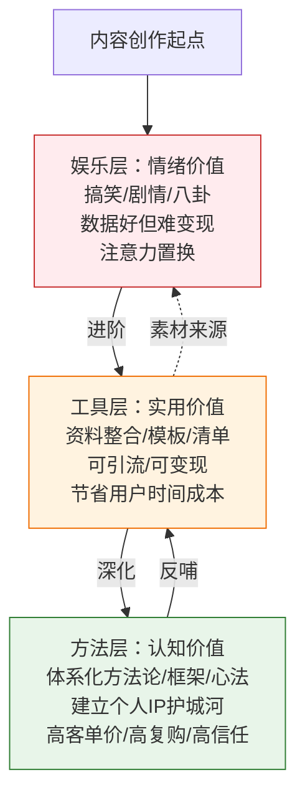

### 方法演进图：超垂直IP SEO布局四步实操

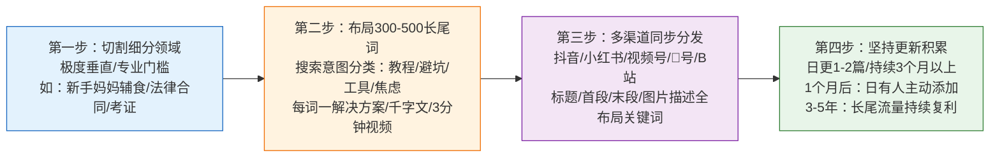

### 方法演进图：渣男思维内容生产双核流

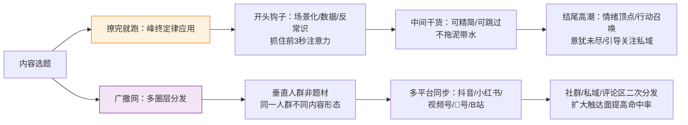

### 方法演进图：爆款引流库 100-10-1 聚焦法

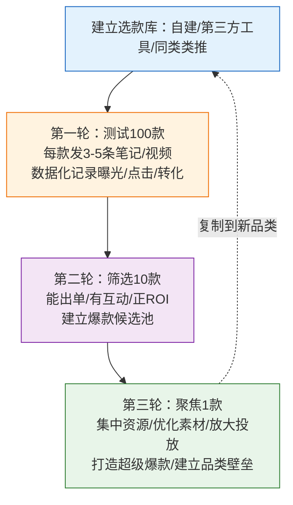

### 设计中的取舍：爆款思维 vs SEO思维

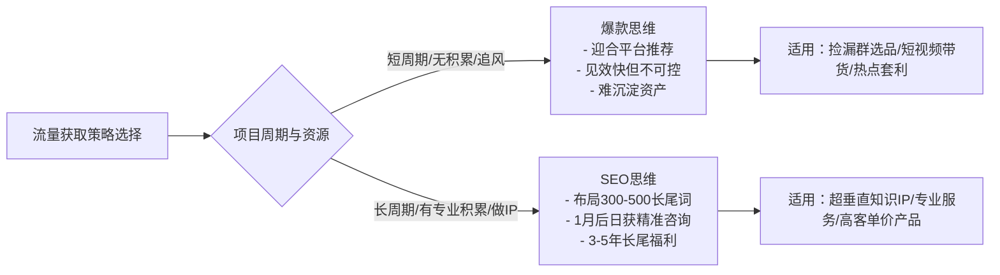

**主张**：做超垂直个人IP、专业服务、高客单价产品，必须用SEO思维；做捡漏群、短视频带货、热点套利等短周期项目，用爆款思维。**切勿混用**：用SEO做捡漏群选品会错过时效性；用爆款做知识IP会陷入“追风者陷阱”，流量归平台、难变现、不可控。

---

## 44.7 项目操盘与变现 —— 从“最小验证”到“规模复制”

### 为什么需要这个概念？

验证产品应优先卖想法而非做产品，通过高意向付费人数判断需求：聊100人仅几人买有问题，20-30人购买交预售金则不确定因素解决，可短时间测试几十个产品。

很多人严重低估已有项目而过分高估新项目；赚钱应结合自身已有资源，新项目与自身资源匹配度（而非项目好坏）决定成功概率。

副业收入增长疲惫时，拿出部分收入招聘他人处理重复基础工作，释放自己精力成为老板，建立赚钱杠杆。

商业英雄是平台红利产物：抓住某时期平台/市场红利，匹以执行力，赚到第一桶金；以前以为赚的是实力钱，实则是红利钱。

### 核心定义

**MVP先卖后做**：最小成本验证需求，先卖想法、再做产品，用高意向付费人数判断需求是否成立。

> "比如最重要的是先卖产品的想法，而不是做产品。如果聊了 100 个人，只有几个人买，肯定有问题；如果 20-30 个人购买，交了预售金，那这个不确定因素就解决了。"
> 
> ——《龙哥赚钱周报 2022年12月20日精华帖汇总》（素材 ID：20230207_06.md）

**商业拆解复制副业法**：刷短视频发现案例，拆解前端内容生产到后端导流私域及转化成交全流程，判断可复制性（货源非独家、场景验证有需求），低门槛复制快速变现。

> "拆下来之后，我就发现很多时候有些项目是完全可以复制的，是不需要投入几十万也可以复制的。"
> 
> ——《龙哥赚钱周报 2022年11月15日合集》（素材 ID：20230207_07.md）

**资源盘点与项目拆解**：三步评估新项目——盘点自身资源、拆解项目所需资源、评估匹配度以快速启动。

> "第一步：盘点自己手里有哪些资源。第二步：拆解项目需要的资源……第三步：评估资源匹配度。"
> 
> ——《龙哥赚钱周报 2022年11月29日精华帖汇总》（素材 ID：20230207_09.md）

**买卖、生意、商业三分论**：自己做所有事是出卖劳动力（买卖），通过代理商/多次卖出是生意，建立可复制放大模式才是商业。

> "首先你要清楚的是买卖、生意、商业是三件事情……自己做所有事是出卖劳动力（买卖），通过代理商/多次卖出是生意，建立可复制放大的模式才是商业。"
> 
> ——《龙哥赚钱周报 2022年12月20日精华帖汇总》（素材 ID：20230207_06.md）

**招商加盟四级别**：轻量级（卖技术/料包）、中量级（卖设备/服务）、重量级（卖品牌）、魔鬼级（卖特许权，可作为资产转移继承）。

> "按照品牌方操作的难度，加盟模式一共分为四个级别六种类型：轻量级、中量级、重量级和魔鬼级……魔鬼级的加盟是最难实现的一种，我称之为卖特许权。"
> 
> ——《龙哥赚钱周报 2022年11月15日合集》（素材 ID：20230207_11.md）

### 关键性质

**矩阵化抖音带货怼量法**：保证质量前提下大量发布拼接剪辑带货视频增加爆单概率，即使大部分视频流量惨淡（点赞>500仅10个、大部分个位数甚至0），纯靠怼量不开直播累计带货10万+。

> "在保证视频质量的前提下，量怼的越多，爆单的概率肯定就越大……点赞超过500的视频就10个……纯靠怼量，把这个抖音号做起来了……累计带货10万+。"
> 
> ——《龙哥赚钱周报 2022年11月15日合集》（素材 ID：20230207_11.md）

**健康单店模型是加盟前提**：先跑通单店盈利，再验证区域模型（多店复制），模型健康可复制时规模化扩张才可持续。最新标准：门店模型测算到位、单店财务健康、区域模型验证、复制性和财务模型达标。

> "健康的单店模型是加盟扩张的前提……我们提出了一个最新的标准：1）各种门店模型要测算到位；2）单店模型的财务模型要健康；3）要实现一定范围内的区域模型验证；4）该区域模型的复制性和财务模型要达标。"
> 
> ——《龙哥赚钱周报 2022年11月15日合集》（素材 ID：20230207_11.md）

**奶茶加盟优于直营**：蜜雪冰城（加盟）21年19亿利润 VS 奈雪的茶（直营）亏1.5亿，加盟品牌利润能力显著高于直营，喜茶开放加盟顺应行业规律。

> "对比即将上市的蜜雪冰城和已经上市的奈雪的茶（21年19亿利润 VS 亏损1.5亿）……加盟品牌的利润能力要比直营品牌高非常非常多。"
> 
> ——《龙哥赚钱周报 2022年11月15日合集》（素材 ID：20230207_11.md）

**无人直播素材与风险**：核心是高质量素材（录播需审查违禁词、去重、避开品牌标识），平台检测风险：雷同限流1月、原创举报限流、判录播罚100-200、批量做号罚2-3千。

**视频号无货源店群**：后端商品缺乏是根本原因，关键操作：开旗舰店/普通店刷入池→入优选联盟→选品上架→拍单发货；必须做店群（矩阵思维对抗不确定性），最少5个以上店铺。

**抖音本地生活核心**：POI加热是第一课、无爆品不做推广（否则是赌博）、玩转短视频矩阵和直播运营、好评率维护极其重要。

### 典型例子

- 亏损反弹案例：多项目累计亏损超100万，经资源梳理叠加外卖CPS与副业课程，3个月赚100万、总利润超300万（外卖CPS盈利200万+、副业课程3个月100万+）（素材 ID：20230207_09.md）。
- 无人直播单场百万：自研硬件（伪装摄像头黑盒子）规避检测，录制真实直播间无人带货，单场销售额116.8万，甚至比大多数真人直播高（素材 ID：20230207_08.md）。
- 视频号店群数据：7店日营业额合计7858元，单店均1122元/天，毛利30%（日利润300-400），精细操作单店月利润1W，10店即10W/月，达人爆单带来额外几万利润（素材 ID：20230207_08.md）。
- 美团电商冷启动：8月末发现机会<2个月跑通扩展到30店，类目不同单店月利润6k-12k（零运营未优化），首店跑通MVP仅花80元（素材 ID：20230207_11.md）。
- 抖音本地生活十倍增长空间：美团覆盖全国地级市，抖音仅覆盖一线新一线，二三线覆盖率低，2023年投放入口调为本地推及外卖打开，预计10倍增长（素材 ID：20230207_03.md / 20230207_11.md）。

### 边界条件

- 平台风控持续收紧：无人直播需持续换品、换号、注销重起；硬改设备手机寿命10分钟至10天不等，卖手机是“一锤子买卖”（素材 ID：20230207_08.md / 20230207_11.md）。
- TEMU低价标品议价空间极小：小二预留10%利润，报价超1688同款视为“无诚意”压价至持平或更低，需侧重非标品（素材 ID：20230207_11.md）。
- 创业项目匹配度：结合自身资源而非盲目All In，低估已有项目、高估新项目是常见错误（素材 ID：20230207_09.md）。
- 非刚需项目失败教训：10年创业失败4次、负债百万靠自媒体上岸，总结“非刚需项目都别做”，不够刚需链条太长推不动（素材 ID：20230207_06.md / 20230207_07.md）。
- 战术勤奋逃避战略探索：用忙碌麻痹自己，短期轻松长期有毒；动脑累、探索恐惧，但唯有战略突破带来真正成长（素材 ID：20230207_03.md / 20230207_07.md）。

### 方法演进图：MVP 先卖后做验证环

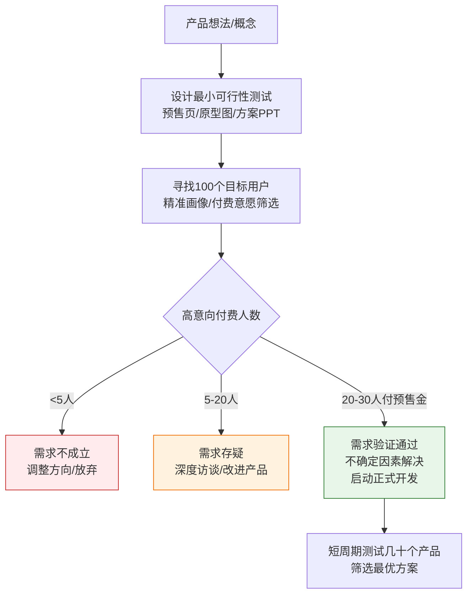

### 方法演进图：商业拆解复制副业法四步走

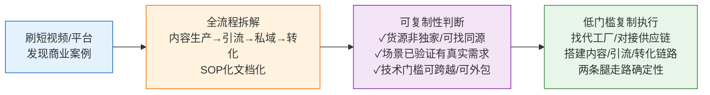

### 方法演进图：矩阵化怼量操作标准流程

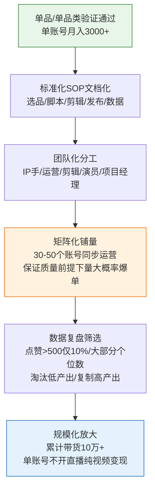

### 方法演进图：加盟扩张前提验证链（新标准四项）

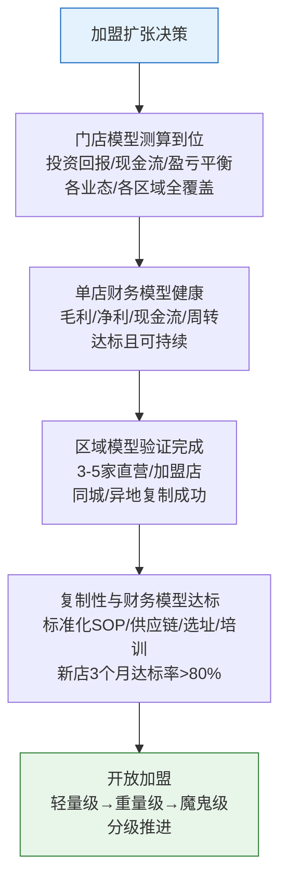

### 设计中的取舍：无人直播可持续性

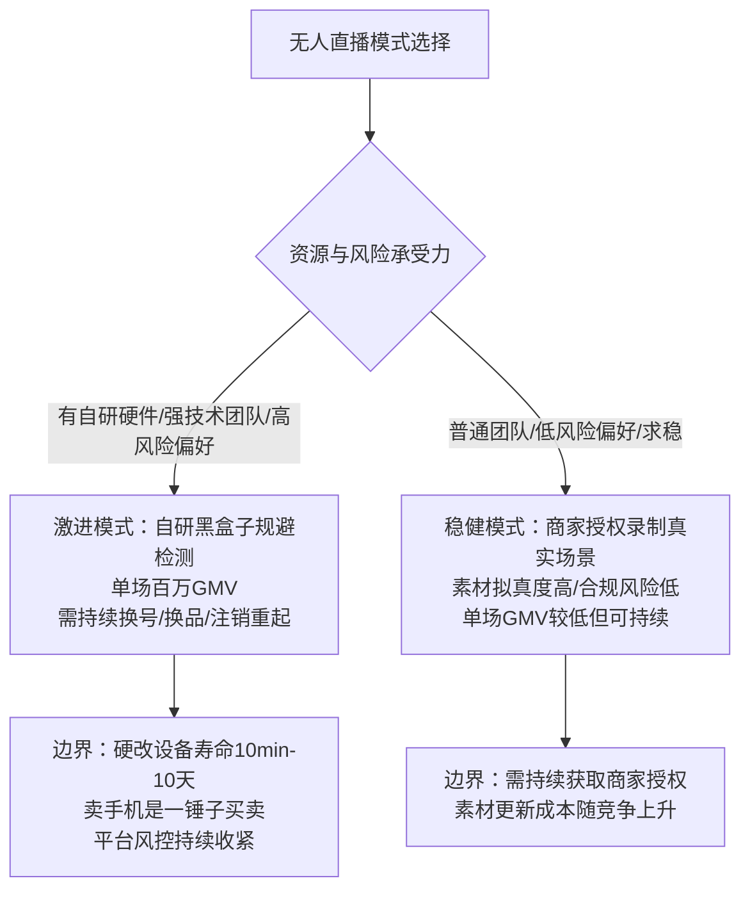

**主张**：普通团队选择“商家授权录制真实场景”稳健模式；仅有自研硬件能力、极高风险偏好的团队可尝试激进模式。**核心判据**：你的技术基建能否支撑“最小成本快速响应平台风控迭代”？不能则选稳健模式。

---

## 44.8 创业心态与内在比赛 —— 从“输了内在”到“赢了自己”

### 为什么需要这个概念？

任何外在成就的取得都取决于潜意识是否真正认可目标：当自我二（潜意识）不认可目标时就会输掉内在比赛，进而输掉外在比赛——李宗伟不是输给林丹，是输给自己。

创业者需要的不是理性自我怀疑，而是近乎盲目的自信与乐观——“在我的领域我就是国王”的潜意识信念是打赢内在比赛、获得外在成功的前提。

与其相信“失败是成功之母”，不如相信“成功才是成功之母”；过去的成功体验在潜意识累积自信，推动后续更大成功。

懒惰本质是未获得正反馈；未获正反馈源于做得不够多，而做得不够多是因为不够喜欢。两个突破口：尽快找到真正热爱的，或纯粹为钱冲——不别扭、不内耗。

### 核心定义

**内在比赛理论**（源自《身心合一的奇迹力量》）：人有两个自我——自我一（理性/一般自我）、自我二（感性/潜意识）；任何比赛同时进行内在与外在比赛，输掉内在比赛必然输掉外在比赛。

> "人，有两个自我，分别是自我一、自我二。自我一，对应着理性，是一般意义上的自我。自我二，对应着感性，或者说对应着潜意识。任何一个比赛，实际上是同时进行的两场比赛，内在比赛和外在比赛。"
> 
> ——《龙哥赚钱周报 2023年2月7日精华帖汇总》（素材 ID：20230207_01.md）

**盲目自信**：创业者的理性选择，近乎盲目的自信与乐观，潜意识信念“我在我的领域我就是国王”。

> "一言以蔽之：你需要盲目的自信。因为盲目的自信和乐观，是创业者的理性选择。这样'舍我其谁''在我的领域，我就是国王'的心态，才是创业者真正需要的心态！"
> 
> ——《龙哥赚钱周报 2023年2月7日精华帖汇总》（素材 ID：20230207_01.md）

**成功是成功之母**：过去的成功体验在潜意识累积自信，推动后续更大成功——一个成功体验推动一个又一个成功体验。

> "失败不是成功之母，成功才是成功之母。我一个成功体验，推动一个又一个的成功体验。成功，才是成功之母。"
> 
> ——《龙哥赚钱周报 2023年2月7日精华帖汇总》（素材 ID：20230207_01.md）

**唤醒成功体验法**：内心怂/不自信时，回顾并唤醒过往成功体验建立潜意识自信；优秀推销员先找优质客户或卖易销产品制造成功体验。

> "当自己内心很怂、不自信的时候，你需要回顾下自己成功的经历，唤醒自己的成功体验。比如，一些优秀的推销员，在开展一天的工作时，会先去找一些优质的客户，或者推销一些容易卖的产品，通过这种方式去制造成功体验。"
> 
> ——《龙哥赚钱周报 2023年2月7日精华帖汇总》（素材 ID：20230207_01.md）

**俯视学习法**：潜意识层面保持国王般俯视姿态（战略藐视），具体请教落实时保持学生认真态度（战术重视）——跪着学习的人打不赢内在比赛。

> "我的答案是：别跪着学！要俯视！你就是国王，把生财有术的帖子，当成奏折来看。毛主席说，战略上藐视敌人，战术上重视敌人。跪着学生财有术的人，打不赢内在比赛。"
> 
> ——《龙哥赚钱周报 2023年2月7日精华帖汇总》（素材 ID：20230207_01.md）

### 关键性质

**内在比赛决定外在成败**：长期目标与创业行为成败本质取决于潜意识是否真正认可目标。

**老虎伍兹案例**：性丑闻离婚后两个月丢掉世界第一，几年跌出前100；核心非技术下降，而是潜意识和对手潜意识都不再认为他是完美、不可战胜的人——输掉了内在比赛。

> "在性丑闻离婚之后的两个月，他就丢掉了世界第一的头衔……曾经，他光芒四射，是个完美的人。闹了性丑闻以后，他的潜意识和他的对手的潜意识，都不再认为他是一个完美、不可战胜的人。因为性丑闻，老虎伍兹输掉了自己的内在比赛。"
> 
> ——《龙哥赚钱周报 2023年2月7日精华帖汇总》（素材 ID：20230207_01.md）

**李宗伟VS林丹**：职业生涯交手37次李输25次（含两次奥运决赛）；大部分运动员教练认为技术不分伯仲——输球根源是潜意识层面内在比赛落败。

> "在两人的职业生涯中，总共交手 37 次，李宗伟输了 25 次，其中两次是奥运会决赛。李宗伟的技术比林丹差吗？可真不见得……其实他不是输给了林丹，他是输给了自己。"
> 
> ——《龙哥赚钱周报 2023年2月7日精华帖汇总》（素材 ID：20230207_01.md）

**正反馈驱动热爱**：懒惰本质=未获正反馈=做得不够多=不够喜欢。突破口：找到热爱，或纯粹为钱冲（不别扭、不内耗）。

> "为什么会有懒惰这个东西？本质上，就是没拿到正反馈……但是最核心的是，你不够喜欢……两个突破口：一个是尽快找到自己到底热爱，另一个……就是为了钱冲，不别扭，不内耗。"
> 
> ——《龙哥赚钱周报 2022年11月15日合集》（素材 ID：20230207_07.md）

**战术勤奋无法逃避战略探索**：用忙碌工作麻痹自己、以战术勤奋逃避战略突破，短期轻松长期有毒。

> "动脑是很累的，探索是令人恐惧的，用战术上面的勤奋来逃避真正战略上要去探索和突破的事情，用忙碌的工作来麻痹自己，是短期轻松的，长期确是有毒的。"
> 
> ——《龙哥赚钱周报 2023年1月中旬合集》（素材 ID：20230207_03.md）

### 典型例子

- 老虎伍兹：丑闻后失去“不可战胜”信念，世界排名从第一跌出前100（素材 ID：20230207_01.md）。
- 李宗伟：技术不输林丹，但潜意识层面内在比赛落败，奥运决赛两连败（素材 ID：20230207_01.md）。
- 优秀推销员：开展一天工作先找优质客户或推销易卖产品制造成功体验，帮助更好开展后续工作（素材 ID：20230207_01.md）。
- 宝妈执行力变现：4个月加4000多好友微信号被亦仁花约7万购买；作者因执行力被邀请生财办公室，这是对执行力的奖励（素材 ID：20230207_03.md）。

### 边界条件

- 做事依据是能力与资源而非愿望：老鹰吃兔子、鲨鱼吃鱼；鲨鱼不应羡慕老鹰，应努力捕捉更多鱼；先确定适合做什么，倾注一生精力做好（素材 ID：20230207_05.md / 20230207_07.md）。
- 亏钱是赚钱路上不可缺少部分：舍弃亏钱就意味着舍弃赚钱；赚钱方式千差万别，亏钱方式殊途同归（素材 ID：20230207_07.md）。
- 反期望：严格反着做亏钱步骤也无法保证赚钱，因为高手也会亏钱（素材 ID：20230207_07.md）。

### 方法演进图：内在比赛双自我模型

```mermaid
graph LR
    A[外在比赛\n商业结果/竞技成绩] --> B[内在比赛\n潜意识认可度]
    B --> C[自我一：理性/教练\n分析/判断/自我怀疑\n"别贪心/太难了/不行"]
    B --> D[自我二：潜意识/射手\n本能/肌肉记忆/信念\n"我行/百发百中/国王"]
    
    C -.->|干扰/阻碍| D
    D -->|决定| A
    
    style A fill:#e3f2fd,stroke:#1565c0
    style B fill:#f3e5f5,stroke:#7b1fa2
    style C fill:#ffebee,stroke:#c62828
    style D fill:#e8f5e9,stroke:#2e7d32
```

### 方法演进图：盲目自信建立路径

```mermaid
flowchart TD
    A[创业者面临不确定性] --> B{潜意识是否认可目标}
    B -->|否| C[输掉内在比赛\n自我怀疑/恐惧/犹豫\n外在比赛必败]
    B -->|是| D[盲目自信建立\n"我是国王"潜意识信念\n身心合一/心无旁骛]
    D --> E[赢下内在比赛\n专注执行/抗压/创新]
    E --> F[赢得外在比赛\n商业结果/市场地位]
    
    C -.->|需干预| G[唤醒成功体验法\n回顾过往成功/制造小胜利\n重塑潜意识信念]
    G --> D
    
    style C fill:#ffebee,stroke:#c62828
    style D fill:#e8f5e9,stroke:#2e7d32
    style F fill:#e3f2fd,stroke:#1565c0
```

### 方法演进图：唤醒成功体验法操作步骤

```mermaid
flowchart LR
    A[内心怂/不自信时刻] --> B[停止当前行动\n深呼吸/冥想1分钟]
    B --> C[回顾过往成功经历\n哪怕微小：考试/项目/销售/人际]
    C --> D[具象化重现\n画面/声音/感受/肌肉记忆\n提取"我行"的核心感受]
    D --> E[锚定当下状态\n手势/口令/呼吸节奏\n"我是国王/我百发百中"]
    E --> F[带着状态投入行动\n首个动作必须在5分钟内完成]
    
    style A fill:#ffebee,stroke:#c62828
    style D fill:#fff3e0,stroke:#ef6c00
    style F fill:#e8f5e9,stroke:#2e7d32
```

### 方法演进图：俯视学习法战略/战术双层

```mermaid
graph TD
    A[面对大师/前辈/优质内容] --> B[战略层：俯视/藐视\n"老头儿，奏折有亮点\n朕心甚悦，但朕是国王"]
    A --> C[战术层：跪着/重视\n细节笔记/追问/复盘/落地\n"这个细节怎么执行？"]
    
    B --> D[内在比赛：自信/从容\n不被权威压制/保持独立判断]
    C --> E[外在比赛：精准/高效\n吸收精华/规避坑点/快速迭代]
    
    D --> F[赢下内在比赛]
    E --> F
    F --> G[最终外在成果]
    
    style B fill:#e8f5e9,stroke:#2e7d32
    style C fill:#fff3e0,stroke:#ef6c00
```

---

## 44.9 销售与成交 —— 从“卖产品”到“卖信任”

### 为什么需要这个概念？

高净值客户最大痛点是“失去掌控权”，恐惧源于未知；抓住这个核心痛点，客户会觉得你懂他，形成依赖——由奢入俭难，对一直拥有掌控权的人更可怕。

销售中买家会本能启动自我保护机制（撒谎、给希望、躲起来）获取免费资讯，卖家按传统需求挖掘流程推进会在高净值客户面前受挫；破局需从让客户产生好奇开始。

成交核心三要素：需求、信任、购买力。成交前提是信任，信任前提是能提供用户需要的价值、解决用户需求。

闲鱼套利核心逻辑：低买高卖、安全边际、标品看价格、选爆品、合作思维（利他即利己）。

### 核心定义

**需求vs痛点**：需求是理性的、缺乏情绪动力；痛点带有强烈情绪驱动。只有把需求上升为痛点，才能促使下决定购买——客户很平静时都是需求，不是痛点。

> "需求是理性的、缺乏情绪动力的，而痛点是带有强烈情绪驱动的；只有把客户的需求上升为痛点，才能促使其下决定购买——当客户很平静时，都是需求，不是痛点。"
> 
> ——《龙哥赚钱周报 2022年11月15日合集》（素材 ID：20230207_07.md）

**高净值客户核心痛点：失去掌控权**。恐惧源于未知，抓住此痛点客户觉你懂他，形成依赖。

> "高净值客户（尤其是富一代、创一代）最大的痛点是失去掌控权，恐惧源于未知；抓住这个核心痛点，客户会觉得你懂他，从而形成依赖。"
> 
> ——《龙哥赚钱周报 2022年11月15日合集》（素材 ID：20230207_07.md / 20230207_08.md）

**买家系统vs卖家系统**：买家本能启动自我保护（撒谎、给希望、躲起来），卖家传统流程在高净值客户面前受挫，破局需从引起好奇开始。

> "通常当一个人你知道他是销售，你出现在他面前的时候，他有一些举动好像是想吸引你的注意……我们会开始自我保护起来……这些行为在买家系统里就是一个本能，叫撒谎。"
> 
> ——《龙哥赚钱周报 2022年11月15日合集》（素材 ID：20230207_08.md）

**闲鱼倒爷套利流程**：商业底层逻辑（低买高卖、安全边际、标品看价、选爆品、合作思维）→ 市场调研（品牌货优先、标品优先、销量大优先、候选品官方价≥150元、避开劝退类目）→ 定向关键词搜索（抵账、抵债、批量出）找低价好货。

> "一、商业的底层逻辑：低买高卖、安全边际、标品看价格、选爆品、合作思维。二、如何进行前期的市场调研：品牌货最优先、标品优先、销量大优先……三、如何找到低价好货：定向关键词搜索（抵账、抵债、顶债、顶账、批量出）"
> 
> ——《龙哥赚钱周报 2022年11月15日合集》（素材 ID：20230207_11.md）

**合作思维**：将对方置于合作共赢而非对立关系，释放“利他”信号（为对方节省精力、加速资金回笼）促成交易。

> "采用合作思维，我和他不是对立关系，而是合作共赢，即利他思维，利他即利己，所以合作思维逻辑成立。"
> 
> ——《龙哥赚钱周报 2022年11月15日合集》（素材 ID：20230207_11.md / 20230207_08.md）

### 关键性质

**破局方法**：反问/布置功课引起好奇→跳出买家系统→需求上升为痛点+重塑行业概念建立权威→提问（聊小孩、谈自己、谈传承）形成长久依赖。

> "先通过反问或布置功课引起客户好奇，跳出其熟悉的买家系统；再将需求上升为痛点和重塑行业概念建立权威；最后通过提问（聊小孩、谈自己、谈传承）形成长久依赖。"
> 
> ——《龙哥赚钱周报 2022年11月15日合集》（素材 ID：20230207_08.md / 20230207_11.md）

**发圈动力公式**：发圈动力 = 佣金 / 设计交压力。产品需具备社交货币价值，让分销员发圈/私聊无压力才能自发传播。

> "发圈动力=佣金/设计交压力。产品需要具备社交货币价值，让分销员发朋友圈、私聊没有压力才能自发传播。"
> 
> ——《龙哥赚钱周报 2022年11月15日合集》（素材 ID：20230207_07.md / 20230207_08.md）

**社群分销佣金分配**：一级佣金高→普通分销员卖货意愿强但难吸引大团长；二级佣金高→团长招商积极但普通分销员动力不足。调高二级佣金招商裂变快，调高一级佣金平台发展稳健。

> "一级佣金高，普通分销员卖货的意愿强，但是很难吸引到大的团长。二级佣金高，团长很积极招商和拓展团队，但普通分销员带货的意愿不足。"
> 
> ——《龙哥赚钱周报 2022年11月15日合集》（素材 ID：20230207_07.md / 20230207_08.md）

**抖音爆单承接法**：视频爆了立马上传同内容视频建合集带爆新视频；流量视频与带货视频双路并进；视频一爆立马开直播双频共振。

> "视频一爆，立马上传同内容的视频，并创建合集，大概率能把新的视频带爆……视频一爆，立马开直播，双频共振。"
> 
> ——《龙哥赚钱周报 2022年12月20日精华帖汇总》（素材 ID：20230207_06.md）

**微头条爆文写法**：选社会类/法律类争议或共鸣题材，掌握推荐机制（点击率>10%进入下一轮、互动率3%），编写吸引人开头和留白提问——核心四字：争议、共鸣。

> "我建议大家去选择社会类的新闻事件以及法律类的故事情节……核心四字：争议、共鸣。"
> 
> ——《龙哥赚钱周报 2022年11月15日合集》（素材 ID：20230207_11.md / 20230207_07.md）

### 典型例子

- 闲鱼套利三验证：飞利浦音响5台购入1400卖出2250；360U盘20个购入300卖出550；72个欧普台灯（成本102元）旺季单日最高卖9个、149元包邮价卖出（素材 ID：20230207_11.md）。
- 抖音爆单实证：A账号两条视频日入1.8万；B账号连续直播最高日佣3万（素材 ID：20230207_06.md）。
- 高净值客户痛点：富一代/创一代最大痛点是失去掌控权，恐惧源于未知（素材 ID：20230207_08.md）。
- 微头条反向发帖：表扬被全网骂的女干部，账号被喷成狗，<300字赚400+块（素材 ID：20230207_07.md / 20230207_11.md）。

### 边界条件

- 闲鱼套利避开劝退类目：候选品官方价格至少150元以上，避开劝退类目（素材 ID：20230207_11.md）。
- 合作思维非万能：利他即利己的谈判逻辑成立，但需对方具备合作意愿（素材 ID：20230207_08.md）。
- 社群分销佣金设计需平衡：一级高利稳健、二级高利裂变快，需根据阶段调整（素材 ID：20230207_07.md / 20230207_08.md）。

### 方法演进图：需求上升为痛点转化路径

```mermaid
flowchart LR
    A[客户表层需求\n理性/平静/功能性\n"我想要个信托规划税务"] --> B[深度诊断提问\n场景化/后果推演/情绪唤起]
    B --> C[痛点显性化\n情绪驱动/恐惧/损失厌恶\n"失去掌控权/家族分裂/资产流失"]
    C --> D[痛点升级为购买动力\n紧迫感/必要性/现在就要解决]
    D --> E[成交决策\n信任建立/方案匹配/行动召唤]
    
    style A fill:#ffebee,stroke:#c62828
    style C fill:#fff3e0,stroke:#ef6c00
    style E fill:#e8f5e9,stroke:#2e7d32
```

### 方法演进图：高净值客户破局五步法

```mermaid
flowchart TD
    A[客户平静/拒绝见面\n买家系统全开/自我保护] --> B[第一步：反问/布置功课\n引起好奇心\n"我要谈的不是钱\n是趣味性和价值问题"]
    B --> C[第二步：跳出买家系统\n打破销售框架\n建立专家/顾问身份]
    C --> D[第三步：需求上升为痛点\n失去掌控权/未知恐惧\n由奢入俭难的心理冲击]
    D --> E[第四步：重塑行业概念\n建立权威/重新定义\n"信托不是避税工具\n是家族宪法"]
    E --> F[第五步：深度提问形成依赖\n聊小孩教育/谈创业史/谈传承焦虑\n长期顾问关系锁定]
    
    style A fill:#ffebee,stroke:#c62828
    style B fill:#e3f2fd,stroke:#1565c0
    style D fill:#fff3e0,stroke:#ef6c00
    style F fill:#e8f5e9,stroke:#2e7d32
```

### 方法演进图：买家/卖家系统博弈模型

```mermaid
graph LR
    A[销售拜访] --> B[买家系统启动\n自我保护本能]
    B --> B1[撒谎\n隐藏真实预算/需求/决策权]
    B --> B2[给希望\n"我考虑一下/再联系你"]
    B --> B3[躲起来\n不回消息/推迟见面/设门槛]
    
    A --> C[卖家系统传统流程\n建立关系→挖掘需求→方案→报价→谈判→成交]
    C --> D[高净值客户前受挫\n流程被买家系统卡死]
    
    E[破局关键：好奇心\n反问/功课/反常识] --> F[买家系统暂时失效\n注意力被捕获/防御降低]
    F --> G[进入专家咨询框架\n需求→痛点→权威→依赖→成交]
    
    style B fill:#ffebee,stroke:#c62828
    style E fill:#e8f5e9,stroke:#2e7d32
    style G fill:#e3f2fd,stroke:#1565c0
```

### 方法演进图：抖音爆单承接三板斧

```mermaid
flowchart LR
    A[视频爆款出现\n播放量/点赞/评论异常] --> B[斧头1：同内容合集\n立即上传同款视频\n创建合集带爆新视频\n算法关联推荐]
    A --> C[斧头2：双路并进\n流量视频持续投放\n带货视频同步发布\n相辅相成/分层转化]
    A --> D[斧头3：直播共振\n视频爆立即开播\n短视频引流直播间\n双频共振/双重收割]
    
    style B fill:#e3f2fd,stroke:#1565c0
    style C fill:#fff3e0,stroke:#ef6c00
    style D fill:#f3e5f5,stroke:#7b1fa2
```

### 方法演进图：微头条爆文推荐机制与写作公式

```mermaid
flowchart TD
    A[选题：社会/法律类\n争议性/共鸣性题材] --> B[开头钩子\n吸睛标题/反常识/冲突场景\n前50字决定点击率]
    B --> C[正文留白提问\n引发评论区争论/站队\n互动率>3%触发二次推荐]
    C --> D[平台推荐机制验证\n点击率>10%进入下一流量池\n互动率>3%持续分发]
    D --> E[爆文产出\n<300字/高收益\n争议+共鸣双核驱动]
    
    style A fill:#e3f2fd,stroke:#1565c0
    style D fill:#fff3e0,stroke:#ef6c00
    style E fill:#e8f5e9,stroke:#2e7d32
```

---

## 44.10 趋势判断与机会窗口 —— 从“看数据”到“抓红利”

### 为什么需要这个概念？

通过数据推演和行业类比判断确定性窗口期：香港疫情数据类比推演大陆首轮感染后有2-3个月平稳期，2023年春天是相对确定的稳定期，是生意人与投资者看重的窗口期。

平台电商演进有四个周期（铺货、动销、精细化、玩趋势），底层逻辑相通，可用来预判新平台（美团、TEMU）机会——视频号与抖音历史进程何其相似。

面对流量热点，技术驱动者用已备好技术基础设施最小成本快速响应：注册域名👸号/小程序、接入API、做镜像站，抢占搜索流量首位。

赚钱机会往往隐藏在身边，源于多数人未发现的信息差；网上说做什么小项目月入多少的基本已过时。

### 核心定义

**确定性窗口期**：从疫情数据推演商业机会，如香港数据类比大陆首轮感染后2-3个月平稳期，2023年春天是全年最重要的3个月窗口期。

> "通过香港疫情数据类比推演：大陆首轮大规模感染后有2-3个月疫情平稳期，之后才进入第二波感染峰值——2023年春天是相对确定的稳定期，是生意人与投资者看重的窗口期。"
> 
> ——《龙哥赚钱周报 2023年2月7日精华帖汇总》（素材 ID：20230207_01.md）

**平台电商四周期**：铺货期（鼓励资源涌入，适合激进投放）→ 动销期→ 精细化期→ 玩趋势期（存量期重生态建设，需从自身找原因）。

> "从平台电商的历史出发，我把美团的发展分为了四个周期：铺货、动销、精细化、玩趋势。所有平台演变的底层逻辑是相通的。"
> 
> ——《龙哥赚钱周报 2022年11月15日合集》（素材 ID：20230207_11.md）

**热点套利技术栈**：技术基础设施决定响应速度，ChatGPT热度起来后十几分钟写代码成全网首个集成👸号，消耗近50万次请求。

> "最重要的是要打造好自己的或者团队的技术基础设施，这样可以用最短的时间来迎接风口……我又花了十几分钟，写了几十行代码，成了全网首个把'ChatGPT'集成到👸号的人。"
> 
> ——《龙哥赚钱周报 2022年12月20日精华帖汇总》（素材 ID：20230207_06.md）

**需求共振**：商品销售与目标用户季节性需求（如学生暑假对台灯需求增加）高峰期重合，利用此规律提升销量。

> "我通过往年的台灯数据以及生活的经验，预测6月底之后会迎来台灯的小旺季。因为学生们都放暑假了，家长就有需求给孩子配置一个台灯。"
> 
> ——《龙哥赚钱周报 2022年11月15日合集》（素材 ID：20230207_11.md）

**信息差生意**：身边被忽视的赚钱机会，源于多数人未发现的信息差。

> "身边赚钱的机会其实还是很多的，只是你没有发现，这个就是大家所说的信息差。先有闷声发大财，网上说做什么小项目一个月可以赚多少钱的，基本是已经过时了。"
> 
> ——《龙哥赚钱周报 2022年11月15日合集》（素材 ID：20230207_07.md / 20230207_11.md）

### 关键性质

**行业机会切入点**：旅游/健康/餐饮三行业。旅游做产品分销套利（机票/酒店/景点）；健康做保健养生带货；餐饮紧扣春季爆发需求。

**旅游复苏数据**：春节国内旅游3亿人次恢复至2019年88.6%，出境机票订单涨258%、入境预定涨632%、国际酒店预定增177%。

**健康带货火爆**：多个保健品品牌抖音销量过亿，诺特兰德维生素片连续两月抖音直播单品销量第一，养生书单/茶/推拿小课程适合普通人带货。

**美团电商红利验证**：8月末发现机会<2个月跑通扩展到30店，类目不同单店月利润6k-12k（零运营未优化），首店MVP仅花80元。

**SEO长尾福利**：SEO思维发布内容即使3-5年后依然享受流量福利，发<200篇内容后大半个月不更新也每天有人主动咨询。

### 典型例子

- 香港疫情数据类比推演大陆平稳期，2023年春天“先干个春天再说”（素材 ID：20230207_01.md）。
- 旅游/健康/餐饮三行业春天爆发数据验证（素材 ID：20230207_01.md）。
- 美团电商：不到两个月30家店，单店月利润6k-12k，验证新平台初期红利效应（素材 ID：20230207_11.md）。
- ChatGPT热点套利：十几分钟注册👸号“ChatGPT中文版”、接入API、做镜像站套娃小程序，全网首个集成，消耗近50万请求（素材 ID：20230207_06.md）。
- 台灯需求共振：预测6月底暑假旺季，72个台灯旺季单日最高卖9个（素材 ID：20230207_11.md）。
- 身边信息差案例：苏州AO图文专做广告牌开70家店、四线城市烤面筋三轮车月入过万、大学生朋友圈卖螃蟹年入约1.2万（素材 ID：20230207_07.md）。

### 边界条件

- 反期望：逆向操作也不能保证赚钱，因为“赚钱方式千差万别，亏钱方式殊途同归”，亏钱是赚钱路上不可缺少部分（素材 ID：20230207_07.md）。
- 平台存量期需合规：增长期激进投放，存量期重生态建设，需从自身找原因（合规、素材原创、发货时效），否则被清理（素材 ID：20230207_08.md / 20230207_11.md）。
- 赛道热度与SEO长尾：热门/冷门赛道数据优秀有抬价优势；SEO内容长尾福利持久（素材 ID：20230207_11.md）。
- Web3新人23条建议：小成本试错、不玩杠杆合约、保护资产、好机会重仓>平庸机会轻仓、会卖比会买重要、人声鼎沸时一定要跑（见好就收、有利必跑、狠心出货、切勿幻想、变现为王）（素材 ID：20230207_04.md）。

### 方法演进图：确定性窗口期推演链

```mermaid
flowchart LR
    A[外部参照系数据\n香港疫情:首轮感染后2-3月平稳期\n第二波峰值随之而来] --> B[类比推演目标市场\n大陆首轮大规模感染完成\n平稳期窗口期确认]
    B --> C[时间窗口锚定\n2023年春天=全年最重要3个月\n"先干个春天再说"]
    C --> D[行业机会映射\n旅游/健康/餐饮三大赛道\n供需两端同步爆发]
    D --> E[资源预调度\n供应链/团队/资金/内容\n窗口期内全力冲刺]
    
    style A fill:#e3f2fd,stroke:#1565c0
    style C fill:#fff3e0,stroke:#ef6c00
    style E fill:#e8f5e9,stroke:#2e7d32
```

### 方法演进图：平台电商四周期演进规律

```mermaid
graph TD
    A[平台诞生/新赛道开启] --> B[第一阶段：铺货期\n平台鼓励资源涌入\n激进投放/铺SKU/抢占心智\n红利期/流量便宜/转化宽松]
    B --> C[第二阶段：动销期\n平台考核动销率/转化率\n优品/优价/优服务\n清理僵尸链接/提升客单]
    C --> D[第三阶段：精细化期\n全域兴趣电商/货架电商融合\nROI精细化/人群资产运营\n品牌建设/私域沉淀/供应链]
    D --> E[第四阶段：玩趋势期/存量期\n生态建设/合规/原创/履约\n从自身找原因/内容化/品牌化\n长期主义/护城河构建]
    
    E -.->|新平台/新赛道| A
    
    style B fill:#e8f5e9,stroke:#2e7d32
    style C fill:#fff3e0,stroke:#ef6c00
    style D fill:#f3e5f5,stroke:#7b1fa2
    style E fill:#e3f2fd,stroke:#1565c0
```

### 方法演进图：热点套利技术栈响应流

```mermaid
flowchart LR
    A[热点信号捕获\n舆情监控/关键词/热搜榜\n技术群/行业群/情报源] --> B[技术基建预埋好\n域名/备案/服务器/数据库\n👸号/小程序/API密钥\n镜像站/套娃架构]
    B --> C[极速响应开发\n十几分钟/几十行代码\n集成API/配置提示词\n上线测试/监控告警]
    C --> D[抢占搜索流量首位\n品牌词/长尾词/指令词\n首发优势/自然流量复利]
    D --> E[变现闭环跑通\n付费/广告/分销/私域\n流量价值最大化]
    
    style A fill:#e3f2fd,stroke:#1565c0
    style B fill:#e8f5e9,stroke:#2e7d32
    style C fill:#fff3e0,stroke:#ef6c00
    style E fill:#f3e5f5,stroke:#7b1fa2
```

### 方法演进图：需求共振识别与切入法

```mermaid
flowchart TD
    A[产品/品类确定] --> B[目标用户画像\n年龄/职业/收入/生活阶段]
    B --> C[季节性/周期性需求映射\n开学季/春节/毕业季/换季/促销节点]
    C --> D[需求高峰期重合度分析\n产品旺季=用户需求爆发期\n共振强度=高/中/低]
    D --> E[切入点设计\n提前2-4周预热/布局\n库存/素材/投放/客服全就绪]
    E --> F[旺季收割\n单日峰值销量/利润最大化\n复盘沉淀下一轮共振]
    
    style C fill:#fff3e0,stroke:#ef6c00
    style D fill:#f3e5f5,stroke:#7b1fa2
    style F fill:#e8f5e9,stroke:#2e7d32
```

### 方法演进图：信息差挖掘实地走访路径

```mermaid
flowchart LR
    A[走出线上回归线下\n商圈/批发市场/技校/社区] --> B[观察被忽视的生意\n单品类/单服务/高频刚需\n老板/员工/客户三方视角]
    B --> C[记录3个核心变量\n客单价/频次/利润率\n竞品缺失/供应链优势/门槛]
    C --> D[验证可复制性\n货源非独家/场景已验证\n低门槛/快速启动/可矩阵化]
    D --> E[小成本MVP测试\n首单成交/现金流为正\n决定是否All In]
    
    style A fill:#e3f2fd,stroke:#1565c0
    style C fill:#fff3e0,stroke:#ef6c00
    style E fill:#e8f5e9,stroke:#2e7d32
```

---

## 44.11 风险管理与合规底线 —— 从“踩坑复盘”到“稳健经营”

### 为什么需要这个概念？

劳动合同必须包含岗位考核表、公司规章制度、廉洁自律协议、员工保密协议等附件；合同是枪、附件是子弹——枪再好没子弹也无济于事。

处理被辞退员工只能尽量减少损失而无法完全避免：安排会表达的人谈、引导签署离职表（原因写个人原因且公司不盖章）、离职当天结清工资、收集证据备不时之需。

平台内容合规审核会导致内容无法正常显示；应对方式：提供离线版分发渠道、征集用户敏感内容反馈、修订后重新上传。

非刚需项目本性成就人而非人推动项目：10年创业失败4次、负债百万靠自媒体上岸，总结“不够刚需链条太长推不动”。

没有壁垒的项目本质是付费买试错经验：普通人能接触的互联网项目几乎无绝对核心壁垒，培训本质是让用户付费购买别人的试错经验和时间。

### 核心定义

**劳动合同有效性**：必须包含岗位考核表、公司规章制度、廉洁自律协议、员工保密协议等附件。

> "一份有效的劳动合同，不止只是劳动合同，而是一定是包含了岗位考核表、公司规章制度、廉洁自律协议、员工保密协议等附件。劳动合同就等于是一把枪，而这些附件，就是子弹。你的枪再好，没有子弹也是无济于事。"
> 
> ——《龙哥赚钱周报 2022年11月15日合集》（素材 ID：20230207_08.md）

**辞退损失最小化**：只能减少损失无法完全避免，核心动作：会表达的人谈、签离职表（个人原因不盖章）、当天结清工资、收集证据。

> "我们只能尽量减少最少化，而不能完全避免，因为没有办法……无论员工公司主动离职还是被辞退，一定要引导他签署离职表。离职原因最好是写'个人原因'或者'其它'……工资建议在离职当天就给他结算完，千万不要拖，非常重要。"
> 
> ——《龙哥赚钱周报 2022年11月15日合集》（素材 ID：20230207_08.md）

**优雅亏大钱三步骤（反讽式）**：做容易亏钱的事（选少数人能赚钱或看不懂项目）→ 投入足够多钱（加杠杆/高频交易）→ 坚持到底（赚钱不止盈亏钱不止损），反向提醒规避。

> "我的方案可以分成三个步骤：1、做容易亏钱的事。2、投入足够多的钱。3、坚持到底。坚定选择只有少数人能够赚钱的项目……要带着一夜暴富的追求，伴随破釜沉舟的气势……一次上大仓位，最好配上杠杆……赚钱了不止盈，亏钱了不止损。"
> 
> ——《龙哥赚钱周报 2022年11月15日合集》（素材 ID：20230207_07.md）

**平台风控本质**：通过分析限流逻辑、违禁词、处罚机制，反向推导平台流量分配偏好，进而通过合规或规避获得更多流量。

> "对于平台来说，引流就是强盗行为……出于对自己流量的保护，平台对引流行为做出了诸多限制……我们引流的思路，便是基于账号、笔记、对话框这三大场景，通过花式表达，绕过检测机制。"
> 
> ——《龙哥赚钱周报 2022年11月15日合集》（素材 ID：20230207_11.md）

**理性止损**：因预算超期、无执照、工期过长、流量依赖单一渠道等理由放弃AI绘画小程序开发，理性评估门槛后选择止损而非盲目投入。

> "因预算远超预期、无个体和公司执照、工期15-20天对热点太长、流量99%来自👸号等原因放弃AI绘画小程序开发——理性评估门槛后选择止损而非盲目投入。"
> 
> ——《龙哥赚钱周报 2022年11月15日合集》（素材 ID：20230207_11.md / 20230207_08.md）

### 关键性质

**劳动纠纷三案例**：品牌部张先生赔22500元、运营部徐女士赔4500元、短视频部李女士赔2500元，总结：合同须及时签（特别是节假日）、建立考核表和周考核、完善合同体系（素材 ID：20230207_08.md）。

**TikTok无人直播设备风险**：硬改手机寿命10分钟至10天不等，卖手机是“一锤子买卖”；朋友买五六十部谷歌3手机后风控直播间进不去，卖家不解决。基本一个员工2-3个号，电脑二手1500、手机二手600-800（素材 ID：20230207_11.md）。

**TEMU低价标品议价空间极小**：小二预留10%利润，报价超1688同款视为“无诚意”压价至持平或更低，需侧重非标品（素材 ID：20230207_11.md）。

**Web3熊市生存法则**：敬畏市场与市场共舞；年轻团队领袖保护团队免受崩塌连锁反应（如FTX暴雷）；资金弹药充裕的基建公司工作是熊市更优选择（素材 ID：20230207_04.md）。

**星云IP计划生态构想**：头部玩家构建IP聚合生态（20个S级IP、年2亿盘子、北京市版权局战略试点），S级基因为核心的产业群组通过理论/执行/变现/人才端协同形成终极护城河（素材 ID：20230207_11.md）。

### 典型例子

- 劳动纠纷赔付：三个真实案例总赔付2.95万，暴露合同未及时签、缺考核表等管理漏洞（素材 ID：20230207_08.md）。
- AI绘画小程序放弃决策：预算远超预期、无个体/公司执照、工期15-20天对热点太长、流量99%来自👸号，理性止损（素材 ID：20230207_11.md / 20230207_08.md）。
- 非刚需项目失败：10年创业失败4次、负债百万靠自媒体上岸，结论“非刚需项目都别做”（素材 ID：20230207_06.md / 20230207_07.md）。
- Web3市场规模信号：10年创造3万亿流动价值、Polychain/Paradigm/a16z管理数十亿至数百亿美元、全球对冲基金计划5年内投入7%资产（素材 ID：20230207_04.md）。

### 边界条件

- 合同是枪附件是子弹：劳动合同无附件等于没子弹的枪，无法有效管控风险（素材 ID：20230207_08.md）。
- 辞退只能最小化损失：无法完全规避劳动纠纷风险，只能通过流程控制降低损失（素材 ID：20230207_08.md）。
- 平台规则敬畏：引流对平台是“强盗行为”，平台为保护流量做诸多限制，需基于账号/笔记/对话框三大场景花式表达绕过检测（素材 ID：20230207_11.md）。
- 优雅亏钱三步骤是反讽警示：实际操作中应反向规避这三步（选懂项目、控制仓位止损、不死扛）（素材 ID：20230207_07.md）。
- 硬改设备不可控：TikTok无人直播硬改手机寿命极短且不可控，卖手机者不负责售后，建议不尝试（素材 ID：20230207_11.md）。

### 方法演进图：劳动合同有效性构成要素

```mermaid
graph TD
    A[劳动合同主体\n基础条款/双方权责] --> B[附件1：岗位考核表\nKPI/OKR/周考核/量化标准\n绩效依据/辞退证据]
    A --> C[附件2：公司规章制度\n考勤/奖惩/保密/竞业\n行为规范/合规底线]
    A --> D[附件3：廉洁自律协议\n商业贿赂/利益冲突/举报\n高管/关键岗必签]
    A --> E[附件4：员工保密协议\n商业秘密/客户数据/技术\n离职后限制/违约赔偿]
    
    B -.->|枪无子弹=无效| A
    C -.->|枪无子弹=无效| A
    D -.->|枪无子弹=无效| A
    E -.->|枪无子弹=无效| A
    
    style A fill:#e3f2fd,stroke:#1565c0
    style B fill:#e8f5e9,stroke:#2e7d32
    style C fill:#e8f5e9,stroke:#2e7d32
    style D fill:#e8f5e9,stroke:#2e7d32
    style E fill:#e8f5e9,stroke:#2e7d32
```

### 方法演进图：辞退损失最小化四步法（谈/签/结/证）

```mermaid
flowchart TD
    A[启动辞退流程] --> B[谈：安排会表达的人沟通\n情绪稳定/逻辑清晰/同理心\n避免直接冲突/录音取证]
    B --> C[签：引导签署离职表\n原因写"个人原因"或"其他"\n公司不盖章/不确认事实\n规避经济补偿金触发条件]
    C --> D[结：离职当天结清工资\n含加班费/年假折现/奖金\n不拖延/不分期/不抵扣\n切断后续索赔借口]
    D --> E[证：收集全流程证据\n考核表/违纪记录/沟通录音\n离职交接单/资产归还单\n归档备查/法律保护]
    
    style B fill:#e3f2fd,stroke:#1565c0
    style C fill:#fff3e0,stroke:#ef6c00
    style D fill:#e8f5e9,stroke:#2e7d32
    style E fill:#f3e5f5,stroke:#7b1fa2
```

### 方法演进图：优雅亏大钱三步骤反讽链（反向规避指南）

```mermaid
flowchart TD
    A[原版反讽三步\n必亏大钱路径] --> A1[步骤1：做容易亏钱的事\n选少数人能赚/看不懂的项目\n自作聪明做对手方]
    A1 --> A2[步骤2：投入足够多的钱\n加杠杆/高频交易/大仓位\n破釜沉舟/一夜暴富幻觉]
    A2 --> A3[步骤3：坚持到底不止损\n赚钱不止盈/亏钱不止损\n死扛/沉没成本陷阱]
    
    B[反向规避指南\n实操正向清单] --> B1[规避1：只做懂的项目\n能力圈内/资源匹配度高\n有确定性验证路径]
    B1 --> B2[规避2：控制仓位严格止损\n单项目<总资金10-20%\n预设止损线/机械执行]
    B2 --> B3[规避3：不死扛/快速试错\nMVP验证/小步快跑\n错就认/换赛道/保本金]
    
    style A fill:#ffebee,stroke:#c62828
    style B fill:#e8f5e9,stroke:#2e7d32
```

### 方法演进图：平台风控本质反向推导流

```mermaid
flowchart LR
    A[平台限流/处罚案例收集\n雷同/违禁词/录播/批量\n账号/笔记/对话框三场景] --> B[反向推导分配偏好\n原创>搬运/真人>无人/互动>广告\n私域引流=强盗行为被打击]
    B --> C[合规/规避策略设计\n花式表达/隐喻/谐音/图文\n私域钩子前置/价值先行]
    C --> D[合规获流/规避获流\n账号权重养护/内容质量\n长期稳定/抗风险]
    
    style A fill:#e3f2fd,stroke:#1565c0
    style B fill:#fff3e0,stroke:#ef6c00
    style D fill:#e8f5e9,stroke:#2e7d32
```

### 方法演进图：非刚需项目识别清单

```mermaid
flowchart TD
    A[新项目评估] --> B{是否为刚需\n用户不买会死/会痛/会亏}
    B -->|否| C[非刚需特征\n链条长/决策周期长\n需教育市场/推不动]
    C --> D[项目本性成就人\n而非人推动项目\n10年4次失败教训]
    D --> E[坚决不做\n规避资源沉没]
    
    B -->|是| F[刚需验证\n高频/高痛/高复购\n用户主动找/转化率高]
    F --> G[结合资源匹配度\n决定投入规模]
    
    style C fill:#ffebee,stroke:#c62828
    style D fill:#ffebee,stroke:#c62828
    style E fill:#ffebee,stroke:#c62828
    style F fill:#e8f5e9,stroke:#2e7d32
    style G fill:#e3f2fd,stroke:#1565c0
```

### 方法演进图：理性止损决策树

```mermaid
flowchart TD
    A[新项目启动] --> B{预算是否超标\n>2倍原始预算}
    B -->|是| C[触发止损评估]
    B -->|否| D{是否有必要资质\n执照/备案/认证}
    D -->|否| C
    D -->|是| E{工期是否过长\n>热点周期1/2}
    E -->|是| C
    E -->|否| F{流量是否单一依赖\n>90%来自单渠道}
    F -->|是| C
    F -->|否| G[继续投入\n设置里程碑检查点]
    C --> H[理性止损：\n1. 确认沉没成本\n2. 保留核心资产\n3. 复盘归因文档化\n4. 释放团队/资金\n   投入下一轮MVP验证]
    
    style C fill:#fff3e0,stroke:#ef6c00
    style H fill:#e8f5e9,stroke:#2e7d32
    style G fill:#e3f2fd,stroke:#1565c0
```

---

## 44.12 杠杆复制与放大 —— 从“单点盈利”到“系统增长”

### 为什么需要这个概念？

不要追求完美，用最快速度跑通盈利模型——先用最简单方式验证商业模式（完成第一单）；把月入3000的号复制30多遍不难，把盈利的事情重复做；哪怕只赚一元钱，只要能无限放大就是年赚百万的项目。

公司经营不善或倒闭根源更多在治理层（三会一层）而非执行层；战略既不是一朝一夕也不是朝令夕改的事，战略是三会一层要做的事。

股权设计围绕顶层控制权、进入机制、分配机制、退出机制四核心因素：有操盘能力有责任心的好人拥有控制权；资金型溢价进入、资源型对赌进入、技术型专利进入；静态分配+动态调整；退出时间约束、约定回购原则价格。

副业转老板：收入增长疲惫时拿出部分收入招聘他人处理重复基础工作，释放精力成为老板，“一旦习惯花钱找人干活，赚钱杠杆就有了”。

### 核心定义

**盈利验证与放大法**：先跑通再复制，用最快速度验证商业模式，完成第一单；月入3000的号复制30遍，重复做盈利的事。

> "不要追求完美，用最快速度跑通盈利模型——先用最简单方式验证商业模式（完成第一单）；把月入3000的号复制30多遍不难，把盈利的事情重复做；哪怕只赚一元钱，只要能无限放大就是年赚百万的项目。"
> 
> ——《龙哥赚钱周报 2022年11月29日精华帖汇总》（素材 ID：20230207_09.md / 20230207_05.md）

**剥离式拆解问题法**：提炼客户群体最需解决的10个大问题，每个拆解10个小问题得100个问题——你和团队最该花时间的地方就是这100个小问题。

> "提炼客户群体最需要解决的 10 个大问题，每个拆解为 10 个小问题得到 100 个问题——你和你的团队，最该花时间的地方，就是这 100 个小问题。"
> 
> ——《龙哥赚钱周报 2022年11月29日精华帖汇总》（素材 ID：20230207_09.md / 20230207_05.md）

**OKR制定执行要点**：战略坚定是底层成功要素；KR必须直接推动O、O要有可衡量标准；用MVP验证最不确定因素；与关键角色高频同步；增加问题暴露场景和勇气——过程管理量化目标明确时间节点，团队效率至少提升50%。

> "战略坚定是最底层的成功要素……作为 KR 的负责人，重点关注的是 O，不是 KR。KR 一定要能对 O 产生直接推动……过程管理只要有了'量化的目标'和'明确的时间节点'，团队效率至少提升50%。"
> 
> ——《龙哥赚钱周报 2022年12月20日精华帖汇总》（素材 ID：20230207_06.md）

**招商加盟四级别**：轻量级（卖技术/料包）、中量级（卖设备/服务）、重量级（卖品牌）、魔鬼级（卖特许权，可作为资产转移继承，最难实现）。

**股权顶层设计四要素**：顶层控制权、进入机制、分配机制、退出机制。

> "做股权顶层设计时考虑的核心因素，还是顶层控制权、进入机制、分配机制、退出机制。内部不乱才能更好打市场，但不存在放之四海而皆准的方案。"
> 
> ——《龙哥赚钱周报 2022年12月20日精华帖汇总》（素材 ID：20230207_06.md）

**三会一层**：股东会（最高权力）、董事会（决策）、监事会（监管）、高管层（执行）；公司经营不善更多源于治理层而非执行层。

> "三会一层：股东（大）会、董事会/执行董事、监事会、高管层；股东会选任董事会成员/执行董事……董事会/执行董事选任高管层经理……股东会选任监事会成员，监事会监督董事会/执行董事、监督高管层经理，向股东会负责汇报。"
> 
> ——《龙哥赚钱周报 2022年12月20日精华帖汇总》（素材 ID：20230207_06.md）

### 关键性质

**矩阵化抖音带货怼量**：保证质量前提下大量发布拼接剪辑视频增加爆单概率，大部分视频流量惨淡（点赞>500仅10个、大部分个位数甚至0），纯靠怼量不开直播累计带货10万+。

> "在保证视频质量的前提下，量怼的越多，爆单的概率肯定就越大……点赞超过500的视频就10个……纯靠怼量，把这个抖音号做起来了……累计带货10万+。"
> 
> ——《龙哥赚钱周报 2022年11月15日合集》（素材 ID：20230207_11.md）

**招商加盟0到1操盘法**：从项目分类、模式选择到准备工作的完整起盘方法论，不同模式对品牌方要求不同，总部需提前做准备工作。

**健康单店模型是加盟前提**：先跑通单店盈利，再验证区域模型（多店复制），模型健康可复制时规模化扩张才可持续。最新标准：门店模型测算到位、单店财务健康、区域模型验证、复制性和财务模型达标。

**奶茶加盟优于直营**：蜜雪冰城（加盟）21年19亿利润 VS 奈雪的茶（直营）亏1.5亿，加盟品牌利润能力显著高于直营，喜茶开放加盟顺应行业规律。

**战略稳于执行论**：公司倒闭更多源于治理层（三会一层）而非管理/执行层；战略是三会一层要做的事，要绘制地图、选择路径、制定计划、抬头看路、慎之又慎、不朝令夕改。

> "所以，公司如果经营不善或者倒闭，更多的原因，不是下面的管理层、执行层，而是治理层'三会一层'。战略，既不是一朝一夕的事，也不是朝令夕改的事。战略，是三会一层要做的事。"
> 
> ——《龙哥赚钱周报 2022年12月20日精华帖汇总》（素材 ID：20230207_06.md）

### 典型例子

- 矩阵化带货：一个号纯靠发带货视频不开直播，累计带货10万+，点赞超500仅10个视频（素材 ID：20230207_11.md）。
- 蜜雪冰城VS奈雪的茶：加盟模式19亿利润 VS 直营模式亏损1.5亿，验证加盟模式优势（素材 ID：20230207_11.md）。
- OKR实践：过程管理有量化目标明确时间节点，团队效率至少提升50%（素材 ID：20230207_06.md）。
- 股权设计：有操盘能力有责任心的好人拥有控制权；资金型溢价进入、资源型对赌进入、技术型专利进入（素材 ID：20230207_06.md）。

### 边界条件

- 不存在放之四海而皆准的股权方案：内部不乱才能更好打市场，但需根据具体情况调整（素材 ID：20230207_06.md）。
- 矩阵化怼量需保证视频质量前提：质量不达标则量大也无用（素材 ID：20230207_11.md）。
- 加盟扩张前提是单店模型健康：未跑通单店盈利即开放加盟是不负责任的收割（素材 ID：20230207_11.md）。
- 战略非朝令夕改：股东会/董事会做战略方针要慎之又慎，一旦确定不轻易改变（素材 ID：20230207_06.md）。

### 方法演进图：盈利验证放大环

```mermaid
flowchart LR
    A[业务构想] --> B[最小MVP验证\n最简单方式/完成第一单\n成本<1000元/周期<2周]
    B --> C{单点盈利验证\n现金流为正/ROI>1}
    C -->|否| D[调整/放弃/换赛道]
    C -->|是| E[标准化SOP沉淀\n10大问题×10小问题=100细节]
    E --> F[矩阵化复制放大\n30-50单元同步运营\n质量前提/量大概率爆单]
    F --> G[系统化增长\n年入百万/团队/品牌/资产]
    
    style B fill:#e3f2fd,stroke:#1565c0
    style E fill:#fff3e0,stroke:#ef6c00
    style F fill:#f3e5f5,stroke:#7b1fa2
    style G fill:#e8f5e9,stroke:#2e7d32
```

### 方法演进图：剥离式拆解 10→100 问题法

```mermaid
graph TD
    A[客户群体核心需求] --> B[提炼10个大问题\nP1-P10\n按优先级/频次/价值排序]
    B --> C[每个大问题拆解10小问题\nP1.1-P1.10 ... P10.1-P10.10\n共100个具体执行项]
    C --> D[团队任务分配\n人岗匹配/责任到人/可量化]
    D --> E[OKR对齐\n每个小问题=一个KR\n直接推动对应大问题O]
    E --> F[高频同步/问题暴露\n周会/日站/看板/复盘\n效率提升50%+]
    
    style B fill:#e3f2fd,stroke:#1565c0
    style C fill:#fff3e0,stroke:#ef6c00
    style F fill:#e8f5e9,stroke:#2e7d32
```

### 方法演进图：OKR 制定执行闭环

```mermaid
flowchart TD
    A[战略坚定：愿景/使命/长期目标\n不朝令夕改/慎之又慎] --> B[O: 定性目标\n有挑战/有激励/可衡量\n如：月利润破100万]
    B --> C[KR: 关键结果\n量化/时限/直接推动O\nKR1:账号数30个\nKR2:单账号月产出3000\nKR3:人效>5万/人月]
    C --> D[MVP验证最不确定因素\n先跑通单账号/单品/单城]
    D --> E[高频同步机制\n周OKR复盘/日站会/看板\n问题暴露场景+勇气]
    E --> F[过程管理量化\n目标/节点/责任人/进度\n团队效率提升50%+]
    F --> G[战略层面复盘调整\n季度/半年/年度\n战略坚定/战术灵活]
    
    style A fill:#e3f2fd,stroke:#1565c0
    style D fill:#e8f5e9,stroke:#2e7d32
    style G fill:#f3e5f5,stroke:#7b1fa2
```

### 方法演进图：股权顶层设计四要素架构

```mermaid
graph TD
    A[股权顶层设计] --> B[控制权\n有操盘能力+责任心的好人\n投票权/董事提名权/否决权\nAB股/持股平台/一票否决]
    A --> C[进入机制\n资金型:溢价进入/估值协商\n资源型:对赌进入/业绩承诺\n技术型:专利入股/技术评估]
    A --> D[分配机制\n静态:初始股比/出资比例\n动态:业绩贡献/增资稀释\n期权池/分红/回购条款]
    A --> E[退出机制\n时间约束:锁定期/归属期\n回购原则:公司/创始人/投资人\n回购价格:净资产×1.5/利润×3取高\n触发条件:离职/分歧/IPO/并购]
    
    style A fill:#e3f2fd,stroke:#1565c0
    style B fill:#e8f5e9,stroke:#2e7d32
    style C fill:#fff3e0,stroke:#ef6c00
    style D fill:#f3e5f5,stroke:#7b1fa2
    style E fill:#fff3e0,stroke:#ef6c00
```

### 方法演进图：三会一层治理架构权责关系

```mermaid
graph TD
    A[股东会\n最高权力机构] -->|选任/罢免| B[董事会/执行董事\n决策机构]
    A -->|选任/罢免| C[监事会\n监督机构]
    B -->|选任/授权| D[高管层\n执行机构]
    C -->|监督/向股东会汇报| B
    C -->|监督/向股东会汇报| D
    D -->|执行/汇报| B
    
    A -.->|战略方针/融资/高管任免/分红\n慎之又慎/不朝令夕改| B
    B -.->|经营计划/预算/风控/组织| D
    
    style A fill:#e3f2fd,stroke:#1565c0
    style B fill:#f3e5f5,stroke:#7b1fa2
    style C fill:#fff3e0,stroke:#ef6c00
    style D fill:#e8f5e9,stroke:#2e7d32
```

### 方法演进图：副业转老板杠杆跃迁路径

```mermaid
flowchart LR
    A[副业月利润稳定\n如5万/月] --> B[痛点：精力瓶颈\n重复基础工作占满时间\n无法战略思考/拓展新业务]
    B --> C[拿出部分收入招人\n20-30%利润/兼职/全职\n重复基础工作外包]
    C --> D[释放创始人精力\n战略探索/新业务/融资/组织\n成为真正老板]
    D --> E[建立赚钱杠杆\n劳动力杠杆→媒体杠杆→资本杠杆\n财富积累四阶段跃迁]
    
    style A fill:#e3f2fd,stroke:#1565c0
    style C fill:#fff3e0,stroke:#ef6c00
    style E fill:#e8f5e9,stroke:#2e7d32
```

### 设计中的取舍：加盟模式优劣

```mermaid
graph TD
    A[加盟模式选择] --> B{单店模型是否健康\n测算到位/财务健康/区域验证/复制达标}
    B -->|否| C[暂不开放加盟\n专注单店打磨\n避免不负责任收割]
    B -->|是| D{品牌方资源与意愿}
    D -->|轻资产/标准化强/想快| E[轻量级：卖技术/料包\n如黄焖鸡米饭/茶饮料包]
    D -->|中等资产/服务标准化| F[中量级：卖设备/服务\n如共享按摩椅/自助洗车]
    D -->|重资产/品牌溢价高| G[重量级：卖品牌\n如蜜雪冰城/瑞幸咖啡]
    D -->|顶层设计/资产化/传承| H[魔鬼级：卖特许权\n可资产转移继承\n最难实现]
    E --> I[优先级建议：\n新手/轻资产→轻量级\n成熟品牌→重量级\n家族企业→魔鬼级]
```

**主张**：素材 20230207_11.md 中蜜雪冰城（重量级加盟）19亿利润 vs 奈雪（直营）亏1.5亿，验证“加盟优于直营”在标准化程度高、SKU可复制的餐饮/零售赛道成立。**但**前提是必须通过“健康单店模型新标准四项”验证。新手切入建议从轻量级（卖技术/料包）起步，积累运营能力后向重量级演进。轻量级即素材 20230207_03.md / 20230207_08.md 中的“捡漏群/社群分销/店群”模式。

---

## 44.13 认知升维与长期主义 —— 从“赚快钱”到“复利人生”

### 为什么需要这个概念？

乐于分享好信息、好方法不藏私，不会因竞争受损，反而因分享获得更大回报和更多信息回流——“你越利他，得到的回报更大；市场这么大，蛋糕分得完吗？”

战略核心是先审视自己手里的筹码（优势），再决定怎么打牌（如何运用优势获得结果）——执行战略核心思路是发挥优势、补齐短板；不能选择劣势作为战略方向。

当你想去争权夺力，反而距离目标会变远；当你不去争、想着怎么为系统创造价值，才能赢得最关键的信任——“争是不争，不争是争”。

应优先投入时间积累当前环境中真正稀缺、不流动的资产（品牌、数据、人才、信任等），而非追逐无限流动的短期资源（销售额、DAU、权力）。

### 核心定义

**利他等于利己**：越分享越幸运，分享好信息好方法不藏私，因分享获得更大回报和信息回流。

> "利他等于利己，越分享越幸运。曾有朋友反问我，你就不怕你把赚钱的信息分享出去，别人抢了你的蛋糕？……事实证明，你越利他，你得到的回报会更大。现在最稀缺的就是信息……这市场这么大，蛋糕分的完吗？"
> 
> ——《龙哥赚钱周报 2022年12月20日精华帖汇总》（素材 ID：20230207_06.md）

**战略发挥优势法（筹码-出牌框架）**：先审视自身筹码（优势），再决定如何运用优势获取结果；发挥优势补齐短板，不选劣势做战略方向。

> "战略就是先审视自己手里的筹码，也就是自己的优势，然后再决定自己怎么打牌，也就是如何运用自己的优势来获得你想要的结果。在执行战略的时有个核心的思路，就是要发挥自己的优势。"
> 
> ——《龙哥赚钱周报 2023年1月中旬合集》（素材 ID：20230207_03.md）

**卓越策略师五大能力**：
1. 扎实调研能力（压倒性投入是对客户负责）
2. 清晰逻辑归纳总结能力（搜尽奇峰打草稿）
3. 把控全局项目管理能力
4. 让人难以怀疑的决断力
5. 面向内外部双重叙事能力

> "对调研的压倒性投入，就是对客户的负责。而每一次调研的背后，可能是十几个竞品分析，十几万字的消费者、店长和经销商访谈，不计其数的行业报告等等。策略师不是一个白领，而是一个蓝领。"
> 
> ——《龙哥赚钱周报 2023年1月10日精华帖汇总》（素材 ID：20230207_04.md）

**商业模式画布道术器用四层**：
- **道**：商业模式本质（用XX产品解决XX客户XX痛点赚XX钱）
- **术**：解决方案9维度（客户/价值/渠道/关系/资源/伙伴/活动/成本/收益）
- **器**：载体工具平台
- **用**：执行力与业务流迭代

> "1、道的层面：一句话阐述商业模式：我用一个XX产品/服务，解决了XX客户的XX痛点，赚XX钱。2、术的层面：①解决谁的问题……⑨我能得到什么……3、器的层面：承载上述9个板块的有没有更便捷的工具；4、用的层面：执行力、业务流的迭代。"
> 
> ——《龙哥赚钱周报 2023年1月10日精华帖汇总》（素材 ID：20230207_04.md）

**5WHY分析法**：连续问5个为什么探寻真实原因——从“为什么老板骂我”层层追问到“为什么闹钟没电”找到根因。

> "第一个方法，叫5WHY分析法……1WHY：为什么老板骂我？因为我今天迟到了……5WHY：为什么闹钟没电？因为我忘记了换电池。"
> 
> ——《龙哥赚钱周报 2023年1月10日精华帖汇总》（素材 ID：20230207_04.md）

**合格总结三要素**：总结与目标比对、要事实不要观点、能帮助发现问题（完不成有问题、完成了有问题为何不超额、超额有问题目标是否设太低）。

> "一次合格的总结必须带有下方三个因素：1、总结与目标的比对。2、要事实，不要观点。3、能够帮助发现问题。"
> 
> ——《龙哥赚钱周报 2023年1月10日精华帖汇总》（素材 ID：20230207_04.md）

**产品Idea五种构思法**（成功率递减）：
1. 原生idea（注意到并解决自己问题）
2. 抄成功竞品做差异化
3. 分析搜索关键词找未满足需求
4. 预付费定制产品化
5. 生造idea（不推荐）

高成功率需满足：有真实需求、你是领域专家、能坚持下去。

> "我一共总结了五种常见的方法，他们的成功概率递减。它们分别是：一、原生idea；二、抄成功竞品，然后做出差异化的价值点；三、分析搜索关键词，找到尚未被满足的需求；四、有人愿意预付费找你定制某个需求，然后你将它产品化；五、生造的idea。"
> 
> ——《龙哥赚钱周报 2022年11月15日合集》（素材 ID：20230207_11.md）

**好名字公式**：低触达成本+低理解成本+低记忆成本+好体验理由+低传播成本+好的延展空间——听得懂、记得住、好理解、易传播、易扩散形成口碑。

> "好的名字=低触达成本+低理解成本+低记忆成本+好体验理由+低传播成本+好的延展空间。好的名字，听得懂、记得住、好理解、易传播，就比较容易扩散并形成一定的口碑。"
> 
> ——《龙哥赚钱周报 2022年11月15日合集》（素材 ID：20230207_11.md / 20230207_04.md）

### 关键性质

**争是不争，不争是争**：从争抢视角变成贡献视角，四爷最与众不同策略是贡献视角赢得皇帝信任成为赢家。

> "邬思道提出了违反共识却真正行之有效的关键战略，只有八个字'争是不争，不争是争'——就是当你想去争权夺力，反而距离皇位会变远，当你不去争，去想着怎么给大清国创造价值，才能赢得皇帝的信任，这才是最大的争，成为最后的赢家。"
> 
> ——《龙哥赚钱周报 2022年11月15日合集》（素材 ID：20230207_07.md）

**不流动稀缺资源优先**：八项规定后大量中高端白酒降价砸牌，几乎只有茅台认为品牌是最重要资产，不牺牲品牌换销售额。

> "实际上，这也是一个奇怪的现象，我们花费了太多的精力去抓住无限的、流动的东西，而非关注真正稀缺的、不变的东西……对一个品牌来说，销售额几乎是无限的而且每年都在改变，但是用户对你高端品牌的心智是稀缺的。"
> 
> ——《龙哥赚钱周报 2022年11月15日合集》（素材 ID：20230207_07.md）

**战略非目标论**：目标是战略对象或结果，但目标本身不是战略——“帮助一万个人赚到钱”是目标不是战略。

> "比如读书群里有人说他的战略是：帮助一万个人赚到钱。这就是对战略的一个巨大误解。因为帮助一万人赚到钱，这是一个目标，它不是战略。"
> 
> ——《龙哥赚钱周报 2022年11月15日合集》（素材 ID：20230207_07.md）

**持续增长悖论**：成功后往往不再做导致成功的事（面向未来开创、洞察用户、积累价值），一旦面对巨大增长预期便为追求增长放弃价值创造，最终陷入瓶颈。

> "为什么'可持续增长'这么难……一个人或者企业成功了后，就往往不再去做当初导致它们成功的事情。一旦面对巨大的增长预期，就很容易为了追求增长而放弃价值创造……最终陷入了瓶颈。"
> 
> ——《龙哥赚钱周报 2022年11月15日合集》（素材 ID：20230207_07.md）

**成功企业抓住势能开创新品类**：LV借铁路普及推轻便旅行箱、NIKE借电视转播赞球星、索尼借晶体管开发随身听、宝洁借广播媒体建全国品牌——柯达因用过去定义自己错失数码相机趋势。

> "LV 率先开发出轻便、耐磨损的旅行箱，抓住了 19 世纪欧洲火车普及的机会；NIKE 通过赞助顶级球星的方式抓住了电视转播崛起的机会；索尼抓住了晶体管技术的突破开发随身听等等。"
> 
> ——《龙哥赚钱周报 2022年11月15日合集》（素材 ID：20230207_07.md）

### 典型例子

- 茅台案例：八项规定后中高端白酒降价砸牌，茅台视品牌为最重要资产，不牺牲品牌换销售额（素材 ID：20230207_07.md）。
- 柯达案例：自认成功源于坚持成像品质，实则源于创始人开发低价便捷相机抓住大众化趋势；用过去定义自己错失数码趋势（素材 ID：20230207_07.md）。
- LV/耐克/索尼/宝洁：抓住大趋势做开创性举动实现巨大增长（素材 ID：20230207_07.md）。
- 宜家模式误读：对标研究提高顾客时长学宜家做体验式门店，忽略宜家出发点是解决“搬入陌生城市一天内拥有一家”需求（素材 ID：20230207_07.md）。
- 好名字实践：低触达/理解/记忆/传播成本+好体验理由+好延展空间，易扩散形成口碑（素材 ID：20230207_11.md / 20230207_04.md）。

### 边界条件

- 单靠长期努力无正反馈基本归零：坚持必须在清晰前景与两周可验证变现基础上（素材 ID：20230207_07.md）。
- 直接复制他人路径产生路径依赖并遗漏关键情境：应拆解多模型取长补短（素材 ID：20230207_07.md / 20230207_11.md）。
- 亏钱是赚钱路上不可缺少部分：舍弃亏钱即舍弃赚钱；赚钱方式千差万别，亏钱方式殊途同归（素材 ID：20230207_07.md）。
- 反期望：严格反着做亏钱步骤也无法保证赚钱（素材 ID：20230207_07.md）。

### 方法演进图：利他利己正向循环飞轮

```mermaid
flowchart LR
    A[分享好信息/好方法\n不藏私/开源心态] --> B[吸引同频高质量连接\n信任/互助/资源互换]
    B --> C[获得更大回报\n信息回流/机会推荐/合作共赢]
    C --> D[市场蛋糕足够大\n非零和博弈/正和游戏\n利他=利己]
    D --> A
    
    style A fill:#e8f5e9,stroke:#2e7d32
    style C fill:#e3f2fd,stroke:#1565c0
    style D fill:#fff3e0,stroke:#ef6c00
```

### 方法演进图：战略筹码-出牌框架

```mermaid
flowchart LR
    A[审视手中筹码\n核心优势/稀缺资源\n能力/数据/品牌/人脉/资金] --> B[筹码分级\nS级:不可复制核心壁垒\nA级:强优势/差异化\nB级:基础能力/可外包]
    B --> C[出牌决策\n发挥S/A级筹码为主攻\n补齐关键短板/外包非核心\n绝不选劣势做战略方向]
    C --> D[战略执行\nOKR分解/资源聚焦/快速迭代\n复盘调整筹码评估]
    
    style A fill:#e3f2fd,stroke:#1565c0
    style C fill:#e8f5e9,stroke:#2e7d32
    style D fill:#fff3e0,stroke:#ef6c00
```

### 方法演进图：卓越策略师五大能力模型

```mermaid
graph TD
    A[卓越策略师] --> B[扎实调研能力\n压倒性投入=对客户负责\n竞品分析/访谈/报告/深入一线\n蓝领而非白领]
    A --> C[清晰逻辑归纳总结\n搜尽奇峰打草稿\n广泛收集事实→深度思考归纳\n拒绝办公室头脑风暴]
    A --> D[把控全局项目管理\n严格时间节点/里程碑/依赖\n访谈/策略/设计/提案全链路]
    A --> E[让人难以怀疑的决断力\n可依赖/非单纯执行方\n关键节点一锤定音/担责]
    A --> F[双重叙事能力\n面向客户:商业价值/ROI\n面向消费者:体验/情感/痛点\n提案汇报双视角切换]
    
    style A fill:#e3f2fd,stroke:#1565c0
    style B fill:#e8f5e9,stroke:#2e7d32
    style C fill:#fff3e0,stroke:#ef6c00
    style D fill:#f3e5f5,stroke:#7b1fa2
    style E fill:#e8f5e9,stroke:#2e7d32
    style F fill:#fff3e0,stroke:#ef6c00
```

### 方法演进图：道术器用四层商业模式画布

```mermaid
graph TD
    A[道:商业本质\n一句话:用XX产品/服务\n解决XX客户XX痛点赚XX钱] --> B[术:9维解决方案]
    B --> B1[①客户细分:服务谁]
    B --> B2[②价值主张:解决什么问题]
    B --> B3[③渠道通路:怎么被找到]
    B --> B4[④客户关系:怎么打交道]
    B --> B5[⑤核心资源:我是谁/有什么]
    B --> B6[⑥关键伙伴:谁能帮我]
    B --> B7[⑦关键业务:必须做什么]
    B --> B8[⑧成本结构:付出什么]
    B --> B9[⑨收入来源:得到什么]
    A --> C[器:工具平台载体\nCRM/ERP/自动化/AI/低代码\n承载9维板块的便捷工具]
    A --> D[用:执行力迭代\n业务流SOP/数据驱动/持续优化\n知行合一/结果导向]
    
    style A fill:#e3f2fd,stroke:#1565c0
    style B fill:#f3e5f5,stroke:#7b1fa2
    style C fill:#fff3e0,stroke:#ef6c00
    style D fill:#e8f5e9,stroke:#2e7d32
```

### 方法演进图：5WHY 根因挖掘链

```mermaid
flowchart TD
    A[问题表象:老板骂我] --> B[1WHY:为什么?\n因为我今天迟到了]
    B --> C[2WHY:为什么迟到?\n因为我起床晚了]
    C --> D[3WHY:为什么起床晚?\n因为闹钟没响]
    D --> E[4WHY:为什么闹钟没响?\n因为没电了]
    E --> F[5WHY:为什么没电?\n因为我忘记换电池\n根因:缺乏例行检查机制]
    F --> G[对策:建立闹钟电池\n月度检查/自动提醒/备用方案\n而非单纯"下不为例"]
    
    style A fill:#ffebee,stroke:#c62828
    style F fill:#e8f5e9,stroke:#2e7d32
    style G fill:#e3f2fd,stroke:#1565c0
```

### 方法演进图：合格总结三要素检查表

```mermaid
graph TD
    A[年度/季度/月度总结] --> B[要素1:总结与目标比对\n量化目标vs实际完成\n完不成/完成/超额\n每项逐一对标]
    A --> C[要素2:要事实不要观点\n"GMV 120万"而非"业绩不错"\n数据/证据/链接支撑\n剔除形容词/主观判断]
    A --> D[要素3:帮助发现问题\n完不成:为什么/根因/对策\n完成:为何未超额/瓶颈在哪\n超额:目标是否设太低/漏机会]
    
    B -.->|缺一不可| E[合格总结]
    C -.->|缺一不可| E
    D -.->|缺一不可| E
    
    style B fill:#e3f2fd,stroke:#1565c0
    style C fill:#fff3e0,stroke:#ef6c00
    style D fill:#f3e5f5,stroke:#7b1fa2
    style E fill:#e8f5e9,stroke:#2e7d32
```

### 方法演进图：产品 Idea 五法成功率排序

```mermaid
graph TD
    A[产品 Idea 来源] --> B[1. 原生 Idea\n注意到并解决自己问题\n成功率最高\n需:真实需求/你是专家/能坚持]
    A --> C[2. 抄竞品做差异化\n成功竞品+差异化价值点\n成功率高\n需:深度拆解/非表层模仿]
    A --> D[3. 搜索词挖掘未满足需求\n长尾词/下拉框/相关搜索\n成功率中等\n需:SEO思维/内容/产品化]
    A --> E[4. 预付费定制产品化\n客户先付费再开发\n成功率中低\n需:信任/交付能力/标准化]
    A --> F[5. 生造 Idea\n拍脑袋/伪需求/伪痛点\n成功率最低\n不推荐新手尝试]
    
    style B fill:#e8f5e9,stroke:#2e7d32
    style C fill:#e8f5e9,stroke:#2e7d32
    style D fill:#fff3e0,stroke:#ef6c00
    style E fill:#fff3e0,stroke:#ef6c00
    style F fill:#ffebee,stroke:#c62828
```

### 方法演进图：好名字公式六要素评分卡

```mermaid
graph LR
    A[品牌/产品命名] --> B[低触达成本\n易见/易闻/易搜到]
    A --> C[低理解成本\n一听懂/无歧义/无需解释]
    A --> D[低记忆成本\n朗朗上口/有画面感/有钩子]
    A --> E[好体验理由\n名字即承诺/暗示价值/解决痛点]
    A --> F[低传播成本\n易口述/易输入/易分享/可造梗]
    A --> G[好延展空间\n多品类/多场景/可IP化/可讲故事]
    
    B --> H[综合打分选优\nTop 1 进入商标注册/品牌建设]
    C --> H
    D --> H
    E --> H
    F --> H
    G --> H
    
    style H fill:#e8f5e9,stroke:#2e7d32
```

---

## 44.14 多源对照

### 共识

- **时代红利决定论**：多份素材（03、05、06、11）均指出普通人收入90%源于红利，识别窗口期比提升能力更关键。
- **流量价值=规模×相关性×信任度**：素材 03、06 反复强调，流量规模只解决连接，相关性和信任度决定交易。
- **MVP先卖后做**：素材 06、09、11 均主张先卖想法验证需求，用高意向付费人数判断，而非先做产品。
- **选品即运营/四步法**：素材 02 系统阐述，素材 03、06、08、11 在不同项目中复用验证（合规平替、空壳品牌、材质套利）。
- **私域单客价>客单价**：素材 03、06、08 一致认为私域运营核心是单客价（LTV），而非单次客单价。
- **内容价值金字塔**：素材 06、09、11 一致分为娱乐/工具/方法三层，方法层壁垒最高。
- **内在比赛理论**：素材 01、07、03、06、11 均引用或实践“自我一/自我二”框架，强调潜意识认可决定成败。
- **利他等于利己/分享即获益**：素材 03、06、07、11 一致认为分享好信息不藏私，反而获得更大回报和信息回流。

### 分歧与取舍化解

| 分歧点 | 素材A观点 | 素材B观点 | 本章取舍判断（44.15设计中的取舍） |
|--------|-----------|-----------|-----------------------------------|
| TikTok/低价平台可行性 | 02：所有低价平台为不蓝海，新手不建议入局 | 11：TEMU非标品可做，议价空间虽小但非完全不可做 | **主张新手避开低价平台**。理由：低价平台要求供应链深度整合（海外资质/英文包材/稀缺度把控），新手资源匹配度极低，属“战术勤奋逃避战略探索”。有成熟供应链/海外实体/精通规则的团队可尝试TEMU非标品。 |
| 无人直播可持续性 | 08：单场116.8万验证天花板高，但风控收紧、硬改设备寿命极短 | 11：需持续换品/换号/注销重起，不可长期依赖单一账号/素材 | **主张“商家授权录制真实场景”稳健模式**。普通团队无自研硬件能力时，硬改设备不可控（寿命10min-10天、卖家不售后），选稳健模式虽GMV较低但可持续。仅有自研硬件+高风险偏好的团队尝试激进模式。 |
| 爆款思维 vs SEO思维 | 05/09/11：长期主义者用SEO，追风者用爆款，彻底理解受益10年 | 03/06：捡漏群/视频号直播仍大量用“爆款视频/爆品”承接流量 | **按项目周期分层适用**。短周期项目（捡漏群/短视频带货/热点套利）用爆款思维；长周期项目（超垂直知识IP/专业服务/高客单价）用SEO思维。切勿混用。 |
| 加盟模式优劣 | 11：蜜雪(加盟)19亿 vs 奈雪(直营)亏1.5亿，论证加盟优于直营 | 03/08：捡漏群/社群分销/店群本质是轻量级加盟/分销模式 | **主张“加盟优于直营”在标准化高/SKU可复制赛道成立，但前提是健康单店模型四项验证通过**。新手从轻量级（卖技术/料包）起步，积累能力后向重量级演进。轻量级即素材 03/08 中的“捡漏群/社群分销/店群”模式。 |

---

## 44.15 设计中的取舍

**为什么不用“全职All In新项目”而是“资源匹配度评估”？**
因为很多人严重低估已有项目而过分高估新项目；赚钱应结合自身已有资源，新项目与自身资源的匹配度（而非项目好坏）决定成功概率。盲目All In新项目往往导致资源错配，而资源盘点→拆解所需→评估匹配度的三步法，能让创业者在现有优势基础上快速启动，避免从零开始的高试错成本。**隐喻对应**：狩猎游戏中“依据装备选猎场”而非“裸奔进深山”。

**为什么不用“原创设计/痛点迭代”而是“材质套利/热点嫁接”？**
新手不适合做原创设计和痛点迭代，这些方向没有专业积淀，很难拿到成功确定性。基于大标品做升级式（材质套利）和热点嫁接式差异化，能以最低成本获得确定性流量和转化，延长红利期，构建护城河。原创创新属于“生造idea”，成功率最低，不推荐新手尝试。**隐喻对应**：“改良陷阱扳机”而非“从零造新枪”。

**为什么不用“追求爆款流量”而是“SEO长尾布局”？**
爆款流量属于平台，有效期内不用掉就变废纸，且难变现、不可控；SEO思维布局300-500长尾词，虽前期辛苦，但1个月后每天有人主动添加，3-5年持续享受流量福利，精准度高、转化强、自主可控。彻底理解这一点，起码受益10年。**隐喻对应**：“预埋诱饵（盐砖/费洛蒙）等兽群来舔”而非“追着兽群跑”。

**为什么不用“战术勤奋填满日程”而是“战略探索留白”？**
动脑累、探索恐惧，用战术勤奋逃避战略突破是短期轻松长期有毒。只有战略层面的探索和突破（如寻找第二曲线、设计商业模式、搭建组织架构）才能带来真正成长。执行层效率再高，方向错了也是南辕北辙。**隐喻对应**：“磨刀不误砍柴工”在制高点俯瞰全局，而非在草丛里盲目奔跑。

**为什么不用“单打独斗赚辛苦钱”而是“招人建立杠杆”？**
副业收入增长疲惫时，拿出部分收入招聘他人处理重复基础工作，释放自己精力成为老板。一份时间多次卖（内容/代码杠杆）→ 购买他人时间（劳动力杠杆）→ 钱生钱（资本杠杆），这是财富积累的必经跃迁路径，不可跳跃。**隐喻对应**：“组建猎人军团”分工协作，而非独自扛大枪。

---

## 44.16 动手练习

### 练习 1：手算流量价值与ROI核算

某直播间投放广告40万，客单价150元，毛利率40%，直播间成交营业额100万（扣除退货），私域进线率60%，私域用户月产值10元，衰减系数前3个月80%后按维护情况：
1. 计算纯直播间ROI与纯利润
2. 计算加入私域产值后的综合月利润与ROI（按3个月衰减估算）
3. 若私域月产值翻倍至20元，ROI能提升至多少？
回答问题：
- 为什么流量规模只解决连接问题，不解决交易问题？
- 如何通过流量切片分析找到‘相关性’和‘信任度’低的环节？

### 练习 2：选品四步法实战演练

假设你想在跨境电商平台切入‘家居收纳’大类，请按四步法操作：
1. 找蓝海：用‘小语种发达国家+本地入驻门槛’筛选最蓝市场和平台，再通过‘材质/功能/场景’定位3个蓝海方向（如真皮收纳盒、模块化抽屉分隔器、磁吸墙面收纳）
2. 走捷径：对每个方向找1个亚马逊/抖音爆款明星产品，设计合规平替方案（材质成本降80%、保留90%核心体验、价格降至原价1/5）
3. 加光环：为每个方向设计1个空壳品牌故事（国别/创始人/工艺传承），说明如何利用竞品品牌词投放广告
4. 微创新：基于大标品设计2个材质套利差异化点（如PP料升级ABS、无纺布升级牛津布），并说明如何打造护城河延长红利期
回答问题：
- 为什么所有低价平台被定义为‘不蓝’海？
- 空壳品牌为何只有特定窗口期？风险边界在哪里？
- 新手为何不适合原创设计和痛点迭代？

### 练习 3：私域社群捡漏群运营模拟

你运营一个500人的捡漏群，单群成本8000元，计划3个月回本，群内配置40个演员，每天发1个主品+2个辅品，精推文案100+条，催单4-6次：
1. 设计主品选品标准：原价150元以上、佣金率30%以上、有社交货币属性、标品非标品比例如何把控？
2. 编写某款‘无线吸尘器’的预告文案、秒杀文案、第1/3/5次催单文案，体现‘损失厌恶’心理学原理
3. 演员话术设计：晒单/催单/提问/表情包四类演员各10人，设计3句核心话术
4. 核算模型：月产值/用户15元，进群留存率月均衰减20%，单群生命周期24个月，计算投资回报率
回答问题：
- 为什么有演员和没演员社群产出相差一倍以上？核心心理机制是什么？
- 社群分销增长公式‘收入增长=供应链强度×顶层设计×动员能力’中，冷启动关键为何是选品而非运营？

### 练习 4：内容IP从0到1的SEO布局规划

你决定打造‘新手妈妈辅食制作’超垂直IP，请完成：
1. 用5WHY分析法挖掘核心需求：从‘妈妈不会做辅食’层层追问5层，找到根因
2. 布局长尾关键词：列出30个长尾词（如‘6个月宝宝辅食食谱’/‘辅食过敏怎么办’/‘铁锅辅食食谱’），分类标注搜索意图（教程/避坑/工具/焦虑）
3. 设计内容生产模板：标题公式（关键词+痛点+数字）、开头钩子（场景化/数据/反常识）、结构（痛点/方案/步骤/避坑/引流）、结尾峰终设计（情绪高点/行动召唤）
4. 规划分发节奏：日更1篇，抖音/小红书/视频号/👸号同步，第1个月纯铺词，第2个月优化转化，第3个月建私域转化飞轮
回答问题：
- 为什么‘长期主义者用SEO思维，追风者用爆款思维’，彻底理解这一点起码受益10年？
- 爆款模板复用的边界在哪里？为何模板化会限制文案力？

### 练习 5：内在比赛与销售破局实战推演

场景：你要向一位年入500万的创一代老板销售‘家族财富传承信托’服务（客单价20万），对方表现平静、拒绝见面：
1. 内在比赛准备：写下你的‘盲目自信’自我肯定语（3句），列出3个过往成功体验用于唤醒自信，设计‘俯视学习’心态提醒卡
2. 破局话术设计：
   - 反问/布置功课引起好奇（1句）
   - 将‘税务筹划需求’上升为‘失去掌控权痛点’（话术段落）
   - 重塑行业概念建立权威：‘信托不是避税工具，是家族宪法’（1句话）
   - 提问形成依赖：聊小孩教育/谈自己创业史/谈传承焦虑（各1个深度提问）
3. 成交飞轮推演：按破冰/诊断/方案/信任/成交五步，写出每步的关键动作与预期客户反应
回答问题：
- 为什么‘需求是理性的、痛点是情绪的’，客户平静时都是需求不是痛点？
- 买家系统的自我保护机制（撒谎/给希望/躲起来）如何通过‘好奇’破解？

### 练习 6：趋势判断与风险管理压力测试

假设当前是2024年初，你发现‘AI陪伴硬件’赛道突然爆火（类比ChatGPT时刻），请完成：
1. 确定性窗口推演：用‘平台电商四周期’判断该赛道处于哪个周期？依据是什么？
2. 热点套利技术栈准备：列出抢占‘AI陪伴硬件’搜索流量所需的最小技术基建清单（域名/👸号/小程序/API/镜像站）
3. 需求共振分析：识别3个季节性/周期性需求高峰（如开学季/春节/毕业季），设计对应产品切入点
4. 信息差挖掘：去你所在城市的线下商圈/批发市场/技校转一圈，记录3个‘身边被忽视的赚钱机会’
5. 风控清单：针对该项目列出‘优雅亏大钱三步骤’的反面清单（即如何规避：不做不懂项目/控制仓位止损/不死扛），并设计‘理性止损’决策树（预算超标/无资质/工期过长/单一流量依赖）
回答问题：
- 为什么‘反着做亏钱步骤也无法保证赚钱’？亏钱与赚钱的非对称性何在？
- 平台风控本质是‘对流量的分配’，如何通过分析限流逻辑反向获取更多流量？

### 练习 7：杠杆复制与股权设计沙盘

你的副业‘短视频代运营’月利润稳定5万，决定放大：
1. 盈利验证：该业务最小MVP是什么？第一单如何完成的？可复制的标准化SOP包含哪100个小问题（剥离式拆解：10大问题×10小问题）？
2. 矩阵化扩张：计划复制30个账号，每个账号月入3000元，团队架构如何设计（演员/运营/剪辑/IP手/项目经理）？OKR如何设定（O：月利润100万/KR1：账号数/KR2：单账号产出/KR3：人效）？
3. 股权设计：你持股60%，招2位合伙人（运营合伙人全职/资源合伙人兼职），设计：进入机制（资源型对赌进入条件）、分配机制（静态+动态调整公式）、退出机制（回购价格=净资产×1.5/最近12月利润×3取高）
4. 治理架构：画出‘三会一层’权责关系图，约定股东会/董事会决策清单（战略/融资/高管任免/分红）
回答问题：
- 为什么‘健康的单店模型是加盟扩张前提’？新标准四项（测算到位/财务健康/区域验证/复制达标）如何落地？
- 战略稳于执行论：为何公司倒闭多源治理层而非执行层？股东会/董事会如何‘慎之又慎’制定战略？

### 练习 8：认知升维：年度复盘与战略规划

请对你过去一年的副业/创业进行合格总结：
1. 目标比对：列出年初设定的3个核心目标（量化），对比实际完成情况，标注完不成/完成/超额完成
2. 事实陈述：用数字和证据支撑每个结果（如‘GMV 120万’而非‘业绩不错’），剔除所有观点性描述
3. 问题发现：对每个目标问‘为什么完不成/为什么没超额/目标是否设太低’，用5WHY挖掘根因
4. 战略规划：
   - 筹码盘点：列出你的5个核心优势（技能/资源/人脉/数据/品牌）
   - 出牌决策：基于优势决定下一年‘做什么/不做什么’（战略即选择）
   - 道术器用：用一句话阐述商业模式（道），列出9维解决方案（术），选定工具栈（器），制定执行迭代节奏（用）
5. 产品Idea生成：用五种方法各产出1个Idea，按成功率排序，筛选符合‘真实需求/你是专家/能坚持’三条件的Top 1
6. 好名字测试：为Top 1 Idea起3个名字，按‘低触达/理解/记忆/传播成本+体验理由+延展空间’打分选优
回答问题：
- 为什么‘单靠长期努力无正反馈基本归零’？坚持的前提条件是什么？
- 直接复制他人路径为何会产生路径依赖并遗漏关键情境？如何‘拆解多模型取长补短’？

---

## 44.17 本章小结

这一章中我们系统梳理了从商业认知底层逻辑到具体实操方法论的完整知识体系。首先我们理解了时代红利决定论、流量价值公式、财富积累四阶段等商业认知基石，其次掌握了选品四步法（找蓝海、走捷径、加光环、微创新）与公域引流私域变现全链路（切片分析、流速控制、流量合并、单客价思维、五位一体成交飞轮），接着深入解析了内容创作的渣男思维、SEO布局、爆款模板复用等IP打造核心逻辑，然后学习了项目操盘从MVP验证到矩阵化复制、加盟扩张的规模化路径，随后建立了内在比赛理论与高净值销售破局的心法框架，进而掌握了趋势判断的确定性窗口推演、平台四周期、热点套利技术栈等机会捕捉能力，同时构建了劳动合同有效性、非刚需规避、理性止损等风险管理底线，最后内化了杠杆复制的盈利验证、剥离式拆解、股权四要素、三会一层治理，以及利他利己、发挥优势、争是不争、不流动稀缺资源优先等认知升维原则。

本章我们一起学习了以下概念：

| 概念 | 解释 |
|------|------|
| 时代红利决定论 | 普通人收入90%源于时代红利，仅10%为能力补偿，识别红利窗口比提升能力更关键 |
| 流量价值公式 | 流量价值 = 流量规模 × 交易相关性 × 信任度，规模只解决连接，相关性和信任度决定交易 |
| 财富积累四阶段 | 出卖劳动力 → 一份时间多次卖 → 购买他人时间 → 钱生钱，不可跳跃跃迁 |
| 战略即选择 | 战略本质是取舍，核心决策在于明确不做什么，而非做什么 |
| 选品即运营 | 选品过程本身决定引流方法和转化卖点，好选品提前解决流量转化问题 |
| 四步打造爆款 | 找蓝海（市场/平台/方向） → 走捷径（合规平替对标明星品） → 加光环（空壳品牌获信任） → 微创新（材质套利造护城河） |
| 公域引流私域变现 | 核心心法：定位即人群、人群即内容、内容即流量、流量即转化、转化即模式，目标将公域流量导入微信私域 |
| 流量切片分析 | 横向切渠道趋势动作，纵向切用户需求路径价值，流量要切片才有优化空间 |
| 流量流速悖论 | 流量要流动也要停留、不快不慢、持续不断，核心是增加用户停留时间 |
| 私域单客价 | 关注单用户长期总贡献而非单次客单价，通过拉长生命周期和增加复购提升销售额 |
| 五位一体成交飞轮 | 破冰建立好感 → 诊断放大需求 → 方案铺垫成交 → 信任突破抗拒 → 成交引导下单 |
| 内容价值金字塔 | 娱乐（情绪值难变现） → 工具（实用可引流） → 方法（解决问题建IP壁垒最高） |
| 渣男思维做内容 | 撩完就跑（峰终定律在高潮停止）+ 广撒网（多圈子多平台发内容，垂直垂人群非题材） |
| SEO思维布局精准流量 | 超垂直领域布局300-500长尾词，每词一解决方案，多渠道发布，1个月后日有人主动添加 |
| MVP先卖后做 | 先卖想法验证需求，聊100人仅几人买有问题，20-30人付预售金则不确定因素解决 |
| 商业拆解复制 | 刷视频发现案例，拆解前端内容到后端转化全流程，判断可复制性（货源非独家、场景验证需求）低门槛复制 |
| 矩阵化怼量 | 保证质量前提下大量发布视频增加爆单概率，纯靠量累计带货10万+，点赞>500仅10个 |
| 内在比赛理论 | 自我一（理性）vs 自我二（潜意识），输掉内在比赛必然输掉外在比赛，李宗伟输给自己非林丹 |
| 盲目自信 | 创业者需要‘在我领域我就是国王’的潜意识信念，是打赢内在比赛的前提 |
| 成功是成功之母 | 过去成功体验在潜意识累积自信推动更大成功，一个成功体验推动下一个 |
| 高净值痛点：失去掌控权 | 富一代/创一代最大痛点是失去掌控权，恐惧源于未知，抓住此痛点建立依赖 |
| 需求上升为痛点 | 需求理性无情绪动力，痛点带强烈情绪驱动，仅当客户平静时是需求，升级为痛点才促成购买 |
| 确定性窗口期 | 通过数据推演和类比判断确定性商业窗口，如疫情平稳期2-3个月为生意黄金期 |
| 平台电商四周期 | 铺货期（激进投放） → 动销期 → 精细化期 → 玩趋势期（存量重生态，从自身找原因） |
| 热点套利技术栈 | 技术基建决定响应速度，ChatGPT热度起十几分钟集成👸号/小程序抢占搜索流量首位 |
| 劳动合同有效性 | 合同是枪、附件是子弹，必须含岗位考核表、规章制度、廉洁协议、保密协议等附件 |
| 非刚需项目规避 | 不够刚需链条太长推不动，最终项目本性成就人而非人推动项目，10年4次失败教训 |
| 无壁垒项目本质 | 普通人能接触的互联网项目几乎无绝对壁垒，培训本质是付费买别人的试错经验和时间 |
| 盈利验证与放大 | 最快速度跑通盈利模型完成第一单，月入3000的号复制30遍，赚1元也能无限放大成年入百万 |
| 股权顶层设计四要素 | 顶层控制权（操盘能力+责任心好人）、进入机制（资金溢价/资源对赌/技术专利）、分配机制（静态+动态）、退出机制（时间约束/回购原则价格） |
| 三会一层治理 | 股东会（最高权力）、董事会（决策）、监事会（监管）、高管层（执行），公司倒闭多源治理层非执行层 |
| 利他等于利己 | 越分享越幸运，分享好信息好方法不藏私，获得更大回报和信息回流，市场大蛋糕分不完 |
| 战略发挥优势法 | 先审视手中筹码（优势），再决定怎么打牌（运用优势），核心思路发挥优势补齐短板 |
| 争是不争不争是争 | 想争权夺力反而远离目标，想为系统创造价值反而赢得信任与胜利，四爷贡献视角成赢家 |
| 不流动稀缺资源优先 | 优先积累品牌/数据/人才/信任等稀缺不流动资产，而非追逐销售额/DAU/权力等流动资源 |
| 道术器用四层 | 道（商业本质：用XX产品解决XX客户XX痛点赚XX钱）、术（客户/价值/渠道/关系/资源/伙伴/活动/成本/收益9维）、器（工具平台）、用（执行力迭代） |
| 5WHY分析法 | 连续问5个为什么探寻根因，从‘老板骂我’层层追问到‘忘换闹钟电池’ |
| 合格总结三要素 | 总结与目标比对、要事实不要观点、能帮助发现问题（完不成/完成/超额均有问题） |
| 产品Idea五种构思法 | 成功率递减：原生idea（注意到解决自己问题）→ 抄竞品做差异化 → 分析搜索词找未满足需求 → 预付费定制产品化 → 生造idea（不推荐） |
| 好名字公式 | 低触达+低理解+低记忆+低传播成本+好体验理由+好延展空间，听得懂记得住好理解易传播 |


