# 第 39 章 创业心态与内在比赛 —— 从“输了内在”到“赢了自己”

## 学习目标

- 理解内在比赛理论（自我一/自我二）如何决定外在成败
- 掌握盲目自信、唤醒成功体验、俯视学习法等心态建设方法
- 掌握确定性窗口期的数据推演方法，能识别并抓住时机窗口
- 理解时代红利对个人收入的量级影响，建立长短线结合的项目思维
- 掌握实时真实ROI的核算公式，能综合评估公域与私域的投产比
- 理解渣男思维做内容的核心理念（撩完就跑、广撒网、峰终定律）
- 掌握逆向思考法，能先定变现路径再规划内容与产品
- 理解增长瓶颈怪圈与价值创造视角，学会三大勇气切换法
- 了解信息差生意的特征，具备从身边发现机会的意识
- 掌握战略即选择的核心理念，明确不做什么是关键决策
- 理解正反馈驱动热爱的机制，摆脱低水平勤奋的内耗
- 掌握盈利验证与放大法，构建从跑通到复制的增长路径

## 39.1 生活类比

想象创业是一场**打网球时的内在对决**：自我一 = 你理性分析对手动作、计算球路的"教练大脑"；自我二 = 你身体里凭直觉挥拍的"肌肉记忆"；内在比赛 = 你的潜意识是否相信自己能赢这场球；外在比赛 = 实际技术对抗的得分。当你脑子里总在自我怀疑"这球我要失误"，身体就会僵硬动作变形，于是真的失误了。就像网球手必须先赢下内心的恐惧，创业者也需要先打赢内在比赛，才能赢得外在的胜利。

想象流量像一座**水库的水流**：公域 = 上游的江河（平台流量），流量大但不归你管；私域 = 你建的水库（微信好友），蓄起来才属于你；流速控制 = 水流太急会冲垮堤坝（无法形成连接），太慢会干涸（没有规模）；实时真实ROI = 不只是看引了多少水（曝光），还要算这类水在自家鱼塘养出的鱼（私域产值）。就像修水库的人要算清蓄水带来的养鱼收益和发电收益，做私域也要把引流的长期产值算进总账。

## 39.2 概念地图

创业心态 · 内在比赛
├── 内在比赛理论
│   ├── 自我一（理性） vs 自我二（感性/潜意识）
│   ├── 内在比赛 vs 外在比赛
│   └── 自我二不认可 → 输掉外在比赛
│       ├── 李宗伟输给林丹（37次交手输25次）
│       └── 老虎伍兹失去'不可战胜'信念
├── 盲目自信
│   ├── 舍我其谁心态 · 我的领域我是国王
│   ├── 战胜理性自我怀疑
│   └── 配合俯视学习法（战略藐视·战术重视）
└── 成功是成功之母
    ├── 用成功体验唤醒潜意识自信
    └── 优秀推销员先制造成功体验
商业机会 · 时机窗口
├── 确定性窗口期
│   ├── 香港疫情数据类比推演（2-3个月平静期）
│   ├── 2023年春天 = 全年最重要的3个月窗口
│   └── 联动数据验证（旅游/健康/餐饮）
└── 时代红利
    ├── 每100元收入90元来自时代红利
    ├── 英雄是平台与市场红利的产物
    └── 长短线结合项目（视频号直播+私域）
流量运营 · 私域变现
├── 实时真实ROI
│   ├── 综合核算公域投放与私域产值
│   ├── 公式：q*z-y + z/n×60%×p
│   └── ROI从2.5提升至3.5-4.5
├── 捡漏群
│   ├── 原价1-3折超高性价比商品
│   ├── 演员（30-50个托）营造抢购氛围
│   └── 500人大群 · 佣金变现
└── 私域单客价
    ├── 关注长期贡献而非单次客单价
    └── 2万宝妈好友变现超100万
内容创作 · 爆款心法
├── 渣男思维做内容
│   ├── 撩完就跑（峰终定律：开头结尾愉悦）
│   └── 广撒网（垂直垂的是人群而非题材）
├── 逆向思考法
│   ├── 逆向流程：变现→定位→产品→内容→流量
│   └── 先找买家，再找产品
└── 剥离式拆解问题法
    └── 10个大问题 → 100个小问题
战略认知 · 增长视角
├── 增长瓶颈怪圈
│   ├── 被想拥有的东西绑架
│   ├── FOMO心理加剧焦虑
│   └── 投机跟风、计较利弊、抓取资源
├── 价值创造视角（三大勇气）
│   ├── 面向未来而非面向过去
│   ├── 面向用户而非计算利弊
│   └── 积累价值而非抓取资源
├── 战略即选择
│   ├── 最重要是不做什么
│   ├── 目标不是战略
│   └── 发挥自身禀赋
└── 信息差生意
    ├── 机会隐藏在身边
    ├── 网上流传的项目已过时
    └── 苏州图文/烤面筋/朋友圈卖螃蟹
认知心理 · 动力机制
├── 正反馈驱动热爱
│   ├── 懒惰 = 未获得正反馈
│   ├── 不够喜欢 ↔ 做得不够多（负循环）
│   └── 突破口：找到热爱 或 纯粹为钱冲
├── 优雅亏大钱法（反向警示）
│   ├── 做容易亏钱的事
│   ├── 投入足够多的钱
│   └── 坚持到底（不止盈不止损）
└── 盈利验证与放大法
    ├── 最快速度跑通盈利模型
    ├── 月入3000的号复制30遍
    └── 把盈利的事情重复做

## 39.3 内在比赛理论 —— 一场头脑中的“双线作战”

### 为什么需要这个概念？

许多创业者面临“道理都懂，但就是做不到”的困境，规划清晰却行动迟缓。传统归因只关注技术、方法等外部因素，忽略了潜意识对成败的关键影响。我们需要用一套理论解释“为何技术不差却总在关键时刻掉链子”的现象。

### 核心定义

**内在比赛理论**（来源：《龙哥赚钱周报 20230207》，基于 Timothy Gallwey《身心合一的奇迹力量》（The Inner Game Of Tennis））

> "人，有两个自我，分别是自我一、自我二。自我一，对应着理性，是一般意义上的自我。自我二，对应着感性，或者说对应着潜意识。任何一个比赛，实际上是同时进行的两场比赛，内在比赛和外在比赛。内在比赛，也就是英文书名里的'Inner Game'，这是最容易被人忽视的。人们往往容易忽略的是，如果自我二（也就是潜意识），并不认可这个目标的时候，会输掉内在比赛。一旦输掉内部比赛，外在比赛也会输。"

这个理论将人拆解为两个自我：
- **自我一（Self 1）**：理性、分析、评判、指挥的"教练大脑"
- **自我二（Self 2）**：感性、直觉、执行、肌肉记忆的"运动员身体"

任何比赛（创业、考试、销售）都同时进行着两场比赛：
1. **外在比赛**：对抗对手、市场、环境，产生可见的分数与结果
2. **内在比赛**：自我一与自我二的博弈，潜意识是否真正认可目标

**核心公理**：当自我二不认可目标时 → 输掉内在比赛 → 必然输掉外在比赛。

### 方法演进图：内在比赛的双线作战流程

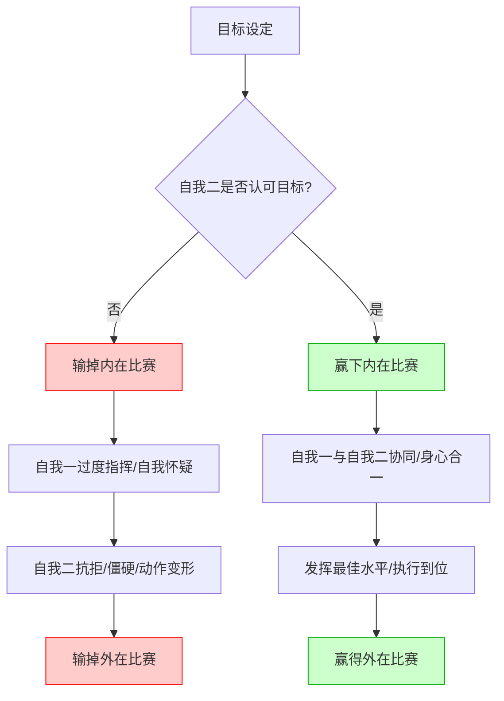

**图解说明**：该流程图展示了内在比赛如何决定外在成败。关键节点在于"自我二是否认可目标"。一旦潜意识抗拒，理性自我会陷入过度控制，导致执行层面的僵硬与失误，最终外在比赛失败；反之，潜意识认可则形成"身心合一"状态，外在比赛自然获胜。

### 关键性质

1. **内在比赛的胜负是外在比赛成败的前提条件** —— 无论外在技术多娴熟，若内在比赛输了，外在必输。
2. **自我一与自我二常对立**：理性上想要，潜意识却在抗拒，这种"双线作战"消耗了本应用于外在对抗的能量。
3. **胜负手往往不在技术层面，而在心理层面的"身心合一"状态** —— 李宗伟技术不输林丹，老虎伍兹身体未受损，输的都是内在比赛。

### 典型例子

**李宗伟 vs 林丹：输的不是技术，是内在比赛**
- 37次交手，李宗伟输25次，两次奥运会决赛落败
- 大部分职业运动员和教练认为：他俩技术不分伯仲，甚至李宗伟更全面
- **素材原话**：“其实他不是输给了林丹，他是输给了自己。如果他的潜意识不相信自己能够打赢林丹，他就输了这场内部比赛，从而也会输掉外部比赛。” [P001, p.3]

**老虎·伍兹：失去"不可战胜"信念的代价**
- 性丑闻离婚后两个月丢掉世界第一，几年内跌出前100
- 技术与身体并未受损，但潜意识和对手的潜意识都不再认为他是完美、不可战胜的人
- **素材原话**：“因为性丑闻，老虎伍兹输掉了自己的内在比赛。” [P001, p.3]

### 边界条件

- 适用于长期目标与复杂竞争情境，不适用于纯粹的运气博弈
- 解释的是“为什么做不成”的心理根源，不能替代具体的方法和技能训练
- 只有自我二真正认可目标，外在的方法论才能发挥最大效用

---

## 39.4 盲目自信 —— 创业者的“理性保险丝”

### 为什么需要这个概念？

创业充满不确定性与艰难险阻，理性的自我怀疑会放大恐惧、削弱行动力。过度分析利弊往往导致裹足不前，错失窗口期。我们需要一种心态机制，让创业者在信息不全时仍能果断推进。

### 核心定义

**盲目自信**（来源：《龙哥赚钱周报 20230207》）

> "一言以蔽之：你需要盲目的自信。因为盲目的自信和乐观，是创业者的理性选择。这样'舍我其谁''在我的领域，我就是国王'的心态，才是创业者真正需要的心态！创业途中充满了艰难险阻，而盲目的自信和乐观，是创业者的理性选择。常言道，永远不要低估一个高估自己的人。"

这不是自负，而是**主动选择的、有意识的心理建设**——在潜意识层面植入"我是国王"的信念，对抗自我一的理性怀疑。

### 方法演进图：盲目自信的心态构建流程

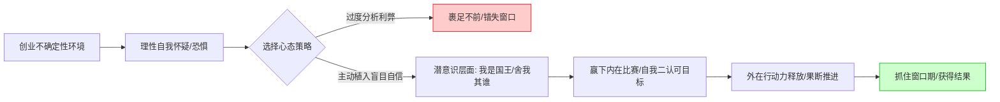

**图解说明**：在不确定性环境下，创业者面临两种选择：被理性怀疑绑架导致不行动，或主动选择"盲目自信"植入潜意识。后者让自我二认可目标，赢下内在比赛，进而释放行动力抓住机会。

### 关键性质

1. **与"战略上藐视敌人，战术上重视敌人"相通**：潜意识层面俯视（保持国王姿态），具体执行层面认真（保持学生态度）。
2. **盲目自信是创业者的理性选择**：因为创业的不确定性要求必须先相信才能看见，先自信才能行动。
3. **配合"俯视学习法"使用**：战略上藐视（保持国王姿态）、战术上重视（保持学生认真），二者合一才能打赢内在比赛。

### 典型例子

- 一等一的赚钱高手早已"身心合一"，言语中的不羁源自打赢了内在比赛 [P001, p.5]
- 优秀推销员开展一天工作前，先找优质客户或推销容易卖的产品制造成功体验 [P001, p.4]

### 边界条件

- 作用于心态层面，不能替代战术层面的精细化执行
- 适用于需要长期坚持、对抗不确定性的创业场景
- 自信需建立在过往成功体验的唤醒上，而非自我欺骗

---

## 39.5 成功是成功之母 —— 用过去的胜利喂养未来的自己

### 为什么需要这个概念？

传统认知强调"失败是成功之母"，但现实中失败可能反复打击自信、强化自我否定。创业者在低谷期需要一种正向心理循环，而非在失败中反复受挫。潜意识层面的自信需要可复现的路径来持续累积。

### 核心定义

**成功是成功之母**（来源：《龙哥赚钱周报 20230207》）

> "失败不是成功之母，成功才是成功之母。我一个成功体验，推动一个又一个的成功体验。成功，才是成功之母。当自己内心很怂、不自信的时候，你需要回顾下自己成功的经历，唤醒自己的成功体验。"

### 方法演进图：成功体验的正向循环机制

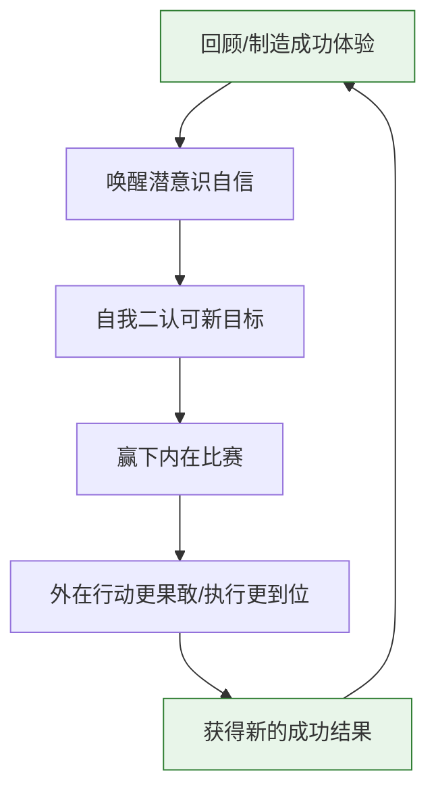

**图解说明**：成功体验不是终点，而是下一轮成功的起点。通过回顾过往成功或主动制造微小成功，唤醒潜意识自信，让自我二认可新目标，从而形成"成功→自信→行动→更大成功"的正向飞轮。

### 关键性质

1. **正向循环**：一个成功体验推动一个又一个成功体验，形成复利效应。
2. **可主动调用**：成功体验是唤醒潜意识自信的"开关"，创业者可随时按下。
3. **配合"唤醒成功体验法"**：先做容易成功的事，制造成功体验以撬动更大成功。

### 典型例子

- 优秀推销员在一天工作开始前，先找优质客户或推销容易卖的产品，用"成功体验"帮助自己更好地开展一天工作 [P001, p.4]
- 创业者在做新事情前，回顾并唤醒过往的成功经历，从潜意识层面建立自信 [P001, p.4]

### 边界条件

- 适用于心理建设与信心累积，不适用于否认失败教训的价值
- 需确保过往有真实的成功体验可唤起，而非凭空虚构
- 强调心态层面的正反馈，仍需要外部的方法论与执行支撑

---

## 39.6 俯视学习法（战略藐视·战术重视）

### 核心定义

**俯视学习法**（来源：《龙哥赚钱周报 20230207》）

> "我的答案是：别跪着学！要俯视！你就是国王，把生财有术的帖子，当成奏折来看。毛主席说，战略上藐视敌人，战术上重视敌人。跪着学生财有术的人，打不赢内在比赛。但是在战略上，来自于你的潜意识，你内心相信的应该是'老头儿，刚才你的奏折有一些亮点，朕心甚悦。可是，朕才是这个领域的国王。'"

### 操作步骤

```
1. 战略层面（潜意识）：俯视姿态
   - "他是在向我汇报，我才是决策者"
   - 保持"国王"身份，不因学习而自卑

2. 战术层面（执行）：学生姿态
   - 认真记笔记、复盘、执行每一个细节
   - 对具体方法论保持极度的敬畏与学习态度

3. 两层合一：赢下内在比赛
   - 潜意识认可目标 → 自我二配合执行 → 外在比赛获胜
```

### 方法演进图：俯视学习法的双层心态模型

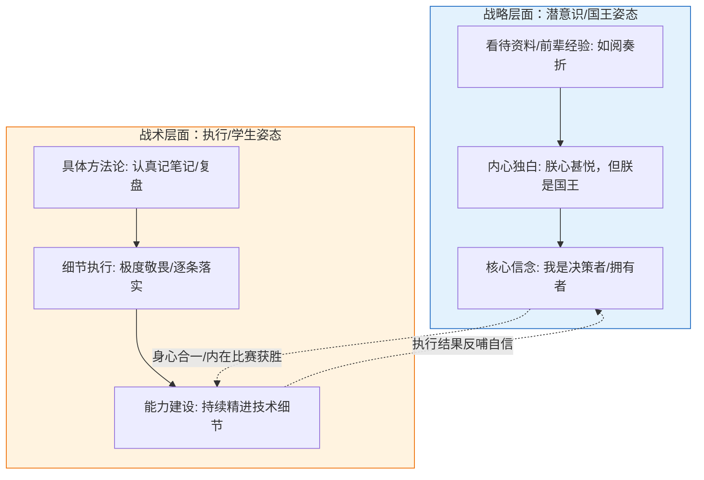

**图解说明**：俯视学习法将"学习"拆解为两个维度：战略层面保持"国王"身份，从潜意识确认自我二对目标的认可；战术层面保持"学生"态度，对细节极度敬畏。两层合一，不再内耗，形成正向循环。

### 为什么有效？

这个方法直接对齐了内在比赛理论：自我一（理性/学生态度）负责战术执行，自我二（潜意识/国王身份）负责战略认可。当两者不再冲突，行动力自然释放。

---

## 39.7 确定性窗口期 —— 在“数据推演”里捕捉的商业春天

### 为什么需要这个概念？

创业者常面临"何时入场"的困扰，盲目行动可能踩在错误的时间点上。市场机会有周期性，需要一种可推演的方法识别相对确定的机会窗口，减少不确定性是降低创业风险的关键手段。

### 核心定义

**确定性窗口期**（来源：《龙哥赚钱周报 20230207》）

> "最近 3~6 个月，是比较确定的疫情平稳期，之后才会迎来第二波疫情的峰值。香港跟大陆一样，也是第一次大规模疫情感染，就把八九成的居民给感染了。之后香港就进入了 2~3 个月的平静期，平静期之后就进入第二波疫情感染。所以我们会有一个共识，至少 2023 年的春天，会是一个比较确定的稳定期。因为这个春天，可能是今年最重要的 3 个月窗口期。反正我相信春天来了，先干个春天再说。"

### 方法演进图：确定性窗口期的类比推演流程

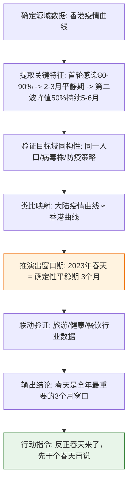

**图解说明**：该流程展示了从香港疫情数据（源域）出发，通过结构映射推演大陆疫情走势（目标域），识别出2023年春天这一确定性窗口，并用三大行业联动数据交叉验证，最终形成行动指令。

### 推演伪代码：类比法的标准化步骤

```python
# 确定性窗口期类比推演标准流程
def certainty_window_inference(source_data, target_context, verification_indicators):
    """
    source_data: 源域历史数据（如香港疫情曲线）
    target_context: 目标域环境参数（人口、病毒株、政策等）
    verification_indicators: 联动验证指标列表（旅游人次、健康带货销量、餐饮客流等）
    """
    # 1. 提取源域关键特征
    source_features = extract_key_phases(source_data)  
    # 返回: {phase1_infection_rate: 0.85, phase2_quiet_months: 2.5, phase3_peak_ratio: 0.5, phase3_duration: 5.5}
    
    # 2. 验证结构同构性
    structural_similarity = check_isomorphism(source_context, target_context)
    # 检查: 人口特征、病毒属性、防疫策略是否一致
    assert structural_similarity > 0.8, "源域与目标域结构差异过大，类比不可靠"
    
    # 3. 映射推演目标域窗口期
    target_window = map_features_to_target(source_features, target_context)
    # 输出: {window_start: "2023-02", window_end: "2023-05", confidence: "高"}
    
    # 4. 联动数据交叉验证
    verification_results = {}
    for indicator in verification_indicators:
        actual = fetch_realtime_data(indicator)
        expected = predict_from_window(target_window, indicator)
        verification_results[indicator] = (actual, expected, actual >= expected * 0.8)
    
    # 5. 综合判定
    all_passed = all(result[2] for result in verification_results.values())
    return {
        "window": target_window,
        "verification": verification_results,
        "action_guidance": "先干个春天再说" if all_passed else "需谨慎/补充验证"
    }

# 使用示例
window_result = certainty_window_inference(
    source_data="香港2022疫情曲线",
    target_context="大陆2023疫情环境",
    verification_indicators=["国内旅游人次", "出境机票订单", "抖音保健品销量"]
)
```

**代码块作用说明**：这段伪代码将"类比推演"这一模糊的思维过程，标准化为可复用的五步流程：特征提取、同构性验证、窗口映射、联动验证、综合判定。它把作者隐性的经验显性化，使任何创业者都能对新行业、新周期复用这套推演逻辑。

### 联动数据验证（三行业佐证窗口期真实性）

下表展示了三大行业的实时数据如何交叉验证2023年春天这一确定性窗口期的真实性：

| 行业 | 验证指标 | 数据表现 | 结论 |
|------|----------|----------|------|
| 旅游 | 国内旅游人次 | 春节3亿人次，恢复至2019年同期88.6% | 旅游春天爆发 |
| 旅游 | 出境/入境/酒店预订 | 同比+258%/+632%/+177% | 跨境游强劲复苏 |
| 健康 | 抖音直播单品销量 | 诺特兰德维生素连续2个月销量第一 | 保健养生带货窗口打开 |
| 餐饮 | 春季爆发需求 | 紧扣春季节点 | 短期红利明显 |

> **素材原话**："今年春节国内旅游人次达到 3 个亿，基本上已经恢复到 2019 年同期的 88.6%了。出境的机票订单量上涨了 258%，入境的预定量上涨了 632%，国际酒店的预定量同比增长了 177%。诺特兰德的维生素片保健品，连续两个月是抖音直播的单品销量第一了。" [P001, p.4-5]

### 普通人切入玩法

1. **旅游行业**：做产品分销与套利（机票、酒店、景点分销）
2. **健康行业**：保健养生带货（养生书单、养生茶、推拿小课程）
3. **餐饮行业**：紧扣春季爆发需求

### 边界条件

- 类比推演依赖源数据可靠性，需警惕数据偏差
- 窗口期具有时效性，错过3-6个月即失效
- 不同行业对同一窗口的敏感度不同，需结合特性判断

---

## 39.8 时代红利 —— 每一百块钱里，有九十块在“风口上”

### 核心定义

**时代红利**（来源：《龙哥赚钱周报 20230207》）

> "可能所有夸张，我们所赚的每一百块钱，有九十块钱是时代红利，仅有十块钱是时代对我们个人能力的补偿，英雄只是时势的产物。"

### 关键性质

1. **红利决定量级，能力决定分额**：时代红利与个人能力互补，红利定阶层，能力定位次。
2. **识别窗口比提升能力更紧迫**：红利时隐时现，稍纵即逝；能力提升是慢变量，红利捕捉是快变量。
3. **长短线结合**：视频号直播（短期爆发）+ 私域（长期基本盘）= 对红利的主动顺应。

### 典型例子

> **素材原话**：“近年来，因为现在信息传递越来越快了，项目红利期是越来越短的。所以我就在思考，怎么样能长短线结合，又有短期的爆发力，又有长期的基本盘。目前看，视频号直播+私域是有这个属性的。” [P002, p.2]

### 边界条件

- 不否定个人努力价值，只是重新校准成功归因权重
- 适用于宏观层面财富分配解释，不指导单次微观决策
- 红利客观存在但稍纵即逝，识别与抓住都需前置行动

---

## 39.9 实时真实ROI —— 把私域产值算进投放账本的“复利眼”

### 为什么需要这个概念？

传统ROI只计算直播间直接的广告回报，系统性低估了私域流量的长期价值。投放决策依赖精确的投产比，错误的算法会导致广告预算配置失当。我们需要一种综合核算方法，把公域引流与私域复购统一到同一本账上。

### 核心公式推导：从纯直播到含私域的完整推演

**逐步推导过程**：

> **第一步：纯直播间利润核算**
> - 设客单价为 n，毛利率为 q，广告投入为 y，直播间除退货后营业额为 z
> - 纯直播间毛利 = q × z
> - **纯直播间净利润 = q × z - y**
> - **纯直播间 ROI = (q × z - y) / y**

> **第二步：私域流量价值核算**
> - 直播间成交客数 = z / n
> - 私域进线率设为 60%（合格线，即60%购买用户添加企微/私域）
> - 私域用户数 = (z / n) × 60%
> - 单用户月产值为 p（经验值：8-15元/月）
> - **首月私域增量营业额 = (z / n) × 60% × p**
> - **关键假设：前3个月月递减率按80%计算**（基于经验：用户活跃度自然衰减，第1个月100%，第2个月80%，第3个月64%...），第4个月起视维护情况而定
> - 3个月累计私域营业额 ≈ 首月 × (1 + 0.8 + 0.64) = 首月 × 2.44
> - 年化估算（含衰减）可达首月的 7.5 倍左右（作者实测年产值可达首月的 60/8 ≈ 7.5 倍）

> **第三步：含私域综合利润与实时真实ROI**
> - **含私域综合月利润 = q × z - y + (z / n) × 60% × p**
> - **实时真实 ROI = 含私域综合月利润 / y**
> - **核心洞见**：私域产值是"无需额外投放的免费增量"，将其计入分子，分母y不变，ROI必然显著提升

> **为什么这些假设合理？**
> - **私域进线率60%**：作者实测视频号直播引流企微的实测合格线，低于此值说明运营动作不到位
> - **前3个月80%递减**：基于数百个群的实测均值，符合私域用户自然流失曲线（类似留存率曲线）
> - **月产值p直接相乘**：p已为"净产值/人/月"（扣除成本后的毛利贡献），非GMV，可直接加到利润端

### 公式拆解表

下表定义了实时真实ROI核算模型中的各参数含义与典型取值：

| 符号 | 含义 | 典型值 | 说明 |
|------|------|--------|------|
| n | 客单价 | 150元 | 直播间单品售价 |
| q | 毛利率 | 视产品而定 | 扣除货品成本后的毛利比例 |
| y | 广告投入 | 40万（例） | 直播间投流成本 |
| z | 直播间营业额 | 100万（例） | 扣除退货后的实收金额 |
| 60% | 私域进线合格线 | 基准值 | 购买用户添加企微/私域的比例 |
| p | 月产值/人 | 8-15元 | 私域单用户月均毛利贡献 |

**纯直播利润** = q×z - y  
**纯直播ROI** = (q×z - y) / y  

**含私域综合月利润** = q×z - y + (z/n) × 60% × p  
**实时真实ROI** = 综合月利润 / y  

### 实战演算

> **素材实测**："我们 150 客单价的产品，进粉率 60%的情况下，月产值只能做到 8……年产值算完衰减，能到 60。这么一算我的 roi 就从 2.5 提升到了 3.5……翻个倍的话 roi 就能提升到 4.5。" [P002, p.3]

| 场景 | 纯直播ROI | 含私域ROI(月度) | 年化综合ROI估算 | 提升幅度 |
|------|-----------|-----------------|-----------------|----------|
| 基础（月产值8） | 2.5 | 3.5 | ~5.2 | +40%(月)/+108%(年) |
| 月产值翻倍（16） | 2.5 | 4.5 | ~6.8 | +80%(月)/+172%(年) |

### 公域转私域效率直接拉高ROI

> **素材实测**："昨天开了个直播，一小时吧，加到私人微信近 200 人，生财新年预约人数 51 个，加曹大星球 49 个。" [P002, p.3]

### 方法演进图：实时真实ROI的数据流向

```mermaid
flowchart LR
    subgraph 公域投放[公域投放层]
        A1[广告投入 y]
        A2[直播间营业额 z]
        A3[客单价 n]
        A4[毛利率 q]
    end
    
    subgraph 私域转化[私域转化层]
        B1[成交客数 z/n]
        B2[进线率 60%]
        B3[私域用户数]
        B4[月产值 p]
    end
    
    subgraph 综合核算[综合核算层]
        C1[纯直播利润 q*z-y]
        C2[私域月增量 (z/n)*60%*p]
        C3[综合月利润 C1+C2]
        C4[实时真实ROI C3/y]
    end
    
    A1 --> C1
    A2 --> C1
    A3 --> B1
    A4 --> C1
    B1 --> B2 --> B3
    B3 --> B4 --> C2
    C1 --> C3
    C2 --> C3
    C3 --> C4
    
    style C4 fill:#e8f5e9,stroke:#2e7d32,stroke-width:2px
```

**图解说明**：数据流向清晰展示了私域价值如何从"成交客数"经"进线率"转化为"私域用户数"，再乘以"月产值"形成"私域月增量"，最终汇入"综合月利润"分子，显著提升分母不变的ROI。

### 边界条件

- 依赖稳定的私域进线率与月产值数据，需持续追踪
- 适用于直播+私域联动业务，不适用纯公域一次性变现
- 衰减率假设（前3个月80%）基于经验，不同行业需自行校准

---

## 39.10 捡漏群 —— 用“1-3折”把羊毛党变成现金流的社群引擎

### 核心定义

**捡漏群**（来源：《龙哥赚钱周报 20230207》）

> "捡漏群：用户在我们的群里可以用原价的 1-3 折买到超高性价比的商品。…… 能通过售卖商品来产出佣金，实现变现。目前这种模式不仅能将单品的产出发挥到极致，还不会造成选品的困难。"

### 方法演进图：捡漏群商业闭环流程

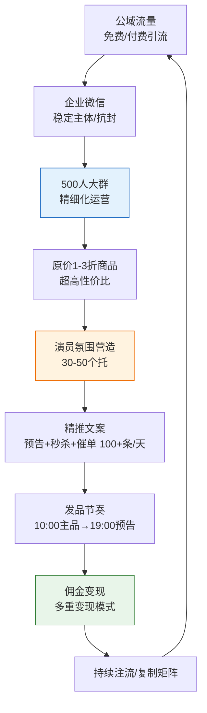

**图解说明**：捡漏群的商业闭环从公域引流起步，经企微沉淀，核心在于"演员氛围+精推文案+发品节奏"三位一体的社群运营，最终通过佣金变现，再用利润反哺引流形成飞轮。

### 核心要素

下表列出了捡漏群运营的六大核心要素及其关键指标：

| 要素 | 关键指标 | 作用 |
|------|----------|------|
| 企微主体 | 稳定、抗封 | 基础设施，保障流量容器不被封禁 |
| 流量来源 | 靠谱、稳定 | 持续注水，维持群体规模与活跃度 |
| 选品排品 | 定向招商群、淘客网站、同行群 | 货源保障，确保1-3折高性价比供给 |
| 演员配置 | 30-50个/群 | **灵魂**：有/无演员产出相差≥1倍，营造抢购紧迫感 |
| 精推文案 | 预告+秒杀+催单，100+条/天 | 转化引擎，全天候高频触达激发购买冲动 |
| 发品节奏 | 10:00主品→19:00预告 | 运营节拍，训练用户定时围观习惯 |

> **素材强调**："一个群必须有 20 个以上的演员，确保整个群的发品节奏。演员是捡漏群的灵魂，有演员和没演员的情况，社群产出起码相差一半以上。" [P002, p.5]

### 收益模型

下表展示了单群与矩阵化运营的收益测算：

| 阶段 | 单群成本 | 回本周期 | 回本后月利润 | 生命周期 | 总收益(单群) | 矩阵规模 | 日利润 | 月利润 |
|------|----------|----------|--------------|----------|--------------|----------|--------|--------|
| 单群 | 3500-10000元 | 2-3个月 | ~1000元 | ~2年 | ~2.1万 | - | - | - |
| 矩阵 | - | - | - | - | - | 1000群 | 3万 | 90万 |

> **素材数据**："目前今年新起的盘不到 1000 个群，月佣在 100w+。今年很多同行通过捡漏群和美妆小样群赚得盆满钵满，月佣百 W 的大有人在，我身边还有大的团队社群数量达到万个以上，月佣在几千个 W。" [P002, p.5]

### 边界条件

- 社群有生命周期（约2年），需持续注入新流量
- 演员配置是隐形成本，需精心管理防穿帮
- 单群成本3500-10000元，回本周期2-3个月，需资金垫付能力

---

## 39.11 私域单客价 —— 从“一锤子买卖”转向“一辈子生意”

### 核心定义

**私域单客价**（来源：《龙哥赚钱周报 20230207》）

> "电商有个'客单价'的概念，而在私域流量运营的思维下，真正值得关注的不是'客单价'，而是'单客价'，就是一个消费者总共贡献了多少销售额。"

### 关键公式

**单客价 = 单次客单价 × 复购次数 × 用户生命周期长度**

### 典型例子

> **素材案例**："结果从抖音导流 2 万私域的，都是精准的宝妈好友，完成了 7000 单的胎毛纪念品变现。在副业赚钱上变现大概有 30 万左右……总计超100万变现。" [P002, p.6]

- 2万精准宝妈好友
- 7000单胎毛纪念品（单次高客单价）
- 副业培训 + 无货源 + 淘客（长期复购）
- **单客价远超单次客单价**

### 核心心法

- **复购比拉新更重要** [P002, p.2]
- 私域运营核心：拉长用户生命周期、增加复购频次
- 衡量的是整个私域资产的质量而非短期交易规模

### 边界条件

- 适用于有复购属性或可延伸需求的产品
- 需持续的用户维护投入（内容、服务、关怀）
- 急功近利的过度推销会反而缩短生命周期

---

## 39.12 渣男思维做内容 —— “撩完就跑”和“广撒网”的爆款心法

### 为什么需要这个概念？

许多创作者陷入"自嗨式"输出，内容质量高却缺乏用户共鸣与转化。平台竞争激烈，需要一种更高命中率的内容策略。传统"垂直深耕"思维限制了内容的覆盖面与传播潜力。

### 核心定义

**渣男思维做内容**（来源：《龙哥赚钱周报 20230207》）

> "今天我来分享渣男思维做内容，让你们变成自媒体世界的渣男！做渣男第一点：撩完就跑。戳痒点，意犹未尽。…… 咱们撩到用户的痒点就停，峰终定律，在情绪最高点停止，才能让人意犹未尽，印象最好。做渣男第二点：广撒网。渣男怎么养鱼的？当然是混多个圈子……所以，咱们做内容也需要广撒网，提高自己的内容命中率。要注意，咱们垂直，并不是垂直内容……咱们垂直垂的是人群。"

两大核心原则：
1. **撩完就跑**：戳中痛点/痒点即停，利用峰终定律让用户在情绪最高点意犹未尽
2. **广撒网**：在多个圈子多平台发内容提高命中率，**垂直垂的是人群而非内容题材**

### 峰终定律（心理学支撑）

> **素材定义**："有个定律，叫做峰终定律：如果在一段体验的高峰和结尾，体验是愉悦的，那么对整个体验的感受就是愉悦的。这就说明，如果我们让目标用户在看我们的内容的开头和结尾（中间内容无所谓），体验愉悦，那么她对我们的内容就会产生好感。" [P003, p.3]

**应用公式**：
```
内容体验 = f(峰值体验, 结尾体验)
中间体验权重 → 0
整体好感度 ≈ 开头愉悦度 × 结尾愉悦度
```

### 方法演进图：渣男思维内容生产流程

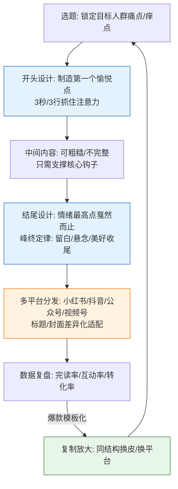

**图解说明**：渣男思维内容生产的核心是"两头精、中间松、多平台发、模板化复制"。开头与结尾是峰终定律的两个锚点，中间内容成本可控，多平台分发实现"广撒网"，爆款后提炼模板复用。

### 典型例子

1. **展示有钱人生活视频**：开头无边泳池、结尾美妙画面收尾，中间剪辑粗糙仍获大量点赞 [P003, p.4]
2. **"做个人IP的40个APP"**：仅列名字不教用法，成功戳中想做IP的痛点引发关注 [P003, p.4]
3. **作者实战**：劲猫曾用20分钟做出10万赞藏大爆文，1万粉丝变现20万；小红书3个月从0涨粉8000、变现5万 [P003, p.4]

### 爆款内容可复制与再利用

> **素材主张**："爆过的内容一定是可以再爆的，内容创作不要靠灵感，要靠爆款模板！" [P003, p.3]

### 边界条件

- 适用于公域内容引流场景，不适用于需要深度信任的私域成交
- "撩完就跑"需把握分寸，过度"渣"会损坏个人品牌信誉
- "广撒网"需建立在内容质量不低的基础上

---

## 39.13 逆向思考法 —— 从“先找买家”开始的变现倒推术

### 为什么需要这个概念？

传统创业流程"定位→内容→流量→产品→变现"周期长、风险高，可能投入巨大却无人买单。许多创作者先做内容再想变现，导致流量无法转化为收入。需要一种以终点为起点的思考方式。

### 核心定义

**逆向思考法**（来源：《龙哥赚钱周报 20230207》）

> "以结果为导向，逆向思维需要的步骤，拆解出最小行动单元。正常流程：定位→内容→流量→产品→变现，我们可以以结果倒推内容：变现→定位→产品→内容→流量。先找买家，再找产品！（也可以理解为先找需求），一定要先考虑好怎么变现，然后再去开展业务，一定会事半功倍。"

### 方法演进图：正向与逆向流程的对比与倒推链路

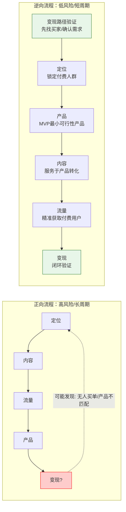

**图解说明**：正向流程是"造车再找买主"，风险在于最后一步才验证变现；逆向流程是"先找买主再造车"，从变现端倒推，每一步都服务于付费转化，大幅降低试错成本。

### 逆向思考法伪代码：标准化倒推流程

```python
# 逆向思考法标准化倒推流程
def reverse_thinking_framework(target_market, initial_idea=None):
    """
    从变现端倒推完整业务链路
    target_market: 目标市场/人群描述
    initial_idea: 可选的初始创意/方向
    """
    # 步骤1: 变现路径验证 - 先找买家/需求
    monetization_paths = discover_monetization_paths(target_market)
    # 方法: 竞品调研/客户访谈/关键词搜索付费意愿/同行变现模式拆解
    # 输出: [{path: "咨询服务", price: 5000, demand: "高"}, {path: "课程", price: 999, demand: "中"}, ...]
    
    validated_path = select_best_path(monetization_paths)
    # 选择标准: 客单价高、复购强、交付标准化程度高、自己能做
    
    # 步骤2: 定位 - 基于变现路径锁定人群
    positioning = define_positioning(validated_path)
    # 输出: {target_user: "想做副业的宝妈", pain_point: "不会选品/没流量", willingness_to_pay: 2999}
    
    # 步骤3: 产品 - MVP最小可行性产品
    mvp = build_mvp(validated_path, positioning)
    # 原则: 先卖后做/最小交付单元/可在2周内交付验证
    # 输出: {product: "选品陪跑营", format: "社群+直播", price: 2999, delivery: "4周"}
    
    # 步骤4: 内容 - 服务于产品转化
    content_strategy = design_content_for_conversion(mvp, positioning)
    # 核心: 每篇内容都要有CTA指向产品/私域
    # 输出: {topics: ["选品避坑", "流量实操", "心法"], format: "短视频+图文", cta: "加微信领资料"}
    
    # 步骤5: 流量 - 精准获取付费用户
    traffic_plan = plan_precision_traffic(content_strategy, positioning)
    # 渠道: 同行评论区截流/关键词SEO/付费投放/裂变
    # 输出: {channels: ["抖音", "小红书", "视频号"], budget: 5000, target_cpa: 50}
    
    # 步骤6: 变现闭环验证
    validation = run_pilot(traffic_plan, content_strategy, mvp)
    # 关键指标: ROI>1, 留存>30%, NPS>40
    
    return {
        "monetization_path": validated_path,
        "positioning": positioning,
        "mvp": mvp,
        "content_strategy": content_strategy,
        "traffic_plan": traffic_plan,
        "validation_result": validation
    }

# 使用示例
business_plan = reverse_thinking_framework("宝妈副业赛道")
```

**代码块作用说明**：这段伪代码将"逆向思考"从抽象建议转化为可执行的六步标准流程，每步都有明确的输入、方法、输出标准。它解决了"先找买家"如何落地的问题：通过竞品调研、关键词搜索、客户访谈等具体手段验证变现路径，而非凭空想象。

### 关键性质

1. **变现路径前置**：保证内容与产品始终围绕付费需求
2. **先找需求**：再投入研发与生产
3. **配合"MVP先卖后做"**：用最小成本验证需求

### 典型例子

- "先找买家，再找产品！"——先通过市场调研确认目标用户愿意为何付费，再针对性开发产品 [P003, p.4]
- 做个人IP前先确定变现方式（咨询、课程、社群），再决定内容定位与流量策略 [P003, p.4]

### 边界条件

- 需要一定市场敏感度，否则可能倒推出伪需求
- 适用于可预见变现路径（知识付费、电商），不适用探索性创新
- 需保留用户反馈调整空间，避免过度僵化

---

## 39.14 剥离式拆解问题法

### 核心方法

**剥离式拆解问题法**（来源：《龙哥赚钱周报 20230207》）

> "提炼客户群体最需要解决的 10 个大问题，并把每个大问题拆解为 10 个小问题，得到 100 个问题，你和你的团队，最该花时间的地方，就是这 100 个小问题。"

### 操作步骤伪代码：从大问题到执行清单的标准化拆解

```python
# 剥离式拆解问题法标准化流程
def peel_problems(customer_segment, top_n=10, sub_n=10):
    """
    将目标客群核心问题层层剥离为可执行的小问题清单
    customer_segment: 目标客群画像
    top_n: 大问题数量(默认10)
    sub_n: 每个大问题拆解的小问题数(默认10)
    """
    # 步骤1: 识别目标客群最核心的大问题
    major_problems = identify_major_problems(customer_segment, top_n)
    # 方法: 用户访谈/工单分析/竞品差评/搜索下拉词/社群高频提问
    # 输出: ["如何低成本获客", "如何提高复购", "如何做私域转化", ...]
    
    # 步骤2: 每个大问题拆解为具体小问题
    all_minor_problems = []
    for major in major_problems:
        minor_problems = decompose_to_actionable(major, sub_n)
        # 拆解原则: 
        # 1) 具体到可执行动作(如"如何写朋友圈文案"而非"如何做营销")
        # 2) 可量化验证(如"日发3条朋友圈"而非"多发朋友圈")
        # 3) 有明确责任人与截止时间
        # 输出: ["朋友圈文案结构怎么写", "朋友圈发布最佳时间", "朋友圈互动引导话术", ...]
        all_minor_problems.extend([f"{major} -> {minor}" for minor in minor_problems])
    
    # 步骤3: 优先级排序与资源分配
    prioritized = prioritize_by_impact_effort(all_minor_problems)
    # 维度: 影响力(解决后对业务提升大小) × 紧迫度 / 实施成本
    
    # 步骤4: 生成团队执行看板
    execution_board = generate_board(prioritized)
    # 输出: [{problem, owner, deadline, kpi, status}, ...]
    
    return {
        "major_problems": major_problems,
        "minor_problems_count": len(all_minor_problems),
        "execution_board": execution_board
    }

# 使用示例
problem_map = peel_problems("做私域变现的宝妈创业者", top_n=10, sub_n=10)
# 得到100个具体执行问题，团队精力100%对齐这100个点逐个击破
```

**代码块作用说明**：这段伪代码将"拆解问题"这一模糊的管理建议，标准化为四步可执行流程：大问题识别、小问题分解、优先级排序、执行看板生成。它把作者的"10×10=100"法则工程化，使团队能系统性地对齐精力于最高杠杆的执行点上。

---

## 39.15 增长瓶颈怪圈 —— “被想拥有的东西绑架”的恶性循环

### 为什么需要这个概念？

许多企业面临增长停滞时，越努力反而离增长越远，陷入自我怀疑与压榨的死循环。传统诊断聚焦外部环境，忽略了"追求增长"这一心态本身可能成为障碍。

### 核心定义

**增长瓶颈怪圈**（来源：《龙哥赚钱周报 20230207》）

> "进入增长瓶颈的一个典型现象，就是越想要增长，却距离想要的增长越远。如果用一句话来形容这种现象，那就是我们被我们想拥有的东西绑架了。当一个人被增长的预期绑架，就会失去这些习惯，他会变得投机一样地去跟随对手而非做开创性事情，会天天计算自己的利弊得失而非去关注用户，会抓取身边的资源、流量而非积累价值，这些都让他距离增长越来越远。"

### 方法演进图：增长瓶颈怪圈的恶性循环机制

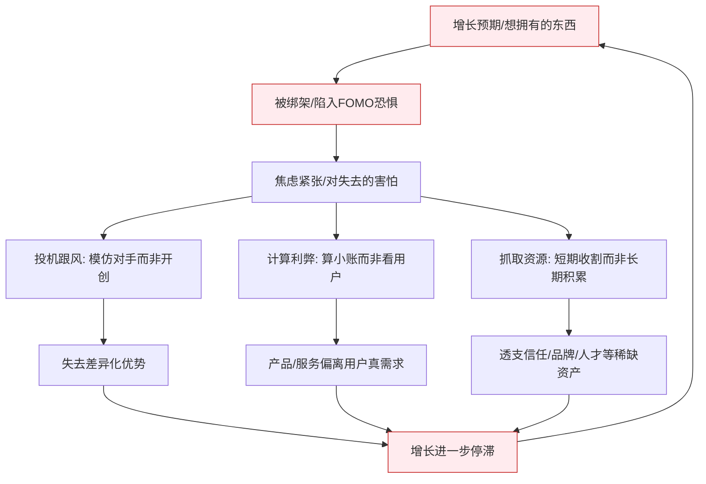

**图解说明**：增长预期本应是动力，却因"想拥有"过度而变成绑架。绑架触发FOMO心理，导致三大短视行为（投机、计较、抓取），这些行为反而破坏了增长的真实根基（差异化、用户价值、稀缺资产），让增长更遥远，形成自我强化的恶性循环。

### 核心机制

```
增长预期（想拥有的东西）
        ↓ 绑架
FOMO心理（错失恐惧）+ 焦虑紧张
        ↓
三大短视行为：
├── 投机跟风（而非开创）
├── 计算利弊（而非关注用户）
└── 抓取资源（而非积累价值）
        ↓
进一步远离真正增长
```

### 典型反面教材

**柯达：用过去定义自己，错失数码相机趋势**
- 柯达自认成功源于"坚持成像品质与性能"
- 实际上最初成功源于创始人开发低价便捷相机抓住大众化趋势
- 这一错误信念限制其进入"便捷但品质相对低"的数码相机市场 [P004, p.3]

**宜家模式被误读：学表面不解本质**
- 家具公司对标宜家做体验式门店，目的是提高顾客停留时长
- 忽略宜家出发点：解决"搬入陌生城市一天内拥有一家"的核心需求 [P004, p.3]

### 边界条件

- 适用于解释长期性增长停滞，不适用于短期波动
- 视角切换需要三种勇气，并非一蹴而就
- 警惕将"不追求增长"误读为"躺平"

---

## 39.16 价值创造视角 —— 从“索取增长”到“配得上增长”的三步切换

### 核心定义

**价值创造视角**（来源：《龙哥赚钱周报 20230207》）

> "我发现，破除增长焦虑唯一的方法，就是怎么从追求增长的视角，切换成价值创造的视角。从一个'我如何得到增长'，变成'我如何成为一个值得被奖赏增长的人'。转化看待问题的方式，而非解决问题本身，往往才是最关键的办法。"

### 方法演进图：价值创造视角的三大勇气切换

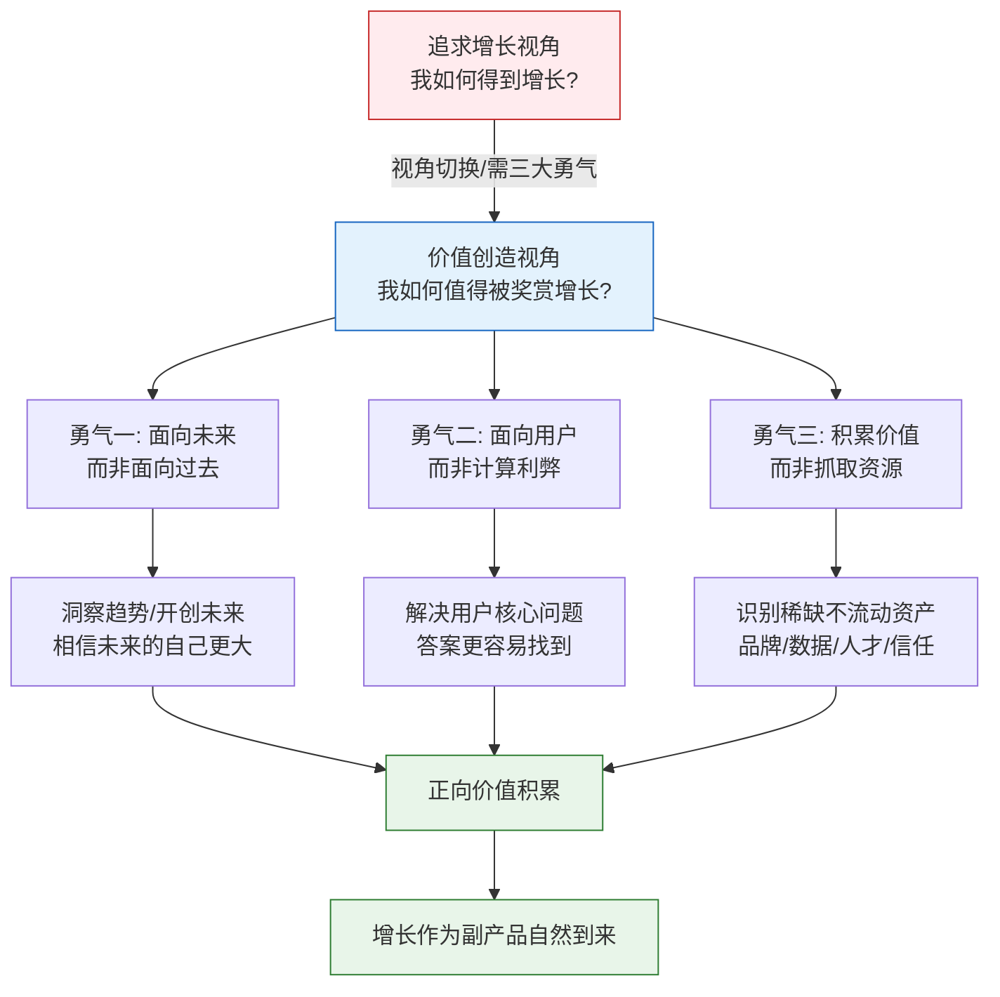

**图解说明**：视角切换的本质是从"索取型"转为"贡献型"。三大勇气分别对应时间维度（未来vs过去）、对象维度（用户vs自己）、资产维度（稀缺长期vs流动短期）。三者合力形成正向价值积累，增长成为水到渠成的副产品。

### 三大勇气切换对照表

下表对比了追求增长视角与价值创造视角的核心差异，以及所需的三种勇气：

| 原视角（追求增长） | 新视角（价值创造） | 核心勇气 | 具体行动指引 |
|-------------------|-------------------|----------|-------------|
| 面向过去（守成果、复盘旧成功归因） | **面向未来**（开创趋势、相信未来的自己更大） | 相信未来的自己更大 | 复盘时除问"坚持了什么"，更要问"抓住了什么机会/打破了什么惯例" |
| 计算利弊（算账、算CAC/LTV、算ROI） | **面向用户**（解决问题、我若想解决用户问题该怎么做？） | 把"解决用户问题"放第一位 | 选品/开发/运营每个决策前先问：这能解决用户什么痛点？ |
| 抓取资源（短期流量/销售额/权力/DAU） | **积累价值**（长期品牌/数据/人才/信任/稀缺供给） | 识别环境中最稀缺、最不流动的资产 | 审视当前业务：什么是无限可得的？什么是稀缺不流动的？All in后者 |

### 关键性质

1. **转化看待问题的方式 > 解决问题本身** —— 视角错，努力白费；视角对，答案自现。
2. **面向未来**：只有觉得未来的自己更大，才能洞察趋势并开创未来 [P004, p.4]
3. **面向用户**：把视角切换为"我如果想要去解决用户的问题，应该怎么做？"，答案更容易找到 [P004, p.4]
4. **积累价值**：识别当前环境中最稀缺、最不流动的是什么（品牌、数据、人才、信任），整体优化目标本着这些 [P004, p.4]

### 典型例子

- **鉴真、贝聿铭**：不断自我革新，始终面向未来而非守在过去成就上 [P004, p.4]
- **茅台**：八项规定后不降价砸牌，认为品牌是最重要资产，维持高端心智 [P004, p.4]
- **美国对苏"强加成本"战略**：所有行动遵循"让苏联增加成本"指导原则，而非直接追求具体目标 [P004, p.3]

### 边界条件

- 需要"勇气"，反直觉且需刻意练习
- 适用于陷入增长瓶颈的成熟企业与个人
- 识别"真正稀缺不流动的资产"仍依赖判断力

---

## 39.17 战略即选择 —— 最重要的不是做什么，而是不做什么

### 核心定义

**战略即选择**（来源：《龙哥赚钱周报 20230207》）

> "什么是战略呢？就是选择。选择，其最重要的就是不做什么，而不是做什么。首先，战略目的是让你能获得优势或者获得相对优势。其次，战略应该形成一种自始至终的指导原则。还有一个呢，就是战略需要发挥你的禀赋。"

### 战略三段论描述

```
1. 目的：获得相对优势
2. 形式：自始至终的指导原则
3. 约束：发挥自身禀赋（劣势不能作为战略方向）
```

### 方法演进图：战略三段论的决策模型

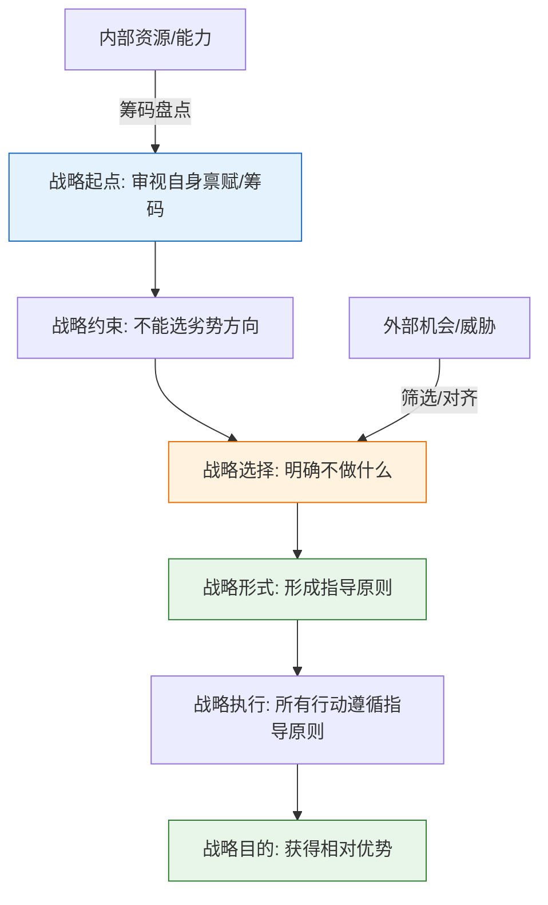

**图解说明**：战略不是从"想做什么"开始，而是从"手里有什么筹码"（禀赋）开始。基于禀赋做取舍（明确不做什么），形成指导原则，所有战术行动都在原则框架内灵活展开，最终获得相对优势。

### 关键区分

下表澄清了战略与易混淆概念的本质区别：

| 易混淆概念 | 真相 | 举例 |
|-----------|------|------|
| 目标 = 战略 | **目标是战略的对象/结果，不是战略本身** | "帮助1万人赚钱"是目标，不是战略。战略是"怎么帮"的指导原则 |
| 做更多 = 战略 | **战略核心是"不做什么"，拒绝诱惑与偏离** | 小餐馆不该比标准化（大牌强项），该比人情味、现炒（己之长） |
| 对标强者 = 战略 | **要发挥己之长，而非以己之短追人之长** | 老乡鸡/南城香的标准化路径不适合小餐馆，小餐馆战略应发挥"现炒/人情味"禀赋 |

### 典型例子

**美国"强加成本"战略**：所有行动（毒刺导弹、压油价、星球大战）遵守同一指导原则："让苏联增加成本"。目的明确、手段灵活、贯穿始终 [P004, p.3]。

### 边界条件

- "不做什么"的前提是已明确"要做什么"
- 战略指导原则需保持稳定，频繁更迭失去指导意义
- 禀赋识别需客观，自我认知偏差会导致战略建立在虚构优势上

---

## 39.18 信息差生意 —— 在你身边“闷声发大财”的隐藏金矿

### 核心定义

**信息差生意**（来源：《龙哥赚钱周报 20230207》）

> "身边赚钱的机会其实还是很多的，只是你没有发现，这个就是大家所说的信息差。先有闷声发大财，网上说做什么小项目一个月可以赚多少钱的，基本是已经过时了。对于赚钱这件事，真的需要你从身边挖掘发现，而不是在网上听谁说赚钱。"

### 关键性质

1. **信息差 = 你知道而别人不知道的路径/渠道/认知** —— 它是隐性的、局部的、时效的。
2. **隐蔽性决定低竞争高利润属性** —— 一旦公开，红利即被稀释。
3. **一旦公开传播，红利迅速消失** —— 网上能看到的"项目"，大概率已过红利期。

### 典型身边案例

下表列举了三个真实的身边信息差生意案例，展示了机会往往藏在不起眼的日常场景中：

| 案例 | 模式 | 收入规模 | 核心信息差 |
|------|------|----------|------------|
| 苏州ao图文 | 专做广告牌，70家店 | 单牌3000-5000，月15块≈7万 | 专注细分B2B需求，标准化交付，规模化复制 |
| 四线城市烤面筋 | 三轮车流动售卖 | 日卖600串，日入2000+，节假日更高 | 选址技巧+产品标准化+低成本运营，非本地人难发现 |
| 大学生朋友圈卖螃蟹 | 社交电商预售 | 淡季月7-8千，旺季月2-3万，年均约1.2万 | 供应链渠道+朋友圈信任转化+季节性爆发节奏 |

> **素材原话**："苏州有一家叫 ao 图文的，就只做广告牌子，现在开了有 70 家店……一块牌子 3000-5000 块，生意稳定……一个月 15 块牌子，也要 7w 块了。四线城市做烤面筋……一天卖 600 串左右，一天的收入在 2000 多，节假日更多。小姐姐也没有天天广告漫天……差一点一个月 7000-8000 左右，到了吃螃蟹的季节，一个月 2w-3w 不等。" [P004, p.5]

### 边界条件

- 规模往往有限，难以大规模复制
- 需持续挖掘新信息差，旧的很快被抹平
- 依赖对身边生活的敏感观察，而非远程追逐热点

---

## 39.19 正反馈驱动热爱 —— 懒惰本质上是一笔“没到账的激励”

### 核心定义

**正反馈驱动热爱**（来源：《龙哥赚钱周报 20230207》）

> "为什么会有懒惰这个东西？本质上，就是没拿到正反馈，如果你每天做的事都有大量的钱进账，比如一天一万利润揣兜里，你说你会懒？你比谁都积极。但是最核心的是，你不够喜欢。你不够想，不够想赚钱，不够缺钱。这里有两个突破口，一个是尽快找到自己到底热爱，另一个，找不到也没关系，就是为了钱冲，不别扭，不内耗。"

### 负向循环机制

```
不够喜欢 → 做得不够多 → 未获正反馈 → 更不喜欢 → 更懒惰
     ↑___________________________________________________|
```

### 方法演进图：正反馈与热爱的双重螺旋

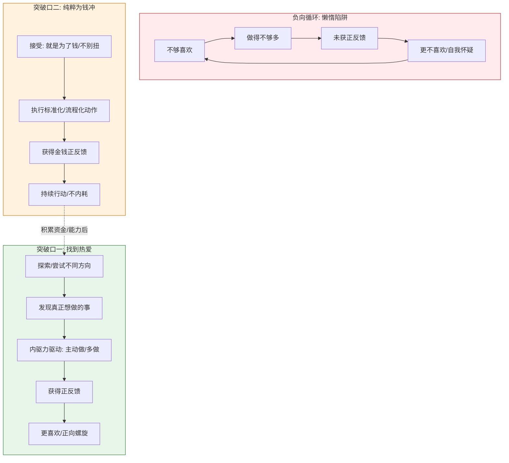

**图解说明**：懒惰不是性格缺陷，是激励机制缺失。两大突破口分别对应"内驱力路线"（找热爱→主动做→获正反馈→更热爱）和"外驱力路线"（为钱冲→标准化执行→获钱反馈→持续行动）。后者可作为前者的过渡与兜底。

### 好方向定义

> **素材公式**："好方向 = 想做 & 能做 & 可做的交集。想做：热爱（非讨厌）的；能做：专业能力所在的；可做：花时间能完成的。权重还是：能做（硬技能） > 想做（心态） > 可做（体力）。" [P002, p.2]

---

## 39.20 优雅亏大钱法 —— 一条反着读的“保命清单”

### 核心定义

**优雅亏大钱三步骤**（来源：《龙哥赚钱周报 20230207》）—— 反讽式风险警示

> "我的方案可以分成三个步骤：1、做容易亏钱的事。2、投入足够多的钱。3、坚持到底。"

### 方法演进图：优雅亏大钱的三步走与反向规避

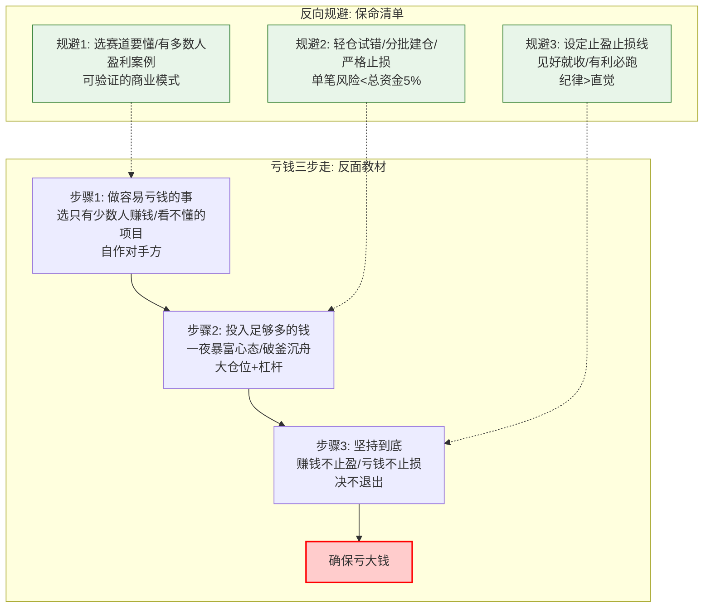

**图解说明**：左侧是"标准亏钱流程"的三级台阶，每一级都是人性弱点的放大器；右侧是对应的反向规避动作。读者可对照自查：自己是否正站在某个台阶上？

### 三步亏钱法对照表（反面教材与规避行为）

下表将每个亏钱步骤与对应的规避行为一一对照，构成一份可直接自查的"保命清单"：

| 步骤 | 亏钱操作（反面教材） | 对应规避行为（保命清单） | 核心逻辑 |
|------|---------------------|--------------------------|----------|
| 1 | **做容易亏钱的事**：坚定选择"只有少数人能赚钱"或"看不懂"的项目，自作对手方 | 选赛道要懂、要有可验证的多数人盈利案例，拒绝"不懂不碰" | 认知圈内游戏，胜率才可期 |
| 2 | **投入足够多的钱**：带一夜暴富追求、破釜沉舟气势，一次上大仓位，最好配杠杆 | 轻仓试错、分批建仓、严格止损，单笔风险<总资金5% | 活下来才有翻盘机会，重仓=赌博 |
| 3 | **坚持到底**：赚钱了不止盈，亏钱了不止损，决不退出 | 设定止盈止损线，见好就收、有利必跑，纪律执行>直觉坚持 | 止损是成本，止盈是利润落袋 |

> **素材金句**："这一步叫：坚持到底，决不退出。赚钱了不止盈，亏钱了不止损。只有这样才能确保真的亏大钱。毕竟，赚钱的方式千差万别，亏钱的方式殊途同归。" [P004, p.5]

### 反期望定理

> **素材原话**："如果你要问，那我反着来，就能保证赚钱吗？我也希望可以，但很不幸不能，无论多厉害的高手，亏钱是赚钱路上的不可缺少的部分。舍弃了亏钱，就意味着舍弃赚钱。" [P004, p.5]

---

## 39.21 盈利验证与放大法 —— 先赚1块钱，再复制10000遍

### 核心定义

**盈利验证与放大法**（来源：《龙哥赚钱周报 20230207》）

> "不要追求完美，用最快速度跑通盈利模型。（先用最简单的方式去验证商业模式是否正确，也就是完成第一单）把 1 个号做到月入 10 万很难，但是把月入 3000 的号复制 30 多遍不难，把盈利的事情重复做。找到一点点能够获利的机会，再通过放大，将它变成个大生意，哪怕只能赚一元钱，只要他可以无限放大，那他就是一个年赚百万的项目！"

### 方法演进图：盈利验证与放大的三阶段飞轮

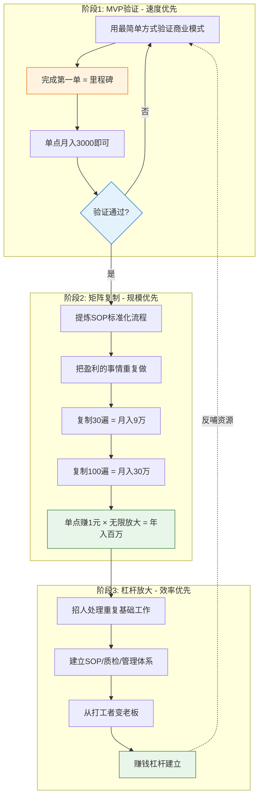

**图解说明**：三阶段飞轮从"跑通一个点"开始，通过标准化复制实现线性放大，再通过组织化杠杆实现指数级放大。关键节点是"第一单"（验证）和"SOP化"（复制前提）。

### 盈利验证与放大法伪代码：从跑通到复制的标准化路径

```python
# 盈利验证与放大法标准化流程
def profit_validate_and_scale(initial_idea, max_iterations=100):
    """
    从0到1跑通盈利模型，再通过矩阵化复制放大
    initial_idea: 初始业务想法
    max_iterations: 最大复制倍数
    """
    # 阶段1: MVP验证 - 最快速度跑通
    mvp = build_mvp(initial_idea)  # 最小可行性产品/服务
    # 原则: 2周内上线, 成本<5000元, 能收第一笔钱
    
    validation_result = run_validation(mvp, duration_weeks=4)
    # 关键指标: 
    # - 月收入 >= 3000元
    # - ROI > 1 (含人力成本)
    # - 可标准化程度高 (SOP化难度低)
    # - 复购/留存指标健康
    
    if not validation_result.passed:
        return {"status": "验证失败", "pivot_suggestion": "换赛道/换产品/换人群"}
    
    # 阶段2: 矩阵化复制 - 规模优先
    sop = extract_sop(mvp, validation_result)  # 提炼标准化操作手册
    # SOP包含: 选品/引流/转化/交付/售后 全链路清单
    
    copies = []
    for i in range(max_iterations):
        copy_instance = replicate(sop, instance_id=i)
        # 复制要素: 新账号/新团队/新渠道/新货源
        # 隔离性: 单点失败不传染, 单点数据独立核算
        
        copy_result = run_copy(copy_instance, duration_weeks=4)
        if copy_result.monthly_profit >= 3000:
            copies.append(copy_instance)
        else:
            diagnose_and_fix(copy_instance)  # 复制失败诊断修复
    
    total_monthly = sum(c.monthly_profit for c in copies)
    
    # 阶段3: 杠杆放大 - 效率优先
    if len(copies) >= 10:  # 规模阈值
        # 招人/外包/系统化
        org = build_organization(copies)
        # 角色: 运营专员/客服/选品/投放/管理层
        # 核心: 创始人从"做业务"转型为"管做业务的人"
        
        scale_result = scale_with_leverage(org, target_copies=100)
        return {
            "status": "放大成功",
            "validated_copies": len(copies),
            "total_monthly_profit": total_monthly,
            "organization": org,
            "scale_projection": scale_result
        }
    
    return {
        "status": "矩阵运行中",
        "validated_copies": len(copies),
        "total_monthly_profit": total_monthly,
        "next_milestone": f"再复制 {10 - len(copies)} 个进入组织化阶段"
    }

# 使用示例
result = profit_validate_and_scale("捡漏群模式", max_iterations=1000)
# 预期: 单群月利1000, 1000群月利100万, 组织化管理
```

**代码块作用说明**：这段伪代码将"先跑通再复制"的口号工程化为三阶段可执行流程：MVP验证（4周、3000元门槛）、矩阵复制（SOP标准化、隔离性运行、诊断修复）、组织化杠杆（角色分工、创始人转型）。它解决了"怎么复制""复制多少""何时组织化"的具体落地问题。

### 关键性质

1. **MVP验证优先**：第一单是验证商业模式的"里程碑"，不求完美，求跑通。
2. **复制放大前提**：单点模型必须可复制、可重复，否则放大的是亏损。
3. **放大手段**：矩阵化（多账号/多群）、招商加盟、组织化杠杆（招人管人）。

### 典型例子

- "同行就是最好的老师，抄同行永远是做项目最快的途径，能避开多数弯路和无用功。" [P002, p.4]
- "我们以客户的角度去思考如果我想要买这个产品，我会在哪去搜关键词，自然也可以找到同行的流量渠道。" [P002, p.4]
- **副业转老板路径**："拿出你现在收入的一部分……把重复的基础的活整理出来，安排给其他人……一旦你习惯了花钱找人帮你干活，你就开始成为一个老板，赚钱的杠杆就有了。" [P002, p.5]

### 边界条件

- 放大前提：单点模型健康且可复制，否则放大亏损
- 追求速度≠草率，验证阶段仍需关注核心指标（留存、转化）
- 适用于已验证商业模式，不适用探索性创新

---

## 39.22 多源对照

本章核心概念均有多份素材交叉支撑，以下逐一列出共识与分歧：

### 1. 内在比赛理论 / 自我一自我二
- **共识**：P001（周报核心帖）与《身心合一的奇迹力量》原著（Timothy Gallwey, 1974/1997/2012多版本）一致：人有两个自我，内在比赛决定外在成败。
- **分歧/侧重差异**：P001侧重**心理机制解释**（为什么输），给出"盲目自信""唤醒成功体验""俯视学习"三套心法；P003（50条认知）中的"竭尽全力是最轻松的工作方式"与内在比赛理论呼应：心态到位，执行自然不内耗。

### 2. 盲目自信 / 舍我其谁心态
- **共识**：P001与P003（"竭尽全力是最轻松的工作方式""不要低估一个高估自己的人"）形成共振：高手皆有超常自信。
- **分歧**：P001强调其为"创业者的理性选择"（策略性），P003更侧重"竭尽全力"的执行层面表现。

### 3. 成功是成功之母 / 唤醒成功体验法
- **共识**：P001明确提出"失败不是成功之母，成功才是成功之母"，并给出优秀推销员"先制造成功体验"的具体战术。
- **分歧**：P003的"竭尽全力是最轻松的工作方式"可视为该理论在执行层面的投射——成功体验来自全力以赴的过程而非结果。

### 4. 俯视学习法（战略藐视·战术重视）
- **共识**：P001独创性提出，引用毛泽东"战略上藐视敌人，战术上重视敌人"作为理论支撑。
- **分歧**：P005的"真传一句话，假传万卷书"与"学以致用"原则在战术层面呼应：俯视学习的战术层面就是"只取精华、即学即用"。

### 5. 确定性窗口期 / 类比推演方法
- **共识**：P001基于香港疫情数据类比推演大陆2023年春天窗口期，并用旅游/健康/餐饮三行业数据联动验证。
- **分歧**：P003的"进化论是唯一可靠的成功学"提供了宏观哲学支撑——环境变化产生窗口，适应者生存。

### 6. 时代红利 / 长短线结合
- **共识**：P001"先干个春天再说"与P003"视频号直播+私域是长短线结合"形成完整链路：窗口期识别（P001）+ 红利认知（P003）+ 业务模式适配（P003）。
- **分歧**：P001侧重"时机判断"，P003侧重"业务模式设计"，两者互补。

### 7. 实时真实ROI / 私域产值核算
- **共识**：P003给出完整公式（q*z-y + z/n×60%×p）与实测数据（ROI从2.5→3.5→4.5），P001的"春天来了先干"隐含了对窗口期内高ROI的预期。
- **分歧**：P003提供了具体的衰减率假设（前3个月80%）、进线率合格线（60%）、月产值范围（8-15元），使模型可落地。

### 8. 捡漏群 / 演员氛围 / 社群收益模型
- **共识**：P003系统拆解了捡漏群的商业闭环、核心要素（演员是灵魂）、收益模型（单群2年2.1万、千群月佣90万）。
- **分歧**：P001未涉及此战术，属于P003独有的战术级方法论。

### 9. 私域单客价 / 复购思维
- **共识**：P003定义"单客价"替代"客单价"，并给出2万宝妈变现100万的实证案例。
- **分歧**：P005的"能够变现的流量才叫流量"与单客价思维一脉相承：从第一个用户开始算长期价值。

### 10. 渣男思维做内容 / 峰终定律 / 广撒网
- **共识**：P005系统阐述"撩完就跑""广撒网""垂直垂人群"三大支柱，并给出峰终定律心理学支撑与作者实测数据（20分钟出10万赞藏、1万粉变现20万、小红书3月8000粉变现5万）。
- **分歧**：P003未涉及内容策略，P005为内容专题。

### 11. 逆向思考法 / 先找买家
- **共识**：P005给出完整逆向流程（变现→定位→产品→内容→流量）与"先找买家再找产品"核心口诀。
- **分歧**：P003的"找项目与抄同行方法"在战术层面支撑逆向法的"产品/流量"环节：验证变现路径后，抄同行是最快获取产品与流量方案的手段。

### 12. 剥离式拆解问题法
- **共识**：P005提出"10个大问题→100个小问题"的团队聚焦法。
- **分歧**：P003的"找项目与抄同行"在执行层面可视为该方法的应用——把"怎么做捡漏群"拆解为选品/文案/演员/节奏等100个小问题。

### 13. 增长瓶颈怪圈 / 被想拥有的东西绑架
- **共识**：P007系统阐述"被增长预期绑架→FOMO→投机/计较/抓取→更远离增长"的完整机制，并给出柯达、宜家等反面教材。
- **分歧**：P003的"战术勤奋无法逃避战略探索"是该怪圈在执行层面的投射：用忙碌麻痹自己，实为逃避战略突破。

### 14. 价值创造视角 / 三大勇气切换
- **共识**：P007提出从"我如何得到增长"切换为"我如何值得被奖赏增长"，三大勇气（面向未来/用户/积累价值）与具体案例（茅台、美国强加成本、鉴真、贝聿铭）。
- **分歧**：P003的"发挥自身禀赋/优势"与价值创造视角的"积累稀缺不流动资产"高度一致：禀赋即稀缺资产。

### 15. 战略即选择 / 不做什么 / 目标非战略
- **共识**：P003与P007双源支撑：战略=选择，核心是不做什么；目标不是战略；发挥禀赋/优势。P003给出"老乡鸡不比标准化"案例，P007给出"美国强加成本"案例。
- **分歧**：P003侧重商业战略定义，P007侧重国家/历史大战略案例，两者互证。

### 16. 信息差生意 / 身边机会
- **共识**：P007给出三个实证案例（苏州图文/烤面筋/卖螃蟹），论证"机会在身边、网上项目已过时"。
- **分歧**：P003的"多数情况下没有不赚钱的项目，只有不赚钱的人"与信息差生意形成张力：前者说项目都能做，后者说网上项目过时了。实则互补——成熟项目需信息差切入，红利期项目需执行力跑通。

### 17. 正反馈驱动热爱 / 懒惰=无正反馈
- **共识**：P007给出完整机制：懒惰=无正反馈=做得少=不够喜欢，两大突破口（找热爱/为钱冲）。
- **分歧**：P005的"竭尽全力是最轻松的工作方式"可视为正反馈循环建立后的状态描述。

### 18. 优雅亏大钱法 / 反向警示
- **共识**：P007独创反讽式三步骤，并给出"反期望定理"（反着做也不保证赚钱）。
- **分歧**：P003的"轻仓试错/止损"在战术层面是该反向警示的正向落地。

### 19. 盈利验证与放大法 / 先跑通再复制
- **共识**：P005提出核心主张（第一单验证、月入3000复制30遍、无限放大年入百万），P003给出战术支撑（抄同行、以客户身份套话术、副业转老板招人建立杠杆）。
- **分歧**：P005侧重战略节奏，P003侧重战术执行细节，两者构成完整"验证-复制-杠杆"链路。

---

## 39.23 设计中的取舍

### 为什么不直接教"具体赚钱项目"而要先讲"内在比赛"？

**素材逻辑**：因为项目、方法、技巧都是"外在比赛"的工具，只有赢下"内在比赛"（自我二认可目标），这些工具才能被持续、高质量地执行。素材作者反复强调："作为一等一的赚钱高手，他们早就身心合一了。大家看到他们言语里的不羁，是源自于他们打赢了自己内在比赛。" [P001, p.3]

**Trade-off**：
- **短期看**：讲心法显得"虚"，不如直接给项目来钱快
- **长期看**：没打赢内在比赛，换再多项目也会在执行层面卡死
- **作者选择**：先给心法（内在比赛理论+盲目自信+成功体验），再给方法（确定性窗口+实时ROI+捡漏群+渣男思维），最后给放大（盈利验证复制），构建"心-法-术"完整链路

### 为什么用"渣男思维"这种带负面色彩的比喻做内容指导？

**素材逻辑**："渣男"的核心行为模式——**撩完就跑（情绪高点止损）+ 广撒网（概率思维）**，精准映射了公域内容算法的两个核心机制：峰终定律决定完读率/互动率，多平台分发决定曝光概率。用极具画面感的负面隐喻，倒逼创作者跳出"自嗨式完美主义"，拥抱"不完美但高命中"的工业化内容生产。

**Trade-off**：
- **风险**：容易被误解为教人"不负责任""割韭菜"
- **收益**：极强的记忆钩子 + 精准的算法对齐
- **作者处理**：明确边界——"渣男思维适用于公域引流，不适用于私域深度信任建设" [P003, p.3]

### 为什么强调"盲目自信"而非"理性乐观"？

**素材逻辑**："理性乐观"仍停留在自我一（理性层面），无法直接安抚自我二（潜意识）。创业的不确定性要求必须在潜意识层面建立"不可动摇的信念"，这只能通过"盲目"这一非理性手段植入。理性乐观是事后复盘的叙事，盲目自信是事前行动的燃料。

**Trade-off**：
- **风险**：可能掩盖真实风险，导致盲目冒进
- **收益**：解锁行动力，打破"分析瘫痪"
- **作者处理**：配合"俯视学习法"——战略上盲目自信，战术上极度理性（精细化执行、止损、复盘）

### 为什么用"优雅亏大钱法"反讽而非正向风控清单？

**素材逻辑**：正向清单（"应该做什么"）往往被视为常识而被忽略；反讽式"亏钱指南"通过极端化呈现亏损机制，利用损失厌恶心理，让读者在"照镜子"中精准识别自己正在犯的错。"赚钱方式千差万别，亏钱方式殊途同归"——反面教材的普适性远强于正面清单。

**Trade-off**：
- **风险**：被字面理解为教人亏钱
- **收益**：极强的警示穿透力 + 完备的自查清单
- **作者处理**：明标"反讽式"，并给出"反期望定理"（反着做也不保证赚钱），防止读者机械反向操作。

### 为什么主张"先跑通再复制"而非"先做大再优化"？

**素材逻辑**："先做大再优化"假设资源无限、试错成本可控，适合大厂不适合普通创业者。普通人资源稀缺，单点不跑通就规模化，必死无疑。"月入3000复制30遍"将风险控制在单点可承受范围内，通过数量换确定性。

**Trade-off**：
- **风险**：复制过程可能遭遇平台打击/流量枯竭/管理失控
- **收益**：单点风险可控、放大路径清晰、普通人可操作
- **作者处理**：强调"单点模型必须健康且可复制"，并给出"副业转老板"的组织化路径解决管理失控问题。

### 为什么用"峰终定律"指导内容而非"完整价值交付"？

**素材逻辑**：公域内容的核心任务是"获取注意力并引导进私域"，而非"一次性讲透知识"。完整价值交付属于私域/付费产品环节。峰终定律揭示了人类记忆与判断的认知捷径：用户只记住开头和结尾。抓住两端，中间可大幅降本，是工业化内容生产的必然选择。

**Trade-off**：
- **风险**：被指责为"标题党""割韭菜""内容注水"
- **收益**：极高的产出比（20分钟产出10万赞藏）+ 精准引流
- **作者处理**：边界明确——公域用渣男思维（撩完就跑），私域用信任思维（深度交付、长期陪伴）。

---

## 39.24 动手练习

### 练习 1：自测内在比赛——识别你的"自我二"在对抗什么

选取一个你长期想做但迟迟未行动的目标（如启动副业、日更写作、转行），完成以下自我诊断：
1. 用一句话写下这个目标，并标注它是"理性上应该做"还是"内心真正渴望做"。
2. 列出当你准备行动时，脑海中浮现的三条"自我否定"声音（如"我肯定做不好""现在入场太晚了"）。
3. 对每条声音，判断它来自自我一（理性分析）还是自我二（潜意识抗拒）。
4. 回忆你过往一次成功的经历，写下当时如何赢下内在比赛（例如第一次完成某项挑战时的信心来源）。
5. 运用"唤醒成功体验法"，设计一个"最小成功体验"动作——今天就能完成的一件小事，用于启动你的目标。

**回答问题**：
- 你的自我二更可能在哪些场景下对抗目标？如何识别这种对抗的早期信号？
- 盲目自信与自我欺骗的边界在哪里？如何确保自信建立在真实成功体验而非虚构之上？

### 练习 2：推演你的"确定性窗口期"

假设你现在要判断"未来6个月内，某个行业是否存在确定性机会窗口"，按以下步骤推演：
1. 选定一个你关注的行业（如本地生活、AI应用、知识付费）。
2. 找出该行业可类比的历史数据源（如上一轮行业周期、相似疫情/政策冲击下的恢复曲线）。
3. 用类比法推演：源数据中"冲击后恢复到什么程度、持续多久"？据此推断目标行业未来3-6个月的走势。
4. 列出3个可验证的联动数据指标（如旅游看人次数、健康看抖音销量、餐饮看门店客流），并说明每个指标如何辅助验证。
5. 写出你的结论：这个窗口期的起止时间、确定性程度（高/中/低）及依据。

**回答问题**：
- 类比推演的局限性在哪里？若源数据失真或行业特性差异大，你的结论还成立吗？
- 如何设计一个"止损线"，让窗口期判断出错时的损失可控？

### 练习 3：用实时真实ROI重算你的投放决策

选取你正在做或计划做的业务（如直播带货、付费社群、知识星球），按以下步骤核算：
1. 设定参数：客单价n、毛利率q、广告投入y、直播间营业额z、私域进线率、私域月产值p。
2. 计算纯直播间ROI：企业利润 = q×z - y，ROI = 利润 / y。
3. 计算加入私域后的综合利润：每月利润 = q×z - y + (z/n)×60%×p。
4. 将综合利润除以广告投入y，得到实时真实ROI，与纯直播ROI对比。
5. 若你的私域进线率不足60%或月产值很低，分析差距原因并给出改进方案。

**回答问题**：
- 当私域进线率从60%降到30%时，ROI会如何变化？递减率（前3个月80%）的假设对长期决策有什么影响？
- 这个方法适用于哪些业务？对于纯公域一次性交易（如信息流广告卖单品）还适用吗？

### 练习 4：用"渣男思维"拆解一篇你的内容

选取你最近发布的一篇内容（公众号文章、小红书笔记、短视频脚本皆可），按"渣男思维"进行分析：
1. 检查"开头"：前3秒/前3行是否制造了第一个愉悦点？如果没有，改写一个更抓人的开头。
2. 检查"结尾"：结尾是否在用户情绪最高点停止？还是在"抖完包袱"后还有冗余信息？
3. 分析"撩完就跑"：你展示的是"完整答案"还是"戳中痛点的部分"？若给了完整答案，尝试删减为"只撩不教"。
4. 分析"广撒网"：这篇文章发在几个平台？标题是否针对各平台做了差异化？
5. 结合峰终定律，重新设计文章的开头和结尾，确保用户在两个端点体验愉悦。

**回答问题**：
- 渣男思维适用于你的内容"深度信任型"产品吗？边界在哪里？
- 如何避免"撩完就跑"滑向"标题党"，在吸引注意与建立信誉间找到平衡？

### 练习 5：从"增长瓶颈"到"价值创造"的三步演练

选取你当前正面临增长停滞的业务或个人项目，完成视角切换演练：
1. 写下你当前的"增长目标"（如月营收10万、粉丝1万）。
2. 诊断当前是否陷入"增长瓶颈怪圈"：你最近3次决策，是面向未来还是面向过去？是关注用户还是计较利弊？是积累价值还是抓取资源？
3. 切换视角：把问题改为"我如何成为一个值得被奖赏增长的人？"，重新定义目标。
4. 执行三大勇气切换：
   - 面向未来：写下你当前环境中"未来更大"的依据（趋势、技术、用户变迁）。
   - 面向用户：列出用户当前最痛的3个问题，而非你希望卖的产品。
   - 积累价值：识别你环境中"最稀缺、最不流动"的资产（品牌、信任、数据、人才），设计一个与之对齐的每周行动。
5. 对比切换前后的行动清单，找出至少3个"从追逐到创造"的行为转变。

**回答问题**：
- 价值创造视角是否适用于所有阶段？对于一个从0起步、急需第一笔收入的创业者，是否过于"奢侈"？
- 如何避免"积累价值"变成"无限期不商业化"的借口？

---

## 39.25 本章小结

这一章中我们深入探讨了创业者最核心却最易被忽视的心理基建——**内在比赛**，以及由此延展出的商业机会识别、流量变现精算、内容爆款心法、战略认知升级、动力机制重塑与放大增长路径。首先我们拆解了**内在比赛理论**，理解自我一（理性）与自我二（潜意识）的对抗机制，以及为何李宗伟输给林丹、老虎伍兹跌落神坛的本质是输掉内在比赛；其次掌握了**盲目自信、成功是成功之母、唤醒成功体验法、俯视学习法**四大心态建设工具，帮助创业者在不确定性中建立"国王心态"；接着学习了**确定性窗口期的数据推演方法**，通过香港疫情类比大陆、联动旅游健康餐饮三行业数据验证，识别2023年春天这个关键的3个月机会窗；然后建立了**时代红利认知**（90%收入来自红利）与**长短线结合项目思维**（视频号直播+私域）；随后深入**实时真实ROI核算模型**，把私域产值算进投放账本，从2.5提升至3.5-4.5；紧接着拆解了**捡漏群**与**私域单客价**两大私域变现模型，理解演员氛围、精推文案、复购思维的杠杆作用；之后内化了**渣男思维做内容**（撩完就跑+广撒网+峰终定律）与**逆向思考法**（变现→定位→产品→内容→流量）两大内容与产品心法；进而识破**增长瓶颈怪圈**（被想拥有的东西绑架），完成向**价值创造视角**的三大勇气切换（面向未来/用户/积累价值）；随即明确了**战略即选择**（不做什么是关键）、**信息差生意**（机会在身边）等认知框架；最后掌握了**正反馈驱动热爱**（懒惰=无正反馈）、**优雅亏大钱法**（反向警示）与**盈利验证放大法**（先跑通再复制）三套生存与增长工具。

本章我们一起学习了以下概念：

| 概念 | 解释 |
|------|------|
| 内在比赛理论 | 自我一（理性）与自我二（潜意识）的对抗，潜意识不认可目标则外在必输 |
| 盲目自信 | 创业者需要的不是理性自我怀疑，而是"在我的领域我就是国王"的潜意识信念 |
| 成功是成功之母 | 过去的成功体验能在潜意识累积自信，推动后续更大的成功 |
| 唤醒成功体验法 | 先做容易成功的事制造正反馈，用成功的体验撬动一天更大规模的行动 |
| 俯视学习法 | 战略上藐视（保持国王姿态）、战术上重视（保持学生认真），才能打赢内在比赛 |
| 确定性窗口期 | 通过历史数据类比推演识别相对确定的市场稳定期，错过3-6个月即等于放弃 |
| 时代红利 | 普通人收入的90%来自时代红利而非个人能力，识别红利窗口比提升能力更紧迫 |
| 实时真实ROI | 将私域产值计入投放产出后的综合投产比，公式：q*z-y + z/n×60%×p |
| 捡漏群 | 以1-3折高性价比商品吸引用户、演员营造氛围、佣金变现的私域社群模式 |
| 私域单客价 | 关注单个用户长期贡献的总销售额而非单次客单价，通过复购拉长生命周期 |
| 渣男思维做内容 | 撩完就跑（峰终定律）+ 广撒网（垂直人群而非题材），提高内容命中率 |
| 峰终定律 | 开头和结尾的体验决定整体感受，中间内容好坏无关紧要 |
| 逆向思考法 | 以变现为终点逆向拆解：变现→定位→产品→内容→流量，先找买家再找产品 |
| 增长瓶颈怪圈 | 被增长预期绑架，越追求增长反而距离增长越远，陷入投机、计较、抓取的恶性循环 |
| 价值创造视角 | 从"我如何得到增长"切换为"我如何值得被奖赏增长"，需三大勇气（面向未来/用户/积累价值） |
| 战略即选择 | 战略的本质是取舍，最重要是明确不做什么，目标是对象而非战略本身 |
| 信息差生意 | 赚钱机会隐藏在身边的日常信息差里，网上流传的项目往往已过时 |
| 正反馈驱动热爱 | 懒惰的本质是未获得正反馈，找到热爱或纯粹为钱冲是两大突破口 |
| 优雅亏大钱法 | 反向警示：容易亏钱的事+足够多的钱+坚持不止损=确保亏大钱，反着读是保命清单 |
| 盈利验证与放大法 | 最快速度跑通盈利模型，把月入3000的号复制30遍，把盈利的事情重复做 |

下一章中，我们将学习 **销售与成交** —— 从"卖产品"到"卖信任"，掌握高净值客户销售的核心痛点（失去掌控权）、买家系统与卖家系统的博弈破局、闲鱼套利实操、发圈动力公式与社群分销佣金设计，以及抖音爆单承接与微头条爆文写作等具体成交场景技巧。


