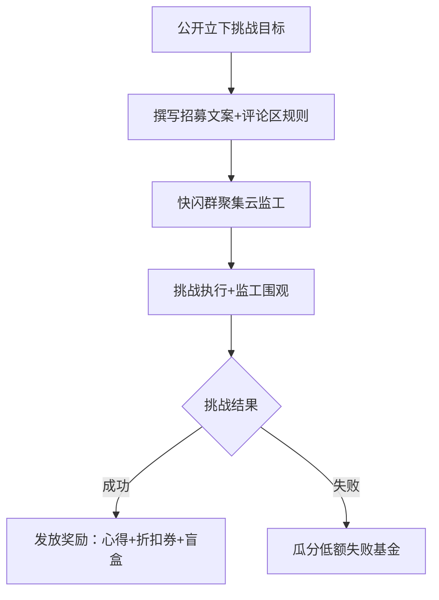
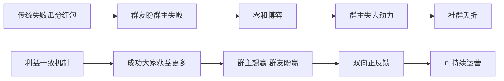
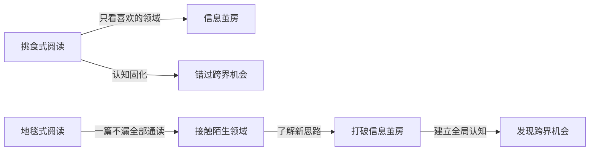
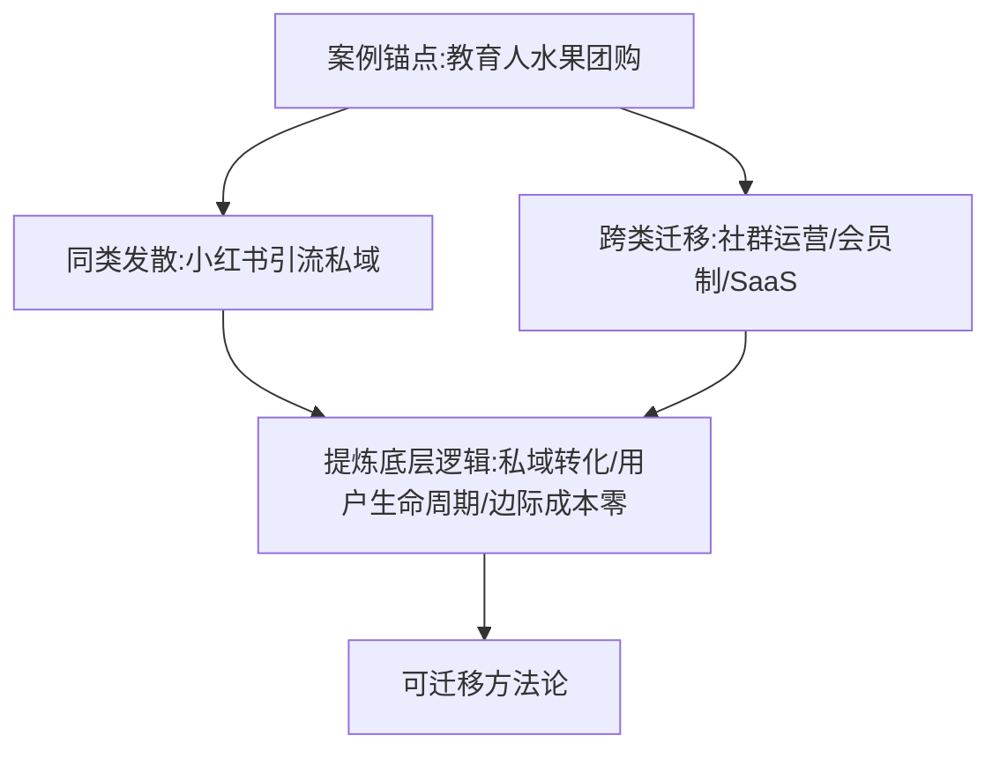
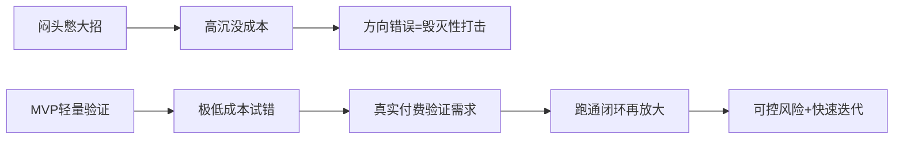
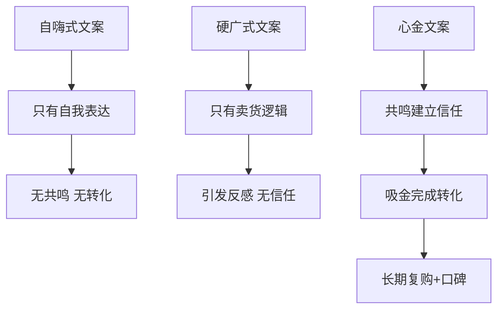
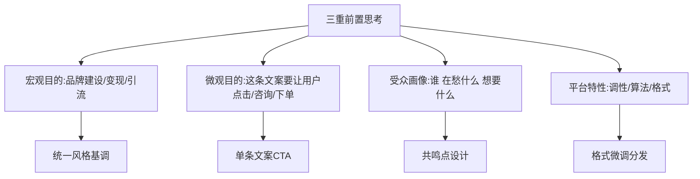
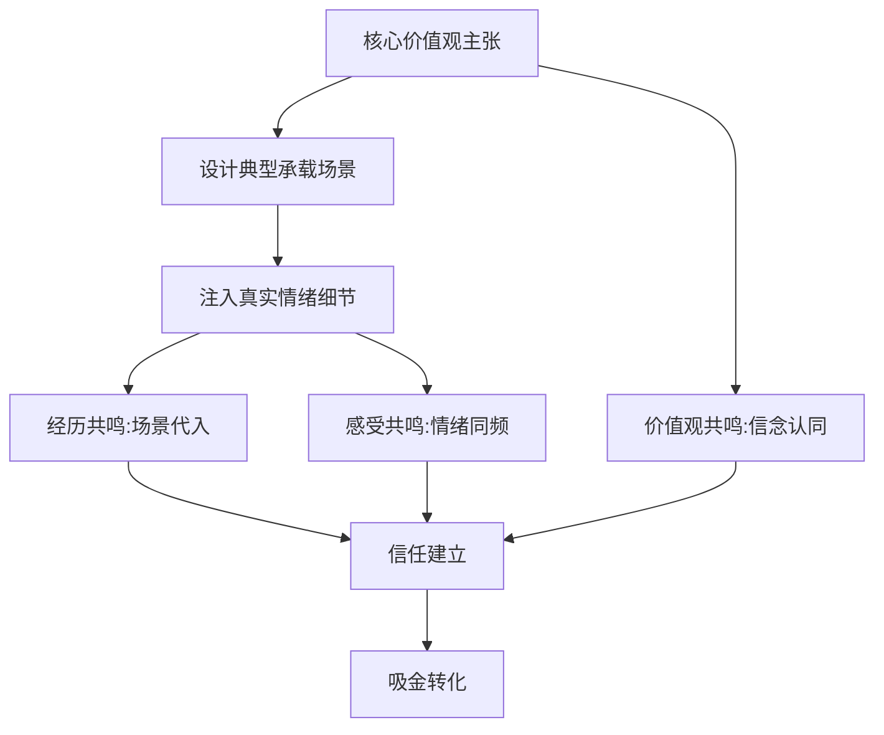
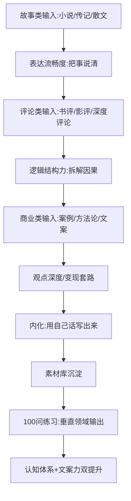
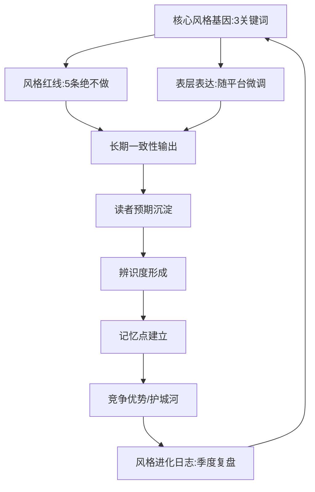

# 第 19 章 社群运营与个人表达力 —— 从"云监工"到"心金文案"

## 学习目标

-   理解云监工玩法的本质：低成本、利益一致、强正反馈的社群监督机制
-   掌握利益一致机制的设计原则，能区分健康与不健康的社群规则
-   了解地毯式阅读法如何打破信息茧房，建立系统性输入能力
-   掌握举一反三拆解法，能把单个案例经验提炼为可迁移的方法论
-   理解 MVP 轻量验证的核心逻辑：先跑通再 All In，降低试错成本
-   掌握铁粉复利模型的操作路径：从种子用户到铁粉转介绍
-   理解心金文案的'吸金+深入人心'双重属性及其思维本质
-   掌握写文案前的三重前置思考（目的、受众、平台），避免自嗨
-   掌握富兰克林复写法、共鸣感构建法和输入带动输出法三大写作训练方法
-   理解统一文案风格与避免模板化对建立个人IP记忆点的作用
-   能根据社群、文案、阅读等不同场景选择合适的轻量验证与训练策略
-   能诊断私域运营中'自嗨式写作''利益对立社群'等常见问题并给出改进方案

## 19.1 生活类比

想象社群运营是一场**登山挑战直播**：群主是挑战者，公开宣布"我要 3 天登顶"；云监工是直播间观众，围观每一步进度并加油鼓劲；成功奖励是登顶后大家都能分到补给品（心得、折扣券）；失败基金是挑战者在山脚押的少量"狠话金"，失败才被分走；利益一致意味着观众不是盼着挑战者摔跤，而是盼着他登顶好领奖励。就像登山直播让挑战者获得陪伴与监督，云监工玩法让群主获得正反馈与动力。

想象写文案是一场**对朋友的倾诉**：心金文案既说到朋友心坎里（深入人心），又自然推荐了好东西（吸金）；三重前置思考是开口前想清楚"我为什么说、对谁说、在什么场合说"；富兰克林复写法像学唱歌先听原唱再自己唱，对比找跑调的地方；共鸣感是"我懂你"——你有过的经历和感受，我也经历过；统一风格是你的说话腔调始终如一，朋友一听就知道是你。就像好朋友的劝告比陌生人的广告更有分量，心金文案靠共鸣与信任促成成交。

## 19.2 概念地图

```
社群运营与轻量验证
├── 云监工玩法
│   ├── 核心定义 —— 群主公开立目标，招募线上监工围观监督
│   ├── 关键性质
│   │   ├── 低成本：快闪群即可启动，无需复杂工具
│   │   ├── 利益一致：成功大家获益更多，可持续
│   │   └── 强正反馈：陪伴监督，意外形成'夸夸群'效应
│   └── 边界条件 —— 适合自我驱动尚可、只缺外部氛围的人
├── 利益一致机制
│   ├── 核心定义 —— 将群主成功与成员收益绑定，而非失败惩罚
│   ├── 关键性质
│   │   ├── 可持续性：群主与成员双向正反馈
│   │   ├── 筛选性：低额失败基金过滤投机者
│   │   └── 通用性：1元到10万元的社群均适用
│   └── 边界条件 —— 成功奖励需大于沉默成本，否则激励失效
├── 铁粉复利模型
│   ├── 核心定义 —— 精细化服务高信任铁粉，依靠复购与转介绍增长
│   ├── 关键性质
│   │   ├── 高复购：铁粉重复购买贡献长期价值
│   │   ├── 自传播：主动转介绍降低获客成本
│   │   └── 高抗风险：不依赖平台流量波动
│   └── 边界条件 —— 适合高毛利、有服务溢价的产品
└── MVP轻量验证
    ├── 核心定义 —— 最低成本做出最简版本，跑通闭环再放大
    ├── 关键性质
    │   ├── 极低成本：不追求完美只求验证
    │   ├── 快速反馈：用真实付费行为判断需求
    │   └── 可迭代：验证成功后 SOP 化
    └── 边界条件 —— 无法验证规模化边际成本，重资产领域不适用
阅读与认知突破
├── 地毯式阅读法
│   ├── 核心定义 —— 与挑食式阅读相对，一篇不漏全部通读
│   ├── 关键性质
│   │   ├── 系统性：覆盖全部主题避免遗漏
│   │   ├── 破界性：强制触碰陌生领域打破信息茧房
│   │   └── 高效性：以扫读为主快速建立全局认知
│   └── 边界条件 —— 适合拓视野建框架，不适合深度钻研
└── 举一反三拆解法
    ├── 核心定义 —— 以案例为锚点，发散联想同类与跨类项目
    ├── 关键性质
    │   ├── 发散性：从单一案例向全局扩散
    │   ├── 抽象性：剥离表层提炼底层逻辑
    │   └── 练习性：需要刻意训练的基本功
    └── 边界条件 —— 需累积足够案例素材库，联想需有逻辑支撑
文案写作与表达力
├── 心金文案
│   ├── 核心定义 —— 既能吸金又能深入人心的文案风格
│   ├── 关键性质
│   │   ├── 商业性：自带变现目的，为成交服务
│   │   ├── 共鸣性：通过相似经历感受价值观引发共振
│   │   └── 思维性：文案是思维的显化，思考越清文案越有力
│   └── 边界条件 —— 情绪共鸣类不适合硬核参数型产品
├── 三重前置思考
│   ├── 核心定义 —— 动笔前回答目的、受众、平台三个问题
│   ├── 关键性质
│   │   ├── 目标导向：明确任务避免跑题
│   │   ├── 用户中心：先理解用户再谈表达
│   │   └── 平台适配：微调后可多平台分发放大影响
│   └── 边界条件 —— 突发性热点内容可简化以追时效
├── 富兰克林复写法
│   ├── 核心定义 —— 看-关-写-比，对照原文定位表达薄弱点
│   ├── 关键性质
│   │   ├── 主动输出：从输入切换为调用语言组织能力
│   │   ├── 差异定位：对比原文快速暴露漏洞
│   │   └── 外部反馈：配合点评打破自我感觉良好
│   └── 边界条件 —— 需长期坚持，重度依赖灵感的创作者可能受限
├── 共鸣感构建
│   ├── 核心定义 —— 通过经历的、感受的、价值观的相似引发共鸣
│   ├── 关键性质
│   │   ├── 相似性：共鸣的本质是'我也有过'
│   │   ├── 场景化：代入生活细节让画面在读者脑中播放
│   │   └── 价值表达：亮出观点吸引同频者
│   └── 边界条件 —— 价值观共鸣需谨慎，编造经历会损害信任
├── 输入带动输出法
│   ├── 核心定义 —— 故事类→评论类→商业类三级递进输入，配合素材库
│   ├── 关键性质
│   │   ├── 递进性：表达流畅→逻辑清晰→观点深度
│   │   ├── 内化性：输入后必须思考用自己的话写出来
│   │   └── 系统性：素材库让零散输入沉淀为资产
│   └── 边界条件 —— 需时间投入，100问练习在垂直领域效果最佳
└── 风格自洽原则
    ├── 核心定义 —— 统一协调有辨识度的个人风格是记忆点前提
    ├── 关键性质
    │   ├── 辨识度：读者能认出作者
    │   ├── 一致性：长期统一风格沉淀读者预期
    │   └── 原创性：拒绝机械模仿保持独立思考
    └── 边界条件 —— 风格统一不意味着一成不变，初期可多探索
```

## 19.3 云监工玩法 —— 让社群变成你的"成长直播间"

我们常常面临这样的困境：立下一个目标（读完一本书、学完一门课、跑通一个项目），却因缺乏外部监督而半途而废。传统打卡群靠"失败瓜分红包"督促，却把群主和参与者置于对立面，长期不可持续。云监工玩法正是为解决这一痛点而生——它成本低、操作简单，又能让你获得监督与正反馈。

> "希望我复盘的这个云监工快闪群玩法，能：帮助更多圈友高效地跑MVP；让群变得更好玩，云监工还可以成为社群角色、监督促进复盘文化等；让云监工们感知、陪伴到群主的成长；让云监工们加强对群主了解、记忆。"
>
> ——《云监工快闪群复盘》（素材 ID：P001）

**云监工玩法定义**（来源：《云监工快闪群复盘》，素材 ID：P001）

```
群主公开立下挑战目标（如3天读50篇文章、写5000字心得），
招募一群"云监工"在线上围观、监督其执行进度。
挑战成功，参与者获得奖励；挑战失败，参与者瓜分一笔低额"失败基金"。
```

这个定义展示了云监工玩法的三个核心环节：公开立目标（制造承诺感）、招募监工（建立外部监督）、设定奖惩（提供动力机制）。与传统打卡群不同的是，这里的奖励锚定在"成功"上，而不是惩罚锚定在"失败"上。

作者丽丽用 2 天多时间招募了 102 位云监工，顺利完成"3 天读 50 篇写 5000 字"的挑战，并通过快闪群的方式验证了这套玩法对普通人的适用性：



**云监工玩法操作流程演进图解**
上图展示了云监工玩法从目标设定到结果交付的完整闭环。流程之所以能跑通，关键在于“快闪群”这一轻量级载体的选择：它降低了组织成本，同时通过“评论区放规则、正文放招募”的文案结构，实现了低摩擦的参与引导。成功分支发放的是高感知价值奖励（心得、折扣、盲盒），失败分支仅瓜分低额基金，这种设计天然将双方利益绑定在“成功”侧。

云监工玩法的关键性质包括：

-   **低成本**：无需复杂工具，一个快闪群即可启动，对群主运营能力要求不高。这源于作者实操中“运营模式对群主的要求并没有陪伴群那么高”的亲测结论（素材 ID：P001）。
-   **利益一致**：规则设计为"成功大家获得更多"，使群主与群友目标一致、可持续。这不同于传统“失败瓜分红包”将双方置于零和博弈的对立面。
-   **强正反馈**：围观与督促带来陪伴感，甚至意外形成"夸夸群"效应——有监工认真计算作者时间投入，有监工帮忙汇总群内容。

> "这哪里是云监工群？简直是夸夸群~~ 比如，有云监工很认真地在算我花的时间：果然顺利完成了! 3天50篇，一篇10分钟的话，平均下来一天也要花将近3小时了，还有5000字的内容要写。2023开了个好头，向你学习。"
>
> ——《云监工快闪群复盘》（素材 ID：P001）

这种意外的正反馈构成了社群运营的"飞轮效应"：围观产生陪伴，陪伴产生激励，激励推动完成，完成又吸引更多围观。对自我驱动尚可、只缺外部氛围的人来说，云监工玩法是一个极佳的启动方式。

**边界条件**：云监工的监督强度有限，无法替代自我驱动。如果挑战失败基金设置过低，虽然能筛选掉纯凑热闹的人，但也降低了对"逐利者"的吸引力——这类人群需要更高额的激励才愿意参与。

## 19.4 利益一致机制 —— 让群主和群友坐同一条船


> "以前我见过一些目标挑战群，规则一般只是挑战失败后瓜分1000元或XXXX元。这是不太健康的，这会把群主、群友的利益对立起来。所以我的规则中设置的是如果我挑战成功了，大家能获得更多。另外规则中挑战失败瓜分的金额设置得很低，这能筛选掉只是被红包吸引的人。"
>
> ——《云监工快闪群复盘》（素材 ID：P001）

**利益一致机制定义**（来源：《云监工快闪群复盘》，素材 ID：P001）

$$
\text{健康社群规则} = \underbrace{\text{成功奖励}}_{\text{大家获益更多}} + \underbrace{\text{低额失败基金}}_{\text{筛选真诚参与者}}
$$

**公式逐步推导与作用说明**
该公式将健康社群规则拆解为两个正交组件：**成功奖励**承担“正向激励与利益绑定”功能，其价值需显著高于参与成本，让成员真心盼望群主成功；**低额失败基金**仅承担“筛选门槛”功能，金额低到不具备诱导作用，避免成员盼着群主失败。两者配合，实现了“群主想赢、群友盼赢、失败成本可控”的三方平衡。之所以采用加法结构，是因为两者功能正交且独立——成功奖励解决“动力从哪来”，失败基金解决“烂人怎么筛”，二者缺一不可、不可替代。若用乘法，任一项为零即导致整体失效，不符合“成功奖励本身即可驱动、失败基金仅为辅助”的实战观察。实战中，此公式指导你：先设计一个让成员“拍大腿想要”的成功奖励包，再把失败基金压到“丢了不心疼、但纯薅羊毛的人懒得进”的门槛线。

这个公式展示了健康社群规则的两个关键组件：成功奖励要足够有吸引力（让成员有动力盼望群主成功），失败基金的金额要足够低（只承担筛选功能而非激励功能）。两者的配合使群主与成员的利益对齐。在实战决策中，这公式指导你：先设计一个让成员“拍大腿想要”的成功奖励包，再把失败基金压到“丢了不心疼、但纯薅羊毛的人懒得进”的门槛线。

作者进一步指出了"利益对立"规则的具体表现形式：

> "如果只用完成打卡全额退费，当群主再次变现能力弱、群主没法通过活动赚到有正反馈的钱时、当群主的策略没法帮助大部分群友们完成打卡时，在一定程度相当于把群主、参与者的利益对立，这不是一种健康的状态，不利于可持续发展。"
>
> ——《云监工快闪群复盘》（素材 ID：P001）

这段分析揭示了"全额退费"模式的三重隐患：(1) 群主无法通过活动获得正反馈；(2) 群主缺乏动力持续运营；(3) 群主与成员的利益实质对立——成员盼着群主提供价值，群主却无法获得回报。这种失衡注定了社群难以持久。

利益一致机制的三个关键性质：

-   **可持续性**：群主有动力运营，成员有动力参与，形成双向正反馈。这源于“群主成功=成员获益”的正向循环结构，使运营动力内生化（素材 ID：P001）。
-   **筛选性**：低额失败基金自动过滤"只为红包而来"的投机者。作者实测“设置得很低，这能筛选掉只是被红包吸引的人”（素材 ID：P001）。
-   **通用性**：适用于付费 1 元到付费 10 万的各类社群。作者断言“万事万物皆可通过付费群变现……健康的、可持续发展模式是群能给用户带来价值”（素材 ID：P001）。

> "万事万物皆可通过付费群变现。不论是付费10万还是付费1元的群，健康的、可持续发展模式是群能给用户带来价值。"
>
> ——《云监工快闪群复盘》（素材 ID：P001）

**边界条件**：该机制适用于以"群主产出"为核心的社群。若社群依赖纯成员互助，需另行设计激励。成功奖励的价值需大于成员的沉默成本（即参与机会成本），否则激励失效——如果成员觉得"参与与否无所谓"，这套机制就失去了约束力。



**利益一致机制与传统惩罚机制的利益结构演进对比**
上图对比了两种规则设计的因果链条。传统模式通过“失败惩罚”制造零和博弈，导致群主动力内耗、社群不可持续；利益一致机制通过“成功绑定”构建正和博弈，实现群主与成员的动力对齐，形成可持续的飞轮效应。这种结构性差异，是社群能否长久运营的分水岭。

## 19.5 地毯式阅读 —— 用"笨办法"从信息茧房里突围

大多数人只挑喜欢的领域、喜欢的作者阅读，久而久之被困在"信息茧房"中，认知无法突破。你越是只看自己认同的内容，就越难接触到不同的视角，越难发现跨界的机会。地毯式阅读法正是打破这种状态的一剂猛药。

> "以前我看内容，更多地是挑自己喜欢的主题或人。这次采用地毯式的方法每一篇都看，很受益，又了解了一些新领域的思路、打破了一点点信息茧房。"
>
> ——《云监工快闪群复盘》（素材 ID：P001）

**地毯式阅读法定义**（来源：《云监工快闪群复盘》，素材 ID：P001）

```
地毯式阅读法 = 对目标内容集采取一篇不漏、全部通读的方式
与"挑食式阅读"相对
强调"量"与"全"，先吸收再消化，而非先筛选再精读
```

这个定义揭示了地毯式阅读与日常阅读的本质区别：日常阅读是"筛选式"的——先判断值不值得看，再看；地毯式阅读是"拥抱式"的——先全部接收，再慢慢消化。前者让你停留在舒适区，后者强迫你触碰陌生领域。

在丽丽的实操中，她用 3 天时间一篇不漏读完《生财有术项目精选》全部 66 篇笔记，了解了新领域思路，输出了举一反三心得。这种"先全盘接收、再提炼归纳"的方式，被证明是快速建立全局认知的有效路径。

地毯式阅读法的三个关键性质：

-   **系统性**：覆盖全部主题，避免遗漏关键信息。通过“一篇不漏”保证了信息摄入的完备性，为后续的举一反三提供完整素材库（素材 ID：P001）。
-   **破界性**：强制触碰陌生领域，打破信息茧房。作者亲测“了解了一些新领域的思路、打破了一点点信息茧房”（素材 ID：P001）。
-   **高效性**：以"扫读"为主，快速建立全局认知。作者在接近 2 天时间内完成 66 篇阅读与整理，验证了“以扫读为主可控制时间成本”（素材 ID：P001）。



**地毯式阅读与挑食式阅读的结果演进对比**
上图对比了两种阅读策略的因果链条。挑食式阅读通过“筛选-固化-错失”形成闭环，将读者锁死在既有认知框架内；地毯式阅读通过“全量摄入-破界-建立全局认知”路径，主动制造认知冲突与跨界连接机会。这种“笨办法”实则是认知升级的最短路径。

**边界条件**：地毯式阅读适合"拓视野、建框架"阶段，不适合深度钻研某个具体主题。遇到低频或无关内容，需允许"略读"而非逐字精读，以控制时间成本。此外，这种方法对内容集的质量有要求——如果内容本身质量参差，地毯式通读的收益会大打折扣。

## 19.6 举一反三拆解 —— 把一个项目拆成一片"项目群"

只看一个具体项目往往只获得"一次性信息"，无法沉淀为可迁移的方法论。单个案例的实操经验，若不进行抽象提炼，换个赛道就失效。你需要一种阅读和思考的框架，把"一个点"扩散成"一张网"。

> "举一反三是做项目要练习的基本功。看完教育人做水果团购后，我首先想到我在生财知识星球发过的这篇文章《才391个小红书粉丝，但引流私域432人成交308单的复盘》，两者在一些方面逻辑是一致的，之后这类项目都可以借鉴经验；我的另外一个想法是这种拆解项目的思路，也很值得练习。"
>
> ——《云监工快闪群复盘》（素材 ID：P001）

**举一反三拆解法定义**（来源：《云监工快闪群复盘》，素材 ID：P001）

$$
\text{举一反三} = \text{案例锚点} + \text{同类发散} + \text{跨类迁移}
$$

**公式逐步推导与作用说明**
该公式将举一反三的认知过程显性化为三步走：**案例锚点**锁定具体经验载体，**同类发散**在同一赛道寻找结构相似的可复制模式，**跨类迁移**在不同赛道提炼共性底层逻辑。三步缺一不可：无锚点则无着力点，无同类发散则成孤例，无跨类迁移则止步于经验主义。之所以必须是加法而非乘法/逻辑与，是因为三步各自产出独立价值（锚点产出“具体经验”、同类产出“可复制模式”、跨类产出“可迁移原则”），三者叠加形成完整方法论。若用乘法，任一步缺失即归零，不符合“即使只做到同类发散也已有价值”的实战观察。实战中，此公式指导你：读案例时先锁定锚点，再强制自己列出“3个同类+3个跨类”，最后写下共同的底层逻辑——把阅读变成结构化思维训练。

这个公式展示了举一反三的三个步骤：先锁定一个具体案例作为锚点，然后发联想到同类项目（直接竞争或相似的），再迁移到跨类项目（逻辑相似但不同行业）。最终的目标是把单个经验提炼为普适性原则。

作者进一步总结了案例的价值维度：

> "看案例不要只看这个项目，现在还能不能做。一个案例的价值：高实效性、同类复制、跨类迁移。"
>
> ——《云监工快闪群复盘》（素材 ID：P001）

这三个价值维度告诉我们：评估一个案例时，不应只问"这个项目现在还能做吗"，而应关注——它传递的信息是否具有实时价值？它的模式能否复用到同类项目？它的底层逻辑能否迁移到跨类项目？这种评估框架让单个案例的收益最大化。

举一反三拆解法的三个关键性质：

-   **发散性**：从单一案例向同类、跨类扩散。作者以“水果团购”为锚点，同类联想“小红书引流私域”，跨类迁移至“社群运营”，展示了发散的广度（素材 ID：P001）。
-   **抽象性**：剥离表层细节，提炼底层逻辑。从具体的“卖水果”“卖资料”抽象出“私域转化逻辑”“选品敏感度”等可迁移方法论（素材 ID：P001）。
-   **练习性**：是一种需要刻意训练的基本功。作者明确指出“举一反三是做项目要练习的基本功”“这种拆解项目的思路，也很值得练习”（素材 ID：P001）。

以下是一个具体的举一反三示例：

**举一反三拆解实操示例表（展示如何从单一案例发散提炼底层逻辑）**

| 案例 | 同类联想 | 跨类迁移 | 底层逻辑 |
|------|----------|----------|----------|
| 教育人做水果团购 | 小红书引流私域成交 | 社群运营 | 私域转化逻辑 |
| 母婴团购的"铁粉精细化" | 私域电商 | 会员制订阅 | 用户生命周期管理 |
| 拼多多卖资料的"自动发货" | 虚拟产品电商 | SaaS 订阅 | 边际成本趋零的交付 |



**举一反三拆解的思维发散路径图**
上图还原了从单一案例出发，经由同类与跨类双向发散，最终汇聚到底层逻辑层的认知路径。这种“点-面-体”的扩散结构，是举一反三拆解法的标准化操作流程，可作为阅读笔记的模板复用。

**边界条件**：举一反三的前提是看过足够多的案例，否则缺乏可供联想的"素材库"。联想需有逻辑支撑，不能牵强附会、强行类比——如果两个案例之间缺乏真正的共性，强行迁移只会导致错误结论。

## 19.7 MVP 轻量验证 —— 先跑通再 All In，别一上来就造航母

普通人容易陷入"闷头憋大招"的陷阱——投入大量时间精力做产品，最终发现没人买单。录课、开发产品等高成本投入一旦方向错了，沉没成本极高。MVP 轻量验证提供了一条低风险试错路径，让你在重投入前先验证需求。

> "随着知识付费的发展，录课卖课越来越内卷。建议普通人在投入高成本录制课程前，先用轻量化的单次付费咨询、付费专栏、快闪社群等跑MVP，积累一定粉丝或者有可观流量合作渠道后，再去录课卖课。"
>


$$
\text{MVP} = \underbrace{\text{最低成本}}_{\text{不追求完美}} + \underbrace{\text{最简版本}}_{\text{只验证核心需求}} + \underbrace{\text{快速反馈}}_{\text{用真实付费判断}}
$$

**公式逐步推导与作用说明**
该公式将 MVP 的构成要素拆解为三维：**最低成本**设定资源上限，倒逼聚焦核心假设；**最简版本**定义交付范围，仅保留验证“有人愿付费”所必需的最小功能集；**快速反馈**规定验证标准，唯有真实付费行为才算数。三者存在制约关系：成本过低会导致版本过简、失去验证效度（如仅发一条朋友圈问“要不要买”不算验证）；版本过简会失去核心体验，反馈失真。因此三者非简单加法，而是“最低成本”约束下的“最简版本”与“快速反馈”的张力平衡。实战中，此公式指导你：先写下“要验证的唯一核心假设”，再设计“花最少钱、最快拿到真实付费单”的最简流程，若成本超限或版本超纲，立即砍需求。

这个公式展示了 MVP 的三大要素：极低成本（只求验证不求完美）、最简版本（聚焦核心假设）、快速反馈（用真实付费行为而非口头意愿判断）。三者缺一不可——成本高了无法快速试错，版本复杂了难以定位问题，反馈太慢则失去迭代节奏。

轻量化形式的典型例子包括：单次付费咨询、付费专栏、快闪社群、最简单的微信点单流程。作者用大学生做校园业务的案例进一步说明：

> "如果大学生要做校园业务，在组团队前，先自己用最简单的方式跑流程，从最基础的微信点单、微信群接单开始，低成本低风险。这条经验来自一个多年前，在大学组队做过水果送货上门失败的学姐。"
>

这段案例揭示了 MVP 的核心逻辑：先以最小成本验证"有人愿意买"这个最关键的假设，再逐步投入资源放大。那位失败的学姐正是因为跳过了验证环节，直接组队、备货、配送，最终在需求未确认的情况下造成了大量沉没成本。



**MVP 与“闷头憋大招”风险收益演进对比**
上图对比了两种路径的风险收益曲线。“闷头憋大招”路径前期投入大、反馈晚、风险指数级上升；“MVP轻量验证”路径前期投入极低、反馈极快、风险可控，验证通过后再通过 SOP 化实现规模化放大。这种“先验证后投入”的序列结构，是普通人创业降低试错成本的核心生存策略。

MVP 与"先造航母"的对比：

**MVP 与传统重投入模式的关键维度对比表（量化两种策略在成本、反馈、风险、迭代上的差异）**

| 维度 | MVP 轻量验证 | 闷头憋大招 |
|------|-------------|-----------|
| 成本 | 极低，快速试错 | 高，沉没成本大 |
| 反馈 | 真实付费行为，立即可见 | 自我想象，缺乏验证 |
| 风险 | 可控，失败可快速转向 | 高，方向错了损失巨大 |
| 迭代 | 快速迭代，持续优化 | 重做成本高，难以调整 |

**边界条件**：MVP 无法验证的维度包括规模化后的边际成本、团队管理复杂度。某些需要重资产投入才能验证的领域（如建工厂），MVP 方法论不适用——这类项目天然需要更大的初始投入，无法用轻量方式验证。

## 19.8 铁粉复利模型 —— 800 个精准用户，比 80 万泛粉更值钱

很多人做私域只盯着"好友数量"，陷入"更多用户=更多收入"的误区。泛流量价值低、转化差，耗费精力却回报有限。铁粉复利模型提供了一套以"用户质量"为核心的增长逻辑，把单次流量变成长期复利。

> "用心地精细化对铁粉，获得复利。一年卖货120W需要运营多少位用户？泳怡的答案是800位。项目逻辑是先广撒网，从各种精准的宝妈流量池积累40位种子用户，在精细化运营前期用户获取信任后，筛选其中的铁粉进行转介绍、转卖，最终实现总购买次数16000+次。让人惊讶的高粘性社群，离不开用心、执行力。"
>
> ——《社群精细化运营案例》（素材 ID：P001）

**铁粉复利模型定义**（来源：《社群精细化运营案例》，素材 ID：P001）

$$
销售额 = \underbrace{\text{铁粉数量}}_{\text{非泛粉数量}} \times \underbrace{\text{复购次数}}_{\text{长期价值}} \times \underbrace{\text{转介绍}}_{\text{自传播}}
$$

**公式逐步推导与作用说明**
该公式将销售额分解为三个乘法因子：**铁粉数量**是存量资产，**复购次数**是单用户生命周期价值的放大器，**转介绍**是自获客的指数级放大器。采用乘法而非加法，是因为三者存在强耦合的复利关系：无铁粉则无复购基数，无复购则无信任积累从而无转介绍，三者缺一即整体归零。各变量量纲统一：铁粉数量（人）、复购次数（次/人/周期）、转介绍（新增人/老用户/周期），相乘得“周期销售额/周期”。边际递减拐点估算：当铁粉数量触达个人服务带宽上限（约 200-500 人/人），复购频次触达产品消耗周期上限，转介绍触达社交圈层穷尽时，单因子边际收益递减，需通过招募合伙人/建立分级服务体系突破。实战中，此公式指导你：别盯着加粉数，而要盯着“铁粉数×复购率×转介绍系数”三个乘数，任何一项为零，业务即归零。

这个公式揭示了铁粉复利模型与传统"数量驱动"模型的本质区别：传统模型关注"有多少人买一次"，铁粉模型关注"有多少人买很多次并带来更多人买"。前者是流量思维，后者是复利思维。

泳怡的 800 位用户案例（含 40 位种子用户）展示了完整的铁粉运营路径：


**铁粉复利模型操作路径演进图**
上图还原了从“广撒网获取流量”到“沉淀铁粉复利”的完整操作链路。关键节点在于“精细化运营获取信任”后的“筛选铁粉”动作——并非所有用户都值得同等投入，只有通过高强度服务筛选出的高信任铁粉，才能承载后续的转介绍与高频复购，形成复利飞轮。

铁粉复利模型的三个关键性质：

-   **高复购**：铁粉重复购买，贡献长期价值。案例中 800 位用户贡献 16000+ 次购买，人均复购 20 次，验证了高复购特性（素材 ID：P001）。
-   **自传播**：铁粉主动转介绍，降低获客成本。案例中“筛选其中的铁粉进行转介绍、转卖”表明铁粉成为自发传播节点（素材 ID：P001）。
-   **高抗风险**：不依赖平台流量波动。私域内的信任资产与复购关系构成护城河，免疫公域算法变动（素材 ID：P001）。

**边界条件**：该模型适合高毛利、有服务溢价的产品，纯低价标品难建立铁粉粘性。需要投入大量一对一沟通精力，对个人执行力要求高，不适合纯靠广告投放的"流量收割"模式——如果你的产品本身缺乏服务溢价空间，铁粉就缺乏"值得粉"的理由。

## 19.9 心金文案 —— 既能吸金，又能钻进人心

很多私域运营者狂发朋友圈却咨询寥寥，陷入"自嗨式写作"的尴尬。文案被误写成了"文章"，只有情怀没有转化，或只有硬广没人想看。心金文案正是为了解决这一困境而生的方法论。

> "2022年，我给我的文案风格，终于敲定了一个名字，叫做「心金文案」，寓意是既能吸金、又能深入人心的文案。"
>
> ——《心金文案方法论》（素材 ID：P002）

**心金文案定义**（来源：《心金文案方法论》，素材 ID：P002）

$$
\text{心金文案} = \underbrace{\text{吸金}}_{\text{商业变现}} + \underbrace{\text{深入人心}}_{\text{情感共鸣}}
$$

**公式逐步推导与作用说明**
该公式将心金文案定义为双维度正交组合：**吸金**是商业维度的必要条件（无变现即非文案，是文章），**深入人心**是心理维度的充分条件（无共鸣即硬广，无人读）。两维度非等权：商业性是“生存线”，共鸣性是“增长线”。冲突时的裁决机制：先满足“深入人心”（建立信任），再植入“吸金钩子”（完成转化）——若为吸金牺牲共鸣，长期信任账户破产；若为共鸣放弃吸金，商业不可持续。可测量指标体系：吸金侧看“点击率→咨询率→转化率”，共鸣侧看“完读率→互动率→转发率/收藏率”。实战中，此公式指导你：写每条文案前，先写出“核心共鸣点”（让用户觉得懂我），再设计“转化路径”（自然带出产品），最后对照检查：去掉产品部分，还会被转发吗？去掉共鸣部分，还会被下单吗？

这个公式展示了心金文案的双重属性：吸金是目的，深入人心是手段。两者缺一不可——只吸金不深入人心，就是硬广，没人想看；只深入人心不吸金，就是文章，无法变现。

作者进一步阐述了文案与文章的本质区别：

> "文案不同于文章，文案本身就带有一层商业变现属性，所以能够吸金才是关键，而文案又需要蕴藏感情、给人能带来触动，所以深入人心的写法，也是必要。"
>
> ——《心金文案方法论》（素材 ID：P002）

这段论述揭示了文案写作的两个核心要求：自带商业变现属性（吸金），同时蕴藏感情给人触动（深入人心）。它区别于"文章"的地方在于——文案始终为成交服务，只是通过共鸣和信任来实现。

心金文案的三大关键性质：

-   **商业性**：文案自带变现目的，最终为成交服务。作者强调“文案本身就带有一层商业变现属性，所以能够吸金才是关键”（素材 ID：P002）。
-   **共鸣性**：通过构建相似经历、感受、价值观引发读者情感共振。作者提出“共鸣是需要通过构建相似来进行的”（素材 ID：P002）。
-   **思维性**：文案是思维的显化，思考越清晰，文案越有力。

> "我记得我曾经说过，文案是思维的显化。写作的过程其实就是把你的思考你的价值观传递出来。你的每一次起心动念，都会影响着你文字的风格与走向。"
>
> ——《心金文案方法论》（素材 ID：P002）

**边界条件**：情绪共鸣类文案不适合功能性、参数型产品的硬核介绍场景。树立风格需要长期一致性输出，急于求成反而四不像——如果你今天发"感性故事"，明天发"参数对比"，读者无法建立对你的稳定预期。



**心金文案与自嗨/硬广文案的效果演进对比**
上图对比了三种文案策略的因果结果。自嗨式文案缺乏用户视角，陷入自我感动死循环；硬广式文案缺乏情感连接，透支信任账户；心金文案通过“共鸣→信任→吸金”的正向链条，实现转化与品牌的双重积累。这种双维并进的结构，是私域成交的核心方法论。

## 19.10 三重前置思考 —— 写文案前先当一回"产品经理"

大多数人写文案动笔就写，想说什么说什么，结果写完发现"自嗨"了，没人看、没人转。文案跑题、目标不清、平台不匹配，是新手最常见的三大失误。三重前置思考为你在动笔前锁定了方向。

> "你写文案的目的是什么？你的文案是写给谁看？文案发布在哪些平台？"
>
> ——《心金文案方法论》（素材 ID：P002）

**三重前置思考定义**（来源：《心金文案方法论》，素材 ID：P002）

$$
\text{写文案前} = \underbrace{\text{目的}}_{\text{宏观+微观}} + \underbrace{\text{受众}}_{\text{用户画像}} + \underbrace{\text{平台}}_{\text{特性适配}}
$$

**公式逐步推导与作用说明**
该公式将写作前置决策拆解为三个正交维度：**目的**层面区分宏观方向（整体文案体系服务的战略目标）与微观目标（单条文案要达成的具体动作），避免“为了发而发”；**受众**层面强制要求建立用户画像，实现“以用户为中心”的表达导向；**平台**层面要求识别平台特性并微调表达，实现“一条文案多平台放大”的杠杆效应。三者正交性证明：目的不清→跑题；受众不清→自嗨；平台不清→违规/效率低。缺一不可：有目的无受众=对着墙说话；有受众无平台=水土不服；有平台无目的=盲目跟风。动态调整机制：单条文案以微观目的为锚，宏观目的为舵，受众画像为图，平台特性为桨。实战中，此公式指导你：动笔前在便签上写下三句话——这条文案要让用户做什么动作（微观目的）？ta是谁、正愁什么（受众）？发在哪、改哪三个字（平台）？

这个公式展示了动笔前的三个前置性问题：为什么要写（目的）、写给谁看（受众）、在哪里发布（平台）。三个问题都回答清楚，才能确保文案不跑题、不陷入自嗨。

关于目的，作者强调需要思考两层：

> "我们在写文案之前，需要思考两层目的。一层是宏观的，你整体文案的方向是为了实现什么？……一层是微观的，具体到每一个单条文案要达到什么目的？"
>
> ——《心金文案方法论》（素材 ID：P002）

这段论述揭示了目的的层次性：宏观目的（整体方向）和微观目的（单条任务）。宏观目的指导方向，微观目的指导具体行动。如果只有宏观没有微观，文案容易宽泛无力；只有微观没有宏观，文案会迷失方向。

三重前置思考的关键性质：

-   **目标导向**：明确每条文案的具体任务，避免跑题。通过微观目的锁定单条文案的“预期动作”，杜绝宽泛表达（素材 ID：P002）。
-   **用户中心**：先理解用户，再谈表达。

> "你要先去理解用户，然后才能写好文案甚至于做好营销。"
>
> ——《心金文案方法论》（素材 ID：P002）

-   **平台适配**：同一条文案经微调可多平台分发，放大影响力。

> "同一条文案，适当根据平台特性去修改，就可以实现多平台分发，真正让一条文案实现成倍放大影响力的效果。"
>
> ——《心金文案方法论》（素材 ID：P002）

以下是一个平台适配的示例：

**同一文案的多平台适配策略对照表（展示如何根据平台特性微调同一核心文案）**

| 平台 | 侧重方向 | 表达风格 | 微调要点 |
|------|----------|----------|----------|
| 朋友圈 | 信任感+温情 | 亲切、口语化 | 增加个人细节 |
| 小红书 | 种草+干货 | 简洁、有结构 | 用标签和清单 |
| 👸号 | 深度+逻辑 | 完整、正式 | 扩展段落与论证 |
| 知乎 | 专业+数据 | 严谨、有引用 | 补充案例和数据 |



**三重前置思考的决策分解流程图**
上图将三重前置思考拆解为四个并行决策流：宏观目的统领风格基调，微观目的锚定单条 CTA，受众画像决定共鸣点设计，平台特性指导格式微调。四个流在“动笔”节点汇合，生成高确定性的文案初稿。这一流程可制成 Checklist，作为每次写作前的标准化动作。

**边界条件**：该框架适用于常规营销文案，突发性、即时性内容（如热点评论）可适当简化流程以追时效。目标受众过于宽泛时，需先做用户细分定位——如果你连"写给谁"都回答不了，写出来的文案必然缺乏针对性。

## 19.11 富兰克林复写法 —— 用"对照实验"打磨表达肌肉

看了很多好文案，轮到自己写却还是老样子——"眼高手低"是写作通病。单纯阅读只能"看懂"，无法直接转化为"会写"。富兰克林复写法提供了一种主动的、有反馈的刻意训练方法。

> "什么叫做复写？就是你先看一遍文案，然后把它关闭，尝试用自己的话去再次写出来，然后你会发现，每一次你写出来的内容都不一样，然后你去跟原文案对比，去发现自己表达不清晰的地方在哪里，那就是你写作的薄弱点。"
>
> ——《心金文案方法论》（素材 ID：P002）

**富兰克林复写法定义**（来源：《心金文案方法论》，素材 ID：P002）

$$
\text{复写法} = \underbrace{\text{看}}_{\text{阅读原文}} \rightarrow \underbrace{\text{关}}_{\text{合上不看}} \rightarrow \underbrace{\text{写}}_{\text{用自己的话复写}} \rightarrow \underbrace{\text{比}}_{\text{对照原文找差异}}
$$

**公式逐步推导与作用说明**
该公式定义了复写的四步标准动作：**看**（全神贯注阅读，建立短时记忆表征）、**关**（物理切断视觉输入，强迫大脑从“识别模式”切换到“生成模式”，这是认知科学中的“生成效应”——主动提取比被动识别能产生更深的记忆痕迹）、**写**（调用语言组织能力，将内部表征外化为文本）、**比**（逐句对齐对比，量化差异）。“关”这一步是认知机制的关键：不关原文即复制粘贴，关了才是真正的提取与重组。对比维度量化标准：结构层（段落逻辑是否同构）、句法层（句式长短、连接词是否对等）、词汇层（用词是否更精准/更口语化）、情感层（语气语调是否传神）。迭代收敛条件：连续 3 次复写对比差异率 < 10%，或经外部点评确认“神似”而非“形似”。实战中，此公式指导你：每周选 1 篇爆款，按“看-关-写-比”做 3 轮，记录差异标签，累积 20 篇后按标签分类复盘——你的高频薄弱点即为重点训练靶心。

这个公式展示了富兰克林复写法的四步流程。其中关键的一步是"关"——关闭原文后用自己的话复写，这强迫你从"被动输入"切换到"主动输出"，调用自己的语言组织能力。每一次复写的内容都不一样，差异之处就是你的表达薄弱点。

为什么要配合他人点评？

> "然后当大家写出来一个文案的时候，不要孤芳自赏，可以去找一些朋友或者专业人士帮助你点评你的文案，提出建议。"
>
> ——《心金文案方法论》（素材 ID：P002）

这段建议揭示了复写法的重要补充机制：外部反馈。独自复写容易"自我感觉良好"，因为你看不出自己的问题；他人的视角能帮你发现盲点，打破自我认知的局限。

富兰克林复写法的三个关键性质：

-   **主动输出**：从"输入"切换为"输出"，强制调用语言组织能力。通过“关闭原文”这一物理动作，切断复制粘贴的捷径，强迫大脑调用语言组织能力（素材 ID：P002）。
-   **差异定位**：对比原文，快速暴露表达漏洞。作者指出“每一次你写出来的内容都不一样，然后你去跟原文案对比，去发现自己表达不清晰的地方在哪里”（素材 ID：P002）。
-   **外部反馈**：配合他人点评，打破"自我感觉良好"。作者建议“找一些朋友或者专业人士帮助你点评你的文案，提出建议”（素材 ID：P002）。

**边界条件**：对依赖"灵感"胜过"结构"的创意型写作者，机械复写可能限制风格发挥。需要长期坚持，短期几次难以见效——复写法是"肌肉训练"而非"药物"，不可能一蹴而就。


**富兰克林复写法的迭代训练闭环图**
上图展示了复写法的标准化迭代闭环：从阅读到对比到标签化薄弱点，引入外部点评修正盲区，再进入下一轮。这种“刻意练习”结构，将模糊的“多练习”转化为可度量、可收敛的工程化训练流程。

## 19.12 共鸣感构建 —— 让读者觉得"你懂我"的三条通道

用户看文案是感性的，只有"说得对、说到心坎里"才会产生行动。单纯讲道理、堆数据无法打动用户。你需要一套可操作的方法，让文案穿透理性防线，直接触达情绪。

> "这种共鸣，是需要通过「构建相似」来进行的。可以在文案中代入生活场景感受，贴近现实，你所感受到的喜怒哀乐，用户也能同样感受到。"
>
> ——《心金文案方法论》（素材 ID：P002）

**共鸣感构建定义**（来源：《心金文案方法论》，素材 ID：P002）

$$
\text{共鸣} = \underbrace{\text{经历的共鸣}}_{\text{相似场景}} + \underbrace{\text{感受的共鸣}}_{\text{相似情绪}} + \underbrace{\text{价值观的共鸣}}_{\text{相似信念}}
$$

**公式逐步推导与作用说明**
该公式将共鸣构建拆解为三个层级：**经历共鸣**（场景层，门槛最低，易触发），“我也遇到过这事”；“感受共鸣”（情绪层，穿透力更强），“我也这样觉得/怕过/委屈过”；“价值观共鸣”（信念层，粘性最强），“我也相信这个道理”。三者呈层级递进而非并列关系：经历是载体，感受是连接，价值观是锚点。叠加效应非线性：单一维度共鸣系数为 1，双维叠加系数约 1.8（1+1>2，因情绪与场景耦合放大），三维全开系数可达 3.5+（信念锚定产生信任溢价）。负共鸣风险对冲：价值观共鸣若过于极端，引发非目标群体反感，需通过“场景限定+情绪缓冲”控制辐射范围；经历共鸣若编造，一旦穿帮信任归零，需坚持“真实经历+艺术加工”原则。实战中，此公式指导你：写文案先定“核心价值观主张”，再设计“承载该主张的典型场景”，最后注入“该场景下的真实情绪细节”，三层打通即为深度共鸣。

这个公式展示了构建共鸣的三条通道：经历的共鸣（"我也遇到过这种事"）、感受的共鸣（"我也这样觉得"）、价值观的共鸣（"我也相信这个道理"）。三者既可单独使用，也可叠加使用，共同的目标是让读者觉得"你懂我"。

作者进一步强调价值观共鸣的力量：

> "世间万物其实都遵循着吸引力法则，低能量会被高能量吸引，那你就必须要先把自己的势能打造起来，勇敢的在文案里去表达你的心声，才会引发别人的共鸣。"
>
> ——《心金文案方法论》（素材 ID：P002）

这段论述揭示了共鸣感构建的关键前提：敢于表达。如果你藏着掖着不敢亮出观点，读者就无法识别你是同类；只有勇敢表达心声，才能吸引同频者。

三种共鸣路径的对比：

**三种共鸣路径的机制与场景对照表（展示三类共鸣的核心心理机制、适用场景与典型案例）**

| 共鸣类型 | 核心机制 | 适用场景 | 案例 |
|----------|----------|----------|------|
| 经历共鸣 | "我也遇到过" | 描述具体场景 | 写妈妈产品写哄睡场景 |
| 感受共鸣 | "我也这样觉得" | 表达共同情绪 | 写生活焦虑写失眠之痛 |
| 价值观共鸣 | "我也相信" | 亮出鲜明观点 | 写环保理念倡导可持续 |

**边界条件**：价值观共鸣需谨慎，过于小众或极端的价值观可能引发争议。经历共鸣若编造虚假经历，一旦被拆穿将严重损害信任——共鸣的前提是真诚，编造的共鸣比没有共鸣更有害。



**共鸣感构建的三层递进与转化路径图**
上图揭示了共鸣构建的工程化路径：从核心价值观出发，设计场景、注入情绪，三维共鸣汇聚于信任建立，最终驱动转化。这种“由内而外、层层打通”的结构，避免了“堆砌场景却无核心”、“谈信念却无落地”的常见失误。

## 19.13 输入带动输出 —— 用"三级火箭"喂大你的思维

写不出东西，本质是脑子里没货，而"没货"是因为"没吃"。很多人闷头苦想，因认知基础薄弱，想出来的内容也缺乏深度。输入带动输出法提供了一套系统的高质量输入策略，为持续输出供血。

> "千万不要自己闷头苦想，因为你的认知基础薄弱，你想半天想出来的很可能归因逻辑就是错的。"
>
> ——《心金文案方法论》（素材 ID：P002）

**输入带动输出法定义**（来源：《心金文案方法论》，素材 ID：P002）

$$
\text{输入三级火箭} = \underbrace{\text{故事类}}_{\text{学表达}} \rightarrow \underbrace{\text{评论类}}_{\text{学逻辑}} \rightarrow \underbrace{\text{商业类}}_{\text{学观点}}
$$

**公式逐步推导与作用说明**
该公式揭示了输入内容的三个递进层级及其各自的能力建设功能：**故事类**训练“表达流畅度”（把事说清的能力），是基础；**评论类**训练“逻辑结构力”（拆解事物因果的能力），是进阶；**商业类**训练“观点深度与变现套路”（洞察本质与成交的能力），是高阶。三者遵循“会说→会想→会卖”的认知升级链条，不可倒置跳跃。为何不可逆：若无表达流畅度，逻辑无法清晰呈现；若无逻辑结构力，观点无法经得起推敲；若跳过前两级直奔商业类，产出的只能是“套话”而非“洞见”。各阶段投入产出比阈值：故事类输入约 50-100 篇可建立基础表达肌肉；评论类输入约 30-50 篇可形成基础逻辑框架；商业类输入需配合实战复盘，单纯阅读边际收益递减快。跨阶段迁移损耗率：故事类→评论类迁移约 30% 损耗（表达≠逻辑），评论类→商业类迁移约 50% 损耗（逻辑≠洞察），需通过“用自己的话写出来”强制内化降低损耗。实战中，此公式指导你：制定季度输入计划，Q1 重故事、Q2 重评论、Q3 重商业、Q4 重复盘，配合素材库与 100 问练习，形成可复利的输入-输出飞轮。

这个公式展示了输入内容的三个递进层级：先读故事类学表达方式，再读评论类学逻辑结构，最后读商业类学观点套路。每一级都为下一级打基础——表达流畅是逻辑清晰的前提，逻辑清晰是观点深度的前提。

关于三类输入的具体作用：

> "看故事类的内容是看表达方式，是看语句的通畅，连贯的表达，是把一件事情说明白的能力。接着看【评论类】的内容，比如书评，影评等等，这类是去看逻辑的。最后再看【商业类】的内容，这类内容是看观点和文案套路。"
>
> ——《心金文案方法论》（素材 ID：P002）

这段论述拆解了三类输入各自训练的能力维度：故事类训练表达流畅度、评论类训练逻辑结构、商业类训练观点深度和商业套路。三者构成一个从"会说"到"会想"再到"会卖"的进阶路径。

关于输入后的"内化"过程：

> "输入完了之后，还要思考。因为从明白到掌握，有一个「内化」的过程。"
>
> ——《心金文案方法论》（素材 ID：P002）

这段强调了一个关键点：输入不等于掌握。从"明白"到"掌握"之间还有一道"内化"的工序——用自己的话重新写出来，才是真正的内化。只读不写，就像只吃饭不消化，营养无法吸收。

输入带动输出法的三个关键性质：

-   **递进性**：从表达流畅→逻辑清晰→观点深度，逐层进阶。作者明确了三类内容的能力对应关系：“故事类看表达、评论类看逻辑、商业类看观点套路”（素材 ID：P002）。
-   **内化性**：输入后必须经过思考、用自己的话写出来，才算真正掌握。作者强调“一定是用自己的话写出来，不是去照搬或者模仿别人的语言，那样你还是没有思考、没有自己文风的”（素材 ID：P002）。
-   **系统性**：配合素材库管理，让零散输入沉淀为资产。作者建议“建立一个属于自己的文案素材库……分门别类的整理……会更高效”（素材 ID：P002）。

此外，作者还推荐了 100 问练习法作为持续输出的支撑：

> "去把你行业里最常见的100个问题整理出来，能自己回答的自己尝试回答，不能自己回答的去各种书籍、行业大神那里求教获得答案，理解之后再用自己的话写出来。……当写完这100个问题的回答之后，不仅你的专业认知体系完整建立了，文字输出能力也提升了。"
>
> ——《心金文案方法论》（素材 ID：P002）

**边界条件**：高质量输入需要时间投入，不适合追求"立竿见影"的速成心态。"100 问练习法"在高度垂直的专业领域效果最佳，泛领域则难以穷举——问题不够具体、不够垂直，练习的针对性和深度都会打折扣。



**输入带动输出的三级火箭与内化闭环图**
上图还原了从三级输入到能力建设、再经内化与素材库沉淀、最终经由 100 问练习实现认知与文案双提升的完整系统。这种“输入-加工-沉淀-输出”的工程化结构，是个人 IP 长期复利的基础设施。

## 19.14 风格自洽原则 —— 别让文案变成"精神分裂"

很多新人喜欢模仿爆款、套用模板，结果四不像，毫无辨识度。风格频繁切换（今天俏皮、明天深沉）让读者无法建立稳定认知，难以记住你。风格自洽原则告诉你：文案风格不是"越多样越好"，而是"越统一越有记忆点"。

> "如果说你的文案能够让别人在阅读的时候，感叹出来这一定是谁写的文案，那其实就证明你成功了，你已经形成了自己的风格。"
>
> ——《心金文案方法论》（素材 ID：P002）

**风格自洽原则定义**（来源：《心金文案方法论》，素材 ID：P002）

$$
\text{个人记忆点} = \underbrace{\text{统一风格}}_{\text{持续一致}} + \underbrace{\text{辨识度}}_{\text{一眼认出}} + \underbrace{\text{原创性}}_{\text{独立思考}}
$$

**公式逐步推导与作用说明**
该公式揭示了个人IP记忆点的生成机制：**统一风格**是时间维度上的累积（长期一致的输出沉淀读者预期），**辨识度**是空间维度上的区隔（在海量内容中被一眼识别），**原创性**是深度维度上的护城河（拒绝模仿、保持独立思考）。三者构成“时间×空间×深度”的立体记忆点模型。之所以采用加法，是因为三者在不同维度上独立贡献：统一风格解决“记得住”，辨识度解决“分得清”，原创性解决“替代不了”。边际贡献递减曲线：前期建立统一风格边际收益最高（从无到有）；中期提升辨识度边际收益递减（需在细节中打磨差异化）；长期维护原创性边际成本最高（需持续深度思考投入）。风格演进时的动态平衡机制：核心风格基因（如“温柔犀利”、“极简实操”）锁定不变，表层表达（如句式长短、流行语引用、emoji 频次）随平台与阶段微调。实战中，此公式指导你：先用 3 个关键词定义核心风格基因，再列出 5 条“风格红线”（绝不做的事），最后设计“风格进化日志”，每季度复盘一次——变的是表层，不变的是基因。

这个公式揭示了建立个人记忆点的三要素：统一风格（长期一致，沉淀读者预期）、辨识度（读者一眼认出作者）、原创性（拒绝机械模仿，保持独立思考）。三者合力，才能让读者"在人群中一眼认出你"。

为什么模板化会限制你的文案力？

> "这种就是根本没掌握文案写法，自以为很聪明，但实际上束缚了自己的文案力和创造力，她只会在我的文案框架里去改写，却从未思考我文案中的吸引点和逻辑性。所以大家写作记住，千万不要硬性模仿，更不要去套什么所谓的模版，那只会局限你的思维。"
>
> ——《心金文案方法论》（素材 ID：P002）

这段论述揭示了模板化的根本问题：套模板的人只模仿了表面形式，却没有理解背后的逻辑与吸引力来源。这种"知其然不知其所以然"的模仿，长期来看会束缚创造力和独立思考能力。

关于风格统一与辨识度的关系：

> "很多人写文案，是没有一个统一风格的，今天俏皮可爱，明天又是犀利毒舌，后天又成了沉稳温柔——这样反而不利于形成记忆点。所以一定要想明白，自己要形成哪种文案风格，统一、协调，才能持续吸粉。"
>
> ——《心金文案方法论》（素材 ID：P002）

这段强调了一个关键原则：风格多样性不是优势，而是记忆点的敌人。频繁切换风格让读者无法形成稳定预期，也就无法记住你；只有在统一的基础上谈变化，才能既保持新鲜感又不失辨识度。

风格自洽原则的关键性质：

-   **辨识度**：别人读到文案就能认出作者。作者以“很多朋友跑来跟我说谁谁谁的小红书是模仿你的”佐证风格辨识度形成的竞争优势（素材 ID：P002）。
-   **一致性**：长期统一风格，沉淀读者预期。作者指出“今天俏皮可爱，明天犀利毒舌，后天沉稳温柔——这样反而不利于形成记忆点”（素材 ID：P002）。
-   **原创性**：拒绝机械模仿，保持独立思考。作者告诫“千万不要硬性模仿，更不要去套什么所谓的模版，那只会局限你的思维”（素材 ID：P002）。

**边界条件**：风格统一不意味着一成不变，随阶段与 IP 成长需要适度演进。初期探索期可多尝试，但须尽快明确主风格——探索的目的是为了"选定"，而不是"永远不选"。



**风格自洽原则的动态演进与护城河构建图**
上图展示了风格自洽的工程化管理体系：核心基因与红线锁定“不变量”，表层表达作为“变量”适配平台，长期一致性输出沉淀预期，形成辨识度与记忆点，进而构建竞争护城河。季度复盘机制确保风格在演进中不失根基，实现“守正出奇”。

## 19.15 多源对照：社群运营与文案写作的方法论交汇

当我们将社群运营方法论与文案写作方法论并列审视时，可以提取出一些跨领域的共识与分歧。

### 共识

**轻量验证优先**：无论是社群玩法（云监工快闪群）还是文案训练（富兰克林复写法），都强调"先低成本验证、再规模化投入"的原则。《社群精细化运营案例》中的"跑 MVP 后再录课"（素材 ID：P001）与《心金文案方法论》中的"复写对比找薄弱点"（素材 ID：P002），在底层逻辑上完全一致——先小步试错，再重投入。

**正反馈驱动持续**：社群运营强调"群主获得正反馈才能持续运营"，文案写作强调"写作获得反馈才能持续输出"。两者都承认：缺乏正反馈是行动中断的根源。云监工群的"夸夸群效应"（素材 ID：P001）与文案复写训练的"他人点评"（素材 ID：P002），本质上都是建立正反馈循环。

**用户中心思维**：社群规则设计的核心是"让成员获得价值"，文案写作的核心是"先理解用户再谈表达"。两者都反对"自嗨"——社群自嗨是"自我感动的规则设计"，文案自嗨是"自我感动的表达方式"。

### 分歧

**监督强度的定位**：《云监工快闪群复盘》认为外部监督（云监工）是社群运营的核心驱动力，强调"陪伴与围观"的力量；《心金文案方法论》则更强调"内化与思考"——外部反馈（他人点评）是辅助手段，根本驱动力在写作者自身的思维升级。一个偏向"环境推动个人"，一个偏向"个人驱动环境"。

**训练路径的侧重**：社群方法论侧重"玩中学"——通过快闪群、挑战赛等游戏化机制驱动行动；文案方法论侧重"练中学"——通过复写、100 问等刻意练习打磨技能。两者虽都强调实践，但社群路径更像"先行动后反思"，文案路径更像"先模仿后创新"。

**利益设计的边界**：社群运营强调利益一致机制的普适性（"1 元到 10 万元的群均适用"，素材 ID：P001），但文案写作对"共鸣感构建"提出了伦理警示——价值观共鸣需谨慎，编造经历会损害信任（素材 ID：P002）。社群方法论更关注机制能否持续运转，文案方法论更关注表达是否真诚可信。

```mermaid
graph TD
    subgraph 共识
        A1[轻量验证优先] --> A2[先小步试错 再重投入]
        B1[正反馈驱动] --> B2[云监工夸夸群(P001) / 复写他人点评(P002)]
        C1[用户中心] --> C2[反自嗨 规则/文案皆以用户价值为本]
    end
    subgraph 分歧
        D1[监督定位] --> D2[环境推动个人 VS 个人驱动环境]
        E1[训练路径] --> E2[玩中学(游戏化) VS 练中学(刻意练习)]
        F1[利益/伦理边界] --> F2[机制可持续性 VS 表达真诚可信]
    end
```

**社群运营与文案写作方法论的共识与分歧结构图**
上图将双方的三大共识与三大分歧进行了结构化呈现。共识指向的是“底层生存逻辑”的同构性（验证、反馈、用户中心），分歧指向的是“方法论侧重面”的差异性（外驱 vs 内驱、游戏化 vs 刻意练习、机制 vs 伦理）。理解这些共识与分歧，有助于我们在具体场景中灵活组合两套方法论的优势，而非生搬硬套单一框架。

## 19.16 设计中的取舍

本节探讨两个关键设计决策背后的权衡逻辑，帮助你在面临类似抉择时做出更有利于长期增长的选择。

**为什么不用"失败瓜分红包"的惩罚机制？**

表面上看，"失败瓜分红包"比"成功大家获益"更容易吸引人参与——毕竟"抢钱"的诱惑比"等奖励"更直接。但这种机制有一个致命缺陷：它把群主和群友的利益对立起来。群友盼着群主失败好分钱，群主则希望自己成功保住红包。双方的目标相反，社群关系从"合作伙伴"降级为"零和博弈"。长期来看，这种对立的利益结构会让群主失去运营动力（反正没人盼我好），也会让真正想参与的成员被逐利者排挤。利益一致机制虽然吸引力略弱，但能形成"一荣俱荣"的正向循环，可持续性远超惩罚机制。权衡取舍：短期吸引力 vs 长期可持续性，前者用小损失换大收益。

**为什么文案要统一风格而不是追求多样？**

从直觉出发，似乎"多变"更能吸引不同类型的读者——今天俏皮吸引年轻人，明天深沉吸引中年人，覆盖面更广。但这种"广覆盖"有一个代价：失去记忆点。读者看到你的文案时，如果每次都感觉是不同人写的，就无法建立稳定的认知预期；没有预期，就无法形成信任；没有信任，就无法促成成交。统一风格的本质是"用一致性换辨识度"——你放弃了覆盖全类型的可能，换取了"读者一眼认出你"的记忆点。这在信息过载的今天尤为珍贵：能被记住，就已经赢了。权衡取舍：覆盖面 vs 辨识度，后者是长期资产的积累。

## 19.17 动手练习

1.  **设计一个云监工快闪群**

    假设你要在 7 天内读完一本 500 页的专业书并输出 3000 字读书笔记。首先，写出你的挑战目标，要求可量化、有时限。其次，设计招募文案：正文写什么、评论区放什么规则。再次，设计成功奖励与失败基金，参考利益一致机制，金额自定。最后，预估你的目标人群在哪里、如何触达他们。回答问题：你的奖励设计如何体现"成功大家获得更多"？失败基金定多少合适？用什么原则确定这个金额？

2.  **诊断一个"不健康"的打卡群**

    某培训机构的"21 天写作打卡营"规则如下：每人交 199 元押金，完成 21 天打卡全额退还；未完成打卡者，押金被已完成者瓜分。用利益一致机制分析该规则对群主和学员的影响。指出该规则中"利益对立"的具体表现。给出改进方案：如何重新设计规则让双方利益一致且可持续。补充：如果群主运营能力弱、无法持续提供价值，即使规则改好还有什么隐患？

3.  **地毯式阅读+举一反三实操**

    选一个你所在行业的专栏合集（至少 10 篇不同主题的文章）。采用地毯式阅读法，一篇不漏通读全部内容，记录每篇的核心观点。从任意一篇案例出发，发散联想：找出 1 个同类项目（与案例直接竞争或相似的）；找出 1 个跨类项目（逻辑相似但不同行业）。提炼案例背后的底层逻辑（如私域转化、选品思维、信任构建等）。回答问题：地毯式阅读和你平时"挑着看"的收获有何差异？你的举一反三联想是否有逻辑支撑？描述你的类比链条。

4.  **把一条"自嗨式"文案改写成心金文案**

    以下是一位健身教练发的朋友圈文案："今天我练了背、做了有氧、还上了瑜伽课，感觉特别好！自律给我自由！" 用三重前置思考分析这条文案的问题所在。代入一位"想减肥但没时间"的职场妈妈的视角，改写这条文案：用感受的共鸣引发触动；加入一个具体生活场景；自然带出你的服务或课程。指出你的改写中"吸金"与"深入人心"分别体现在哪里。思考：同一条文案发朋友圈与发小红书，需要做什么调整？

5.  **富兰克林复写法实战训练**

    找一条你欣赏的爆款文案（可从小红书、👸号等平台选取）。通读一遍原文，理解其核心结构与表达逻辑。关闭原文，用自己的话完整复写一遍（不要偷看）。打开原文逐句对比，列出你表达不清晰、不简洁或遗漏的地方。把对比结果给你的一位朋友看，请他提出修改建议。回答问题：你的薄弱点集中在哪些方面？（用词、逻辑、细节、情感？）根据对比，你下一步该重点练习什么？

## 19.18 本章小结

这一章中我们学习了社群运营与个人表达力的核心方法论，包括云监工玩法、利益一致机制、地毯式阅读法、举一反三拆解法、MVP 轻量验证、铁粉复利模型、心金文案、三重前置思考、富兰克林复写法、共鸣感构建、输入带动输出和风格自洽原则。我们首先从云监工玩法入手，理解了如何用低成本社群机制获得外部监督与正反馈；其次通过利益一致机制的设计原则，学会了区分健康与不健康的社群规则；接着学习了地毯式阅读与举一反三拆解，掌握了打破信息茧房、建立系统性认知并提炼可迁移方法论的能力；随后通过 MVP 轻量验证和铁粉复利模型，建立了"先验证后放大"的运营思维和"质量优先于数量"的用户运营逻辑；最后系统掌握了心金文案的完整方法论——从三重前置思考、富兰克林复写法、共鸣感构建到输入带动输出和风格自洽原则，理解了如何写出既能吸金又能深入人心的文案。

本章我们一起学习了以下概念：

**本章核心概念速查表（汇总 12 个关键概念的定义与核心作用）**

| 概念 | 解释 |
|------|------|
| 云监工玩法 | 群主公开目标招募线上监工围观，低成本获得监督与正反馈 |
| 利益一致机制 | 把群主成功与成员收益绑定，而非失败惩罚，实现可持续运营 |
| 地毯式阅读法 | 一篇不漏地通读全部内容，打破信息茧房、建立系统性认知 |
| 举一反三拆解法 | 以案例为锚点发散到同类与跨类项目，提炼可迁移的方法论 |
| MVP 轻量验证 | 用最低成本做出最简版本跑通闭环，验证需求后再放大投入 |
| 铁粉复利模型 | 精细化服务高信任铁粉，靠复购与转介绍实现复利增长 |
| 心金文案 | 既能吸金又能深入人心的文案，兼具商业变现与情感共鸣 |
| 三重前置思考 | 写文案前先回答目的、受众、平台三个问题，避免自嗨 |
| 富兰克林复写法 | 看-关-写-比对照原文定位表达薄弱点，打磨写作肌肉 |
| 共鸣感构建 | 通过经历、感受、价值观的三重相似让读者觉得'你懂我' |
| 输入带动输出 | 故事类→评论类→商业类三级递进输入，配合素材库支撑持续输出 |
| 风格自洽原则 | 统一协调有辨识度的个人风格是建立 IP 记忆点的前提，拒绝硬套模板 |

下一章中，我们将学习裂变与转化的进阶方法论——从裂变的两种基本模型（团队裂变与用户裂变）及其叠加玩法入手，学习如何设计机制驱动用户持续分享；同时深入探讨成交前的信任积累、广告的本质，以及成交后的精细化运营，打通"流量→信任→成交→复购"的完整链路，实现从"临门一脚"到"指数增长"的跨越。


