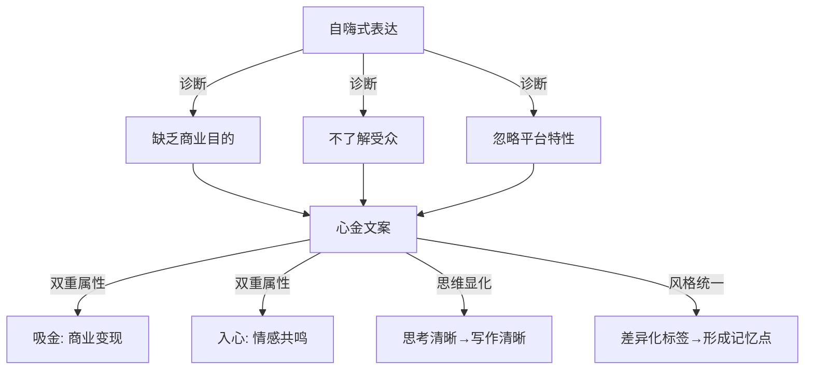
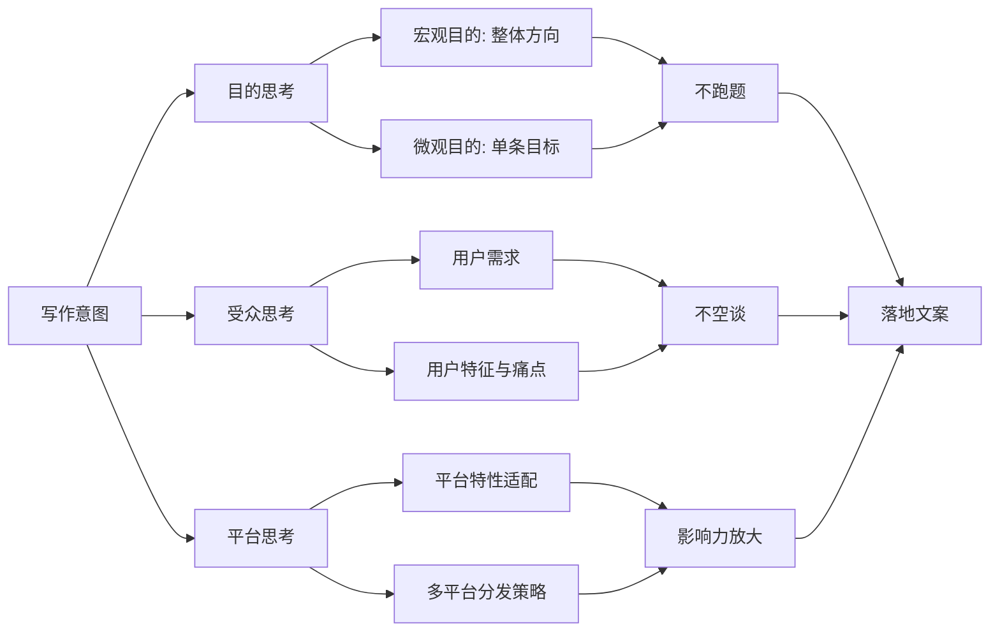
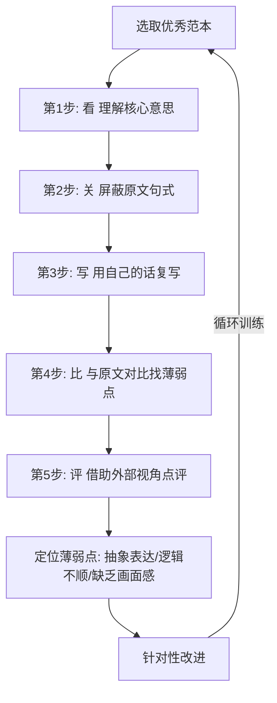
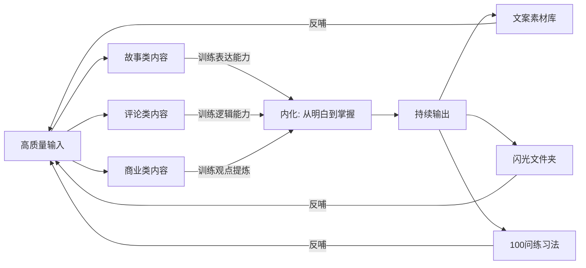
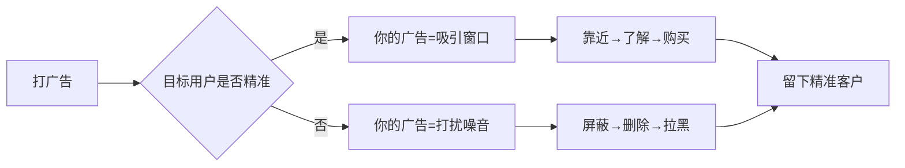
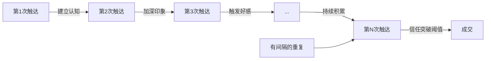
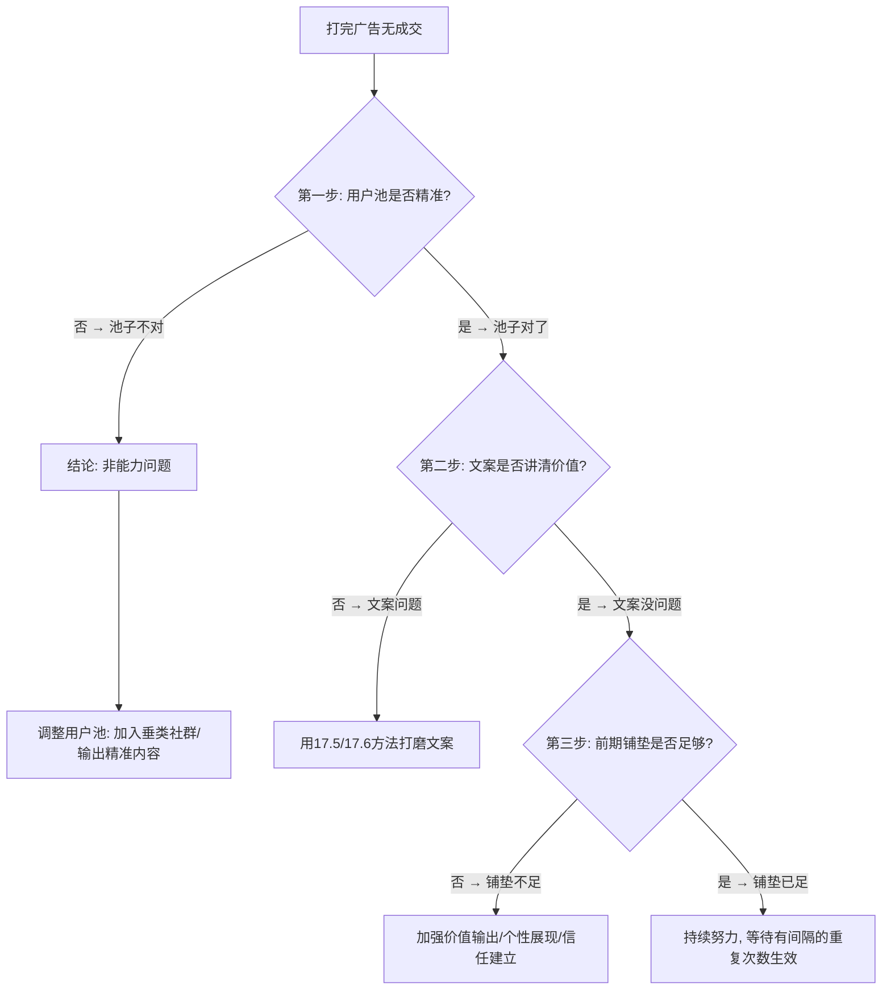

# 第 17 章 内容与文案力 —— 从"自嗨式表达"到"深入人心"

## 学习目标

- 理解心金文案的"吸金"与"深入人心"双重属性
- 掌握写文案前的三重思考：目的、受众、平台
- 学会用"构建相似"引发读者共情的三种路径
- 能运用富兰克林复写法定位并打磨表达薄弱点
- 理解"输入带动输出"的闭环机制并建立素材库
- 读懂打广告"放大与筛选"的本质并破除心理卡点
- 建立"有间隔的重复次数"的成交信任积累节奏
- 掌握用"鱼塘钓鱼"类比排查精准用户的决策顺序
- 能结合案例与局限，综合运用心法和心法避免自嗨

## 17.1 生活类比

想象你是一位养鱼塘塘主，想在自家池塘里钓上目标客户这条"大鱼"。你的**心金文案**就是精心调配的**鱼饵**：它既要散发诱人的香味勾住鱼群（吸金），又要贴合鱼群的口味让它们愿意咬钩（深入人心）。如果鱼饵只顾自己闻着香，却不符合鱼的口味，那你在岸边守上一天也只会收获空空如也的鱼钩。但光有好鱼饵还不够——你得先确认池塘里真的有鱼。如果你站的地方其实是个动物园，里面只有牛羊和长颈鹿，那你换再好的饵、练再精的钓技，也注定一无所获。这正是"精准用户排查"的意义：先确认自己在鱼塘里，再谈钓技（素材 P001《破除打广告的认知卡点》）。**而在17.10节中我们将看到，排查顺序的第一步永远不是怀疑自己，而是先低头看看脚下站的究竟是鱼塘还是动物园。**

再想象你站在广场中央，打广告就像打开一束**聚光灯**。灯光照亮的瞬间，喜欢你的人会清晰地看到你的价值而向你靠近；不喜欢你的人则被光线刺得眯起眼，转身离开。这束光的作用不是讨好所有人，而是**放大**你与支持者之间的共鸣，同时**筛选**出真正愿意付费的客户。它既照亮了同路人，也照走了无关者——两者同样重要，因为留下的才是你真正需要的客户（素材 P001《破除打广告的认知卡点》）。**在17.8节中我们将看到，广告本质上就是这台"聚光灯"——它从不试图照亮所有人，而是通过放大与筛选的双重操作，为你筛出真正的同路人。**

而成交更像是**追求喜欢的人**——你不可能靠一次表白就成功。你需要间隔性地约见、分享生活、展现三观，让对方在第十次、第三十次甚至第一百次被你触动时，才终于点头答应。这既考验你每次"约见"（内容输出）的质量，也考验你保持节奏的耐心。有趣的是，如果对方一次次拒绝你，你可能不会立刻怀疑自己"没有魅力"，而是会先想想"是不是追错了人"——但在打广告这件事上，人们却常常忘记同样的道理。如果你发现自己在一个"动物园"里追求一只根本不存在的"鱼"，那不是你魅力不够，而是你站错了地方（素材 P001《破除打广告的认知卡点》）。**在17.9节中我们将看到，成交的节奏从来不是一次惊艳的表白，而是"有间隔的重复次数"所积累的信任雪球。**

这三个类比——鱼塘钓鱼、聚光灯、追求爱人——看似独立，实则指向同一个核心逻辑：**文案（鱼饵）要好，用户池（鱼塘）要对，节奏（有间隔的重复）要稳**。三者缺一不可，这正是本章内容与文案力的完整体系。

## 17.2 概念地图

```
内容与文案力
├── 心金文案
│   ├── 双重属性: 吸金(商业变现)+入心(情感共鸣) —— P002
│   └── 思维显化: 写作传递思考与价值观 —— P002
├── 写作前置思考
│   ├── 目的(宏观/微观) —— P002
│   ├── 受众(理解用户) —— P002
│   └── 平台(特性适配/多平台分发) —— P002
├── 表达打磨方法
│   ├── 富兰克林复写法(看-关-写-比) —— P002
│   ├── 共鸣感构建(经历/感受/价值观) —— P002
│   └── 统一的文案风格(记忆点) —— P002
├── 持续输出系统
│   ├── 输入带动输出(故事→评论→商业) —— P002
│   ├── 三类内容输入法 —— P002
│   ├── 文案素材库/闪光文件夹 —— P002
│   └── 100问练习法 —— P002
├── 广告认知与心态
│   ├── 打广告的放大与筛选本质 —— P001
│   ├── 广告是成交前最后一步 —— P001
│   ├── 成交信任积累(有间隔的重复) —— P001
│   └── 精准用户排查(鱼塘/动物园类比) —— P001
└── 自我反思与边界
    ├── 自嗨式写文案的陷阱 —— P002
    ├── 硬性模仿与套模板局限 —— P002
    ├── 打广告无成交的排查顺序(池子→文案→铺垫) —— P001
    └── 不精准用户池中的数据归因 —— P001
```

## 17.3 心金文案 —— 让文字既能"吸金"又能"入心"

想象你刷朋友圈时，看到一位朋友连续发了一个月的产品广告，但评论区始终冷冷清清。你也会看到另一种人，他们偶尔分享一段生活感悟，下面却涌满了"求链接""怎么加入"的咨询。这两者的差别，正是我们要解开的核心谜题。

为什么需要"心金文案"这个概念？因为普通人发朋友圈、写内容常陷入一种"自嗨式表达"的陷阱：自己觉得写得很棒，用户却不感兴趣，咨询寥寥无几。传统文案要么只重"吸金"——硬广自夸，惹人反感；要么只重"抒情"——写得很感人，却不带来任何商业回报。我们需要一种同时兼顾商业变现（吸金）与情感共鸣（深入人心）的文案范式，让每一次表达都真正服务于成交。（素材 P002《心金文案方法论》）

> "2022年，我给我的文案风格，终于敲定了一个名字，叫做「心金文案」，寓意是既能吸金、又能深入人心的文案。文案不同于文章，文案本身就带有一层商业变现属性，所以能够吸金才是关键，而文案又需要蕴藏感情、给人能带来触动，所以深入人心的写法，也是必要。"
>
> ——《心金文案方法论》（素材 P002）

这段话为我们划定了文案与文章的分界线。**文章**可以纯粹为了表达与分享；但**文案**天然背负着商业使命——它要促成交易。同时，如果文案只有功利性而没有温度，用户只会感到被冒犯。心金文案正是在这两极之间找到平衡点的写作范式。

> **心金文案**定义（来源：《心金文案方法论》，素材 P002）

**心金文案** = 既能吸金（具备商业变现属性）又能深入人心（蕴含情感、带来触动）的文案类型

这个定义揭示了心金文案的三大关键性质。**双重属性**——商业变现与情感共鸣缺一不可，任何一边失衡都会让文案失效；**思维显化**——文案是写作者思考与价值观的外在呈现，思考清晰才能写得清晰（素材 P002《心金文案方法论》）；**风格统一**——需要形成差异化、标签化的个人风格，统一协调才利于形成记忆点（素材 P002《心金文案方法论》）。

让我们看一个典型例子。一条朋友圈软广：先讲自己踩坑的故事引发共鸣（入心），再自然带出产品如何解决问题（吸金）。再比如个人IP介绍：用"营销圈里最懂投资"的差异化标签吸引同频人群关注并咨询。

> "很多做私域的朋友，为什么发了无数朋友圈但是咨询寥寥无几？大概率是因为他陷入了一种自嗨式写文案的状态。他沉浸在自己的世界里，按照自己的局限性想法去发文案，他以为用户会想看的内容，其实用户并不一定想看。"
>
> ——《心金文案方法论》（素材 P002）

这段话点出了心金文案要解决的核心病症——**自嗨式写文案**。自嗨的本质，是写作者把"自己想表达的"误当成"用户想看的"，在自我世界里自说自话，却从未换位到读者的视角。

但心金文案也有其边界条件。它不适合硬性模仿与套用模板——这会束缚文案力与创造力，使人无法理解爆款背后的吸引点和逻辑性（素材 P002《心金文案方法论》）。它适合需要长期经营私域、打造个人IP的个体，而不适合追求短期一次性投放的纯流量玩家。



## 17.4 写文案前的三重思考 —— 先问"为什么、给谁看、在哪发"再动笔

你有没有过这样的经历：灵感来了，一口气写下一大段文字，自我感觉良好地点击发送，结果一整天过去，点赞与咨询都毫无动静？问题往往不在于你写得好不好，而在于你在动笔之前，有没有想清楚三个最基本的问题。

为什么需要三重思考？因为许多写作者不假思索提笔就写，结果文案跑题、无人问津，陷入自嗨。缺乏对目标用户的理解，写出的内容用户不关心、不信任，更不会下单。同一内容在不同平台若不调整风格，传播效果天差地别——发在朋友圈的金句体放到公众号可能显得单薄，发在知乎的长文放到抖音则会让人划走。

> "你写文案的目的是什么？你的文案是写给谁看？文案发布在哪些平台？我们在写文案之前，需要思考两层目的。一层是宏观的，你整体文案的方向是为了实现什么？……一层是微观的，具体到每一个单条文案要达到什么目的？你要先去理解用户，然后才能写好文案甚至于做好营销。同一条文案，适当根据平台特性去修改，就可以实现多平台分发，真正让一条文案实现成倍放大影响力的效果。"
>
> ——《心金文案方法论》（素材 P002）

这段话给出了写文案前必须回答的三个前置问题，它们构成了一个完整的思考框架。明确目的是方向锚，让你不跑题；理解受众是沟通靶，让你不空谈；适配平台是放大器，让你的影响力成倍扩散。

> **三重思考框架**方法（来源：《心金文案方法论》，素材 P002）

```
输入：写作意图
步骤1：目的思考 —— 宏观目的（整体方向）+ 微观目的（单条目标）
步骤2：受众思考 —— 用户需求、特征、痛点
步骤3：平台思考 —— 平台特性适配 + 多平台分发策略
输出：一篇不跑题、不空谈、适配渠道的文案
```

这段伪代码展示了三重思考作为"前置过滤器"的核心价值。它强制我们在动笔前完成一次思维校准，确保后续的每个字都朝着同一个方向发力。这也回应了素材中"一条文案，一个主旨就足够了"的主张——主旨太多，读者反而抓不住重点（素材 P002《心金文案方法论》）。



让我们看一个具体例子。假设你要卖护肤品，写一条朋友圈：**宏观目的**是建立专业护肤形象，为后续产品推广做信任铺垫。**微观目的**是让读者产生好奇并私信你咨询具体方案。**目标受众**锁定为有痘印困扰、正在寻找有效护肤方案的年轻女性。**平台适配**上，发在小红书侧重图文种草笔记，发在公众号则侧重长文信任建设。这四步连成一气，确保文案的每个字都朝着同一个方向发力。

三重思考的边界条件同样重要。当你发现受众画像模糊（如"所有人"）时，应先做减法聚焦人群，否则三重思考难以落地。当平台特性与内容主旨冲突时（如严谨行业报告发抖音），应优先保证主旨在单平台内的适配表达，而非强求多平台分发。

## 17.5 共鸣感构建 —— 让读者觉得"你懂我"的写作心法

你有没有读到过一段文字，瞬间觉得"这说的不就是我吗"？那种被看穿的感觉，会让人不由自主地信任作者，甚至愿意为他的产品买单。这种"被理解"的体验，正是共鸣感构建要达成的效果。

为什么需要共鸣感构建？因为用户对"自说自话"的文案毫无感觉，只有感到"被理解"才会产生信任。单纯的道理说教难以触动情绪，而没有情绪触动的文案很难驱动购买决策。文案要深入人心，就必须触发读者的情感共振，让读者觉得"这说的就是我"。

> "这种共鸣，是需要通过「构建相似」来进行的。可以在文案中代入生活场景感受，贴近现实，你所感受到的喜怒哀乐，用户也能同样感受到。分享给大家3个方向：经历的共鸣，感受的共鸣，价值观的共鸣。世间万物其实都遵循着吸引力法则，低能量会被高能量吸引，那你就必须要先把自己的势能打造起来，勇敢的在文案里去表达你的心声，才会引发别人的共鸣。"
>
> ——《心金文案方法论》（素材 P002）

这段话揭示了共鸣感的底层机制：**相似性**是触发器。当读者在文案中看到自己的影子时，防御心会自然放下，信任感随之生长。作者给出的三个方向——经历、感受、价值观——构成了由浅入深的三重递进。

> **共鸣感构建**方法（来源：《心金文案方法论》，素材 P002）

```
共鸣强度层级（由低到高）：
层级1: 经历的共鸣 —— 建立"同病相怜"
层级2: 感受的共鸣 —— 建立"感同身受"
层级3: 价值观的共鸣 —— 建立"灵魂同频"
```

这个层级模型的含义是：共鸣的深度决定了关系的牢固度。经历共鸣让读者觉得"我们有相似的过去"，感受共鸣让读者觉得"我们有一致的情绪"，价值观共鸣则让读者觉得"我们是一类人"——最后一层产生的信任最为牢固。


让我们看三个直接可用的例子，它们分别对应"过去的相似经历""当下的一致情绪""深层的共同信念"：**经历共鸣**的文案可以写成"你是不是也试过，深夜加班回家，打开外卖软件却不知道点什么？"；**感受共鸣**的文案可以写成"那种被客户放鸽子后还得笑着说没事的委屈，我太懂了。"；**价值观共鸣**的文案可以写成"我坚持认为，好的关系不是消耗，而是互相成就。"三个例子对应三个层级，你可以根据文案目标选择合适的层级。

共鸣感构建同样有边界。"构建相似"不能编造虚假经历，否则一旦被识破，信任会瞬间崩塌（素材 P002《心金文案方法论》）。共鸣感需要建立在真实自我表达的基础上，如果一味迎合用户而失去自我风格，反而会削弱文案辨识度——这恰好呼应了心金文案"统一风格"的要求（素材 P002《心金文案方法论》）。

## 17.6 富兰克林复写法 —— 用"看-关-写-比"打磨表达力

你是否遇到过这样的困境：明明读了很多好文章，轮到自己写时却总觉词不达意？问题的根源在于，阅读输入不经过刻意训练，无法自动转化为写作能力。富兰克林复写法，正是为了解决这一困境而生。

为什么需要富兰克林复写法？因为新手写作最大的问题是"看不清自己的薄弱点"：不知道哪里表达不清、哪里逻辑不顺。单纯的阅读输入不经过刻意训练，无法转化为自己的写作能力。我们需要一套可操作的自检方法，精准定位表达短板并针对性改进。

> "什么叫做复写？就是你先看一遍文案，然后把它关闭，尝试用自己的话去再次写出来，然后你会发现，每一次你写出来的内容都不一样，然后你去跟原文案对比，去发现自己表达不清晰的地方在哪里，那就是你写作的薄弱点。然后当大家写出来一个文案的时候，不要孤芳自赏，可以去找一些朋友或者专业人士帮助你点评你的文案，提出建议。"
>
> ——《心金文案方法论》（素材 P002）

这段话蕴含着复写训练的三层价值。**对比产生反馈**——通过"自己的表达"与"优秀原文"的差异暴露短板；**需要外部视角**——找朋友或专业人士点评，避免"孤芳自赏"；**原理是复写而非抄写**——每一次重写都不一样，逼迫大脑重新组织语言。

> **富兰克林复写法**方法（来源：《心金文案方法论》，素材 P002）

```
1. 看：阅读一段优秀文案，理解其核心意思
2. 关：关闭原文，不参考任何内容
3. 写：用自己的话重新写出同样的意思
4. 比：将复写与原文对比，标注表达不清晰处
5. 评：请朋友或专业人士点评，获取外部反馈
```

这段伪代码展示了复写法"从输入到输出再到反馈"的完整闭环。它的精妙之处在于：通过"关闭原文"强制大脑脱离原文的句式与词汇，逼迫自己从语义层面重新组织表达，从而暴露真正的写作薄弱点。



让我们看一个具体例子。你读到一句"好的文案是思维的显化"，关闭后自己写出"写作就是在表达思考，想法理清了，写出来才明白"。对比原文后你会发现：原文的"显化"一词包含了"看不见的思想变成看得见的文字"这一层含义，而你的复写只表达了"想法理清才能写明白"的一半意思——这就是你需要打磨的薄弱点。再比如，你写完一条朋友圈文案，发给有经验的朋友点评，对方指出"开头没有痛点代入，读者不知道跟他有什么关系"——这正是外部视角能发现的盲点。

复写训练的边界条件同样值得注意。首先，需要选择真正高质量的范本，否则复写学到的是错误范式。其次，复写训练的进步是渐进的，不适合追求"看一遍就脱胎换骨"的速成心态——它需要日复一日的刻意练习。

## 17.7 输入带动输出 —— 用"高质量输入"喂养思维，突破写作瓶颈

很多写作者在遇到瓶颈时，第一反应是"再多读几本写作技巧书"。但真正的问题往往不是技巧不足，而是"脑空"——没有足够的素材、观点和逻辑框架可供调用。输入带动输出，正是为了解决这个根本问题。

为什么需要输入带动输出？因为写作卡壳的根源往往不是"手生"，而是"脑空"——没有足够的素材、观点和逻辑框架可供调用。只靠闷头苦想，容易因认知基础薄弱而归因错误、产出低质内容。持续输出能力的建立必须依靠稳定的输入系统，否则写作难以为继。

> "千万不要自己闷头苦想，因为你的认知基础薄弱，你想半天想出来的很可能归因逻辑就是错的。思维是一定要通过不断输入才能得到提升的，踩着巨人的肩膀，你会看到更广阔的天空。输入完了之后，还要思考。因为从明白到掌握，有一个「内化」的过程。"
>
> ——《心金文案方法论》（素材 P002）

这段话切中了写作瓶颈的根因：不是不够努力，而是认知基础薄弱导致归因错误。素材给出的解药是"踩着巨人的肩膀"——通过高质量输入站在更高的认知起点上。但输入本身还不够，必须经过"内化"（从明白到掌握的转化）才能真正为己所用。

> **输入带动输出**方法（来源：《心金文案方法论》，素材 P002）

```
输入层级（由浅入深）：
层级1: 故事类内容 —— 训练"把一件事说明白"的表达能力
层级2: 评论类内容 —— 训练逻辑结构与论证能力
层级3: 商业类内容 —— 训练观点提炼与文案套路

支撑系统：
- 文案素材库：分类整理高价值内容，便于快速检索
- 闪光文件夹：随手记录灵感，积累原创素材
- 100问练习法：整理行业100问，逐一用自己的话写出
```

这段伪代码展示了"输入—内化—输出"的完整闭环。输入有层级：按"故事类→评论类→商业类"三级递进，分别训练表达、逻辑与观点（素材 P002《心金文案方法论》）。输入后需要内化：从"明白"到"掌握"之间有转化过程，只读不想等于白读。系统化支撑：配合"文案素材库"分类整理与"100问练习法"刻意输出，形成闭环（素材 P002《心金文案方法论》）。



输入带动输出的边界条件同样重要。输入内容需与自身输出方向强相关，漫无目的的泛读效率低下。"内化"需要足够的思考时间与主动加工，若只囤积不加工——比如收藏夹里存了几百篇文章却从不回看——则输入无法转化为输出能力。

## 17.8 打广告的"放大与筛选"本质 —— 把广告变成精准客户的雷达

"我不想打广告，怕朋友觉得我在推销。"这是许多副业新手的心声。但素材中的观点可能会颠覆你的认知：不打广告，恰恰是放弃了你最需要的支持者。理解"放大与筛选"的本质，是破除这一心理卡点的第一步。

为什么需要理解"放大与筛选"？因为很多人不敢打广告，核心是不理解打广告的价值，误以为广告只会打扰别人、损害关系。打完广告不出单又容易陷入自我怀疑，归因于"我不行"而非"池子不对、铺垫不够"。我们需要重新定义广告的本质，建立对广告的正确认知与健康心态。

> "打广告这动作，本质是一种「放大」和「筛选」。让喜欢你的人，更深入的理解你在做的事情，更明白你的能力和价值。喜欢你的人，更喜欢你；不喜欢你的人，更烦你。此为「放大」。喜欢你的人，觉得你的广告，是一个能更好的了解你的窗口，了解完之后，他们会靠近你，购买你的产品，成为你的客户。不喜欢你的人，觉得你打广告，是又想让他掏钱了，你又打扰他了，看完后更烦你，然后屏蔽你、删除你、拉黑你。此为筛选。"
>
> ——《破除打广告的认知卡点》（素材 P001）

这段话揭示了打广告的双向性：它同时作用于喜欢与不喜欢你的人，效果相反但机制相同。广告天然不是为所有人服务的——对准客户是"吸引"，对无关者是"打扰"。这恰恰是筛选机制在工作。

这一本质可以进一步形式化。广告效果如何用函数表达？让我们从最简单的逻辑开始推导。**第一步，先明确影响广告效果的两个核心变量**：广告对一个人产生的影响，首先取决于他是否本来就在你的目标客户范围内——我们用 $S$（Support，支持度）表示某人原本对你的认同程度；其次取决于广告内容传递的价值信息是否足够清晰——我们用 $V$（Value，价值清晰度）表示广告传递的价值信息质量。**第二步，思考两个变量的关系结构**：如果一个人完全不认同你（$S=0$），那么无论你的广告内容多么精彩（$V$ 多高），广告对他毫无正面作用，效果为零；同理，如果广告内容含糊不清（$V=0$），那么即使他再欣赏你（$S$ 多高），他也看不懂你在做什么，效果同样为零。**第三步，选择能表达"缺一不可"关系的数学形式**：加法结构允许一个变量为零时结果仍不为零（比如 $S=0$ 但 $V=10$ 时 $E=10$），这不符合"两者缺一不可"的事实；乘法结构则天然满足：只要任一变量为零，结果就为零。**第四步，引入一个正的常数系数 $\alpha$ 来调节整体尺度**，它代表广告内容本身的传播效率——同样的支持度和价值清晰度，传播效率越高（比如文案更吸引人、投放渠道更精准），广告效果就被放大得越多。因此广告效果 $E$ 写成：

$$
E = \alpha \cdot S \cdot V
$$

**系数 $\alpha$ 如何理解与调整？** 它本质上是广告的"杠杆倍率"，反映从触达到转化的整体转化效率。实操中，$\alpha$ 并非一个可以精确计算的常数，而是一个用来提醒你关注"转化效率"的思维变量：当你的广告点击率、咨询率明显偏低时，意味着 $\alpha$ 偏低——此时应优先优化广告的呈现形式（标题、配图、行动号召），而非怀疑 $S$ 或 $V$ 出了问题。反过来，当池子精准（$S$ 高）且文案清晰（$V$ 高）时，通过在更精准的渠道投放（如垂类社群）可以有效提升 $\alpha$，让同样一条广告产生更大的效果。

**为什么是乘法而不是加法？** 因为这两个变量缺一不可：如果 $S=0$（完全不认同你），那么无论 $V$ 多高，$E=0$——广告对他毫无正面作用；同理如果 $V=0$（广告内容含糊不清），那么无论 $S$ 多高，$E=0$——支持者也看不懂你在做什么。乘法结构天然捕捉了这种"缺一不可"的关系。

这个公式的核心意义在于揭示广告的"双向过滤器"工作原理：它同时执行两个动作——**放大效应**（喜欢你的人 → 更理解你的价值 → 靠近购买）和**筛选效应**（不喜欢你的人 → 觉得被打扰 → 屏蔽删除）。理解这一点，你就不必为"有人屏蔽我"而沮丧——那是筛选机制在为你清理池子。落地到实操中，这个公式提醒你：与其纠结于"为什么广告没人看"，不如先去检查两个变量——你的目标用户是否真的在池子里（$S$ 是否大于零），以及你的广告是否把价值说清楚了（$V$ 是否足够高）。这正是"精准用户排查"与"文案自查"两大步骤的数学依据。



作者进一步点出了广告的准确定位：

> "打广告，是成交前的最后一步，而不是唯一的步骤！在打广告之前，还有：价值输出、个性展现、信任建立...对于【无关人员】来说是【打扰】的东西，对于【你的客户】来说是一种【吸引】。如果你不打广告，不去【打扰】无关人员，那么同样的，你就没法【吸引】你的客户。"
>
> ——《破除打广告的认知卡点》（素材 P001）

这段话极为关键：广告只是"临门一脚"，而非全部。如果此前没有N篇价值文章、N条生活分享、N次互动交流作为铺垫，广告只会被当作垃圾信息。这也意味着，不敢打广告的代价是——你连"临门一脚"的机会都放弃了。回扣第17.1节的**聚光灯类比**：聚光灯打开时，照亮的永远是站在光里的人——那些已经通过前期铺垫认识你、信任你的人。广告这束光从来不是为了照亮整个广场，而是为了让你的支持者看清你、让无关者自行离场。

放大与筛选的边界条件同样重要。"放大筛选"的前提是产品真实有价值，如果产品本身是垃圾，广告只会加速口碑崩塌。该逻辑仅适用于"有价值交换"的关系，对需要顾及感受的亲朋好友、领导同事，需要另外调整投放范围与表达方式。

## 17.9 成交信任积累 —— "有间隔的重复次数"比一次惊艳更重要

"我写了一篇很棒的文章，怎么还是没人买我的产品？"这个问题背后，藏着一个对成交节奏的根本误解。成交很少因为一次惊艳的展示而发生，它更像一场需要耐心推进的"马拉松"。

为什么需要理解"有间隔的重复次数"？因为很多新人以为"写一篇爆款就能转化客户"，但实际上多数人成交前需要多次被触动。打完广告不出单就自闭，是因为把"单次广告"当成全部，忽略了此前的信任积累。我们需要理解成交的真实节奏，建立对"打广告-没成交"的合理预期与耐心。

> "我发现，打动别人，让人下单这事，除了强度之外，还有【有间隔的重复次数】。有些人会在认识你的第一天就买单。而有些人会在第10天、第30天、第50天、第100天...第N次看到你的干货，看到你的生活，了解你这人的性格、三观，第N次被你触动后，才会买单的。以我为例，原本我以为，我已经有几篇很精彩的代表作了，一些新朋友加过来，看了我3篇大作，应该就能买单了。但实际上，我发现不完全是这样的。也有很多朋友，是看了我几篇大作后初步了解了我，但仍对我的产品无动于衷。后来又刷了我十几篇唠嗑短文后，才来找我下单的。"
>
> ——《破除打广告的认知卡点》（素材 P001）

这段话用作者亲身经历揭示了成交的节奏规律：不同用户需要的"触发次数"差异巨大——有人第一次就买单，有人需要等到第10、30、50甚至100次被触动。打动别人的要素不仅有"强度"，还有"有间隔的重复次数"。

如何从思想实验推导出"累加模型"？让我们一步步来。**第一步，明确基础假设**：假设一次高质量触达（比如一篇干货文章、一条真诚分享）提供的价值为 $V$，但用户对不同触达的感知并不等权——越新鲜、越贴近需求、越击中痛点的触达，感知权重越高。我们用 $w_i$ 表示用户对第 $i$ 次触达的感知权重，权重越高，说明这次触达在他心中的分量越重。**第二步，思考信任如何积累**：每次触达后，用户对你的信任会累加一个"感知价值量"。这个感知价值量等于"触达的价值"乘以"用户对这次触达的感知权重"。**第三步，确定累加而非其他累积形式的理由**：如果采用乘法模型（如 $P = w \cdot V$），它的含义是"单次触达就决定成交概率"，这就忽略了多次触达逐步积累信任的事实；如果采用加权平均，它会把历史触达的价值"稀释"掉，意味着第1次的触达对最终成交的贡献越来越小，这与现实经验不符——第1次触达建立的初步认知往往是后续信任的地基。累加模型则意味着：每一次触达都在为信任总量添砖加瓦，第1次触达建立初步认知，第2次加深印象，第3次触发好感……即使单次触达的价值不高，只要重复足够多次，信任总量依然可以积累到促成成交的阈值。

**第四步，感知权重 $w_i$ 如何量化与估计？** $w_i$ 虽然难以精确测量，但可以用一个简单的代理指标来近似：**触达的"新鲜度"与"相关性"**。比如，同样一条产品介绍，第一次看到时的新鲜感权重最高（$w_i \approx 1$）；如果连续三天刷屏同一条内容，感知权重会迅速衰减甚至变为负值。实操中，你可以用"用户互动率"（点赞、评论、私信询问的比例）作为 $w_i$ 的粗略估计——互动率越高，说明该次触达的感知权重越高。当你发现某类内容的互动率持续走低时，就应该调整触达形式，而不是继续重复同一种内容。

**第五步，写成数学形式**：

$$
P(\text{成交}) = \sum_{i=1}^{N} w_i \cdot \text{Value}_i
$$

其中 $N$ = 触达次数，$\text{Value}_i$ = 第 $i$ 次触达提供的价值，$w_i$ 为用户对第 $i$ 次触达的感知权重。

这个公式表达了成交概率的"累加模型"：单次触达的强度再高，如果 $N=1$，覆盖的用户群也有限；但即使每次触达的强度不高，只要 $N$ 足够大且每次都有价值输出，信任就会像滚雪球一样积累。这就解释了一个反直觉的现象——为什么"唠嗑短文"也能促进成交？因为虽然每条唠嗑短文的价值 $Value_i$ 不高、感知权重 $w_i$ 也普通，但它增加了触达次数 $N$，为累加总和贡献了一份力量。在实操中，这个公式直接指导你设计"有间隔的重复次数"方案：与其把全部精力押在一篇"爆款大作"上孤注一掷，不如规划一个跨度为30天至90天的内容日历——每周安排固定次数的干货输出、生活分享、三观表达，让触达次数 $N$ 稳步增长。同时要注意，重复必须"有间隔"，连续刷屏式重复会触发用户的防御机制，让感知权重 $w_i$ 大幅降低甚至变成负值；重复的内容需保持价值输出的多样性——干货、生活、三观——不能只重复同一句广告语，否则每一次触达的感知权重都会递减。



回扣第17.1节的**追求爱人类比**：你不可能靠一次表白就成功。追求的过程本身就是一次次的"有间隔的约见"——每一次约见都在为对方的信任总量添砖加瓦，直到某一次约见后，对方终于点头。广告就是你的"表白"，而此前的每一次分享、互动、干货输出，都是表白前的约会。

## 17.10 精准用户排查 —— 别在"动物园"里钓不到鱼就怀疑自己

打完广告没成交，你的第一反应是什么？如果你像大多数人一样开始怀疑"是不是我能力不行"、"是不是我魅力不够"，那么你正在犯一个归因错误。问题可能根本不在你，而在你站错了"鱼塘"。

为什么需要精准用户排查？因为打广告没成交时，新手第一反应是怀疑自己能力不行、魅力不够，从而陷入自卑与内耗。很多人的用户池是长期随缘积累的"杂物间"，里面几乎没有目标客户。我们需要一套方法先排除"池子不对"的干扰因素，再谈优化文案与转化。

> "你现在的精准人群，他们的类型是【鱼】，但你以前从各种场合积累下来的，都是些【牛】【羊】【长颈鹿】【犀牛】【狮子】... 2000好友里，就没有几只你要的【鱼】。钓不到鱼，那不是再正常不过了吗？所以呀，当你发现你没钓上几只鱼时，你要想的第一件事，不是怀疑自己，而是思考思考，自己到底是在鱼塘，还是动物园。要检验自己的钓鱼技术如何，得去鱼塘，才能检验出来呀。"
>
> ——《破除打广告的认知卡点》（素材 P001）

这段话用"养牛场里钓鱼"的类比，精准点出了新手最常见也最隐蔽的归因错误。如果你在养牛场里钓鱼，钓不到鱼是必然结果，跟你的钓鱼技术毫无关系。同样，如果你的2000好友全是同学、亲人、同事等随缘积累的人群，里面根本没有你的目标客户，发广告无人问津就是正常现象。

> **鱼塘排查法**方法（来源：《破除打广告的认知卡点》，素材 P001）

```
判断依据：用户池中目标客户（鱼）的占比
执行步骤：
1. 将好友按"是否为目标客户画像"分类
2. 计算目标客户占比
3. 若占比低 → 结论：池子不对，非能力问题
4. 若占比高但仍无成交 → 检查文案 → 检查铺垫 → 持续努力
```

这段伪代码给出了排查的逻辑优先级：**先检查池子，再检查文案，最后检查铺垫**。这个顺序安排有深刻的心理学考量——它防止你过早地自我否定，而是先在客观层面排除干扰因素。这正回应了细纲中"打广告无成交的排查顺序"这一要点：池子不对时，再好的文案和再多的铺垫都是无用功；池子对了但仍然无成交，才需要审视文案是否讲清了产品价值、铺垫是否足够（素材 P001《破除打广告的认知卡点》）。



**回扣鱼塘类比，这里给出一个更具体的操作视角**：如果你发现自己站在"动物园"里，第一反应不应该是"我的鱼饵不够香"（文案问题），而应该是"我得先找到真正的鱼塘"（用户池问题）。换个视角看，动物园排查法和17.8节的聚光灯公式共享同一条决策路径——公式 $E = \alpha \cdot S \cdot V$ 告诉我们：如果 $S$ 接近零（池子里没有鱼），无论 $V$（文案清晰度）多么高，最终广告效果都趋近于零，这正是"池子不对时，再好的文案都是无用功"的数学表达。只有当确认脚下确实是鱼塘（$S$ 高）之后，你的钓技（文案）、你的耐心（重复触达）才有用武之地。

精准用户排查的边界条件同样重要。"精准"不以好友数量衡量，而以目标用户占比衡量。即使池子精准，仍需结合文案自查与信任铺垫，不能只靠"池子对"就期望成交。一个300人的宝妈社群发同一条母婴广告，可能瞬间收到5个咨询——这就是鱼塘与动物园的区别。

### 17.11 多源对照：两种素材视角下的"成交与转化"

#### 共识

两份素材（P001《破除打广告的认知卡点》与P002《心金文案方法论》）在"成交的根基是信任"这一命题上高度一致。P001强调"广告是成交前的最后一步，而非唯一步骤"，主张在打广告之前必须完成价值输出、个性展现与信任建立；P002则从文案创作的角度提出"共鸣感构建"，认为读者只有在感受到"被理解"后才会产生信任。两者共同指向同一个结论：广告或文案不是成交的起点，而是信任积累链条上的终端动作。

#### 分歧

两份素材对"成交驱动因素"的侧重点存在明显差异。下表对两者的分歧进行了系统对照（下表视角均来源于素材 P001《破除打广告的认知卡点》与素材 P002《心金文案方法论》的原文对比）：

| 维度 | P001 视角 | P002 视角 |
|------|-----------|-----------|
| 成交的关键变量 | 触达频率与节奏（有间隔的重复次数） | 内容品质与情感共鸣（深度思考与共鸣感） |
| 驱动机制 | "量"的积累——多次触达弥补单次强度不足 | "质"的突破——单次触达直击人心 |
| 落地方法 | 前期价值输出、个性展现、信任建立 | 共鸣感构建、富兰克林复写法、输入带动输出 |
| 适用场景 | 私域运营、长期客户关系维护 | 文案创作、个人IP内容打造 |

此外，P001素材中还有一条重要主张——"酒香也怕巷子深"（素材 P001《破除打广告的认知卡点》），强调的是好产品也要主动宣传；而P002素材侧重点在于"如何把宣传内容写得深入人心"（素材 P002《心金文案方法论》）。两者结合：前者解决"要不要打广告"的意愿问题，后者解决"广告怎么打才有效"的方法问题。

这一分歧反映的是"量"与"质"的权衡：P001认为"重复"可以弥补单次触达的强度不足，P002则认为单次触达的"深度"才是决定转化率的根本。在实操中，两者应结合使用——用P002的方法论打磨单次触达的质量，用P001的节奏观规划触达的频率。

## 17.12 设计中的取舍

**为什么不用"只要把产品做好，用户自然会来"的策略，而非要打广告？**

这个看似朴素的思路，其实暗藏一个致命的盲区。素材中有一句精辟的论断："酒香也怕巷子深"（素材 P001《破除打广告的认知卡点》）。即使你的产品再好，如果没有人知道它的存在，它就等于不存在。广告的作用不是"推销垃圾"，而是"放大真实价值"——让喜欢你的人更深入地理解你在做的事情。如果你不打广告，不去"打扰"无关人员，那么同样的，你就无法"吸引"你的客户。这是一个"打扰与吸引不可兼得"的取舍：为了照顾无关人员的观感而放弃广告，等于连真正的支持者也一并舍弃了。

**打完广告没成交，先怀疑自己还是先排查池子？**

这两者的取舍决定了你的心态走向。如果先怀疑自己，你会在毫无依据的情况下陷入自卑与内耗，甚至干脆放弃副业；如果先排查池子，你至少能在客观层面验证"客户是否对"这一前提。素材用"养牛场里钓鱼"的类比告诉我们：如果2000好友里没有几条你想要的"鱼"，钓不到鱼是正常结果，不是能力问题。正确的排查顺序是：**先检查用户池是否精准 → 再检查文案 → 再检查铺垫 → 最后才是持续努力**。这个顺序避免了"在错误的地方用错误的工具做正确的事"的最大浪费。

**追求"单次惊艳"还是"重复触达"？**

这是"量"与"质"的经典取舍。单次惊艳的优势在于爆发力强、传播效率高，但覆盖面有限；重复触达的优势在于覆盖面广、信任积累扎实，但需要长期耐心。素材告诉我们，两者并非二选一——正确的策略是：用"心金文案"的方法打磨单次触达的质量，用"有间隔的重复"规划触达的频率。这正印证了17.9节公式中的乘法与累加逻辑：单次触达的"价值"决定了系数 $w_i$，重复触达的"次数"决定了求和项数 $N$。只有 $w_i$ 够大、$N$ 够多，成交概率才会足够高。

## 17.13 动手练习

1. **拆解一条朋友圈文案的三重思考**
   给定以下朋友圈文案（练习素材，改编自素材 P002《心金文案方法论》的共鸣感构建案例）：
   "深夜11点，刚哄完二宝睡觉。看着镜子里浮肿的自己，想起三年前那个被甲方折磨到崩溃的职场妈妈。那时我没想到，现在能靠写文案月入过万，还能每天接送孩子上下学。如果你也在带娃和事业之间挣扎，私信我'妈妈'，送你一份我的私域起步清单。"
   请回答：
   1. 用"三重思考"框架拆解：这条文案的宏观目的和微观目的是什么？目标受众是谁？适合发布在哪些平台（朋友圈/小红书/公众号）？
   2. 指出文案中"共鸣感构建"属于哪一种类型（经历/感受/价值观），并改写其中一句，使其加入"价值观共鸣"元素。
   3. 判断：如果发布后咨询寥寥，按照排查顺序，第一步应该检查什么？为什么不是先改文案？

2. **用富兰克林复写法对比打磨一段文案**
   步骤1：阅读以下优秀文案（范本，改编自素材 P002《心金文案方法论》中关于共鸣感构建的写作原则）：
   "你不是懒，你只是太久没有被自己感动过了。那些说'差不多就行'的日子，正在一点点吞掉你眼里的光。"
   步骤2：关闭范本，用自己的话重新写出同样的意思（复写），至少100字，不要看原文。
   步骤3：将你的复写与原文对比，找出你表达不清、逻辑不顺或缺少画面感的3个薄弱点，写下来。
   步骤4：将你的复写发给一位朋友或同事，请对方给出1条具体改进建议，并记录对方的反馈。
   回答问题：
   - 对比后你发现自己最薄弱的环节是什么？是抽象表达的具象化，还是情绪渲染？
   - 请他人点评与自我对比，两者的反馈有何不同？哪个更能暴露问题？

3. **鱼塘检查：为你的微信好友做一个"动物园盘点"**
   打开你的微信通讯录，任选100位好友（或全部），做一次用户池盘点（本练习基于素材 P001《破除打广告的认知卡点》的"鱼塘/动物园"类比设计）：
   1. 将好友按四个象限分类：A=有感情联系（亲友/同事/领导）、B=无联系但可能有价值交换（网友/同行）、C=无联系也无付费可能（泛泛之交）、D=精准目标用户（符合你业务画像）。
   2. 统计每类人数，算出你通讯录中的"鱼"（D类）占比。
   3. 假设你正在推广一门"家庭理财入门课"，请判断：你的用户池是"鱼塘"还是"动物园"？依据是什么？
   4. 如果D类占比低于5%，请列出2种将"动物园"改造为"鱼塘"的具体行动（如加入垂类社群、调整内容吸引精准人群），并说明为什么这些行动有效。

4. **设计"有间隔的重复次数"的30天信任积累计划**
   假设你开始推广自己的副业产品（自选，如课程/咨询/实物），请制定一个30天的"成交铺垫日历"（本练习基于素材 P001《破除打广告的认知卡点》的"有间隔的重复次数"理念设计），要求体现"有间隔的重复次数"理念：
   1. 将30天划分为4周，每周安排不同内容主题（如第1周=专业干货、第2周=个人故事、第3周=用户好评、第4周=软广），避免连续刷屏。
   2. 在日历中标注至少3个"软广"节点，并说明每个软广前已铺垫了哪些价值内容（价值输出/个性展现/信任建立）。
   3. 针对"有人第1天就买单、有人要到第30天才买单"的现实，写出你预判的2种用户反应，以及你对应的应对策略（如私聊跟进/持续输出）。
   4. 最后用"放大与筛选"视角回答：如果一位老同学因你发广告而屏蔽你，你应该如何看待？依据哪条原理？

## 17.14 本章小结

这一章中我们深入学习了内容与文案力的完整体系。首先我们理解了"心金文案"的双重属性——既要能吸金（商业变现）又要能入心（情感共鸣），并识破了"自嗨式写文案"的陷阱；其次我们掌握了写文案前的三重思考框架——明确目的、理解受众、适配平台，确保文案不跑题不空谈；接着我们学会了用"构建相似"引发共鸣的三种路径——经历、感受、价值观，以及用富兰克林复写法定位表达薄弱点的训练方法；然后我们建立了"输入带动输出"的闭环机制——通过故事类→评论类→商业类的三级输入喂养思维，配合素材库与100问练习形成持续输出系统；最后我们重构了对广告的认知——理解"放大与筛选"的本质，建立"有间隔的重复次数"的成交信任积累节奏，并用"鱼塘钓鱼"类比学会精准排查用户池。

下面表格总结了本章的核心概念：

| 概念 | 解释 |
|------|------|
| 心金文案 | 既能吸金（商业变现）又能深入人心（情感共鸣）的文案范式，是私域经营的表达核心 |
| 自嗨式写文案 | 沉浸自我世界、按自身局限想法发文，误以为用户想看却无人问津的写作状态 |
| 文案是思维的显化 | 写作是传递思考与价值观的过程，思考清晰才能写得清晰 |
| 三重思考（目的/受众/平台） | 写文案前先问"为什么写、给谁看、在哪发"，避免跑题与自嗨 |
| 共鸣感构建 | 通过经历、感受、价值观三种相似性触发读者情感共振，让其觉得"你懂我" |
| 富兰克林复写法 | 看-关-写-比的复写训练，精准定位表达薄弱点并借外部点评改进 |
| 输入带动输出 | 以故事→评论→商业三类高质量输入喂养思维，配合素材库与100问形成输出闭环 |
| 打广告的放大与筛选本质 | 广告既放大喜欢你的人的理解也放大不喜欢者的反感，并筛选出真正的客户 |
| 有间隔的重复次数 | 成交取决于多次（第10/50/100天）有价值的重复触动，而非单次惊艳强度 |
| 精准用户排查（鱼塘/动物园） | 打完广告无成交先检查用户池是否为精准鱼塘，而非随缘积累的动物园，避免错误自我怀疑 |

下一章中，我们将聚焦于"裂变与转化"——从"临门一脚"到"指数增长"。你将学习裂变的两种基本模型及其叠加玩法，掌握如何用"战队PK"机制破解裂变断层，并深入理解成交前的信任积累与广告的"放大与筛选"本质。我们会打通"流量→信任→成交→复购"的完整链路，帮助你从单次成交跃迁到持续增长。

