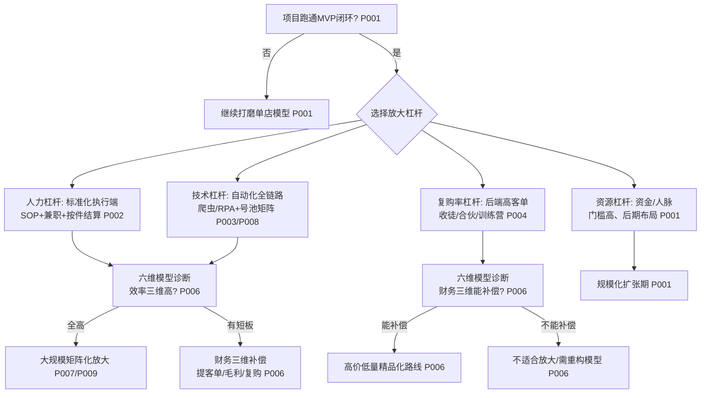
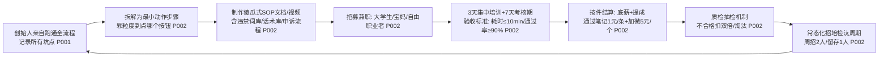
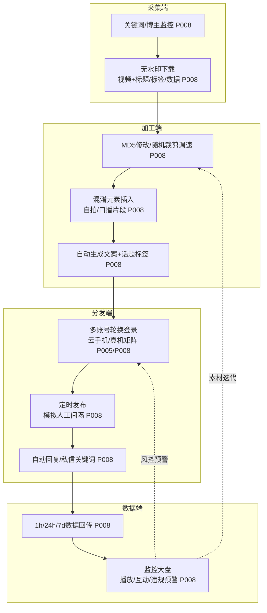
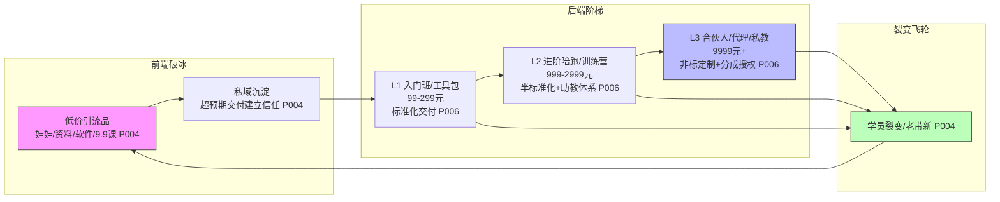
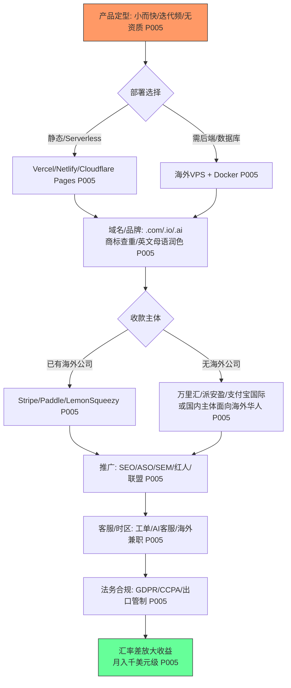
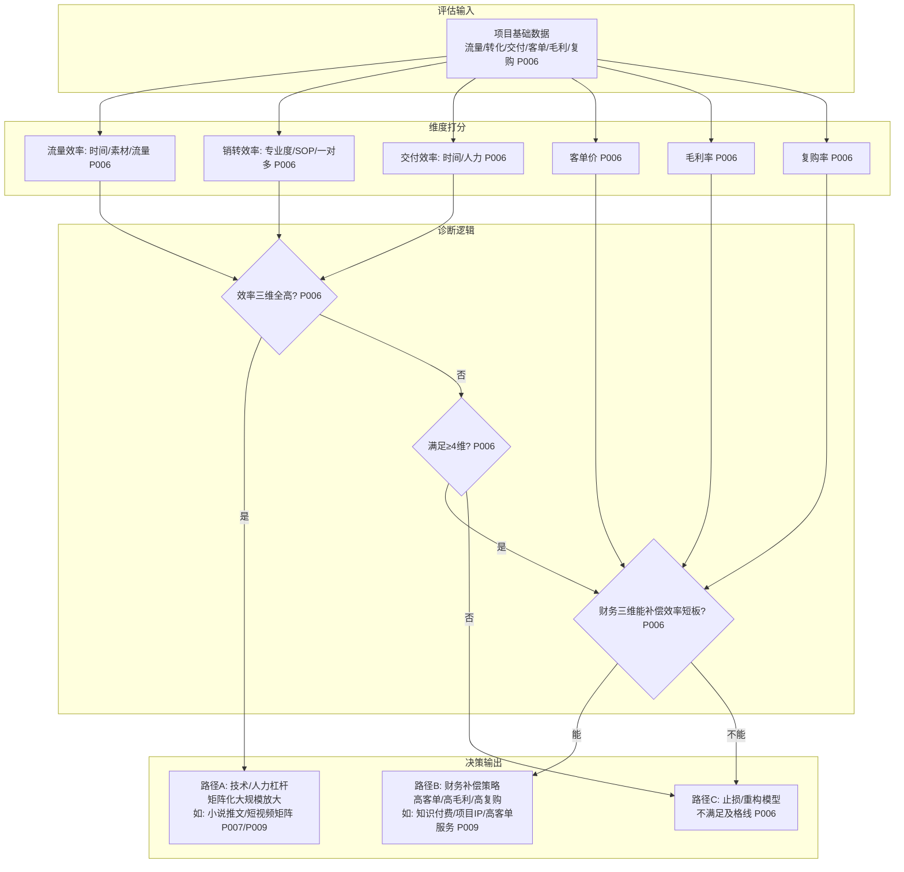

# 第 6 章 放大与变现 —— 用三大杠杆撬动百万级收入
作者：龙哥

## 学习目标

- 理解放大杠杆的核心逻辑：验证后复制，先跑通单店模型再引入杠杆
- 掌握三大放大杠杆的定义、适用场景与操作要点：人力杠杆（SOP+兼职）、技术杠杆（爬虫/RPA+矩阵）、资源杠杆（资金/人脉，高门槛）
- 能运用六维评估模型（流量/销转/交付效率、客单价/毛利率/复购率）诊断项目瓶颈，判断是否可放大及放大路径
- 理解复购率杠杆的本质：前端低价引流，后端高客单/高复购产品（收徒/合伙/训练营）实现LTV最大化
- 掌握人力杠杆的SOP制作、兼职招募、按件结算、质检闭环的标准化操作流程
- 掌握技术杠杆的采集-加工-分发-数据四模块架构，及账号池/云手机/风控对抗的工程化配套
- 了解软件全球化（出海）对非规范化生产者的核心优势（免备案、免证件、免软著、免审核）及收款/语言/推广的现实边界
- 能识别放大过程中的核心风险：未验证盈利即放大、SOP失效、账号存活率低、法律合规红线、后端交付崩盘反噬

## 6.1 生活类比

想象项目放大像开连锁餐厅：六维评估模型就是选址、菜品、后厨、定价、毛利、回头率的标准化体检表，效率三维看这店能不能复制开分店，财务三维看开多少分店能赚多少钱，如果后厨慢（交付低）就得卖贵点（高客单）或搞会员卡（高复购）。人力杠杆就是雇兼职店员按SOP翻炒打包：老板把炒菜标准动作录成视频SOP，招钟点工“5分钟一份炒饭”，只付“合格出餐”的钱，自己只管选址、研发新菜、谈供应链。技术杠杆就是中央厨房+自动化配送机器人：写爬虫/RPA脚本像造“自动切菜机、包装机、送餐机器人”，一台机器顶十个人，但要修机器（维护迭代）、买厂房（服务器/云手机）、防卫生检查（风控封号），单机容易坏得靠“机器矩阵（号池）”保产量。复购率杠杆就是从“卖盒饭”转“卖加盟/教做饭”：前端盒饭赚辛苦钱（低客单/低复购），后端收加盟费/教学费/卖核心酱料包（高客单/高毛利/高复购/自带裂变），一份酱料包卖N家店，收入指数级跃迁。全球化出海就是把餐车开到夜市/海外集市：国内商场（应用商店）进场要备案/证件/审核/软著，夜市/海外（Google Play/Web）交摊位费（充值广告费）就能卖，规则透明、顾客付费习惯好、汇率还能赚差价，但得学会用当地方言（本地化）吆喝、用当地支付码（Stripe/PayPal）收钱、雇懂当地口味的服务员（时区客服）。

> **生活类比来源说明**：以上类比为作者基于第六章核心框架（六维评估模型、三大杠杆、出海策略）综合构建，旨在降低理解门槛，对应素材见本章各小节引用的《I9OAdzzs2oBliNxsmPjcHnBUnzf.md》《NxhWdJj3UoPKvmxaBqkcz8wlntf.md》《DNGrdODFBowfk2xwkNCc5GGSnRd.md》等文献。

## 6.2 概念地图

第六章：放大与变现 —— 用三大杠杆撬动百万级收入
├── 核心框架：六维评估模型 (P006/P004)
│   ├── 效率三维（决定可复制性）
│   │   ├── 流量效率：时间/素材/流量 —— P006
│   │   ├── 销转效率：专业度/SOP/一对多 —— P006
│   │   └── 交付效率：时间/人力 —— P006
│   └── 财务三维（决定收入天花板/补偿效率）
│       ├── 客单价 —— P006
│       ├── 毛利率 —— P006
│       └── 复购率 —— P006
├── 三大放大杠杆
│   ├── 人力杠杆 (P002)
│   │   ├── 核心：非核心流程SOP化 → 低成本兼职 → 按件结算
│   │   ├── 关键动作：跑通全流程 → 文档/视频SOP → 招募培训 → 质检反馈
│   │   └── 边界：仅外包执行端，核心决策/高客单成交留给自己
│   ├── 技术杠杆 (P003/P008)
│   │   ├── 核心：脚本/RPA自动化“采集-加工-分发-数据”全链路
│   │   ├── 四模块：采集端/加工端/分发端/数据端
│   │   ├── 生存法则：低单账成功率 → 靠号池规模换确定性收益
│   │   └── 边界：猫鼠博弈/硬件成本/法律风险/账号寿命短
│   ├── 资源杠杆 (P001)
│   │   ├── 定义：资金与人脉
│   │   └── 定位：门槛高、不可控，普通副业起步不建议优先布局
│   └── 复购率杠杆 (P004)
│       ├── 核心路径：前端低价引流品 → 私域信任沉淀 → 后端高客单(收徒/合伙/训练营) → 裂变飞轮
│       ├── 收入结构反转：前端破冰/亏本引流，后端卖模式/技能/资源为真利润
│       └── 边界：需可标准化交付资产、合规红线(传销/虚假宣传)、交付瓶颈/信用风险
├── 放大决策与验证原则
│   ├── 先验证后放大：必须跑通单店/单号盈利模型（MVP闭环） —— P001
│   ├── SOP是杠杆前提：无标准化流程无法复制 —— P001/P002/P003
│   └── 边际成本递减：杠杆生效后单位产出成本大幅下降 —— P001
└── 全球化出海 —— 非规范化生产者的避风港 (P005)
    ├── 核心优势：网站免备案、投放免证件、免软著、免商店审核、汇率差
    ├── 适配性：匹配小而快、迭代频、无资质、擦边的非规范化生产
    ├── 流量模式迁移：私域/内容流 → SEO/ASO/付费广告/联盟营销
    └── 现实边界：语言本地化、收款主体(Stripe需海外公司)、推广认知差异(SEO/SEM/红人)、时区客服

## 6.3 放大与变现的三大杠杆 —— 用系统化复制撬动百万收入

### 为什么需要这个概念？

单人单号的副业模式极易触达时间与精力的天花板，月入上万后往往陷入“越忙越穷”的死循环。同一项目有人月入1千，有人月入100万，核心差距不在项目本身，而在于是否掌握了“工程化复制”的放大能力。只有将验证过的商业模式标准化、流程化，才能突破个人产能上限，实现指数级增长。

### 核心定义

> **放大杠杆**（来源：《I9OAdzzs2oBliNxsmPjcHnBUnzf.md》 P001）
> 在项目跑通最小MVP闭环后，通过外部资源将单点盈利能力复制N份的系统化方法。

> **三大核心杠杆**（来源：《I9OAdzzs2oBliNxsmPjcHnBUnzf.md》 P001）
> - 人力杠杆：低成本兼职 + SOP
> - 技术杠杆：软件/脚本自动化批量操作
> - 资源杠杆：资金与人脉（门槛较高）

### 关键性质

**先验证后放大**（来源：《I9OAdzzs2oBliNxsmPjcHnBUnzf.md》 P001）
必须先跑通“单店模型/单号模型”（盈利验证），再投入杠杆资源，否则是放大亏损。

**SOP是杠杆的前提**（来源：《I9OAdzzs2oBliNxsmPjcHnBUnzf.md》 P001、《DNGrdODFBowfk2xwkNCc5GGSnRd.md》 P005）
人力杠杆依赖详细SOP，技术杠杆依赖标准化流程，无SOP无法复制。

**边际成本递减**（来源：《I9OAdzzs2oBliNxsmPjcHnBUnzf.md》 P001）
杠杆生效后，单位产出的边际成本大幅下降，利润率上升。

### 典型例子

> "人力杠杆顾名思义是低成本的兼职。比如说要做小红书。我们招了很多兼职小伙伴，通过我们自己的内容生产模式，做成一个 SOP ，帮我们去做引流，5 到 10 分钟一篇笔记，引流加一个微信我给你多少钱。" ——《I9OAdzzs2oBliNxsmPjcHnBUnzf.md》 P001

> "技术杠杆就是顾名思义通过软件释放你的双手。比如说你可以批量的把某一个领域的小红书笔记批量地扒一下，因为你要抄同行。...用这种工业化的流水线这种方式去完成。" ——《I9OAdzzs2oBliNxsmPjcHnBUnzf.md》 P001

> "有一个哥们，他是一个抓娃娃的高手...他就挂闲鱼上去卖...一年能赚 40 多万。同时他把这些买娃娃的人引流加微信加到私域里面来，又发展了另外一个变现模式——收徒弟。我教你怎么去商场抓娃娃，收599一个学费。...加起来，一年能给他赚个 100 来万。" ——《I9OAdzzs2oBliNxsmPjcHnBUnzf.md》 P001

> "知识付费，以李一舟为代表：月收益10W~500W...流量效率高...销转效率高...交付效率高...毛利率高：100%。" ——《NxhWdJj3UoPKvmxaBqkcz8wlntf.md》 P006

> "小说推文项目：月收益1000~2W...流量效率高...销转效率高...交付效率高...复购率低：没有复购。" ——《NxhWdJj3UoPKvmxaBqkcz8wlntf.md》 P006

> "目前国内的互联网环境没那么好，软件全球化是大势所趋，甚至可能是唯一的出路！" ——《DNGrdODFBowfk2xwkNCc5GGSnRd.md》 P005

> "1、网站不需要备案 2、Google投放广告不需要证件，充钱就行 3、软件不需要'软件著作权证书' 4、不需要应用商店审核" ——《DNGrdODFBowfk2xwkNCc5GGSnRd.md》 P005

### 边界条件

- 资源杠杆（资金/人脉）门槛高、不可控，不适合大多数普通副业起步者，建议优先布局人力与技术杠杆。
- 单店/单号模型未跑通盈利前，严禁引入杠杆，否则会加速资金烧完。
- 技术杠杆（爬虫/RPA）面临平台风控风险，账号存活率低，需建立“号池”机制对抗封号。
- 人力杠杆管理成本随规模上升，兼职人员流动性大，需持续招聘培训，SOP需极度傻瓜化。

---

### 方法演进图：三大杠杆放大决策树（素材演进路径：P001→P002/P003/P004→P006/P007/P009）



---

## 6.4 人力杠杆 —— 用SOP把兼职变成你的“分身”

### 为什么需要这个概念？

创始人精力是最稀缺资源，高价值动作（选品、策略、谈判）被低价值重复劳动（发笔记、回消息、剪视频）挤占。直接雇佣全职员工成本高、风险大、管理难，不适合副业/早期创业阶段。需要一种低成本、可随时启停、按结果付费的劳动力获取方式。

### 核心定义

> **人力杠杆**（来源：《I9OAdzzs2oBliNxsmPjcHnBUnzf.md》 P002）
> 将核心业务流程（如内容生产、初筛客资）拆解为标准化作业指导书（SOP），外包给低成本兼职人员执行，创始人仅负责质检与策略。

> **核心公式**
> 业务流程拆解 → SOP文档/视频化 → 兼职招募/培训 → 按件/按结果结算 → 质检反馈循环

### 关键性质

**非核心外包**
仅外包标准化程度高、可量化考核的“手脚”工作，核心决策“脑”留给自己。

**低门槛招募**
利用大学生、宝妈、自由职业者群体，单价低（如5-10分钟一条笔记）、流动性大。

**结果导向结算**
不付工时，付“合格产出”（如：通过审核的笔记数、加微信的有效客资数）。

### 典型例子

> "人力杠杆顾名思义是低成本的兼职。比如说要做小红书。我们招了很多兼职小伙伴，通过我们自己的内容生产模式，做成一个 SOP ，帮我们去做引流，5 到 10 分钟一篇笔记，引流加一个微信我给你多少钱。" ——《I9OAdzzs2oBliNxsmPjcHnBUnzf.md》 P002

> "定完策略之后要搭团队。你要把这个事情分为几个点，比如产品端、流量端，转化端是否是一个人就够了，还是需要两三个人？" ——《I9OAdzzs2oBliNxsmPjcHnBUnzf.md》 P002

> "执行案是什么呢？某一年某一月的核心工作事项。第一个模块是什么？这个模块里的二级事项有哪些？具体内容是什么？负责人是什么？协助人是谁？完成日期是什么？" ——《I9OAdzzs2oBliNxsmPjcHnBUnzf.md》 P002

### 边界条件

- SOP制作成本高：前期需创始人亲自跑通全流程、记录每个坑点，耗时1-2周，若业务未稳定则SOP频繁失效。
- 质检成本隐性高：兼职产出参差不齐，创始人需投入大量精力审核，若质检机制不完善会导致账号权重受损。
- 兼职忠诚度低：人员流失率极高，需建立“招聘-培训-淘汰”常态化机制，且核心账号密码不能交给兼职。
- 适用边界：仅适用于“流量端/执行端”，不适用于“转化端/决策端”（如高客单价成交、产品核心设计）。

---

### 方法演进图：人力杠杆SOP落地闭环（素材演进路径：P001→P002→P006→P007）



---

## 6.5 技术杠杆 —— 让爬虫与RPA替你打工

### 为什么需要这个概念？

内容生产、数据采集、账号矩阵操作等高频重复动作，人工成本极高且不可持续。平台算法偏好高频更新、大基数分发，人力无法满足“量”的要求。低代码/无代码工具（RPA、影刀、按键精灵）普及，普通人也能低成本搭建自动化流水线。

### 核心定义

> **技术杠杆**（来源：《I9OAdzzs2oBliNxsmPjcHnBUnzf.md》 P003、《JmBgdr705ovHoyxQknRctRaMnKh.md》 P008）
> 编写或配置脚本/软件（爬虫、RPA、自动化发布工具），自动完成“采集-加工-分发-数据回流”全链路，实现单人操作百号规模。

> **核心四模块架构**（来源：《JmBgdr705ovHoyxQknRctRaMnKh.md》 P008）
> - 采集端：关键词/博主监控 + 无水印下载
> - 加工端：去重/混剪/伪原创/加字
> - 分发端：多账号定时发布/私信/评论
> - 数据端：播放/转化/违规监控

### 关键性质

**规模化生存法则**（来源：《JmBgdr705ovHoyxQknRctRaMnKh.md》 P008）
单账号成功率低（如10%），需靠“号池”规模（百号）换取确定性收益，技术杠杆解决“管得过来”的问题。

**猫鼠博弈本质**（来源：《DNGrdODFBowfk2xwkNCc5GGSnRd.md》 P005、《JmBgdr705ovHoyxQknRctRaMnKh.md》 P008）
平台持续升级反爬/反自动化，技术杠杆需持续维护迭代，非一次性投入。

**合规边界模糊**（来源：《DNGrdODFBowfk2xwkNCc5GGSnRd.md》 P005）
批量注册、模拟器、协议控制易触发封设备/封IP，需配合“云手机/真机矩阵+纯净环境”使用。

### 典型例子

> "技术杠杆就是顾名思义通过软件释放你的双手。比如说你可以批量的把某一个领域的小红书笔记批量地扒一下，因为你要抄同行。...用这种工业化的流水线这种方式去完成。" ——《I9OAdzzs2oBliNxsmPjcHnBUnzf.md》 P003

> "个人开发者研发一个软件的时间不应超过1周，超过1周的软件产品不适合个人开发者！" ——《DNGrdODFBowfk2xwkNCc5GGSnRd.md》 P005

> "当时中医养生号短视频带货还比较火，有一个朋友正巧在做，做了三个号几个月变现了10w左右" ——《JmBgdr705ovHoyxQknRctRaMnKh.md》 P008

### 边界条件

- 技术门槛：虽有无代码工具，但复杂逻辑（验证码、加密签名、风控对抗）仍需懂代码或雇佣开发者。
- 硬件成本：云手机/真机矩阵/服务器/IP池，百号规模月硬件成本可达数千元。
- 账号寿命短：自动化账号平均存活周期短（天/周级），需建立“养号-热号-废号”全生命周期管理体系。
- 法律风险：爬虫大规模采集可能触犯《刑法》第二百八十五条/《数据安全法》，商业化用途风险极高。

---

### 方法演进图：技术杠杆四模块自动化流水线（素材演进路径：P001→P003→P008→P007/P009）



---

## 6.6 复购率杠杆 —— 从“卖货”到“收徒”的指数级跃迁

### 为什么需要这个概念？

绝大多数副业项目（小说推文、带货、资料）复购率极低，收入严重依赖持续买流量，获客成本上涨即亏损。单次交易利润有限（客单价低），只有将“买家”转化为“合伙人/学员”，解锁长期现金流（复购/分成/裂变），才能改变收入量级。这是六维模型中“财务维度补偿效率维度不足”的最高阶打法。

### 核心定义

> **复购率杠杆**（来源：《I9OAdzzs2oBliNxsmPjcHnBUnzf.md》 P004、《NxhWdJj3UoPKvmxaBqkcz8wlntf.md》 P006）
> 设计“后端高客单/高复购产品”（如收徒、代理、训练营、合伙人），将前端低客单价流量的终身价值（LTV）最大化。

> **核心路径**
> 前端低价/免费引流品（娃娃/资料/软件） → 私域信任沉淀 → 高客单后端（教学/授权/服务） → 学员再裂变

### 关键性质

**收入结构反转**
前端“卖货”仅为破冰获客（甚至亏本引流），真正利润来自后端“卖模式/卖技能/卖资源”。

**信任前置**
高客单成交依赖前端交付的“超预期体验”与人设IP建立，无信任不成交。

**自带裂变基因**
学员/合伙人自带传播属性，形成“老带新”有机增长飞轮。

### 典型例子

> "以“抓娃娃卖娃娃+收599学费”的案例，演示如何把一次性买家转为长期学员，让复购率从0变为高，实现收入叠加。" ——《I9OAdzzs2oBliNxsmPjcHnBUnzf.md》 P004

> "有一个哥们...他就挂闲鱼上去卖...一年能赚 40 多万。同时他把这些买娃娃的人引流加微信...收徒弟。我教你怎么去商场抓娃娃，收599一个学费。...加起来，一年能给他赚个 100 来万。" ——《I9OAdzzs2oBliNxsmPjcHnBUnzf.md》 P004

> "项目拆解商业IP...交付效率低...客单价高：从几千到六位数。毛利率高：70%以上...复购率低~高。" ——《NxhWdJj3UoPKvmxaBqkcz8wlntf.md》 P006

> "知识付费...毛利率高：100%。复购率低：没有复购（课会更新）。" ——《NxhWdJj3UoPKvmxaBqkcz8wlntf.md》 P006

> "减肥食谱项目...复购率高：减肥是个重复的过程。" ——《NxhWdJj3UoPKvmxaBqkcz8wlntf.md》 P006

### 边界条件

- 必须具备“可标准化交付”的核心资产：教程、软件、供应链、方法论、社群运营体系，空手套白狼必翻车。
- 法律合规红线：收徒/招商/加盟涉及《传销条例》《消保法》，严禁“无实物/服务仅收人头费”、虚假宣传收益。
- 交付能力瓶颈：后端交付效率极低（六维模型中交付效率低），规模化极易崩盘，必须同步建立“助教/合伙人分级交付体系”。
- 信用风险：一旦后端交付塌房（教不会、服务差），前端流量池会瞬间反噬，品牌归零。

---

### 方法演进图：复购率杠杆后端产品阶梯与转化飞轮（素材演进路径：P001→P004→P006→P009）



---

## 6.7 全球化出海 —— 非规范化生产者的“避风港”

### 为什么需要这个概念？

国内互联网环境：备案繁琐、广告投放需资质、软著证书门槛高、应用商店审核严、内容合规红线密集，极不友好“非规范化/野路子”生产。个人开发者/小团队缺乏法务、合规、资质申办能力，国内赛道生存空间被大厂挤压。海外市场（Google Play、Web、海外广告网络）对个人开发者极度友好，规则透明、门槛低、付费习惯成熟。

### 核心定义

> **软件全球化**（来源：《DNGrdODFBowfk2xwkNCc5GGSnRd.md》 P005）
> 将产品部署在海外服务器，面向海外用户推广变现，绕过国内备案、资质、审核、软著等“四大拦路虎”。

> **核心优势**
> 网站免备案、Google投放免证件充钱即投、免软著上架、免商店人工审核（或审核宽松）、汇率差放大收益。

### 关键性质

**适配“非规范化生产”**
小而快、迭代频繁、无资质、甚至擦边产品，在海外可合规生存。

**流量获取模式变迁**
从“私域/内容流”转向“SEO/ASO/付费广告/联盟营销”，更标准化、可量化、可放大。

**收款结汇挑战**
需解决Stripe/PayPal/万里汇/派安盈等收单渠道，及个人/公司主体合规出海资质。

### 典型例子

> "目前国内的互联网环境没那么好，软件全球化是大势所趋，甚至可能是唯一的出路！" ——《DNGrdODFBowfk2xwkNCc5GGSnRd.md》 P005

> "1、网站不需要备案 2、Google投放广告不需要证件，充钱就行 3、软件不需要'软件著作权证书' 4、不需要应用商店审核" ——《DNGrdODFBowfk2xwkNCc5GGSnRd.md》 P005

> "无证件的产品也可以上市场，正适合非规范化生产" ——《DNGrdODFBowfk2xwkNCc5GGSnRd.md》 P005

> "个人开发者研发一个软件的时间不应超过1周，超过1周的软件产品不适合个人开发者！" ——《DNGrdODFBowfk2xwkNCc5GGSnRd.md》 P005

> "做些小而简单的软件，站在用户角度上根据需求打造产品" ——《DNGrdODFBowfk2xwkNCc5GGSnRd.md》 P005

### 边界条件

- 语言文化壁垒：产品文案、客服、营销素材需本地化（英文/小语种），纯机翻信任度极低。
- 收款主体要求：Stripe等需香港/美国公司主体，个人注册门槛高、合规成本高（年审/报税/开户）。
- 推广认知差异：国内擅长“私域/内容/裂变”，海外需精通“SEO/SEM/红人营销/联盟/邮件营销”，学习曲线陡峭。
- 时区与服务：面向欧美用户需提供本地化时间段客服支持，否则退款率/差评率极高。

---

### 方法演进图：软件全球化落地路径与边界跨越（素材演进路径：P005→P009）



---

## 6.8 六维评估模型 —— 给放大决策算一笔“复制账”

### 为什么需要这个概念？

盲目放大是创业致死主因：未验证模型就招人、买设备、砸广告，导致现金流断裂。直觉判断“不可靠”：需要一套结构化、可量化、可跨项目对比的决策框架，决定“能不能放大、怎么放大、放大上限在哪”。六维模型将复杂商业拆解为3个效率维度（决定可复制性）+ 3个财务维度（决定收入天花板），提供了决策坐标系。

### 核心定义

> **六维评估模型**（来源：《NxhWdJj3UoPKvmxaBqkcz8wlntf.md》 P006）
> 从流量效率、销转效率、交付效率、客单价、毛利率、复购率六个维度，对项目进行标准化打分与诊断。

> **效率三维（可复制性判断）**（来源：《NxhWdJj3UoPKvmxaBqkcz8wlntf.md》 P006）
> - 流量效率：时间/素材/流量
> - 销转效率：专业度/SOP/一对多
> - 交付效率：时间/人力

> **财务三维（收入天花板判断）**（来源：《NxhWdJj3UoPKvmxaBqkcz8wlntf.md》 P006）
> - 客单价
> - 毛利率
> - 复购率

> **及格线**（来源：《NxhWdJj3UoPKvmxaBqkcz8wlntf.md》 P006）
> 六维满足≥4项；效率三维全高=可大规模矩阵化放大；效率有短板=必须靠财务三维补偿。

### 关键性质

**诊断功能**
精准定位项目瓶颈在哪一环（如：流量效率低→靠SEO/广告/矩阵补；交付效率低→靠标准化/产品化/提价补）。

**对比功能**
横向对比不同赛道/项目（小说推文vs知识付费vs教育资料），纵向追踪单项目迭代（教育资料1.0→2.0）。

**决策功能**
指导资源分配——效率高处投人力/技术杠杆；效率低处投产品研发/提价策略/会员体系。

### 典型例子

> "小说推文项目：月收益1000~2W。流量效率高...销转效率高...交付效率高...客单价低...毛利率高...复购率低" ——《NxhWdJj3UoPKvmxaBqkcz8wlntf.md》 P006

> "教育资料2.0项目：月收益2W~100W...客单价低：几千到十几二十万不等，毛利率高：10%..." ——《NxhWdJj3UoPKvmxaBqkcz8wlntf.md》 P006

> "项目拆解商业IP...流量效率低...交付效率低...客单价高：从几千到六位数。毛利率高：70%以上" ——《NxhWdJj3UoPKvmxaBqkcz8wlntf.md》 P006

> "知识付费...月收益10W~500W...流量效率高...销转效率高...交付效率高...毛利率高：100%" ——《NxhWdJj3UoPKvmxaBqkcz8wlntf.md》 P006

### 公式/推导：六维评估决策公式

**① 公式定义来源标注**
> 本公式由作者基于《NxhWdJj3UoPKvmxaBqkcz8wlntf.md》P006中的六维框架与“三效率决定可复制性定理”、“六维满足度及格线定理”综合推导而成，并非单一文献直接给出。

**② 核心判断公式**

```
项目放大可行性 = f(效率三维, 财务三维)

其中：
效率三维得分 = (流量效率 + 销转效率 + 交付效率) / 3
财务三维得分 = (客单价 + 毛利率 + 复购率) / 3

及格线判定：
IF (满足维度数 >= 4) THEN "及格"
   IF (效率三维全高) THEN "路径: 技术/人力杠杆矩阵化放大"
   ELSE "路径: 财务三维补偿(提客单/毛利/复购)"
ELSE "不及格: 需重构模型或止损"
```

**③ 逐行/逐步公式解释**

| 公式行/分支 | 逐步解释 | 业务含义 |
|-------------|----------|----------|
| `效率三维得分 = (流量效率 + 销转效率 + 交付效率) / 3` | 取三个效率维度的算术平均值 | 衡量项目“能不能复制”的整体水平：三者缺一不可，短板效应显著 |
| `财务三维得分 = (客单价 + 毛利率 + 复购率) / 3` | 取三个财务维度的算术平均值 | 衡量项目“赚多少钱”的整体水平：可互相补偿（如高客单可抵消低复购） |
| `IF (满足维度数 >= 4) THEN "及格"` | 统计六个维度中得分≥4分的项数，≥4项判定为及格 | 经验法则：实证观察显示满足≥4维的项目均能实现稳定正现金流 |
| `IF (效率三维全高) THEN "路径: 技术/人力杠杆矩阵化放大"` | 三个效率维度均高（≥4分） | 单位产出边际成本趋近于零，适合用人力/技术杠杆做大规模矩阵复制（如小说推文） |
| `ELSE "路径: 财务三维补偿(提客单/毛利/复购)"` | 效率三维有任一短板（<4分） | 单位产出成本随规模上升，必须靠提高客单价/毛利率/复购率摊薄固定成本（如项目拆解IP、知识付费） |
| `ELSE "不及格: 需重构模型或止损"` | 满足维度数 < 4 | 多为“伪需求”或“陷阱项目”，需止损重构 |

**④ 推导逻辑：为什么可以这样变？**

1. **效率三维决定“能不能复制”**（来源：P006“三效率决定可复制性定理”）：
   - 流量效率高 = 内容可矩阵化（素材易得、框架固定、自带流量）
   - 销转效率高 = 成交可SOP化（网销低专业度、可一对多、时间利用率高）
   - 交付效率高 = 履约可产品化（支付即完成、无人力消耗）
   - 三者全高 → 边际成本随规模趋近于零 → 适合技术/人力杠杆大规模复制

2. **财务三维决定“赚多少钱”**（来源：P006“六维满足度及格线定理”）：
   - 若效率有短板（如交付效率低），单位产出成本随规模上升
   - 必须靠提高客单价、毛利率、复购率来摊薄固定成本
   - 实现单客高利润补偿低效率（如项目拆解IP：客单价万-十万、毛利70%+）

3. **≥4项及格线的由来**（来源：P006“六个点，满足的越多越好，满足四个点，及格”）：
   - 实证观察显示，满足≥4维的项目均能实现稳定正现金流
   - <4维则多为“伪需求”或“陷阱项目”，需止损

**⑤ 公式作用总结**
该公式将模糊的“项目好不好”转化为可量化的诊断坐标，帮助创始人在放大前用数据说话，避免凭感觉盲目投入。它同时揭示了两条截然不同的放大路径：效率驱动型（矩阵化）与财务补偿型（高价精品），并给出了明确的止损红线。

### 边界条件

- 静态快照局限：六维是时点评估，平台算法变、竞品入场、政策变会导致各维度剧烈波动，需定期（月/季）复盘。
- 指标关联性：提客单价往往降转化率、降复购率；提毛利率可能降交付质量；指标间存在权衡，非线性独立。
- 定性难量化：专业度、素材难度、信任度等核心变量难精确量化，打分带主观性，需结合实测数据（ROI、CAC、LTV）校准。
- 不适用早期探索：MVP验证阶段（0-1）数据太少、噪音太大，六维参考意义弱，适用于1-N放大决策期。

---

### 方法演进图：六维模型诊断与放大路径决策（素材演进路径：P004→P006→P009）



---

## 6.9 多源对照

不同素材对“放大杠杆的核心与边界”给出了互补视角。

### 共识

- **先验证后放大**：所有素材一致认为，必须先跑通单店/单号盈利模型（MVP闭环），未盈利引入杠杆等于放大亏损。
- **SOP是前提**：无论人力还是技术杠杆，核心前提均为极度详细、傻瓜化、可迭代的标准化作业指导书，无SOP无复制。
- **边际成本递减**：杠杆生效的核心标志是单位产出边际成本大幅下降，利润率随规模上升。

### 分歧与角色差异

| 素材ID | 角色 | 核心主张 | 侧重杠杆 | 关键差异点 |
|--------|------|----------|----------|------------|
| `I9OAdzzs2oBliNxsmPjcHnBUnzf.md` | **origin** | 普通人副业起步首选**人力杠杆**（兼职SOP化），技术杠杆次之，资源杠杆门槛高不建议优先 | 人力杠杆为主 | 强调低成本、可控、快速启动的兼职SOP模式 |
| `DNGrdODFBowfk2xwkNCc5GGSnRd.md` | **apply** | 个人开发者核心出路是**技术杠杆+软件全球化**，“研发周期不超1周”、“非规范化生产”配合海外分发 | 技术杠杆为主 | 认为技术杠杆比人力杠杆更具确定性与边际成本优势，主张出海规避国内合规 |
| `NxhWdJj3UoPKvmxaBqkcz8wlntf.md` | **improve** | 提出**六维模型**重新定义放大决策：不预设杠杆优先级，按项目画像“开药方” | 视项目六维画像而定 | 效率三维全高→技术/人力杠杆矩阵化；效率有短板→财务三维补偿；甚至完全不需要人力/技术杠杆 |
| `JmBgdr705ovHoyxQknRctRaMnKh.md` | **apply** | 提供**技术杠杆工程化实现细节**：视频元素化拆解、混淆元素机制、底层工具模块抽取、多平台自动发布 | 技术杠杆深化 | 将“技术杠杆”从概念落地为可复用的“采集-加工-分发-数据”四模块标准化架构 |
| `NxhWdJj3UoPKvmxaBqkcz8wlntf.md` | **origin** (六维模型) | 六维框架本身为原创方法论，为放大决策提供结构化坐标系 | 无预设 | 为上述所有杠杆选择提供了通用的诊断依据 |

---

## 6.10 设计中的取舍

### 为什么不用“全职员工”而是“兼职SOP”？

> **边际成本与SOP迭代成本的权衡**
> 全职员工意味着固定薪资、社保、管理成本、劳动法风险，且早期业务未稳定时SOP频繁变更，全职员工适应成本高。兼职按件结算，用工灵活，风险可控，且倒逼SOP必须足够傻瓜化——如果SOP写不好，兼职做不出来，全职员工也做不好，只是掩盖了问题。兼职模式将“人力成本”转化为“变动成本”，完美契合边际成本递减的杠杆逻辑。

### 为什么技术杠杆要靠“号池”而不是“单号精养”？

> **概率论与风控对抗的工程化取舍**
> 平台对自动化/营销号零容忍，单账号存活周期短（天/周级），精养单号ROI极低。技术杠杆的本质是“用规模换确定性”：单账号成功率10%，百号矩阵预期产出10个存活号，符合大数定律。这要求建立“养号-热号-废号”全生命周期管理体系，而非追求单号完美。硬件成本（云手机/IP池）是确定性收益的必要资本支出。

### 复购率杠杆的trade-off是什么？

> **LTV指数级跃迁 vs 交付崩盘/合规红线/信用反噬的三重风险**
> **收益**：前端低价破冰，后端高客单/高复购实现LTV指数级跃迁，收入结构从“卖货”反转为“卖模式”，具备裂变基因。
> **代价**：交付效率极低（六维模型最弱项），规模化极易崩盘；法律红线密集（传销/虚假宣传），一旦踩线全盘皆错；信用风险高，后端塌房前端流量池瞬间反噬。必须同步建立分级交付体系与合规防火墙。

### 为什么要出海而不是死磕国内合规？

> **固定合规成本 vs 变量学习成本的博弈**
> 国内合规成本（备案、软著、资质、审核）对个人/小团队是固定高门槛，且规则高频收紧；海外（Web/Google Play）对个人开发者零门槛、规则透明、付费习惯成熟、汇率差放大收益。代价是语言本地化、收款主体（需海外公司）、推广认知重构（SEO/SEM/联盟）、时区客服四座大山。对于“非规范化生产者”，出海是生存概率更高的选择——用变量学习成本替代固定合规成本。

### 为什么起步期不优先用资源杠杆（资金/人脉）？

> **固定高成本 vs 不可控回报、稀释控制权 vs 加速验证的权衡**
> **收益**：资金可买流量/买设备/雇团队快速放大；人脉可对接供应链/渠道/大客户，跨越冷启动期。
> **代价**：资金引入即稀释控制权、引入回报压力（投资人要退出）、放大烧钱速度；人脉依赖强关系、不可复制、随人走茶凉。起步期模型未验证时，资源杠杆放大的是“未经验证的假设”，极易导致资源耗尽仍未跑通闭环。细纲明确指出“资源杠杆门槛高、不可控，普通副业起步不建议优先布局”，建议在MVP跑通、六维模型及格、需规模化扩张时再引入。

---

## 6.11 动手练习

### 练习 1：六维模型实战诊断：决定你的副业能否放大

请选择你正在做或打算做的一个副业项目，按六维模型逐项打分（1-5分）并简述理由：
1. 流量效率：获取流量耗时？素材制作难度？单位时间流量规模？
2. 销转效率：成交是否需高专业度？能否SOP化一对多？销售时间利用率？
3. 交付效率：付款后交付耗时/人力？是否支付即完成？
4. 客单价：单次交易金额？是否有高客单后端产品？
5. 毛利率：扣除直接成本后利润占比？
6. 复购率：用户是否会重复购买或购买后端高价产品？

回答问题：
- 该项目六维满足几项（≥4分视为满足）？是否及格？
- 效率三维中是否有短板？若有，财务三维能否补偿？具体怎么补（提价/提毛利/做复购）？
- 基于诊断，该项目适合用哪种杠杆放大（人力/技术/复购/资源）？为什么？

### 练习 2：设计你的第一份人力杠杆SOP

假设你要把‘小红书引流加微信’这个动作外包给兼职，请完成：
1. 将‘选题-找素材-配图-写文案-发布-评论区引导-私信回复-加微信’全流程拆解为最小动作步骤（颗粒度到‘点哪个按钮、输什么话术’）
2. 产出一份‘傻瓜式’操作手册（文档或视频），包含：账号设置、违禁词库、选题库来源、文案模板3套、回复话术库、加微信引导图制作教程、违规申诉流程
3. 设定验收标准：单条笔记耗时≤10分钟、通过率≥90%、单日产出≥20条、有效加微信≥3个/天
4. 设计薪酬结算规则：底薪+提成（如：通过审核笔记1元/条，有效加微信5元/个，周结），并规定质检抽检机制（抽检不合格扣双倍）

回答问题：
- 这份SOP制作耗时预估多少小时？你是否已亲自跑通全流程并记录了所有坑点？
- 兼职人员流失率高如何应对？设计‘招聘-培训-淘汰’标准化周期（如：周招2人、3天培训、7天考核、留存1人’）
- 核心账号密码如何隔离？是否需配置子账号/团队协作功能/云手机？

### 练习 3：技术杠杆最小可行性验证（MVP）：跑通一个自动化闭环

目标：用影刀RPA/按键精灵/Python+ADB实现‘关键词采集爆款笔记→去重/混剪/加字→定时发布→数据回传’的单账号最小闭环

步骤：
1. 采集端：设置关键词/博主监控，自动下载无水印视频+标题/标签/数据(播放/点赞/GMV)到本地表格
2. 加工端：实现视频MD5修改、随机裁剪/调速/滤镜、随机插入3-5秒自拍/口播混淆片段、自动生成带话题标签的文案
3. 分发端：多账号轮换登录、定时发布(模拟人工时间间隔)、自动回复置顶评论/私信关键词回复
4. 数据端：定时抓取发布后1h/24h/7d播放/互动/违规状态，写入监控大盘

回答问题：
- 单账号全流程自动化耗时？成功率？遇到的风控拦截（验证码/频控/设备指纹）如何破解？
- 扩展到10号/50号/100号矩阵，需要增加哪些基建（云手机/真机柜/IP池/账号养号流程/分发调度系统）？月硬件成本预估？
- 内容去重率如何量化？平台原创判定通过率如何？若通过率<50%如何迭代加工端算法？
- 法律风险自查：爬虫采集频次/并发是否触犯‘破坏计算机信息系统罪’？数据用途是否合规？是否需备案？

### 练习 4：复购率杠杆设计：从‘卖货’到‘收徒’的后端产品架构

以‘抓娃娃/小说推文/资料/软件’任一前端低价项目为例，设计后端高复购产品体系：
1. 定义前端引流品：客单价、交付形式、核心卖点、目标人群画像
2. 设计后端阶梯产品（至少3层）：
   - L1 入门班/工具包：客单价99-299元，标准化交付（教程/软件/素材库/SOP），交付效率高
   - L2 进阶陪跑/训练营：客单价999-2999元，半标准化（群答疑+周直播+作业批改），需助教体系
   - L3 合伙人/代理/私教：客单价9999元以上，非标定制（1v1诊断/资源对接/分成授权），高毛利/高复购/自带裂变
3. 设计转化路径：前端购买→进群→前端交付超预期→L1软推→L1交付出结果→L2硬推→L2结业典礼裂变→L3邀约
4. 合规自查：是否涉及‘无实物服务仅收人头费’/‘虚假收益承诺’/‘层级返佣超3层’等传销/违法红线？

回答问题：
- 后端L1/L2/L3的交付标准化程度分别为多少？创始人精力主要投在哪一层？
- 若L2交付崩盘(助教跑路/课程烂尾)，前端流量池会受何影响？设计‘熔断/兜底/赔付’预案
- 复购率杠杆启动的前置条件：前端月流量规模？私域信任沉淀周期？核心交付资产(课程/软件/供应链)是否就绪？

### 练习 5：出海可行性评估清单：你的产品能否‘走出去’？

对照‘软件全球化四大优势(免备案/免证件/免软著/免审核)’与‘四大边界(语言/收款/推广/时区)’

请对你的产品/项目逐项打钩/打叉并填写备注：
1. 产品形态：□网站/Web App □移动App □桌面端 □浏览器插件 □其他____
2. 部署方案：□Vercel/Netlify/Cloudflare Pages(静态/Serverless) □海外VPS/Docker □其他____
3. 域名/品牌：□已注册海外域名(.com/.io/.ai) □品牌名无商标冲突(已查USPTO/EUIPO) □英文文案/落地页由母语者润色
4. 收款主体：□已有香港/美国公司实体 □已开通Stripe/Paddle/LemonSqueezy/PayPal □已配置万里汇/派安盈/支付宝国际结汇 □了解年审/报税/合规成本(预估$____/年)
5. 推广能力：□懂SEO关键词挖掘/内容营销 □懂Google Ads/Meta Ads投放(或预算找代投) □有红人/联盟/邮件营销资源 □不懂/无预算
6. 客服/时区：□产品无需售后/全自助 □可配置工单系统/自动回复/FAQ覆盖80%问题 □可雇佣海外兼职客服覆盖目标时区 □完全不懂
7. 法务/合规：□隐私政策/条款符合GDPR/CCPA □无敏感/擦边/灰色功能 □已评估出口管制/加密合规(如涉及AI/加密)

回答问题：
- 哪一项是你的‘短板之王’(最弱项)？短期内如何补齐或规避？
- 若收款主体未解决，是否可先用‘国内主体+支付宝/微信支付’面向海外华人/留学生验证需求？汇率损耗多少？
- 语言本地化成本预估？是否可用AI翻译+母语者校对的混合模式降低成本？

---

## 6.12 本章小结

这一章中我们学习了如何从一个“能赚钱的个体”跃迁为一个“能放大的体系”。首先，我们建立了**六维评估模型**这个通用坐标系，用效率三维（流量/销转/交付）判断项目可复制性，用财务三维（客单/毛利/复购）判断收入天花板与补偿路径，满足四项及格。其次，我们确立了**先验证后放大**的铁律：必须先跑通单店/单号盈利模型（MVP闭环），未盈利引入杠杆等于放大亏损。接着，我们深度拆解了**三大核心杠杆**：**人力杠杆**通过SOP标准化+低成本兼职+按件结算外包执行端，**技术杠杆**通过爬虫/RPA实现采集-加工-分发-数据全自动并靠号池规模对抗封号，**复购率杠杆**通过前端低价引流破冰、后端高客单（收徒/合伙/训练营）实现收入结构反转与LTV最大化。然后，我们介绍了**资源杠杆**（资金/人脉）虽强但门槛高、不可控，非起步首选。随后，我们探讨了**软件全球化/出海**作为非规范化生产者的避风港：免备案、免证件、免软著、免审核，但需跨越语言、收款、推广、时区四座大山。最后，我们反复强调**SOP是杠杆前提**、**边际成本递减是杠杆生效标志**、**止损点是防沉没成本的安全阀**。

本章我们一起学习了以下概念：

| 概念 | 解释 |
|------|------|
| 六维评估模型 | 拆解项目的通用坐标系：效率三维(流量/销转/交付)定可复制性，财务三维(客单/毛利/复购)定天花板与补偿路径，满足4项及格 |
| 先验证后放大 | 放大铁律：必须先跑通单店/单号盈利模型(MVP闭环)，未盈利引入杠杆等于放大亏损 |
| 人力杠杆 | SOP标准化+低成本兼职+按件结算，外包执行端(流量/内容/初筛)，核心决策/高客单成交自留，需建立招培检汰常态化机制 |
| 技术杠杆 | 爬虫/RPA实现采集-加工-分发-数据全自动，靠号池规模(百号)对抗低单账成功率与高封号率，属猫鼠博弈需持续投入维护 |
| 复购率杠杆 | 前端低价引流破冰，后端高客单(收徒/合伙/训练营)变现LTV，收入结构从‘卖货’反转为‘卖模式/技能’，需标准化交付资产与合规防线 |
| 资源杠杆 | 资金与人脉，门槛高、不可控，非普通副业起步首选，适合后期规模化扩张阶段 |
| 软件全球化/出海 | 个人开发者唯一出路：免备案、免证件投放、免软著、免审核，适配非规范化生产，但需跨越语言、收款主体、推广认知、时区服务四座大山 |
| SOP是杠杆前提 | 无论人力还是技术杠杆，核心前提均为极度详细、傻瓜化、可迭代的标准化作业指导书，无SOP无复制 |
| 边际成本递减 | 杠杆生效核心标志：单位产出边际成本大幅下降，利润率随规模上升 |
| 止损点 | 项目启动前预设时间/金钱/资源上限，触线即停，防止沉没成本绑架 |

下一章中，我们将学习如何在传授了大量“野路子”打法后，冷静审视其灰色地带与伦理边界，帮助你建立可持续、合规的长期主义视角，实现“用野路子，走正规军的路”。


