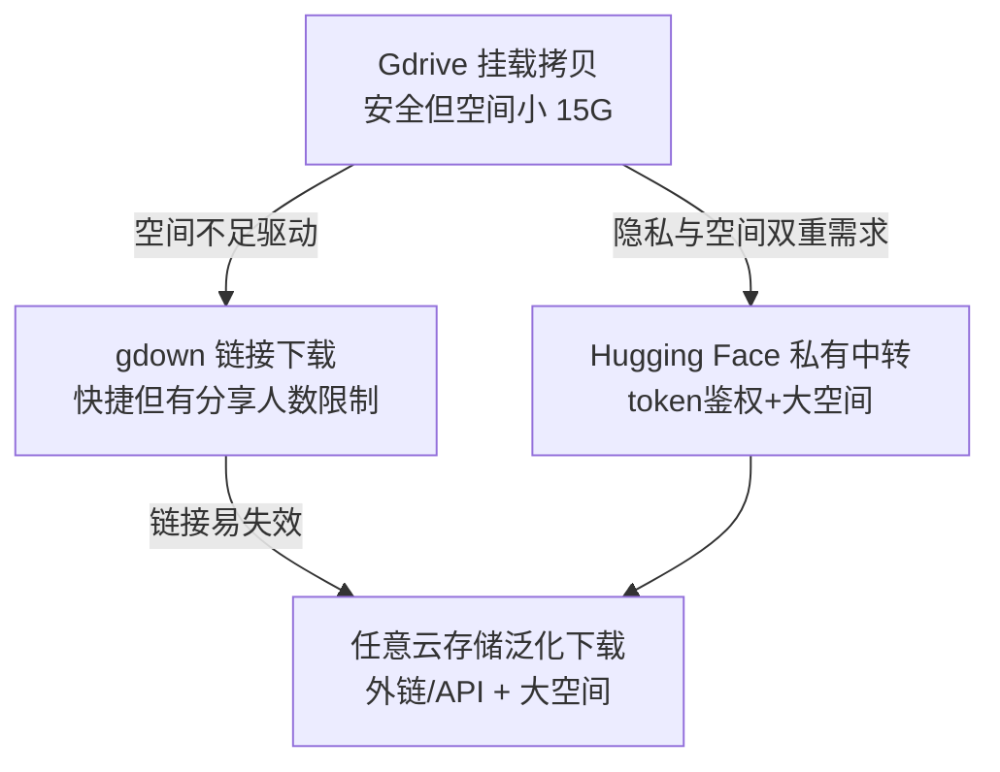

# 第 20 章 算力平权 —— 让每个人的电脑都能跑 AI 绘画

## 学习目标

- 理解 AI 绘画的算力瓶颈，掌握 Google Colab 作为免费云端 GPU 替代方案的定位与边界
- 掌握从零在 Colab 中搭建 Stable Diffusion WebUI 环境的一键脚本与手动步骤
- 掌握四种模型分发与迁移方法，并能根据模型体积、隐私需求与存储空间权衡选择
- 理解Prompt咒语中正向与负向提示词的作用，以及不同模型文件对画风的决定性影响
- 能通过COMMANDLINE_ARGS注入--share、--gradio-auth等参数定制WebUI的对外访问与安全策略
- 能识别免费算力的天花板（时间/空间限制），并制定多账号轮换与存储优化的应对策略


## 20.1 生活类比

想象在云端搭建 AI 画室的过程，就像**开办一家远程营业的照相馆**。首先，**Google Colab** 相当于你免费租到的一间云端暗房，这间暗房自带 GPU 显影液（15G 显存）、内存相纸（12G 内存）和硬盘储物柜（55G 硬盘），你不需要自己购买昂贵的高性能显卡，只需在浏览器里按下“连接”按钮，就能进入这间暗房工作。接着，**Stable Diffusion WebUI** 就是一台封装好的傻瓜相机，你无需懂光学原理或化学配比，只需按快门（填写表单）、调参数（点选按钮），就能得到满意的照片——这正是 WebUI 让 AI 绘画走向大众的关键意义。而**模型文件（.ckpt）**就像不同品牌的胶片，它们必须被装进相机指定的卡槽（WebUI 的 models 目录）才能成像，如果放错位置，相机就找不到胶片、无法出图。与此同时，**Gdrive、Hugging Face 等存储源**就是你的胶片仓库，当你需要把胶片搬到云端暗房时，要考虑仓库容量（15G 还是 55G）与搬运方式（挂载拷贝还是链接下载）。**Prompt 的正向/负向 tag** 则像是给摄影师的指令清单：要什么（masterpiece、sea beach）和不要什么（lowres、watermark），指令越清晰，出图越精准。最后，**--share 与 --gradio-auth** 就是给照相馆装上临时的对外橱窗（公网链接）和门禁锁（登录鉴权），客户必须凭密码才能进店参观。就像开照相馆既要租得起暗房、选对胶片，也要会写拍摄指令并给店面配好锁和橱窗，云端 AI 绘画的全部流程也围绕环境、模型、提示词与访问控制这四件事展开。


## 20.2 概念地图

```
AI绘画算力平权
├── 痛点与替代方案
│   ├── 本地显卡门槛（N卡/A卡需求）  —— P001
│   └── Google Colab 免费云GPU       —— P001, P002
├── 云端环境搭建
│   ├── Colab账号申请与环境初始化    —— P001
│   ├── 一键脚本：挂载Gdrive→git clone→装依赖 —— P001, P002
│   └── Stable Diffusion WebUI可视化界面 —— P001, P002
├── 模型分发与迁移（位置闭环：拷贝到指定目录）
│   ├── Gdrive挂载拷贝（15G限制、不易丢）—— P001
│   ├── gdown链接下载（小圈子、易被屏蔽）—— P001
│   ├── Hugging Face私有中转（推荐：隐私+空间）—— P001
│   └── 任意云存储泛化下载（需外链/API）   —— P001
├── 出图控制与风格决定
│   ├── Prompt咒语：正向tag+负向tag    —— P001, P002
│   └── 模型画风差异（NovelAI/Waifu动漫 vs SD写实）—— P001
└── 部署优化与算力天花板
    ├── 启动参数（--share公网/--gradio-auth鉴权/--deepdanbooru提词）—— P001
    └── 免费额度限制（每日时长/15G Gdrive/55G Colab）与多账号轮换、直连下载应对 —— P001
```


## 20.3 Google Colab —— 让每个人的电脑都拥有云端“显卡”

### 为什么你需要这个概念？

也许你听过这样的说法：想要玩转 AI 绘画，必须先有一块高性能显卡，没有 N 卡或 A 卡就跑不动。这个说法吓退了大量对 AI 绘画感兴趣但预算有限的普通人。事实真的如此吗？

我们先看一段原文：

> “colab是google提供的一个云平台，可以理解为一台远程电脑或者云服务器，用户远程连接进去后，可以用其提供的CPU、GPU资源做各种各样的事情。”
> —— P001《KomqdeUMloO1CkxrgADcqGvDnIe.md》

这段话揭示了一个关键事实：**算力可以不在自己手上**。Google Colab 本质上是一台放在云端的计算机，你通过浏览器远程连接它，就能使用它提供的 GPU 资源。这意味着，无论你手头的笔记本多么简陋，只要你能打开浏览器、登录 Google 账号，你就拥有了一间“云端显卡房”。

### 核心定义

> **Google Colab** 定义（来源：《KomqdeUMloO1CkxrgADcqGvDnIe.md》，P001）

下表展示了 Colab 免费套餐的核心配置：

| 维度 | 配置 |
|------|------|
| 系统 | Ubuntu 18.04 + GPU |
| 内存 | 约 12G |
| 显存 | 约 15G |
| 硬盘 | 约 55G |
| 使用方式 | 浏览器远程执行 Python 代码 |
| 免费时长 | 每个账号约每天数小时 |

为什么这套配置足以支撑 Stable Diffusion 绘画？让我们拆解一下。Stable Diffusion 在推理出图时，模型权重需要整体加载到显存中，主流模型权重约为 2G 到 4G，加上中间激活值，实际显存占用常达 8G 以上，而 Colab 恰好提供约 15G 显存，足以覆盖这一需求。同时，WebUI 运行还需要操作系统和 Python 环境的常驻空间，Colab 的 12G 内存与 55G 硬盘为文件落地、依赖安装预留了充足余量。因此，从显存、内存到硬盘三项指标看，Colab 的免费配置都恰好能够匹配 SD 绘画的硬性资源要求。更重要的是，这些资源无需你购买任何硬件——它们属于 Google 的数据中心。

### 关键性质：免本地硬件与远程执行

我们为你总结 Colab 的三个关键性质，它们共同构成了“算力平权”的基础：

1. **免本地硬件**：你不需要在电脑上安装显卡驱动、配置 CUDA 环境，只需浏览器和 Google 账号，即可使用 GPU 算力。
2. **免费额度**：每个账号每天有约数小时的免费使用时长，足以完成多次出图、调试与小规模训练。
3. **远程执行**：代码在云端运行，你可以随时断开连接，下次重新连接后继续使用。

这三个性质共同表明：Colab 把原本需要万元级硬件投入的 AI 绘画，压缩到了“一个免费账号”的门槛。

### 边界条件：免费是有限度的

> “Google colab提供了免费与收费服务，免费服务每个账号大概每天可以玩几个小时，免费的配置大概是12G的内存，15G左右的显存以及55G左右的硬盘。因为数据训练需要较为强大的GPU资源，一般很多个人电脑配置并不能达到要求，所以colab现在在人工智能、机器学习领域用的比较多。”
> —— P001《KomqdeUMloO1CkxrgADcqGvDnIe.md》

这段话提醒我们两个边界条件。其一，**免费额度每天有限**（数小时），长时间使用需要多账号轮换或付费升级；其二，**环境不持久**：当你点击“断开并删除运行时”，搭建好的环境会被全部清空，下次需要重新搭建。理解这两个边界，是合理规划使用的前提。


## 20.4 Stable Diffusion WebUI —— 从命令行到可视化，AI 绘画的“傻瓜相机”

### 为什么你需要这个概念？

假设你已经拥有了 Colab 这间“云端暗房”，下一步就是需要一台“相机”——也就是能真正出图的工具。原始的 Stable Diffusion 是通过命令行和代码来操作的，这就像让你直接操作一台没有按钮、只有裸露电路板的相机原型：功能强大，但绝大多数人根本无从下手。

> “基于用于stable diffusion开发的一套webui的界面，方便更多人的使用。没有这个的话，要使用stable diffusion的话只能写代码或者敲命令，大多数人使用会很困难，这也是现在AI绘画大火的一个很重要的原因。”
> —— P001《KomqdeUMloO1CkxrgADcqGvDnIe.md》

这段话给出了 WebUI 存在的根本理由：**它把写代码、敲命令的门槛降到了鼠标点击**。正因如此，AI 绘画才从程序员的小圈子走向了大众。

### 核心定义

> **Stable Diffusion WebUI** 定义（来源：《KomqdeUMloO1CkxrgADcqGvDnIe.md》，P001）

**Stable Diffusion WebUI** 是基于 Stable Diffusion 开发的可视化 Web 界面，用户通过浏览器中的图形界面即可完成参数配置与出图，无需任何命令行交互。

这个定义的核心在于“封装”二字：WebUI 把底层复杂的模型加载、采样器调度、图像后处理等逻辑全部隐藏在界面背后，你只需要关心“想画什么”，而不必关心“怎么算”。

### 关键性质

WebUI 之所以能成为“傻瓜相机”，源于它具备三个关键性质：

**可视化操作**是 WebUI 最直观的变革。在原生 Stable Diffusion 中，设置采样步数、调整画面尺寸、选择模型都需要手写 Python 代码或记忆命令行参数，而 WebUI 将这些全部转化为按钮、下拉框和输入框，用户通过鼠标点击、填写表单即可完成参数配置，无需记忆任何命令。

**可扩展性**保证了 WebUI 的长期生命力。它支持加载不同模型文件（.ckpt）并随时切换，同一界面可对接多种画风，用户无需为切换模型重新安装环境。

**公网访问**让结果可以便捷分享。通过启动参数生成公网链接，用户可以将自己生成的画面分享给他人使用或观摩。

这三个性质分别对应着“易用、灵活、可分享”，共同构成 WebUI 作为大众化工具的核心价值。

### 边界条件

当然，WebUI 并非万能：

- **依赖底层环境**：它运行在 Colab 等云端环境中，环境一旦断开，服务随即停止。
- **仍需基础概念**：虽然免去了命令行，但用户仍需理解模型目录、参数配置等基本概念，否则可能“有相机但装不上胶片”。


## 20.5 模型分发与迁移 —— 把模型文件“搬”进云端画室

### 为什么你需要这个概念？

搭建好 WebUI 环境，只是准备好了“空画室”。没有“颜料和画笔”——也就是模型文件——你依然无法出图。而模型文件体积巨大（动辄 4G、8G），传输和存储都面临限制：Gdrive 免费盘只有 15G，Colab 直连空间却有 55G，且模型来源多样（官方开源、泄露版本），需要不同的传输策略。

> “colab环境类似一台拥有GPU资源的云服务器...，通过上述操作stable diffusion webui环境搭建，已经将sdwebui的环境安装到了该台电脑上，现在需要将模型文件也拷贝到该台电脑上，sdwebui才能加载模型，从而出图。”
> —— P001《KomqdeUMloO1CkxrgADcqGvDnIe.md》

这段话揭示了模型分发的一个核心原则，我们称之为**位置闭环**：模型文件必须被拷贝到 WebUI 指定的模型目录下，才能被加载并出图。换句话说，光有文件还不够，必须放在正确的位置。

### 四种分发方式对比

素材中给出了四种主流的模型迁移方法（P001），其权衡关系如下表所示：

| 方法 | 操作方式 | 优点 | 缺点 |
|------|----------|------|------|
| Gdrive 挂载拷贝 | 将模型放入自己的 Gdrive，Colab 挂载后 cp 到模型目录 | 文件在个人云端硬盘，不易丢失 | 免费盘仅 15G，放不下几个大模型 |
| gdown 链接下载 | 通过 Drive 文件的分享 ID，用 gdown 命令直接下载 | 简单快捷，无需额外账号 | 仅适合一两人小圈子，人多会被 Google 屏蔽 |
| Hugging Face 私有中转 | 创建私有仓库 + token 鉴权，通过 wget 下载 | 兼顾隐私与空间，综合体验好 | 需注册 HF 账号并掌握 token 生成 |
| 任意云存储泛化下载 | 通过外链或 API 从 mega、AWS S3 等下载 | 空间大、来源广 | 需具备外网访问地址或 API 能力 |

这张表格展示了四种方法的适用场景。你可以看出，没有一种方法是全能的：Gdrive 法安全但空间小，gdown 法快捷但易被屏蔽，Hugging Face 法平衡但需额外配置，泛化法灵活但门槛高。

### 方法一：Gdrive 挂载法

> **Gdrive 挂载法**方法（来源：《KomqdeUMloO1CkxrgADcqGvDnIe.md》，P001）

```
1. 将模型文件上传至自己的 Google 云端硬盘
2. 在 Colab 中挂载 Gdrive（drive.mount('/content/drive')）
3. 使用 cp 命令将模型文件从 Gdrive 拷贝到 WebUI 的 models/Stable-diffusion 目录
```

这段伪代码展示了 Gdrive 挂载法的完整操作流程。这个流程的核心价值在于**数据安全**：模型文件存放在你自己的云端硬盘中，不会因为 Colab 环境重置而丢失，属于“存一份，搬一份”的稳妥模式。

### 方法二：Hugging Face 私有中转法（作者推荐）

> **Hugging Face 私有中转法**方法（来源：《KomqdeUMloO1CkxrgADcqGvDnIe.md》，P001）

```
1. 注册 Hugging Face 账号，创建 Private 模型仓库
2. 上传模型文件到仓库，Commit 保存
3. 获取模型文件的下载链接
4. 生成个人访问 token（user_token）
5. 在 Colab 中用带 Authorization 头部的 wget 下载模型和 VAE
```

```bash
user_header = f"\"Authorization: Bearer {user_token}\""
!wget --header={user_header} {model_link} -O /content/stable-diffusion-webui/models/Stable-diffusion/model.ckpt
```

这段代码展示了 Hugging Face 私有中转法的实际操作。可以看到，它通过 Bearer token 进行身份鉴权，既保护了非官方开源模型的隐私，又绕开了 Gdrive 15G 空间限制——这正是素材作者明确表示“我个人比较推荐使用huggingface，简单易学，综合体验很好”（P001）的原因。

### 方法权衡图

让我们用一张图来展示四种模型分发方法的权衡关系：



这张方法权衡图展示了四种分发方式之间的制约关系：Gdrive 法的安全特性被保留到 HF 法中，而 gdown 法的便捷性被泛化法吸收，最终形成了“安全 + 灵活 + 大空间”的综合方案阵列。实际上，你选择哪种方法，取决于你对隐私、空间和便捷三者的优先级排序——素材中并没有给出“唯一正确”的答案，而是提供了完整的权衡光谱。


## 20.6 Prompt 咒语与画风差异 —— 指挥 AI 的“魔法咒语”

### 为什么你需要这个概念？

环境搭好了，模型放进去了，接下来最关键的问题来了：**如何让 AI 画出你想要的东西？** 这就轮到“Prompt 咒语”出场了。你可以把它理解为向 AI 下达的精确指令——指令写得好，出图质量高；指令写不好，AI 就“自由发挥”，结果往往不尽如人意。

> “masterpiece,best quality,CG,wallpaper,HDR,{(sea beach)},{beautiful detailed water},{detailed light},((extremely delicate and beautiful girls)),((blue bubble)),splash,fluttered detailed splashs,{{intricate detail}},{highres},surrounded_by_floating_petal,chiaroscuro,swimming ring,splash,waves, coconut trees”
> —— P001《KomqdeUMloO1CkxrgADcqGvDnIe.md》

这段密密麻麻的英文词串看似杂乱，实则蕴含深意。它本质上是两套规则的叠加：**正向 tag 描述“期望出现什么”**（质量词、主体、场景、光线），**负向 tag 排除“不希望出现什么”**（缺陷、水印、低质量）。

### 核心定义：Prompt 的正向与负向

> **Prompt 咒语** 定义（来源：《KomqdeUMloO1CkxrgADcqGvDnIe.md》，P001）

$$
\text{Prompt} = \{\text{正向tag}\} \cup \{\text{负向tag}\}
$$

其中，正向 tag 包含质量词（masterpiece、best quality）、场景词（sea beach、chiaroscuro）、主体词（extremely delicate and beautiful girls）等，负向 tag 则包含 lowres、bad anatomy、watermark 等。

为什么可以这样定义？让我们从公式右侧逐步拆解。先看“正向 tag”这一集合。素材中那一长串英文词条可以按功能细分为几个子集：质量词（masterpiece、best quality、CG）用于提升整体画面精细度与构图水准；场景词（sea beach、waves、coconut trees）用于锚定画面发生的物理环境；主体词（extremely delicate and beautiful girls）用于明确画面中的核心人物或物体；还有光影与氛围词（chiaroscuro、detailed light）用于控制画面氛围。这些词的作用机制相同——它们在模型推理时被编码为特征向量，引导扩散过程向“包含这些元素”的方向收敛。再看“负向 tag”这一集合。素材中出现的 lowres、bad anatomy、watermark 等词条恰好与正向词条形成对偶：它们同样被编码为特征向量，但引导扩散过程向“排除这些缺陷”的方向收敛。因此，将两个集合取并集，就构造出了一个完整的指令空间——正向词条负责“画什么”，负向词条负责“不画什么”，二者在扩散模型的特征空间中形成两股方向相反但互补的引导力，共同决定出图效果。

### 关键性质一：同一 Prompt，不同画风

素材中做了一个关键实验：用同一段 Prompt、同样的参数，在不同模型上生成图片。

> “从模型使用同一个prompt、同样参数生成的图片，可以明显看出novelai以及waifu满满的动漫风、其他模型则更加显得真实一些。NovelAI以及Waifu这两个模型对应的是动漫画风，Stable Diffusion1.4/1.5，由于它使用来自LAION-5B数据库进行训练，...所以其画风包含了更多样式。”
> —— P001《KomqdeUMloO1CkxrgADcqGvDnIe.md》

这段话揭示了一个核心原理：**模型文件决定画风上限**。下表整理了几种主流模型的训练数据倾向与画风特征：

| 模型 | 训练数据倾向 | 画风特征 |
|------|--------------|----------|
| NovelAI | 动漫插画 | 二次元、精致线条 |
| Waifu1.3 | 动漫头像 | 二次元、偏头像特写 |
| Stable Diffusion 1.4/1.5 | LAION-5B（海量真实图片） | 写实、风格多样 |

这张表展示了不同模型因训练数据不同而呈现的画风差异。它告诉我们：如果你想画动漫，就选 NovelAI 或 Waifu；如果你想画写实，就选 SD 系列。选对模型，比写更多 Prompt 更有效。

### 关键性质二：负向 tag 的谨慎使用

负向 tag 并非越多越好：

**减少低质量输出**是负向 tag 的第一价值。排除 bad anatomy（形体错误）、lowres（低分辨率）等常见缺陷，能让画面在基础质量层面保持稳定。这就像摄影师告诉助理“不要在逆光时拍、不要抖动”，从源头规避硬伤。

**避免过度抑制**则是负向 tag 的潜在风险。过度堆砌负向词可能抑制画面质量，甚至导致内容缺失。当负向词条与正向词条在特征空间中产生冲突时，模型可能会将两者同时弱化，结果画面变得平淡乃至空洞。

**平衡是关键**。需要根据目标画面反复调试，找到正负之间的最优比例。这个性质提醒你，Prompt 编写是一个“调优”的过程，而非“堆砌”的过程。写多了不一定好，写少了可能不够，需要在实践中找到平衡。


## 20.7 启动参数配置 —— 给 WebUI 装上“对外窗口”

### 为什么你需要这个概念？

默认情况下，你在 Colab 中启动的 WebUI 只在本机可见，这就相当于照相馆没有窗户——只有你自己能看，别人都进不来。如果你想分享给朋友使用，或者自己用手机远程访问，就需要借助启动参数来“开门”。

> “命令行参数如下：`--share` - 创建一个在线的 gradio.app 链接；`--deepdanbooru` - 用于安装deepdanbooru，方便使用图片获取prompt；`--ckpt` - 用于选择加载默认模型”
> —— P001《KomqdeUMloO1CkxrgADcqGvDnIe.md》

### 核心定义

> **启动参数配置** 定义（来源：《KomqdeUMloO1CkxrgADcqGvDnIe.md》，P001）

$$
\underbrace{\text{COMMANDLINE\_ARGS}}_{\text{环境变量}} = \{\text{--share}, \text{--gradio-auth}, \text{--deepdanbooru}, \dots\}
$$

**COMMANDLINE_ARGS** 是一个环境变量，通过在启动命令中注入一组命令行参数，可以控制 WebUI 的对外访问、安全鉴权与功能加载。

这个公式展示了启动参数的本质：它不是 WebUI 代码的一部分，而是启动时注入的“配置开关”集合。你不需要修改任何源代码，只需在命令行中追加参数，就能定制 WebUI 的行为。

### 关键参数速查表

下表汇总了四个核心启动参数的用途：

| 参数 | 功能 | 典型场景 |
|------|------|----------|
| `--share` | 生成一个在线的 gradio.app 公网链接 | 分享给朋友远程访问 |
| `--gradio-auth` | 设置登录用户名与密码 | 防止陌生人访问 |
| `--deepdanbooru` | 安装图片提词工具，支持图片反推 prompt | 用参考图提取关键词 |
| `--ckpt` | 选择加载默认模型 | 固定启动即用的模型 |

这张表展示了四个核心参数的用法。其中 `--share` 与 `--gradio-auth` 通常搭配使用：前者负责“开门”，后者负责“上锁”，两者配合才能在分享的同时保证安全。

### 完整命令示例

素材中给出了一条完整的启动命令（P001）：

```bash
!COMMANDLINE_ARGS="--deepdanbooru --share --gradio-debug --gradio-auth test:test" REQS_FILE="requirements.txt" python launch.py
```

这段命令的核心是：通过 `COMMANDLINE_ARGS` 注入三个关键参数——`--deepdanbooru`（图片提词）、`--share`（公网链接）、`--gradio-auth test:test`（账号 test / 密码 test 登录）。执行后，你会获得一个带登录鉴权的公网链接，朋友输入账号密码即可访问，陌生人则被拒之门外。

### 边界条件

使用启动参数时，有几个注意点：

- **公网链接为临时生成**：环境重启后链接失效，需要重新启动并获取新链接。
- **参数错误可能导致启动失败**：务必确认参数拼写无误，否则 launch.py 可能报错退出。
- **网络环境限制**：部分地区网络可能无法访问 gradio.app 域名。


## 20.8 免费算力的天花板 —— 知其然，更知其所以然

### 为什么你需要这个概念？

免费的午餐终有限度。如果你不理解 Colab 免费额度的边界，可能会在创作高潮时突然断档——这就像照相馆拍了一半，突然停电。理解天花板，是为了更从容地规划使用节奏。

> “如果这几个小时还体验不够，有没有办法延长时间呢？答案是有的，你只需要多注册几个google账号，每个可以玩几小时，多几个账号就可以多玩很多小时- -”
> —— P001《KomqdeUMloO1CkxrgADcqGvDnIe.md》

这段话给出了延长免费时长的直接方案：多账号轮换。它通俗地说明了“时间天花板”的破解之道。

### 核心定义（limitation 角色素材）

> **免费算力天花板** 定义（来源：《KomqdeUMloO1CkxrgADcqGvDnIe.md》，P001，角色：limitation）

$$
\underbrace{T_{\text{每日可用}}}_{\text{时间天花板}} = n_{\text{账号}} \times T_{\text{单账号免费时长}} \qquad s.t. \quad S_{\text{Gdrive}} \le 15\text{G}
$$

免费算力天花板指 Google Colab 免费服务在每日使用时长（约数小时）与存储空间（Gdrive 15G vs Colab 55G）两个维度的上限。其中，时间上限可通过多账号轮换线性扩展，空间上限则取决于存储策略的选择。

这个公式是如何从素材约束推导出来的？让我们分两步走。先看时间维度。素材明确给出“免费服务每个账号大概每天可以玩几个小时”，这是单个账号的时间上限。当我们需要更长总时长时，素材提供的应对策略是“多注册几个google账号，每个可以玩几小时”。由于账号之间的免费时长互不干扰、各自独立，因此每日可用总时长就是账号数量与单账号时长的乘积——这正是公式左侧 \( T_{\text{每日可用}} = n_{\text{账号}} \times T_{\text{单账号免费时长}} \) 的来源。再看空间维度。素材给出两个硬性约束：免费 Gdrive 盘仅 15G（“模型文件动辄4G、8G，所以存不了几个模型”），而 Colab 直连空间约 55G（“我最多的时候下载过10个左右的模型文件同时玩”）。这两个约束共同限定了我们能“同时玩”的模型数量上限，即公式右侧 \( S_{\text{Gdrive}} \le 15\text{G} \) 所表达的存储约束。因此，时间与空间两个维度分别对应着两种截然不同的破解策略——时间靠“加账号”线性扩展，空间靠“换存储位置”绕开限制。

### 应对算力天花板的三种策略

素材中提及了三种应对策略（P001），如下表所示：

| 策略 | 操作方式 | 适用场景 |
|------|----------|----------|
| 多账号轮换 | 注册多个 Google 账号，每个账号各玩数小时 | 需要延长单日总可用时长 |
| Colab 直连下载 | 在 Colab 的 55G 空间中直接用 wget 下载模型 | 需要同时玩多个模型（最多约 10 个） |
| 优先 HF 私有中转 | 用 Hugging Face 大空间仓库替代 Gdrive 15G 盘 | 模型多且需保护隐私 |

这张表展示了三种策略的适用边界。其中，“多账号轮换”解决的是时间天花板，“Colab 直连下载”和“HF 私有中转”则分别从不同角度破解空间天花板的限制——Colab 直连利用的是 55G 的大空间，HF 中转则绕开 Gdrive 的小空间。

### 边界条件

这些应对策略并非万能：

- **多账号有操作成本**：频繁切换登录账号本身耗时，体验打折。
- **免费套餐可能调整**：Google 可能随时调整免费额度，需关注官方政策。
- **云盘空间不足则无法多存**：若坚持用 Gdrive 法，15G 空间最多放下 1-2 个模型。


## 20.9 多源对照

本章的六个核心概念均由同一篇素材（P001）系统支撑，但素材内部针对同一问题给出了多种可选的方案视角，形成了事实层面的“共识”与方法层面的“分歧”。

### 共识

**Google Colab**（origin 角色）与 **Stable Diffusion WebUI**（origin 角色）这两个概念均建立在同一个核心主张之上：**AI 绘画的算力门槛可以通过云端免费 GPU 绕过**。无论是最初的痛点分析、Colab 的定位，还是 WebUI 的价值，素材的内在逻辑一致——算力平权的关键在于“把计算搬到云端”，而非“升级本地硬件”。此外，在 **模型分发与迁移**（origin 角色）这一概念中存在一个普遍共识：模型文件必须放置在 WebUI 指定目录下才能被加载出图，这个“位置闭环”原则在所有分发方法中都被默认为前提条件。而在 **Prompt 咒语与画风差异**（origin 角色）中，共识在于“正向 tag 引导期望、负向 tag 排除缺陷”这一二元结构。

### 分歧

- **模型分发首选方法**：素材明确表示“我个人比较推荐使用huggingface，简单易学，综合体验很好”（P001），将其视为综合最优解；但同时承认 Gdrive 挂载法“优点是模型文件因为是自己的云端硬盘文件，会确保不会丢失”，强调其数据安全性。作者在隐私与便捷之间明确偏好前者，但这并不代表 Gdrive 法一无是处——对于不涉及隐私泄露模型、且只玩 1-2 个模型的场景，Gdrive 法依然稳健可靠。
- **空间利用策略**：素材展示了两种截然不同的空间策略——Gdrive 法由于 15G 限制“只能同时玩 1-2 个模型”，而 Colab 直连下载可同时玩约 10 个模型。两种策略的选择取决于你对“持久性”与“丰富性”的权衡：Gdrive 法牺牲数量换取文件不丢失，Colab 直连法牺牲持久性换取同时玩多模型的自由。
- **负向 tag 的边界**：素材给出了极为详细的负向 tag 清单，但同时未讨论过度使用负向 tag 的副作用。这暗示着负向 tag 的数量与内容需要用户在实践中自行校准——没有放之四海而皆准的模板。

### limitation 角色的独特视角

值得单独指出的是，**免费算力天花板**这一概念的素材角色被细纲标注为 **limitation**，与其他单元的 **origin** 角色形成对照。origin 角色回答的是“这件事是什么、可以怎么做”，而 limitation 角色回答的是“这件事的边界在哪里、何时行不通”。具体而言，P001 素材对免费算力的边界做了明确刻画——“每个账号大概每天可以玩几个小时”设定了时间上限，“免费的google账户硬盘空间只有15G”设定了空间上限。正是基于这些 limitation 约束，才推导出了多账号轮换、Colab 直连下载等应对策略。因此，读者不应把“免费”理解成“无限”，而应理解为“有清晰边界的免费”——这套边界恰恰是本章策略设计的出发点。


## 20.10 设计中的取舍

### 为什么不用本地显卡，而非要折腾 Colab？

在 20.3 节中我们提到，本地显卡（N 卡/A 卡）确实是 AI 绘画体验最流畅的方案，但它的门槛恰恰在于“本地”二字：高性能显卡价格昂贵，且升级电脑硬件成本高、周期长。Colab 的替代价值在于“零硬件投入”——你只需要一个 Google 账号，就能获得 15G 显存的云端 GPU。这就像生活类比中的“免费租到一间云端暗房”——你不必自己掏钱装修暗房，只需带着胶卷（模型）和指令清单（Prompt）进场即可。代价是免费额度有限（每天数小时）、环境不持久（断开即清空）、依赖网络。这个 trade-off 的本质是：**用“不稳定的免费”换取“零成本的体验”**。对于初学者和轻度使用者，这套方案足以跑通全流程；对于重度商业使用者，本地硬件或 Colab 付费版才是更稳的选择。

### 为什么模型分发要用这么多方法，而不是统一一种？

承接 20.5 节的权衡光谱，这一问题自然浮现。如果你只用一两个模型，Gdrive 挂载法最简单——上传一次，永不丢失，就像把胶片长期锁在自己保险柜里。但当你需要同时玩多个模型（素材提到最多 10 个）、且其中部分模型是“泄露的非官方开源版本”时，Gdrive 的 15G 空间和隐私风险就成了瓶颈。于是 Hugging Face 私有中转法应运而生：它用 token 鉴权保护隐私，用大仓库空间承载多模型。这就好比胶片仓库从“自家小柜子”换成了“专业仓储公司”——容量更大、安保更严，但你需要先签约（注册账号）并领取门禁卡（生成 token）。这个 trade-off 的本质是：**用“多一步配置”换取“更大空间 + 更安全传输”**。不同方法没有绝对优劣，只有适配场景之分。

### 为什么启动参数要组合使用，而不是只有一个 --share？

回到 20.7 节的命令示例，这一设计选择也很自然。如果只加 `--share`，你的 WebUI 会暴露在公网上，任何人拿到链接都能访问——这就像照相馆开门营业但不锁门，随时可能被陌生人闯入。加上 `--gradio-auth` 后，访问需要账号密码，安全性大幅提升，相当于给橱窗加了一把门禁锁，客户凭密码才能进店。这个 trade-off 的本质是：**用“登录环节”换取“访问控制”**。对于只在熟人圈子分享，账号密码是必要的代价；对于公开演示场景，也可以只加 `--share` 降低门槛。


## 20.11 动手练习

### 练习 1：模型分发路径权衡（迁移练习）

假设你需要在 Colab 中加载两个 Stable Diffusion 模型（每个约 6G），请你：

1. 分别评估使用 Gdrive 挂载法与 Colab 直连下载法的可行性
2. 计算两种方案下剩余可用的云端硬盘空间
3. 若其中一个模型为泄露的非官方开源模型，选择分发方式时应考虑什么？

回答以下问题：

- 鉴于 Gdrive 免费盘仅 15G，colab 有 55G，你倾向于哪种方式？为什么？
- Hugging Face 私有中转法相比 gdown 分享法的核心优势是什么？

### 练习 2：调试一次环境搭建流程

根据素材，在 Colab 中执行以下操作：

1. 申请一个 Google 账号并访问共享脚本，修改硬件加速器为 GPU
2. 依次执行挂载 Gdrive、git clone WebUI 仓库、安装依赖三大命令
3. 尝试运行一键脚本（运行当前单元格及其后的所有单元格）
4. 观察并记录脚本执行过程中可能出现的报错或中断点

回答以下问题：

- 为什么每次使用完必须“断开并删除运行时”？这会导致什么损失？
- 假设你在运行 `git clone` 时网络中断，如何在不浪费免费时长的情况下恢复？

### 练习 3：Prompt 画风控制对比实验

使用同一段 Prompt 与同一参数：

正向 tag：masterpiece, best quality, sea beach, chiaroscuro

负向 tag：lowres, bad anatomy, watermark

1. 在 NovelAI 与 Stable Diffusion 1.5 两个模型上各生成一张图
2. 对比两张图的画风差异，并说明原因
3. 尝试在负向 tag 中删除 bad anatomy 并重新生成，观察画面变化

回答以下问题：

- 模型文件的训练数据源（如 LAION-5B）如何决定画风边界？
- 负向 tag 过度使用可能带来什么副作用？

### 练习 4：设计一个带鉴权的公网访问方案

你想把自己搭建的 WebUI 分享给 3 位朋友使用：

1. 写出包含 `--share` 与 `--gradio-auth` 参数的完整 COMMANDLINE_ARGS 命令
2. 解释每个参数的作用
3. 说明公网链接的时效性特点

回答以下问题：

- 如果希望额外支持从图片反推 prompt 的功能，应追加哪个参数？
- 公网链接失效后，如何快速恢复给朋友的访问权限？


## 20.12 本章小结

这一章中我们系统探讨了“算力平权”这一主题——如何让每个人都能在无本地高性能显卡的前提下，借助 Google Colab 免费云 GPU 完整体验 AI 绘画的完整流程。首先，我们从本地显卡门槛这一现实痛点出发，理解了 Colab 作为“云端显卡房”的定位与边界：它免费、免硬件、远程执行，但每天只有数小时可用时长。其次，我们掌握了从零搭建 Stable Diffusion WebUI 环境的核心操作——挂载 Gdrive、git clone、安装依赖三大命令，理解了 WebUI 如何把命令行封装为可视化界面、让 AI 绘画走向大众。接着，我们深入探讨了模型分发与迁移这一核心环节，通过对比 Gdrive 挂载、gdown 下载、Hugging Face 私有中转、任意云存储泛化下载四种方法，理解了“位置闭环”（模型必须放在指定目录）与“空间权衡”（15G vs 55G）这两个关键原则。然后，我们学习了 Prompt 咒语的正向/负向结构，以及模型训练数据如何决定画风边界——NovelAI/Waifu 偏动漫、SD 系列偏写实。再然后，我们掌握了通过 COMMANDLINE_ARGS 注入启动参数定制 WebUI 对外访问与安全策略的方法。最后，我们审视了免费算力的天花板——时间（每日数小时）与空间（Gdrive 15G vs Colab 55G）的硬限制，并学会了通过多账号轮换与直连下载等策略加以应对。

本章我们一起学习了以下概念：

| 概念 | 解释 |
|------|------|
| Google Colab | Google 提供的免费云 GPU 服务器，通过浏览器远程执行，解决了本地无高性能显卡的算力痛点 |
| Stable Diffusion WebUI | 基于 Stable Diffusion 的可视化 Web 界面，将命令行封装为鼠标点击，是 AI 绘画走向大众的关键推手 |
| 模型分发与迁移 | 把模型文件从 Gdrive、Hugging Face 等存储源拷贝到云端 WebUI 指定目录的方法集合，位置闭环是出图前提 |
| Gdrive 挂载法 | 优点是不易丢失，缺点是免费盘仅 15G，放不下几个大模型（动辄 4G-8G） |
| Hugging Face 私有中转法 | 创建私有仓库 + token 鉴权下载，兼顾隐私与空间，是作者最推荐的模型分发方式 |
| Prompt 咒语 | 正向 tag（描述期望元素与质量）与负向 tag（排除缺陷）共同控制 AI 绘画输出 |
| 模型画风差异 | 不同模型因训练数据不同而画风迥异：NovelAI/Waifu 偏动漫，SD 系列（LAION-5B）偏写实 |
| 启动参数配置 | 通过 COMMANDLINE_ARGS 注入 --share、--gradio-auth 等参数，定制公网访问、登录鉴权与图片提词功能 |
| 免费算力天花板 | 免费 GPU 每日数小时硬限制、Gdrive 15G vs Colab 55G 空间差异，需多账号轮换与直连下载应对 |

下一章中，我们将转向“自动化编排”——当你在云端拥有稳定的算力与出图能力后，如何让工具替你盯梢和跑腿，用 IFTTT 这类无需编写代码的平台，把 AI 绘画能力与日常信息流、商业推送自动串联起来，真正实现“一次搭建，持续运转”的自动化工作流。

