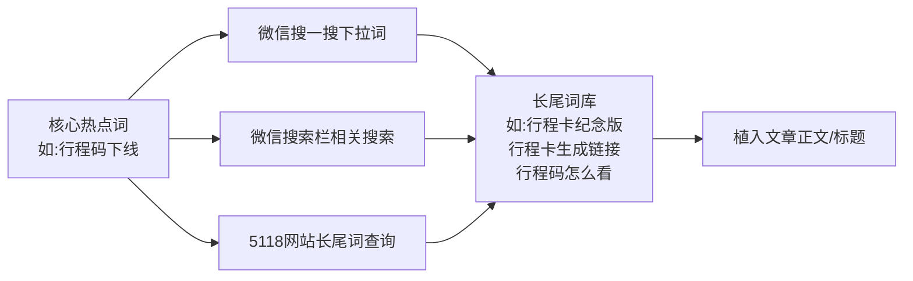
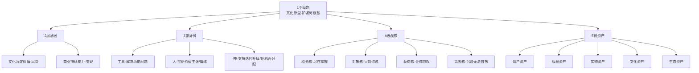

# 第 31 章 搜索流量追热点与 IP 品牌打造 —— 从“算法收割”到“文化地基”

## 学习目标

- 理解搜索流量追热点的底层逻辑，掌握其与推荐流量的核心差异
- 掌握通过下拉词、相关搜索、5118工具挖掘长尾关键词的三种方法
- 学会撰写迎合👸号算法收录的爆款文章，并能设计高点击率的标题
- 理解批量做号矩阵的核心原理，能评估其命中率与风险边界
- 掌握自动回复CTA的配置方法，能设计从内容到变现的承接路径
- 理解母题作为IP护城河的核心概念，能区分其与传统定位的优劣
- 了解内容型IP的五层资产架构与千万级营收模型的构成
- 能根据任务特点选择合适的搜索流量变现方式（流量主/CPS/CPA/泛粉洗粉）

## 31.1 生活类比

想象搜索流量追热点是**在鱼群密集的水域下网**：
- **推荐流量** = 等着鱼自己跳上船（被动、不稳定）
- **搜索流量** = 主动找到鱼群（用户搜索行为）并精准下网（铺设关键词）
- **长尾关键词** = 渔网的不同网眼大小，适配不同大小的鱼（多维度用户需求）
- **批量做号矩阵** = 一次撒出多张网（12个👸号），总有一张网能捞到鱼（对冲单点失败）
- **自动回复CTA** = 渔网底部的集鱼袋，把进网的鱼引导到指定区域（变现链接）
就像渔民不会只靠运气等鱼，而会主动寻找鱼群并布下多张网，追热点的运营者也应主动布局关键词并用矩阵提高命中率。

想象母题是**一棵大树的根系**：
- **传统定位** = 树冠上的某一根枝条（看似明确，但无法延伸出更多枝叶）
- **母题** = 深扎土壤的根系（文化原型），从中能长出千姿百态的枝叶（百变题型）
- **护城河** = 根系在地下盘根错节，别人难以模仿挖掘
- **内容体系** = 树干与主枝（四级架构、理论、故事、百问百答、路径），支撑起繁茂的树冠（IP价值）
- **变现模型** = 树上结出的果实（年度会员、私教、私董会等），不同果子对应不同价位
就像一棵树的强大来自看不见的根系而不只是外露的树冠，IP的长期价值也根植于母题这个文化地基，而非表面的定位。

## 31.2 概念地图

搜索流量追热点
├── 为什么需要（概念解析）
│   ├── 推荐流量不稳定，搜索流量精准可控 —— 素材1
│   └── 用户主动搜索，转化率高 —— 素材1
├── 核心定义（概念解析）
│   ├── 在正文/标题铺设长尾词，被微信搜一搜收录
│   └── 关键词布局：下拉词、相关搜索、第三方工具
├── 操作流程（方法）
│   ├── 步骤一：找对标体验流程 —— P001
│   ├── 步骤二：撰写爆款文章（迎合算法） —— P001
│   │   └── 技巧：七八百字、伪原创、暗淡关键词色
│   ├── 步骤三：起爆款标题（关键词组合/伪原创） —— P001
│   ├── 步骤四：设置后台承接（关键词回复+收到消息回复） —— P001
│   └── 步骤五：变现（流量主/CPS/CPA） —— P001
├── 核心策略
│   ├── 批量做号矩阵（用数量对冲不确定性） —— P001
│   │   └── 关键条件：每篇内容/标题各不相同，提高收录概率
│   ├── 长尾关键词获取三法 —— P001
│   │   ├── 方法1：微信搜一搜下拉词
│   │   ├── 方法2：微信搜索栏相关搜索
│   │   └── 方法3：5118网站查询长尾词
│   └── 自动回复CTA（流量导向变现的桥梁） —— P001
│       └── 核心：订阅号文章内链接不可点，自动回复中可放蓝字链接
├── 变现方式
│   ├── 流量主变现：手动广告位优于智能插入 —— P001
│   │   └── 技巧：广告放在“点击关注下方👸号”下诱导点击
│   ├── CPS/CPA变现：载体必须放自动回复中 —— P001
│   └── 泛粉与洗粉：泛流量二次变现与局限 —— P001
└── 边界条件（概念解析）
    ├── 依赖平台算法收录偏好
    ├── 热点时效性导致流量回落
    └── 批量做号需保证内容差异性 —— P001

IP打造（母题）
├── 为什么需要（概念解析）
│   └── 传统定位/卡位非内容视角，无法延展与构建护城河 —— P002
├── 核心定义（概念解析）
│   └── 母题：文化原型，可承载百变题型，既护城河又灵活 —— P002
├── 外部打造框架（12345） —— P002
│   ├── 1个母题：文化原型（护城河根基） —— P002
│   ├── 2层基因：文化沉淀价值（风骨）+商业持续能力（变现） —— P002
│   ├── 3重身份：工具（功能）/人（价值/情绪）/神（迭代升级） —— P002
│   ├── 4级观感：松弛感/对象感/获得感/氛围感 —— P002
│   └── 5份资产：用户/版权/实物/文化/生态 —— P002
├── 内容体系规划（五件套） —— P002
│   ├── 四级内容架构
│   ├── 一套独有理论（5种生成方法：理想/节点/词根/母题/核心） —— P002
│   ├── 一个十年故事（5-8分钟中视频规范） —— P002
│   ├── 一份百问百答
│   └── 一份点线面打通路径（产品-项目-产业链） —— P002
├── 千万营收模型（变现全景图） —— P002
│   ├── 年度会员：标品趋近0交付
│   ├── 私教：3w/3个月
│   ├── 私董会：5-20w门票
│   ├── 合伙/徒弟：20w-100w
│   ├── 课程直播：199小课/双播/月400w
│   ├── 咨询：1K+/h
│   └── 轻/重顾问：3w起/20w年
└── 核心主张/边界 —— P002
    ├── IP是少数人的领地：不照搬路径，借鉴模型非借用
    ├── 不要相信天道酬勤：坚持须建立在清晰前景+正反馈上
    ├── 危机再分配效应：解决用户危机感即获得话语权（神身份）
    └── 文化溢价验证：松弛感/女性安全升级/李子柒案例

## 31.3 搜索流量追热点 —— 让算法为你“送货上门”

### 31.3.1 为什么需要这个概念？

你是否有过这样的经历：辛苦原创了一篇干货满满的文章，发布后却像石沉大海，阅读量只有个位数？👸号的推荐流量（看一看、朋友圈裂变）就像盲盒，你永远不知道下一个爆款是谁，更无法复制。

> "我们做的是搜索流量，那相关的搜索长尾词、搜索下拉框词语都可以放进来。文章被收录之后，读者搜索相关长尾词会搜到我们这篇文章。"
> 
> ——《P001 火火：行程码下线热点复盘》

这段话揭示了本章核心逻辑：**与其祈祷算法推荐，不如主动迎合用户的搜索行为**。当“行程码下线”成为全民热点时，用户会主动搜索“如何生成纪念版行程卡”“行程码还能用吗”等长尾词。如果你提前把这些词埋在文章里，微信“搜一搜”就会把你的文章推给精准用户。

**核心差异对比**：

以下是推荐流量与搜索流量在获取方式、用户意图、稳定性、转化率四个维度的对比：

| 维度 | 推荐流量 | 搜索流量 |
|------|----------|----------|
| 获取方式 | 被动等待算法分发 | 主动布局关键词诱导收录 |
| 用户意图 | 弱（刷到算） | 强（带着问题来找答案） |
| 稳定性 | 极不稳定，波动大 | 相对可控，有长尾效应 |
| 转化率 | 低（泛流量） | 高（精准需求） |

### 31.3.2 核心定义与关键性质

**搜索流量追热点**（来源：《P001》）：

> 定义：在热点事件发生后，运营者快速产出内容，在文章正文、标题中铺设用户会搜索的长尾词或热点词，使文章被微信“搜一搜”收录，当用户搜索相关关键词时，文章出现在搜索结果中获取精准流量。

这个定义包含三个关键动作：
1. **快**：热点有时效性，必须在热度衰减前完成发布
2. **准**：关键词必须是用户真实搜索的词，而非自以为是的词
3. **全**：正文、标题、后台回复全链路布局

搜索流量追热点具有以下关键性质：
- **主动性与可控性**：流量获取由运营者主动布局驱动，而非被动等待算法推荐
- **精准性与转化性**：搜索用户带着明确意图，流量价值高于泛推荐流量
- **长尾效应**：优质关键词文章可长时间被搜索到，产生持续性流量

### 31.3.3 操作流程五步法

作者火火在“行程码下线”热点中，用12个👸号发布96篇文章，9个有效账号净增近4.5万粉，总结出一套可复制的标准化流程：

#### 步骤一：找对标体验流程

> "我决定要追这个热点之后，把我手头上的👸号挨个登陆，就开始了下面的操作流程：1、找对标账号体验一遍流程……"
> 
> ——《P001》

不要闭门造车。先搜索热点关键词，看排名前几的文章是怎么写的、引导用户回复什么关键词、自动回复里放了什么链接。把用户完整体验走一遍，这就是你的“最小可行性产品”原型。

#### 步骤二：撰写爆款文章——迎合算法而非文笔

> "追热点文章不是需要文笔写的多好，内容迎合平台算法喜好能被收录就行。我写追热点文章的时候，我会有意识的把文章内容写到七八百字左右；让文章更加容易被👸号收录，也能符合👸号在文中添加广告的要求。"
> 
> ——《P001》

爆款文章撰写法遵循以下步骤：
1. 字数控制在 700-800 字：满足文中广告插入门槛，也利于算法判定为“有内容”
2. 结构分两段：第一段给干货（如获取链接步骤），第二段拼接相关搜索结果凑字数
3. 关键词植入：将挖掘出的长尾词自然融入正文，不生硬堆砌
4. 关键词颜色调暗：为了阅读体验感好一些，把这些关键词的颜色调暗淡一些
5. 伪原创整合：复制加入其他相关文章内容，凑够字数且读起来流畅即可

这个方法展示了**“算法友好 > 文学性”**的核心原则：平台需要有效内容填充搜索索引库，你提供符合规格的内容，平台回馈流量。

#### 步骤三：起爆款标题——关键词组合与伪原创双法

> "标题更改的原理是在于原创性以及吸引眼球，原创度有助于算法收录文章，吸引眼球有助于读者搜索到第一栏点击进去阅读。"
> 
> ——《P001》

以下是爆款标题双法的操作对比：

| 方法 | 操作步骤 | 优势 |
|------|----------|------|
| **关键词组合法** | 1. 收集排名靠前文章标题<br>2. 提取高频热词（如“火爆全网”“免费获取”）<br>3. 组合成新标题：`热词 + 核心关键词 + 长尾词` | 原创度高，易收录 |
| **爆款微改法** | 1. 直接复制爆款标题<br>2. 轻微改动（增删字、换序、加符号）<br>3. 保证不完全一致 | 蹭热度快，点击率高 |

**实战案例**：
- 原标题：`行程码下线火爆全网！免费获取个人行程卡纪念版生成链接`
- 组合新标题：`行程卡纪念版火爆全网，免费获取生成链接，手慢无！`
- 微改标题：`行程码下线火爆全网，个人行程卡纪念版免费生成（附链接）`

#### 步骤四：设置后台承接——流量承接双模块

> "模块1：设置关键词回复承接住流量……模块2：设置收到消息回复减少举报率……"
> 
> ——《P001`

👸号后台有两个自动回复模块必须配置：

**流量承接双模块设置**：

- **模块1：关键词回复（核心变现入口）**
  - 触发词：设置核心关键词（如“行程卡”）
  - 半匹配词：补充用户常用变体（如“行程”“卡”“纪念版”“生成链接”等）
  - 回复内容：包含变现链接（CPS/CPA）或引导文案

- **模块2：收到消息回复（兜底与引导）**
  - 触发条件：用户发送任意消息
  - 回复文案："回复“行程卡”三个字，获取纪念版生成链接"
  - 作用：降低用户因不知道回复什么而举报的概率

**半匹配关键词回复**（来源：《P001》，原创贡献）：

> "关键词回复有一个半匹配功能，意思就是读者回复半匹配中任意一个词语，👸号后台都会自动回复对应链接。文章中让读者回复的关键词是'行程卡'三个字，很多读者其实不会回复成完整的3个字，各种各样的回复都有。我为了让读者体验感更好一些，半匹配词语我设置成他们经常回复的文字。"

这个细节极其关键：**用户不会按你的标准操作**。设置“半匹配”相当于给用户铺了多条路，只要踩上任意一条都能到达终点。

#### 步骤五：变现组合拳

> "一个是电话卡销售CPS，一个是外卖进群加粉CPA。电话卡总共卖了6张，平均每张70元的佣金；总共四百多佣金。外卖进群路径太长诱惑力度小，导致外卖这一块没有产出，失策了。"
> 
> ——《P001`

以下是变现方式对比：

| 变现方式 | 载体 | 单日收益 | 关键点 |
|----------|------|----------|--------|
| 流量主 | 文中手动广告位 | 6514元 | 广告放在“点击关注”下方诱导点击 |
| CPS（电话卡） | 自动回复蓝字链接 | 400+元 | 6张卡 × 70元佣金 |
| CPA（外卖进群） | 自动回复蓝字链接 | 0元 | 路径过长，转化失败 |
| 粉丝估值 | 按0.1元/粉 | ~4000元 | 净增4.5万粉 |

**手动广告位优于智能插入**（来源：《P001》定理）：

> "我把广告添加在点击关注下方👸号进入主页这句话下面，很多读者第一反应就会直接点击广告，稍微带了一些诱导性质；另外平台推荐广告的时候，文中广告位直接就推荐其它👸号，很有误导性。这也是为啥我👸号这次追热点流量主收入那么高的原因。一定是要设置手动添加广告，不要智能插入广告。"

这个定理揭示了**“人性弱点 + 平台机制”**的双重红利：用户惯性点击第一个可交互元素，平台误推其他👸号广告反而增加了点击概率。

### 31.3.4 核心策略深度解析

#### 长尾关键词获取三法（来源：《P001》）

你不需要付费工具，微信自带的搜索框就是最好的关键词挖掘器：



**方法1：微信搜一搜下拉词**
打开微信“搜一搜”，输入核心热点词，下拉框弹出的词就是用户当下正在搜索的高频词，**实时性最强**。

**方法2：微信搜索栏相关搜索**
搜索结果页底部的“相关搜索”，反映了用户搜索该词后的**关联需求延伸**。

**方法3：5118网站查询长尾词**
第三方SEO工具，提供**搜索指数、竞争度、长尾词树**等数据，适合深度挖掘。

> **实战建议**：三法结合用。下拉词抓即时热度，相关搜索抓延伸需求，5118抓长尾蓝海。将挖出的词去重后，按搜索量从高到低排序，前20个词重点植入正文首段、中段、末段。

#### 批量做号矩阵——用数量对抗算法不确定性（来源：《P001》概念解析）

> "我用12个👸号，每个👸号8篇文章；总共发布了96篇文章，全部是这样子整合内容。要注意的一点是我96篇文章，每一篇内容都不一样；并且标题都不一样；这样做能够更好的增加被👸号系统收录的概率。"

以下是批量做号矩阵的核心参数：

| 参数 | 数值 | 说明 |
|------|------|------|
| 账号数 | 12 | 同时运营的👸号数量 |
| 单号发文数 | 8 | 每个号发布不同内容 |
| 总发文数 | 96 | 12 × 8 |
| 有效账号数 | 9 | 75% 命中率 |
| 无效账号数 | 3 | 25% 未上排名 |
| 总新增粉丝 | 97,385 | 累计新增 |
| 总取关粉丝 | 52,430 | 取关率 53.8% |
| 净增粉丝 | 44,955 | 实际留存 |

**为什么要“每篇内容、标题都不一样”？**
微信搜一搜有去重机制。如果12个号发一模一样的文章，系统只会收录一篇，甚至判定为刷量违规。内容差异化 = 覆盖更多长尾词 = 增加被收录概率。

**概率视角理解**：
单个账号追热点成功率假设为 60%，12个独立账号至少 1 个成功的概率 = 1 - (1-0.6)^12 ≈ 99.99%。矩阵本质是**用规模换确定性**。

这里引入一个概率公式来量化矩阵策略的优势：

> **公式：矩阵命中概率 = 1 - (1 - 单账号成功率)^账号数**
> 
> **推导**：设单个账号独立成功率为 p，n 个账号全军覆没的概率为 (1-p)^n，则至少有一个账号成功的概率为 1 减去全军覆没概率。
> 
> **作用**：该公式揭示了批量做号矩阵的本质——通过增加分母（账号数）指数级压低失败概率，将“不确定性博弈”转化为“确定性收割”。

#### 自动回复CTA——流量变现的“最后一公里”（来源：《P001》概念解析）

> "订阅号文章页面放链接不会生效跳转，但是它放在自动回复里面就可以实现。我在这次追热点的过程中，自动回复里放入两个链接；一个是电话卡销售CPS，一个是外卖进群加粉CPA。注意，自动回复链接是可以用蓝字的方式展示，当时太赶就没有来得及做这个处理。"

**自动回复CTA设计公式**：

```
自动回复内容 = 
  [共情/确认] + [明确指令] + [蓝字链接] + [预期收益]
  
例：
"收到！回复“行程卡”即可获取纪念版生成链接 👇
🔗 点击生成：[蓝字链接]
📱 仅需10秒，永久保存你的行程记忆"
```

**为什么CPS/CPA必须放在自动回复？**
订阅号文章内链接不可点击（安全策略），只有自动回复、菜单栏、👸号主页支持跳转。文章引流 → 关注/回复 → 自动回复跳转，这是公域流量转私域变现的标准链路。

**外卖进组CPA失败复盘**：
路径 = 回复关键词 → 点击蓝字链接 → 跳转小程序 → 授权登录 → 进群 → 领红包。每一步都流失用户。**路径越长，转化率指数级下降**。电话卡CPS成功是因为：点击链接 → 直接下单，路径极短。

### 31.3.5 变现方式多源对照

本章涉及三种变现方式，均来自素材 P001，但在实际操作中存在共识与分歧：

**共识**：
- 流量主是基础变现，门槛低（500粉开通），长尾稳定
- CPS/CPA需要自动回复承接，链路设计决定成败
- 热点粉丝多为泛粉，需“洗粉”或“淘宝客”二次变现

**分歧**：

| 观点 | 支持论据 | 适用场景 |
|------|----------|----------|
| **流量主为主** | 单日6514元，手动广告位可复制，无需选品发货 | 矩阵号、泛流量大、无供应链能力 |
| **CPS为主** | 客单价高、复购强（如电话卡、课程），单粉价值远超流量主 | 有稳定供应链、能筛选精准粉丝 |
| **洗粉为主** | 泛粉取关率53.8%，不洗粉资产贬值快 | 有私域运营能力、高客单产品 |

> **我的建议**：新手先跑通流量主（正反馈快），再接CPS（利润高），最后建私域洗粉（资产值高）。三条腿走路，单腿倒了还能站。

### 31.3.6 边界条件与风险提示

1. **依赖平台算法收录偏好**：微信搜一搜算法调整（如打击伪原创、调整收录阈值）可能导致流量归零
2. **热点时效性导致流量回落**：“行程码下线”热点持续约3-5天，过后搜索量断崖式下跌
3. **批量做号需保证内容差异性**：同质化内容会被判定违规，封号风险随账号数增加而上升
4. **取关率极高（53.8%）**：热点粉丝忠诚度低，单纯追热点难以沉淀长期资产

---

## 31.4 母题 —— 给IP打下的“文化地基”

### 31.4.1 为什么需要这个概念？

你是否见过这样的IP：定位“职场成长”，写了一阵简历优化，又写考公上岸，又写副业赚钱，最后粉丝不知道ta到底是干嘛的，信任崩塌，变现困难？

> "对于IP来说，掌握母题就是可以既搭建出来自己的护城河又能随时调整边界的，这里可以直接挂钩很多人讲的定位卡位...但这个定位有一个弊端就是，它不是从内容的角度出发的，也就没法做好更细化的延展更不可能把护城河做出来。"
> 
> ——《P002 刘梦园：IP打造五步法》

**传统定位 vs 母题**：

| 维度 | 传统定位（卡位） | 母题（文化原型） |
|------|------------------|------------------|
| 视角 | 市场/竞品/差异化 | 内容/文化/传承性 |
| 延展性 | 单一枝条，难以生发 | 百变题型，无限延展 |
| 护城河 | 易被模仿、替代 | 根植文化，难以复制 |
| 灵活性 | 一旦定位偏，很难调整 | 边界可随时调整 |
| 例子 | “教白领做PPT” | “职场表达力”（母题） |

定位是“切蛋糕”，母题是“种树”。定位解决“站在哪里”，母题解决“根扎多深、能长多高”。

### 31.4.2 核心定义与关键性质

**母题**（来源：《P002》，引用文化原型概念）：

> 定义：文化传统中具有传承性的文化因子，或者人类社会中那些循环往复且普遍发生的事情。最简单的理解就是**原型**。

对IP而言，母题是**内容生成的核心锚点**。掌握母题 = 既搭建护城河，又能随时调整边界。

**关键性质**：
- **文化传承性**：母题根植于文化传统，具有深远的价值沉淀（如“英雄之旅”“自我救赎”“秩序与混沌”）
- **可延展性**：母题下有“百变题型”，IP内容可以千变万化但万变不离其宗
- **护城河效应**：母题构成IP的差异化壁垒，难以被模仿和抄袭

**典型例子**：
> 一个IP如果定位于“女性安全”作为母题，可以延展出防卫技巧、案例分析、法律科普、心理建设、装备测评等百变内容，始终围绕“女性安全”这个原型展开。

### 31.4.3 外部打造框架：12345模型（来源：《P002》）

这是IP从0到1、从1到N的完整“外部打造地图”：



#### 1个母题：文化原型
不是“标签”，是“原型”。如：
- 李子柒母题：**“田园牧歌/归隐山林”**（中国传统隐士文化原型）
- 罗振宇母题：**“焦虑时代的确定性供给者”**（现代知识焦虑原型）
- 樊登母题：**“全民阅读的领读人”**（传士文化原型）

#### 2层基因：风骨 + 变现
- **文化沉淀价值（风骨）**：不做没有文化溢价的事。女性安全IP不只教防狼喷雾用法（工具），而要讲家暴案例、PUA识别、户外求生法则（文化溢价）
- **商业持续能力（变现）**：IP是少数人的领地，**借鉴模型而非借用模型**。拆解10个成功模型，取长补短有机结合，而非照搬单一路径

#### 3重身份：工具 → 人 → 神
以下是3重身份的对应关系：

| 身份 | 用户阶段 | 核心价值 | 案例 |
|------|----------|----------|------|
| **工具** | 新用户/浅层需求 | 解决具体功能问题 | “教你用Excel做报表” |
| **人** | 信任建立期 | 提供价值主张/情绪共鸣 | “我也是从基层干起，懂你的累” |
| **神** | 瓶颈期/危机期 | 解决迭代升级，**危机再分配效应** | “跟着我重构认知系统，突破天花板” |

> **危机再分配效应**（来源：《P002》定理）：
> "神是从解决用户迭代升级的角度去说的。危机具有强烈的再分配的效应。当用户意识到自身的瓶颈之后便具有了一定的危机感，这时候谁解决这个危机感谁就具有一定的再分配话语权……"

这就是为什么顶级IP都在卖“认知”“体系”“闭环”，因为它们承接了用户的**生存焦虑与阶层跃迁渴望**。

#### 4级观感：感性支配消费
IP对外呈现需至少具备2个观感，驱动**感性消费而非理性比价**：
- **松弛感**：“你问题我都见过了，稳住”（龙飞律师连麦风格，账号短期破千万）
- **对象感**：“这些话我只对你一个人说”（私域一对一咨询感）
- **获得感**：“没让你说卧槽就是我输”（干货密度极高）
- **氛围感**：“沉浸其中无法自拔”（李子柒视频、深夜电台）

#### 5份资产：幂次效应的来源
以下是5份资产的详细说明：

| 资产类型 | 说明 | 幂次效应体现 |
|----------|------|--------------|
| 用户资产 | 谁关注你决定你是谁 | 品牌势能 > 流量堆砌，边界更广 |
| 版权资产 | 17种版权，13种可交易 | 课程、书籍、衍生品持续授权收益 |
| 实物资产 | IP衍生品、周边 | 穿搭IP线上发布会千万-上亿流水 |
| 文化资产 | 置于主流/亚文化之下 | 李子柒走文化资产路线，溢价极高 |
| 生态资产 | 组织协同带来的经济效益 | 星云IP计划：20个S级IP、年2亿盘子 |

> **用户资产幂次效应**（来源：《P002》定理）：
> "如果你的IP是靠品牌涨起来的，那品牌本身所具有的势能就是你的用户资产。显而易见，品牌性质的边界会更广，幂次效应更强，IP的多次‘觉醒’就有了可能。"

### 31.4.4 内容体系规划：五件套（来源：《P002》）

一个成熟IP的内容体系包含5个部分：


#### 1. 四级内容架构
- L1：引流内容（公域短视频、文章、直播切片）
- L2：信任内容（私域朋友圈、社群、长文深度）
- L3：转化内容（销售信、案例详解、对标对比）
- L4：交付内容（课程、陪跑、顾问、工具包）

#### 2. 一套独有理论：五大生成方法
这是IP“护城河”的核心显性资产：

| 方法 | 核心逻辑 | 适用场景 | 案例 |
|------|----------|----------|------|
| **理想解法** | 基于TRIZ/ARIZ：理想解=不增加资源前提下解决问题 | 方法论类IP | “零成本获客模型” |
| **节点法** | 从服务流程抽取共性节点，抽象为标准化模块 | 服务/咨询类IP | “水利私域理论”（重构组织→水系/工程/循环） |
| **词根法** | 提炼垂类核心词根，延展成体系 | 垂直深耕类IP | “极简主义”→断舍离/收纳/消费观/生活哲学 |
| **母题法** | 延展/结合母题生成理论 | 文化型IP | “女性安全”→安全体系/法律护盾/心理装甲 |
| **核心法** | 提取自身内容体系核心点命名 | 个人品牌IP | “内容经纪理论”（刘梦园自创） |

#### 3. 一个十年故事：5-8分钟中视频规范
- **素材**：前后对比（新手村→大佬村）、关键时刻（低谷/荣耀/转折）
- **结构**：单一主线或双线并行
- **文案**：表达清晰、目的明确（增信）、契机合理
- **音乐**：体现品位，配合情绪节奏

#### 4. 一份百问百答
覆盖用户从入门到精通的所有高频问题，既是SEO词库，也是销售话术库，还是交付SOP骨架。

#### 5. 一份点线面打通路径（品项态）
> "到了内容型IP上其实就是品项态（产品项目生态）。设计点线面打通的重要性就体现出来了……"

```
点（产品）：一篇文章、一份课程、一个账号、一个二维码
  ↓ 标准化、复制化
线（项目）：内容经纪人培训项目、IP孵化训练营
  ↓ 理论端/执行端/变现端/IP端/政府支持/人才端齐备
面（产业链/生态）：S级IP产业群组、星云IP计划
```

### 31.4.5 千万营收模型：变现全景图（来源：《P002》）

内容型IP几乎所有变现方式及定价区间：

| 变现层级 | 产品形态 | 定价区间 | 交付特点 | 4近原则对应 |
|----------|----------|----------|----------|-------------|
| **L1 入门** | 年度会员 | 199-999元/年 | 标品，趋近0边际成本交付 | 离钱近、离易用近 |
| **L2 进阶** | 私教/陪跑 | 3万/3个月 | 1对1或小班，高交付强服务 | 离痛点近、离信任近 |
| **L3 高阶** | 私董会 | 5-20万/年 | 圈层准入、资源对接、战略共创 | 离信任近、离钱近 |
| **L4 合伙** | 合伙人/徒弟 | 20-100万 | 核心方法论授权、品牌背书、供应链共享 | 离信任近、离钱近 |
| **L5 图书** | 一书一码/联合出品 | 100-1000元/份 | 招募联合出品人（如1000人），破解版税低 | 离钱近、离易用近 |
| **L6 直播** | 199小课+双播+切条 | 单场6万，月400万 | 1+1+1模式：直播→小课→短视频 | 离钱近、离痛点近 |
| **L7 咨询** | 1对1咨询 | 1000+/小时 | 高客单、强定制、时间换钱 | 离痛点近、离信任近 |
| **L8 顾问** | 轻顾问/重顾问 | 3万起/20万年 | 企业级服务，战略+落地 | 离信任近、离钱近 |

**4近原则**（来源：《P002》定理）：
> "注意一个底层逻辑就是4近，离钱近好变现，离痛点近好卖出，离易用近好留存，离信任近好复购。"

这是产品阶梯设计的**底层判断标准**：每增加一个层级，必须满足至少一条“近”。

### 31.4.6 核心主张与边界条件

#### IP是少数人的领地：不走别人的路径
> "二是IP是少数人的领地，每个IP的花期和成长环境不同，不要走别人的路径，既容易形成路径依赖又容易忽略‘地图’上不好展示的关键节点；最有效的办法是找十个模型，看自己适合哪个模型的哪一部分，再看这些部分能不能有机结合，运作起来是不是顺滑，借鉴但非借用~"
> 
> ——《P002》

**路径依赖陷阱**：博商模式（199小课+赛马机制+后端大单）被无数人模仿，但忽略了博商**十几年线下积淀**是前提。盲学前端，扑空后端。

#### 不要相信天道酬勤
> "三是不要相信天道酬勤那种鬼话，极大概率是幸存者偏差……所有的努力与坚持必须是在有非常明晰的前景下才有效，也不要高估了人性，很少有人能在没有持续变现的正反馈下坚持太久。"
> 
> ——《P002》

**坚持的前提**：清晰前景 + 两周可验证变现正反馈。否则及时转换或引入团队。

#### 文化溢价验证案例群
| 案例 | 母题 | 文化溢价体现 | 商业结果 |
|------|------|--------------|----------|
| 女性安全IP | 女性生存权/尊严 | 从防卫升级为家暴/PUA/诈骗案例分析 | 高客单并行 |
| 穿搭IP | 审美自主/生活美学 | 版权素材沉淀，线上发布会千万-亿流水 | 实物+版权双收 |
| 李子柒 | 田园牧歌/文化自信 | 文化资产路线，非带货网红 | 顶级溢价 |
| 龙飞律师 | 权威守护者 | 松弛感“你问题我都见过” | 短期破千万粉 |

---

## 31.5 多源对照：搜索流量 vs IP品牌的底层逻辑差异

虽然素材 P001（搜索流量追热点）与 P002（IP品牌打造）来自不同作者、不同赛道，但都在解决**“流量从哪来、信任怎么建、钱怎么赚”**三个根本问题。我们将两套体系在核心维度上进行对照：

### 共识

以下为两套体系的共识观点：
- **流量本质**：流量=用户需求显性化。搜索流量挖掘显性需求，IP内容沉淀隐性需求
- **内容生产**：都主张“模板化/结构化/标准化”生产，反对靠灵感、靠文笔
- **变现逻辑**：都遵循“流量→信任→转化→复购”链路，拒绝单一变现依赖
- **数据驱动**：都强调用数据验证（收录率、点击率、转化率、ROI、LTV）
- **风险意识**：都明确边界：追热点有取关率/算法风险，做IP有幸存者偏见/路径依赖

### 分歧

| 维度 | 搜索流量追热点 (P001) | IP品牌打造 (P002) | 本质差异 |
|------|------------------------|-------------------|----------|
| **时间周期** | 短期（小时/天级），热点即时变现 | 长期（年/十年级），复利累积 | 战术 vs 战略 |
| **内容核心** | 迎合算法收录（伪原创、凑字数、暗词） | 沉淀文化原创（理论、故事、体系） | 算法友好 vs 人性友好 |
| **账号策略** | 批量矩阵（12号96文，对冲概率） | 单号深耕/矩阵辅助（核心IP+分号） | 数量博弈 vs 质量复利 |
| **粉丝价值** | 泛粉为主，取关率53.8%，单粉估值0.1元 | 精粉为主，幂次效应，单粉价值指数级 | 流量变现 vs 资产运营 |
| **护城河** | 无护城河，靠速度/规模/技巧 | 母题+理论+品牌+生态，深度护城河 | 无护城河 vs 重护城河 |
| **变现重心** | 流量主广告+CPS/CPA快变现 | 高客单产品阶梯（私教/私董/顾问） | 广告分成 vs 知识/服务付费 |
| **核心能力** | 热点敏感度+关键词挖掘+矩阵执行力 | 文化洞察+理论构建+组织化运营 | 敏锐度 vs 深度 |

> **关键洞察**：**追热点是“打猎”，做IP是“种地”**。猎人靠遇到猎物（热点）吃饭，农夫靠耕耘土地（母题）收成。新手可先“打猎”练手、赚第一桶金、验证赛道；但想走远、建资产、抗周期，必须转向“种地”——找到母题，沉淀理论，建立体系。

---

## 31.6 设计中的取舍

### 为什么不用“原创深度长文”追热点？

> "追热点文章不是需要文笔写的多好，内容迎合平台算法喜好能被收录就行。"
> 
> ——《P001》

**为什么不用“原创深度长文”追热点？**
因为热点时效性要求“快”，算法收录要求“规范”。原创深度长文耗时 4-8 小时/篇，收录不确定，热点过期前发不出；而伪原创结构化短文耗时 30-60 分钟/篇，符合收录规范（字数、关键词、结构），可批量。**选择伪原创结构化是唯一可行解**。

**这种设计的 trade-off 是什么？**
牺牲了内容深度与品牌质感，换取发布速度与收录确定性。长期来看，纯追热点账号难以建立用户信任资产，取关率高达53.8%即是代价。

### 为什么不用“单号全力以赴”而用“批量矩阵”？

> "总共用12个👸号批量操作来追这个热点，其中3个👸号发文没有上排名没有流量……"
> 
> ——《P001》

**为什么不用“单号全力以赴”而用“批量矩阵”？**
单号沉没成本高（养号、权重、违规风险全压在一点），方差大；矩阵边际成本低（注册、认证可批量），方差小，75%命中率可预期。**概率游戏必须玩数量，单点全押是赌徒心理**。

**这种设计的 trade-off 是什么？**
用管理成本（多号切换、内容差异化生产、风控风险）换取流量获取的确定性。若平台强化实名/设备指纹风控，矩阵成本将指数级上升，需评估ROI临界点。

### 为什么不用“文章内放链接”而用“自动回复CTA”？

> "订阅号文章页面放链接不会生效跳转，但是它放在自动回复里面就可以实现。"
> 
> ——《P001》

**为什么不用“文章内放链接”而用“自动回复CTA”？**
文章内链用户体验最好（阅读即点击），但平台封杀，点击率=0；自动回复多一步“回复关键词”，但链接可点、可追踪、可分流。**在平台规则硬约束下，自动回复是唯一合规高效落地页**。

**这种设计的 trade-off 是什么？**
增加了用户操作步骤（阅读→回复→点击），流失率随步骤增加而上升。外卖CPA失败即因路径过长（6步）。优化方向：缩短路径、提高诱导力、蓝字链接可视化。

### 为什么IP不做“泛流量大号”而做“母题深耕”？

> "定位不是从内容的角度出发的，也就没法做好更细化的延展更不可能把护城河做出来。"
> 
> ——《P002》

**为什么IP不做“泛流量大号”而做“母题深耕”？**
泛流量大号涨粉快，广告变现快，但取关快、单粉价低、无定价权、易被平台收割；母题深耕IP起势慢，需沉淀理论/故事/体系，但单粉价高、有定价权、资产可继承/出售。**取决于你的目标是“赚快钱”还是“复利人生”。本书建议：先猎后耕，以猎养耕。**

**这种设计的 trade-off 是什么？**
前期投入大（内容体系构建、理论提炼、品牌打磨），回报周期长（通常6-18个月见效），中途极易因现金流断裂或心态崩塌而放弃。需用追热点现金流垫资，或引入合伙人分担风险。

---

## 31.7 动手练习

### 练习 1：手动配置一次搜索流量承接链路

假设你运营一个👸号，刚完成一篇关于"2023年春节旅游攻略"的热点文章，现在需要配置后台承接流量的完整链路：

1. 根据文章主题，用三种方法（下拉词、相关搜索、5118）各挖掘2个长尾关键词
2. 根据长尾词设计3-5个半匹配关键词回复规则（如"旅游""攻略""春节游"等变体）
3. 为关键词回复设计自动回复文案，包含一个CTA（要求：说明回复什么词、提供什么价值）
4. 在"收到消息回复"中设计一条引导语，目的是降低用户因不知道回复什么而举报的概率

回答问题：
- 你的自动回复CTA中，链接应该指向什么变现载体（CPS/CPA/流量主）？依据是什么？
- 如果用户取关率高达53.8%，你会如何优化文章和承接环节来降低取关？

### 练习 2：批量做号矩阵的概率测算与优化

参考"12个👸号发布96篇文章，9个有效，3个未上排名"的案例：

1. 计算该案例的有效账号命中率（有效账号数/总账号数）
2. 假设你只有5个👸号，每号发6篇内容，要想达到同等命中率，需要满足什么关键条件？
3. 若平台对批量注册的账号开始风控（如要求实名认证、绑定手机号），请评估：
   - 批量做号策略的成本会如何变化？
   - 你还会坚持该策略吗？请给出替代方案

回答问题：
- 批量做号矩阵的本质是概率游戏，那么"内容质量"和"内容数量"哪个对最终收益影响更大？为什么？

### 练习 3：母题识别与内容延展练习

以下是三个IP的定位描述，请为每个IP识别其潜在的"母题"（文化原型），并各延展3个不同的内容方向：

1. 定位："专注女性安全的博主"（对标素材中"女性安全"案例）
   - 提示：母题可以是"女性安全"下的某种文化原型，如"自我保护""正义伸张"
2. 定位："教中年人理财的财经博主"（素材中母题概念）
   - 提示：考虑"财务自由""阶层跃迁"等文化因子
3. 定位："分享极简生活的家居博主"
   - 提示：考虑"断舍离""小确幸"等原型

回答问题：
- 为什么传统的"定位"无法像"母题"那样延展出百变题型？请从内容生成的角度对比两者差异。
- 选择一个你熟悉的IP，尝试为其设定母题，并分析该母题能带来的"护城河效应"是什么。

### 练习 4：流量主与CPS/CPA的变现选择实验

假设你刚追完一个热点，获得1万粉丝，现在面临三种变现路径的选择：
路径A：专注流量主收入（文中手动广告位）
路径B：配置自动回复CTA做CPS（如电话卡）和CPA（如外卖进群）
路径C：先洗粉再变现（筛选高价值粉丝做知识付费）

请根据素材中的数据（净增4.5万粉、流量主6514元、6张电话卡400元、取关率53.8%）完成：
1. 估算路径A的千粉收益（流量主收入/净增粉丝数 × 1000）
2. 对比路径B中CPS和CPA的转化率差异，分析"外卖进群"为何失败
3. 你认为路径C更适合什么类型的粉丝？给出判断标准

回答问题：
- 三种路径是否可以叠加使用？如果可以，请设计一个叠加方案。
- 从素材案例看，"手动广告位"的本质是利用了什么用户心理？这种策略的风险是什么？

### 练习 5：设计一个IP的千万营收产品阶梯

参照素材中"千万营收模型"（年度会员→私教→私董会→合伙/徒弟→课程直播→咨询→顾问），为一个"职场沟通教练"IP设计产品阶梯：

1. 按从低门槛到高溢价排列，给出至少7个产品层级
2. 为每个层级标注建议定价（参考素材中的价格带）
3. 说明每个层级对应4近原则（离钱近/离痛点近/离易用近/离信任近）中的哪一条
4. 设计一个"一书一码+联合出品人"的图书增量玩法（招募人数、定价、权益）

回答问题：
- 素材提出"199小课+直播1+1+1"模式可月营收400w，请拆解其成本结构（直播时间、剪辑人力、投放成本）
- IP变现的局限性在于"不要相信天道酬勤"，那么在你设计的产品阶梯中，哪一个环节最可能让坚持者看到正反馈？为什么？

### 练习 6：对标竞品做像素级拆解

选择一个你所在领域的爆款IP（如抖音、👸号、小红书），运用素材中"对标账号筛选"与"母题分析"方法完成拆解：

1. 用四项标准（粉丝5W以下/视频200条以上/垂直品反复带/画面干净）筛选出1个"黑马小达人"
2. 识别其内容背后可能的"母题"（文化原型），并列出其延展出的3个内容系列
3. 用"12345框架"分析其外部打造：1个母题、2层基因、3重身份、4级观感、5份资产（各用一句话说明）
4. 列出其变现产品阶梯（参考千万营收模型），并标注每层的客单价

回答问题：
- 素材指出"IP是少数人的领地，不要走别人的路径"，那么你拆解这个IP的目的是什么？如何避免路径依赖？
- 如果该IP的流量下降，你会建议它如何利用"危机再分配效应"重构话语权？

---

## 31.8 本章小结

这一章中我们学习了如何利用搜索流量追热点实现短期爆发式获客，以及如何通过母题构建长期复利的IP品牌资产。首先我们理解了搜索流量与推荐流量的本质差异，掌握了通过下拉词、相关搜索、5118三法挖掘长尾关键词的方法；其次我们拆解了爆款文章撰写、标题设计、后台承接、矩阵分发、多元变现的完整操作流程，特别是手动广告位、半匹配关键词、自动回复CTA等关键细节技巧；接着我们深入剖析了母题作为IP文化地基的核心定义，对比了传统定位与母题的优劣，展开了12345外部打造框架、五件套内容体系、千万营收模型的全景图谱；然后我们通过多源对照，厘清了“打猎式”短期收割与“种地式”长期深耕的底层逻辑差异；最后我们在设计取舍中反思了各关键决策背后的权衡，并在六个动手练习中将理论转化为可执行的实操能力。

本章我们一起学习了以下概念：

| 概念 | 解释 |
|------|------|
| 搜索流量追热点 | 主动在正文/标题铺设长尾词，利用微信搜一搜获取精准、可控、有长尾效应的流量 |
| 推荐流量 vs 搜索流量 | 推荐流量被动不稳定，搜索流量主动精准、转化率高 |
| 长尾关键词获取三法 | 通过微信下拉词、搜索栏相关搜索、5118网站免费挖掘可铺设的长尾词 |
| 爆款文章撰写法 | 核心是迎合算法而非文笔：字数七八百、伪原创整合、暗淡关键词颜色兼顾阅读体验 |
| 爆款标题双法 | 提取高频热词自行组合或对爆款标题轻微改动伪原创，兼顾原创度与吸引力 |
| 批量做号矩阵 | 同时运营多个👸号、每篇内容标题各不相同，用数量对冲算法不确定性、提高收录概率 |
| 自动回复CTA | 在自动回复中放置可点击蓝字链接，解决订阅号文章内链接不可跳转的痛点，是CPS/CPA变现的落脚点 |
| 半匹配关键词回复 | 设置多个用户经常回复的变体词语，只要包含其一即自动回复链接，提升体验并降低举报率 |
| 手动广告位 | 手动将文中广告放在引导关注文案下方，利用读者第一反应和平台误导性推荐显著拉高单价 |
| 泛粉与洗粉 | 追热点带来的泛流量可做淘宝客或筛选高价值粉丝二次变现，但泛粉价值密度低、取关率高 |
| 母题 | 源自文化原型的核心锚点，既能搭建护城河又能灵活调整边界，是IP长期价值的文化地基 |
| 3重身份 | IP在不同用户阶段扮演工具（功能）、人（价值/情绪）、神（迭代升级）三种角色 |
| 4级观感 | 松弛感、对象感、获得感、氛围感四种对外呈现观感，驱动感性消费行为 |
| 5份资产 | 用户、版权、实物、文化、生态五种与IP息息相关的资产形态，是幂次效应来源 |
| 千万营收模型 | 从年度会员、私教、私董会到课程直播、顾问的完整产品阶梯，覆盖几乎全部变现方式 |
| 天道酬勤误区 | 单靠长期努力而无正反馈基本归零，坚持必须建立在清晰前景与两周可验证变现的基础上 |
| 危机再分配效应 | 当用户感到危机时，能解决危机的IP获得再分配话语权，支撑IP的"神"身份 |
| IP是少数人的领地 | 不要走别人的路径，应拆解多模型后取长补短有机结合，而非全盘复刻 |

下一章中，我们将学习**自动化编排与流量变现闭环**——如何用IFTTT、RPA等工具把“找热点、挖关键词、发文章、配后台、看数据”这套流程自动化跑起来，以及AI绘画小程序从0到月入5万+的完整商业复盘，帮助你从“会操作”进阶到“会设计系统”。

---

## 素材来源对照表

本章引用的两份核心素材及其对应文件路径：

| 素材编号 | 文件路径 | 核心贡献 |
|----------|----------|----------|
| P001 | `docs/202301-02/AmKRdF2Z9oQjDExxxuAc18a5nbb.md` | 搜索流量追热点完整操作流程、批量做号矩阵、手动广告位、半匹配关键词、自动回复CTA、变现实测数据 |
| P002 | `docs/202301-02/HiVkdfBYJo2H5xxWIemcMcMQnLc.md` | 母题概念、12345外部打造框架、五件套内容体系、千万营收模型、IP核心主张（少数人领地/反天道酬勤/危机再分配/文化溢价） |

