# 第 14 章 短视频带货工业化方法论 —— 从“对标复刻”到“矩阵放大”
作者：龙哥

## 学习目标

- 理解官方数据源（巨量百应）相比第三方工具的核心优势，建立"上榜即验证、出单即真理"的选品认知
- 掌握"黑马小达人"筛选策略：以单粉GMV为核心指标，规避头部大号粉丝红利干扰，锁定可复制的纯内容竞争力样本
- 掌握RPA自动化采集流程：从参数配置、前台模拟操作、数据清洗到无水印下载与结构化入库的全链路实现
- 掌握"视频六元素"拆解法：将非结构化爆款视频标准化为背景、标题、内容、文案、字幕、BGM六大正交元素，构建素材池
- 理解"混淆元素机制"的原创保护原理：通过自有实拍素材打破视频指纹相似度，对抗平台查重算法
- 掌握"情趣用品四象限"选题体系：以共情、反差、实用、稀缺四大心理机制为锚点，实现选题的穷举与精准定位
- 掌握全平台素材库二创法：跨平台搬运+结构保留+表达重组的"不违规二创"操作规范与素材管理体系
- 理解"知识诅咒"与"行动配额"对抗法：在0-1冷启动期用"日更N条、不看后台"的强制执行绕过过度思考
- 掌握"账号孵化输送模式"的商业逻辑：轻资产专注流量侧，重资产外包变现侧，通过分成/线索费实现风险隔离与规模化复制
- 掌握"爆款生命周期管理"的动态运营策略：识别起飞/爆发/平台/衰退四期数据拐点，制定分阶段投流、直播、接力SOP

## 14.1 生活类比

想象短视频带货是一场工业化的"盖房子"游戏。官方爆款库（巨量百应）好比国家建筑标准图集，权威、实时、结构经验证，照着盖不塌；黑马小达人好比"白手起家的工长"，没背景（粉丝），纯凭手艺（内容）盖出豪宅（高GMV），最值得拜师；RPA机器人好比不知疲倦的"搬运工机械臂"，24小时把图集里的砖（视频）、水泥（数据）自动搬进自家仓库；视频六元素好比标准化"预制构件"，墙板（背景）、门窗（标题）、主体结构（内容）、水电管线（文案/字幕）、装饰线条（BGM），拆解后才能批量组装；混淆元素好比每栋房子独有的"门牌号与庭院景观"，虽然户型（模板）一样，但自家实拍的独特细节让验房师（算法）判定为"原创独立建筑"；情趣用品四象限好比四大户型设计流派，中式庭院（情共情）、洛可可风（趣反差）、现代智能宅（用实用）、文创文物馆（品稀缺），选定流派才能精准找买家；全平台二创好比"环球采购建材"，抖音的梁、快手的柱、小红书的瓦、TK的漆，拿来按自家图纸（四象限逻辑）重新组装，成本极低；行动配额好比强制自己"日砌100块砖"，别琢磨风水（变现）、看进度（后台），先把墙砌起来，数据自然会说话；账号孵化输送好比"专业造房队+专业卖房队"分工，你只管盖好样板间（账号/流量），交给销售大军（直播基地/供应链）去卖、去交付，按套分成；爆款生命周期好比"楼盘热销周期"，开盘抢购（起飞/爆发）→ 持续去化（平台）→ 尾盘清盘（衰退），聪明开发商在热销期就启动下一盘（接力新号）预售。

## 14.2 概念地图

短视频带货工业化方法论
├── 选品与对标体系
│   ├── 官方实时爆款视频库（巨量百应）  —— P001
│   ├── 黑马小达人样本策略（低粉高销）  —— P002
│   └── 对标方法论：脚本模板复用优于盲目原创  —— P001
├── 数据采集自动化
│   ├── RPA自动化采集（影刀）  —— P003
│   │   ├── 创意搜索采集模式（关键词/商品名）
│   │   ├── 分类采集模式（行业/等级/周期）
│   │   └── 无水印下载与结构化导出
│   └── 边界：前台阻塞、页面变更维护、免费版限制  —— P003
├── 内容标准化生产
│   ├── 视频六元素拆解法  —— P004
│   │   ├── 背景、标题、内容、文案、字幕、BGM
│   │   ├── 正交性、完备性、可计算性
│   │   └── 素材-元素映射表构建
│   ├── 混淆元素机制（指纹伪装）  —— P005
│   │   ├── 自有实拍素材库建设
│   │   ├── 插入时机/占比/质感控制
│   │   └── 对抗指纹/帧级/语义多级查重
│   ├── 情趣用品四象限选题体系  —— P006
│   │   ├── 情（共情细分）、趣（反差/新奇）、用（教学/避坑）、品（稀缺/特产）
│   │   ├── 穷举性、正交性、可迁移性
│   │   └── 变现路径匹配边界
│   └── 全平台素材库二创法  —— P007
│       ├── 跨平台信息差套利
│       ├── 二创深度标准（结构重组≥60%）
│       └── 素材管理系统（下载-分类-标签-去重-归档）
├── 执行与心态管理
│   ├── 知识诅咒与行动配额对抗  —— P008
│   │   ├── 变现看对标、不看后台
│   │   └── 日更硬指标替代动力驱动
│   └── 适用边界：0-1/1-10期 vs 规模期、高客单/强合规业务  —— P008
├── 商业模式与放大
│   ├── 账号孵化输送模式  —— P009
│   │   ├── 轻资产流量侧专注
│   │   ├── 分成/CPA结算与风险隔离
│   │   ├── 谈判博弈、所有权归属、平台政策红线
│   └── 财务逻辑导向：产值与成本打正、号作消耗品  —— P009
└── 生命周期与风控
    ├── 爆款生命周期管理  —— P010
    │   ├── 四期曲线：起飞/爆发/平台/衰退
    │   ├── 拐点判标：环比增速、完播率、峰值在线
    │   └── 分阶段SOP：投流/直播/接力新号
    ├── 从众心理与炒群运营  —— P009
    ├── 封设备判断与刷机处置流程  —— P009
    └── 平台合规性判断：自研源码与概率  —— P009

## 14.3 官方数据源对标 —— 让算法做你的选品雷达

**国家建筑标准图集**般的官方爆款库，是我们选品的基石。第三方工具只能看到"昨天的真相"，而巨量百应让我们看到"当下的机会"。

### 为什么需要这个概念？

你是不是经常纠结：到底选什么品？拍什么视频能火？市面上抖查查、蝉妈妈等第三方工具满天飞，但你会发现——数据滞后、榜单不准，甚至根本查不到昨天刚火的案例。第三方工具的爬虫受限于频次和反爬，只能看到"昨天的真相"，看不到"当下的机会"。

短视频带货的核心竞争力是反应速度：谁能第一时间发现"当下什么视频正在出单"，谁就能抢跑。巨量百应创意中心作为抖音官方广告投放平台，掌握全网最全、最实时的 GMV、粉丝、投流、完播数据。它不是"猜"的，是"账"的——每一条上榜视频背后都是真金白银的交易闭环。

> "一个是爆款视频,能找到各个行业,不同等级作者,近期的非常实时的最新带货效果最好的短视频...这个是比抖查查蝉妈妈这些第三方要更准确的行业优秀爆款视频库.对于上不了热榜的来说,这里更容易找到同行的东西."
> 
> ——《P001, p.1-2》

### 核心定义

**官方实时爆款视频库**（来源：《P001, p.1-2》）

直接使用抖音官方广告投放平台"巨量百应"提供的"爆款视频库"和"创意搜索"功能，按行业、作者等级、时间周期、GMV 等维度筛选真实出单的优秀短视频案例。以官方实时数据为对标依据，替代第三方工具猜测，建立"上榜即验证、出单即真理"的选品认知。

### 关键性质

该策略具有三大关键性质：第一，实时性强，数据为平台实时更新，反映当下最热的带货内容趋势；第二，维度全，覆盖行业分类、作者层级（达人/素人）、投流模式、GMV 销售额、粉丝量等核心指标；第三，可信度高，数据源自交易闭环，无刷单水分，GMV 代表真实成交。

### 典型例子

在巨量百应"创意搜索"输入关键词"护肤品"，按 GMV 降序筛选，发现某素人账号 5000 粉丝单条视频 GMV 10 万+，提取其脚本结构复刻；或按"美妆个护"行业、"近 7 天"、"中腰部作者"筛选爆款视频库，批量下载 Top50 视频进行逐帧拆解。这些操作均基于官方实时数据完成，避免了第三方工具数据滞后导致的决策失误。

> "刷完这里我才发现,带货短视频上限竟然能这么高,一条视频十几万,几十万的收入...很明显这里有很多矩阵号,模板化的内容批量的产出..."
> 
> ——《P001, p.2》

### 方法演进图：官方数据源对标决策流程

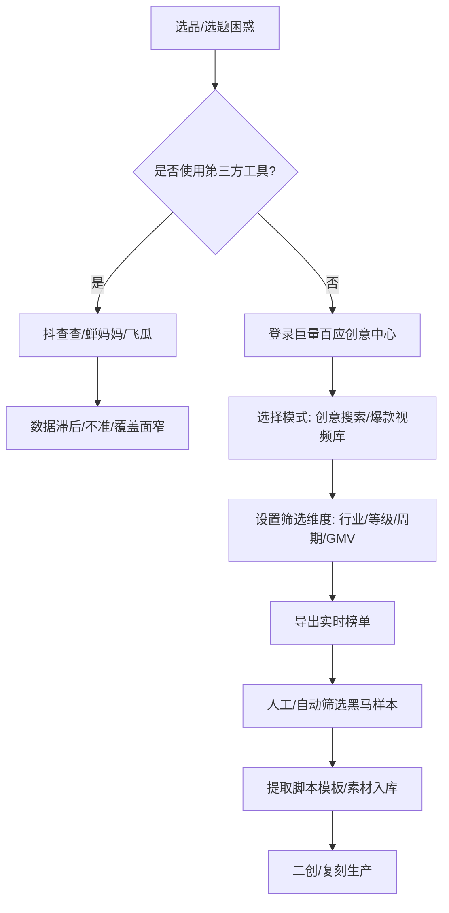

### 边界条件

需具备巨量百应账号权限（通常需企业认证或广告主资质），个人号可能无法访问完整功能；数据仅覆盖投流或自然流量较好的视频，极小众冷启动案例可能未收录；仅提供视频层面数据，无法直接获取账号后台转化漏斗、私域导流等深层运营数据。

---

## 14.4 黑马小达人样本策略 —— 避开大号光环，盯上"真实战力"

**白手起家的工长**最值得拜师：没有粉丝红利加持，却能盖出高GMV的豪宅，这就是纯内容竞争力的证明。

### 为什么需要这个概念？

你是不是也有过这种经历：看到大 V 带货几百万，兴冲冲去模仿，结果自己发出去只有几十播放？头部大号自带粉丝基数和流量池加成，其爆款难以复制，普通人模仿极易"学不来、做不成"。

真正值得学的，是"粉丝少但销量高"的账号。去除粉丝红利后，剩下的就是纯内容竞争力——选品、脚本、表现形式本身的转化能力。这类"黑马小达人"的模板，成功率显著高于盲目跟随头部大号。

> "我的思路是找那种,粉丝量少,但是销量高的视频,做参考...这种黑马小达人更是我们小达人适合学习的对象,毕竟大达人都是有粉丝基础加成在的,销量天然会高一点."
> 
> ——《P001, p.2》

> "在快手/抖音筛选对标账号的四项标准（粉丝5W以下、视频200条以上、垂直品反复带、画面干净），并优先选择“粉丝量少但销量高”的黑马小达人作为学习对象。"
> 
> ——《P002, p.4》

### 核心定义

**黑马小达人样本策略**（来源：《P001, p.2》、《P002, p.4》）

在官方爆款视频库采集数据后，设定筛选阈值：粉丝量 < 1万（或行业中位数以下），单条视频 GMV > 行业均值，重点研究此类"黑马小达人"的内容结构。核心指标为"单粉 GMV"或"千粉销售额"，而非绝对 GMV 总量。

### 关键性质

该策略具有三大关键性质：第一，可复制性强，无团队包装、无付费投流托底，纯靠内容与选品取胜；第二，抗风险性高，不依赖个人 IP 护城河，换人、换号、换赛道均可复用模板；第三，学习成本低，拍摄设备简单（多为手机固定机位）、剪辑节奏基础、话术模板化程度高。

### 典型例子

某中医养生赛道账号，仅 3000 粉丝，单条带货视频 GMV 5 万，固定模板"名医照片背景+经典方剂文案+引导挂车"，作者照搬模板换产品连出 3 个万单视频；家居收纳赛道素人号，2000 粉，单视频带货 2 万，模板为"痛点场景演示+神器展示+价格锚定"，无口播纯字幕。这些案例均验证了低粉高销样本的可复制性。

### 方法演进图：黑马小达人筛选漏斗

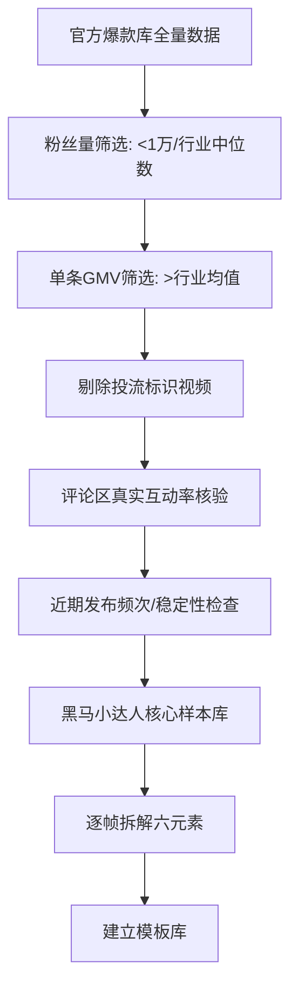

### 多源对照：黑马定义的共识与分歧

**共识**：P001 与 P002 均认为"粉丝少、销量高"是核心特征，都主张以"单粉产出"而非"绝对销量"作为评价指标。

**分歧**：P001 强调"无投流、无团队"的纯自然流样本价值，建议人工甄别剔除投流视频；P002 补充了四项硬性筛选标准（粉丝<5W、视频>200条、垂直带货、画面干净），更偏向"长期稳定输出"的账号，而非单条爆款的运气选手。

### 边界条件

需警惕"投流视频"伪装成自然流黑马：需结合"投流标识"、评论区真实互动率、近期发布频次综合判断；极低粉丝量（<1000）且高 GMV 的案例可能存在刷单、内部员工购买等作弊风险，需人工甄别；仅适用于"货找人"模式（短视频/直播带货），不适用于"私域个人 IP"模式（后者依赖长期人设积累）。

---

## 14.5 RPA 自动化采集 —— 让机器人 24 小时替你"刷视频、记笔记"

**不知疲倦的搬运工机械臂**，把图集里的砖、水泥自动搬进自家仓库，支撑起"日更 50 条+"的矩阵化运营需求。

### 为什么需要这个概念？

官方爆款库视频数量巨大（单类目日更数百条），人工逐个点击、下载、记录脚本、整理表格效率极低，无法支撑"日更 50 条+"的矩阵化运营需求。短视频带货的核心竞争力在于"模板库的广度与更新速度"，必须工业化解决"采集-清洗-入库"流程。非程序员也需要批量获取无水印视频、结构化数据（GMV、点赞、文案），用于后续去重、二创、脚本提取。RPA（影刀、八爪鱼、UiPath）正是为此而生：无需写后端爬虫、处理反爬签名、维护代理 IP 池，录制即用，产品经理/运营可上手。

### 核心定义

**RPA 自动化采集**（来源：《P001, p.3-4》、《P003》）

基于 RPA 工具开发自动化脚本，模拟人工操作浏览器：登录巨量百应 → 输入筛选条件 → 翻页滚动 → 解析列表 DOM → 提取视频链接/数据字段 → 无水印下载视频 → 导出结构化 Excel/CSV。

两大核心采集模式：
1. **创意搜索采集模式**：指定搜索词/商品名、滚动刷新次数、按 GMV 过滤视频（默认过滤 0 销量），数据采集表格导出，可选视频下载（无水印），记住上次输入的内容
2. **分类采集模式**：可选大行业、子行业类目；可选作者等级；可选时间周期；下拉刷新页数；数据采集表格导出，可选视频下载（无水印），记住上次输入的内容

> "指定搜索词/商品名;滚动刷新次数;按gmv过滤视频,默认过滤0销量;数据采集表格导出,默认到桌面;可选视频下载(无水印);记住上次输入的内容...点击确定开始运行,不刷新页数,1页下载完就22秒左右吧"
> 
> ——《P001, p.3》

> "可选大行业,子行业类目;可选作者等级;可选时间周期;下拉刷新页数;数据采集表格导出,默认到桌面;可选视频下载(无水印);记住上次输入的内容...点击确定开始运行,不刷新页数,1页下载完就55秒左右吧"
> 
> ——《P001, p.3》

### 关键性质

该工具具有三大关键性质：第一，低门槛，无需编写后端爬虫，录制即用；第二，高还原，模拟真实用户行为（鼠标轨迹、停留时长、滚动加速度），极难被风控拦截；第三，灵活性强，参数化配置，一套脚本覆盖多种采集场景。

### 典型例子

配置"搜索词=遛狗神器、翻页=20、GMV>1000"，夜间自动跑完，次日获得 400 条结构化竞品数据 + 无水印视频包，直接拖入剪映批量去重；设置"美妆行业、达人等级、近 3 天"定时任务，每天早 8 点自动推送昨日爆款榜单至飞书群，运营打开即用。这些场景展示了 RPA 在不同采集模式下的高效落地能力。

### 方法演进图：RPA 采集技术迭代路线

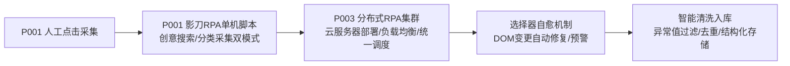

### 数据流图：RPA 采集全链路

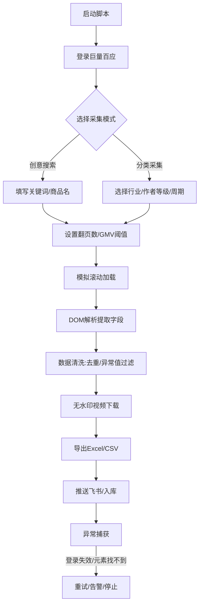

### 核心参数配置表

下表列出影刀RPA脚本在"分类采集模式"下需配置的核心参数字段，含数据类型、默认值、是否必填：

| 参数名 | 数据类型 | 默认值 | 必填 | 说明 |
|--------|----------|--------|------|------|
| big_category | String | "美妆个护" | 是 | 一级行业分类 |
| sub_category | String | "护肤" | 否 | 二级行业分类 |
| author_level | Enum | "腰部达人" | 是 | 作者等级：头部/腰部/素人 |
| time_range | Enum | "近24小时" | 是 | 时间周期：近1/3/7/30天 |
| scroll_pages | Integer | 20 | 是 | 下拉刷新页数 |
| gmv_threshold | Integer | 1000 | 否 | GMV过滤阈值，过滤低销量噪音 |
| download_video | Boolean | true | 否 | 是否下载无水印视频 |
| export_path | String | "~/Desktop" | 否 | 表格导出路径 |
| headless | Boolean | false | 否 | 是否无头模式（云部署必开） |

### 边界条件

> "我还自己用影刀做了个无人直播机器人...跑通了,不过不太好用,脚本执行的时候电脑就不能操作了"
> 
> ——《P001, p.4》

**前台阻塞**：RPA 运行期间占用主机鼠标键盘/屏幕，无法同时操作电脑，需配备专用虚拟机或云服务器。**页面变更维护**：平台前端结构变更（className、DOM 层级调整）会导致脚本失效，需定期维护选择器。**免费版限制**：通常限制并发数、运行时长、导出行数，规模化需购买商业版或自建分布式集群。[需要补充文献：分布式RPA集群架构选型对比文献]

---

## 14.6 视频六元素拆解法 —— 把"玄学爆款"拆成"标准零件"

**标准化预制构件**，墙板（背景）、门窗（标题）、主体结构（内容）、水电管线（文案/字幕）、装饰线条（BGM），拆解后才能批量组装。

### 为什么需要这个概念？

面对海量采集来的爆款视频，若无统一拆解标准，无法沉淀为可复用的"脚本模板资产"，每次选题仍靠灵感。短视频本质是多模态信息的组合，将其离散为有限维度元素，才能实现"素材池化、元素化、模板化"的工业化生产。只有拆解到元素级别，才能实现"换背景、换文案、换音乐、换混淆素材"的排列组合，批量生成差异化原创视频。

### 核心定义

**视频六元素拆解法**（来源：《P004》）

将任意短视频标准化拆解为 6 个正交元素：
1. **背景**：底图/底视频
2. **标题**：主标/副标/封面大字
3. **内容**：核心画面素材（图/视频/混剪片段）
4. **文案**：口播稿/旁白文案
5. **字幕**：样式/位置/动效/关键词高亮
6. **背景音乐**：BGM/音效/节奏卡点

建立"元素-素材"映射表：每个元素对应一个可替换的素材集合（如背景池 50 张、BGM 池 30 首、文案模板 10 套）。

> "所有的视频都可以拆成以下元素：1. 背景：图或者视频 2. 标题：主、副标题 3. 内容：图、视频 4. 文案：5. 字幕：6. 背景音乐：...视频模板有各种各样的形式，拆解的多了会发现其实都是上面提到的那些元素组成的"
> 
> ——《P004, p.2-3》

> "举例，第一个流量视频模板可以拆解为：背景：一张中医大师的照片，放大模糊；标题：请等一下，xxxx；内容：一张中医大师的照片；文案：国医大师xxx；字幕：无；背景音乐："
> 
> ——《P004, p.3》

### 关键性质

该方法具有三大关键性质：第一，完备性，覆盖视频视觉、听觉、文本三大模态，无遗漏；第二，正交性，单一元素变更不影响其他元素逻辑（如换 BGM 不需改文案），支持独立迭代；第三，可计算性，元素化后可编写代码按规则随机组合，实现"万视频一键生成"。

### 典型例子

某中医养生流量视频拆解：背景 = 名医照片高斯模糊；标题 = "请等一下，别再盲目补肾了"；内容 = 名医照片特写 + 古籍翻页动画；文案 = "李老中医讲：肾虚分阴阳..."；字幕 = 黄色黑边重点词放大；BGM = 纯音乐《高山流水`。

**同模板换赛道**：背景换成"健身教练照片"，标题换"别再练错平板支撑"，内容换"动作对比演示"，文案换"教练讲：核心收紧..."，BGM 换"节奏感电子乐"，生成健身赛道新视频。这一拆解过程展示了六元素正交性带来的跨赛道复用能力。

### 方法演进图：从人工拆解到自动化生成

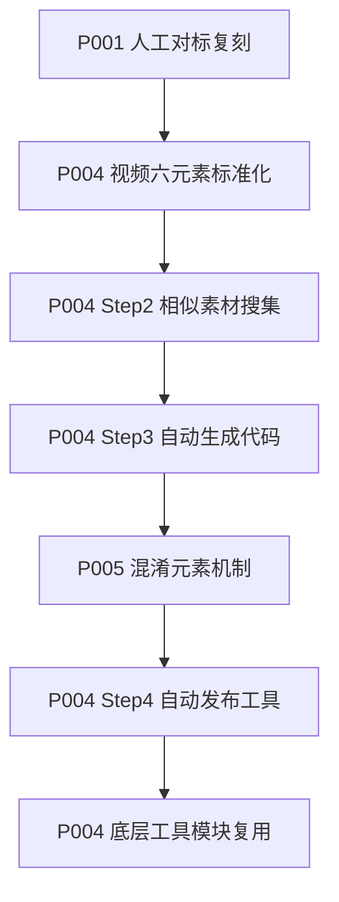

### 边界条件

复杂特效视频（AE 合成、3D 动画、绿幕抠像、转场特效）难以用六元素完全覆盖，需引入"特效层/动画层"扩展元素；直播切片、真人口播实拍类视频，"背景"与"内容"耦合度高，拆解边界模糊，需人工标注切片时间段；仅解决"形式层"拆解，无法直接提炼"策略层"逻辑（如为什么这个钩子有效、痛点挖掘路径），需配合"脚本复盘框架"使用。

---

## 14.7 混淆元素机制 —— 给批量视频加上"指纹伪装"

**每栋房子独有的"门牌号与庭院景观"**，虽然户型（模板）一样，但自家实拍的独特细节让验房师（算法）判定为"原创独立建筑"。

### 为什么需要这个概念？

平台原创检测算法（指纹比对、帧级特征匹配、音频指纹）会精准识别"同模板批量生成"的视频，判定为"低质搬运/非原创"而限流。纯参数化随机组合（换背景图、换文案）仍保留核心画面结构相似度，无法通过"逐帧去重"检测。必须引入"真实独家素材"打破视频指纹的高度相似性，制造"每条视频都有独家画面"的假象。

### 核心定义

**混淆元素机制**（来源：《P004, p.4》、《P005》）

在自动生成视频的固定时间点（如开头 1s、结尾 2s、中间穿插），强制插入"自拍实拍素材库"中的随机片段（真人出镜/手持产品/办公环境/生活碎片），作为"混淆元素"。

混淆素材要求：自有版权、真实拍摄、画面动态变化、与主体内容弱相关，数量需 ≥ 视频生成总量 × 3 倍，保证低重复率。

> "每个视频的生成时都加一些混淆元素，用自己拍的照片和视频...再加上混淆元素，这样能保证做出来的视频都是原创视频，且每个视频生成的都不相同，在任何一个平台都能过原创。"
> 
> ——《P004, p.4》

> "1、每个素材随机取用 2、如果模版视频有多个片段，那么每个片段素材内的时间段也随机取用 再加上混淆元素，这样能保证做出来的视频都是原创视频，且每个视频生成的都不相同"
> 
> ——《P004, p.4》

### 关键性质

该机制具有三大关键性质：第一，破坏指纹连续性，插入真实噪声帧，打断算法的长序列特征匹配；第二，低成本可规模，一次拍摄 100 条 5-10 秒混淆素材，可支撑 1 万+ 视频生成；第三，合规性强，素材为自有实拍，非网络搬运，无版权风险，平台申诉通过率高。

### 典型例子

中医养生号：准备 50 条"翻书、写字、喝茶、整理草药"实拍视频，生成视频时随机插入开头 1 秒"翻书动作"、结尾 2 秒"喝茶点头"。好物分享号：拍摄 30 条"手持产品特写、放入包装盒、贴快递单"素材，每条带货视频中间随机穿插 1 个"手持特写"镜头。这些实操证明了混淆元素在不同赛道的通用有效性。

### 流程图：混淆元素注入与原创判定

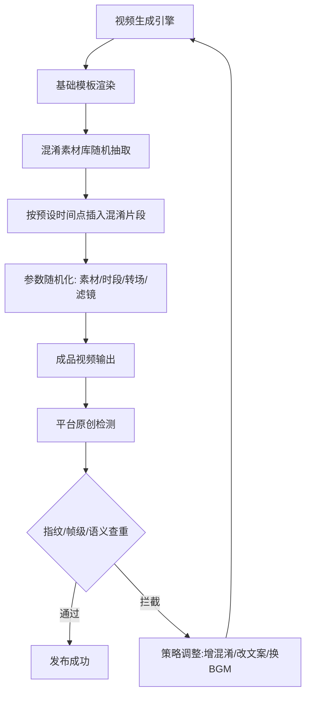

### 边界条件

混淆素材过长或频次过高会稀释核心卖点信息密度，影响完播率与转化率，建议总时长占比 < 15%；若混淆素材画面质感与主体模板差异过大（如 4K 实拍 vs 720P 模板素材），会被判定为"拼凑感强"降权；无法对抗"语义级查重"（如文案高度相似、口播文本同源），需配合"文案改写/同义词替换/TTS 变音"综合使用。

---

## 14.8 情趣用品四象限 —— 让选题不再拍脑袋

**四大户型设计流派**：中式庭院（情共情）、洛可可风（趣反差）、现代智能宅（用实用）、文创文物馆（品稀缺），选定流派才能精准找买家。

### 为什么需要这个概念？

短视频选题常陷入"追热点无方向、做垂类不懂用户、拍产品没痛点"的三无困境，缺乏系统性选题地图。爆款内容底层逻辑具有普适性，跨平台、跨赛道的爆款均可归因于有限的心理机制与内容结构。需要一套可操作、可细分、可穷举的内容分类体系，指导"找素材、定模板、写文案"全流程。

### 核心定义

**情趣用品四象限**（来源：《P006, p.2-3》、《P007》）

将所有短视频内容归纳为四大核心象限及其无限下钻分支：

1. **情（共情）**：喜怒哀乐 → 细分至"30 岁女生职场委屈""50 岁男人更年期焦虑""宝妈带娃崩溃瞬间"
2. **趣（反差/新奇）**：反差萌/奇葩实验/极限挑战 → "80 岁奶奶做街舞""用榴莲壳做盆栽""挑战 24 小时不睡觉"
3. **用（实用/教学）**：技能教学/避坑指南/工具测评 → "PPT 3 分钟做年终汇报""电钻换钻头教程""五款除螨仪横评"
4. **品（稀缺/特色产品）**：地域特产/非遗手作/信息差好物 → "北方人没见过的酸角糕""云南鲜花饼手工制作""日本进口收纳神器"

选题即在四象限坐标系中"定点、钻分支、找对标、做模板"。

> "我把短视频内容分为\"情趣用品\"四个字...情-共情（举例：喜怒哀乐）喜怒哀乐里面又能延伸小朋友的喜怒哀乐，20岁的，30岁的，40岁的，50岁的，男人的，女人的，有钱男人的，没钱女人的等等一些列分支。趣-有趣（有意思的实验，80岁老人做口播，一些反差较大的有意思的内容）用-有用（你教会我做菜了，你在教我做PPT，你教我做电工等等）品-新奇特的产品（北方人大多数没见过酸角糕，很多地方特色的绿植其他地区没见过）所有短视频平台的爆款内容，都可以纳入其中。"
> 
> ——《P006, p.2-3》

### 关键性质

该体系具有三大关键性质：第一，穷举性，四象限分支可细分至上千个微细分人群/场景，覆盖全域内容机会；第二，正交性，四象限触发的用户心理机制互不重叠（共情→情绪共鸣，趣→多巴胺分泌，用→工具价值，品→稀缺性焦虑），可组合叠加；第三，可迁移性，同一分支模板可跨平台（抖音/视频号/快手/小红书/TK）复用，仅需调整呈现风格。

### 典型例子

视频号带货案例：作者放弃"做商品"（品象限单一竞争），转向"做人群"——A 账号锁定"情"象限下的"20-30 岁虚荣穷白领"（发奢侈品平替/职场穿搭），B 账号锁定"情"象限下的"35-45 岁怀旧群体"（复古物件/老歌翻唱），C 账号锁定"情"象限下的"50+ 女性亲情共情"（家庭伦理/养生话术），7 天 4 号累计 10 万粉、5 万利润。知识付费赛道：某账号长期占据"用"象限"AI 工具教学"分支，配合"趣"象限"AI 搞笑对比梗"，单条视频涨粉 2 万+。这些案例展示了四象限在不同商业目标下的灵活组合应用。

### 方法演进图：四象限选题体系演进脉络

### 决策树：四象限选题定位与变现匹配

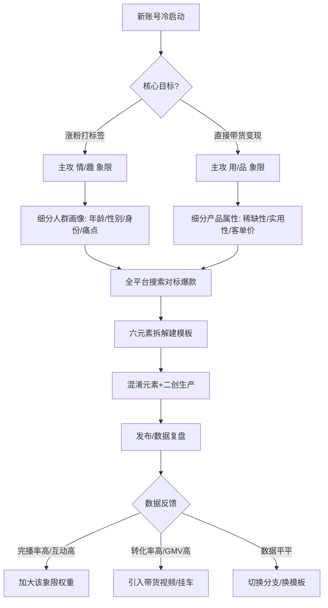

### 多源对照：四象限的不同落地侧重

**共识**：P006 提出四象限作为内容分类底层逻辑，P007 明确将其作为跨平台素材库检索的锚点。

**分歧**：P006 强调"人群定位"优先：在成千上万的分支里"扣到一个点就够了"，反对贪多；P007 强调"素材溯源"穷举：对每个分支在全平台搜索高赞素材，建立"编导直觉"，主张广撒网后再聚焦。

### 边界条件

仅为内容分类框架，不包含"变现路径匹配"（如'情'象限易涨粉难带货，'品'象限易带货难涨粉），需结合商业模式选择象限；过度细分分支会导致受众池过小，流量天花板极低，需平衡"精准度"与"流量池大小"；依赖创作者对用户心理的洞察力，若对目标人群"情/趣/用/品"触发点认知偏差，选题仍会偏离。

---

## 14.9 全平台素材库二创法 —— 把别人的"过期素材"变成你的"爆款库存"

**环球采购建材**：抖音的梁、快手的柱、小红书的瓦、TK的漆，拿来按自家图纸（四象限逻辑）重新组装，成本极低。

### 为什么需要这个概念？

单一平台素材池有限，易陷入"同质化内卷"，且平台算法会压制站内高相似度内容。不同平台用户画像、内容偏好、审核标准差异大，抖音"烂尾"视频搬运至视频号/小红书经常成爆款，存在巨大"跨平台信息差套利空间"。自己拍摄成本高、周期长、不确定性强，二创成熟素材边际成本趋近零，成功率可控。

### 核心定义

**全平台素材库二创法**（来源：《P007》）

以"情趣用品四象限"为底层逻辑锚点，将抖音、快手、优酷、知乎、小红书、TikTok 等全网短视频平台视为"共享素材库"。

二创流程：
1. 锚定象限分支
2. 全平台搜索该分支高赞/高播/高互动视频
3. 下载无水印
4. 逐帧拆解
5. 保留核心叙事结构
6. 替换文案/语音/BGM/混淆素材/字幕样式
7. 重新剪辑合成
8. 发布至目标平台/账号

核心原则：**不违规**（无版权投诉、无水印、无商标侵权）、**保底层逻辑**（钩子/节奏/反转/金句）、**换表达形式**。

> "抖音，快手，优酷，知乎，小红书，甚至TK，所有的短视频平台都是你的素材库...通过这个底层逻辑，你会发现很多爆款都是有迹可循，我们要做的无非是把这些素材不违规的二创成自己赛道的作品，进行发布。"
> 
> ——《P007, p.2》

### 关键性质

该方法具有三大关键性质：第一，复利效应，制作 30-50 条二创视频后，大脑会建立"爆款片段索引库"，看到未上热门视频也能直觉性提取可用片段/音乐，形成"编导直觉"；第二，规模化前提，必须建立"素材下载-分类-标签-去重-归档"的本地/云端素材管理系统（如飞书多维表格+网盘），否则素材找不到等于白下载；第三，跨平台套利，抖音"情"象限情感类文案 + 视频号"品"象限特色产品展示 = 视频号带货新爆款模板。

### 典型例子

从抖音搬运"情"象限"父母养老焦虑"访谈类高赞视频，保留核心金句"别等子女有钱了再孝顺"，替换 BGM 为舒缓钢琴曲，插入自有"养生茶产品"展示镜头，发布至视频号带货，单条 GMV 3 万+。从 TikTok 搬运"趣"象限"神奇工具测评"视频，去除洋人面孔，重新录制中文旁白"这个神器只需 9.9"，替换字体为中文粗体，发布至小红书/抖音，单条点赞 10 万+。这些案例验证了跨平台二创在不同目标平台上的可行性与收益。

### 方法演进图：二创方法论迭代路径

### 时序图：二创标准化执行流程

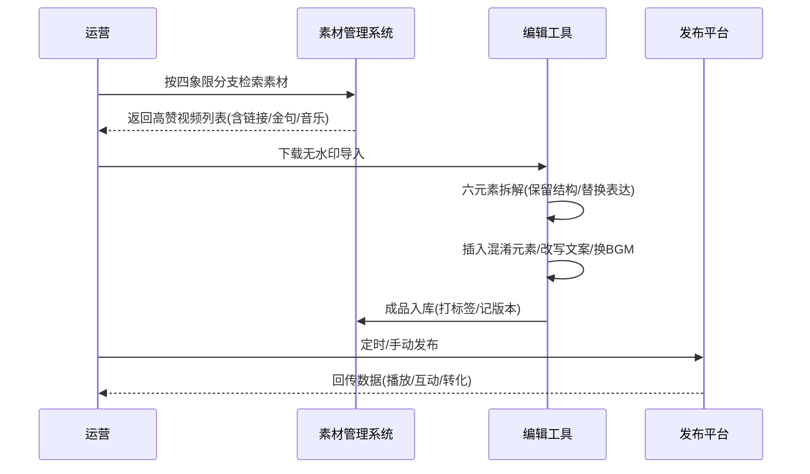

### 边界条件

严禁直接搬运"含水印/商标/真人面孔/独家版权音乐/影视剧片段"的视频，必限流封号；二创深度不足（仅加个片头片尾、换个 BGM）会被判定"搬运/洗稿"，需达到"叙事结构重组+核心素材替换≥60%"的原创标准；素材源平台若为"独家首发/签约独家"，搬运风险极高，优先选择"泛娱乐/知识科普/生活记录/开源素材"类账号内容。

---

## 14.10 克服知识诅咒 —— 少想多干，用"行动配额"对抗"分析瘫痪"

**强制自己"日砌100块砖"**，别琢磨风水（变现）、看进度（后台），先把墙砌起来，数据自然会说话。

### 为什么需要这个概念？

认知越深、经验越丰富的人，越容易陷入"变现路径不清、资源利用率低、未来风险不可控"的过度思考，导致迟迟不敢发第一条视频、不敢投第一笔 Dou+、不敢招第一个主播。短视频带货是"概率游戏+快速试错"，思考 100 遍不如做 1 个模板、跑 1 个账号、看 1 次数据来得真实。需要一套强制执行的"行为锚点"，绕过大脑防御机制，建立"动作→反馈→修正"的最小闭环。

### 核心定义

**知识诅咒与行动配额**（来源：《P008, p.2-3》）

**知识诅咒**：指对行业认知越深，越倾向于在行动前预演失败路径，导致执行力反比于认知水平的心理现象。

**两大破解动作**：
1. **变现看对标**：不想怎么变现，直接去对标账号主页看挂车/挂链接/直播间/私域引流，照抄即可
2. **不看后台**：设定"日更 N 条/号"硬性指标（如 10 条/天/号），全天只看 1 次后台数据（复盘用户画像/完播率/掉粉点），其余时间只管生产发布

> "这部分人群其实对短视频平台，内容制作有很深刻的理解，但是考虑的太多...反而没有顾虑的人执行起来更容易拿到结果，切勿陷入精神内耗...第一点大多数人都会在意的点，账号如何变现，能赚多少钱？这点其实航海教练也说过很多次了，想知道你的赛道如何变现去看你的对标。第二点没有播放量的焦虑如何克服？不去看他，我给自己定的目标是一天一个账号10条视频...一天最多看一次后台数据"
> 
> ——《P008, p.2-3》

### 关键性质

该策略具有三大关键性质：第一，强制性，将"思考"转化为"可执行的配额指标"，用纪律替代动力；第二，极简性，只保留两个动作（看对标、发视频），砍掉一切"战略思考、长期规划、完美主义打磨"；第三，正反馈驱动，完成配额即获得"完成感多巴胺"，数据好获得"成就感多巴胺"，形成正向循环。

### 典型例子

作者自身案例：深知视频号带货变现难、平台打击搬运、账号易死，但强制自己"日更 40 条（4 号×10 条）"，不看后台只管剪，7 天后数据反馈指导调整，最终跑通 3 个号。朋友案例：程序员出身，纠结"自动化生成代码架构不够优雅"，作者建议"先手动跑通 1 个号再写代码"，手动跑通后 3 天变现 2 万，才有动力重构自动化系统。这些实例展示了行动配额在不同人群、不同阶段的普适有效性。

### 方法演进图：心法演进与执行闭环

### 闭环图：行动配额执行与反馈修正

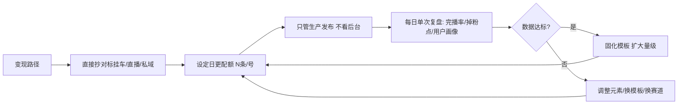

### 设计中的取舍

**为什么不用"完美规划后再执行"？**

因为短视频平台算法、热点、竞品环境变化极快，规划的半衰期极短。完美规划往往基于过时假设，而"日更 N 条"的粗暴执行能在真实环境中快速获得反馈，用数据修正认知。

**这种设计的 trade-off 是什么？**

收益：极大缩短 0-1 验证周期，规避"分析瘫痪"，低成本试错。代价：前期会产出一定比例"废片"（播放低、不转化），浪费部分制作成本；不适用于高客单/强合规业务（试错成本不可承受）。

### 适用边界

仅适用于"0-1 冷启动、1-10 规模化早期"，当团队规模 > 10 人、月 GMV > 100 万时，必须引入战略复盘、数据中台、风控体系，不能盲目"莽"；不适用于"高客单/重决策/强合规"业务（如医疗、金融、法律咨询），此类业务试错成本极高，必须深思熟虑后行动；需具备基本的"底线思维"：账号实名合规、内容不违规、资金安全、不触碰法律红线，在此底线上"少想多干"。

---

## 14.11 账号孵化输送模式 —— 做流量的"专业户"，把变现外包给"供应链"

**专业造房队+专业卖房队分工**：你只管盖好样板间（账号/流量），交给销售大军（直播基地/供应链）去卖、去交付，按套分成。

### 为什么需要这个概念？

个人/小团队精力有限，"又做流量（拍视频、剪辑、投流）、又做转化（选品、谈供应链、客服、发货、直播）"必然两头受阻，上限极低。直播带货需要"日不落"排班、专业话术、售后体系、供应链兜底，非专业团队极难跑通，且账号随时可能被封，自建直播风险过大。视频号/抖音存在大量"缺流量、有供应链、有直播基地"的商家/MCN，急需成熟账号导流，形成天然的"流量生产方-变现承接方"分工协作市场。

### 核心定义

**账号孵化输送模式**（来源：《P009, p.3-4》、《P010》）

**专注"内容侧"**：批量孵化垂类账号矩阵（养号→发视频→涨粉→打标签→稳定出单），将账号做到"日稳定产出精准流量/意向线索"阶段。

**接入"变现侧"**：与直播基地/供应链商家/达人机构合作，将账号"输送"对方直播间（挂车/挂链接/引导进直播间），按 GMV 分成（如 37 分、46 分）或按线索付费（CPA）结算。

**核心公式**：个人收益 = 账号日均流量价值 × 分成比例 × 账号存活周期 - 养号成本，追求"单账号 ROI 最大化"而非"GMV 最大化"。

> "我的思路一直是专注一条线...如果我又做账号又直播只能是个人打法，能赚钱但有限，你也不知道什么时候平台打击你的账号，就一无所有了。专注流量自己孵化账号，同步找伙伴加入一起做账号。做出的账号输送到基地去日不落。帮助基地打造他们的视频号案例，然后手牵手去做商家。我们做任何项目都需要具备财务逻辑。投多少钱，赚多少钱。只要创造的收入和号的成本打的正就行。"
> 
> ——《P009, p.3-4》

### 关键性质

该模式具有三大关键性质：第一，轻资产，无库存、无发货、无客服、无直播间搭建成本，核心资产是"账号矩阵+内容模板库+对标数据库"；第二，抗风险，单账号死亡不影响整体模型，可快速复制新号；分成模式下，变现端违规（如产品质量问题）不连坐内容端；第三，可复制，一套"孵化 SOP + 对接话术 + 分成合同模板"可横向复制至多个赛道、多个基地、多个平台。

### 典型例子

作者视频号案例：4 个账号跑通"怀旧/亲情/白领"三大人群标签，主动联系本地"服装/珠宝/养生"直播基地，谈妥"账号引流、基地直播、五五分成"，自己仅负责日更视频、维护账号活性，月分成 5 万+。抖音盲盒项目：团队专注"盲盒开箱/福袋互动"内容起号，将成熟账号对接"盲盒供应链平台"，平台负责发货/售后/合规，团队按订单分成，单账号周期 2 周，批量复制 20 号轮换。这些案例展示了该模式在不同平台、不同品类下的复制性与收益稳定性。

### 从众心理与炒群运营（配套战术）

> "在有这个情况很有意思，就是直播间明明也有人，福袋也发了，就是没人会去抢。在这个时候，只要有人开了这个头，你就会发现后面突然一下，会跟着好几个人都参与了福袋...这时候小号先开个头，后面自然就有人跟了，这叫从众心理。"
> 
> ——《P010, p.2》

> "在粉丝群里已经有一定用户数量的情况下，可以把群禁言解除掉，自己安排几个小号去里面秀成果带节奏，然后主播再顺势引导用户一起冲，搞完了再恢复群禁言。这个方法我们称之为炒群..."
> 
> ——《P010, p.3》

利用从众心理在起号期用小号带头抢福袋、评论区造势；粉丝群积累后解禁安排小号秀单带节奏，主播顺势转化。

### 封设备判断与刷机处置流程

> "先等禁播时间过了，然后用被禁播的号去直播，看一下直播间是否还有正常推流...如果播几分钟就被'违反直播行为规范'，那就是确定了封设备，直接刷机。"
> 
> ——《P010, p.4》

针对"违反直播行为规范"的严重违规，提供系统处置流程：单号复播验证推流 → 换机排查 → 次日抖音来电判断 → 确认封设备直接刷机。

### 平台合规性自研判断

> "如果说都是用的别人的，这个平台本身就是套了个壳，大概率是看这段时间这个项目在红利期，想来跟波风，收割一波，这种就很危险。以及概率方面是平台自己跑的，还是用的别人现成的，这个真的非常重要。"
> 
> ——《P010, p.4》

判断合作平台是否可靠的关键在于：源码是否自研、概率算法是否自研。若均为外部购置现成套壳，大概率是追风收割，风险极高。[需要补充文献：平台源码审计与合规白皮书参考]

### 全链路图：账号孵化输送商业闭环

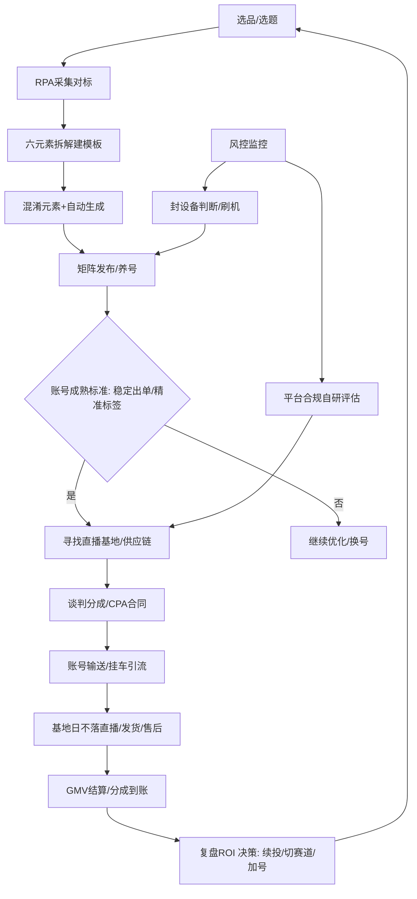

### 分成模式博弈与风控要点表

下表列出分成模式下的核心博弈点与风控要点，供谈判与合同设计参考：

| 博弈/风控维度 | 流量方诉求 | 变现方诉求 | 风控建议 |
|--------------|------------|------------|----------|
| 分成比例 | 高分成（50%+） | 低分成（30%-40%） | 设置阶梯分成：GMV阈值分档，激励双方 |
| 账号所有权 | 归内容方/关联公司 | 运营期内归基地 | 合同约定：主体实名为内容方，粉丝群/私域归内容方 |
| 违规连坐 | 变现端违规不连坐内容端 | 内容端违规由内容方担责 | 明确责任边界：基地违规导致封号赔偿账号沉没成本 |
| 合作终止 | 随时可收回账号平滑过渡 | 需保护期回本 | 任一方提前7天书面通知，账号平滑收回 |
| 平台政策红线 | 规避挂车引流/第三方导流打击 | 合规直播间承接 | 持续关注规则，预留切换直播间/私域引流方案 |

### 多源对照：分成模式的博弈与风控

**共识**：P009 提出"流量侧专注、变现侧外包"的分工逻辑，P010 补充"财务逻辑导向"：号作消耗品、产值与成本打正。

**分歧/张力**：**分成比例谈判博弈**：流量方想要高分成，变现方想压低分成；无标准化定价体系，靠谈判力和替代性决定。**账号所有权归属模糊**：输送后账号由谁运营、粉丝归谁、后续能否收回，需合同约定，否则极易扯皮。**平台政策红线**：视频号打击"挂车引流"、抖音打击"第三方导流"可能切断模式，需持续关注规则红线。

### 边界条件

依赖"成熟供应链/直播基地"的存在，冷门赛道、非标品、定制品类难以找到靠谱承接方；分成比例谈判博弈激烈：流量方想要高分成，变现方想压低分成；无标准化定价体系，靠谈判力和替代性决定；账号所有权归属模糊：输送后账号由谁运营、粉丝归谁、后续能否收回，需合同约定，否则极易扯皮；平台政策收紧（如视频号打击"挂车引流"、抖音打击"第三方导流"）可能切断模式，需持续关注规则红线。

---

## 14.12 爆款生命周期管理 —— 在流量"下坡路"来临前换挡

**楼盘热销周期**：开盘抢购（起飞/爆发）→ 持续去化（平台）→ 尾盘清盘（衰退），聪明开发商在热销期就启动下一盘（接力新号）预售。

### 为什么需要这个概念？

短视频爆款存在显著的"生命周期曲线"：起飞期→爆发期→平台期→衰退期，多数运营者只会"蹭爆发期"，不知"守平台期、避衰退期"。盲目加大投流/延长直播/高频发视频透支账号权重，导致衰退期提前、账号废号，得不偿失。需要一套基于数据拐点的"动态运营策略"，在流量高峰通过时主动降频、引入外部变现、启动新号接力，实现"账号矩阵持续造血"。

### 核心定义

**爆款生命周期管理**（来源：《P010》、《P009》）

监测核心指标：日播放量环比增速、完播率、互动率、直播间实时在线峰值、GMV 转化率。

识别拐点：
- 连续 2 天日播放量环比下降 > 30%
- 或单日播放量跌破峰值 50%
- 或直播间峰值在线连续 3 场下降
→ 判定进入"衰退期"

**衰退判定公式**：

$$ \text{衰退判定} = (\text{日播放环比} < -30\% \land \text{连续2天}) \lor (\text{单日播放} < \text{峰值} \times 50\%) \lor (\text{直播峰值连续3场下降}) $$

**逐步推导与业务含义**：

我们从布尔代数角度推导该判定逻辑的合理性。设三个判定条件分别为：

- $A$：日播放环比 $< -30\%$ 且连续 2 天
- $B$：单日播放 $< \text{峰值} \times 50\%$
- $C$：直播峰值连续 3 场下降

衰退判定 $D = A \lor B \lor C$。这是一个析取范式（DNF），任一子句为真即触发衰退模式。该设计遵循"宁可错杀、不可放过"的风控原则：单一指标波动可能源于噪声，但三条独立维度（自然流量衰减、绝对流量跌破半高线、直播承接能力衰退）任一确认，即表明流量红利窗口关闭。

进一步分析每个子句的业务含义：

1. **子句 A（环比连续下跌）**：$\text{日播放}_t / \text{日播放}_{t-1} < 0.7$ 且持续 2 天。说明算法推流进入衰减通道，自然流量池枯竭，继续投流边际收益递减。从流量曲线角度看，这是一阶导数（增速）由正转负并放大的信号。
2. **子句 B（绝对值跌破半高线）**：$\text{日播放}_t < 0.5 \times \max(\text{日播放}_{1..t-1})$。流量已跌破半高线，用户新鲜感消退，内容边际价值急剧下降。这是对流量幅值的直接判定，抗噪性强。
3. **子句 C（直播承接衰退）**：$\text{峰值在线}_t < \text{峰值在线}_{t-1} < \text{峰值在线}_{t-2}$。直播间承接能力衰退，标签模型漂移，留人/转化双双失效。这是变现端的先行指标，往往早于视频流量衰退。

三条件满足任一即触发"衰退期模式"，避免单一指标波动误判。

分阶段策略：
1. **起飞期（0-3 天）**：全力投流、高频发布、长时直播、抢占标签
2. **爆发期（3-7 天）**：维持节奏、优化转化、收割红利、**同步孵化接力新号**
3. **平台/衰退期（7 天+）**：主动减少直播时长/投流预算、停发低质视频、引入外部基地/合伙人承接存量流量、启动新号矩阵

> "账号爆了三天，自己播了三天，真的坐下来开播就是钱。一个小时几千块的感觉，会让人沉迷。但我意识到不能这样，如果每时每刻都在直播，我没有精力去做内容，流量迟早被消耗完。而且主要三个账号一起爆，我只能选择最好的账号直播。吃了三天最高峰流量。第四天大概只有2000万左右播放了，我把直播时间减少到3个小时。"
> 
> ——《P009, p.3》

> "直播不应因无警告或断播就持续播放，因为继续播并不必然带来更高流量和转化，但账号风险必然增加；被处罚后当天不应再播，要见好就收和及时止损。"
> 
> ——《P010, p.4》

### 关键性质

该管理体系具有三大关键性质：第一，逆人性，爆发期最爽、最想"再播一会儿、再投点钱"，恰恰是最该"收手、布局下一个"的时候；第二，系统性，单账号生命周期不可逆，但"矩阵账号接力"可实现整体流量的持续稳定输出；第三，数据驱动，拒绝"凭感觉"，建立"每日复盘看板"，拐点判断标准化、执行动作 SOP 化。

### 典型例子

作者视频号案例：C 账号第 5 天单日 4000 万播放（峰值），第 6 天跌至 2000 万，作者果断将直播时长从"全天"压缩至"3 小时"，同步引入外部直播基地合作分成，避免流量过度消耗导致账号权重崩塌，延长变现窗口 10 天。某美妆矩阵团队：建立"账号轮换表"，账号 A 处于爆发期主投，账号 B 处于起飞期养号，账号 C 处于衰退期收割/输送基地，账号 D 备用注册，实现全年无淡季。这些案例验证了动态运营策略在不同团队规模下的有效性。

### 状态机：爆款生命周期四期动态转换

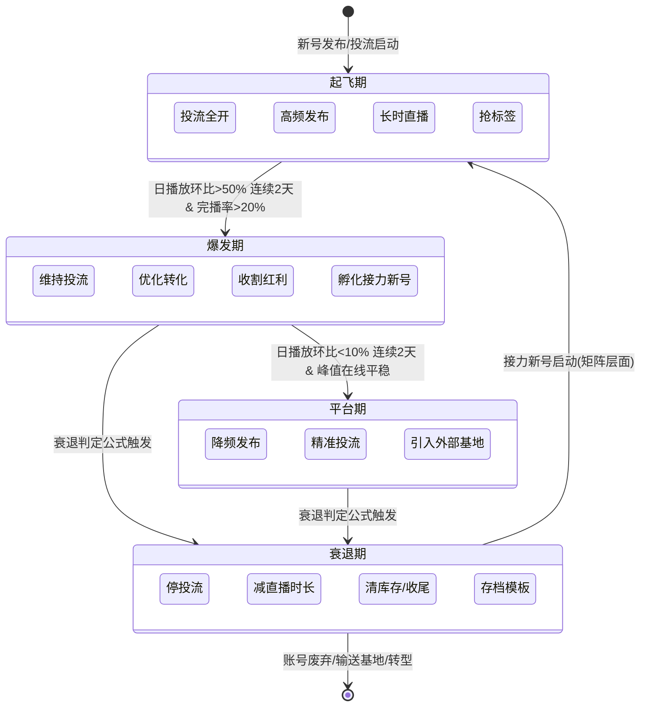

### 公式落地指南

该衰退判定公式在工程落地时，建议以"每日复盘看板"形式固化：在飞书多维表格/Excel中预设三列布尔判定列（A/B/C），每日自动拉取巨量百应/蝉妈妈 API 数据计算，任一列为 TRUE 即触发红色预警，运营按 SOP 执行"减投流→减直播→启动新号"三步走。公式参数（-30%、50%、3 场）为经验值，不同赛道需校准：视频号带货周期短可收紧至 -20%、40%、2 场；抖音种草号周期长可放宽至 -40%、60%、5 场。

### 边界条件

不同赛道/平台生命周期长短差异大：视频号带货周期短（3-7 天）、抖音种草号周期长（14-30 天）、直播间成熟账号可长期稳定（90 天+），需赛道校准。[需要补充文献：不同赛道生命周期分布的实证研究数据]突发热点/平台活动/节日大促会打断自然周期，需建立"事件驱动模式"覆盖常规周期模型；仅适用于"免费/低投流自然流量"账号，重投流付费账号（ROI 模型跑通）生命周期受预算控制，非自然衰退。

---

## 14.13 设计中的取舍

### 为什么不用"全人工剪辑"而是"自动化生成+混淆元素"？

全人工剪辑灵活但上限低：单人日更 10-20 条极限，无法支撑矩阵化"靠量获取免费流量"的打法。自动化生成虽需前期开发投入，但边际成本趋近零，配合混淆元素可规模化通过原创审核，是"免费流量时代"的唯一可行解。**Trade-off**：前期开发成本高、需维护模板代码，换取边际成本趋零与规模化产能；若赛道极度依赖"重表演/重特效/重人设"，自动化生成表达力不足，需回归人工。

### 为什么不用"大号对标"而是"黑马小达人对标"？

大号自带粉丝流量池，其爆款包含"粉丝红利"成分，去除粉丝后模板转化率可能归零。黑马小达人纯凭内容取胜，模板本身即具备"冷启动转化力"，是普通人可复制的"纯技术资产"。**Trade-off**：黑马样本量少、需人工甄别投流作弊，换取模板的高可复制性与低学习门槛；若目标是"做个人 IP/长期品牌"，大号的运营节奏、人设打造更具参考价值。

### 为什么在爆发期主动"收手"减少直播/投流？

因为继续高强度消耗流量会透支账号权重（算法判定内容质量下降、用户疲劳），导致衰退期断崖式下跌、甚至账号废号。主动降频、引入外部基地承接，实则是"以空间换时间"，保护账号资产残值，同时释放精力孵化接力新号。**Trade-off**：放弃爆发期尾部的边际收益（可能还能多赚几万），换取账号存活周期延长、团队精力释放、新号孵化提前启动；若账号本身就是"一次性消耗品"（如盲盒/福袋号），则无需收手，榨干即弃。

### RPA 前台阻塞 vs 云端部署成本

**前台阻塞**是 RPA 固有缺陷：脚本运行占用鼠标/键盘/屏幕，物理机无法并行操作。**云端部署**方案：租用 2C4G/4C8G 云服务器（月费 100-300 元/台），配置 Windows Server + 影刀/八爪鱼客户端，实现 7×24 小时无人值守采集。**成本权衡**：单台云服务器日采集上限约 2000-3000 条（受平台频控限制），日需 5000+ 条需 2-3 台集群 + 负载均衡 + 统一调度，月成本 500-1000 元，远低于雇佣众包采集（按条付费约 0.1-0.3 元/条，月成本 1.5-4.5 万）。[需要补充文献：分布式RPA集群架构选型对比文献]

### 六元素正交性 vs 表达力损失

强制将视频拆解为六大正交元素，获得了"可计算、可组合、可批量"的工程红利，但牺牲了"跨元素耦合的精妙表达"（如：文案语气必须配合特定 BGM 节奏、字幕动效必须卡在内容动作节点）。**补救**：在模板层面预设"元素组合规则"（如：文案模板 A 必须搭配 BGM 池 B、字幕样式 C），用"约束组合"替代"完全随机"，在正交性与表达力间取得平衡。

### 分成模式下账号所有权归属风险 vs 轻资产收益

账号输送给基地后，若合同未明确"账号所有权归内容方、粉丝资产归内容方、基地仅有运营使用权"，极易陷入"号养大了被基地赖账/截胡"的纠纷。**风控要点**：合同必加条款——账号主体实名为内容方/其关联公司；粉丝群/私域归内容方；基地违规导致封号由基地赔偿账号沉没成本；任一方可提前 7 天书面通知终止合作，账号平滑收回。

---

## 14.14 动手练习

### 练习 1：实战——巨量百应对标与黑马筛选

**场景**：你计划切入"中医养生茶"赛道做短视频带货。

**任务**：
1. 登录巨量百应创意中心，使用"创意搜索"输入关键词"养生茶"，按"近7天"、"GMV降序"筛选，导出Top 50视频数据。
2. 从导出数据中筛选符合"黑马小达人"标准的视频：粉丝量 < 1万，单条视频 GMV > 5000元。记录筛选出的视频数量及其共同特征（如拍摄形式、话术结构、选品价格带）。
3. 对比：若用抖查查/蝉妈妈同条件搜索，Top 50榜单有何差异？哪个榜单的"黑马"占比更高？

**思考题**：
- 为什么大达人（百万粉）的带货视频不适合作为你的模仿模板？
- "单粉GMV"指标在什么情况下会失真（如投流视频、内购刷单）？如何辨别？

### 练习 2：实操——视频六元素拆解与混淆素材库建设

**素材**：选取练习1中筛选出的1个"黑马"爆款视频链接（下载无水印版）。

**任务**：
1. 逐帧拆解：按六元素填写拆解表——背景（图/视频描述）、标题（主/副标文案）、内容（核心画面序列）、文案（口播/旁白全文）、字幕（样式/关键词高亮/出现时间轴）、BGM（曲名/节奏卡点位置）。
2. 素材替代方案设计：为每个元素准备3-5个替代素材（如背景换3张不同中医大师照片、文案改写3版同义话术、BGM选3首同风格纯音乐）。
3. 混淆素材库拍摄：用手机拍摄10条5-10秒的"自有实拍"素材（如：翻书特写、倒茶特写、手写笔记特写、整理草药特写、点头微笑特写），命名归类存入网盘文件夹。

**思考题**：
- 若该视频为"真人口播实拍"而非"图文/混剪"形式，六元素中的"背景"与"内容"边界如何界定？拆解难度如何？
- 混淆素材总时长占生成视频总时长的比例建议<15%，若超标会对完播率和转化率产生何种具体负面影响？

### 练习 3：设计——RPA采集脚本参数配置与异常处理流程图

**场景**：你需要每天自动采集"美妆个护"行业、"腰部达人"等级、"近24小时"爆款视频库的Top 100数据及视频。

**任务**：
1. 列出影刀RPA脚本需配置的核心参数字段（含数据类型、默认值、是否必填）。
2. 绘制脚本运行流程图：启动→登录检测→进入目标页→参数填写→翻页滚动→DOM解析→数据清洗（去重/异常值过滤）→视频下载→表格导出→飞书群推送→异常捕获（登录失效/元素找不到/下载失败/反爬拦截）→重试/告警/停止。
3. 标注流程中"前台阻塞"导致无法同时操作电脑的节点，设计"云服务器/虚拟机部署"方案的成本估算（配置、带宽、月费）。

**思考题**：
- 巨量百应前端页面结构变更（如className修改、iframe嵌套层级变化）会导致脚本哪些环节失效？建立何种"选择器自愈/维护预警机制"？
- 免费版影刀限制导出行数、并发数，规模化需求（日采集5000+条）下，自建分布式RPA集群 vs 购买商业版 vs 雇佣众包采集，三者ROI如何对比？

### 练习 4：复盘——账号生命周期拐点识别与分阶段策略制定

**数据**：某视频号带货账号（美妆赛道）连续10天核心数据如下：
- 第1-3天：日播放量 50万→120万→300万（环比增速>100%），完播率18%→22%→25%，直播峰值在线 50→200→500，GMV 2000→8000→25000。
- 第4-6天：日播放量 450万→480万→460万（环比增速<10%），完播率24%→23%→22%，直播峰值在线 800→850→820，GMV 40000→42000→38000。
- 第7-10天：日播放量 300万→150万→60万→20万（环比下降>30%），完播率20%→18%→15%→12%，直播峰值在线 600→300→100→30，GMV 25000→10000→3000→800。

**任务**：
1. 标注该账号第1-10天分别处于生命周期的哪个阶段（起飞/爆发/平台/衰退），并标出关键拐点日期及判断依据指标。
2. 针对第4天（爆发期顶点）、第7天（衰退期确立）两个关键节点，制定差异化运营动作清单：投流预算调整、直播时长/场次安排、发视频频次/质量要求、新号孵化启动时间、外部基地合作引入时机。
3. 计算：若该账号第4天起改为"每日直播3小时+停投Dou+"，预估能延长衰退期几天？节省的投流成本能否覆盖新号孵化成本？

**思考题**：
- 为何"逆人性"在爆发期主动收手（减投流、减直播）反而能延长账号总生命周期价值？
- 不同赛道（如图书教辅vs生鲜水果）生命周期长短差异巨大，如何建立"赛道校准系数"快速套用本模型？

### 练习 5：策划——跨赛道"情趣用品四象限"选题矩阵与二创执行计划

**目标**：为一个新注册的"家居收纳"视频号，规划首月（30天）内容生产计划。

**任务**：
1. 选题矩阵构建：在"情、趣、用、品"四象限中，各挖掘3个细分分支（如情-"租房党收纳焦虑"、趣-"神奇折叠收纳神器实测"、用-"3分钟衣柜整理法"、品-"日本进口真空压缩袋"）。
2. 素材溯源：针对12个分支，分别在抖音/小红书/B站/TikTok搜索3-5个高赞/高播对标视频，记录链接、核心金句、镜头语言、BGM。
3. 二创执行表：设计"原视频链接→保留结构要素（钩子/反转/金句）→替换要素（文案/人设/产品/BGM/混淆素材）→目标发布平台/账号/时间"的标准化执行表，共30条（日更1条）。
4. 合规自查清单：列出5项必查项（水印/商标/真人面孔/版权音乐/影视片段）与"原创度自测标准"（核心素材替换≥60%、叙事结构重组、混淆素材插入）。

**思考题**：
- "情"象限内容易涨粉难带货，"品"象限易带货难涨粉，新号冷启动期（0-1万粉）应以哪个象限为主？如何设计"引流款（情/趣）+ 转化款（用/品）"的发布节奏？
- 素材源账号为"独家首发/签约达人"时，二创风险极高。如何建立"素材源风险等级标签体系"（S/A/B/C级）并在执行表中自动拦截高风险素材？

---

## 14.15 本章小结

这一章中我们系统学习了短视频带货工业化方法论的全链路。首先建立了以**官方实时爆款视频库（巨量百应）**为雷达的**选品对标体系**，并提出**黑马小达人样本策略**规避头部光环、锁定可复制的纯内容竞争力；其次引入**RPA自动化采集**解决工业化数据获取难题，配合**视频六元素拆解法**将非结构化爆款标准化为正交元素，构建素材池与模板库；再次通过**混淆元素机制**破解平台查重算法，以低成本实现批量原创；然后给出**情趣用品四象限**作为穷举式选题地图，指导跨平台**素材库二创**实现信息差套利；在执行层面，用**行动配额**对抗**知识诅咒**，以纪律替代动力跑通0-1；商业模式上，提出**账号孵化输送模式**实现轻资产流量侧专注、重资产变现侧外包、风险隔离与横向复制；最后建立**爆款生命周期管理**动态运营体系，识别四期拐点、制定分阶段SOP，配合从众心理/炒群、封设备刷机、平台合规自研判断等风控战术，实现账号矩阵持续造血。

本章我们一起学习了以下概念：

下表汇总了本章核心概念及其核心解释：

| 概念 | 解释 |
|------|------|
| 官方实时爆款视频库 | 巨量百应创意中心提供的实时、高权重带货视频数据源，替代第三方工具猜测 |
| 黑马小达人样本策略 | 筛选粉丝少但单条GMV高的账号作为对标，去除粉丝红利，锁定可复制的纯内容竞争力 |
| RPA自动化采集 | 用影刀等工具模拟人工操作，批量采集官方库视频数据与无水印素材，解决工业化采集效率 |
| 视频六元素拆解法 | 将视频标准化为背景、标题、内容、文案、字幕、BGM六大正交元素，实现素材池化与模板化 |
| 混淆元素机制 | 在生成视频中强制插入自有实拍片段，打破指纹相似度，以低成本通过平台原创审核 |
| 情趣用品四象限 | 共情、反差、实用、稀缺四大内容心理机制分类，指导选题穷举、定位精准与跨平台迁移 |
| 全平台素材库二创法 | 以四象限为锚点，跨平台搜集爆款素材，保留底层叙事结构，替换表达要素实现不违规二创 |
| 知识诅咒与行动配额 | 认知越深越不敢动；冷启动期设定'日更N条、不看后台'硬指标，用纪律替代动力建立最小闭环 |
| 账号孵化输送模式 | 专注流量侧孵化账号矩阵，输送给直播基地/供应链变现分成，轻资产、抗风险、可横向复制 |
| 爆款生命周期管理 | 监测播放环比、完播率、峰值在线拐点，分起飞/爆发/平台/衰退四期执行差异化投流、直播、接力策略 |
| 从众心理与炒群 | 用小号带头互动触发真实用户跟随；粉丝群解禁安排小号秀单带节奏，主播顺势转化 |
| 封设备与刷机处置 | '违反直播行为规范'导致设备级封禁，通过单号复播验证、换机排查、抖音来电确认三步判定后刷机 |
| 平台合规性自研判断 | 合作平台若源码套壳、概率外购，大概率追风收割，需规避；自研能力是长期靠谱的核心信号 |

下一章中，我们将学习**搜索流量蓝海**，掌握抖音SEO的底层逻辑，从选蓝海词、优化细节指标到工业级素材库，学会在推荐流量之外开辟精准、持久、低成本的搜索流量渠道。

