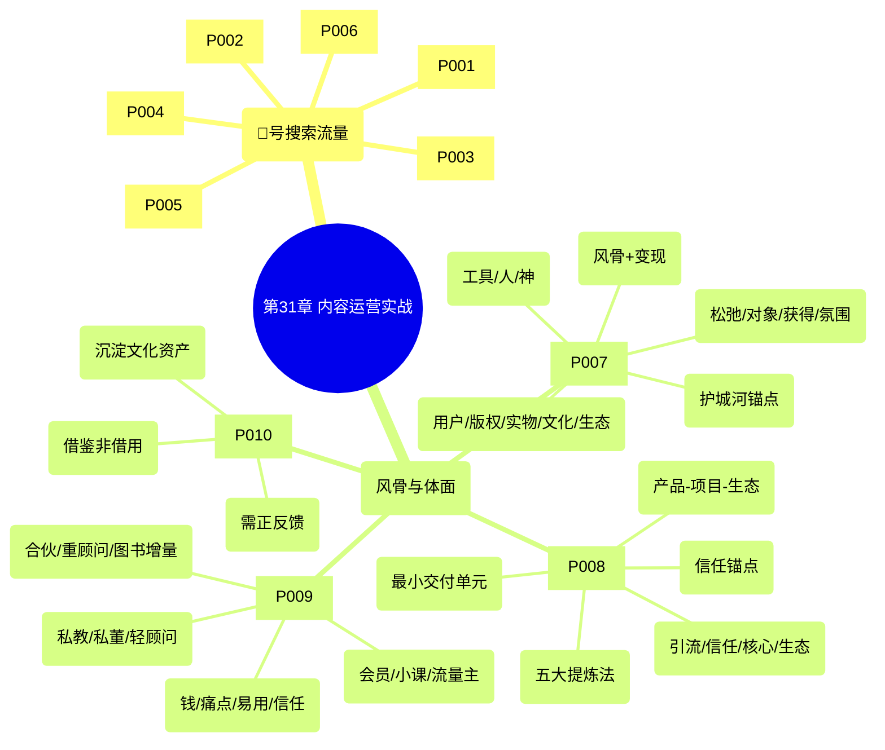
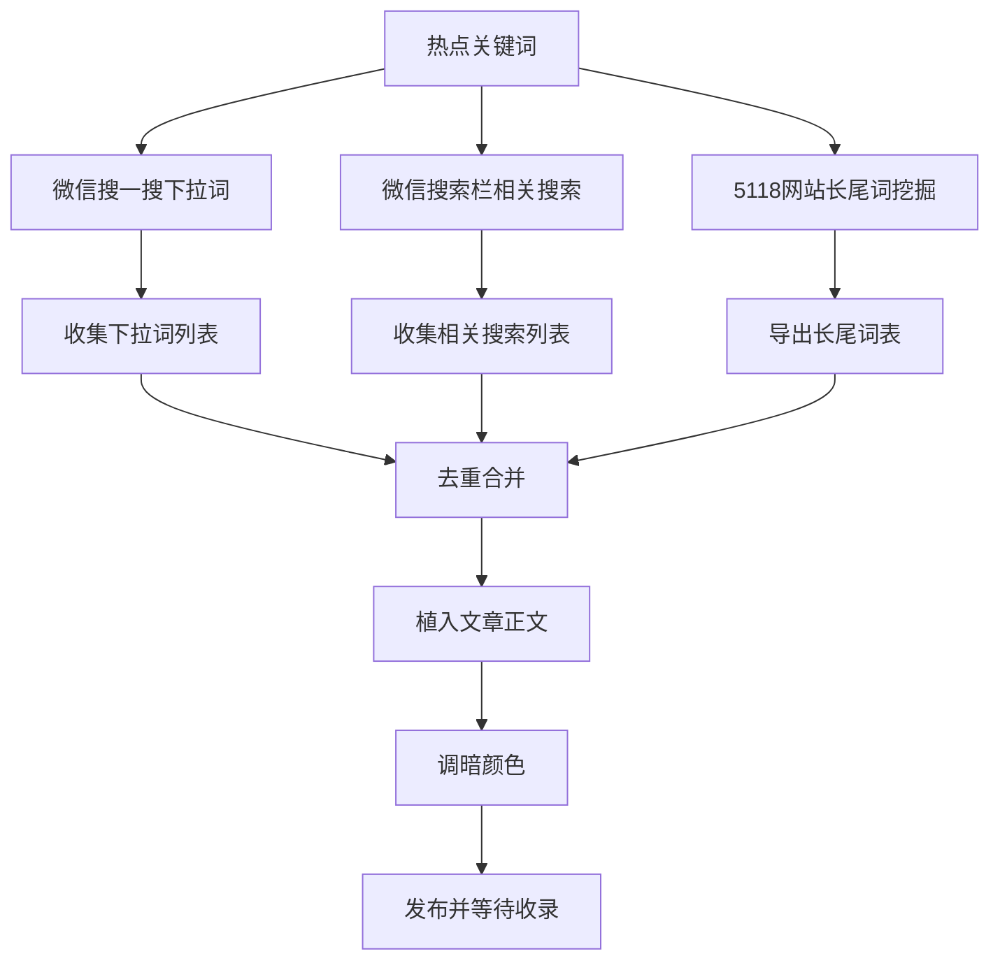
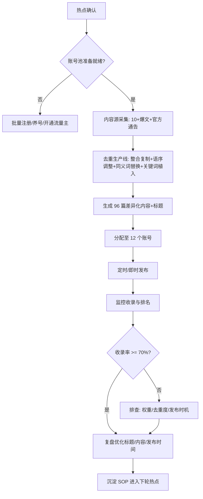
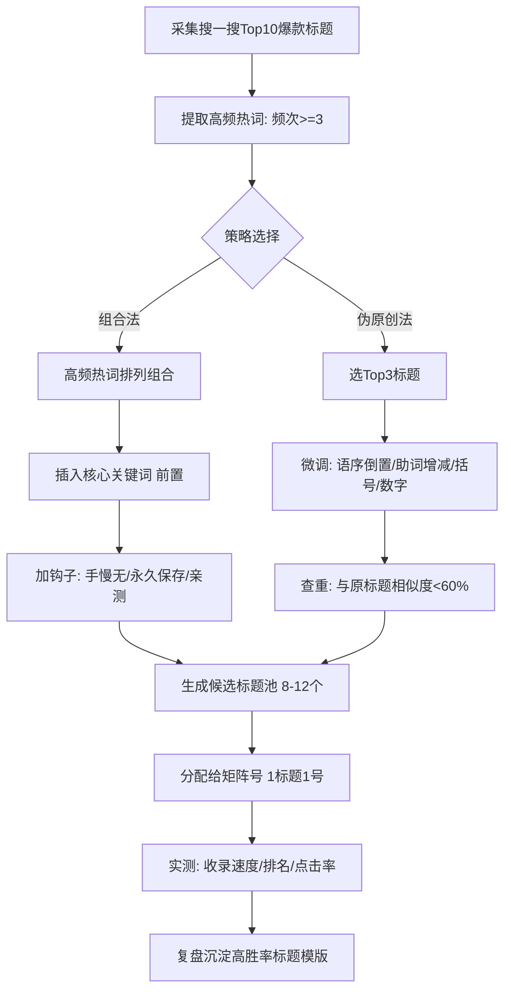
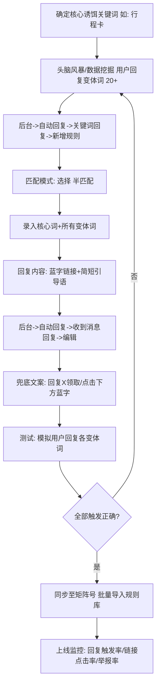
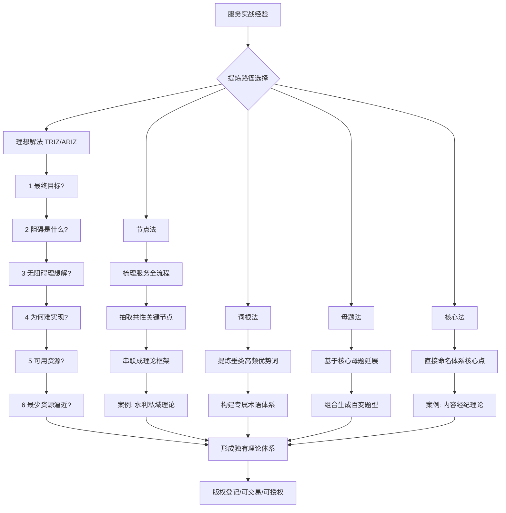
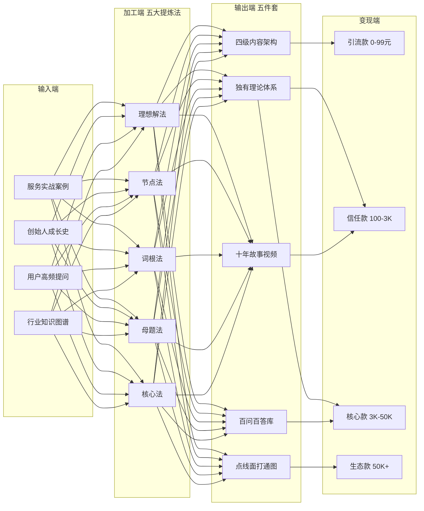
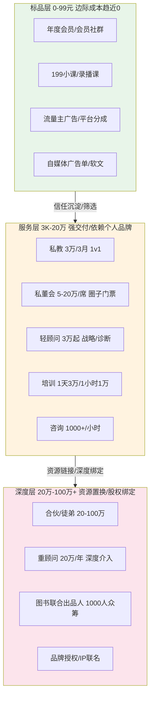
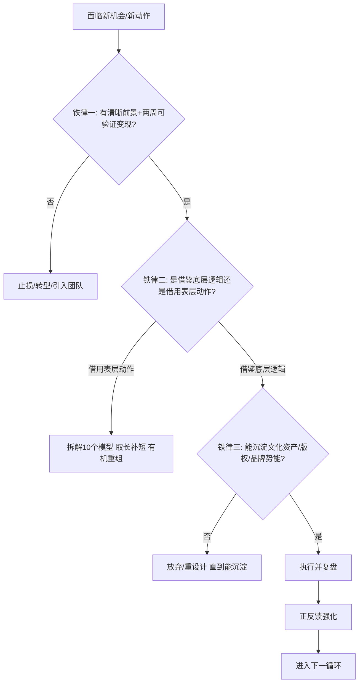

# 第 31 章 内容运营实战：从热点收割到 IP 长期打造
作者：龙哥

## 学习目标

- 理解搜索流量追热点的核心逻辑：在👸号正文铺设长尾词以获取微信搜一搜流量
- 掌握批量做号矩阵的操作要点：多号、多标题、多内容差异化提升收录概率
- 掌握迎合算法的爆款文章撰写法：字数控制、伪原创手法、关键词暗淡处理
- 掌握爆款标题双法：关键词组合法与伪原创法的实操步骤
- 理解流量承接双模块设计：半匹配关键词回复+兜底消息回复，打通搜索到变现链路
- 掌握手动文中广告位技巧：利用诱导性文案与平台误导性推荐拉高流量主单价
- 理解 IP 地基 12345 框架：母题、基因、身份、观感、资产五维构建长期护城河
- 掌握内容体系五件套：四级架构、独有理论、十年故事、百问百答、点线面打通路径
- 了解千万营收模型全景：从标品到高客单服务的 10+ 变现渠道及 4 近定价原则
- 内化 IP 长期主义三大铁律：不信天道酬勤、不走复刻路、不做无溢价事

## 31.1 生活类比

想象内容运营是一场**“钓鱼”与“养鱼”的组合游戏**。在热点收割篇里，你是一位经验丰富的渔夫，站在岸边观察鱼群（用户）的动向：你知道当热点事件爆发时，鱼群不会等着饵料主动送上门，它们会游向特定的岸边（微信搜一搜搜索框）寻找食物。于是你提前在岸边埋好饵料（在文章正文铺设长尾关键词），不求饵料多么精致（文笔优美），只求鱼爱吃（算法喜欢：字数达标、关键词全、伪原创过审）。为了不让空军，你派出 12 条船（👸号矩阵），每条船撒不同味道的网（差异化标题与内容），总有一条船能收网满载。鱼咬钩后，你用自动收网机（半匹配关键词回复 + 兜底消息回复）把它们收入鱼仓（私域），不管鱼怎么挣扎、乱回复，都能精准投递生成链接。而在收网绳上，你还挂了闪亮的诱饵（手动文中广告位，放在“点击关注”文案正下方），鱼以为是救命稻草一口咬下，实则点中了平台推荐的其他👸号名片，渔夫由此赚得佣金。在 IP 长期打造篇里，你不再满足于一次次撒网，而是决定建鱼塘、养种鱼、卖鱼苗。你首先寻找一眼好水源（母题，文化原型），水源正，鱼塘才能长久、扩大、调整边界；你精心培育鱼的品种基因（两层基因），既要有好看的花纹（文化溢价/风骨），又要长得快肉多（商业变现/体面）；你根据鱼的生长阶段扮演三种角色（三重身份）：喂食员/工具解决功能问题、知心友/人提供情绪价值、鱼塘之神/神在危机时刻指引迭代；你打造鱼在塘里的四重极致体验（四级观感）：水温舒服的松弛感、专属投喂的对象感、吃到饱的获得感、不想离开的氛围感；你积累鱼塘的五份家底（五份资产）：鱼群（用户）、品种专利（版权）、鱼肉罐头（实物）、风水宝地名声（文化）、连锁鱼塘网络（生态）。你制定养鱼标准化 SOP（内容体系五件套）：分级饲料（四级架构）、独家秘方（独有理论）、创业史册（十年故事）、百问百答手册、从卖鱼到卖鱼塘加盟的扩张地图（点线面打通）。你设计变现菜单（千万营收模型）：卖鱼食（会员/小课）、卖观赏鱼（私教/私董）、卖鱼塘经营权（合伙/顾问）、卖鱼塘品牌（图书/联合出品）。最后，你遵守老渔夫的三大戒律（IP 长期主义三大铁律）：不信“勤劳致富”不看鱼情（天道酬勤）、不照搬隔壁老王养法（复刻路径）、不养只长不大、没名气的杂鱼（无溢价）。

## 31.2 概念地图



短视频/内容运营实战（第31章）
├── 热点收割技术体系（👸号搜索流量）
│   ├── 搜索流量追热点  —— P001
│   ├── 批量做号矩阵  —— P002
│   ├── 爆款文章撰写法  —— P003
│   ├── 爆款标题双法  —— P004
│   ├── 流量承接双模块  —— P005
│   └── 手动文中广告位  —— P006
└── 个人 IP 长期打造体系（风骨与体面）
    ├── IP 地基 12345 框架  —— P007
    │   ├── 1 个母题（护城河锚点）
    │   ├── 2 层基因（风骨+变现）
    │   ├── 3 重身份（工具/人/神）
    │   ├── 4 级观感（松弛/对象/获得/氛围）
    │   └── 5 份资产（用户/版权/实物/文化/生态）
    ├── 内容体系五件套  —— P008
    │   ├── 四级内容架构（引流/信任/核心/生态）
    │   ├── 一套独有理论（五大提炼法）
    │   ├── 一个十年故事（信任锚点）
    │   ├── 一份百问百答（最小交付单元）
    │   └── 一份点线面打通路径（产品-项目-生态）
    ├── 千万营收模型  —— P009
    │   ├── 标品层（会员/小课/流量主）
    │   ├── 服务层（私教/私董/轻顾问）
    │   ├── 深度层（合伙/重顾问/图书增量）
    │   └── 4 近原则（钱/痛点/易用/信任）
    └── IP 长期主义三大铁律  —— P010
        ├── 不信天道酬勤（需正反馈）
        ├── 不走复刻路（借鉴非借用）
        └── 不做无溢价事（沉淀文化资产）

## 31.3 搜索流量追热点 —— 在搜索框里埋伏“长尾词”

### 为什么需要这个概念？

你一定有过这样的经历：刷到一个大热点，想发文蹭流量，结果发完沉底，连个水花都没有。原因往往不是你写得不好，而是**你等推荐流量，用户却在搜索框里找答案**。平台推荐流量不可控，像盲盒；但热点事件下，用户会主动搜索，搜索流量更精准、更持久。👸号文章标题字数有限，无法覆盖所有用户搜索习惯，需在正文植入长尾词。传统 SEO 周期长，短期热点需“即时 SEO”：热点爆发时植入词、即时收录、即时获流。

> "我们做的是搜索流量，那相关的搜索长尾词、搜索下拉框词语都可以放进来。文章被收录之后，读者搜索相关长尾词会搜到我们这篇文章。"
> "我在追短期热点的时候，会把这个长尾词放进文章内容中。"
>
> ——《P001 火火：行程码下线热点追踪复盘》（来源：`docs/202301-02/AmKRdF2Z9oQjDExxxuAc18a5nbb.md`）

### 核心定义

**搜索流量追热点**（来源：《P001 火火：行程码下线热点追踪复盘》，`docs/202301-02/AmKRdF2Z9oQjDExxxuAc18a5nbb.md`）

> 在追热点文章正文中，主动铺设微信搜一搜下拉词、相关搜索词、5118 长尾词等用户真实搜索词，让文章被微信搜一搜收录，用户搜索热点相关长尾词时，直接搜到并点击阅读。核心区别：长期 SEO 词在标题/布局，短期热点追词在正文内容中。

### 关键性质

- **依赖平台收录机制**：文章需符合算法偏好（字数 700-800 字、伪原创、关键词暗淡处理）
- **依赖关键词覆盖面**：覆盖的长尾词越多，被搜到的概率越大
- **时效性强**：热点衰退快，需在热点爆发初期（几小时内）完成发布和收录

### 长尾关键词获取三法（来源：《P001》）



1. **微信搜一搜下拉词**：打开微信搜一搜，输入关键词，会有对应的下拉词弹出；把这些下拉词全部放入文章中
2. **微信搜索栏相关搜索**：根据你搜索的关键词展示，也是其他用户经常用到的词语
3. **5118 网站查询长尾词**：用 5118 的长尾词挖掘功能查找相关长尾词

这个方法展示了如何零成本、全渠道覆盖用户搜索意图。你不需要猜用户怎么搜，平台直接告诉你。

### 典型例子

2022 年 12 月 14 日“行程码下线”热点：作者在文章中植入“行程卡纪念版生成链接”“行程码怎么查”“行程卡截图”等长尾词。通过微信搜一搜下拉词、相关搜索、5118 三法获取词库，植入正文并调暗颜色，兼顾收录与阅读体验。

### 边界条件

- 仅适用于订阅号/服务号文章被“搜一搜”收录的场景，不适用于视频号、小程序等其他入口
- 热点生命周期短（通常 24-48 小时），过期后长尾词搜索量骤减，流量不可复用
- 依赖账号权重：新号或低权重号可能收录慢或不收录，需矩阵号兜底

### 设计取舍：为何选择“搜索流量”而非“推荐流量”？

**问**：热点事件下，为何不依赖平台推荐算法分发，而要主动布局搜索流量？  
**答**：推荐流量像盲盒，受账号权重、历史表现、算法随机性影响极大，新号或低权重号几乎无法获得推荐；而搜索流量是用户主动表达意图的结果，精准度高、生命周期长，且对账号权重依赖较低——只要文章被“搜一搜”收录，覆盖了用户真实搜索词，就能持续获得流量。对于短期热点，推荐流量的爆发窗口仅几小时且不可控，搜索流量则允许我们通过“即时 SEO”（正文植入长尾词）在热点红利期内主动出击。权衡的代价是：需承担关键词挖掘、正文植入、暗淡处理的操作成本，且仅限订阅号/服务号文本内容场景。

### 设计取舍：为何将长尾词放在“正文”而非“标题”？

**问**：传统 SEO 讲究标题布局核心词，为何短期热点要把长尾词塞进正文？  
**答**：👸号标题字数上限约 64 字，仅能容纳 1-2 个核心词，无法覆盖用户几十种搜索习惯（如“行程卡纪念版”“行程卡怎么生成”“行程码截图保存”等）。正文字数无上限，可容纳 20+ 长尾词，且微信搜一搜爬虫会抓取正文内容建立倒排索引。将长尾词放入正文并调暗颜色，既不破坏阅读体验，又能最大化关键词覆盖面。权衡的代价是：需人工或脚本批量植入、调色，增加生产环节；且若关键词堆砌过度、颜色过浅被判作弊，可能触发平台风控。

---

## 31.4 批量做号矩阵 —— 用“多号弹幕”打爆收录概率

### 为什么需要这个概念？

单个👸号发文收录不稳定，受权重、历史违规、算法随机性影响大。热点追踪是“概率游戏”：同一篇内容，换个号发可能就被收录了。需要用“数量换确定性”：多号、多标题、多内容同步发布，覆盖更多搜索入口。

> "我用12个👸号，每个👸号8篇文章；总共发布了96篇文章，全部是这样子整合内容。"
> "要注意的一点是我96篇文章，每一篇内容都不一样；并且标题都不一样；这样做能够更好的增加被👸号系统收录的概率。"
>
> ——《P001 火火：行程码下线热点追踪复盘》（来源：`docs/202301-02/AmKRdF2Z9oQjDExxxuAc18a5nbb.md`）

### 核心定义

**批量做号矩阵**（来源：《P001 火火：行程码下线热点追踪复盘》，`docs/202301-02/AmKRdF2Z9oQjDExxxuAc18a5nbb.md`）

> 同时运营多个👸号（如 12 个），每个号发多篇文章（如 8 篇），总计 96 篇内容。核心铁律：每篇文章内容完全不同、标题完全不同，避免被判定为刷屏/搬运。目标：最大化“至少有一个号被收录上排名”的概率。

### 关键性质

- **去重成本高**：需用“整合复制+伪原创”而非直接搬运，每篇耗时约 10-15 分钟
- **账号分层管理**：主力号、备胎号、测试号分工明确，避免主号因违规被封影响长期 IP
- **数据聚合看板**：需汇总各号涨粉、阅读、收益数据，复盘哪类账号/标题/内容命中率高

### 典型例子

行程码热点：12 个号发 96 篇，9 个号有效上排名，3 个号零流量，命中率 75%。净增粉丝 4.5 万，取关率 53.8%，验证“泛粉”特性：热点粉粘性低，需快速变现或洗粉。

### 边界条件

- 账号注册/养号成本高：需提前批量注册、养号、开通流量主，非一日之功
- 运营负担重：单人难以同时操作 10+ 号实时发文、回复、数据监控，需工具/团队配合
- 平台打击风险：微信严查“矩阵号刷量、刷阅读”，内容差异化不足极易封号

### 方法演进：矩阵号发文决策流程



### 设计取舍：为何坚持“每篇内容、标题完全不同”？

**问**：直接搬运同一篇文章发 12 个号不是更快？为何要付出 10-15 分钟/篇的去重成本？  
**答**：微信算法对“批量发布相似内容”有明确打击机制：若检测到多账号发布高度相似内容，会判定为“矩阵刷量/搬运”，导致全号限流或封禁。内容差异化是生存红线。实测中，12 号 96 篇全差异化，命中率 75%（9/12 号上排名）；若内容同质化，命中率将趋近 0，且面临封号风险。权衡的代价是：需建立“内容工厂”流水线（采集→拆解→重组→植词→排版），单人需借助 RPA/脚本工具，或组建 2-3 人小团队分工协作。

### 设计取舍：为何不把矩阵号用于长期 IP 主号？

**问**：既然矩阵号能跑出流量，为何不直接用主号做矩阵？  
**答**：矩阵号内容为“伪原创拼接”，风格杂糅、无人设、无深度，长期发布会严重稀释主号标签、降低粉丝信任、污染账号模型。火火案例中明确“主力号、备胎号、测试号分工明确，避免主号因违规被封影响长期 IP”。矩阵号是“一次性弹药”，打完即弃或低频维护；主号是“长期资产”，只发原创深度内容。两者物理隔离、内容隔离、风险隔离。

---

## 31.5 爆款文章撰写法 —— 迎合算法的“伪原创”流水线

### 为什么需要这个概念？

热点追踪拼速度，原创写作太慢（需 1-2 小时），无法赶上流量红利期。平台算法不看“文笔好不好”，只看“结构对不对、关键词全不全、字数够不够”。纯搬运会被判重、限流，需“伪原创”：换标题、换开头、拼接多源、调整排版。

> "追热点文章不是需要文笔写的多好，内容迎合平台算法喜好能被收录就行。"
> "我写追热点文章的时候，我会有意识的把文章内容写到七八百字左右；让文章更加容易被👸号收录，也能符合👸号在文中添加广告的要求。"
> "为了阅读体验感好一些，我在文章中就把这些关键词的颜色调暗淡一些。"
>
> ——《P001 火火：行程码下线热点追踪复盘》（来源：`docs/202301-02/AmKRdF2Z9oQjDExxxuAc18a5nbb.md`）

### 核心定义

**爆款文章撰写法**（来源：《P001 火火：行程码下线热点追踪复盘》，`docs/202301-02/AmKRdF2Z9oQjDExxxuAc18a5nbb.md`）

> - 字数控制在 700-800 字：满足“文中广告插入要求”，且读完不累
> - 结构：第一段给核心干货（如生成链接获取），后段拼接相关资讯凑字数
> - 伪原创手法：整合复制多篇爆文内容、修改语序替换同义词、插入关键词并调暗颜色
> - 核心原则：迎合算法收录 > 迎合人类阅读

### 关键性质

- **“暗淡关键词”技巧**：将植入的 SEO 长尾词设为浅灰色，用户肉眼难见，爬虫可识别，平衡体验与收录
- **“首段定生死”**：开头必须直接给用户想要的结果（链接/方法），否则跳出率高、完读率低、算法判定低质
- **图文并茂**：配图需去水印、压缩体积、加‘alt 标签’，辅助语义理解

### 典型例子

行程码文章：开头直接给“纪念版生成链接获取步骤”，后半段拼接“行程码下线官方通知、网友热议、替代方案”等公开资讯。全文约 800 字，耗时 12 分钟产出，被收录后单篇阅读破万。

### 边界条件

- 仅适用于“短期热点、搜索流量、弱关系粉丝”场景
- 长期 IP 账号慎用：会破坏账号人设、降低粉丝信任、污染账号标签
- 法律风险：拼接内容若涉及版权图片/文字，可能面临侵权投诉

### 方法演进：伪原创生产流水线


### 设计取舍：为何字数卡在“700-800 字”？

**问**：为何不写 2000 字深度长文，或 300 字极短文？  
**答**：👸号“文中广告”开通门槛要求文章字数 ≥ 500 字（早期为 800 字），且算法对“中等长度、结构完整、完读率尚可”的文章收录偏好最高。700-800 字是“最小通过门槛”与“最大生产效率”的平衡点：低于 500 字无法插文中广告、收录权重低；高于 1000 字生产耗时翻倍、完读率下降、算法判定“冗余”。权衡的代价是：牺牲内容深度与品质，只做“够用”的算法友好型内容。

### 设计取舍：为何采用“整合复制+同义词替换”而非 AI 重写？

**问**：现在有 GPT 等 AI 工具，为何不直接让 AI 重写成原创？  
**答**：实测中，AI 重写单篇耗时 3-5 分钟（含提示词调试、审核、排版），而“整合复制+人工微调”仅需 10-15 分钟/篇，且 AI 重写易出现幻觉、逻辑断裂、关键词丢失，反而降低收录率。对于“小时级决战”的热点追踪，确定性流水线优于概率型 AI。权衡的代价是：人工去重强度依赖操作手熟练度，新手易出现去重不足被判搬运。

---

## 31.6 爆款标题双法 —— 组词与伪原创的“吸睛术”

### 为什么需要这个概念？

标题决定点击率（CTR），点击率决定算法二次分发权重。热点下用户搜索词固化（如“行程卡”“纪念版”“免费获取”），标题必须覆盖高频词。完全原创标题容易“跑偏”蹭不上热词；完全复制标题会被判重、不收录。

> "方法1：提取关键词自己原创：把排名在前面阅读量比较好的文章标题全部copy下来当参考，找到共同的关键词...火爆全网、免费获取；然后再加上关键词个人行程卡。"
> "方法2：找爆款标题伪原创：我搜对应关键词，直接把排名在前面的文章标题复制下来，轻微改动；但不能全部一样。"
>
> ——《P001 火火：行程码下线热点追踪复盘》（来源：`docs/202301-02/AmKRdF2Z9oQjDExxxuAc18a5nbb.md`）

### 核心定义

**爆款标题双法**（来源：《P001 火火：行程码下线热点追踪复盘》，`docs/202301-02/AmKRdF2Z9oQjDExxxuAc18a5nbb.md`）

> - **方法一·关键词组合法**：采集 Top10 爆款标题 → 提取高频热词（火爆全网、免费获取、永久保存） → 重新组合生成新标题
> - **方法二·爆款标题伪原创法**：直接复制 Top3 标题 → 微调语序/增减助词/加括号/换数字 → 保持原意换表达
> - 核心公式：高频热词 + 核心关键词 + 吸睛钩子 = 高 CTR 标题

### 关键性质

- **原创度阈值**：微信算法要求标题重复度 < 60%，伪原创需改动关键语序、替换核心修饰词
- **关键词前置**：核心搜索词（行程卡、纪念版）必须在前 15 字，否则搜索结果截断、点击率骤降
- **多标题测试**：矩阵号同内容发不同标题，实测哪个标题收录快、排名高、点击高

### 典型例子

- 原标题：《行程码下线！教你免费获取行程卡纪念版，火爆全网！》
- 组合新标题：《行程卡纪念版生成入口，免费获取永久保存，手慢无！》
- 伪原创标题：《行程码下线了，行程卡纪念版怎么弄？免费生成攻略》

### 边界条件

- 标题党红线：标题承诺内容正文必须兑现，否则用户投诉、平台封号、账号权重归零
- 敏感词规避：标题不可含“内部、独家、官方、第一、顶级”等违规营销词
- 仅适用于搜索流量场景：推荐流场景下标题需更强调情绪价值、悬念感，而非关键词堆砌

### 方法演进：标题生成决策流



### 设计取舍：为何不用“纯原创标题”而是“组合/伪原创”？

**问**：原创标题不是更有辨识度、更利于品牌建设？  
**答**：搜索流量场景下，用户不看品牌、只看关键词匹配度。纯原创标题极易“跑偏”：要么漏掉核心高频词导致搜不到，要么语序不符合用户搜索习惯导致点击率低。组合法保证关键词全覆盖、前置；伪原创法保证原创度过审、沿用已验证的高 CTR 语序。两者结合，兼顾“被搜到”与“被点击”。权衡的代价是：标题同质化严重、无品牌辨识度，仅适用于一次性热点收割号，不可用于长期 IP 主号。

---

## 31.7 流量承接双模块 —— 自动回复里的“收割机”

### 为什么需要这个概念？

订阅号文章正文链接不生效、不能跳转，用户无法直接点击购买/领取。用户关注后若无引导、找不到入口，会直接取关或举报，流量瞬间流失。需在“关注后”、“回复后”两个关键动作节点，用自动回复完成“交付链接、引导动作、降低举报”三合一。

> "模块1：设置关键词回复承接住流量：我们设置好的流程是粉丝关注👸号之后，回复关键词，👸号自动回复行程码生成链接。"
> "关键词回复有一个半匹配功能，意思就是读者回复半匹配中任意一个词语，👸号后台都会自动回复对应链接。"
> "模块2：设置收到消息回复减少举报率：我还在收到消息回复这里也设置了文案，这里的作用是让读者不管回复什么消息，都能看到这句话；知道回复哪几个字才能拿到链接。"
>
> ——《P001 火火：行程码下线热点追踪复盘》（来源：`docs/202301-02/AmKRdF2Z9oQjDExxxuAc18a5nbb.md`）

### 核心定义

**流量承接双模块**（来源：《P001 火火：行程码下线热点追踪复盘》，`docs/202301-02/AmKRdF2Z9oQjDExxxuAc18a5nbb.md`）

> - **模块一·关键词回复（半匹配模式）**：设置核心词（如“行程卡”）+ 20+ 变体词（行程、行程码、纪念版、领取、链接等） → 用户回复任意变体词 → 自动推送目标链接/小程序卡片
> - **模块二·收到消息回复（兜底引导）**：用户回复非设定词时 → 自动回复引导语：“回复‘行程卡’三个字领取生成链接” → 减少用户挫败感与举报率
> - 核心逻辑：把“公域搜索流量” → “关注动作” → “私域自动回复” → “变现链接” 打通

### 关键性质

- **半匹配是核心**：用户回复极其随意（错别字、简写、语气词），全匹配会漏掉 90% 流量
- **蓝字链接**：自动回复支持“蓝字跳转链接”，这是订阅号唯一可点击跳转的载体，CPS/CPA 变现必用
- **多链接并行**：一条自动回复可放多个蓝字链接（如：链接 1 领资料、链接 2 办卡、链接 3 进群），实现多变现并行

### 典型例子

行程码案例：关键词回复设“行程卡”半匹配，自动推送生成器链接；收到消息回复设“回复行程卡领纪念版”。电话卡 CPS：自动回复中放“点击办理大流量卡”蓝字链接，卖出 6 张、佣金 400+ 元。

### 边界条件

- 仅限订阅号/服务号后台自动回复功能，企业微信、视频号、小程序另套逻辑
- 规则数量限制：关键词回复规则上限 200 条，矩阵号需批量导入/同步规则库
- 违规风险：自动回复链接指向违规域名（诱导分享、欺诈、色赌毒）会导致账号封禁

### 方法演进：自动回复配置流程



### 设计取舍：为何必须用“半匹配”而非“全匹配”？

**问**：全匹配不是更精准、避免误触发？  
**答**：用户回复行为极其随性：有人回“行程卡”，有人回“行程”，有人回“xck”，有人回“领取”，有人回“链接在哪”，甚至回表情包。全匹配要求用户输入与设定词**完全一致**，实测会漏掉 90% 以上流量。半匹配只需用户回复**包含**任一变体词即可触发，容错率极高。火火案例中明确：“很多读者其实不会回复成完整的 3 个字，各种各样的回复都有……半匹配词语我设置成他们经常回复的文字。”权衡的代价是：需人工收集、维护 20+ 变体词库，且可能误触发无关对话（如用户闲聊提到“行程”），需在兜底回复中引导纠偏。

### 设计取舍：为何变现链接放在“自动回复”而非“文章正文”？

**问**：文章正文里放链接不是更直观、转化更高？  
**答**：订阅号文章正文**不支持可点击跳转的外链**（仅支持小程序卡片、视频号、👸号文章内链），用户点击无反应、体验极差、投诉举报率高。自动回复支持“蓝字链接”可直接跳转 H5/小程序/淘宝客页面，是订阅号唯一合规的外链跳转载体。火火案例明确：“订阅号文章页面放链接不会生效跳转，但是它放在自动回复里面就可以实现。”权衡的代价是：增加了用户“关注→回复→点击”三步操作路径，流失率上升，需通过首段干货强诱导、半匹配强容错、兜底回复强引导来补偿。

---

## 31.8 手动文中广告位 —— 利用“误导性”拉高流量主单价

### 为什么需要这个概念？

流量主收入 = 底部广告收入 + 文中广告收入，底部广告单价低、点击率低。智能插入广告位随机、不可控，且多为非相关广告，用户无感。手动插入可控制广告位置、诱导文案、广告类型，将“广告点击”伪装成“功能性点击”。

> "我把广告添加在点击关注下方👸号进入主页这句话下面，很多读者第一反应就会直接点击广告，稍微带了一些诱导性质；另外平台推荐广告的时候，文中广告位直接就推荐其它👸号，很有误导性。这也是为啥我👸号这次追热点流量主收入那么高的原因。"
> "一定是要设置手动添加广告，不要智能插入广告。"
>
> ——《P001 火火：行程码下线热点追踪复盘》（来源：`docs/202301-02/AmKRdF2Z9oQjDExxxuAc18a5nbb.md`）

### 核心定义

**手动文中广告位**（来源：《P001 火火：行程码下线热点追踪复盘》，`docs/202301-02/AmKRdF2Z9oQjDExxxuAc18a5nbb.md`）

> - 在文章正文中，手动插入“文中广告”组件（而非智能插入）
> - 位置策略：放在“引导关注👸号/回复关键词”的 CTA 文案正下方
> - 话术策略：上方写“点击下方广告/卡片进入👸号主页领取完整版”，利用用户惯性点击
> - 平台机制：文中广告位优先推荐“其他👸号名片”，极易被误认为是目标👸号，诱导点击率极高

### 关键性质

- **单价杠杆**：文中广告单价通常是底部广告的 3-10 倍，是流量主收入的主要贡献者
- **合规边缘**：属于“诱导点击”灰度地带，平台若严查易判违规，需控制频次、措辞
- **数据复盘**：需对比“手动文中广告收入”vs“智能底部广告收入”，验证单价提升倍数

### 典型例子

行程码案例：3 个破千元单号中，文中广告收入占比 > 80%，底部广告仅几十元。广告位文案：“点击关注下方👸号进入主页”正下方放广告，用户以为点的是“关注按钮”实为广告。

### 边界条件

- 仅适用于开通流量主、且流量主收入占比高的账号（非带货/服务号主流变现路径）
- 依赖平台广告库存：若广告库存不足（如新号、冷门领域），文中广告位可能空白或展示低价广告
- 长期使用会降低账号信任度，粉丝识破后取关、举报，账号权重下降

### 方法演进：广告位置策略图


### 设计取舍：为何选择“手动插入”而非“智能插入”？

**问**：智能插入不是更省力、平台自动优化位置？  
**答**：智能插入位置随机（可能在首段、中段、尾段），广告内容多为泛商品/游戏/课程，与热点内容无关，用户无感点击率极低。手动插入可精准锚定在“CTA 引导语正下方”，利用用户“寻找入口”的强意图心理，配合“点击下方进入主页”的诱导文案，将广告点击伪装成功能性点击。火花案例实测：同一账号同一天，手动文中广告收入远超底部广告（占比 >80%），验证了位置与话术的杠杆效应。权衡的代价是：需人工逐篇插入、措辞踩线诱导点击红线，平台严查期易违规，且长期损害账号信任度。

### 设计取舍：为何广告位放在“引导关注文案下方”而非“首段干货下方”？

**问**：首段干货阅读完读率最高，放在那里曝光不更大？  
**答**：首段用户处于“获取干货”强目的状态，对任何非干货元素极其敏感，广告会被视为干扰、引发反感举报。尾段 CTA 处用户处于“寻找下一步动作”状态，点击意图最强、防御最弱，此时广告伪装成“下一步入口”，转化率最高。火火案例明确：“我把广告添加在点击关注下方👸号进入主页这句话下面，很多读者第一反应就会直接点击广告。”权衡的代价是：尾段阅读完读率低于首段，需通过“首段给结果、中段凑字数、尾段强 CTA”结构设计，最大化读完全文并到达尾段的用户比例。

---

## 31.9 IP 地基 12345 框架 —— 从“定位”进化到“母题护城河”

### 为什么需要这个概念？

传统“定位/人设/卡位”静态、单一、易被复制，无法应对市场变化与内容延展。IP 需兼具“文化溢价（风骨）”与“商业变现（体面）”，二者缺一不可。需要一套可延展、可模块化、可标准化的外部打造体系，而非靠直觉拍脑袋。

> "指的是，文化传统中具有传承性的文化因子，或者人类社会中那些循环往复且普遍发生的事情。最简单的理解就是原型。"
> "对于 IP 来说，掌握母题就是可以既搭建出来自己的护城河又能随时调整边界的，这里可以直接挂钩很多人讲的定位卡位，但这个定位有一个弊端就是，它不是从内容的角度出发的，也就没法做好更细化的延展更不可能把护城河做出来。"
> "指文化沉淀价值（风骨）和商业持续能力（变现），这里重点需要说的三点：一是不要做没有文化溢价的事情……二是 IP 是少数人的领地……三是不要相信天道酬勤那种鬼话。"
> "指 IP 需要根据不同的状态下把自己当工具或者当人或者当神。工具是从解决用户问题的功能性上说的……人是从解决用户价值主张或情绪性的角度去说的……神是从解决用户迭代升级的角度去说的，危机具有强烈的再分配的效应。"
> "指的是 IP 的对外输出和呈现上要具备至少两个观感才可以让用户有被感性支配而非理性催生的消费行为。松弛感是说 IP 有一种尽在掌握的状态……对象感是指这些话我只对你一个人说……获得感指的是没能让你说卧槽就是我输……氛围感是指沉浸其中无法自拔。"
> "指的用户资产、版权资产、实物资产、文化资产、生态资产这五种和个人 IP 息息相关的资产形态。"
>
> ——《P007 刘梦园：年入千万的“风骨体面” IP 打造方法论》（来源：`docs/202301-02/HiVkdfBYJo2H5xxWIemcMcMQnLc.md`）

### 核心定义

**IP 地基 12345 框架**（来源：《P007 刘梦园：年入千万的“风骨体面” IP 打造方法论》，`docs/202301-02/HiVkdfBYJo2H5xxWIemcMcMQnLc.md`）

| 维度 | 名称 | 核心内涵 | 关键作用 |
|------|------|----------|----------|
| 1 | **母题** | 文化原型/核心隐喻（如“成长”、“破局”、“治愈”） | 护城河锚点，下生百变题型，替代静态定位实现动态边界 |
| 2 | **2 层基因** | 文化沉淀价值（风骨）+ 商业持续能力（变现） | 拒绝无文化溢价、拒绝全盘复刻他人路径、拒绝盲目天道酬勤 |
| 3 | **3 重身份** | 工具（解决功能）、人（情绪/价值观）、神（危机/迭代） | 随用户旅程动态切换，解决不同层级需求 |
| 4 | **4 级观感** | 松弛感、对象感、获得感、氛围感 | 至少具备 2 个，驱动感性消费，支撑高客单复购 |
| 5 | **5 份资产** | 用户、版权、实物、文化、生态 | 构建 IP 护城河的资产组合，文化/生态资产具备幂次效应 |

### 关键性质

- **母题可延展**：一个母题下可开发 N 个题型，题型模块化、解法标准化，形成内容护城河
- **身份动态切换**：根据用户旅程阶段（获客→转化→留存→升级）切换工具/人/神身份
- **观感组合拳**：至少具备 2 个观感，单一观感无法支撑高客单复购
- **资产复利**：版权资产可交易 13 种、文化资产跨周期、生态资产产生幂次效应

### 典型例子

- **龙飞律师**：母题“婚姻破局”，身份切换（工具给法律建议、人给情绪支持、神解人生危机），松弛感强，短期破千万粉
- **李子柒**：母题“田园诗意”，走文化资产路线，IP 价值远超带货收入
- **女性安全 IP**：从“防狼喷雾推荐”（工具/低溢价）升级为“家暴/PUA/诈骗案例库”（神/高文化溢价）

### 边界条件

- 需长期主义：母题挖掘、基因沉淀、资产积累需年单位，不适合“速成、收割”型玩家
- 需内容生产能力：无法持续输出高质量内容支撑题型、观感、身份，框架即空中楼阁
- 商业化过度会稀释文化基因，需把控“风骨与变现”的动态平衡

### 结构图：IP 地基 12345 五维分层

```mermaid
graph TD
    A[IP地基 12345] --> B[1 个母题<br/>文化原型/核心隐喻<br/>护城河锚点]
    A --> C[2 层基因<br/>风骨(文化溢价)<br/>体面(商业变现)]
    A --> D[3 重身份<br/>工具/人/神<br/>动态切换]
    A --> E[4 级观感<br/>松弛/对象/获得/氛围<br/>至少具备2个]
    A --> F[5 份资产<br/>用户/版权/实物/文化/生态<br/>文化&生态具备幂次效应]
    
    B --> B1[下生百变题型]
    B1 --> B2[题型模块化]
    B2 --> B3[解法标准化]
    
    C --> C1[拒绝无溢价]
    C --> C2[拒绝全盘复刻]
    C --> C3[拒绝盲目天道酬勤]
    
    D --> D1[工具: 解决功能问题]
    D --> D2[人: 情绪价值/价值观]
    D --> D3[神: 危机再分配/迭代]
    
    E --> E1[松弛感: 尽在掌握]
    E --> E2[对象感: 只对你说]
    E --> E3[获得感: 说到痛点]
    E --> E4[氛围感: 沉浸无法自拔]
    
    F --> F1[用户资产: 画像/粘性/LTV]
    F --> F2[版权资产: 17种/13种可交易]
    F --> F3[实物资产: 周边/衍生品]
    F --> F4[文化资产: 主文化/亚文化标签]
    F --> F5[生态资产: 合伙/分销/联盟]
```

### 设计取舍：为何用“母题”替代传统“定位/人设”？

**问**：定位理论成熟、操作简单（如“垂直领域+人设标签”），为何要引入晦涩的“母题/文化原型”？  
**答**：定位是静态坐标（如“职场成长导师”），一旦设定便难以调整边界，且无法指导内容生产的细化延展——你不知道下一篇写什么、怎么写、形成什么壁垒。母题是动态生成器（如“破局”）：它是文化原型，自带叙事张力，可延展为 N 个“百变题型”（破局职场/破局婚姻/破局创业/破局认知），每个题型可模块化、解法标准化，形成可复制、可授权、可交易的内容资产。龙飞律师以“婚姻破局”为母题，衍生出“财产分割破局、子女抚养破局、情感勒索破局”等标准化题型，短期破千万粉。权衡的代价是：母题挖掘需深厚文化素养与行业洞察，非一日可成；且母题过宽（如“成长”）会导致边界模糊，需配合“题型模块化+解法标准化”收敛。

### 设计取舍：为何“风骨（文化溢价）”与“体面（商业变现）”必须双基因并存？

**问**：为何不先做流量变现（体面），等有钱了再补文化（风骨）？  
**答**：素材明确指出三点铁律：一是不做无文化溢价的事——纯流量变现（广告、带货、CPS）无资产积累，用户资产边界窄、无幂次效应，算法一变即归零；二是 IP 是少数人的领地——全盘复刻他人路径（如盲学博商 199 小课）会忽略关键节点，陷入路径依赖；三是不要相信天道酬勤——无正反馈的坚持是幸存者偏差。女性安全 IP 案例印证：从“卖防狼喷雾”（工具/低溢价/纯体面）转型“案例库会员/咨询”（神/高文化溢价/风骨），客单价提升 100 倍。权衡的代价是：前期需克制商业冲动，投入精力打磨文化资产（案例库、理论体系、版权），现金流回正周期长，需强现金流支撑或低成本运营。

### 设计取舍：为何“三重身份”要动态切换而非固定单一身份？

**问**：为何不一直做“专家/工具”人设，专业度最强？  
**答**：用户需求随旅程分层：获客期需“工具”给确定性方法（如法律条文、生成链接）；转化期需“人”建立情感连接、打破防御（如共情婚姻痛苦、分享价值观）；升级期需“神”提供危机迭代方案、获得话语权（如“人生重大抉择指引”）。龙飞律师案例：连麦时展现“松弛感”（神身份雏形），信号“你问题我都见过”，直接获取话语权、高转化。固定单一身份会导致：工具身份无情感粘性、人身份无专业权威、神身份无落地交付。权衡的代价是：要求创作者具备极强的共情力、专业力、洞察力三合一能力，或需团队分工协作（策划/专家/运营）。

### 设计取舍：为何“四级观感”要求“至少具备两个”？

**问**：一个极致观感（如极致松弛感）不行吗？  
**答**：单一观感只能激发单一情绪，无法支撑完整决策链路。松弛感建立权威信任，但缺乏行动召唤；对象感建立专属亲密，但缺乏价值锚点；获得感直击痛点，但缺乏品牌溢价；氛围感构建沉浸场域，但缺乏具体交付。组合拳才能覆盖“认知-情感-决策-忠诚”全链路：如“松弛感+获得感”=专业权威直击痛点（高客单咨询）；“对象感+氛围感”=专属陪伴沉浸体验（会员社群/私董会）。素材原话：“IP 的对外输出和呈现上要具备至少两个观感才可以让用户有被感性支配而非理性催生的消费行为。”权衡的代价是：内容生产需同时兼顾多种表达风格，对团队分工、素材库建设、排期规划提出更高要求。

---

## 31.10 内容体系五件套 —— 从“写文章”到“做产业链”

### 为什么需要这个概念？

单篇内容无资产价值，只有体系化内容才能沉淀为可复用、可放大、可交易的 IP 资产。缺乏体系会导致：选题发散、风格割裂、变现单一、无法培训他人、无法规模化。需要标准化的“内容生产操作系统”：从架构到理论、故事、问答、产品路径一应俱全。

> "一个 IP 的内容体系包含 5 个部分，四级内容架构、一套独有理论、一个十年故事、一份百问百答和一份产品项目产业链打通路径。"
> "系统的方法也是有的，大概分成 5 种。第一种理想解法。……ARIZ 算法中给出了确定理想解的步骤：1）设计的最终目标是什么？……第六种是核心法。……直接命名内容经纪理论了。"
> "素材方面，需要前后对比表现成长，重点是新手村到大佬村的对比；关键时刻重点标注 低谷、荣耀、转折；故事方面，一般一个十年故事要 5-8 分钟……文案方面，表达清晰……目的明确，增加信任。"
> "到了内容型 IP 上其实就是品项态（产品项目生态）"
> "设计点线面打通的重要性就体现出来了，在电商方向上，大家都知道人货场这个概念，到了内容型 IP 上其实就是品项态（产品项目生态）。"
>
> ——《P007 刘梦园：年入千万的“风骨体面” IP 打造方法论》（来源：`docs/202301-02/HiVkdfBYJo2H5xxWIemcMcMQnLc.md`）

### 核心定义

**内容体系五件套**（来源：《P007 刘梦园：年入千万的“风骨体面” IP 打造方法论》，`docs/202301-02/HiVkdfBYJo2H5xxWIemcMcMQnLc.md`）

| 组件 | 定义 | 核心价值 |
|------|------|----------|
| **四级内容架构** | 引流款(免费/低价) → 信任款(中价/课程) → 核心款(高价/私教/私董) → 生态款(合伙/联营/品牌授权) | 建立产品阶梯，实现流量分层变现 |
| **一套独有理论** | 用理想解法/TRIZ、节点法、词根法、母题法、核心法五大方法，从服务经验中提炼可复制、可教学、可版权的理论体系 | 形成核心壁垒，支撑高客单、可授权 |
| **一个十年故事** | 5-8 分钟中视频，素材（前后对比/关键时刻）、故事线（低谷-荣耀-转折）、文案（清晰/目的/契机）、音乐（品位） | 建立信任锚点，缩短用户决策路径 |
| **一份百问百答** | 覆盖用户全旅程高频问，标准化交付工具，也是产品大纲、销售话术、客服 SOP | 最小交付单元，内容生产原子化 |
| **一份点线面打通路径** | 产品(点) → 项目(线) → 产业链/生态(面)，从单品变现进化为组织化运营 | 结构化增长路径，电商“人货场”在内容 IP 的映射 |

### 五大理论提炼法（来源：《P007》）



1. **理想解法 (TRIZ/ARIZ 六步推导)**：  
   1) 设计的最终目标是什么？  
   2) 什么阻碍了目标实现？  
   3) 如果没有这个阻碍，理想解是什么？  
   4) 为什么理想解难以实现？  
   5) 有什么资源可利用？  
   6) 如何用最少资源逼近理想解？

2. **节点法（服务流程抽节点）**：从实际交付流程中抽取共性关键节点，串联成理论框架。案例：水利私域理论——第一步重构组织/商业模式，后续以“水系/水利工程/水循环”串联

3. **词根法（垂类优势词）**：提炼垂直领域的高频优势词汇，构建专属术语体系

4. **母题法（原型延展）**：基于核心母题进行延展与组合，生成百变题型

5. **核心法（体系核心点）**：直接提取并命名内容体系的核心理论点。案例：内容经纪理论

这个方法论展示了如何从“经验”走向“理论”，再走向“可交易资产”。

### 典型例子

- **水利私域理论**：私域顾问用节点法提炼——第一步重构组织/商业模式，后续以“水系/水利工程/水循环”串联，形成独创理论，支撑 50-100 万/年顾问费
- **星云 IP 计划**：20 个 S 级 IP + 80 个 A 级 IP，从理论端/执行端/变现端/IP 端/政府支持/人才端六端协同，构建年 2 亿盘子的产业群组

### 边界条件

- 理论提炼需真实服务案例支撑：无实战经验强行提炼理论，只会生产“伪理论”，无法交付、无法复购
- 十年故事需真实性：编造故事一旦被识破，信任崩塌不可逆
- 产业链构建需组织能力：从个人 IP 到产业群组，需经营管理、资本运作、政府关系等非内容能力

### 方法演进：内容体系五件套生产线



### 设计取舍：为何要“百问百答”作为最小交付单元？

**问**：直接写文章/录课程不行吗？为何要先做问答库？  
**答**：文章/课程是“推模式”（创作者决定给什么），问答库是“拉模式”（用户真实需要什么）。百问百答直接源自用户全旅程高频提问，每个 Q&A 可拆解为一篇文章、一节课、一个短视频、一个销售话术、一条客服 SOP，是内容生产的原子单元、产品大纲的源头、交付标准化的基准。素材原话：“一份百问百答……也是产品大纲、销售话术、客服 SOP。”权衡的代价是：需建立持续的用户提问收集机制（私域/评论区/直播/咨询），并定期清洗、分类、更新，非一次性产出。

### 设计取舍：为何用“点线面/品项态”替代电商“人货场”？

**问**：人货场模型成熟通用，为何要发明新词“品项态”？  
**答**：电商卖标品，核心是“货（选品）-人（流量）-场（渠道）”匹配效率；内容 IP 卖“非标服务/知识/社群”，核心是“产品（点：单篇内容/课程/账号）→ 项目（线：训练营/顾问/私董）→ 生态/产业链（面：培训体系/合伙联盟/品牌授权）”的结构化进化。人货场无法描述“理论提炼→培训项目→产业群组”的知识资产化路径。品项态精准映射了内容 IP 从个人超劳变现到组织化规模化的本质跃迁。权衡的代价是：概念新、需团队内部对齐认知，外部传播需额外教育成本。

---

## 31.11 千万营收模型 —— 内容 IP 变现的“全景价签”

### 为什么需要这个概念？

多数创作者只知“接广告/卖课”，不知内容 IP 有 10+ 变现渠道、客单价跨度从 99 元到 100 万+。缺乏全景图会导致：低客单产品做多了拉低品牌调性、高客单产品不敢卖、变现天花板低。需要一张“变现菜单”：看清每个渠道的定价逻辑、交付形态、适用阶段、资源需求。

> "图里主要涉及到内容型 IP 可以变现的几乎所有方式……年度会员的年入百万像素级拆解……私教常规是 3w3 个月的一对一……私董会……花个 5-20w 买个圈子的门票……"
> "注意一个底层逻辑就是 4 近，离钱近好变现，离痛点近好卖出，离易用近好留存，离信任近好复购。"
> "课程和直播一起搭配会更有效果，说个现实数据，199 小课，一天两播，一场 6w，一个月 400w~有点意思是吧……"
> "图书在常规出版的情况下卖 5w 册才有二三十万的版税收入，但是能卖 1w 册已经属于畅销书了……可以，走一书一码和联合出品人计划，在一书一码技术的支持下招募 1000 个人作为联合出品人。"
>
> ——《P007 刘梦园：年入千万的“风骨体面” IP 打造方法论》（来源：`docs/202301-02/HiVkdfBYJo2H5xxWIemcMcMQnLc.md`）

### 核心定义

**千万营收模型**（来源：《P007 刘梦园：年入千万的“风骨体面” IP 打造方法论》，`docs/202301-02/HiVkdfBYJo2H5xxWIemcMcMQnLc.md`）

| 层级 | 产品形态 | 典型客单价 | 交付特点 | 适用阶段 |
|------|----------|------------|----------|----------|
| **标品层** | 年度会员、199 小课、流量主/广告 | 0-99 元 | 标品化、边际成本趋近 0、可无限复制 | 冷启动、拉新、建立信任 |
| **服务层** | 私教 3 万/3 月、私董会 5-20 万、轻顾问 3 万起、培训 1 天 3 万 | 3 千-20 万 | 非标服务、强交付、依赖个人品牌 | 成熟期、深度变现 |
| **深度层** | 合伙/徒弟 20-100 万、重顾问 20 万/年、图书联合出品 | 20 万-100 万+ | 资源置换、股权绑定、生态共建 | 头部 IP、生态扩张 |

**4 近原则**（变现产品设计底层逻辑）：
- 离钱近 → 好变现（如广告、带货、会员）
- 离痛点近 → 好卖出（如私教解决具体难题）
- 离易用近 → 好留存（如工具包、模板、SOP）
- 离信任近 → 好复购（如私董会、合伙人、顾问）

### 关键性质

- **产品阶梯设计**：引流款→信任款→核心款→生态款，每层转化率预估、LTV 测算、交付 SOP 标准化
- **直播 1+1+1 模式**：低成本直播课→剪成小课→切条做短视频，一天两播、单场 6 万、月入 400 万，边际成本趋近零
- **图书增量玩法**：传统版税 5 万册才几十万，用“一书一码+联合出品人”招募 1000 人众筹/分销，撬动增量收益
- **自媒体五方向配比**：爆款路线+五方向(干货/观点/故事/案例/工具)配比，服务直播间与私域双转化

### 典型例子

- **博商模式**：199 小课只是钩子，后端几十万上百万大单才是利润源，盲学前端直播玩法无后端支撑必扑空
- **私董会**：卖“圈子门票”，5-20 万/位，核心交付是“资源链接+认知升级”，非标准化课程
- **联合出品人**：图书未出版前招募 1000 人每人出资/分销，作者获预售资金+分销队伍，读者获身份+分成

### 边界条件

- 高客单产品（私教/私董/顾问）极度依赖个人品牌信任度，新 IP 无法直接上手
- 直播 1+1+1 需团队配合：选品、排品、话术、切条、投流、客服，单人难以闭环
- 合规风险：高客单收款、合伙/徒弟模式涉及合同法、消费保、税务合规，需法务把关

### 结构图：千万营收模型全景阶梯



### 设计取舍：为何“199 小课”只是钩子而非主利润源？

**问**：199 元小课单场 6 万、月入 400 万，看起来已经很赚钱，为何说它只是钩子？  
**答**：博商案例揭示：199 小课边际成本虽低，但获客成本高、续费率低、用户生命周期短，单靠小课难以支撑团队与规模扩张。真正利润源在后端：私教 3 万、私董会 20 万、合伙 100 万，这些高客单产品 LTV 高、复购强、抗周期。盲学前端直播玩法（选品、排品、话术、投流），忽略后端十年积淀的“大客单服务体系”，必扑空。素材原话：“199 的小课只是后端几万上百万费用的钩子；赛马机制可以学，但后端没有常年的积淀是学不来的。”权衡的代价是：新 IP 必须先跑通前端拉新（标品层），再逐层构建后端服务体系，不可倒序操作。

### 设计取舍：为何图书要走“联合出品人”而非传统版税？

**问**：传统出版模式成熟，为何要搞众筹/分销？  
**答**：传统版税模式作者被动：卖 5 万册才有二三十万版税，而 1 万册即属畅销书，剩余 4 万册能否卖出是概率问题，作者无掌控力。联合出品人模式作者主动：出版前招募 1000 人出资/分销，作者获预售资金（现金流）+ 分销队伍（流量），读者获身份（联合出品人证书/社群）+ 分成（激励传播）。借助“一书一码”技术实现销量溯源、分成自动化。素材数据：常规出版 5 万册版税二三十万，联合出品人可撬动增量收益。权衡的代价是：需具备社群运营能力、分销裂变机制设计、法律合规（非法集资风险）、出版社配合度。

---

## 31.12 IP 长期主义三大铁律 —— 不信天道酬勤、不走复刻路、不做无溢价事

### 为什么需要这个概念？

内容创业充满幸存者偏差：看到日更 365 天成功者，没看到日更 365 天归零的万倍基数。盲目复刻头部大V路径(如博商 199 小课)，忽略其十年积淀的后端体系，必死无疑。追求短期流量、无文化溢价变现(纯带货、纯广告)，透支 IP 寿命，无法建立护城河。

> "三是不要相信天道酬勤那种鬼话，极大概率是幸存者偏差，这里用不下牌桌的能力来表达会更恰当。"
> "所有的努力与坚持必须是在有非常明晰的前景下才有效，也不要高估了人性，很少有人能在没有持续变现的正反馈下坚持太久。"
> "二是 IP 是少数人的领地，每个 IP 的花期和成长环境不同，不要走别人的路径，既容易形成路径依赖又容易忽略“地图”上不好展示的关键节点；"
> "最有效的办法是找十个模型，看自己适合哪个模型的哪一部分，再看这些部分能不能有机结合，运作起来是不是顺滑，借鉴但非借用~"
> "如果你的 IP 是靠品牌涨起来的，那品牌本身所具有的势能就是你的用户资产。显而易见，品牌性质的边界会更广，幂次效应更强，IP 的多次“觉醒”就有了可能。"
> "危机具有强烈的再分配的效应。当用户意识到自身的瓶颈之后便具有了一定的危机感，这时候谁解决这个危机感谁就具有一定的再分配话语权……"
>
> ——《P007 刘梦园：年入千万的“风骨体面” IP 打造方法论》（来源：`docs/202301-02/HiVkdfBYJo2H5xxWIemcMcMQnLc.md`）

### 核心定义

**IP 长期主义三大铁律**（来源：《P007 刘梦园：年入千万的“风骨体面” IP 打造方法论》，`docs/202301-02/HiVkdfBYJo2H5xxWIemcMcMQnLc.md`）

| 铁律 | 核心主张 | 关键判断标准 |
|------|----------|--------------|
| **铁律一·不信“天道酬勤”** | 努力必须建立在“清晰前景”+“两周可验证变现”基础上，否则及时止损/转型/引入团队，核心是“不下牌桌的能力” | 有无正反馈？两周能否看到变现信号？ |
| **铁律二·不走别人路径** | IP 是少数人的领地，花期/环境/资源禀赋皆不同，直接复刻=路径依赖+关键节点缺失，应“拆解十个模型，取长补短、有机结合” | 是借鉴底层逻辑，还是借用表层动作？ |
| **铁律三·不做无文化溢价的事** | 纯流量变现无资产积累，必须沉淀“风骨”(文化资产/版权/品牌势能)，实现用户资产幂次效应(品牌势能边界广、抗周期强) | 该动作能否沉淀为可复用、可交易的文化资产？ |

### 关键性质

- **正反馈前置**：所有坚持须有“两周可验证变现”的正反馈，人性无法在长期零反馈下坚持
- **模型借鉴 ≠ 模型借用**：借鉴是拆解底层逻辑重组，借用是照搬表层动作，前者进化、后者扑街
- **危机再分配**：用户危机感爆发时，能提供“迭代升级”方案的 IP（神身份）获得话语权，完成高客单收割

### 典型例子

- **反面教材**：大量机构盲学博商“199 小课+赛马机制”，忽略博商十年积淀的大客单后端，投入巨大、回收为零
- **正面教材**：女性安全 IP 从“卖防狼喷雾”(工具/低溢价)转型“案例库会员/咨询”(神/高文化溢价)，客单价提升 100 倍
- **龙飞律师**：用“松弛感”(神身份雏形)建立“问题我都见过”的权威感，短期破千万粉，验证危机再分配效应

### 边界条件

- 仅适用于“以 IP 为核心资产、追求长期复利”的创作者，不适用于“项目制、快进快出、套利型”玩家
- 需极强的自我认知与延迟满足能力：拒绝短期诱惑(如高额广告费、带货佣金)极其痛苦
- 市场环境变化(算法更迭、政策收紧)可能令长期主义策略失效，需动态调整战术、坚守战略

### 方法演进：铁律决策树



### 设计取舍：为何强调“两周可验证变现”作为正反馈门槛？

**问**：为何是两周？一个月、一个季度不行吗？  
**答**：人性在零反馈下极难坚持。素材原话：“很少有人能在没有持续变现的正反馈下坚持太久。”两周是心理账户的容忍上限：足够跑通“内容产出→流量→转化→到账”最短链路，又不至于因周期过长导致动力耗尽。若两周无变现信号（哪怕仅几十元），说明模型、渠道、产品、人群至少有一环不通，必须复盘调整。权衡的代价是：可能过早放弃长周期品牌建设动作（如写书、做理论、办线下），需将此类动作拆解为可在两周内看到微弱信号的子任务（如：大纲完成、试读反馈、预售订单）。

### 设计取舍：为何“借鉴模型”不能变成“借用路径”？

**问**：博商模式、李子柒模式、罗振宇模式都很成功，直接套用不行吗？  
**答**：IP 是少数人的领地，每个 IP 的花期、成长环境、资源禀赋（专业背景、人脉、资金、性格）完全不同。博商十年积淀的后端体系（组织架构、大客户关系、课程体系、师资库）在地图上不可见，盲学前端“199 小课+赛马”必死。借鉴是：拆解博商“前端拉新-中端转化-后端高客单-生态联盟”底层逻辑，结合自身禀赋重组；借用是：照搬 199 定价、直播话术、海报文案。素材原话：“最有效的办法是找十个模型，看自己适合哪个模型的哪一部分，再看这些部分能不能有机结合，运作起来是不是顺滑，借鉴但非借用。”权衡的代价是：需具备模型拆解能力、自我认知清晰度、跨模型整合能力，非新手可为。

### 设计取舍：为何“纯流量变现”被判定为“无文化溢价”而被禁止？

**问**：流量主广告、带货佣金、CPS 现金流好、到账快，为何要拒绝？  
**答**：纯流量变现的用户资产是“租来的”：平台算法一变、账号一封、热点一过，用户即流失，无资产沉淀、无复购、无溢价、无幂次效应。文化资产（理论、案例库、版权、品牌势能、亚文化标签）是“自有的”：跨周期、可授权、可交易、边界广、抗周期强。素材对比：李子柒走文化资产路线，IP 价值远超带货收入；女性安全 IP 从“卖喷雾”（纯流量变现）转型“案例库/咨询”（文化资产），客单价提升 100 倍。权衡的代价是：放弃短期确定性现金流，承担长周期不确定性投入，需强现金流垫资或极低成本运营。

---

## 31.13 多源对照

本章的两大技术体系来自两篇独立素材，形成互补的“短期收割 vs 长期打造”视角。

### 共识

- **内容即产品，需标准化**：无论是热点文章还是 IP 内容，都需要 SOP 化生产，不能靠灵感
- **流量要能“接住”并“变现”**：P001 的自动回复双模块、P007 的四级内容架构，本质都是流量承接与分层变现机制
- **数据驱动决策**：P001 用收录率、取关率、广告单价复盘；P007 用 LTV、转化率、资产幂次效应评估

### 分歧

| 维度 | P001 热点收割派（火火） | P007 IP 长期派（刘梦园） |
|------|------------------------|--------------------------|
| **时间周期** | 小时/天级（热点生命周期 24-48h） | 年/十年级（母题、文化资产跨周期） |
| **内容策略** | 伪原创、拼接、迎合算法、暗淡关键词 | 原创理论、十年故事、百问百答、文化沉淀 |
| **账号策略** | 矩阵号、一次性账号、主号隔离 | 单一主号、人设一致、品牌资产累积 |
| **变现逻辑** | 流量主广告、CPS 佣金、泛粉淘宝客 | 高客单服务、合伙/顾问、品牌授权、图书增量 |
| **风险偏好** | 高频试错、账号可弃、灰度玩法 | 合规优先、资产保护、拒绝短期透支 |
| **核心指标** | 单次热点 ROI、收录率、广告单价 | 文化溢价、用户资产幂次效应、生态估值 |

---

## 31.14 设计中的取舍

### 为什么不用“原创深度长文”做热点收割？

- **速度不匹配**：原创深度文需 2-4 小时，热点红利期仅 6-12 小时，发布时流量已过半
- **算法不买账**：搜索收录看重关键词覆盖、字数达标、结构规范，不看文笔深度
- **ROI 算不来**：投入产出比极低，矩阵号成本摊薄后，伪原创单篇成本 < 5 元，原创单篇 > 200 元

**Trade-off**：牺牲内容品质与账号长期人设，换取极致的时效性、收录率与短期 ROI。仅适用于“矩阵号、弱人设、纯流量变现”场景。

### 为什么 IP 打造不走“蹭热点、做伪原创”路线？

- **资产属性不同**：热点文是“易耗品”，用完即弃；IP 内容是“耐用品”，需沉淀版权、文化、信任
- **用户关系不同**：热点粉是“泛粉”（取关率 >50%），IP 粉是“信任粉”（复购率高、LTV 长）
- **护城河来源不同**：热点靠“速度+矩阵”，护城河极浅；IP 靠“母题+理论+文化”，护城河深宽

**Trade-off**：放弃短期爆发式现金流，换取长期复利式资产增值。需承担前期长周期零收入、高投入的“死亡谷”。

### 为何选“半匹配”而非“全匹配”做关键词回复？

全匹配要求用户输入与设定词完全一致，实测漏掉 90% 以上流量（用户回复极其随性：错别字、简写、语气词）。半匹配只需包含任一变体词即可触发，容错率极高。代价是需维护 20+ 变体词库、可能误触发，靠兜底回复纠偏。

### 为何选“手动文中广告”而非“智能插入广告”？

智能插入位置随机、广告内容泛化、点击率低；手动插入可锚定在 CTA 文案下方，利用用户“找入口”强意图，配合诱导文案与平台推荐👸号名片的误导性，将广告点击伪装成功能性点击，单价提升 3-10 倍。代价是踩诱导点击红线、长期损害信任度。

### 为何选“母题”而非“定位”？

定位是静态坐标，无法指导内容细化延展、无法形成可复制题型、无法做护城河。母题是文化原型/生成器，可延展百变题型、模块化、解法标准化，形成动态可调整的护城河。代价是挖掘门槛高、需文化素养与行业洞察。

### 为何选“点线面/品项态”而非“人货场”？

人货场描述标品电商“选品-流量-渠道”匹配效率；品项态描述内容 IP “产品-项目-生态”结构化进化路径，精准映射知识资产化、组织化规模化的本质跃迁。代价是概念新、需内部对齐、外部教育。

---

## 31.15 动手练习

### 练习 1：实战：👸号热点追踪全流程模拟

假设明日发生“某热门 APP 崩溃/重大功能下线”热点，请设计完整操作方案：

1. **关键词挖掘**：列出用微信搜一搜下拉词、相关搜索、5118 三法能获取的 10 个核心长尾词
2. **矩阵规划**：你有 5 个👸号，如何分配每个号的发文篇数、标题策略（组合法/伪原创法）、内容差异化方向？
3. **文章结构**：写出一篇 800 字伪原创文章的详细大纲（首段干货、中段拼接、关键词植入位置、暗淡颜色处理）
4. **后台配置**：设置关键词回复的半匹配词库（含错别字/简写/语气词变体 15 个）与收到消息回复的兜底引导语
5. **变现植入**：在自动回复中植入 2 个 CPS/CPA 蓝字链接，设计文案引导点击
6. **广告位设计**：文中广告放在哪句话下方？文案如何写？预估单价提升倍数？

**回答问题**：
- 若 3 个号未收录，如何复盘判断是账号权重、内容去重不足、还是发布时间过晚？
- 热点过后，这批泛粉（取关率>50%）如何通过“洗粉”或“淘宝客”进行二次变现？
- 长期运营中，如何判断某热点“我可以做” vs “不值得做”的决策边界？

---

### 练习 2：实战：个人 IP 地基 12345 框架落地自查表

针对你正在运营或计划启动的个人 IP，完成以下自查：

1. **母题定位**：用一句话定义你的核心文化原型（如“成长破局”“焦虑疗愈”“技术平权”），并列出该母题下可延展的 5 个“百变题型”
2. **基因诊断**：你的内容目前“风骨”（文化溢价）与“体面”（商业变现）的比例约为多少？是否存在“纯带货无文化”或“纯输出不变现”的失衡？
3. **身份审视**：梳理你近 10 篇内容/服务，分别属于“工具”（给方法）、“人”（给情绪/价值观）、“神”（解决危机/迭代）哪种身份？是否缺失某一身份？
4. **观感打分**：让 5 个种子用户对你的 IP 打分（1-10 分）：松弛感/对象感/获得感/氛围感。哪两项最高？最低项如何通过内容调整提升？
5. **资产盘点**：填表——用户资产（画像/数量/粘性）、版权资产（已登记/可交易项）、实物资产（周边/衍生品）、文化资产（所属亚文化/标签）、生态资产（合伙人/分销/联盟）。哪一项最薄弱？

**回答问题**：
- 若母题过宽（如“成长”），如何通过“题型模块化+解法标准化”建立差异化护城河？
- 如何用“节点法”从你的过往服务案例中提炼一套“独有理论”？请演示提炼步骤。
- 十年故事脚本：列出你的“低谷-荣耀-转折”三个关键节点素材，设计 5 分钟视频分镜大纲。

---

### 练习 3：实战：千万营收模型产品阶梯设计与压测

基于你的 IP 资源禀赋，设计一份 4 层产品阶梯并进行商业压测：

1. **引流款 (0-99 元)**：设计 1 个标品（如会员/小课/模板），明确交付 SOP、获客成本、转化率预估
2. **信任款 (100-2999 元)**：设计 1 个进阶产品（如训练营/工具包/小群），计算单客 LTV、交付边际成本、复购率
3. **核心款 (3000-50000 元)**：设计 1 个高客单服务（私教/私董/轻顾问），定义交付标准、人力上限、客户成功指标
4. **生态款 (5 万+元)**：设计 1 个合伙/联营/品牌授权模式，拆解利益分配、准入门槛、复制边界
5. **4 近原则对照**：逐项检查四层产品是否符合“离钱近/离痛点近/离易用近/离信任近”，标记不合规项并修正
6. **直播 1+1+1 测算**：若做 199 元小课直播，假设日双播、单场转化 6 万、剪辑分发成本 500 元/天，推算月 ROI 与人力需求

**回答问题**：
- 新 IP（粉丝<1 万）能否直接上核心款？为何博商模式中 199 小课只是钩子？
- 图书联合出品人计划：如何设计 1000 个名额的权益结构（身份/分成/服务）使其“好卖且不坑粉”？
- 当平台算法变更导致推荐流量暴跌时，你的哪层产品抗风险最强？为何文化资产能提供幂次效应保护？

---

## 31.16 本章小结

这一章中我们学习了内容运营的两套核心体系：一套是**短期热点收割技术体系**，利用👸号搜索流量、批量矩阵号、伪原创流水线、半匹配自动回复、手动广告位等战术组合，在 24-48 小时内完成“流量获取→承接→变现”闭环；另一套是**个人 IP 长期打造体系**，以母题为锚点、双基因为引擎、三身份为界面、四观感为体验、五资产为护城河，配合内容体系五件套（四级架构、独有理论、十年故事、百问百答、点线面打通）与千万营收模型（标品-服务-深度三层阶梯、四近定价原则），最终以三大铁律（不信天道酬勤、不走复刻路、不做无溢价事）守住长期主义底线。

首先我们掌握了搜索流量追热点的核心逻辑与三大获词法，其次掌握了批量矩阵号的去重与命中率提升技巧，接着学习了迎合算法的爆款文章撰写法与标题双法，然后理解了流量承接双模块与手动广告位的变现杠杆，之后建立了 IP 地基 12345 框架的五维认知，进而掌握了内容体系五件套的标准化操作体系，接着洞悉了千万营收模型的全景变现菜单，最后内化了 IP 长期主义的三大铁律。

本章我们一起学习了以下概念：

| 概念 | 解释 |
|------|------|
| 搜索流量追热点 | 在👸号正文植入长尾词，利用微信搜一搜收录获取精准、持久的热点搜索流量 |
| 批量做号矩阵 | 多号、多标题、多内容差异化发布，用数量换收录确定性，单次热点命中率 75% |
| 爆款文章撰写法 | 迎合算法而非人类阅读：700-800字、整合复制伪原创、关键词暗淡处理平衡体验 |
| 爆款标题双法 | 关键词组合法(提取高频词重组)与伪原创法(微调爆款标题)，兼顾原创度与点击率 |
| 流量承接双模块 | 半匹配关键词回复(承接变体词自动发链接)+收到消息回复(兜底引导降低举报) |
| 手动文中广告位 | 广告位置放在引导关注文案下方，利用用户惯性点击与平台推荐👸号名片的误导性拉高单价 3-10 倍 |
| 母题 | 文化原型/核心隐喻，作为 IP 护城河锚点，可延展百变题型，替代静态定位实现动态边界 |
| 2 层基因 | 文化沉淀价值(风骨)+商业持续能力(变现)，拒绝无溢价、拒绝全盘复刻、拒绝盲目天道酬勤 |
| 3 重身份 | 工具(解决功能)、人(情绪价值)、神(危机再分配/迭代升级)，随用户旅程动态切换 |
| 4 级观感 | 松弛感/对象感/获得感/氛围感，至少具备两个驱动感性消费，支撑高客单复购 |
| 5 份资产 | 用户/版权/实物/文化/生态五大资产组合，构建 IP 护城河，文化资产与生态资产具备幂次效应 |
| 内容体系五件套 | 四级架构、独有理论(五大提炼法)、十年故事、百问百答、点线面打通路径，从内容到产业链的标准化操作系统 |
| 品项态(点线面) | 电商“人货场”在内容 IP 的映射：产品(点)-项目(线)-生态/产业链(面)，结构化增长路径 |
| 4 近原则 | 变现产品设计底层逻辑：离钱近好变现、离痛点近好卖出、离易用近好留存、离信任近好复购 |
| 千万营收模型 | 覆盖年费会员(0交付)到合伙/徒弟(100万)的全景变现菜单，直播 1+1+1 模式月入 400 万可复制 |
| IP 三大铁律 | 1. 努力需建立在清晰前景+两周可验证变现基础上 2. 借鉴模型非借用路径 3. 必须沉淀文化溢价资产 |

## 参考文献

| 素材 ID | 文件名 | 标题 | 作者/来源 | 日期 |
|---------|--------|------|-----------|------|
| P001 | `docs/202301-02/AmKRdF2Z9oQjDExxxuAc18a5nbb.md` | 火火：行程码下线热点追踪复盘 | 火火（👸号运营者） | 2022-12-14 |
| P007 | `docs/202301-02/HiVkdfBYJo2H5xxWIemcMcMQnLc.md` | 刘梦园：年入千万的“风骨体面” IP 打造方法论 | 刘梦园（巢野文化创始人、星云IP计划发起人） | 2023-01 |

下一章中，我们将学习**自动化编排与 AI 工具链**，探讨如何用 IFTTT、RPA、Coze 等平台把上述内容生产、流量分发、数据复盘的繁琐环节自动化，实现“睡后收入”级的运营杠杆。


