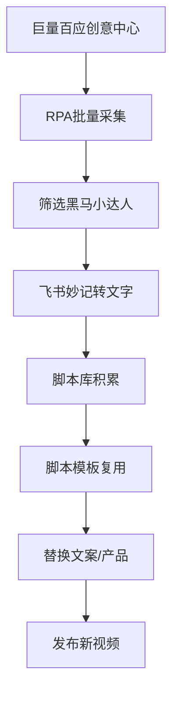
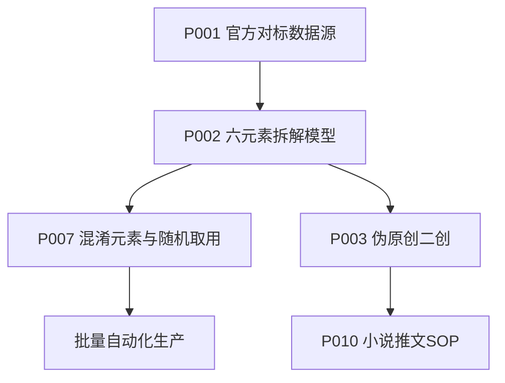
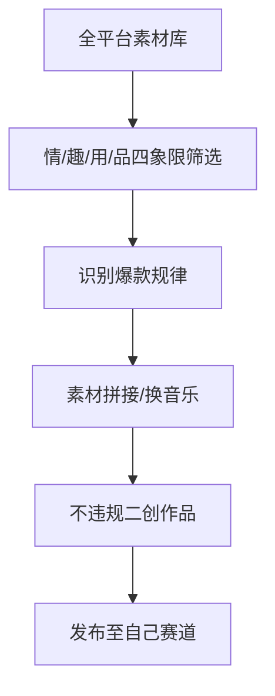
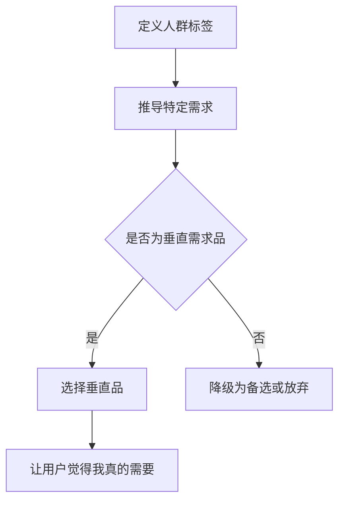
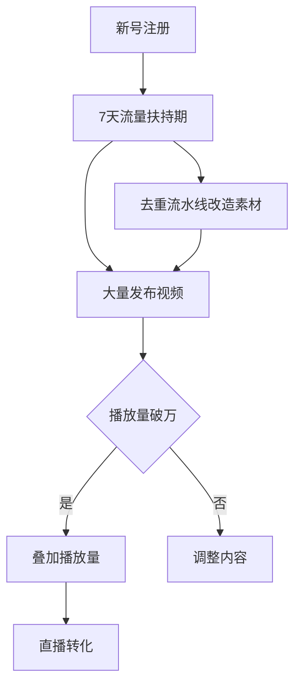
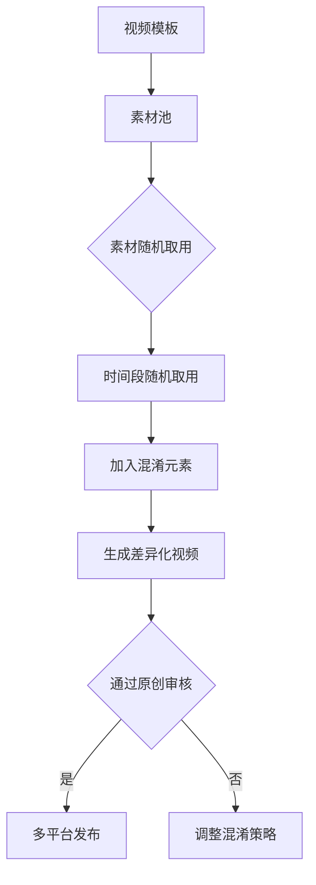
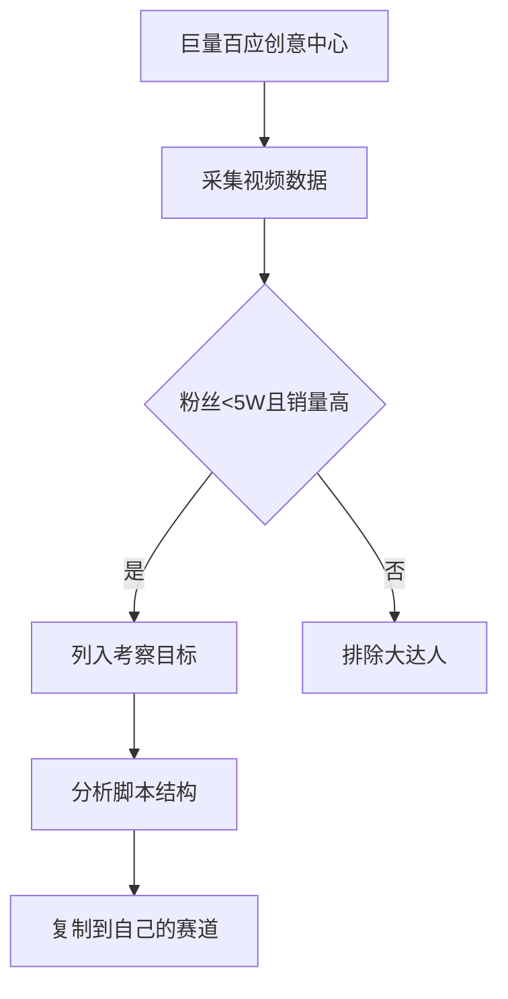
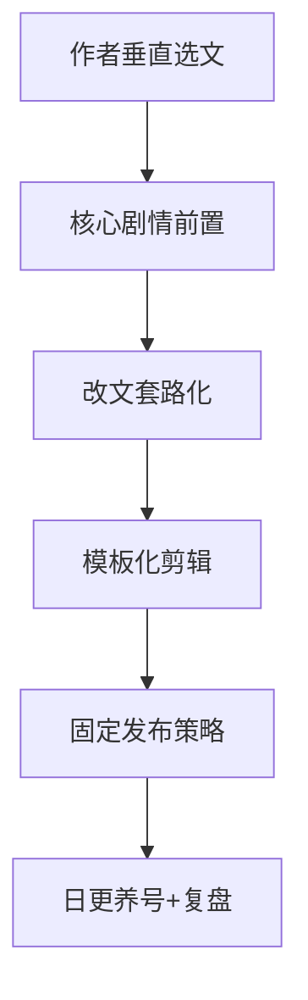

# 第 10 章 爆款内容生产线——从“对标”到“批量工业化”
作者：龙哥

## 学习目标

-   理解官方数据源与第三方工具在短视频对标中的差异，掌握以巨量百应创意中心为雷达的对标方法论
-   掌握短视频模板六元素拆解法，能将任意爆款视频转化为可复制的乐高积木
-   理解伪原创二创的底层逻辑，能基于'情、趣、用、品'四象限跨平台取材并合规改造
-   掌握选品即定人群的推导逻辑，能针对特定人群标签筛选垂直需求品
-   理解视频号新号流量扶持机制与视频搬运去重流水线，能独立完成新号冷启动与素材改造
-   掌握混淆元素与随机取用机制，能实现批量视频的差异化和原创化生产
-   理解黑马小达人策略的筛选标准与学习价值，能建立可持续的对标账号库
-   掌握小说推文的核心剧情前置与选文垂直化方法，能将文艺创作转化为标准化SOP

## 10.1 生活类比

想象短视频内容生产是一个**美食中央厨房**。在这个厨房里，每一条短视频就像一道菜，而我们的目标是用标准化的流程批量产出能吸引食客的招牌菜。首先，我们需要一份可靠的“美食榜单”来决定学做什么菜——这就是**对标方法论**：与其听那些所谓美食博主空口推荐，不如直接参考米其林餐厅那份经过市场检验的招牌菜榜单，也就是官方数据平台上的实时爆款视频。但榜单上那些名声在外的大餐厅（大达人）往往自带流量，我们更应该去关注那些不在榜单上、却在小巷里天天排队的苍蝇馆子，这就是**黑马小达人**策略——他们虽然没什么名气，但能靠一道菜养家糊口，说明手艺（内容）本身过硬，更值得偷师。确定要学哪道菜后，我们需要把这道菜分解成可操作的菜谱，这就是**六元素拆解**：一份完整的菜谱可以拆为食材（背景）、菜名（标题）、主料（内容）、烹饪步骤（文案）、摆盘说明（字幕），以及决定用餐氛围的背景音乐，每个部分都可以单独替换和调整。接下来，为了不在自家菜单上直接照抄，我们采用**伪原创二创**的思路：把A店的招牌菜换个B店的秘制酱料，再端到C店去卖，只要不是原封不动的照抄，就能挂上自家菜单。而做菜之前，我们必须先想清楚这家店开给谁吃，这就涉及**选品定人群**的智慧：如果我们是给中老年人开的食堂，就应该卖养生粥和健步鞋，而不是网红奶茶，因为后者虽然流行，却不是核心食客真正需要的。当我们要利用别人用过的食材（搬运素材）时，就需要一套**去重流水线**：把食材换个切法（放大），换口锅（翻转），换个盘子（换BGM），再撒把自家葱花（加字）来赋予它新的生命。为了保证每道菜出品后都带有一点“自家特色”，我们还会在出锅前夹一片自家院子种的香菜作为**混淆元素**——让每盘菜都因为这片香菜而显得独一无二。最后，为了让路人在第一眼就被吸引进店消费，我们采用**核心剧情前置**的手法：把小说里最精彩的反转情节写到封面海报上，让路人第一眼就产生掏钱买书的冲动。就像这个美食中央厨房需要标准化的菜谱和流水线才能批量出餐一样，短视频生产也需要模板化和SOP才能规模化放大，这就是本章的核心主旨。

## 10.2 概念地图

在正式展开各小节之前，我们先通过一张结构化的知识图谱，总览本章将要学习的核心概念及其相互之间的逻辑关系。下表为本章知识架构的总览，其中每个知识点后标注了其对应的素材来源编号（如P001对应素材《CGZ4dZq4ZoSFT4xUmFecNpk4nNe.md》），便于读者回溯原文。

```
短视频爆款内容生产
├── 对标方法论 （素材编号：P001《CGZ4dZq4ZoSFT4xUmFecNpk4nNe.md》）
│   ├── 官方数据源（巨量百应创意中心） —— P001
│   │   ├── 爆款视频库（实时、分行业）
│   │   └── 创意搜索（按GMV/关键词筛选）
│   ├── 黑马小达人策略 —— P001（同素材）, P008（《Lg2vd5GWHoqhBbxuT5LcThEpncb.md》）
│   │   ├── 粉丝5W以下、视频200条以上
│   │   ├── 围绕垂直品反复带、画面干净
│   │   └── 低粉高销更具可参考性
│   └── 脚本模板复用 —— P001
├── 模板化拆解 （素材编号：P002《JmBgdr705ovHoyxQknRctRaMnKh.md》）
│   ├── 六元素模型（背景/标题/内容/文案/字幕/BGM） —— P002
│   ├── 流量视频 vs 带货视频 —— P002, P011（同素材不同章节）
│   ├── 1比1模仿保底原则 —— P002
│   └── 底层工具模块抽取 —— P002
├── 伪原创二创 （素材编号：P003《VsjCdIDNJoNRvlxo4OWcJ7bDnO5.md》, 辅助参考P002）
│   ├── 情、趣、用、品四象限 —— P003, P002
│   │   ├── 情-共情（喜怒哀乐细分人群）
│   │   ├── 趣-有趣（反差/实验）
│   │   ├── 用-有用（教学/实用）
│   │   └── 品-新奇特产品
│   ├── 跨平台素材库（抖音/快手/知乎/小红书/TK） —— P003
│   └── 不违规二创（拼接/换音乐） —— P003
├── 选品定人群 （素材编号：P004《Lg2vd5GWHoqhBbxuT5LcThEpncb.md》）
│   ├── 人群标签先行（中老年+下沉城市） —— P004
│   ├── 垂直需求品优先 —— P004
│   │   ├── 运动锻炼类
│   │   └── 保养类
│   └── 通用品不作为第一梯队 —— P004
├── 批量生产与去重 （素材编号：P006《Lg2vd5GWHoqhBbxuT5LcThEpncb.md》，辅助参考P005同素材, P002与P007）
│   ├── 视频搬运去重流水线（放大→翻转→BGM→加字） —— P006
│   │   └── 加字引导出单 —— P006
│   ├── 混淆元素与随机取用 —— P002（《JmBgdr705ovHoyxQknRctRaMnKh.md》）, P007（同素材不同章节）
│   │   ├── 素材随机取用
│   │   ├── 时间段随机取用
│   │   └── 自拍混淆元素
│   ├── 新号流量扶持（前7天） —— P005
│   └── RPA批量采集（影刀） —— P001
└── 小说推文SOP （素材编号：P010/P012《ZcEdd0xTCo1K5IxwCyLccKUynOb.md》）
    ├── 选文垂直化（作者垂直+专栏垂直） —— P010
    ├── 核心剧情前置（提高5s完播率） —— P009
    ├── 改文套路化（关键词提炼+情绪修饰） —— P009
    └── 模板化剪辑（复制草稿统一样式） —— P012
```

## 10.3 对标方法论——让官方数据成为你的“商业雷达”

我们在前几章反复提到，短视频带货的第一步是“看到别人怎么赚钱”。但很多新人会陷入一个误区：凭感觉刷视频，凭印象模仿。这一节，我们介绍一套系统化的对标杆方法，把“凭感觉”变成“看数据”。

> “对标对标, 这里上榜的, 出成绩的, 最新的, 不就是最好的对标吗?”
> 
> ——《CGZ4dZq4ZoSFT4xUmFecNpk4nNe.md》素材P001

这段话点明了核心思想：**最好的对标素材，是官方数据平台上“正在出成绩”的爆款**。

### 为什么需要这个概念？

我们来看第一性原理：短视频带货竞争激烈，盲目原创成功率低。我们需要找到经过市场验证的爆款作为参考。但问题来了——去哪里找？常用的第三方数据工具（如抖查查、蝉妈妈）存在明显短板：数据滞后且不准确，难以实时捕捉行业最新趋势。作者在素材中直接指出：“这个是比抖查查蝉妈妈这些第三方要更准确的行业优秀爆款视频库。”（出自《CGZ4dZq4ZoSFT4xUmFecNpk4nNe.md》素材P001）也就是说，**官方数据源比第三方工具更贴近真实战场**。

### 核心定义：官方实时爆款视频库

> **对标方法论**定义（来源：《CGZ4dZq4ZoSFT4xUmFecNpk4nNe.md》素材P001）

我们以巨量百应创意中心的官方实时数据为对标工作的第一优先级，即**“官方实时数据源优于第三方工具”**。这种“优于”并非数学上的大小比较，而是一种方法论上的优先排序——它告诉我们在对标工作中，资源的分配顺序应该是：首先依赖官方实时数据（爆款视频库和创意搜索），而不是传统的第三方数据平台。实际应用时，这意味着通过官方平台我们能找到各行业、不同等级作者、近期带货效果最好的真实数据，而不是滞后或不完整的推测。

### 关键性质一：筛选性——黑马小达人策略

光有数据还不够，关键在于如何从海量数据中筛选出**可学习**的对象。这里引入“黑马小达人”概念。

> **黑马小达人策略**方法（来源：《CGZ4dZq4ZoSFT4xUmFecNpk4nNe.md》素材P001）

```
1. 在巨量百应创意中心采集数据后，优先筛选“粉丝量少但销量高”的视频
2. 筛选标准：粉丝5W以下、视频200条以上、一直围绕几个垂直品反复带、视频画面干净
3. 有一定非带货视频、保持更新
4. 分析其脚本结构，复制到自己的赛道
```

这个筛选流程的核心逻辑在于：大达人的销量往往受“粉丝基础加成”影响，无法真实反映内容质量。而黑马小达人粉丝少、销量高，说明其内容本身具备强大的转化力，这才是值得普通玩家对标学习的对象。素材中明确指出了这一反直觉的洞察：“这种黑马小达人更是我们小达人适合学习的对象, 毕竟大达人都是有粉丝基础加成在的, 销量天然会高一点.”（出自《CGZ4dZq4ZoSFT4xUmFecNpk4nNe.md》素材P001）

### 关键性质二：模板化——脚本模板复用

对标的目的不是“看”，而是“用”。素材提供了一个重要观点：“好的脚本大概率是不会过时的, 一个脚本模板, 改改文案换个产品推, 成功率大概也比瞎原创要好一点吧.”（出自《CGZ4dZq4ZoSFT4xUmFecNpk4nNe.md》素材P001）这引出一个核心原则：**脚本模板复用优于盲目原创**。

### RPA批量采集的衔接

在上文提到“用飞书妙记转成文字脚本”之前，我们还需要解决一个效率问题：面对创意中心海量的爆款视频，手动一个个点击下载显然过于低效。此时可以引入**RPA工具（如影刀）**来构建批量采集机器人。通过设定搜索词、滚动刷新次数、按GMV过滤等参数，RPA机器人可以自动循环采集页面上的视频数据（含GMV、粉丝量等）并导出表格，同时支持批量下载无水印视频。素材中作者提到：“指定搜索词/商品名;滚动刷新次数;按gmv过滤视频,默认过滤0销量;数据采集表格导出,默认到桌面;可选视频下载(无水印)”（出自《CGZ4dZq4ZoSFT4xUmFecNpk4nNe.md》素材P001）。RPA的价值在于将“人工手动翻页、逐个下载”的重复劳动程序化，让运营者把时间节省下来投入到更重要的内容分析和脚本拆解环节，这也正是后续“模板化拆解”得以批量化实施的基础设施。

### 方法演进图

以下流程图展示了从数据采集到脚本复用的完整对标链路：



### 典型例子

我们来看一个完整的操作示例：通过巨量百应创意中心，输入“护肤”关键词，自动采集近7天内GMV最高的100条视频，筛选出粉丝量低于5万但单条视频GMV超10万的“黑马视频”，下载后用飞书妙记转成文字脚本，存入自己的脚本库。这个过程把“对标”从理念落到了可执行的动作。

### 多源对照

关于“对标谁”这个问题，不同素材给出了侧重点不同的答案。**共识**：对标的核心是“找到已验证的爆款”，而非盲目原创。最新、出成绩的爆款是最好的学习对象。**分歧**：《CGZ4dZq4ZoSFT4xUmFecNpk4nNe.md》素材P001强调**官方数据源**：应以巨量百应创意中心等实时数据为准，数据更准确；《JmBgdr705ovHoyxQknRctRaMnKh.md》素材P002强调**直接1比1模仿**当下爆款视频去做原创，任何验证过的流量视频或带货视频都可作为模板；《Lg2vd5GWHoqhBbxuT5LcThEpncb.md》素材P008则从**学习对象**角度提出，黑马小达人（低粉高销、视频数多）比大达人更具参考价值。

### 设计中的取舍

**为什么不用第三方工具而是官方数据？** 第三方工具（抖查查、蝉妈妈）虽然方便，但数据滞后，难以捕捉当天的最新趋势。官方平台（如巨量百应）实时更新，能看到“现在”正在爆的视频。这种设计的代价（trade-off）是：官方平台仅覆盖入驻巨量百应的商家，部分非平台内爆款无法捕捉。这就像股市的实时行情和历史K线——你要做短线，就得看实时盘。

**黑马小达人策略的边界在哪里？** 低粉账号可能因偶然因素爆款（如一时的热点），缺乏长期可复制性。如果选了粉丝过少的账号（如低于1000粉），可能学到的是“运气”而非“方法论”。所以筛选标准不能只看“低粉高销”，还要看视频数量和持续性。

## 10.4 模板化拆解——把爆款视频拆成“乐高积木”

对标找到了爆款，下一步是**理解爆款为什么爆**。这一节我们学习如何把任意一条视频拆解成可复制的“乐高积木”。

> “所有的视频都可以拆成以下元素：1. 背景：图或者视频 2. 标题：主、副标题 3. 内容：图、视频 4. 文案：5. 字幕：6. 背景音乐：”
> 
> ——《JmBgdr705ovHoyxQknRctRaMnKh.md》素材P002

### 为什么需要这个概念？

在当前的短视频竞争环境中，1比1模仿爆款虽然保险，但直接搬运会面临平台打击和内容同质化风险；同时，手动剪辑视频效率极低，无法实现批量生产，难以满足矩阵化运营对内容数量的需求；此外，视频制作看似复杂多变，缺乏统一的抽象模型就无法实现自动化生成。正是这三个痛点，共同催生了“模板化拆解”这一核心方法论。

### 核心定义：六元素拆解模型

> **六元素拆解**定义（来源：《JmBgdr705ovHoyxQknRctRaMnKh.md》素材P002）

任何短视频的内容构成，都可以被**背景、标题、内容、文案、字幕、背景音乐**这六个自变量唯一确定。其中，“背景”决定了视频的视觉基调；“标题”负责在第一时间抓住注意力；“内容”提供主要画面信息；“文案”通过旁白或文字传递核心卖点；“字幕”辅助理解并强化重点；“BGM”则塑造情绪氛围。通过分别调整或替换这六个变量，我们就能在保持模板“骨架”不变的情况下，生成全新的视频。这是实现视频自动生成的基础，也是将任意爆款视频转化为可复制模板的关键。

### 关键性质一：普适性与模块化

视频模板有各种各样的形式，拆解的多了会发现其实都是上面提到的那些元素组成的。例如，一个中医养生流量视频模板可以拆解为：**背景**为一张中医大师的照片放大模糊；**标题**为“请等一下，xxxx”；**内容**为一张中医大师的照片；**文案**为“国医大师xxx”；**字幕**为无；**背景音乐**为一段舒缓古风曲。每个元素都可独立寻找相似替代素材，这种模块化特性大大降低了模板复制的操作难度。

### 关键性质二：可编程性

元素拆解后即可编写代码自动生成视频，实现批量化生产。

> **原创视频自动生成**方法（来源：《JmBgdr705ovHoyxQknRctRaMnKh.md》素材P002）

```
1. 将爆款视频拆解为六元素
2. 为每个元素寻找3-5个相似素材
3. 编写代码自动生成视频
4. 通过素材随机取用、时间段随机取用、混淆元素确保差异性和原创性
5. 开发自动发布工具，多平台自动发布
```

这段伪代码展示了从“看一条视频”到“生产一百条视频”的完整链路。作者指出，底层工具模块抽取后，“现在几分钟就能实现一个新的模板，抖音上看到的视频只要不是特效很多，基本都能做，只要拆解清楚就可以。”（出自《JmBgdr705ovHoyxQknRctRaMnKh.md》素材P002）

### 流量视频 vs 带货视频

拆解之前，还要先分清视频的类型。

> **流量视频 vs 带货视频**定义（来源：《JmBgdr705ovHoyxQknRctRaMnKh.md》素材P002）

$$
\text{流量视频} \rightarrow \text{拉曝光、涨粉、打标签}
$$

$$
\text{带货视频} \rightarrow \text{直接促成销售转化}
$$

这两个公式展示了内容矩阵的分工：前者服务于账号的“增长”目标，后者服务于“变现”目标。每个赛道的视频内容都有这两种类型，**用验证过的流量视频或带货视频当模板，是要保证1比1模仿做出的内容都是60分以上的。**

值得注意的是，流量视频与带货视频的分类并非绝对。在某些垂直赛道（如机械工具类），同一支视频可能既展示了产品使用过程（具有实用价值），又附带了购买链接。但在大多数消费赛道，二者的分工依然清晰：流量视频蓄水，带货视频收割，两者协同构成完整的内容矩阵。关于“流量视频与带货视频”这一分类的进一步拓展，以及“1比1模仿保底原则”的详细阐述，在素材P011（与P002同素材，不同章节）中也有相关论述。P011重点强调，无论是流量视频还是带货视频，都应该以验证过的爆款为模板，以保障内容质量的下限。两个素材的核心观点一脉相承，均指向“模仿已验证内容”作为效率最高的创作起点。

### 方法演进图



### 典型例子

我们来看完整操作：拆解一条中医养生流量视频模板，明确其六个元素（背景、标题、内容、文案、字幕、BGM）的具体形式后，为每个元素寻找3-5个相似素材，然后编写代码实现自动生成。作者分享的案例中，通过这种方式将一个朋友的三个中医养生号做成数月变现10w左右（出自《JmBgdr705ovHoyxQknRctRaMnKh.md》素材P002）。

### 设计中的取舍

**为什么不直接人工剪辑而要程序化生成？** 人工剪辑虽然灵活，但效率极低，无法满足矩阵号每天几十上百条的内容需求。程序化生成的代价是**创意天花板受限**——它只能基于已拆解的模板进行组合，难以生成真正“出格”的创意内容。因此，这套方法更适合“以量取胜”的矩阵打法，而非追求单一爆款的精品路线。

**为什么强调1比1模仿而不是自己发挥？** 模仿验证过的爆款可以保证内容质量在60分以上，避免低质内容。其**代价是**：如果市场上同质化内容过多，平台可能会对相似的模板进行限流，因此需要配合10.8节的“混淆元素”机制来维持原创度。

### 边界条件

特效较多的视频（如复杂转场、粒子效果）拆解后难以用代码还原，需人工介入。模板拆解依赖对目标赛道的理解，若赛道本身内容形式单一，拆解出的模板受限。此外，过度依赖程序化导致创意趋同，需定期人工更新模板库。

## 10.5 伪原创二创——用“拼图思维”制造“新爆款”

有了模板拆解的能力，我们面对的下一个问题是：**素材从哪里来？** 答案出人意料：全网都是你的素材库。这一节我们学习伪原创二创方法论。

> “我把短视频内容分为\"情趣用品\"四个字”
> 
> ——《VsjCdIDNJoNRvlxo4OWcJ7bDnO5.md》素材P003

### 为什么需要这个概念？

在当前的平台环境下，平台对搬运打击日益严厉，直接搬运视频容易导致限流、封号；而完全原创难度大、成功率低，需要借力已验证的爆款素材降低创作风险；同时各平台素材丰富，但缺乏系统化的素材筛选与重组方法，导致二次创作效率低。因此，伪原创二创成为平衡风险与效率的关键方法。

### 核心定义：情、趣、用、品四象限

> **内容四象限**定义（来源：《VsjCdIDNJoNRvlxo4OWcJ7bDnO5.md》素材P003）

几乎所有短视频平台的爆款内容，都可以被归入**情（共情）、趣（有趣）、用（有用）、品（新奇特产品）**这四个象限之一。其中，“**情**”指能引发观众共情的喜怒哀乐内容，并且可以按人群无限细分；“**趣**”指通过反差、实验等形式让人感到有趣的内容；“**用**”指具有教学或实用价值的干货内容；“**品**”则指那些让人感到新奇、罕见的特色产品。理解这四个象限，是我们在海量素材中快速识别“爆款基因”并筛选可用素材的底层逻辑。

### 关键性质一：四象限的细分与定位

作者特别强调了“情”这一象限的可细分性：“喜怒哀乐里面又能延伸小朋友的喜怒哀乐，20岁的，30岁的，40岁的，50岁的，男人的，女人的，有钱男人的，没钱女人的等等一系列分支。”（出自《VsjCdIDNJoNRvlxo4OWcJ7bDnO5.md》素材P003）这说明四象限不仅是分类工具，更是**人群定位工具**——你不需要在所有分支里都做出爆款，只需在成千上万的细分分支中“扣到一个点就够了”。这就解决了新手“想要的太多”而导致定位模糊的问题。

### 关键性质二：跨平台取材与不违规二创

> **伪原创二创**定义（来源：《VsjCdIDNJoNRvlxo4OWcJ7bDnO5.md》素材P003）

伪原创的完整链路可以描述为：**以全平台为素材库，通过“情、趣、用、品”底层逻辑筛选，再进行拼接或换音乐等不违规的二次创作，最终转化为自己赛道的作品**。**所有短视频平台（抖音、快手、优酷、知乎、小红书甚至TK）都是你的素材库**。通过“情、趣、用、品”底层逻辑找到爆款规律后，我们要做的无非是把这些素材不违规地二创成自己赛道的作品进行发布。

素材中给出了一个重要操作心法：“通过大概几十条作品的制作之后, 你大概率会发现其实有些作者没上热门的视频, 其实他的画面或者他们音乐很好. 你就会开始留意那些视频的那些片段, 或者音乐, 脑海里面会自然给他做一个合适的拼接.”（出自《VsjCdIDNJoNRvlxo4OWcJ7bDnO5.md》素材P003）也就是说，伪原创不是“乱拼”，而是**基于对爆款底层逻辑的理解，做有意识的拼接**。

### 方法演进图



### 典型例子

在抖音找到一条播放量破千万的“情感共鸣”类视频，分析其文案和画面节奏后，将其画面素材与另一条快手的背景音乐拼接，文案改为自己赛道（如“中年职场困境”）相关的表达，发布到视频号后播放量突破百万。

### 多源对照

关于“伪原创”，两个素材给出了互补视角。**共识**：都认为基于已验证的爆款素材进行二次创作，比完全原创更高效，且需要规避平台打击。**分歧**：《VsjCdIDNJoNRvlxo4OWcJ7bDnO5.md》素材P003从**内容分类**角度出发，强调“情、趣、用、品”四象限是所有爆款的底层逻辑，跨平台取材是关键；《JmBgdr705ovHoyxQknRctRaMnKh.md》素材P002则从**技术自动化**角度出发，认为通过六元素拆解+代码生成可以实现“原创优于二剪优于搬运”，强调的是程序化批量生产，而非手工拼接。

### 设计中的取舍

**为什么不纯原创而要“伪原创”？** 纯原创的成功率低且耗时耗力，而伪原创能大幅降低创作门槛和风险。这种设计的代价（trade-off）是：内容可能缺乏真正的差异化，容易陷入同质化竞争。因此，伪原创更适合作为冷启动阶段的“第一桶金”，随着账号成长，需要逐步增加真正的原创元素。

**为什么跨平台取材优于单平台？** 跨平台取材能获取更丰富的素材库，避免单一平台的审美疲劳。但其代价是：不同平台的用户喜好和内容调性存在差异，直接搬运可能“水土不服”，需要针对目标平台的人群特性进行调整。

### 边界条件

过度拼接他人素材可能触犯平台原创审核，需要搭配自拍混淆元素降低风险。“情、趣、用、品”仅用于内容定位和素材筛选，不能替代对目标用户需求的深入理解。抖音的热度内容不一定在视频号爆，需要观察视频号平台人群的特性来调整。

## 10.6 选品即定人群——让用户觉得“我真的需要”

内容生产的最终目的是卖货。而卖货的第一步是选品。这一节我们介绍一种反直觉的选品方法论——**选品即定人群**。

> “选品其实就是定人群然后找需求，大家能理解这句话，就很好选品了。”
> 
> ——《Lg2vd5GWHoqhBbxuT5LcThEpncb.md》素材P004

### 为什么需要这个概念？

视频号用户群体（中老年、下沉市场）与抖音快手差异明显，直接搬运其他平台的选品逻辑失败率高；面向泛人群的通用品（服装、食品）竞争激烈，难以通过价格优势取胜；同时，带货效率取决于商品与目标用户需求的精准匹配，缺乏方法论时容易凭感觉选品。因此，需要一套“人群先行”的选品框架来替代直觉决策。

### 核心定义：选品即定人群

> **选品方法论**定义（来源：《Lg2vd5GWHoqhBbxuT5LcThEpncb.md》素材P004）

选品的核心逻辑链条是**“定义人群标签 → 推导特定需求 → 选择垂直需求品”**。第一步，确定清晰的人群标签（如年龄、地域、消费习惯）；第二步，基于对该人群的深刻理解，推导其未被满足的特定需求；第三步，选择能够精准满足该需求的“垂直需求品”，而不是面向所有人的“通用品”。

### 关键性质：垂直优先与需求差异化

以视频号带货为例，人群标签是“中老年人+下沉城市”。那么这类人群的特定需求是什么？素材指出：“年纪大了就想身体好，年纪大了就想重返青春，所以运动锻炼类的品和有关保养方面的品，都可以考虑。”（出自《Lg2vd5GWHoqhBbxuT5LcThEpncb.md》素材P004）

垂直需求品的核心优势是：**价格反而不是特别的重要，重点在于我觉得这玩意对我有用**（出自《Lg2vd5GWHoqhBbxuT5LcThEpncb.md》素材P004）。作者更偏向于那种让用户看了觉得“这个东西我是真的需要，是真的适合我”的产品。而“通用品”（如服装、食品）因为需求过于普通，是所有人的需求而非目标人群的特定需求，所以不在第一梯队。

### 方法演进图



### 典型例子

视频号带货项目中，将人群定位为“中老年人+下沉城市”，挖掘其“身体好、重返青春”的特定需求，选择运动锻炼类和保养类产品（如健步鞋、按摩仪）而非服装、零食等通用品。最终通过直播实现单场破万场观、200多单的转化（出自《Lg2vd5GWHoqhBbxuT5LcThEpncb.md》素材P004）。

### 设计中的取舍

**为什么不选择销量高的“爆款”通用品？** 通用品虽然需求量大，但竞争也异常激烈。在没有价格优势的前提下，小达人很难在红海中突围。这种设计的代价（trade-off）是：选择垂直需求品意味着放弃了巨大的流量池，受众相对狭窄，天花板较低。因此，这个策略更适合在资源有限时，寻求“小而美”的精准变现，而非追求大规模的销售额。

**为什么“人群先行”优于“产品先行”？** 产品先行容易陷入“我有好东西但不知道卖给谁”的困境。人群先行则通过理解人群，反向推导其决策逻辑（“我真的需要”），从而提高转化效率。代价是，这套方法要求运营者对特定人群有足够深入的洞察，否则需求推导容易失真。

### 边界条件

垂直需求品虽转化率高，但受众相对狭窄，需配合高频上新和持续内容输出维持流量。下沉市场用户对价格敏感度存在差异，部分垂直品（如高价保健品）需测试后再决定是否主推。

## 10.7 视频号新号流量扶持与去重流水线——平台送给新手的“新手村加速器”与“旧衣翻新术”

做号的第一道坎是冷启动：新账号没粉丝、没播放、没信心。这一节我们介绍一个平台规则上的“隐形加速器”——**新号流量扶持**。

> “圈友诚不欺我也，新号果然是有流量扶持的，这个视频号还真可以搞。”
> 
> ——《Lg2vd5GWHoqhBbxuT5LcThEpncb.md》素材P005

### 为什么需要这个概念？

新账号冷启动阶段播放量低、无人问津，大量运营者在前7天就放弃；不了解平台的冷启动机制，就无法利用平台规则加速起量过程；同时需要判断新号流量扶持的时间窗口和效果边界，以制定合理的起号策略。因此，理解新号流量扶持机制是冷启动的第一步。

### 核心定义：新号流量扶持

> **新号流量扶持**定义（来源：《Lg2vd5GWHoqhBbxuT5LcThEpncb.md》素材P005）

视频号平台会对新注册账号给予初期（据称约7天）的流量倾斜机制，表现为新号发布的视频有高概率获得破万播放的流量扶持。一旦扶持期结束，播放量将回归正常水平。实际应用中，这意味着运营者应充分利用这7天的时间窗口大量发布测试内容，以最低的成本获取最大的初始流量，同时通过数据反馈快速找到用户喜欢的内容方向。

### 关键性质与应用

作者用实测数据验证了这个机制的存在：“到了晚上我看了一下，三个号全部破万播放了，两个1W出头，有一个跑到了3W+的播放。”（出自《Lg2vd5GWHoqhBbxuT5LcThEpncb.md》素材P005）这一数据直观地展示了新号流量扶持的力度和普遍性。

新号流量扶持的“时限性”意味着它是一个**有限的时间窗口**。作者也提出了一个激进但有效的策略：

> “在7天扶持期内作死的发视频，一个视频几千一万的，几十个视频就是几十万，几百个就是几百万，然后7天时间过了就换号。”（出自《Lg2vd5GWHoqhBbxuT5LcThEpncb.md》素材P005）

这个策略的核心是利用扶持期的高播放概率，通过大量发视频叠加出百万级播放量。但该策略有明显的**边界条件**：它“不长久”，本质是消耗平台红利而非建设账号资产，且存在因大量发布低质内容被平台判定为营销号的风险。因此，作者也坦诚“这样虽然不长久，但总比每天发了没反应做无用功要强吧”（出自《Lg2vd5GWHoqhBbxuT5LcThEpncb.md》素材P005）。对于想长期运营的玩家，更应利用扶持期的流量做内容测试，快速找到用户喜欢的内容方向。

### 视频搬运去重流水线

新号有了流量，但视频素材从哪里来？在冷启动阶段，搬运是常见的起步方式，但直接搬运必然限流。这就需要用一套固定的去重流程给旧素材“换马甲”。下面这条流水线解决了两个核心问题：一是规避平台的重复内容检测机制，让旧素材在新号上以“新内容”的形式获得第二次生命；二是通过“加字”环节将通用素材转化为具有针对性的转化工具，使搬运内容在整体链路中承担起为直播间引流和测试选品的功能。

> **视频搬运去重流水线**方法（来源：《Lg2vd5GWHoqhBbxuT5LcThEpncb.md》素材P006）

```
1. 放大：将画面放大一定比例，可配合裁剪
2. 翻转：左右翻转或上下翻转画面方向
3. BGM处理：换BGM、加BGM底、或对原视频变速（1.1-1.2倍）
4. 加字：遮盖原字幕，添加针对产品特点的醒目引导文字
```

这段伪代码展示了一条固定流程。作者强调了一个反直觉的洞察：“有时候出单可能不是因为视频，而是你加的字抓住了用户.”（出自《Lg2vd5GWHoqhBbxuT5LcThEpncb.md》素材P006）举一个具体的例子：“比如产品是个拖把……今天惹老伴生气了，罚我做一天家务，还好有这个拖把。”（出自《Lg2vd5GWHoqhBbxuT5LcThEpncb.md》素材P006）这条引导语把“卖拖把”包装成了一个“男人认错做家务”的场景，抓住了中老年女性用户的心理。

### 方法演进图



### 设计中的取舍

**为什么使用搬运+去重而非完全原创？** 搬运能快速获取经过验证的素材，大大降低冷启动内容制作的时间和精力成本。这种设计的代价是：搬运内容存在被平台判定为“非原创”的封号风险，同时可能面临版权纠纷。因此，去重流水线并非为了“骗过平台”，而是为了在借鉴中融入自己的二次创作，让旧素材在平台上以“新内容”的形式获得第二次生命。

**为什么“加字”被视为出单关键而非视频本身？** 因为搬运视频的画面内容对用户而言可能已经“见过”，但一句精心设计的引导语却能针对特定人群的心理重新定义这个视频，从而激发购买欲。这种设计的代价是：对文案能力要求较高，如果引导语不够精准，可能无法产生预期的转化效果，因此需要持续测试优化。

### 边界条件

扶持期结束后流量下降明显，需要依赖内容质量和粉丝积累维持播放量。过度依赖流量扶持会导致扶持期结束后数据断崖式下跌，需提前规划内容策略。画面翻转、变速幅度过大可能影响观看体验，需适度处理。

## 10.8 混淆元素与随机取用——让批量视频“长得不一样”

当你有了模板、素材和去重流程，下一个瓶颈出现了：**如何批量生产而不被平台判定为搬运？** 答案藏在“混淆元素”和“随机取用”这两个机制里。

> “再加上混淆元素，这样能保证做出来的视频都是原创视频，且每个视频生成的都不相同，在任何一个平台都能过原创。”
> 
> ——《JmBgdr705ovHoyxQknRctRaMnKh.md》素材P002

### 为什么需要这个概念？

自动化批量生成的视频若内容雷同，会被平台判定为搬运或低质内容，无法通过原创审核；手动差异化处理效率低，无法支撑矩阵化运营对内容数量的要求；因此，需要一套机制在自动化流程中自然地生成具有差异性的原创内容。

### 核心定义：三个差异化手段

> **差异化生成机制**定义（来源：《JmBgdr705ovHoyxQknRctRaMnKh.md》素材P002）

确保视频原创性的三个核心手段可以整合为：**素材随机取用（每个素材在生成时随机选择，保证组合多样性） + 时间段随机取用（模板多片段时，随机截取素材内时间段，增加不确定性） + 自拍混淆元素（加入自己拍摄的照片和视频，嵌入“原创指纹”）**。三者叠加，使每条自动生成的视频在组合层面都是独一无二的，从而能在任何平台通过原创审核。

### 关键性质

这三个手段均可编码实现，无需人工干预。作者强调：“每个视频的生成时都加一些混淆元素，用自己拍的照片和视频”（出自《JmBgdr705ovHoyxQknRctRaMnKh.md》素材P002）。这套机制的巧妙之处在于，它用**程序化**的方式模拟了“人肉原创”的随机性，使得批量生产的内容也能保持“每一帧都不同”的原创感。

### 方法演进图



### 典型例子

在一套中医养生视频模板中，准备了20张中医相关照片、50段背景视频、30首背景音乐。生成时每次随机选取1张照片、随机截取某段视频的某个时间段，并混入自己拍摄的5张生活照片，确保生成的100条视频各不相同且都能过原创审核。

### 设计中的取舍

**为什么随机取用优于人工挑选？** 人工挑选虽能保证内容逻辑的连贯性，但在批量生产中效率极低且主观性强。随机取用虽可能产生“不协调”的组合（如古风画面配现代音乐），但大幅提高了生成效率，且通过预设合理的素材组合规则（如按风格分类）可以降低不协调的概率。这种设计的代价是：需要投入一定时间在素材池的整理和分类上，以规避随机性带来的负面影响。

**为什么必须加入自拍混淆元素？** 仅靠素材随机组合，在数学上仍有极小概率生成与已发布视频完全相同的排列。自拍素材的加入，相当于为每条视频打上了一个不可复制的“物理指纹”，从根源上保障了唯一性。代价是，自拍混淆元素需与赛道相关或至少不突兀，否则会影响视频内容的完整性。

### 边界条件

自拍混淆元素需与赛道相关或至少不突兀，否则影响视频内容的完整性。随机组合可能产生不协调的视频（如古风画面配现代音乐），需要预设合理的素材组合规则。特效较多的视频因难以拆解和代码还原，不适合此自动化流程，需人工介入。

## 10.9 黑马小达人策略——向“低粉高销”的野路子学习

在10.3节中我们提到了黑马小达人是对标的重要对象，这一节我们专门展开讲讲：为什么以及如何“向野路子学习”。

> “我的思路是找那种,粉丝量少,但是销量高的视频,做参考”
> 
> ——《CGZ4dZq4ZoSFT4xUmFecNpk4nNe.md》素材P001

### 为什么需要这个概念？

对标大达人（粉丝百万级）时，其销量受粉丝基础加成影响，难以判断内容本身的质量；普通小达人需要可复制、可参照的学习对象，而非遥不可及的大V案例；同时，缺乏筛选标准时，对标账号的选择随意性大，学习效率低。因此，黑马小达人策略就是为普通玩家量身定制的筛选框架。

### 核心定义

> **黑马小达人策略**定义（来源：《CGZ4dZq4ZoSFT4xUmFecNpk4nNe.md》素材P001）

我们可以用“学习价值 = 销量 / 粉丝量”这一比值来快速评估对标账号的价值：**一个账号的学习价值与其“销量/粉丝量”的比值正相关**。当粉丝量很低而销量很高时，比值就很大，这意味着该账号的内容本身具备强大的转化力，而非依赖粉丝信任完成销售。对普通玩家而言，这样的账号是“黑马”，它的成功路径更容易被拆解和复制。实际应用中，我们应优先学习那些“高销量低粉丝”的账号，而警惕那些“高销量高粉丝”的大V——后者的成功里混杂了太多粉丝加成。素材中将其称为“黑马小达人”，并明确表示“这种黑马小达人更是我们小达人适合学习的对象”（出自《CGZ4dZq4ZoSFT4xUmFecNpk4nNe.md》素材P001）。

### 关键性质：筛选标准与素材优势

黑马小达人的筛选并非随意，而是有一套明确的标准。素材《Lg2vd5GWHoqhBbxuT5LcThEpncb.md》给出了具体条件：“粉丝在5W以下、视频在200以上、一直围绕几个品反复带、视频画面不是自己加很多字的、有一定的非带货视频、保持更新，这样的号我就会把它列入考察目标。”（出自《Lg2vd5GWHoqhBbxuT5LcThEpncb.md》素材P008）

**这套标准确保了筛选出的黑马小达人具备三个核心价值**：其一，**内容质量经市场验证**（低粉高销证明其内容转化力强）；其二，**素材供给可持续**（视频200条以上、持续更新保证了素材的丰富度和可筛选空间）；其三，**搬运风险较低**（小号被搬运几率小，画面干净便于二次创作）。素材还指出：“小号就代表被搬过的几率小，而且号主本人同时在发视频号的几率也小。视频多素材就多，可以发的久也可以去做筛选。”（出自《Lg2vd5GWHoqhBbxuT5LcThEpncb.md》素材P008）这说明黑马小达人不仅是学习对象，也是稀缺的素材来源。

### 方法演进图



### 典型例子

在巨量百应创意中心筛选出一位粉丝仅8000、但近30天带货视频累计GMV超20万的博主。分析其视频后发现，其脚本多采用“痛点前置+产品演示+限时优惠”结构，因此复制该结构替换为自己赛道的产品和文案，成功跑出多条爆款视频。

### 设计中的取舍

**为什么选黑马小达人而非大达人？** 大达人的成功往往难以复制，其销量由粉丝信任、品牌效应、供应链能力等多重因素构成；而黑马小达人的成功更纯粹地依赖于内容本身的“爆款基因”，拆解其内容能获得更直接、可复制的经验。这种设计的代价是：黑马小达人可能昙花一现，需要持续更新对标库，而不是固定学习某几个账号，这增加了信息收集的工作量。

### 边界条件

黑马小达人可能昙花一现，需持续更新对标库而非固定某几个账号。部分低粉高销账号依赖直播转化而非视频内容，需结合直播间数据综合判断。如果选了粉丝过少的账号（如低于1000粉），可能学到的是“运气”而非“方法论”。

## 10.10 小说推文的批量生产SOP——把“文艺创作”变成“流水线作业”

前面几节的方法适用于大多数短视频赛道，这一节我们聚焦一个具体的变现场景——**小说推文**。这个赛道特别适合展示“从艺术到工程”的转变。

> “下面我将根据配音号的实操流程，从选文改文、剪辑制作、发布运营、日常维护四个方面展开.”
> 
> ——《ZcEdd0xTCo1K5IxwCyLccKUynOb.md》素材P010/P012

### 为什么需要这个概念？

单篇小说推文制作耗时（选文、改文、配音、剪辑），无法满足日更多篇的需求；手工制作质量不稳定，难以形成可持续的内容供给能力；因此，需要一套标准化、可重复的流程，降低单条内容的制作时间和精力消耗。

### 核心定义一：选文垂直化

> **选文垂直化**定义（来源：《ZcEdd0xTCo1K5IxwCyLccKUynOb.md》素材P010）

选文垂直化通过两种互补的路径获取稳定优质的文章来源：**作者垂直**指关注8~10个符合账号定位的优质作者，在知乎-动态里可以看到他们每天点赞的文章、关注的问题、发布的回答，抓住作者就等于抓住了稳定的文章来源；**专栏垂直**指选中作者的某篇优质文章后，查看该文章所属盐选专栏，再去专栏里筛选同类型的优质文章，相当于借力知乎编辑的筛选能力。作者强调：“选文是小说推文项目的绝对核心。”（出自《ZcEdd0xTCo1K5IxwCyLccKUynOb.md》素材P010）

另外，关于“每天定时‘收菜’”这一操作，它指的是：在关注好作者/专栏后，每天选定几个固定的时间点（如早晚各一次），集中查看关注列表中的新动态，将新发布的优质文章“采摘”入库。这样做的好处是避免频繁刷新浪费时间，同时又能确保不错过优质作者的最新文章，抢占关键词先发优势（出自《ZcEdd0xTCo1K5IxwCyLccKUynOb.md》素材P010）。

### 核心定义二：核心剧情前置

选好文后，接下来是“改文”。这一步的关键不是“朗读”，而是**二次创作**。

> **核心剧情前置**定义（来源：《ZcEdd0xTCo1K5IxwCyLccKUynOb.md》素材P010）

**完播率与核心剧情位置呈负相关：核心剧情在视频中的位置越靠前，完播率越高。** 因为抖音的推荐机制高度依赖5秒完播率，如果开头不能立刻抓住观众，后续流量会急剧下降。在实际改文操作中，针对“中开高走”的文章（开头平淡、中后期精彩），运营者应将核心剧情（含冲突、悬念、反差）提炼后前置到视频开头，从而在“5秒完播率”这个关键指标上获得显著提升。素材中给出了具体操作：“将核心剧情提前后，还可以适当添加一些能够调动情绪的修饰词，比如'竟然''偏偏''非要'等.”（出自《ZcEdd0xTCo1K5IxwCyLccKUynOb.md》素材P010）

### 批量生产SOP

> **批量生产SOP**方法（来源：《ZcEdd0xTCo1K5IxwCyLccKUynOb.md》素材P010/P012）

```
1. 选文：作者垂直+专栏垂直，每天定时“收菜”
2. 改文：通读全文→提炼关键词→核心剧情前置→添加情绪修饰词→精简篇幅
3. 剪辑：打开剪映→拖入素材→处理素材→智能字幕→导出视频（熟练后≤15分钟）
4. 发布：发布前5-15分钟上线活跃，发布后评论区引导
5. 复盘：内容分析、粉丝分析、策略分析三维度每日复盘
```

这段伪代码展示了从选文到发布的完整流程。其中第5步“复盘”至关重要：**内容分析**指回顾每日发布内容，根据完播率、播放量、评论量等数据判断哪些文章更受欢迎；**粉丝分析**指每天查看粉丝画像（尤其是性别与年龄分布），并可适当移除不符合账号定位的粉丝；**策略分析**指记录发布时间、话题标签、引导方式等组合，持续测试最优搭配。这三者共同构成了“数据反馈→策略优化”的闭环，是SOP持续迭代的关键。作者运营2个号，每天发布2-4条视频，从选文改文到剪辑发布投入的时间不超过1.5小时，单号每周收益稳定在400元左右（出自《ZcEdd0xTCo1K5IxwCyLccKUynOb.md》素材P012）。这一数据也印证了素材P012中关于“剪映模板化剪辑流程（复制草稿统一样式）”的具体做法：第一次剪辑后可复制草稿形成统一模板，后续直接打开在第一条视频的基础上进行删改，从而大幅缩短单条制作时间。

### 方法演进图



### 多源对照

关于“批量生产”，不同素材给出了互补视角。**共识**：都必须先找到“验证过的爆款”作为基础，再通过流程化手段放大产量。**分歧**：《ZcEdd0xTCo1K5IxwCyLccKUynOb.md》素材P010强调**内容精细化**：核心在选文质量（作者垂直+专栏垂直）和改文技巧（核心剧情前置），剪辑反而被简化；《JmBgdr705ovHoyxQknRctRaMnKh.md》素材P002强调**程序化自动化**：核心在六元素拆解和代码生成，内容“质量底线”靠1比1模仿保证，不依赖人工改文能力。

### 设计中的取舍

**为什么强调“选文垂直化”而非广泛选文？** 垂直选文能精准锁定账号的目标受众，提高粉丝的精准度和账号权重，长期来看更利于变现。这种设计的代价是：可选择的文章范围变窄，需要花费更多精力去维护作者和专栏的关注列表，且可能因为内容过于垂直而错失偶尔的“跨界爆款”。但对于追求稳定变现的账号而言，垂直化的长期收益更大。

**为什么要把核心剧情前置而不是完全改编？** 核心剧情前置是在保留原文精华的基础上进行二次创作，既解决了开头平淡的问题，又保留了小说的完整性。代价是，如果核心剧情本身不够突出，或者提炼不到位，前置的效果会大打折扣，因此对运营者的“拆解能力”有较高要求。

### 边界条件

SOP依赖选文质量，若选文环节未垂直化则后续改文剪辑的投入可能浪费。标准化流程可能限制创意发挥，需定期引入新模板防止内容同质化。优质作者也可能发一些低质量文章，仍需二次筛选判断。

## 10.11 本章小结

这一章中我们系统学习了短视频爆款内容生产的完整链路：从“对标”到“拆解”到“批量生产”。首先，我们讲解了以巨量百应创意中心为雷达的对标方法论，理解了官方数据源优于第三方工具，以及黑马小达人策略的学习价值；其次，我们掌握了六元素拆解模型，能把任意爆款视频转化为可复制的乐高积木；接着，我们学习了伪原创二创的底层逻辑，理解了如何基于“情、趣、用、品”四象限跨平台取材合规改造；然后，我们推导了选品即定人群的方法论，理解了垂直需求品优先的选品逻辑；再然后，我们介绍了视频号新号流量扶持机制与搬运去重流水线，完成了新号冷启动与素材改造的技能储备；最后，我们深入小说推文赛道，掌握了选文垂直化与核心剧情前置的批量生产SOP。

下表汇总了本章涉及的关键概念及其要点，便于读者回顾与复习：

| 概念 | 解释 |
|------|------|
| 对标方法论 | 以官方实时数据源（巨量百应创意中心）替代滞后第三方工具，以爆款作为学习基准 |
| 黑马小达人策略 | 优先学习'低粉高销'账号，其内容转化力不依赖粉丝加成，更具参考价值 |
| 六元素拆解模型 | 所有短视频均可拆为背景、标题、内容、文案、字幕、BGM六个可替换的积木模块 |
| 流量视频 vs 带货视频 | 内容矩阵分工：流量视频拉曝光打标签，带货视频承接转化 |
| 伪原创二创 | 以'情、趣、用、品'四象限为底层逻辑，跨平台取材并合规拼接换乐 |
| 选品即定人群 | 先定义人群标签再推导垂直需求，让用户觉得'我真的需要'而非靠价格取胜 |
| 新号流量扶持 | 视频号新号前7天有流量倾斜，是快速起量的时间窗口 |
| 搬运去重流水线 | 固定四步（放大→翻转→BGM→加字）给旧素材换马甲，加字引导是出单关键 |
| 混淆元素与随机取用 | 通过素材随机、时间段随机和自拍混淆，保证批量视频差异化且过原创 |
| 核心剧情前置 | 将小说冲突悬念提炼后前置到开头，是提升5s完播率的关键手段 |
| 选文垂直化 | 作者垂直+专栏垂直双路径获取稳定优质文章来源，强化账号垂直定位 |
| 批量生产SOP | 从选文到发布的标准流程，把单条制作时间压缩到15分钟内 |

**关于现有证据的说明与建议补充方向**

[需要补充文献] 本章多处论述基于实战案例的归纳总结，尤其涉及平台机制的部分（如新号流量扶持、原创审核规则），目前主要依赖从业者的一手经验与社群分享。为增强论述的严谨性，建议读者在以下方向补充官方规则说明或更多实证数据后再作为正式教程引用：

[需要补充文献] 其一，关于视频号“新号流量扶持”机制，目前仅有实操案例佐证（素材P005），建议补充微信官方创作者后台或平台帮助中心的规则原文，以确认“前7天”的准确性与适用范围。

[需要补充文献] 其二，关于抖音/视频号原创审核机制，目前依据的是从业者的经验性判断（素材P002/P003），建议补充平台官方发布的“原创度检测”技术白皮书或规则文档。

[需要补充文献] 其三，关于巨量百应创意中心的使用边界，素材P001提到了官方数据源的优越性，但未指明该工具覆盖的行业范围与数据更新频率，建议补充官方产品说明。

[需要补充文献] 其四，关于黑马小达人策略的长期有效性，素材P001与P008提供了筛选标准与案例，但缺乏对“黑马账号生命周期”的系统统计，建议补充更长时间跨度的追踪数据。

[需要补充文献] 其五，关于伪原创二创的合规边界，素材P003提出了“不违规二创”的原则，但未界定“违规”与“不违规”的具体界限，建议补充平台对于“搬运”与“二次创作”的官方判定标准。

下一章中，我们将从“内容生产”转向“商业化放大”，学习如何把解决一个痛点的方法论复制到多个赛道，用矩阵号和团队协作实现从月入几千到月入百万的跃迁。你将掌握账号运营与私域转化的完整体系，把辛苦生产出来的内容“吃干抹净”。

