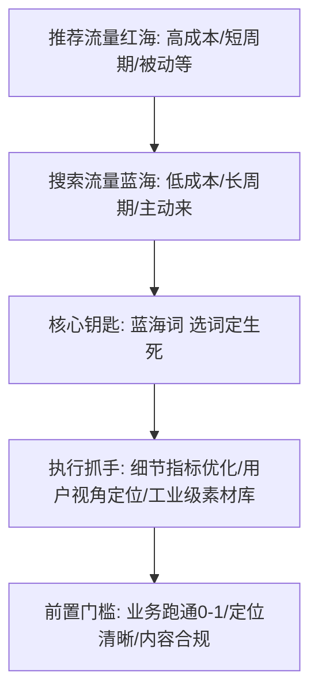

# 第 12 章 抖音搜索蓝海 —— 从“蹭推荐”到“做搜索”的降维打击
作者：龙哥

## 学习目标

- 理解抖音搜索流量（SEO）相对于推荐流量的蓝海属性与核心优势
- 掌握基于1500万词库的“蓝海词”筛选标准与避坑指南（拒绝大词、拒绝自嗨长尾词）
- 掌握“细节指标优化法”：对存量视频微调十几项底层指标实现低成本、极速引流
- 掌握“用户视角内容定位法”：从专家思维转向小白搜索习惯，用数据洞察痛点做差异化
- 了解“工业级素材库”自动化采集体系的搭建逻辑与二创边界
- 明确抖音SEO的前置条件：业务已跑通0-1、定位清晰，否则流量来了也接不住

## 12.1 生活类比

想象一下，你要在抖音这座巨大的城市里做生意。**推荐算法就像在“路人擦肩而过”的十字路口发传单**：你拼命设计诱人的标题、蹭热门BGM、追逐热点，祈祷算法这位“交警”能多把几个路人推到你摊位前。可路人没准备买东西，甚至连看都不看就划走了，转化率极低，还得天天守在路口“赶大集”，累得半死流量却留不住。

**抖音SEO则像在“用户主动找店”的商业街开一家专卖店**。顾客走进这条街，手里攥着明确的购物清单——他们在搜索框输入“留学文书避坑指南”、“真皮沙发怎么辨别真假”、“热玛吉痛不痛维持多久”，意图极其明确：“我要买/学/解决某事”。此时，**蓝海词**就是这条街上“没人开、但天天有顾客主动找”的稀缺招牌：大家都在抢“留学”、“西装”这种泛词大招牌（大词），却无人挂出“留学文书模板下载”、“全麻衬工艺怎么选”这种精准招牌（蓝海词），你只要挂对招牌，顾客就会顺着关键词直奔而来。

**细节指标**就是店铺的“门头招牌、橱窗布置、导购话术、收银二维码”十几项硬件细节。素材揭示抖音SEO底层原理包含十几项指标，缺一项就少一拨客。留学老板仅花5分钟补齐旧视频的标题关键词、话题标签、评论区引导等几项高杠杆指标，沉睡一个月的视频瞬间激活，新增3万+搜索量、150条精准客资。

**用户视角定位**要求店主不自说自话“我料子多好、工艺多牛”（专家视角），而是挂顾客爱搜、听得懂的牌子“防皱、不透、好打理”、“多少钱、痛不痛、维持多久”（用户视角）。实体店老板原用专业术语和低价引流，转为用搜索数据分析用户真实痛点后，摆脱价格战，精准吸引高客单价客户，老板感叹：“以前凭直觉，现在靠数据，视野开阔多了。”

**工业级素材库**相当于雇了“全城情报员”每天送情报：隔壁哪家爆款、顾客在评论区抱怨什么、想买什么买不到。只需设定关键词，系统自动采集全网昨日爆款内容、选题、高赞评论，解决“选题难、找素材难、不知痛点”三大瓶颈。APP开发者正是通过评论洞察发现冷门小需求，专门做内容，月省10万买量费、多赚10万，竞对看不懂也抄不走。

**业务跑通0-1**是开店前的必修课：你得先有“能交易的商品”和“成熟的收银流程”，否则顾客进店也买不了、留不住。素材反复强调：“很多老板的痛点，不是缺流量，而是流量来了也接不住，核心原因是业务定位不清晰。”SEO只负责“把对的人找来”，不负责“把产品卖好”。

就像开店：选对招牌（选词）、把细节做透（指标）、卖客户真想买的（定位）、情报系统跟上（素材库），生意自然好做。

## 12.2 概念地图

抖音搜索蓝海（第12章）
├── 核心认知：为什么要做抖音SEO
│   ├── 蓝海定理：99%达人不懂搜索 → 供给不足 → 流量大/竞争小/持久  —— P001
│   ├── 选词定生死：蓝海词是90%成功率的钥匙  —— P002
│   └── 前置条件：业务须跑通0-1，定位清晰才能接住流量  —— P001
├── 方法论体系：怎么做
│   ├── 选词策略
│   │   ├── 基于1500万词库筛选蓝海词（月覆盖人数+指数涨势）  —— P002
│   │   ├── 用户视角vs专家视角：用小白搜索词替代行业黑话  —— P005
│   │   └── 避坑：拒绝大泛词、拒绝无搜索量专业长尾词  —— P002
│   ├── 内容优化策略
│   │   ├── 细节指标优化法：十几项底层指标微调，旧视频翻红（最快<8小时）  —— P003
│   │   ├── 用户痛点导向定位：搜索数据→痛点分析→人群区分→差异化内容  —— P005
│   │   └── 小需求挖掘：冷门细分需求低成本获流、难被抄袭  —— P001
│   └── 生产基建策略
│       └── 工业级素材库：设定关键词→自动全网采集爆款+高赞评论→每日更新  —— P004
└── 实战验证与边界
    ├── 留学老板案例：5分钟优化→3万+搜索量/150条精准客资  —— P001
    ├── 实体店案例：低价引流转数据化定位→精准高客单获客  —— P005
    ├── APP案例：挖掘小需求→月省10万买量费+多赚10万  —— P001
    └── 边界条件：内容合规/账号基础权重/选词正确/持续迭代词库  —— P001,P002,P003

## 12.3 抖音搜索蓝海 —— 为什么99%的达人都在捡芝麻，而你可以捡西瓜

### 为什么需要这个概念？

你可能正经历这样的困境：每天熬夜剪视频，蹭热点、跟BGM、写文案，好不容易爆一条，流量却像潮水一样退得干干净净，留不住人、转化不了单，还得明天继续“赶大集”般搏推荐流量。推荐流量（刷视频）的本质是**平台分发**，你是被动等待被推荐，竞争者是全平台所有创作者，获客成本高、留存难、生命周期短。

但有一片被99%达人忽视的“自留地”：**搜索流量（用户主动找）**。用户在搜索框输入关键词，意图极其明确——“我要买/学/解决某事”，转化率天然碾压推荐流。素材数据显示，截至2021年底抖音月搜索量已达5.5亿，庞大的需求端却因“99%的抖音达人并不懂搜索逻辑”，导致优质内容供给极度不足，**流量大、竞争小、持久**的蓝海就此形成。

> "蓝海之所以是蓝海，是因为流量大，竞争小。而之所以竞争小，是因为99%的抖音达人并不懂搜索逻辑，更别谈运用搜索逻辑，能获得长久流量的，更多是靠运气蹭上的。搜索出来的作品，远没有推荐的作品优质，搜索存在大量的机会。"
> 
> ——《抖音SEO陪跑计划线下课复盘》

### 核心定义

**抖音SEO**（来源：《抖音SEO陪跑计划线下课复盘》）
> 在抖音平台内，针对用户搜索行为进行内容与关键词优化，使作品被有明确需求的用户精准搜索到的过程。

**蓝海词**（来源：《抖音SEO陪跑计划线下课复盘》）
> 指搜索流量大但竞争小、容易被排上名的关键词。约70%的细分领域词汇属于蓝海词，是SEO成败的核心钥匙。

> "做抖音SEO最重要的是选词，找到蓝海词，才能保证90%的成功率，词选的好，靠运气也能获得搜索流量。"
> 
> ——《抖音SEO陪跑计划线下课复盘》

这个定论直指要害：**选词定生死**。词选对，成功率90%；词选错，全军覆没。

### 关键性质：为什么说它是“降维打击”？

搜索流量之所以构成对推荐流量的降维打击，源于其四大核心性质的组合拳：

1.  **精准性**：用户主动搜索，意图明确，转化率远高于推荐流。素材中留学老板优化后获得的150条客资，成交概率极高，因为用户搜索“留学文书避坑”时，已经处于强决策意图阶段。
2.  **持久性**：优化得当的视频，“一年不更新视频，依旧每月流量稳定”（长尾效应）。这与推荐流“爆完即死”、生命周期以小时计形成鲜明对比。一条视频只要排名稳住，就是持续产出流量的“自动取款机”。
3.  **低成本**：仅需更新3-10条视频，无需日更，边际成本极低。素材明确列出“成本低：只需要更新3~10条视频，无需日更”，这对中小商家、个人IP极其友好。
4.  **门槛性（关键前置条件）**：**SEO只负责“把对的人找来”，不负责“把产品卖好”**。素材反复强调：“想要最大发挥抖音SEO的效用，首先是你已经跑通了从0-1。很多老板的痛点，不是缺流量，而是流量来了，也接不住，转化率低，核心原因是，自身业务定位不清晰。”没有标准化交付流程、跑通的成交闭环、覆盖获客成本的客单价，搜来的精准流量只会变成“无效咨询”，浪费账号权重。

### 典型例子：5分钟换来3万+精准搜索量

素材记录了一个极具说服力的现场案例，完美印证了“细节指标优化法”对存量资产的激活威力：

> "我早上对已经发布的内容，按照老师的方法做了调整，一个月前的视频突然多了3w+的搜索量，评论区多了几十条客资。虽然只花了5分钟的时间，对已经发布的视频进行SEO的优化，但是截止到昨天，这位老板已经新增了11万播放，2000个点赞，150条潜在客资"
> 
> ——《抖音SEO陪跑计划线下课复盘》

这个留学业务老板，只是对**已发布一个月的旧视频**做了5分钟的细节微调，就激活了沉睡的流量资产。这印证了素材中的另一条核心主张：**“蹭到搜索流量，一年不更新视频，依旧每月流量稳定”**。

另一个APP开发者案例展示了“小需求挖掘”的威力：挖掘竞品忽视的冷门细分需求专门做内容，**月省10万买量费、多赚10万**，且因竞对“看不明白”而难以被抄袭。

### 边界条件：不踩这些坑，才算入门

- **选词两大误区**：① 只挑大词（如“留学”、“西装”），太泛轮不到你；② 只挑无搜索量的专业长尾词（如“全麻衬工艺参数”、“PS个人陈述STAR法则”），自嗨无流量，均等于白做。
- **业务未跑通**：定位不清=转化低，流量来了也接不住。
- **工具与规则依赖**：依赖第三方词库工具（如极客抖音SEO）及平台算法，规则变动需同步调整策略。
- **内容合规底线**：视频本身不能违规/低俗/硬广，否则优化指标也会被限流。



## 12.4 选词定生死 —— 从“拍脑袋猜词”到“用数据库淘金”

### 为什么需要这个概念？

大多数人选词凭直觉：要么蹭大热门（竞争太大排不上），要么写专业黑话（用户根本不搜），导致内容无人问津。素材直言：**“目前99%的抖音博主都是不懂抖音SEO逻辑的，所以大家即使选词，也容易出现两种情况：1.只挑大词……2.挑了没有流量的长尾词……”** 选词是SEO的“灵魂”，词选对成功率90%，词选错全军覆没。

### 核心定义与筛选标准

**蓝海词筛选三维标准**（来源：《抖音SEO陪跑计划线下课复盘》）

以下表格呈现了蓝海词筛选的三个核心维度、具体标准及判断依据工具，是选词实操的“体检单”：

| 维度 | 标准 | 判断依据/工具 |
| :--- | :--- | :--- |
| **有搜索量** | 月覆盖人数达标 | 1500万词库工具（极客抖音SEO）查月覆盖人数 |
| **低竞争度** | 99%达人不懂/未布局 | 词库中70%为蓝海词；搜索结果页内容质量低 |
| **强相关性** | 匹配业务定位/购买意图 | 结合业务定位人工筛选；指数涨势判断趋势 |

> "我们1500万个搜索词中，70%是蓝海词，绝大多数一个领域，都可以找到属于自己的蓝海方向。我给大家举一个世界杯的例子，可以快速找到大量与世界杯相关的蓝海词，以及与之对应的月覆盖人数，以及每日关键词的指数的涨势情况"
> 
> ——《抖音SEO陪跑计划线下课复盘》

### 关键性质：避坑指南与视角转换

**两大选词“死亡陷阱”**是新手选词翻车的根本原因，必须死磕规避：

1.  **大而泛的行业词**（如“留学”、“定制西装”）：用户搜这个词意图模糊，且头部大号霸榜，新号无机会。素材警示：“只放行业词……用户压根不会这么搜，即使这么搜，这么大的词，压根也轮不到你。”
2.  **“自嗨式专业词”**（如“全麻衬工艺参数”、“PS个人陈述STAR法则”）：**“有的老板会从自己专业角度出发，写一些专业的词，但是假如面向的是小白用户，大家根本不懂，也不会搜这个词，那这种词就没有意义，因为无法让用户搜索到你。”** 这是典型的“专家诅咒”——用行业黑话自娱自乐，用户根本搜不到。

**核心策略：站在用户搜索习惯视角（小白视角），而非自身专家视角选词。**
> "学会用数据分析的方法，从用户的角度看问题，视野真的开阔多了。你对客户的定位越清晰，你靠内容吸引的客户就越精准。"
> 
> ——《抖音SEO陪跑计划线下课复盘》

**结构化挖掘路径**将选词从“拍脑袋”变为“按图索骥”：
1.  确定**蓝海方向**（垂直细分赛道，如“真皮”、“科技材料”、“留学文书避坑”）；
2.  延展具体**长尾蓝海词**（如“真皮沙发怎么辨别真假”、“留学文书模板下载”）；
3.  结合**指数涨势**捕捉趋势红利（如世界杯期间相关词汇指数飙升）。

### 典型例子：实体店老板的“视野打开”

素材中一位高端女性实体店老板，原本用专业术语/低价引流，转为用搜索数据分析痛点后反馈：“**以前只会凭直觉，现在靠数据支撑，更清晰了。学会用数据分析的方法，从用户的角度看问题，视野真的开阔多了。**” 从“猜用户想要什么”到“看用户在搜什么”，是认知维度的跃迁。

### 边界条件

- 词库覆盖依赖第三方工具更新，新兴热点可能滞后。
- 蓝海词随时间会变红海（竞争者入场），需持续挖掘新词、迭代内容库。
- 选词仅为“门票”，内容质量、账号权重、指标细节优化决定能否“上岸”。

## 12.5 细节指标优化法 —— 旧内容也能“整容”翻红的5分钟魔法

### 为什么需要这个概念？

你的账号里躺着多少播放量平平的旧视频？它们是沉没成本，还是待激活的资产？素材揭示：**抖音SEO底层原理包含十几项指标**，新号新内容做全套慢，**旧内容微调指标见效极快（最快<8小时）**。这解决了“不会拍新视频/没预算拍新视频”但想获流量的现实痛点。

### 核心定义

**细节指标优化法**（来源：《抖音SEO陪跑计划线下课复盘》）
> 基于底层原理十几项指标（标题、标签、文案布局、评论区引导、话题挂载等），对已发布视频进行微调完善，触发搜索推荐机制。核心动作：补齐缺失的SEO指标项，而非重拍视频。

> "抖音SEO底层原理包含十几项指标，我们在实操的时候，就是要把各项指标都完善好。关键词的一环就是做好抖音细节。"
> 
> ——《抖音SEO陪跑计划线下课复盘》

### 关键性质：低成本、极速、叠加

1.  **低成本**：不拍摄、不剪辑、不投流，仅改后台设置/文案/评论区。
2.  **极速反馈**：历史最快记录18小时出结果，**线下课现场突破记录，<8小时出搜索流量**。
3.  **叠加效应**：单条视频优化叠加，形成账号级搜索流量矩阵。

> "在我们历史的培训中，学员最快的记录是凌晨开始做，当天晚上出结果，用时18个小时。然而这次线下课直接突破了记录，结果当场就有老板出结果了！只用了不到8个小时的时间，流量直接起飞。"
> 
> ——《抖音SEO陪跑计划线下课复盘》

### 实战演进：从存量审计到流量激活的闭环流程

以下流程图展示了细节指标优化法的标准化执行闭环，从存量视频审计出发，经指标对标、高杠杆定位、微调执行、流量验证，最终沉淀为团队可执行的SOP：

```mermaid
flowchart TD
    A[存量视频审计: 导出近3-6月播放平平但题材垂直的视频清单] --> B[十几项指标对标: 逐条核对标题/话题/文案/封面/评论区/主页等指标缺失项]
    B --> C[高杠杆指标定位: 识别对搜索排名影响最大的2-3项指标(标题关键词前置/垂直话题挂载/评论区置顶引导)]
    C --> D[微调执行: 5-10分钟/条完成关键词植入/话题替换/评论钩子设置]
    D --> E[流量激活验证: 监控8-24小时搜索量/播放量/客资量变化 对比优化前基线]
    E --> F{是否达标?}
    F -- 否 --> B
    F -- 是 --> G[SOP沉淀: 形成'选词→指标清单→优化动作→验收标准'团队执行手册]
    G --> H[规模化复制: 批量处理存量库 建立月度复盘机制]
```

### 实战复盘：留学老板的5分钟操作

虽然素材未穷举“十几项指标”清单，但结合常规SEO要素与案例反推，**高杠杆指标**极大概率包含：
1.  **标题重写**：前置嵌入蓝海词 + 核心痛点；
2.  **话题/标签替换**：卸载泛娱乐大话题，挂载精准垂直话题；
3.  **文案/简介布局**：自然植入长尾关键词 + 引导搜索/评论钩子；
4.  **评论区运营**：置顶评论引导关键词回复，自有回复中植入长尾词；
5.  **主页垂直度强化**：简介、合集、置顶视频强化账号标签。

> "当场出效果的老板，也就是在原有的内容基础上优化了细节，就立马产生巨大的效果。"
> 
> ——《抖音SEO陪跑计划线下课复盘》

### 边界条件：优化生效的三个“前提”

1.  **内容底线**：视频本身不能违规/低俗/硬广，否则优化指标也会被限流。
2.  **账号基础权重**：纯新号（零粉零权）需先养号/发优质内容积累初始权重。
3.  **选词正确 + 业务承接**：指标优化是“放大器”，前提是选词正确（蓝海词）且业务能承接转化。

## 12.6 工业级素材库 —— 让“选题难、找素材难”成为历史

### 为什么需要这个概念？

内容生产三大瓶颈：天天愁选题、找素材慢、不知用户真实痛点。人工采集全网爆款不可持续，且易错过评论区隐性需求。我们需要一套**“设定关键词→自动全网采集爆款+评论→每日更新”**的自动化流水线。

### 核心定义

**工业级素材库/爆款素材库**（来源：《抖音SEO陪跑计划线下课复盘》）
> 全自动收集全网爆款素材与评论的工业化内容生产系统：只需设定关键词，即可每日自动采集昨日全网爆款内容、选题、高赞评论。

> "只需设定几个关键词关键词，就能够自动收集全网的爆款内容，每日自动收集全网昨天的爆款内容，大大节省人力了。不仅仅能够自动收集选题，也会自动收集选题下的评论，方便深度洞察高点赞数的评论背后的隐形需求"
> 
> ——《抖音SEO陪跑计划线下课复盘》

### 关键性质：双重价值

1.  **解决“写什么”**：每日自动生成选题库，支持“模仿→优化→创新”标准化生产。
2.  **挖掘“隐性需求”**：**高赞评论往往藏着用户最真实的隐性需求**，是选品/选题金矿。素材中APP开发者即通过评论洞察发现冷门小需求，**月省10万买量费、多赚10万**，且竞对看不懂无法抄袭。

### 典型例子：课程配套工具落地

素材提到课程配套该工具：学员设定关键词后，自动获得每日爆款素材库，直接拿来二创，大幅降低内容生产门槛。配合**陪跑式教学**（理论+现场实操6任务+专属SOP），对抗“课后忘80%”的遗忘曲线，落地团队执行。

> "学完课程后可以拿到了一份专属的Sop，方便老板们在上完线下课之后，可以给到团队去执行。"
> 
> ——《抖音SEO陪跑计划线下课复盘》

### 二创红线与边界条件

- **直接搬运必违规被判重**，核心操作规范：**“借逻辑/结构、换皮肤/人设、植入自有蓝海词”**。
- 工具依赖平台反爬策略、API稳定性，需技术维护或付费订阅可靠服务商。
- 爆款素材具有时效性，需结合自身业务定位筛选，不可盲目跟风热点破坏账号垂直标签。

## 12.7 用户视角内容定位法 —— 别用专家思维，要用小白搜索词

### 为什么需要这个概念？

**专家视角=诅咒**。老板用行业黑话选词、做内容，用户听不懂、不搜、不买单。素材指出：**“流量来了接不住、转化低，根因是‘业务定位不清晰’+‘内容不匹配用户搜索意图’”**。必须从“用户怎么搜、搜什么、痛点什么”反推内容策略。

### 核心定义与公式推导

**用户视角内容定位法**（来源：《抖音SEO陪跑计划线下课复盘》）
> 以用户搜索需求数据（搜索量、搜词习惯、痛点词）为锚点，反向确定账号人设、内容方向、选题规划、转化路径。

**核心公式**：
$$ \text{用户搜索行为数据} \xrightarrow{\text{痛点分析}} \text{痛点图谱} \xrightarrow{\text{人群区分}} \text{细分人群画像} \xrightarrow{\text{差异化内容}} \text{精准获客} $$

> "我们帮助她从用户的搜索量来分析用户痛点，区分用户群体，确定接下来的运营策略。你对自己的客户定位越清晰，你靠内容吸引的客户就越精准。"
> 
> ——《抖音SEO陪跑计划线下课复盘》

**公式推导逻辑逐层拆解**：

1.  **搜索行为数据 → 痛点分析（如何量化）**：
    利用词库工具导出目标领域高频搜索词（含下拉词、相关搜索、长尾词），按“疑问型（怎么/为什么/多少钱）”、“痛点型（避坑/后悔/失败）”、“需求型（推荐/对比/教程）”三类标签分类，统计月覆盖人数与指数涨势。高频疑问词=显性痛点，高赞评论抱怨=隐性痛点。量化指标：搜索量Top20词覆盖率、痛点词频次、指数环比增速。

2.  **痛点图谱 → 人群区分（聚类依据）**：
    将提取的痛点词与用户画像标签（地域、性别、年龄、消费力、决策阶段）交叉分析。例如“留学文书模板”搜索者多为准备期学生（预算低、需标准化），而“留学文书润色避坑”搜索者多为申请期高客单用户（预算高、需定制服务）。聚类依据：搜索词语义意图聚类 + 用户画像标签聚类，产出3-5个细分人群包。

3.  **人群画像 → 差异化内容（映射规则）**：
    针对每个细分人群包，按“认知层级（小白/进阶/专家）”、“决策阶段（种草/拔草/成交）”、“内容形态（干货/案例/工具/避坑）”三维度映射内容策略。例如：针对“准备期小白”产出《留学文书从0到1自写全流程模板》（工具型）；针对“申请期高客单”产出《3个真实拒信案例教你避过90%文书坑》（案例避坑型）。映射规则：人群标签 × 决策阶段 × 内容形态 = 选题方向。

### 关键性质：三步走差异化

1.  **去专业化**：用大白话覆盖小白高频搜索词，而非学术术语。
    > "有的老板会从自己专业角度出发，写一些专业的词，但是假如面向的是小白用户，大家根本不懂，也不会搜这个词，那这种词就没有意义。"
2.  **差异化**：避开同质化低价竞争，用内容精准筛选高价值人群。
    > "我们结合她的人群定位，建议她与别人做出差异化，做好客户的痛点分析，从用户痛点入手来做内容，避免传统的低价竞争。"
3.  **数据驱动**：用数据说话替代拍脑袋，视野更开阔、决策更确定。

### 典型例子：高端实体店的“起死回生”

高端女性实体店：原走低价引流→转化差；改用搜索数据分析用户真实痛点、做差异化内容→吸引精准高客单客户。老板反馈：“**以前凭直觉，现在靠数据，清晰多了**”。

留学业务：按用户搜索习惯布局长尾词（如“留学文书怎么写/避坑/模板”），而非机构内部术语，精准截获高意向咨询。

### 边界条件

- 需具备基础数据分析能力或工具支持（词库工具、下拉词采集）。
- 仅适用于“用户有主动搜索习惯”的赛道（知识付费、本地服务、高客单产品），纯娱乐/冲动消费型赛道搜索权重低。
- 定位一旦确立，内容需长期垂直深耕，频繁跳赛道会破坏账号标签权重。

## 12.8 多源对照：搜索流量 vs 推荐流量的本质差异

本章核心素材单一（P001），但结合大纲中其他章节（如第9章短视频带货、第10章爆款内容生产线）的推荐流量打法，可形成如下对照。以下表格呈现两大流量体系在七大维度的共识与分歧，帮助你根据业务特性选择主战场或组合拳策略：

### 共识
- 内容是流量载体，垂直度是账号权重基础。
- 爆款逻辑可复制：拆解结构、借逻辑、换皮肤。

### 分歧

以下表格对比了推荐流量体系（第9/10章）与搜索流量体系（第12章）在核心运营维度上的本质差异，阅读重点在于识别“主动/被动”、“长/短”、“宽/窄”三对核心张力：

| 维度 | 推荐流量打法 (第9/10章) | 搜索流量打法 (第12章/P001) |
| :--- | :--- | :--- |
| **流量来源** | 平台算法分发（被动） | 用户主动检索（主动） |
| **核心指标** | 完播率、互动率、停留时长 | 关键词覆盖、搜索排名、点击率 |
| **内容生命周期** | 短（小时/天级，爆完即死） | 长（月/年级，长尾效应强） |
| **选词/选题逻辑** | 蹭热点、跟趋势、广撒网 | 挖蓝海词、匹配搜索意图、精准布局 |
| **生产节奏** | 高频（日更/多更）、重运营 | 低频（3-10条起步）、重优化、轻更新 |
| **适合赛道** | 泛娱乐、低客单、冲动消费 | 知识付费、高客单、本地服务、强决策周期 |
| **抗风险能力** | 弱（算法变动/限流即死） | 强（自带流量池，平台难抹杀搜索需求） |

**深度洞见**：推荐流量是“狩猎”，搜索流量是“种田”。狩猎看运气、拼体力、周期短；种田看选种（选词）、拼细节（指标）、周期长、复利强。成熟玩家会“狩猎补给、种田主业”：用推荐流测款、涨粉、建人设，用搜索流精准获客、成交、长尾复利。

## 12.9 设计中的取舍

**为什么不建议纯新号、零业务直接上手做SEO？**
因为SEO是“放大器”，不是“制造机”。素材反复警示：“很多老板的痛点，不是缺流量，而是流量来了，也接不住，转化率低，核心原因是，自身业务定位不清晰。” 如果没有标准化交付流程、跑通的成交闭环、覆盖获客成本的客单价，搜来的精准流量只会变成“无效咨询”，浪费账号权重，甚至因转化率过低被平台判定为低质内容而限流。

**Trade-off 深度分析：纯新号做SEO的边际成本 vs 风险收益曲线**
- **边际成本看似极低**（不拍摄、不投流、只改指标），但**机会成本极高**：账号冷启动期权重极低，同等优化动作在权重号上可能<8小时出流量，在新号上可能需30天甚至永远不出。前期投入的时间成本、团队协同成本、试错沉没成本，远超直接先跑通业务再接入SEO的总成本。
- **风险收益不对称**：新号无业务承接能力，搜来的高意向用户咨询无人回复/回复不专业/交付不标准，直接导致差评、投诉、账号权重受损，甚至被打标“低质商家”，后续想做SEO都难。收益端为0，风险端为账号废弃。

**为什么拒绝“大词”和“专业长尾词”？**
大词是“独木桥”，专业长尾词是“死胡同”。蓝海词是“康庄大道”——有流量、低竞争、强意图。

**Trade-off 深度分析：大词曝光量虚荣指标与精准转化率的机会成本量化对比**
- **大词（如“西装”）**：月搜索量50万，点击率1%，竞争极大排第50名，实际曝光约0，获客0，ROI=0。虚荣指标“搜索量大”带来的心理安慰，掩盖了“零转化”现实。
- **蓝海词（如“定制西装全麻衬怎么选”）**：月搜索量5000，点击率15%，优化后排Top3，实际曝光750，点击112，咨询30，成交5，客单价8000，GMV 4万，ROI极高。
- **机会成本**：每天盯着大词数据发呆、蹭热点的8小时，若用来挖10个蓝海词、优化20条存量视频、搭建1套素材库，产出的长尾流量资产将持续产出现金流。大词是“彩票”，蓝海词是“年金保险”。

## 12.10 动手练习

### 练习1：蓝海词筛选实战演练
假设你经营‘高端定制西装’业务，使用模拟的抖音SEO词库工具（或回忆素材中的世界杯案例逻辑）：
1. 列出 3 个属于‘大泛词’（如‘西装’、‘定制西装’），解释为何不适合新号直接切入
2. 列出 3 个属于‘专家自嗨长尾词’（如‘全麻衬工艺参数’、‘羊毛超细旦支数标准’），解释为何用户不搜
3. 尝试挖掘 5 个符合‘蓝海词’特征的关键词（需兼顾：有搜索量、低竞争、强购买意图），并标注判断依据（如月覆盖人数、指数涨势、用户痛点）
回答问题：
- 为什么素材强调‘一个领域70%是蓝海词’，但大多数人仍选词失败？
- 如何用‘用户搜索习惯’反推出你的内容选题方向？

### 练习2：存量视频细节指标自检清单
拿出你账号中播放量平平但题材垂直的 3 条旧视频，对照抖音SEO底层原理的‘十几项指标’逐项自检：
1. 标题：是否嵌入蓝海词？是否前置核心痛点？
2. 话题/标签：是否挂载精准垂直话题而非泛娱乐大话题？
3. 文案/简介：是否自然布局长尾关键词？是否有引导搜索/评论的钩子？
4. 封面/字幕：关键词是否可视化呈现？
5. 评论区：是否有置顶评论引导关键词回复？是否回复中植入长尾词？
6. 发布时间/频次：是否符合账号活跃度权重要求？
7. 账号主页：简介、合集、置顶视频是否强化垂直标签？
回答问题：
- 素材中老板仅花 5 分钟优化旧视频即获 3 万+ 搜索量，最可能调整了哪 2-3 项‘高杠杆指标’？
- 为什么‘内容本身不违规/低俗’是指标优化生效的前提？

### 练习3：从‘专家视角’到‘用户视角’的定位翻译
素材指出：实体店老板原用专业术语/低价引流，转为用搜索数据分析痛点后大幅起量。请完成一次‘视角翻译’：
1. 选定一个你熟悉的垂直领域（如：医美抗衰、留学文书、工业设备、宠物训练）
2. 写出 3 个‘专家视角’的选题/关键词（如‘热玛吉热凝区原理’、‘PS个人陈述STAR法则’、‘PLC梯形图编程规范’、‘正向强化条件反射原理’）
3. 利用‘下拉词/搜索词库/评论区高赞’模拟挖掘，将其翻译为 3 个‘用户视角’的搜索词/选题（如‘热玛吉多少钱/痛不痛/维持多久’、‘留学文书怎么写/模板/避坑’、‘PLC自学入门/常见报错/项目实战’、‘狗乱叫/咬人/不听话怎么办’）
4. 对比两组词在‘搜索量、竞争度、转化意图’三维度的差异
回答问题：
- 为什么‘你对客户定位越清晰，吸引的客户越精准’？定位模糊时，内容会陷入什么误区？
- 如何建立‘设定关键词→自动采集爆款+评论→洞察隐性需求→产出内容’的最小闭环？

### 练习4：工业级素材库搭建与二创边界界定
素材提到‘只需设定关键词，自动收集全网爆款内容与高赞评论’。请设计一个最小可行性方案（MVP）：
1. 工具选型：列举 2-3 种可实现‘关键词监控+全网爆款采集+评论导出’的低成本方案（如RPA/影刀、第三方SaaS/新榜/蝉妈妈API、自建爬虫），对比优劣
2. 流程设计：从‘设定关键词’到‘获得每日选题清单+痛点洞察报告’的标准化 SOP 步骤
3. 二创红线：明确‘直接搬运必违规’的判定标准，制定‘借逻辑/结构、换皮肤/人设、植入自有蓝海词’的二创操作规范
回答问题：
- 素材说‘高赞评论藏着隐性需求’，如何从几百条评论中快速提炼出‘可做内容/产品的痛点’？
- 爆款素材具有时效性，如何平衡‘跟风热点’与‘垂直深耕账号标签’的矛盾？

### 练习5：业务跑通度自测与SEO介入时机判断
素材反复强调：‘想要最大发挥抖音SEO效用，首先是你已经跑通了从0-1’。请对你当前或计划的项目做一次‘跑通度体检’：
1. 产品/服务：是否有标准化交付流程？（是/否/半标准化）
2. 转化路径：私域/表单/电话/到店，是否跑通过完整成交闭环？（单次成交转化率___%）
3. 客单价/LTV：是否覆盖获客成本？（客单价___，预估获客成本___）
4. 定位清晰度：能否用一句话讲清‘给谁、解决什么问题、凭什么信你’？（是/否）
5. 内容产能：是否能持续产出 3-10 条垂直优质视频？（是/否）
回答问题：
- 若第 1-4 项有任一‘否’，此时强行做SEO会发生什么？（结合素材‘流量来了接不住’案例）
- 如何制定‘先跑通业务，再接入SEO’的分阶段行动计划？

## 12.11 本章小结

这一章中我们深入探讨了抖音搜索SEO这片被99%达人忽视的蓝海。首先，我们认清了**搜索流量相对于推荐流量的蓝海本质**——流量大、竞争小、持久、精准、低成本，核心原因是供给侧严重不足。其次，我们掌握了**选词定生死的核心方法论**：基于1500万词库筛选蓝海词，避开大泛词与自嗨长尾词两大坑，坚持用户视角而非专家视角。接着，我们学习了**细节指标优化法**——对存量视频微调十几项底层指标，以极低成本（5分钟）、极快速度（<8小时）激活沉睡流量资产。然后，我们了解了**工业级素材库**的自动化搭建逻辑，解决选题难、挖掘评论区隐性需求。最后，我们明确了**用户视角内容定位法**与**业务跑通0-1**这两个成败前置条件：定位不清流量来了也接不住，专家视角内容用户搜不到也看不懂。

本章我们一起学习了以下概念：

以下表格汇总了本章九大核心概念及其要义，可作为复盘检索的速查卡：

| 概念 | 解释 |
|------|------|
| 抖音SEO/搜索蓝海 | 针对用户主动搜索行为优化内容，因99%达人不懂逻辑形成流量大、竞争小、持久的蓝海 |
| 蓝海词 | 搜索量大、竞争小、强相关的关键词；选词是SEO成败核心，词选对成功率90% |
| 选词避坑：大词与自嗨长尾词 | 大词太泛轮不到你；专业黑话长尾词用户不搜，均等于白做 |
| 用户视角选词/定位 | 站在小白搜索习惯而非专家视角，用数据洞察痛点、区分人群，做差异化内容 |
| 细节指标优化法 | 基于底层十几项指标对存量视频微调，低成本、极速（最快<8小时）触发搜索流量 |
| 工业级素材库 | 设定关键词自动全网采集昨日爆款内容、选题、高赞评论，解决选题难、挖掘隐性需求 |
| 小需求/冷门细分需求 | 竞品忽视的微小需求，专门做内容可低成本稳获流、难被抄袭、利润高 |
| 业务跑通0-1前置条件 | SEO只负责把对的人找来，不负责把产品卖好；定位不清=转化低，流量来了也接不住 |
| 陪跑式教学/SOP交付 | 理论+现场实操6任务+专属SOP，对抗遗忘率，落地团队执行 |

下一章中，我们将学习 **第 13 章：商业认知的底层逻辑 —— 从“赚钱思维”看懂商业世界**，从具体的流量获取技术上升到商业认知的底层框架，帮助你建立对赚钱、交易、增长、战略等核心概念的系统性理解。

